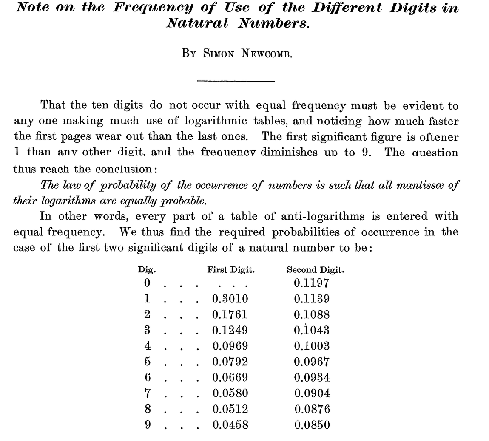
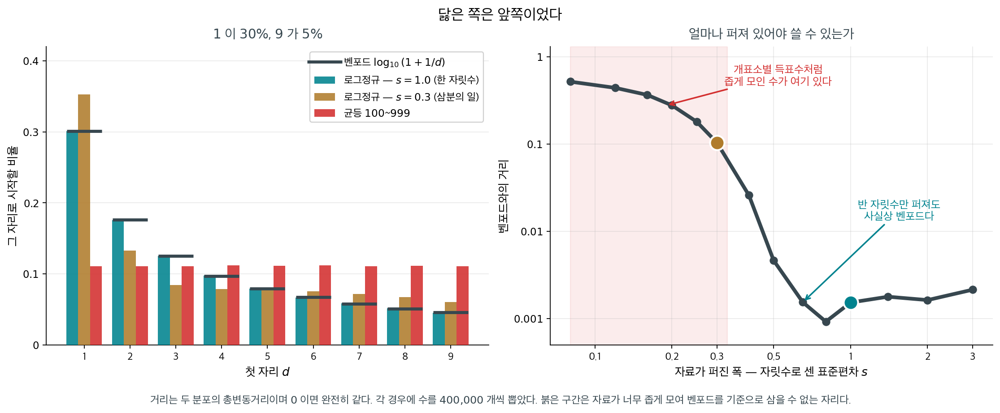
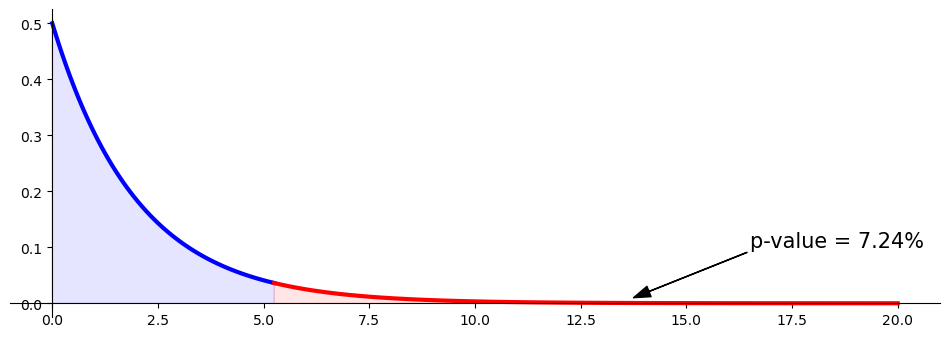
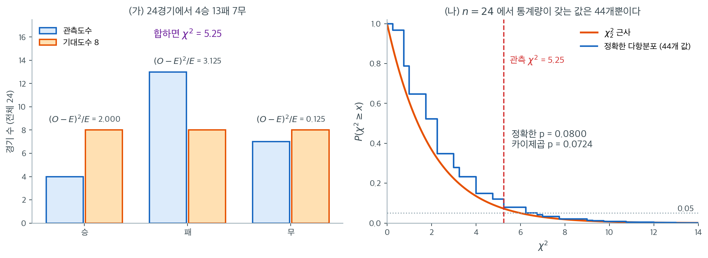
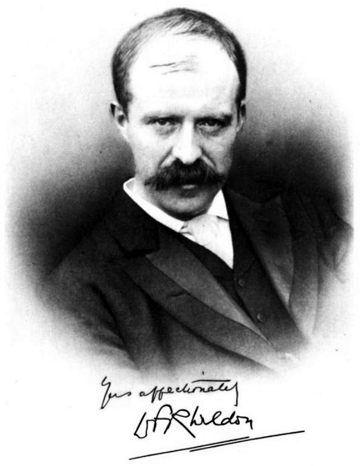
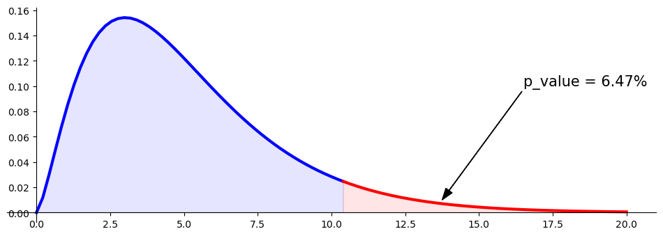
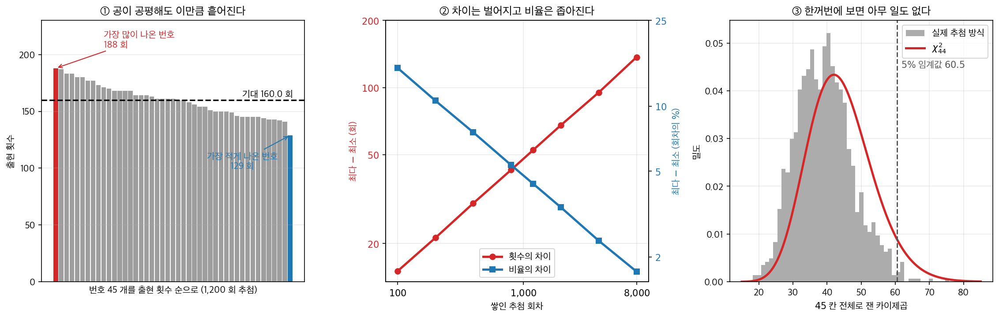

# 적합도 검정

## 개요

**적합도 검정**은 관측된 도수분포가 기대되는 분포와 얼마나 잘 맞는지를 평가하는 통계 절차로, 보통 이산형이나 범주형 자료에 쓴다. 이 검정은 여러 범주에 걸친 사건의 관측도수가 특정 이론 모형이나 가설이 예측하는 기대도수와 부합하는지를 살핀다. 관측도수와 기대도수를 비교하여 유의한 차이가 있는지 판정하며, 차이가 있다면 관측된 자료가 기대되는 패턴에 맞지 않음을 시사한다.

가장 널리 쓰이는 적합도 검정은 **카이제곱 적합도 검정**으로, 특히 범주형 자료에 효과적이다. 이 검정은 범주별 관측도수와 기대도수의 차이를 계산하고, 이를 이용해 관측된 변동이 기대 분포로부터의 이탈이라기보다 우연 때문일 가능성을 평가한다.

---

## 1. 예시 상황

어떤 회사가 세 연령대(18–25세, 26–40세, 41세 이상)에 걸쳐 시장 점유율이 고르게 분포하여 고객의 3분의 1씩이 각 연령대에 속한다고 주장한다고 하자. 이 주장을 확인하기 위해 연구자가 고객 300명을 무작위로 조사하여 연령대를 기록한다. 적합도 검정으로 이 연령대별 고객 분포가 회사가 주장한 분포와 유의하게 다른지, 아니면 실제 고객 연령 분포가 회사가 말한 비율에 잘 맞는지를 판정할 수 있다.

---

## 2. 가설

- **귀무가설 ($H_0$)**: 관측된 자료가 기대되는 분포를 따른다.
- **대립가설 ($H_A$)**: 관측된 자료가 기대되는 분포를 따르지 않는다.

---

## 3. 도수표

적합도 검정에서는 다음을 보여주는 **도수표**를 쓴다:

1. **범주 또는 집단**: 하나의 변수에 대한 여러 범주(예: 연령대, 제품 선호 등).
2. **관측도수**: 표본자료에서 각 범주에 실제로 관측된 도수.
3. **기대도수**: 가설의 분포에 근거하여 각 범주에서 기대되는 도수(보통 범주별 비율이나 백분율로 주어진다).

예를 들어 고객이 세 연령대(18–25세, 26–40세, 41세 이상)에 고르게 분포한다는 회사의 주장에 자료가 맞는지 검정한다면 도수표는 다음과 같을 수 있다:

| 연령대 | 관측도수 | 기대도수 |
|-----------|--------------------|--------------------|
| 18–25     | 90                 | 100                |
| 26–40     | 120                | 100                |
| 41+       | 90                 | 100                |

적합도 검정은 관측도수를 기대도수와 비교하여 유의한 차이가 있는지, 즉 주장된 분포로부터의 이탈 가능성이 있는지를 본다.

---

## 4. 기대도수

**기대도수**는 귀무가설이 참일 때 각 범주에서 기대되는 이론적 도수이다.

### 균등분포

모든 범주에 도수가 고르게 분포한다고 기대하면 각 범주의 기대도수는 단순히

$$
E_i = \frac{\text{Total Sample Size}}{\text{Number of Categories}}
$$

이며, 여기서 $E_i$는 각 범주의 기대도수이다.

예를 들어 고객 300명이 세 연령대에 고르게 분포한다면 각 연령대의 기대도수는

$$
E_i = \frac{300}{3} = 100
$$

이다.

### 비례분포

기대되는 분포가 균등하지 않고 특정 비율을 따르는 경우도 많다. 이때 각 범주의 기대도수는

$$
E_i = p_i \times \text{Total Sample Size}
$$

로 계산하며, $p_i$는 범주 $i$의 기대 비율이다.

예를 들어 회사가 고객의 40%는 18–25세, 30%는 26–40세, 30%는 41세 이상이라고 믿는다면, 고객 300명 표본의 기대도수는 다음과 같다:

- 18–25세: $E = 0.4 \times 300 = 120$
- 26–40세: $E = 0.3 \times 300 = 90$
- 41세 이상: $E = 0.3 \times 300 = 90$

<div class="storybox" markdown>

**그림으로 보는 통계학 1.** 로그표의 앞쪽이 먼저 닳았다

<figure markdown>
  { width=680 }
  <figcaption markdown>뉴컴 「자연수에 쓰이는 숫자들의 빈도에 관한 노트」, 『아메리칸 저널 오브 매스매틱스』 제 $4$ 권($1881$) $39$–$40$ 쪽. 위는 $39$ 쪽의 표제와 첫 문단, 아래는 $40$ 쪽의 결론과 표이며 가운데는 건너뛰고 이어 붙였다. *(JSTOR Early Journal Content, 공개 자료)*</figcaption>
</figure>

위의 $p_i$ 가 균등하지 않은 비례분포 가운데 가장 유명한 것이 「첫 자리 숫자」의 분포다. 상용로그에서 **가수**는 앞자리 숫자만을 기억하고 **지표**는 자릿수만을 기억한다. 그러면 「어떤 수의 첫 자리 숫자가 무엇인가」라는 물음은 통째로 **가수의 물음**이 된다. 이것을 처음 적은 사람은 책상 위의 로그표를 보고 알아챘다.

사진의 첫 문단을 옮기면 이렇다.

> 열 개의 숫자가 똑같은 빈도로 나타나지 않는다는 것은 로그표를 많이 써 본 사람이면 누구에게나 뻔할 것이다 — **앞쪽 몇 장이 뒤쪽보다 얼마나 빨리 닳는지** 보면 된다. 첫 자리 숫자는 $1$ 인 경우가 다른 어느 숫자보다 잦고, $9$ 로 갈수록 드물어진다.

공책에 적힌 수가 아니라 **책장이 닳은 자국**이 자료였던 셈이다. 그가 내린 결론은 사진 가운데의 기울임꼴 한 줄이다 — 수가 나타나는 확률 법칙은 그 로그의 **가수가 모두 똑같이 나타날 법하도록** 되어 있다는 것.

여기서부터는 셈이 한다. 가수가 $0$ 이상 $1$ 미만에 고르게 퍼져 있다면, 첫 자리 숫자가 $d$ 라는 것은 가수가 $\log d$ 이상 $\log (d+1)$ 미만이라는 것과 같다. 그 구간의 길이가 그대로 확률이므로, 첫 자리가 $d$ 일 확률 $p_d$ 는

$$
p_d=\log (d+1)-\log d=\log\left(1+\frac1d\right)
$$

이다. 사진 표의 「First Digit」 칸이 바로 이 값이다. $d=1$ 이면 $\log 2=0.3010$ 이고 $d=9$ 면 $\log\dfrac{10}{9}=0.0458$ 이니, $1$ 로 시작하는 수가 $9$ 로 시작하는 수보다 여섯 배 이상 잦다. 「Second Digit」 칸도 같은 생각을 한 칸 밀어

$$
\sum_{k=1}^{9}\log\left(1+\frac{1}{10k+d}\right)
$$

으로 나온다. 두 칸 모두 식대로 더하면 정확히 $1$ 이 된다(사진의 표는 소수 넷째 자리에서 반올림한 값이라, 둘째 자리 열 줄을 그대로 더하면 $1.0001$ 이 나온다).

논문을 닫는 문장이 오늘까지 이어졌다 — 이 법칙이 있으면 서로 독립인 수치 결과를 크게 모아 놓은 자료가 자연수에서 온 것인지 로그에서 온 것인지 가려낼 수 있다는 것이 흥미롭다고 그는 적었다. 회계 장부나 집계표가 손을 탔는지 살필 때 첫 자리 분포를 이 값과 견주어 보는 일이 그 생각의 자손이고, **견주는 방법이 바로 이 쪽의 적합도 검정이다** — 아홉 칸의 $E_i=p_i n$ 을 위의 $p_d$ 로 잡고 관측도수와 함께 다음 절의 식에 넣으면 된다.

그 뒤의 일이 이름을 바꾸어 놓았다. $1938$ 년에 제너럴 일렉트릭의
물리학자 프랭크 벤포드가 같은 것을 다시 찾아냈고, 이번에는 스무 가지 출처에서 이만 개가 넘는
수를 모아 맞춰 보았다 — 강의 유역 면적, 인구, 물리상수, 신문에 실린 수, 사망률, 집 주소.
지금 이 법칙은 벤포드의 이름으로 불린다.

뉴컴이 적어 둔 그 쓸모가 실제로 쓰이기까지는 오래 걸렸다. 사람이 수를 지어내면 첫 자리를
고르게 쓰는 버릇이 있다는 것이 알려지면서 $1990$ 년대부터 회계 감사와 세무 조사가
장부의 첫 자리를 이 비율과 맞대어 보기 시작했다.

그런데 조건이 있다.

<figure markdown>
{ width="900" }
  <figcaption markdown>거리는 총변동거리이며 $0$ 이면 완전히 같다. 붉은 구간은 자료가 너무 좁게 모여 벤포드를 기준으로 삼을 수 없는 자리다.</figcaption>
</figure>

벤포드가 맞으려면 자료가 **여러 자릿수에 걸쳐** 퍼져 있어야 한다. 로그정규를 써서 퍼진 폭
$s$ (자릿수로 센 표준편차)를 바꿔 가며 재면 경계가 또렷하다. $s = 1$ 이면 벤포드와의 거리가
$0.0015$ 로 사실상 똑같고, $s = 0.5$ 여도 $0.005$ 다. **반 자릿수만 퍼져도 맞는다.**
그런데 $s = 0.3$ 이면 $0.103$ 으로 눈에 띄게 어긋나고, $s = 0.2$ 면 $0.277$ 이다.
$100$ 에서 $999$ 사이의 균등분포는 첫 자리가 모두 $0.111$ 로 평평해 거리가 $0.270$ 이다.

이것이 실무에서 문제를 일으킨다. $s = 0.3$ 짜리 **멀쩡한** 자료 $1{,}000$ 개로 위와 같은
적합도검정을 하면 $\chi^2 = 50.2$, $\text{df} = 8$, $p = 3.7 \times 10^{-8}$ 이다.
보란 듯이 기각된다. 꾸며낸 것이 하나도 없는데 그렇다. 개표소별 득표수, 한 회사 직원들의
월급, 비슷한 크기의 거래가 모인 장부 — 모두 좁게 모여 있어 이 자리에 놓인다.

그러니 이 쪽의 기억할 점에 한 줄을 더 보태야 한다. 기대도수 $E_i \geq 5$ 를 확인하는 것만으로는
모자란다. **기대비율이 이 자료에 적용되는 것이 맞는지**를 먼저 확인해야 한다. 적합도검정은
자료가 기대비율과 다르다는 것까지만 말해 주고, 그것이 **자료의 잘못인지 기대비율의 잘못인지**는
말해 주지 않는다.

_확인한 곳 — 논문은 [Internet Archive 에 올라온 JSTOR Early Journal Content 사본](https://archive.org/details/jstor-2369148) — 사이먼 뉴컴, 「자연수에 쓰이는 숫자들의 빈도에 관한 노트」, 『아메리칸 저널 오브 매스매틱스』 제 $4$ 권($1881$) $39$–$40$ 쪽. 표제와 첫 문단(「앞쪽이 뒤쪽보다 얼마나 빨리 닳는지」), 기울임꼴 결론, 두 칸짜리 표, 그리고 「자연수에서 온 것인지 로그에서 온 것인지 가려낼 수 있다」는 마지막 문단은 모두 **사진과 같은 스캔에서 직접 읽었다** · **표의 수는 직접 맞추어 보았다** — $\log(1+1/d)$ 로 첫 자리 아홉 줄이, $\sum_{k=1}^{9}\log(1+1/(10k+d))$ 로 둘째 자리 열 줄이 소수 넷째 자리까지 논문과 모두 같았고 두 칸의 합이 각각 $1.000000$ 이었다 · JSTOR 은 이 모음을 「누구에게나 열린 초기 저널 자료」로 공개하며 비영리 목적의 재배포를 권한다고 같은 파일 첫 쪽에 적어 두었다 · 벤포드가 $1938$ 년에 서로 다른 출처 **$20$ 가지에서 $20{,}229$ 개**의 수를 모아 같은 법칙을 보인 것과 그 출처에 강의 유역·인구·물리상수·잡지에 실린 수·주소가 들어 있다는 것 · 퍼진 폭에 따른 거리와 $\chi^2$ 값은 모두 직접 모의실험한 값이다_

</div>

---

## 5. 검정통계량

카이제곱 적합도 검정의 검정통계량은 다음 공식으로 계산한다:

$$
\chi^2 = \sum_{i=1}^k \frac{(O_i - E_i)^2}{E_i}
$$

여기서

- $O_i$ = 범주 $i$의 관측도수
- $E_i$ = 범주 $i$의 기대도수

이다.

---

## 6. 자유도

카이제곱 적합도 검정의 자유도($\text{df}$)는

$$
\text{df} = k - 1
$$

로 계산하며, $k$는 범주의 개수이다.

---

## 7. 기각역

$$
\begin{array}{lll}
\text{귀무} & \text{관측된 자료가 기대되는 분포를 따른다} \\
& \text{관측도수가 기대도수에 가깝다} \\
& O_{i} \approx E_{i} \quad \Rightarrow \quad \text{통계량} \approx 0 \\
\\
\text{대립} & \text{관측된 자료가 기대되는 분포를 따르지 않는다} \\
& \text{관측도수가 기대도수와 꽤 다르다} \\
& O_{i} \not\approx E_{i} \quad \Rightarrow \quad \text{통계량} \approx \text{큰 양수}
\end{array}
$$

---

## 8. 임계값과 p-값

- **임계값**: 자유도와 선택한 유의수준(예: 0.05)에 근거하여 카이제곱분포표에서 얻는다.
- **p-값**: 검정통계량과 자유도를 써서 카이제곱분포로부터 계산한다. 귀무가설 아래에서 계산된 값만큼 또는 그보다 극단적인 검정통계량을 관측할 확률을 나타낸다.

---

## 9. 판정 규칙

- 검정통계량이 임계값을 넘거나 p-값이 유의수준보다 작으면 귀무가설을 기각한다. 관측도수가 기대도수와 유의하게 다르다는 뜻이다.
- 검정통계량이 임계값을 넘지 않거나 p-값이 유의수준보다 크면 귀무가설을 기각하지 못한다. 관측된 자료가 기대 분포에 잘 맞는다는 뜻이다.

---

## 10. 가정과 한계

### 가정

1. **무작위 표집**: 표본이 대표성을 갖도록 관측값을 모집단에서 무작위로 추출해야 한다.
2. **기대도수 문턱**: 각 범주의 기대도수가 적어도 5 이상인 것이 이상적이다. 기대도수가 너무 낮으면 카이제곱 근사가 정확하지 않을 수 있다.
3. **상호배타적 범주**: 범주는 서로 배타적이어야 한다. 즉 각 관측값은 오직 한 범주에만 속해야 한다.
4. **관측의 독립성**: 각 관측값은 다른 관측값과 독립이어야 한다. 다시 말해 어떤 관측값이 한 범주에 들어간다고 해서 다른 관측값에 영향을 주어서는 안 된다.

### 한계

1. **작은 표본에 민감**: 카이제곱 적합도 검정은 대표본 근사에 의존한다. 일부 범주의 기대도수가 낮으면 검정이 타당하지 않을 수 있다. 표본이 작거나 기대도수가 낮은 경우에는 **정확검정** 같은 대안이 낫다.
2. **범주의 개수**: (특히 기대도수가 낮은 상태에서) 범주가 너무 많으면 카이제곱 근사의 정확도가 떨어져 결과를 믿기 어려울 수 있다.
3. **일차원 분석**: 적합도 검정은 하나의 변수를 가설의 분포와 비교하도록 설계되었다. 카이제곱 독립성 검정처럼 둘 이상의 변수 사이 관계를 평가하지는 못한다.
4. **근사의 한계**: 카이제곱 검정통계량은 근사이므로 기대도수가 매우 치우쳐 있거나 정규성에서 멀 때에는 정확도가 떨어질 수 있다.

이 가정들이 충족되면 적합도 검정은 타당하고 유용한 통찰을 준다. 그러나 가정이 어긋나면 결과를 신중하게 해석해야 하며 다른 방법이 더 적절할 수 있다.

---

> **출처**: [Khan Academy — Goodness of Fit Example](https://www.khanacademy.org/math/ap-statistics/chi-square-tests/chi-square-goodness-fit/v/goodness-of-fit-example)

<div class="exbox" markdown>

**보기 1.** <span class="diff easy" title="쉬움"></span> 가위바위보. Kenny는 가위바위보를 자주 하는데 이기고 비기고 지는 빈도가 서로 같으리라 기대한다. 그런데 자신의 경기가 이 기대 패턴을 따르지 않는다는 의심이 들기 시작했다. 24판을 무작위로 뽑아 결과를 기록했다.

|                 | 승 | 패 | 무 |
|:---------------:|:---:|:----:|:---:|
| 판 수 | 4   | 13   | 7   |

**(1)** 균등분포 아래의 기대도수를 구하고 $\chi^2$ 을 **유리수로** 구하시오. 기대도수가 모두 같을 때 쓸 수 있는 간편한 꼴도 함께 적으시오.

**(2)** 자유도와 p-값을 구해 $\alpha = 0.05$ 에서 판정하시오. 자유도 2 에서는 p-값이 **닫힌 꼴**로 적힌다.

**(3)** 정의대로 계산하는 코드와 `scipy.stats.chisquare` 가 같은 값을 주는지 확인하시오.

</div>

??? success "풀이"

    **가설.** $H_0$ 은 세 결과(승·패·무)가 똑같이 그럴듯하다는 것, $H_1$ 은 그렇지 않다는 것이다.

    **(1) 기대도수와 통계량.** 전체 $n = 24$ 판이 세 결과에 고르게 나뉜다면 각 결과의 기대도수는 $E_i = n/k = 24/3 = 8$ 이다.

    $$
    \begin{array}{c|ccc|c}
     & \text{승} & \text{패} & \text{무} & \text{합} \\ \hline
    \text{관측 } O_i & 4 & 13 & 7 & 24 \\
    \text{기대 } E_i & 8 & 8 & 8 & 24 \\
    (O_i-E_i)^2/E_i & 16/8 = 2 & 25/8 = 3.125 & 1/8 = 0.125 & 21/4
    \end{array}
    $$

    $$
    \chi^2 = \frac{(4-8)^2}{8} + \frac{(13-8)^2}{8} + \frac{(7-8)^2}{8}
    = \frac{16+25+1}{8} = \frac{42}{8} = \frac{21}{4} = 5.25
    $$

    분모가 모두 같으므로 **분자를 먼저 다 더하고 한 번만 나누면 된다.** 이것을 식으로 정리해 두면 손계산이 훨씬 가볍다. $E_i = n/k$ 일 때

    $$
    \chi^2 = \frac{k}{n}\sum_{i=1}^k \left(O_i - \frac nk\right)^{\!2}
    = \frac kn \left(\sum_i O_i^2 - \frac{2n}{k}\sum_i O_i + k\cdot\frac{n^2}{k^2}\right)
    = \frac kn \sum_{i=1}^k O_i^2 - n
    $$

    이다($\sum_i O_i = n$ 을 썼다). 확인해 보면 $\sum O_i^2 = 16 + 169 + 49 = 234$ 이므로

    $$
    \chi^2 = \frac{3}{24}\times 234 - 24 = 29.25 - 24 = 5.25
    $$

    로 같다. **관측도수의 제곱합만 있으면 된다.**

    **(2) 자유도와 p-값.** 범주가 셋이고 도수의 합이 24 로 묶여 있으므로 $\text{df} = k - 1 = 2$ 다.

    자유도 2 는 특별하다. $\chi^2_2$ 의 밀도가 $\tfrac12 e^{-x/2}$, 곧 평균 2 인 지수분포라서 꼬리확률이 바로 적분된다.

    $$
    p = P(\chi^2_2 \ge 5.25) = \int_{5.25}^\infty \tfrac12 e^{-x/2}\,dx = e^{-5.25/2} = e^{-21/8} = 0.0724398
    $$

    $p = 0.0724 > 0.05$ 이므로 귀무가설을 **기각하지 못한다.** 세 결과의 분포가 균등분포에서 유의하게 벗어난다는 증거는 없다. 다만 $0.0724$ 는 $0.05$ 에서 멀지 않다. 24 판은 너무 적다. 같은 비율로 72 판을 모았다면 $\chi^2$ 이 세 배인 $15.75$ 가 되어 $p = e^{-7.875} = 0.00038$ 이 된다.

    **(3) 수치적으로.** 먼저 정의대로 계산한다.

    ```python
    import matplotlib.pyplot as plt
    import numpy as np
    import scipy.stats as stats

    # 관측도수와, 고르게 나온다고 볼 때의 기대도수
    observed_counts = np.array([4, 13, 7])
    expected_counts = np.ones(3) * observed_counts.mean()
    degrees_of_freedom = observed_counts.shape[0] - 1

    # 검정통계량과 p-값 계산
    chi_square_statistic = np.sum((observed_counts - expected_counts) ** 2 / expected_counts)
    p_value = stats.chi2(degrees_of_freedom).sf(chi_square_statistic)

    # 결과 출력
    print(f"Chi-square Statistic = {chi_square_statistic:.4f}")
    print(f"p-value = {p_value:.4f}\n")

    # 그림 준비
    fig, ax = plt.subplots(figsize=(12, 4))

    # 통계량까지의 왼쪽 구간
    x_left = np.linspace(0, chi_square_statistic, 100)
    y_left = stats.chi2(degrees_of_freedom).pdf(x_left)
    ax.plot(x_left, y_left, color='b', linewidth=3)

    # 왼쪽을 칠한다. 기각하지 않는 쪽이다.
    x_fill_left = np.concatenate([[0], x_left, [chi_square_statistic], [0]])
    y_fill_left = np.concatenate([[0], y_left, [0], [0]])
    ax.fill(x_fill_left, y_fill_left, color='b', alpha=0.1)

    # 통계량 오른쪽 꼬리
    x_right = np.linspace(chi_square_statistic, 20, 100)
    y_right = stats.chi2(degrees_of_freedom).pdf(x_right)
    ax.plot(x_right, y_right, color='r', linewidth=3)

    # 오른쪽을 칠한다. 이 넓이가 곧 p-값이다.
    x_fill_right = np.concatenate([[chi_square_statistic], x_right, [20], [chi_square_statistic]])
    y_fill_right = np.concatenate([[0], y_right, [0], [0]])
    ax.fill(x_fill_right, y_fill_right, color='r', alpha=0.1)

    # 화살표로 p-값을 가리킨다
    annotation_xy = ((12.5 + 15.0) / 2, 0.01)
    annotation_xytext = (16.5, 0.10)
    arrow_properties = dict(color='k', width=0.2, headwidth=8)
    ax.annotate(f'p-value = {p_value:.02%}', annotation_xy, xytext=annotation_xytext,
                fontsize=15, arrowprops=arrow_properties)

    # 축과 테두리를 다듬는다
    ax.spines['right'].set_visible(False)
    ax.spines['top'].set_visible(False)
    ax.spines['bottom'].set_position("zero")
    ax.spines['left'].set_position("zero")

    plt.show()
    ```

    출력:

    ```
    Chi-square Statistic = 5.2500
    p-value = 0.0724
    ```

    

    **이제 `scipy` 로 같은 일을 한다.**

    ```python
    from scipy import stats

    # 결과별 관측도수: 승, 패, 무
    observed_frequencies = [4, 13, 7]

    # 세 결과가 고르게 나온다고 볼 때의 기대도수
    total_games = sum(observed_frequencies)
    expected_frequencies = [total_games / 3] * 3

    # 카이제곱 적합도 검정
    chi_square_statistic, p_value = stats.chisquare(f_obs=observed_frequencies, f_exp=expected_frequencies)

    # 결과 출력
    print(f"{chi_square_statistic = }")
    print(f"{p_value = }")
    ```

    출력:

    ```
    chi_square_statistic = 5.25
    p_value = 0.07243975703425146
    ```

    `chisquare` 가 돌려준 `5.25` 와 `0.07243975703425146` 이 (1)·(2)의 손계산 $21/4$ 와 $e^{-21/8}$ 과 **표시된 모든 자리까지 같다.** 자유도 2 에서는 p-값에 특수함수가 전혀 쓰이지 않으므로 지수함수 한 번으로 끝난다는 것을 수치가 확인해 준다.

    본문이 적은 $p \approx 0.0725$ 는 $0.0724398$ 을 소수 넷째 자리에서 올린 것이다. 셋째 자리까지는 $0.072$ 로 같다.

---
### 5.25 는 얼마나 큰 값인가



왼쪽 (가)가 자료다. 승 $4$, 패 $13$, 무 $7$ 이고 $H_0$ 아래 기대도수는 셋 다 $8$ 이다.
칸별 기여도를 보면 패가 $3.125$ 로 가장 크고, 승이 $2.000$, 무가 $0.125$ 다. 더하면
$5.25$ 다. **한 칸이 통계량의 $60\%$ 를 들고 있다** — 통계량 하나만 보면 보이지 않는
것이고, 절 $11$ 의 보기 $2$ 가 이것을 칸마다 따로 검정하면 왜 안 되는지로 이어 간다.

오른쪽 (나)가 「$5.25$ 가 큰가」에 답한다. $n = 24$, 균등한 $H_0$ 아래에서 가능한 분할을
전부 열거하면 통계량이 가질 수 있는 값은 **$44$ 개뿐**이고, 파란 계단이 그 정확한
꼬리확률이다. 관측 $5.25$ 에서의 정확한 값은 $0.0800$ 이어서, $\chi^2_2$ 곡선이 준
$0.0724$ 보다 $10\%$ 크다. 매끄러운 곡선은 **성근 계단을 매끈하게 덮어쓴 근사**다.

기대도수가 $8$ 이라 「모두 $5$ 이상」이라는 경험 법칙은 만족한다. 근사의 품질을 다른 방식으로
재 보면, $\chi^2_2$ 의 $5\%$ 임계값 $5.9915$ 를 기각 경계로 썼을 때 진짜 제 $1$ 종
오류율은 $0.0499$ 로 명목값과 거의 같다. 꼬리확률 하나는 $10\%$ 어긋나는데 오류율은
맞는다는 것이 이상해 보이지만, 임계값 둘레에서 계단이 오르내린 것이 상쇄된 결과다.

그 임계값 $5.9915$ 는 관측값 $5.25$ 에서 $0.74$ 밖에 떨어져 있지 않다. 위 그림의
$\chi^2_2$ 밀도에는 그 선이 그려져 있지 않으므로 **그림만 보고 기각 여부를 판정할 수는
없다.** 꼬리의 넓이가 눈으로는 $0.05$ 인지 $0.07$ 인지 가려지지 않는다.

한 가지만 덧붙이자. 같은 비율이 세 배 규모의 $72$ 경기에서 나왔다면 통계량도 세 배인
$15.75$ 가 되어 $p = 0.0004$ 가 된다. 기각하지 못한 것은 $4$ 대 $13$ 이라는 치우침이
작아서가 아니라 **$24$ 경기가 적어서다.** 통계량은 치우침의 모양과 표본크기를 곱한 양이다.

---


## 11. 문제 B: 조작된 주사위?

<div class="probox" markdown>

**문제 1.** <span class="diff easy" title="쉬움"></span>

주사위가 하나 있다. 조작되었는지 검정하려고 60번 굴렸더니 다음 결과를 얻었다. 이 주사위가 조작되었는지 판정하라.

</div>

??? success "풀이"
    $$
    \begin{array}{crr}
     & \text{관측} & \text{기대} \\
    \text{눈} & \text{도수} & \text{도수} \\ \hline
    1 & 5 & 10 \\
    2 & 7 & 10 \\
    3 & 17 & 10 \\
    4 & 14 & 10 \\
    5 & 8 & 10 \\
    6 & 9 & 10 \\ \hline
    \text{합} & 60 & 60
    \end{array}
    $$

<div class="storybox" markdown>

**그림으로 보는 통계학 2.** 「공정하다」를 이만 육천 번 던져 재어 본 사람

<figure markdown>
  { width=300 }
  <figcaption markdown>월터 프랭크 래피얼 웰던($1860$–$1906$) — 피어슨이 쓴 추도문에 실린 사진판으로, 『Biometrika』 제$5$ 권($1906$) 첫머리에 붙어 있다. 아래에 「Yours affectionately, W. F. R. Weldon」 이라는 서명이 함께 인쇄되어 있다. *(Wikimedia Commons, PD-US)*</figcaption>
</figure>

위 문제의 $H_0$ 는 「여섯 눈이 **모두 같은 확률**로 나온다」이고, 그래서 기대도수가 모두
$10$ 이다. 그 가정은 증명되는 것이 아니라 **물건이 가진 성질**이고, 그것을 실제 주사위로
재어 본 사람이 사진의 웰던이다. 그는 수학자가 아니라 동물학자였다.

$1894$ 년, 그는 조수와 함께 주사위 열두 개를 한꺼번에 던져 **$5$ 또는 $6$ 이 나온 개수**를
적는 일을 $26\,306$ 번 되풀이했다. 주사위가 공정하다면 한 개가 $5$ 나 $6$ 을 보일 확률이
$\dfrac13$ 이므로, 한 번 던질 때 그 개수의 기댓값은

$$
E[X]=12\times\frac13=4
$$

이다. 그런데 기록을 다 더하면 $5$ 와 $6$ 은 $106\,602$ 번 나왔고 던져진 주사위는
$26\,306\times12=315\,672$ 개였다. 비율은 $\dfrac{106\,602}{315\,672}=0.3377$ 이고 한 번당
평균은 $4.0524$ 다. 기댓값보다 $0.05$ 가 크다.

눈금 하나하나로 보면 어긋남이 또렷하다. $5$ 나 $6$ 이 다섯 개 나온 횟수는 이론상 $5018$ 인데
$5194$ 였고, 여섯 개는 $2927$ 인데 $3067$ 이었다. 웰던 자신은 이 정도면 받아들일 만하다고
보았지만, 자료를 받아 본 피어슨은 아니라고 보았다. 그러면 **열세 칸의 어긋남을 한꺼번에
재는 수**가 있어야 하는데 그때는 그런 것이 없었고, $1900$ 년에 피어슨이 내놓은 적합도
검정이 바로 그 자리를 메운 것이다. 위 §5 의 $\chi^2=\sum (O_i-E_i)^2/E_i$ 가 그 수이고,
아래 보기 2 가 「한 칸만 따로 보면 왜 안 되는가」를 말하는 것도 그 때문이다.

어긋남의 까닭으로 널리 드는 것은 주사위를 만드는 방식이다. 눈을 파내어 새기면 여섯 눈이
있는 면이 한 눈이 있는 면보다 그만큼 가벼워지고, 무거운 쪽이 아래로 가기 쉬우므로 $6$ 이
위로 오는 일이 아주 조금 잦아진다. 그러니 위 문제가 「조작되었는가」를 묻는 것은 말장난이
아니다. 기댓값 $3.5$ 도 $4$ 도 **그 가정이 참일 때에만** 참이고, 참인지는
수학이 아니라 던져 보는 일이 알려 준다.

_확인한 곳 — $1894$ 년에 주사위 열두 개를 $26\,306$ 번 던졌다는 것, 그 자료가 피어슨의
카이제곱 논문에 쓰였다는 것, 생몰($1860$-$03$-$15$ ~ $1906$-$04$-$13$)은
[Wikipedia 「Raphael Weldon」](https://en.wikipedia.org/wiki/Raphael_Weldon) · $5$ 또는 $6$ 이
나온 개수의 관찰도수($185$, $1149$, $3265$, $5475$, $6114$, $5194$, $3067$, $1331$, $403$,
$105$, $14$, $4$, $0$)와 공정할 때의 이론도수는 스티글러의 통계학 강의록
[「Chapter 7. Chi Squared Tests」](https://www.stat.uchicago.edu/~stigler/Stat244/ch7.pdf)
표 $7.1$ 에서 읽었다 · 거기서 **총 $106\,602$ 개, 비율 $0.3377$, 한 번당 평균 $4.0524$ 는
직접 계산해 보았다** · 눈을 파낸 쪽이 가벼워 $6$ 이 조금 잦아진다는 설명은
[Wikipedia 「Dice」](https://en.wikipedia.org/wiki/Dice) · 초상은
[Commons 파일 쪽](https://commons.wikimedia.org/wiki/File:Weldon_Walter_F_R.jpg)
(『Biometrika』 제$5$ 권, $1906$, 저자 미상, PD-US)_

</div>

### 범주별로 따로 검정하면 안 되는 이유

눈 3이 60번 중 17번 나온 것을 보고 일표본 비율 z-검정을 시도할 수도 있다:

<div class="exbox" markdown>

**보기 2.** <span class="diff easy" title="쉬움"></span> 범주별로 따로 검정하면 안 되는 이유. 주사위를 60번 굴려 $(5, 7, 17, 14, 8, 9)$ 를 얻었다. 눈 3 이 17 번이나 나온 것이 눈에 띄므로 **그 눈 하나만** 놓고 일표본 비율 z-검정을 해 본다.

**(1)** $H_0: p = 1/6$ 에 대한 z 통계량과 양측 p-값을 구하시오. 통계량은 무리수로 깔끔하게 적힌다.

**(2)** 주사위가 공정할 때 **여섯 눈 중 적어도 하나**가 $\alpha = 0.05$ 에서 유의해질 확률은 얼마인가. 여섯 검정이 독립이라고 보면 얼마가 되고, 실제로는 왜 그 값과 다른가.

**(3)** 그러므로 (1)의 p-값을 어떻게 읽어야 하는가.

</div>

??? success "풀이"

    **(1) z 통계량.** $p_0 = 1/6$, $\hat p = 17/60$, $n = 60$ 이다. 귀무가설 아래의 표준오차는

    $$
    \operatorname{SE} = \sqrt{\frac{p_0(1-p_0)}{n}} = \sqrt{\frac{(1/6)(5/6)}{60}} = \sqrt{\frac{5}{2160}} = \sqrt{\frac{1}{432}} = \frac{1}{12\sqrt3}
    $$

    이고 $\hat p - p_0 = 17/60 - 10/60 = 7/60$ 이므로

    $$
    z = \frac{7/60}{1/(12\sqrt3)} = \frac{7 \cdot 12\sqrt3}{60} = \frac{7\sqrt3}{5} = 2.4248711
    $$

    이다. 양측 p-값은 $2\bigl(1 - \Phi(2.4248711)\bigr) = 0.0153138$, 곧 $1.53\%$ 다. 이것만 보면 "유의하다" 고 말하고 싶어진다.

    **(2) 여섯 번 보면 한 번은 걸린다.** 눈 $i$ 의 도수 $O_i$ 는 주변적으로 $\text{Bin}(60, 1/6)$ 이고 표준편차가 $\sqrt{60 \cdot \tfrac16 \cdot \tfrac56} = \sqrt{25/3} = 2.8868$ 이다. $\lvert z_i \rvert > 1.96$ 은

    $$
    \lvert O_i - 10 \rvert > 1.96 \times 2.8868 = 5.6579
    $$

    곧 $O_i \le 4$ 또는 $O_i \ge 16$ 을 뜻한다. 이항분포로 그 확률을 세면

    $$
    P(O_i \le 4) + P(O_i \ge 16) = 0.0540
    $$

    이다. 명목 유의수준 $0.05$ 보다 이미 조금 크다. 도수가 정수라 임계선이 칸 사이에 떨어지지 않기 때문이다.

    이제 여섯 눈에 모두 같은 검정을 한다고 보고 **적어도 하나가 유의할 확률**을 센다. 여섯이 서로 독립이라면

    $$
    1 - (1-q)^6 = 1 - (1 - 0.0540)^6 = 0.2835,
    \qquad q = 0.0540
    $$

    이고, 본페로니 상한은 $6q = 0.3242$ 다. 그런데 여섯 도수는 독립이 아니다. 합이 60 으로 묶여 있어 **음의 상관**을 가진다. 다항분포에서 $p_i = p_j = p$ 일 때

    $$
    \operatorname{corr}(O_i, O_j) = -\frac{p}{1-p} = -\frac{1/6}{5/6} = -0.2
    $$

    다. 한 눈이 많이 나오면 다른 눈은 적게 나와야 하는데, **양쪽검정에서는 "적게 나오는 것" 도 유의하다.** 그래서 "눈 $i$ 가 유의" 와 "눈 $j$ 가 유의" 는 서로 **함께 일어나기 쉬운** 사건이 되고, 합집합의 확률은 독립일 때보다 **작아진다.** 아래 모의가 $0.2726$ 을 주어 $0.2835$ 보다 작다.

    **(3) 읽는 법.** $1.53\%$ 는 "눈 3 을 **미리** 정해 두고 검정했다면" 의 p-값이다. 그러나 눈 3 은 자료를 보고 고른 것이다. 가장 많이 나온 눈을 고르는 행위가 이미 여섯 번의 검정을 한 것과 같으므로, 실제 제1종 오류율은 $5\%$ 가 아니라 $27\%$ 다. 러시안 룰렛과 같아서 계속하다 보면 공정한 주사위에서도 조만간 작은 p-값을 만난다. **한 범주만 보는 검정으로 주사위가 조작되었다고 결론지을 수 없고, 모든 범주를 동시에 재는 검정이 필요하다.** 그것이 보기 3 의 적합도 검정통계량이다.

    **(1)을 코드로 확인한다.**

    ```python
    import numpy as np
    import scipy.stats as stats

    def main():
        p_0 = 1/6
        p_hat = 17 / 60
        n = 60

        # 눈 3 하나만 놓고 보는 일표본 비율 z-검정
        statistic = (p_hat - p_0) / np.sqrt(p_0 * (1 - p_0) / n)
        p_value = stats.norm().sf(abs(statistic)) * 2

        print(f"{statistic = :.02f}")
        print(f"{p_value   = :.02%}")

    if __name__ == "__main__":
        main()
    ```

    출력:

    ```
    statistic = 2.42
    p_value   = 1.53%
    ```

    출력의 `2.42` 와 `1.53%` 가 (1)의 $7\sqrt3/5 = 2.4248711$ 과 $0.0153138$ 과 맞는다.

    (2)를 모의로 확인한다. 공정한 주사위를 60번 굴리는 일을 20만 번 되풀이하면서, 여섯 눈 중 하나라도 $\lvert z_i \rvert > 1.96$ 이 되는 비율을 센다.

    ```python
    import numpy as np
    from scipy import stats

    rng = np.random.default_rng(0)
    M = 200_000
    n, k, p = 60, 6, 1 / 6
    z_crit = stats.norm.ppf(0.975)

    # 공정한 주사위를 60번 굴리는 일을 20만 번 되풀이한다.
    X = rng.multinomial(n, [p] * k, size=M)
    Z = np.abs(X - n * p) / np.sqrt(n * p * (1 - p))
    any_sig = (Z > z_crit).any(axis=1).mean()

    # 눈 하나만 보았을 때 유의해질 확률 q — 주변적으로는 이항분포다.
    b = stats.binom(n, p)
    q = b.cdf(4) + b.sf(15)

    print(f"임계값  |O_i - 10| > {z_crit * np.sqrt(n * p * (1 - p)):.4f}"
          f"   곧 O_i <= 4 또는 O_i >= 16")
    print(f"눈 하나가 유의할 확률  q          {q:.4f}")
    print(f"여섯이 독립이라면  1 - (1-q)^6    {1 - (1 - q) ** k:.4f}")
    print(f"본페로니 상한      6q            {k * q:.4f}")
    print(f"여섯 중 적어도 하나 (모의)        {any_sig:.4f}   "
          f"오차 {np.sqrt(any_sig * (1 - any_sig) / M):.4f}")
    print(f"corr(O_1, O_2)  모의 {np.corrcoef(X[:, 0], X[:, 1])[0, 1]:.4f}"
          f"   이론 -p/(1-p) = {-p / (1 - p):.4f}")
    ```

    출력:

    ```
    임계값  |O_i - 10| > 5.6579   곧 O_i <= 4 또는 O_i >= 16
    눈 하나가 유의할 확률  q          0.0540
    여섯이 독립이라면  1 - (1-q)^6    0.2835
    본페로니 상한      6q            0.3242
    여섯 중 적어도 하나 (모의)        0.2726   오차 0.0010
    corr(O_1, O_2)  모의 -0.1993   이론 -p/(1-p) = -0.2000
    ```

    손으로 구한 임계값 $5.6579$, 한 눈의 유의 확률 $0.0540$, 독립일 때의 $0.2835$, 본페로니 상한 $0.3242$ 가 모두 그대로 나온다. 도수끼리의 상관도 모의 $-0.1993$ 이 이론 $-0.2$ 와 맞는다.

    실제 확률은 $0.2726$ 으로 독립일 때의 $0.2835$ 보다 $0.011$ **작다.** 몬테카를로 오차가 $0.0010$ 이므로 이 차이는 우연이 아니며, (2)에서 말한 양의 연관이 만든 것이다. 본페로니 상한 $0.3242$ 는 세 값 모두를 위에서 덮는다.

    **공정한 주사위를 한 번 굴려 보고 "가장 튀는 눈"을 골라 검정하면 네 번에 한 번 이상 유의해진다.** $1.53\%$ 를 증거로 쓸 수 없는 이유가 이 수다.

### 가설

$$
\begin{array}{lll}
\text{귀무} & \text{주사위는 조작되지 않았다} \\
\\
\text{대립} & \text{주사위는 조작되었다}
\end{array}
$$

### 검정통계량

<div class="exbox" markdown>

**보기 3.** <span class="diff easy" title="쉬움"></span> 적합도 검정통계량. 같은 주사위 자료 $(5, 7, 17, 14, 8, 9)$ 에 대해 여섯 눈의 어긋남을 **한 숫자로 모은다.**

**(1)** 보기 1 (1)의 간편한 꼴 $\chi^2 = \dfrac kn \sum_i O_i^2 - n$ 으로 통계량을 구하시오.

**(2)** 이 통계량이 보기 2 의 $z$ 통계량과 어떤 관계인가. 눈 $i$ 의 $z_i$ 를 정의하고

$$
\chi^2 = (1 - p)\sum_{i=1}^k z_i^2
$$

임을 보이시오($p = 1/k$). 눈 3 의 기여와 보기 2 의 $z^2$ 을 견주시오.

</div>

??? success "풀이"

    **(1) 제곱합 한 번으로.** 기대도수가 모두 $E_i = 60/6 = 10$ 이므로 보기 1 의 꼴을 그대로 쓴다.

    $$
    \sum_i O_i^2 = 25 + 49 + 289 + 196 + 64 + 81 = 704
    $$

    $$
    \chi^2 = \frac{k}{n}\sum_i O_i^2 - n = \frac{6}{60}\times 704 - 60 = 70.4 - 60 = 10.4
    $$

    정의대로 더해도 같다. $\sum_i (O_i - 10)^2 = 25 + 9 + 49 + 16 + 4 + 1 = 104$ 이므로 $\chi^2 = 104/10 = 10.4$ 다.

    **(2) $\chi^2$ 은 $z_i^2$ 들의 합에 $1-p$ 를 곱한 것이다.** 눈 $i$ 의 도수 $O_i$ 는 주변적으로 $\text{Bin}(n, p)$ 이므로 보기 2 와 똑같이 표준화할 수 있다.

    $$
    z_i = \frac{O_i - np}{\sqrt{np(1-p)}}
    $$

    한편 적합도 검정의 칸별 항은 $np$ 로 나눈다.

    $$
    \frac{(O_i - np)^2}{np} = \frac{(O_i-np)^2}{np(1-p)}\cdot(1-p) = (1-p)\,z_i^2
    $$

    **분모가 $np(1-p)$ 가 아니라 $np$ 라는 것, 그 하나가 두 검정의 차이다.** 더하면 주장한 식이다. 수로 확인한다. $\sqrt{np(1-p)} = \sqrt{60 \cdot \tfrac16 \cdot \tfrac56} = 2.8868$ 이므로

    $$
    (z_1,\ldots,z_6) = (-1.7321,\ -1.0392,\ +2.4249,\ +1.3856,\ -0.6928,\ -0.3464)
    $$

    $$
    \sum_i z_i^2 = \frac{104}{25/3} = 12.48,
    \qquad
    (1-p)\sum_i z_i^2 = \frac56 \times 12.48 = 10.4
    $$

    로 (1)과 같다.

    **눈 3 을 떼어 본다.** $z_3 = 2.4248711$ 은 보기 2 의 $z$ 와 **같은 수**다. 당연하다. 같은 자료, 같은 표준화다. 그 하나만으로 재면 $z_3^2 = 5.88$ 을 $\chi^2_1$ 에 견주어 $p = 0.0153$ 을 얻는다. 그런데 적합도 검정에서 눈 3 의 기여는 $(1-p)z_3^2 = \tfrac56 \times 5.88 = 4.9$ 이고, 이는 전체 $10.4$ 의 $47\%$ 에 지나지 않는다. **나머지 다섯 눈이 보태는 $5.5$ 가 "이 정도 흔들림은 흔하다" 는 기준선을 올려 준다.** 자유도가 1 에서 5 로 늘어나는 것이 바로 그 기준선이다.

    ```python
    import numpy as np

    def main():
        observed = np.array([5, 7, 17, 14, 8, 9])
        expected = np.array([10] * 6)
        # 여섯 눈의 어긋남을 **한 숫자로 모은다**.
        # 눈 하나만 보던 앞의 검정과 여기서 갈린다.
        statistic = np.sum((observed - expected)**2 / expected)
        print(f'{statistic = }')

    if __name__ == "__main__":
        main()
    ```

    출력:

    ```
    statistic = 10.4
    ```

    `statistic = 10.4` 가 (1)의 손계산과 정확히 같다. 소수점이 없는 깔끔한 값인 것은 $\sum(O_i - 10)^2 = 104$ 가 기대도수 10 으로 나누어떨어지기 때문이다.

    이 한 수를 어떤 분포에 견주어야 하는지, 그래서 p-값이 얼마가 되는지는 보기 4 에서 본다.

### 기각역

$$
\begin{array}{lll}
\text{귀무} & \text{주사위는 조작되지 않았다} \\
& \text{관측도수가 기대도수에 가깝다} \\
& O_i \approx E_i \quad \Rightarrow \quad \text{통계량} \approx 0 \\
\\
\text{대립} & \text{주사위는 조작되었다} \\
& \text{관측도수가 기대도수와 꽤 다르다} \\
& O_i \not\approx E_i \quad \Rightarrow \quad \text{통계량} \approx \text{큰 양수}
\end{array}
$$

### 표집분포

$$
\sum_{i=1}^k \frac{(O_i - E_i)^2}{E_i}
= \sum_{i=1}^k \left(\frac{\left(\sum_{j=1}^{n} X_j\right) - np_i}{\sqrt{np_i}}\right)^2
\approx \sum_{i=1}^k Z_i^2
= \chi^2_{k-1}
$$

이 주사위 예에서는

$$
\sum_{i=1}^6 \frac{(O_i - E_i)^2}{E_i} \approx \chi^2_5
$$

이다.

### 검정 조건 (경험 법칙)

$\chi^2$ 근사는 모든 기대도수가 5 이상일 때 좋다. 이 주사위 예에서는 기대도수가 모두 10이므로 조건을 만족한다. 따라서 $\chi^2$ 근사가 합당하다.

### p-값

$$
\text{p-value} = P\left(\sum_{i=1}^k \frac{(O_i - E_i)^2}{E_i} \ge \text{statistic} \;\middle|\; H_0\right)
$$

### 결론

$$\text{주사위는 조작되지 않았다.}$$

### 식을 그대로 코드로 옮기면

<div class="exbox" markdown>

**보기 4.** <span class="diff easy" title="쉬움"></span> 정의대로 계산한 적합도 검정. 보기 3 의 $\chi^2 = 10.4$ 를 판정한다.

**(1)** 자유도가 5 인 까닭을 적으시오.

**(2)** 귀무가설 아래에서 $E[\chi^2]$ 이 **근사가 아니라 정확히** $k-1$ 임을 보이시오. 그러면 관측값 $10.4$ 가 기준선의 몇 배인가.

**(3)** p-값과 임계값을 구해 $\alpha = 0.05$ 에서 판정하고, 보기 2 의 $p = 0.0153$ 과 왜 다른지 설명하시오.

</div>

??? success "풀이"

    **(1) 자유도 5.** 범주가 $k = 6$ 개지만 도수의 합이 $60$ 으로 묶여 있다. 다섯 칸을 알면 나머지 한 칸이 자동으로 정해지므로 자유롭게 움직이는 것은 $k - 1 = 5$ 개다. 같은 말을 어긋남으로 적으면 $\sum_i (O_i - E_i) = 60 - 60 = 0$ 이라는 선형 제약이 하나 있다는 것이다.

    **(2) $E[\chi^2] = k - 1$ 이 정확히 성립한다.** 귀무가설 아래에서 $O_i \sim \text{Bin}(n, p_i)$ 이므로 $E[O_i] = np_i$ 이고 $\operatorname{Var}(O_i) = np_i(1-p_i)$ 다. 기댓값은 선형이므로 항별로 계산하면 된다.

    $$
    E[\chi^2] = \sum_{i=1}^k \frac{E\bigl[(O_i - np_i)^2\bigr]}{np_i}
    = \sum_{i=1}^k \frac{np_i(1-p_i)}{np_i}
    = \sum_{i=1}^k (1 - p_i) = k - \sum_i p_i = k - 1
    $$

    **근사가 하나도 쓰이지 않았다.** $n$ 이 작아도, $p_i$ 가 치우쳐 있어도 평균은 정확히 $k-1$ 이다. 근사가 필요한 것은 평균이 아니라 **분포 전체의 모양**이다.

    여기서는 $E[\chi^2] = 5$ 이므로 관측값 $10.4$ 는 기준선의 **2.08 배**다. 두 배쯤 크다는 것은 꽤 큰 어긋남이지만, 자유도 5 인 카이제곱은 표준편차가 $\sqrt{2 \times 5} = 3.16$ 이나 되어 평균의 두 배쯤은 드물지 않다.

    **(3) p-값과 임계값.**

    $$
    p = P(\chi^2_5 \ge 10.4) = 0.064663,
    \qquad
    \chi^2_{5,\,0.05} = 11.0705
    $$

    $10.4 < 11.07$ 이고 $p = 0.0647 > 0.05$ 이므로 귀무가설을 **기각하지 못한다.** 주사위가 조작되었다는 증거가 부족하다.

    보기 2 의 $p = 0.0153$ 과 네 배 넘게 다르다. 까닭은 두 겹이다. 첫째, 보기 3 에서 본 대로 눈 3 의 기여가 전체의 절반이 안 되므로 통계량이 "눈 3 만 보던 값" 보다 상대적으로 덜 극단적이다. 둘째, 자유도가 1 에서 5 로 늘어 **표집분포 자체가 오른쪽으로 옮겨 간다.** $\chi^2_1$ 의 평균은 1 이지만 $\chi^2_5$ 의 평균은 5 다.

    **수치적으로.**

    ```python
    import matplotlib.pyplot as plt
    import numpy as np
    import scipy.stats as stats

    plt.rcParams["font.sans-serif"] = ["NanumGothic", "Apple SD Gothic Neo", "Malgun Gothic"]
    plt.rcParams["font.family"] = "sans-serif"
    plt.rcParams["axes.unicode_minus"] = False

    def main():
        """적합도 검정통계량을 정의대로 구하고 p-값을 그림으로 보인다."""
        # 주사위를 60번 굴린 결과라고 하자. 고른 주사위라면 눈마다 10번씩 나온다.
        observed = np.array([5, 7, 17, 14, 8, 9])
        expected = np.array([10] * 6)

        # 자유도는 범주 수에서 1을 뺀다. 도수의 합이 60으로 묶여 있어
        # 다섯 칸을 알면 나머지 한 칸이 자동으로 정해지기 때문이다.
        df = observed.shape[0] - 1

        statistic = np.sum((observed - expected)**2 / expected)
        p_value = stats.chi2(df).sf(statistic)
        print(f"{statistic = :.02f}")
        print(f"{p_value    = :.02%}")

        # 파랑은 통계량보다 작은 쪽, 빨강은 그보다 큰 쪽이다.
        # 적합도 검정은 언제나 우측검정이므로 빨간 넓이가 곧 p-값이다.
        _, ax = plt.subplots(figsize=(12, 4))

        x = np.linspace(0, statistic)
        y = stats.chi2(df).pdf(x)
        ax.plot(x, y, color='b', linewidth=3)

        x = np.concatenate([[0], x, [statistic], [0]])
        y = np.concatenate([[0], y, [0], [0]])
        ax.fill(x, y, color='b', alpha=0.1)

        x = np.linspace(statistic, 20, 100)
        y = stats.chi2(df).pdf(x)
        ax.plot(x, y, color='r', linewidth=3)

        x = np.concatenate([[statistic], x, [20], [statistic]])
        y = np.concatenate([[0], y, [0], [0]])
        ax.fill(x, y, color='r', alpha=0.1)

        xy = ((12.5 + 15.0) / 2, 0.01)
        xytext = (16.5, 0.10)
        arrowprops = dict(color='k', width=0.2, headwidth=8)
        ax.annotate(f'{p_value = :.02%}', xy, xytext=xytext, fontsize=15, arrowprops=arrowprops)

        ax.spines['right'].set_visible(False)
        ax.spines['top'].set_visible(False)
        ax.spines['bottom'].set_position("zero")
        ax.spines['left'].set_position("zero")

        plt.show()

    if __name__ == "__main__":
        main()
    ```

    출력:

    ```
    statistic = 10.40
    p_value    = 6.47%
    ```

    

    `statistic = 10.40`, `p_value = 6.47%` 가 (3)의 $0.064663$ 과 맞는다.

    $p = 0.0647$로 5% 수준에서 기각하지 못한다. 눈 3만 따로 보았을 때의 $p = 0.0153$과 대조된다. 눈 하나를 골라 검정하면 유의하고, 여섯 눈을 함께 보면 유의하지 않다.

    어느 쪽이 옳은가? 여섯 눈을 함께 보는 쪽이다. "눈 3이 많이 나왔다"는 것은 자료를 보고 고른 사실이며, 보기 2 가 모의로 보인 대로 **그 고르는 행위의 실제 오류율이 $27\%$** 이기 때문이다. 앞 장의 p-해킹과 같은 문제다.

### `chisquare` 가 같은 값을 주는지

<div class="exbox" markdown>

**보기 5.** <span class="diff easy" title="쉬움"></span> scipy로 계산한 적합도 검정.

**(1)** `scipy.stats.chisquare` 가 보기 4 의 손계산과 같은 값을 주는지 확인하시오. 이 함수는 자유도를 무엇으로 정하는가.

**(2)** $p = 0.0647$ 은 **카이제곱 근사**가 준 값이다. 실제 다항분포에서의 p-값은 얼마인가. 몬테카를로로 재고, 보기 4 (2)에서 유도한 $E[\chi^2] = k-1$ 도 함께 확인하시오.

</div>

??? success "풀이"

    **(1) 자유도는 $k - 1 - \text{ddof}$ 다.** `chisquare` 는 범주 수에서 1 을 빼 자유도를 정하고, 모수를 자료에서 추정한 경우를 위해 `ddof` 인자를 둔다. 기본값 `ddof=0` 이면 $\text{df} = k - 1 = 5$ 로 보기 4 와 같다. (연습문제 4 가 `ddof` 를 써야 하는 경우를 다룬다.)

    **수치적으로.**

    ```python
    import matplotlib.pyplot as plt
    import numpy as np
    import scipy.stats as stats

    plt.rcParams["font.sans-serif"] = ["NanumGothic", "Apple SD Gothic Neo", "Malgun Gothic"]
    plt.rcParams["font.family"] = "sans-serif"
    plt.rcParams["axes.unicode_minus"] = False

    def main():
        """앞의 손계산을 scipy 한 줄로 대신한다. 값이 같아야 한다."""
        observed = np.array([5, 7, 17, 14, 8, 9])
        expected = np.array([10] * 6)
        df = observed.shape[0] - 1

        # chisquare 는 통계량과 p-값을 한꺼번에 돌려준다. 자유도는 알아서 정한다.
        statistic, p_value = stats.chisquare(observed, f_exp=expected)
        print(f"{statistic = :.02f}")
        print(f"{p_value    = :.02%}")

        _, ax = plt.subplots(figsize=(12, 4))

        x = np.linspace(0, statistic)
        y = stats.chi2(df).pdf(x)
        ax.plot(x, y, color='b', linewidth=3)

        x = np.concatenate([[0], x, [statistic], [0]])
        y = np.concatenate([[0], y, [0], [0]])
        ax.fill(x, y, color='b', alpha=0.1)

        x = np.linspace(statistic, 20, 100)
        y = stats.chi2(df).pdf(x)
        ax.plot(x, y, color='r', linewidth=3)

        x = np.concatenate([[statistic], x, [20], [statistic]])
        y = np.concatenate([[0], y, [0], [0]])
        ax.fill(x, y, color='r', alpha=0.1)

        xy = ((12.5 + 15.0) / 2, 0.01)
        xytext = (16.5, 0.10)
        arrowprops = dict(color='k', width=0.2, headwidth=8)
        ax.annotate(f'{p_value = :.02%}', xy, xytext=xytext, fontsize=15, arrowprops=arrowprops)

        ax.spines['right'].set_visible(False)
        ax.spines['top'].set_visible(False)
        ax.spines['bottom'].set_position("zero")
        ax.spines['left'].set_position("zero")

        plt.show()

    if __name__ == "__main__":
        main()
    ```

    출력:

    ```
    statistic = 10.40
    p_value    = 6.47%
    ```

    

    `chisquare`가 수동 계산과 같은 값을 준다. 통계량 `10.40`, p-값 `6.47%` 가 보기 4 와 글자 하나까지 같다.

    **(2) 근사가 얼마나 정확한가.** $\chi^2_5$ 는 $n \to \infty$ 에서의 극한분포다. $n = 60$, 칸당 기대 10 에서 그 근사가 얼마나 믿을 만한지는 귀무가설이 참인 세상을 직접 만들어 보면 알 수 있다.

    ```python
    import numpy as np
    from scipy import stats

    rng = np.random.default_rng(0)
    M = 200_000
    n, k = 60, 6
    obs = 10.4

    # H0 가 참인 세상에서 주사위를 60번 굴리는 일을 20만 번 되풀이한다.
    X = rng.multinomial(n, np.ones(k) / k, size=M)
    chi2_sim = ((X - n / k) ** 2 / (n / k)).sum(axis=1)

    print(f"모의 {M}회")
    print(f"  E[chi2]  이론 k-1 = {k - 1}        모의 {chi2_sim.mean():.4f}   "
          f"오차 {chi2_sim.std() / np.sqrt(M):.4f}")
    print(f"  p-값     카이제곱 근사 {stats.chi2.sf(obs, k - 1):.4f}   "
          f"모의 {(chi2_sim >= obs - 1e-9).mean():.4f}   "
          f"오차 {np.sqrt(0.066 * 0.934 / M):.4f}")
    ```

    출력:

    ```
    모의 200000회
      E[chi2]  이론 k-1 = 5        모의 5.0039   오차 0.0070
      p-값     카이제곱 근사 0.0647   모의 0.0659   오차 0.0006
    ```

    **평균이 정확히 맞는다.** 보기 4 (2)에서 유도한 $E[\chi^2] = k - 1 = 5$ 와 모의 평균 $5.0039$ 의 차이는 $0.0039$ 이고 몬테카를로 오차가 $0.0070$ 이다. **차이가 오차의 절반 크기이므로 어긋난 것이 아니다.**

    **p-값은 근사가 약간 작게 나온다.** 참값에 가까운 모의값이 $0.0659$ 인데 카이제곱 근사는 $0.0647$ 이다. 차이 $0.0012$ 가 오차 $0.0006$ 의 두 배이므로 이것은 실재하는 치우침이고, **근사가 기각하는 쪽으로 조금 기울어 있다**는 뜻이다. 까닭은 통계량이 실은 이산인데 연속분포로 재기 때문이다. 연습문제 9 이 작은 표에서 같은 치우침을 전수 열거로 보인다.

    다행히 여기서는 어느 쪽이든 결론이 같다. $0.0647$ 이든 $0.0659$ 든 $0.05$ 보다 크다. 그러나 p-값이 $0.05$ 바로 근처였다면 이 $0.0012$ 가 결론을 갈랐을 것이다.

### `f_exp` 를 생략해도 되는 경우

귀무가설이 균등분포를 지정한다면 `f_exp`를 아예 생략해도 된다:

<div class="exbox" markdown>

**보기 6.** <span class="diff easy" title="쉬움"></span> 기대도수를 생략하는 경우.

**(1)** `f_exp` 를 생략하면 `chisquare` 는 무엇을 넣는가.

**(2)** 생략한 결과와 그 값을 명시한 결과가 "거의 같은" 것이 아니라 **부동소수점 비트 단위로 같은지** 확인하시오. $n/k$ 가 유한소수로 떨어지지 않는 경우도 넣어 보시오.

**(3)** 생략해도 되는 경우와 그러면 안 되는 경우를 가르시오. 보기 1 (1)의 합 불일치와 달리 이쪽은 왜 더 위험한가.

</div>

??? success "풀이"

    **(1) 균등분포를 넣는다.** `f_obs` 의 합을 $n$, 길이를 $k$ 라 하면 각 기대도수가 $n/k$ 로 채워진다. 여기서는 $24/3 = 8$ 이다. 합이 자동으로 $n$ 이 되므로 보기 1 (1)의 오류가 일어날 수 없다.

    **(2) 비트 단위로 같아야 한다.** 생략과 명시가 **같은 산술 경로**를 지나기 때문이다. `chisquare` 가 속으로 하는 일이 `f_exp = [sum(f_obs)/k] * k` 한 줄이고, 그 뒤의 계산은 전혀 다르지 않다. 그러므로 $n/k$ 가 $16/3 = 5.333\ldots$ 처럼 이진수로 떨어지지 않는 경우에도 **양쪽이 똑같이 같은 반올림을 받는다.** 반올림 오차가 생기더라도 두 경로에서 같은 크기로 생기므로 결과가 어긋나지 않는다.

    **(3) 생략은 조용히 틀린다.** 합이 어긋나면 `scipy` 가 `ValueError` 로 멈춰 준다. 그러나 **귀무가설이 균등분포가 아닌데 `f_exp` 를 생략하면 아무 경고도 없다.** 함수는 시킨 대로 균등분포를 검정하고 정상적으로 수를 돌려준다. 다만 그 수가 묻고자 한 질문의 답이 아니다. 보기 3 의 $[0.4, 0.3, 0.3]$ 처럼 가설이 균등하지 않을 때 `f_exp` 를 빠뜨리는 것이 이 함수에서 가장 흔한 실수다.

    **수치적으로.**

    ```python
    statistic, p = stats.chisquare(f_obs=[4, 13, 7])
    print(f"{statistic = }, {p = }")
    ```

    출력:

    ```
    statistic = 5.25, p = 0.07243975703425146
    ```

    SciPy가 자동으로 각 기대도수를 $n / k$로 설정한다. 여기서 $n$은 전체 도수, $k$는 `f_obs`의 길이이다. 앞의 결과와 완전히 같다.

    (2)를 네 가지 자료로 확인한다.

    ```python
    from scipy import stats

    for obs in [[4, 13, 7], [1, 2, 3, 4], [7, 7, 7, 7, 7], [0, 5, 11]]:
        k = len(obs)
        uniform = [sum(obs) / k] * k          # scipy 가 속으로 넣는 값
        a = stats.chisquare(obs)              # f_exp 생략
        b = stats.chisquare(obs, f_exp=uniform)
        print(f"{str(obs):>18s}  n/k = {sum(obs) / k!r:<18s} "
              f"chi2 {a.statistic:8.4f}   같은가 "
              f"{a.statistic == b.statistic and a.pvalue == b.pvalue}")
    ```

    출력:

    ```
            [4, 13, 7]  n/k = 8.0                chi2   5.2500   같은가 True
          [1, 2, 3, 4]  n/k = 2.5                chi2   2.0000   같은가 True
       [7, 7, 7, 7, 7]  n/k = 7.0                chi2   0.0000   같은가 True
            [0, 5, 11]  n/k = 5.333333333333333  chi2  11.3750   같은가 True
    ```

    네 번째 줄이 (2)의 요점이다. $16/3$ 은 이진 부동소수점으로 정확히 표현되지 않아 `5.333333333333333` 로 저장되는데, 생략한 쪽과 명시한 쪽이 **같은 부정확한 값**을 쓰므로 `==` 비교가 `True` 다. 세 번째 줄의 $\chi^2 = 0$ 은 관측이 기대와 완전히 일치하는 극단으로, 통계량이 음수가 될 수 없음을 상기시킨다.

---

### 균등하지 않은 기대 비율

귀무가설이 서로 다른 비율 $p_1, p_2, \ldots, p_k$를 지정하면 기대도수를 $E_i = n \cdot p_i$로 계산하여 명시적으로 넘긴다:

<div class="exbox" markdown>

**보기 7.** <span class="diff easy" title="쉬움"></span> 기대 비율이 균등하지 않을 때. 고객 300 명의 연령대가 $18$–$25$, $26$–$40$, $41$ 이상에 $40\%,\ 30\%,\ 30\%$ 로 나뉜다는 주장을 검정한다. 관측도수는 $(130,\ 85,\ 85)$ 다.

**(1)** 기대도수를 구하고 $\chi^2$ 을 **유리수로**, p-값을 **닫힌 꼴로** 구하시오.

**(2)** 비율 $[0.4, 0.3, 0.3]$ 을 `f_exp` 에 그대로 넘기면 어떻게 되는가. 막히지 않았다면 어떤 값이 나왔을지 보기 1 (1)의 식으로 예측하고 확인하시오.

**(3)** $\alpha = 0.05$ 에서 판정하시오.

</div>

??? success "풀이"

    **(1) 유리수로.** $E_i = n p_i$ 이므로 기대도수는 $(120,\ 90,\ 90)$ 이고

    $$
    \chi^2 = \frac{(130-120)^2}{120} + \frac{(85-90)^2}{90} + \frac{(85-90)^2}{90}
    = \frac{100}{120} + \frac{25}{90} + \frac{25}{90}
    $$

    $$
    = \frac56 + \frac5{18} + \frac5{18} = \frac{15 + 5 + 5}{18} = \frac{25}{18} = 1.3888889
    $$

    다. 자유도는 $k-1 = 2$ 이므로 보기 1 (2)와 같은 닫힌 꼴을 쓴다.

    $$
    p = e^{-\chi^2/2} = e^{-25/36} = 0.4993518
    $$

    **(2) 식이 예측한다.** 비율을 그대로 넘기면 $c = \sum_i p_i = 1$ 이고 $n = 300$ 이므로 보기 1 (1)의 식이

    $$
    \frac nc \chi^2 + \frac{(n-c)^2}{c} = 300 \times \frac{25}{18} + 299^2
    = 416.6667 + 89401 = 89817.6667
    $$

    을 준다. 참값 $1.39$ 대신 $89{,}818$ 이 나오고 그중 $89{,}401$ 은 자료와 무관한 눈금 오류다. 다행히 `scipy` 가 `ValueError` 로 막는다.

    **(3) 판정.** $p = 0.4994 > 0.05$ 이므로 기각하지 못한다. 관측 비율이 $43.3\%,\ 28.3\%,\ 28.3\%$ 로 가설의 $40\%,\ 30\%,\ 30\%$ 와 가깝다. 자유도 2 인 카이제곱의 평균이 2 인데 관측값이 $1.39$ 이니 평균보다도 작은, 아주 흔한 값이다.

    **수치적으로.**

    ```python
    n = 300
    proportions = [0.4, 0.3, 0.3]
    # 비율이 아니라 **도수**를 넘겨야 한다. 비율 [0.4, 0.3, 0.3]을 그대로 넣으면
    # 합이 f_obs의 합과 달라 오류가 나거나, 운이 나쁘면 엉뚱한 값이 나온다.
    expected = [n * p for p in proportions]
    stat, pval = stats.chisquare(f_obs=[130, 85, 85], f_exp=expected)
    print(f"{stat = :.4f}, {pval = :.4f}")
    ```

    출력:

    ```
    stat = 1.3889, pval = 0.4994
    ```

    관측 비율이 43.3%, 28.3%, 28.3%로 가설의 40%, 30%, 30%에 가까워 기각하지 못한다($p = 0.50$). 출력의 `1.3889` 와 `0.4994` 가 (1)의 $25/18$ 과 $e^{-25/36}$ 과 맞는다.

    (2)도 확인해 둔다.

    ```python
    from scipy import stats

    n = 300
    proportions = [0.4, 0.3, 0.3]
    obs = [130, 85, 85]

    # ① 도수로 바꾸어 넘긴다 — 올바른 사용
    stat, pval = stats.chisquare(f_obs=obs, f_exp=[n * p for p in proportions])
    print(f"도수로 넘김   chi2 = {stat:.6f},  p = {pval:.6f}")

    # ② 비율을 그대로 넘긴다 — scipy 가 막아 준다
    try:
        stats.chisquare(f_obs=obs, f_exp=proportions)
    except ValueError as e:
        print(f"비율로 넘김   ValueError: {str(e).splitlines()[0][:60]}...")

    # 막지 않았다면 어떤 값이 나왔을까. 보기 1 (1) 의 식으로 예측한다.
    c = sum(proportions)
    predicted = (n / c) * stat + (n - c) ** 2 / c
    actual = sum((o - c * p) ** 2 / (c * p) for o, p in zip(obs, proportions))
    print(f"식의 예측 (n/c)chi2 + (n-c)^2/c = {predicted:.4f}")
    print(f"직접 계산                        = {actual:.4f}")
    ```

    출력:

    ```
    도수로 넘김   chi2 = 1.388889,  p = 0.499352
    비율로 넘김   ValueError: For each axis slice, the sum of the observed frequencies mus...
    식의 예측 (n/c)chi2 + (n-c)^2/c = 89817.6667
    직접 계산                        = 89817.6667
    ```

    **예측과 직접 계산이 소수 넷째 자리까지 같다.** 보기 1 (1)에서 교차항이 사라진다고 한 유도가 맞다는 뜻이다. 합이 맞지 않는 `f_exp` 는 조금 틀린 답을 주는 것이 아니라 **자료와 무관한 수를 더해 버린다.**

---

<div class="storybox" markdown>

**그림으로 보는 통계학 3.** 가장 많이 나온 번호

위 보기는 칸이 셋이었다. 칸이 **마흔다섯**이고 추첨이 천 번 넘게 쌓인 자리가 있다.

로또 $6/45$ 는 매주 토요일 $45$ 개 가운데 $6$ 개를 중복 없이 뽑는다. $2002$ 년 $12$ 월
$2$ 일에 첫 추첨을 했으니 스무 해 넘게 쌓였고, 번호마다 몇 번 나왔는지가 다 공개되어 있다.
그래서 해마다 같은 기사가 난다 — **「가장 많이 나온 번호는 ○○번」.**

그 수가 얼마나 많이 나와야 이상한 것인가. 이 쪽의 검정이 답할 수 있는 물음이다.

<figure markdown>
{ width="960" }
  <figcaption markdown>왼쪽은 **공이 완전히 공평하다고 두고** 컴퓨터로 $1{,}200$ 회를 돌린 결과다. 실제 당첨 번호가 아니다.</figcaption>
</figure>

왼쪽 칸이 공평한 공으로 $1{,}200$ 회를 돌린 한 판이다. 번호 하나의 기대 출현 횟수는
$1200 \times 6/45 = 160$ 회이고 표준편차는 $11.8$ 회다. 그런데 **가장 많이 나온 번호는
$188$ 회, 가장 적게 나온 번호는 $129$ 회** — $59$ 회나 벌어졌다. 공은 멀쩡하다.

한 판이 유별난 것도 아니다. 같은 모의실험을 되풀이하면

| | 평균 | 중앙 $95\%$ |
|---|---:|---:|
| 가장 많이 나온 번호 | $187.1$ 회 | $178 \sim 201$ |
| 가장 적게 나온 번호 | $134.2$ 회 | $123 \sim 142$ |
| 그 차이 | $52.9$ 회 | |

**최다 번호는 평균적으로 기대값보다 $2.3$ 표준편차 위에 있다.** 하나만 떼어 놓고 보면
「우연일 확률 $1\%$」인 수인데, $45$ 개 가운데 **가장 큰 것**을 골라 왔으므로 전혀 놀랄
일이 아니다. 기사에 실리는 수는 $45$ 번의 시도에서 이긴 수다.

가운데 칸은 흔한 반론 — 「회차가 더 쌓이면 고르게 맞춰지지 않겠는가」 — 에 답한다.
**횟수의 차이는 오히려 벌어진다.**

| 쌓인 회차 | 최다 $-$ 최소 | 회차 대비 |
|---:|---:|---:|
| $100$ | $15$ 회 | $15.1\%$ |
| $1{,}200$ | $53$ 회 | $4.4\%$ |
| $8{,}000$ | $137$ 회 | $1.7\%$ |

큰 수의 법칙이 약속하는 것은 **비율**이지 횟수가 아니다. 비율은 $15\%$ 에서 $1.7\%$ 로
얌전히 줄어드는데, 횟수 차이는 $\sqrt n$ 을 따라 $15$ 에서 $137$ 로 자란다. 기사가 세는
것은 언제나 횟수 쪽이다.

오른쪽 칸이 이 쪽의 검정이다. 번호 하나가 아니라 **$45$ 칸을 한꺼번에** 본다. 그런데
여기에 함정이 하나 있다. 칸이 $45$ 개이니 자유도를 $44$ 로 두고 싶지만, 그러면 틀린다.
매 회차가 **반드시 $6$ 개**를 뽑는다는 제약이 칸들을 서로 묶어 놓기 때문이다. 기댓값을
직접 셈해 보면

$$
E[\chi^2] \;=\; \sum_{i=1}^{45} \frac{\operatorname{Var}(O_i)}{E}
\;=\; \sum_{i=1}^{45}\frac{np(1-p)}{np}
\;=\; 45\,(1-p) \;=\; 45 - 6 \;=\; \mathbf{39}
$$

이다. $44$ 가 아니라 **$39$** 다 — 칸 수에서 매 회차 뽑는 개수를 뺀 값이고, 모의실험의
평균 $39.2$ 가 그 값이다. 그래서 $\chi^2_{44}$ 의 $5\%$ 임계값 $60.5$ 를 그대로 쓰면
실제 기각률이 $5\%$ 가 아니라 **$1.2\%$** 가 된다. 틀린 쪽이 보수적인 쪽이라 「공이
이상하다」고 잘못 외칠 위험은 없지만, 정말로 치우친 공을 잡아낼 힘은 그만큼 잃는다.

요점 둘이다. **하나, 여러 칸 가운데 가장 큰 칸은 그 자체로 큰 수다.** 둘, 이 쪽의
검정이 그 함정을 피해 가는 까닭은 **칸을 고르지 않고 전부 더하기 때문**이다. 다만
더할 때 쓰는 자유도가 이 자리에서는 교과서의 $k-1$ 이 아니라는 것도 함께 알아 두어야 한다.

_확인한 곳 — 로또 $6/45$ 가 $45$ 개에서 $6$ 개를 뽑고 매주 토요일 추첨하며 $2002$ 년 $12$ 월 $2$ 일에 첫 추첨을 했다는 것, $1$ 등 당첨 확률이 $1/8{,}145{,}060 = 1/\binom{45}{6}$ 이라는 것. **표와 그림의 수는 모두 공이 공평하다고 두고 직접 모의실험하거나 식으로 구한 값이며, 실제 당첨 번호 자료가 아니다**_

</div>

---

---

## 연습문제

<div class="drillbox" markdown>

**연습문제 1.** <span class="diff easy" title="쉬움"></span>
정규성에 대한 적합도 검정, 구간 4개. 관측 $[10, 30, 50, 10]$, 기대 $[20, 25, 40, 15]$. $\alpha = 0.05$에서 검정하라.

</div>

??? success "풀이"
    조건: 독립성 ✓, 모든 $E_i \ge 5$ ✓.

    $H_0$: 정규분포를 따른다. $H_1$: 따르지 않는다.

    $\chi^2 = (10-20)^2/20 + (30-25)^2/25 + (50-40)^2/40 + (10-15)^2/15$
    $= 5.0 + 1.0 + 2.5 + 1.67 = 10.17$.

    df $= 4 - 1 = 3$ ($\mu, \sigma$가 주어졌다고 가정. 자료에서 추정했다면 그만큼 더 뺀다).

    임계값 $\chi^2_{3, 0.05} = 7.815$. $10.17 > 7.815$이므로 **기각한다**. 자료가 정규 모형에 잘 맞지 않는다.

---

<div class="drillbox" markdown>

**연습문제 2.** <span class="diff easy" title="쉬움"></span>
**공정한 주사위 검정.** 60번 굴려 $(8, 12, 9, 11, 10, 10)$을 얻었다. 공정한지 검정하라.

</div>

??? success "풀이"
    $H_0$: 각 눈에 대해 $p_i = 1/6$. 기대도수는 각각 10.

    $\chi^2 = (8-10)^2/10 + (12-10)^2/10 + (9-10)^2/10 + (11-10)^2/10 + (10-10)^2/10 + (10-10)^2/10$
    $= 0.4 + 0.4 + 0.1 + 0.1 + 0 + 0 = 1.0$.

    df $= 5$. 임계값 $\chi^2_{5, 0.05} = 11.07$. $1.0 \ll 11.07$이므로 **기각하지 못한다**. 불공정하다는 증거가 없다.

---

<div class="drillbox" markdown>

**연습문제 3.** <span class="diff easy" title="쉬움"></span>
적합도 검정의 **전체 절차와 대안 선택**을 한 장으로 정리하라.

</div>

??? success "풀이"

    **절차.**

    ```text
    ① 자료의 형태를 본다
        ├─ 범주형 (도수) ──────────→ 카이제곱 적합도
        └─ 연속형 ────────────────→ 구간화하지 말고 전용 검정
                                     (KS, 앤더슨·달링, 샤피로·윌크)
              ↓
    ② 귀무분포를 정한다
        ├─ 모수가 완전히 주어짐 ──→ df = k - 1
        └─ 모수를 추정 ──────────→ df = k - 1 - r
                                     ※ 원자료 추정이면 근사일 뿐
              ↓
    ③ 기대도수를 계산하고 확인한다
        └─ 작은 칸은 사전에 정한 규칙대로 병합
              ↓
    ④ 검정 + 잔차 + 효과크기
              ↓
    ⑤ 해석: "기각 못 함"은 "맞음"이 아니다
    ```

    **연속형 자료의 정규성 검정 비교.**

    | 검정 | 민감한 곳 | 비고 |
    |---|---|---|
    | 카이제곱 | 전반 | **구간화 때문에 정보 손실. 권하지 않음** |
    | 콜모고로프·스미르노프 | 분포의 중앙 | 모수를 추정하면 릴리포스 보정 필요 |
    | **앤더슨·달링** | **꼬리** | 정규성 검정으로 강력 |
    | **샤피로·윌크** | 전반 | $n<50$에서 특히 강력 |
    | 자크·베라 | 왜도·첨도 | 대표본에 적합 |

    **범주형 자료의 적합도 검정 선택.**

    | 조건 | 방법 |
    |---|---|
    | 기대도수 충분 | 피어슨 $X^2$ |
    | 소표본, $k$ 작음 | **다항 정확검정**(연습문제 9) |
    | 소표본, $k$ 큼 | 몬테카를로 |
    | 모형 비교가 목적 | $G^2$, AIC |
    | "충분히 맞음"을 주장 | **동등성 검정**(연습문제 10) |

    **점검 목록.**

    - [ ] 관측이 **독립**인가
    - [ ] **도수**를 넣었는가(백분율이 아니라)
    - [ ] 범주가 상호배타적이고 빠짐없는가
    - [ ] 모수를 추정했다면 **자유도를 줄였는가**
    - [ ] 병합 규칙을 **자료를 보기 전에** 정했는가
    - [ ] 기대도수의 최솟값을 보고했는가
    - [ ] **잔차**를 확인했는가
    - [ ] "기각 못 함"을 "모형이 맞음"으로 쓰지 않았는가

    **가장 흔한 세 가지 실수.**

    1. **연속형 자료를 구간화해 카이제곱을 쓴다.** 구간 경계를 어떻게 잡느냐에 결과가 좌우되고, 전용 검정보다 훨씬 약하다.
    2. **모수를 추정하고도 $k-1$을 쓴다.** $p$ 값이 체계적으로 커져 모형을 통과시킨다.
    3. **$p>0.05$를 모형의 근거로 삼는다.** 표본이 작았을 뿐일 수 있다.

    **마지막으로.** 적합도 검정의 가장 큰 가치는 $p$ 값이 아니라 **관측과 기대를 나란히 놓고 보는 표**에 있다. 어느 범주가 왜 어긋났는지를 묻는 순간, 검정은 판정 도구에서 **탐색 도구**로 바뀐다.

**적합도 검정으로 정규성을 보는 것은 권하지 않는다.** 구간을 어떻게 나누느냐가 답을 바꾸기 때문이고, 그 자리에는 전용 검정이 따로 있다 — 14.4절 [Lilliefors 검정](../../ch14/formal_tests/lilliefors_test.md)과 14.4절 [Anderson-Darling 검정](../../ch14/formal_tests/anderson_darling.md), 그리고 고르는 기준은 14.5절 [올바른 검정 고르기](../../ch14/limitations/choosing_test.md)다.

---

<div class="drillbox" markdown>

**연습문제 4.** <span class="diff med" title="중간"></span>
**추정한 모수에 대한 자유도 조정.** 모수를 자료에서 추정하면 왜 자유도가 줄어드는가?

</div>

??? success "풀이"
    귀무분포를 완전히 지정하면(예: "$\{1, \ldots, 6\}$ 위의 균등분포") df = (칸 수) − 1이다.

    자료에서 모수 $k$개를 추정하면(예: $\mu, \sigma$를 추정하여 정규분포를 적합하면) df = (칸 수) − 1 − $k$이다.

    연습문제 1에서 $\mu, \sigma$를 자료로부터 추정했다면 df $= 4 - 1 - 2 = 1$이고 임계값도 달라진다.

    **이유:** 모수를 추정하면 정보를 "써버린다". 적합된 분포는 참 분포보다 자료에 더 가까워지므로 검정이 이를 보정해야 한다.

---

<div class="drillbox" markdown>

**연습문제 5.** <span class="diff med" title="중간"></span>
**표본크기의 효과.** 연습문제 2을 $n = 6000$, 관측 $(800, 1200, 900, 1100, 1000, 1000)$으로 반복하라. 모양은 같고 규모만 100배이다.

</div>

??? success "풀이"
    기대도수는 각각 1000이다.

    $\chi^2 = 200^2/1000 + 200^2/1000 + 100^2/1000 + 100^2/1000 + 0 + 0$
    $= 40 + 40 + 10 + 10 = 100$.

    $\chi^2 = 100 \gg 11.07$이므로 **압도적으로 기각한다**.

    이탈의 모양은 같지만 표본크기가 100배가 되면서 편차가 명확히 유의해졌다. p-값은 극도로 작다.

    **교훈:** 통계적 유의성은 $n$과 함께 커진다. 같은 효과크기라도 $n$이 크면 더 잘 탐지된다. p-값만이 아니라 효과크기를 항상 함께 확인하라.

---

<div class="drillbox" markdown>

**연습문제 6.** <span class="diff med" title="중간"></span>
카이제곱 적합도 검정의 대안으로서 **Kolmogorov-Smirnov 검정**. 언제 쓰는가?

</div>

??? success "풀이"
    K-S 검정은 경험적 누적분포함수 $\hat F_n$을 이론적 누적분포함수 $F_0$와 $D_n = \sup_x |\hat F_n(x) - F_0(x)|$로 비교한다.

    **장점:**

    - 구간화가 필요 없다(원자료 그대로 연속형에 적용).
    - 표본크기가 중간 정도일 때 $\chi^2$보다 모양의 차이에 민감하다.

    **단점:**

    - $F_0$가 완전히 지정되어야 한다(모수를 추정하면 안 된다). Lilliefors 변형이 모수를 추정한 정규성 검정에 맞게 조정해 준다.
    - 이산분포에는 제한적이다.

    귀무분포가 완전히 지정된 연속형 자료에는 K-S를, 범주형/구간화된 자료이거나 모수를 추정한 경우에는 $\chi^2$를 쓴다.

---

<div class="drillbox" markdown>

**연습문제 7.** <span class="diff med" title="중간"></span>
정규성 검정을 위한 **Shapiro-Wilk 검정**. 정규성 검정에서 카이제곱보다 선호되는 이유는?

</div>

??? success "풀이"
    Shapiro-Wilk는 정규성을 검정하도록 특별히 설계되었고 대부분의 대립가설에 대해 카이제곱이나 K-S보다 검정력이 높다.

    검정통계량: $W = (\sum a_i x_{(i)})^2/\sum (x_i - \bar x)^2$, 여기서 $a_i$는 $n$에 의존하는 상수이다.

    정규성 아래에서 $W$는 1에 가깝고, 이탈이 있으면 $W$가 작아진다.

    **정규성에 대한 카이제곱 적합도 검정 대비 장점:**

    - 구간화가 없다(원자료를 쓴다).
    - 정규성으로부터의 이탈을 탐지하도록 맞춤 설계되었다.
    - 작은 표본(10–50)에서도 작동한다.

    **주의:**

    - 표본이 아주 크면(> 5000) Shapiro-Wilk가 지나치게 민감해져 사소한 이탈까지 탐지한다.
    - 표본이 아주 작으면(< 10) 검정력이 낮다.

    `scipy.stats.shapiro`로 쓸 수 있다. 많은 소프트웨어에서 기본 정규성 검정으로 쓰인다.

---

<div class="drillbox" markdown>

**연습문제 8.** <span class="diff med" title="중간"></span>
실제 자료에 **포아송 모형의 적합도**를 검정하는 전체 흐름을 수행하라. 보르트키에비치의 프로이센 기병 낙마 사망 자료를 쓴다.

</div>

??? success "풀이"
    **자료.** 프로이센 군단 20개를 10년간 관찰해 얻은 연간 낙마 사망자 수 200건이다.

    | 사망자 수 | 0 | 1 | 2 | 3 | 4 |
    |---|---|---|---|---|---|
    | 군단·연도 수 | 109 | 65 | 22 | 3 | 1 |

    ```python
    import numpy as np
    from scipy import stats

    obs = np.array([109, 65, 22, 3, 1])
    k = np.arange(5)
    n = obs.sum()
    lam = (obs * k).sum() / n                 # ① 모수를 자료에서 추정
    print(f"n = {n},  λ̂ = {lam:.4f}\n")

    p = stats.poisson.pmf(np.arange(4), lam)  # ② 기대도수 (마지막은 4 이상)
    p = np.r_[p, 1 - p.sum()]
    exp = n * p
    print("범주        0       1       2       3      4+")
    print(f"관측  {obs[0]:7d} {obs[1]:7d} {obs[2]:7d} {obs[3]:7d} {obs[4]:7d}")
    print("기대  " + " ".join(f"{v:7.3f}" for v in exp))

    chi2 = ((obs - exp)**2 / exp).sum()
    print(f"\n병합 전:  χ² = {chi2:.4f},  E_min = {exp.min():.3f}  ← 5 미만")
    for df in [len(obs) - 1, len(obs) - 2]:
        print(f"   df={df} 이면 p = {stats.chi2.sf(chi2, df):.4f}")

    # ③ 기대도수가 작은 꼬리를 병합한다
    obs2 = np.r_[obs[:3], obs[3:].sum()]
    p2 = stats.poisson.pmf(np.arange(3), lam)
    p2 = np.r_[p2, 1 - p2.sum()]
    exp2 = n * p2
    chi2b = ((obs2 - exp2)**2 / exp2).sum()
    df2 = len(obs2) - 1 - 1                   # 범주 4개, λ 하나 추정
    print(f"\n병합 후 (0, 1, 2, 3+)")
    print(f"  관측 {obs2.tolist()},  기대 {np.round(exp2, 3).tolist()}")
    print(f"  χ² = {chi2b:.4f},  E_min = {exp2.min():.3f},  df = {df2},  "
          f"p = {stats.chi2.sf(chi2b, df2):.4f}")
    print(f"  표준화 잔차 {np.round((obs2 - exp2) / np.sqrt(exp2), 3).tolist()}")
    ```

    ```text
    n = 200,  λ̂ = 0.6100

    범주        0       1       2       3      4+
    관측      109      65      22       3       1
    기대  108.670  66.289  20.218   4.111   0.712

    병합 전:  χ² = 0.5999,  E_min = 0.712  ← 5 미만
       df=4 이면 p = 0.9631
       df=3 이면 p = 0.8964

    병합 후 (0, 1, 2, 3+)
      관측 [109, 65, 22, 4],  기대 [108.67, 66.289, 20.218, 4.823]
      χ² = 0.3235,  E_min = 4.823,  df = 2,  p = 0.8506
      표준화 잔차 [0.032, -0.158, 0.396, -0.375]
    ```

    **네 단계가 모두 필요하다.**

    | 단계 | 내용 | 빠뜨리면 |
    |---|---|---|
    | ① $\lambda$ 추정 | $\hat\lambda=\bar x=0.61$ | 모형을 적합할 수 없다 |
    | ② 기대도수 | 마지막 범주는 "이상" | 확률의 합이 1이 안 된다 |
    | ③ **꼬리 병합** | $E_{\min}=0.71\to4.82$ | 근사가 불안정 |
    | ④ **자유도 조정** | $k-1-1=2$ | $p$ 값이 부풀려진다 |

    **적합이 매우 좋다**($p=0.85$). 표준화 잔차가 모두 $|0.4|$ 이하로, 어느 범주도 튀지 않는다.

    **이것이 이 자료가 유명한 이유**다. "기병이 말에 차여 죽는" 것처럼 드물고 독립적인 사건이 포아송 분포를 훌륭하게 따른다는 고전적 예시다.

    **그러나 결론을 정확히 말해야 한다.** $p=0.85$는 **"포아송 모형이 맞다"의 증거가 아니다.** 자료가 포아송과 **모순되지 않는다**는 뜻일 뿐이다. $n=200$, df=2로는 검정력이 높지 않다.

    **주의 셋.**

    1. **병합 방식을 자료를 보고 정하지 않는다.** "기대도수가 5 미만이면 위쪽과 합친다"를 **미리** 정해 두어야 한다.
    2. **자유도를 빠뜨리는 실수가 흔하다.** 위에서 $\lambda$를 추정했으므로 df는 3이 아니라 2다.
    3. **$E_{\min}=4.82$는 여전히 5에 못 미친다.** 하나만 살짝 낮으므로 실무적으로 받아들이지만, 엄밀하려면 다음 문제의 정확검정을 쓴다.

---

<div class="drillbox" markdown>

**연습문제 9.** <span class="diff hard" title="어려움"></span>
범주가 적고 표본이 작을 때 쓸 수 있는 **다항 정확검정**을 구현하고, 카이제곱 근사와 비교하라.

</div>

??? success "풀이"
    **원리.** 가능한 모든 도수 벡터를 열거하고, $H_0$ 아래의 다항 확률로 "관측만큼 또는 그보다 극단적인" 표의 확률을 더한다.

    $$
    p=\sum_{\mathbf{c}\,:\,X^2(\mathbf c)\ge X^2_{\text{obs}}}
    \frac{n!}{c_1!\cdots c_k!}\,p_1^{c_1}\cdots p_k^{c_k}
    $$

    ```python
    import numpy as np
    from math import lgamma
    from scipy import stats

    def multinomial_exact(obs, p):
        """모든 도수 벡터를 열거하는 다항 정확검정. k 와 n 이 작을 때만 쓴다."""
        obs = np.asarray(obs, float)
        p = np.asarray(p, float)
        n, k = int(obs.sum()), len(p)
        exp = n * p
        t_obs = ((obs - exp)**2 / exp).sum()
        log_n_fact = lgamma(n + 1)
        total = 0.0

        def walk(i, left, counts, log_p):
            nonlocal total
            if i == k - 1:
                c = np.array(counts + [left], float)
                lp = log_p + left * np.log(p[i]) - lgamma(left + 1)
                if ((c - exp)**2 / exp).sum() >= t_obs - 1e-9:
                    total += np.exp(log_n_fact + lp)
                return
            for x in range(left + 1):
                walk(i + 1, left - x, counts + [x],
                     log_p + x * np.log(p[i]) - lgamma(x + 1))

        walk(0, n, [], 0.0)
        return t_obs, total

    cases = [(np.array([2, 3, 7]), [1 / 3] * 3),
             (np.array([0, 4, 8]), [1 / 3] * 3),
             (np.array([5, 5, 2, 0]), [0.25] * 4),
             (np.array([9, 6, 3, 2]), [0.4, 0.3, 0.2, 0.1])]
    for obs, p in cases:
        t, p_exact = multinomial_exact(obs, p)
        p_approx = stats.chi2.sf(t, len(p) - 1)
        print(f"관측 {str(obs.tolist()):>14s}  χ² = {t:6.4f}   "
              f"정확 p = {p_exact:.4f}   근사 p = {p_approx:.4f}")
    ```

    ```text
    관측      [2, 3, 7]  χ² = 3.5000   정확 p = 0.2672   근사 p = 0.1738
    관측      [0, 4, 8]  χ² = 8.0000   정확 p = 0.0172   근사 p = 0.0183
    관측   [5, 5, 2, 0]  χ² = 6.0000   정확 p = 0.1300   근사 p = 0.1116
    관측   [9, 6, 3, 2]  χ² = 0.3750   정확 p = 0.9634   근사 p = 0.9454
    ```

    **근사가 정확값보다 작게 나오는 경향이 있다.** 네 경우 중 셋에서 근사 $p$가 더 작다. 즉 **카이제곱 근사가 약간 과대기각하는 쪽**이다.

    **차이가 가장 큰 첫 경우.** $n=12$, 3범주에서 정확 0.267 대 근사 0.174다. **$p$가 50% 넘게 차이난다.** 다만 이 경우 어느 쪽으로도 기각하지 않으므로 결론은 같다.

    **둘째 경우는 근사가 훌륭하다**(0.0172 대 0.0183). $\chi^2$이 클 때는 근사가 잘 맞는다.

    **왜 $\chi^2$이 작을 때 근사가 나쁜가.** 다항분포가 이산이므로 $X^2$이 취할 수 있는 값이 **띄엄띄엄**한데, 작은 값 근처에 그 점들이 몰려 있다. 연속분포로 근사하면 이 덩어리를 매끄럽게 펴 버린다.

    **계산 비용.** 가능한 도수 벡터가 $\binom{n+k-1}{k-1}$개다.

    | $n$ | $k$ | 벡터 수 |
    |---|---|---|
    | 12 | 3 | 91 |
    | 20 | 4 | 1,771 |
    | 50 | 5 | 316,251 |
    | 100 | 6 | 96,560,646 |

    **$n$이나 $k$가 조금만 커져도 폭발한다.** 그래서 실무에서는

    1. **몬테카를로**로 근사한다. $H_0$에서 다항 표본을 많이 뽑아 비율을 센다.
    2. **$n$이 크면 카이제곱 근사**로 충분하다.

    **이 구현이 유용한 지점.** $n\le30$, $k\le4$ 정도의 작은 문제에서 **카이제곱 근사가 얼마나 믿을 만한지 확인**하는 용도다. 교육적으로도 "정확검정이란 무엇인가"를 가장 직접적으로 보여 준다.

---

<div class="drillbox" markdown>

**연습문제 10.** <span class="diff hard" title="어려움"></span>
적합도 검정은 대개 **"모형이 맞다"를 보이려는** 목적으로 쓰인다. 이 구조의 논리적 문제를 지적하고, 대안을 제시하라.

</div>

??? success "풀이"
    **문제의 구조.** 보통의 가설검정은 $H_1$을 주장하려고 $H_0$를 기각한다. 그런데 적합도 검정에서는

    $$
    H_0:\ \text{모형이 맞다}
    $$

    를 **기각하지 못하는 것**을 근거로 모형을 받아들인다. **증명하고 싶은 것을 $H_0$에 둔 셈**이다.

    **결과적으로 두 가지 역설이 생긴다.**

    | 표본 | 결과 |
    |---|---|
    | 작으면 | 검정력이 낮아 **무엇이든 통과**한다 |
    | 크면 | 사소한 이탈도 잡아 **무엇이든 기각**된다 |

    ```python
    import numpy as np
    from scipy import stats
    from scipy.optimize import brentq

    def w_upper(chi2, df, n, alpha=0.05):
        """효과크기 w 의 단측 95% 상한 (비중심 카이제곱 반전)."""
        if stats.ncx2.cdf(chi2, df, 0.0) <= alpha:
            return 0.0
        lam = brentq(lambda l: stats.ncx2.cdf(chi2, df, l) - alpha, 0.0, 1e7)
        return np.sqrt(lam / n)

    shape = np.array([8, 12, 9, 11, 10, 10]) / 60     # 이탈의 모양을 고정
    p0, df = np.ones(6) / 6, 5
    print(f"{'n':>7s} {'χ²':>10s} {'p':>9s} {'ŵ':>8s} {'w 의 95% 상한':>15s}")
    for n in [60, 600, 6_000, 60_000]:
        obs = n * shape
        exp = n * p0
        chi2 = ((obs - exp)**2 / exp).sum()
        print(f"{n:7d} {chi2:10.4f} {stats.chi2.sf(chi2, df):9.4f} "
              f"{np.sqrt(chi2 / n):8.4f} {w_upper(chi2, df, n):15.4f}")
    ```

    ```text
          n         χ²         p        ŵ      w 의 95% 상한
         60     1.0000    0.9626   0.1291          0.0000
        600    10.0000    0.0752   0.1291          0.1738
       6000   100.0000    0.0000   0.1291          0.1479
      60000  1000.0000    0.0000   0.1291          0.1356
    ```

    **이탈의 모양은 네 줄 모두 똑같다**($\hat w=0.1291$). 그런데 $p$ 값은 0.96에서 $10^{-200}$까지 움직인다.

    **$p$ 값은 "모형이 맞는가"가 아니라 "그것을 판단할 자료가 얼마나 많은가"를 반영한다.**

    **대안 ① — 효과크기의 상한을 본다.** 마지막 열이 답이다. $n=600$에서 상한이 0.174라 "이탈이 0.17보다 크지는 않다"고 말할 수 있고, $n=60000$에서는 0.136으로 더 조인다. **$p$와 달리 $n$이 커질수록 유용해진다.**

    **대안 ② — 동등성 검정.** "실질적으로 무시할 만한 이탈"의 문턱 $w_0$를 미리 정하고

    $$
    H_0:\ w\ge w_0 \quad\text{대}\quad H_1:\ w<w_0
    $$

    을 검정한다. 기각하면 **"모형이 실용적으로 충분하다"를 적극적으로 주장**할 수 있다. 위 표에서 $w_0=0.20$이면 $n=600$부터 상한 0.174가 이미 0.20 아래이므로 동등성이 인정된다.

    **$n=60$의 상한이 0.0000인 것**은 경계 사례다. $\chi^2=1.0$이 자유도 5의 **아래쪽 꼬리 3.7%**에 들어가, 적합이 오히려 "너무 좋은" 영역이다. 이럴 때 단측 상한은 0으로 붕괴한다.

    **대안 ③ — 모형 선택으로 바꾼다.** "맞다/틀리다"가 아니라 **"어느 모형이 더 나은가"**를 묻는다. AIC, BIC, 교차검증이 이 틀이다. 여러 후보를 견주는 것이 하나를 검정하는 것보다 대개 유익하다.

    **대안 ④ — 그림을 본다.** 분위수–분위수 그림, 잔차 그림, 관측과 기대를 겹친 막대그림이 $p$ 값 하나보다 훨씬 많은 것을 알려준다.

    **권고 요약.**

    | 목적 | 방법 |
    |---|---|
    | "모형과 모순되지 않음"을 확인 | 적합도 검정(약한 근거) |
    | **"모형이 실용적으로 충분함"을 주장** | **동등성 검정 / $w$의 상한** |
    | 여러 모형 중 고르기 | 정보기준, 교차검증 |
    | 어디가 안 맞는지 찾기 | **잔차와 그림** |

    **한 문장.** 적합도 검정에서 $p>0.05$는 **모형을 지지하는 증거가 아니라, 반증에 실패했다는 기록**일 뿐이다.

<div class="drillbox" markdown>

**연습문제 11.** <span class="diff easy" title="쉬움"></span>
p-값을 계산할 때 `stats.chi2(df).cdf(statistic)`이 아니라 `stats.chi2(df).sf(statistic)`을 쓰는 이유를 설명하라.

</div>

??? success "풀이"

    카이제곱 적합도 검정은 언제나 **우측**검정이다. 통계량이 크면 $H_0$으로부터의 이탈을 뜻한다. 따라서 p-값은 위쪽 꼬리 확률인 $P(\chi^2 \ge \text{관측 통계량})$이다. 생존함수 `sf`는 $F$가 누적분포함수일 때 $1 - F(x)$를 계산하므로 정확히 이 위쪽 꼬리 넓이를 준다. `cdf`를 그대로 쓰면 우리가 필요한 것의 여집합인 왼쪽 꼬리 확률을 얻게 된다. $\square$


<div class="drillbox" markdown>

**연습문제 12.** <span class="diff med" title="중간"></span>
기대 비율이 균등하지 않고 $(p_1, p_2, p_3) = (0.5, 0.3, 0.2)$이며 관측값이 총 24개라고 하자. 같은 관측도수 $[4, 13, 7]$에 대해 기대도수와 카이제곱 통계량을 다시 계산하라.

</div>

??? success "풀이"

    기대도수: $E_1 = 0.5 \times 24 = 12$, $E_2 = 0.3 \times 24 = 7.2$, $E_3 = 0.2 \times 24 = 4.8$.

    $$
    \chi^2 = \frac{(4-12)^2}{12} + \frac{(13-7.2)^2}{7.2} + \frac{(7-4.8)^2}{4.8}
    $$

    $$
    = \frac{64}{12} + \frac{33.64}{7.2} + \frac{4.84}{4.8} = 5.333 + 4.672 + 1.008 = 11.014
    $$

    $\text{df} = 2$에서 p-값은 약 $0.0041$이다. $\alpha = 0.05$에서 $H_0$을 기각한다. $\square$


<div class="drillbox" markdown>

**연습문제 13.** <span class="diff med" title="중간"></span>
카이제곱 통계량의 각 항 분모에 (관측도수가 아니라) 기대도수가 와야 하는 이유는 무엇인가? 관측도수를 쓰면 무엇이 잘못되는가?

</div>

??? success "풀이"

    카이제곱 통계량은 각 제곱편차 $(O_i - E_i)^2$을 **기대**도수 $E_i$로 표준화한다. $H_0$ 아래에서 범주 $i$의 도수의 분산이 근사적으로 $E_i$이기 때문이다(다항분포에서 각 칸의 도수는 평균 $E_i$인 포아송으로 근사되고, 포아송 확률변수의 분산은 평균과 같다). 따라서 $E_i$로 나누면 표집분포가 근사적으로 $\chi^2$인 양이 만들어진다.

    관측도수를 쓰면, 우연히 관측도수가 아주 작은 범주에서 (0에 가까운 수로 나누기 때문에) 기여가 인위적으로 부풀려질 수 있고, 결과 통계량은 더 이상 $\chi^2$ 분포를 따르지 않는다. 이론적 정당화는 특정하게 $H_0$ 아래의 기대도수에 의존한다. $\square$


<div class="drillbox" markdown>

**연습문제 14.** <span class="diff med" title="중간"></span>
범주가 $k = 2$개일 때 카이제곱 적합도 통계량이 일표본 비율 z-검정통계량의 제곱으로 환원됨을 증명하라.

</div>

??? success "풀이"

    두 범주의 관측도수를 $O_1$과 $O_2 = n - O_1$, 기대도수를 $E_1 = np_0$과 $E_2 = n(1 - p_0)$이라 하자. 그러면

    $$
    \chi^2 = \frac{(O_1 - np_0)^2}{np_0} + \frac{(O_2 - n(1-p_0))^2}{n(1-p_0)}
    $$

    이다. $O_2 = n - O_1$이므로 두 번째 분자는 $(n - O_1 - n + np_0)^2 = (np_0 - O_1)^2 = (O_1 - np_0)^2$이다. $(O_1 - np_0)^2$을 묶어내면

    $$
    \chi^2 = (O_1 - np_0)^2 \left[\frac{1}{np_0} + \frac{1}{n(1-p_0)}\right] = (O_1 - np_0)^2 \cdot \frac{1}{np_0(1-p_0)}
    $$

    이다. $\hat{p} = O_1/n$이라 쓰면 $O_1 - np_0 = n(\hat{p} - p_0)$이므로

    $$
    \chi^2 = \frac{n^2(\hat{p} - p_0)^2}{np_0(1-p_0)} = \left(\frac{\hat{p} - p_0}{\sqrt{p_0(1-p_0)/n}}\right)^2 = z^2
    $$

    이 되어 표준적인 일표본 비율 z-검정통계량의 제곱과 정확히 같다. $\square$


<div class="drillbox" markdown>

**연습문제 15.** <span class="diff med" title="중간"></span>
어떤 연구자가 자료에 포아송 모형을 적합하고 표본으로부터 모수 $\lambda$를 추정했다. 자료의 범주는 5개이다. `ddof` 인자에 어떤 값을 넘겨야 하며 이유는 무엇인가?

</div>

??? success "풀이"

    모수 하나($\lambda$)를 자료로부터 추정했으므로 자유도를 하나 더 잃는다. `ddof=1`을 넘기면 $\text{df} = k - 1 - \text{ddof} = 5 - 1 - 1 = 3$이 된다. `ddof` 인자는 자료로부터 추정한 모수가 표준 기준선 $k-1$보다 자유도를 더 줄이는 것을 반영한다. $\square$

---


<div class="drillbox" markdown>

**연습문제 16.** <span class="diff med" title="중간"></span>
`f_exp`의 합이 `f_obs`의 합과 같지 않으면 어떻게 되는가? `stats.chisquare(f_obs=[10, 20], f_exp=[5, 5])`로 시험해 보고 결과를 설명하라.

</div>

??? success "풀이"

    기대도수의 합(10)이 관측도수의 합(30)과 맞지 않으므로 SciPy는 오류를 내거나 오도하는 결과를 준다. 구체적으로 `stats.chisquare`는 `f_exp`를 자동으로 다시 축척하지 **않는다**. 검정이 의미를 가지려면 기대도수의 합이 관측도수의 합과 같아야 한다. 올바른 호출은 `f_exp=[15, 15]`처럼 다시 축척하거나, 비율에 관측 총합을 곱해서 쓰는 것이다. $\square$

---


<div class="drillbox" markdown>

**연습문제 17.** <span class="diff med" title="중간"></span>
`scipy.stats.power_divergence`의 `lambda_` 인자로 카이제곱 계열의 여러 통계량을 한 번에 계산하고 비교하라.

</div>

??? success "풀이"
    **크레시·리드 계열.** 한 매개변수 $\lambda$로 여러 통계량을 통합한다.

    $$
    2nI^{\lambda}=\frac{2}{\lambda(\lambda+1)}\sum_i O_i
    \Bigl[\Bigl(\frac{O_i}{E_i}\Bigr)^{\lambda}-1\Bigr]
    $$

    | $\lambda$ | 이름 |
    |---|---|
    | 1 | 피어슨 $X^2$ |
    | 0 | 우도비 $G^2$ |
    | $-1/2$ | 프리먼·튜키 |
    | $2/3$ | 크레시·리드(권장값) |
    | $-1$ | 수정 우도비 |
    | $-2$ | 네이만 수정 |

    ```python
    from scipy import stats

    obs = [90, 70, 40]
    p = [0.5, 0.3, 0.2]
    n = sum(obs)
    exp = [n * q for q in p]

    print(f"{'lambda_':>8s} {'이름':>14s} {'통계량':>10s} {'p 값':>9s}")
    for lam, name in [(1, "피어슨 X²"), (0, "우도비 G²"), (-0.5, "프리먼·튜키"),
                      (2 / 3, "크레시·리드"), (-1, "수정 우도비"),
                      (-2, "네이만 수정")]:
        r = stats.power_divergence(f_obs=obs, f_exp=exp, lambda_=lam)
        print(f"{lam:8.3f} {name:>14s} {r.statistic:10.4f} {r.pvalue:9.4f}")
    ```

    ```text
     lambda_             이름        통계량       p 값
       1.000         피어슨 X²     2.6667    0.2636
       0.000         우도비 G²     2.6162    0.2703
      -0.500         프리먼·튜키     2.5941    0.2733
       0.667         크레시·리드     2.6489    0.2659
      -1.000         수정 우도비     2.5740    0.2761
      -2.000         네이만 수정     2.5397    0.2809
    ```

    **여섯 통계량이 2.54~2.67로 거의 같다.** $p$ 값도 0.264~0.281이다. **$n=200$이고 기대도수가 넉넉하면 어느 것을 써도 결론이 같다.**

    **차이는 소표본에서 드러난다.** 앞 절에서 본 대로 $n=20$이면 네이만 수정($\lambda=-2$, 분모가 $O_i$인 그것)이 수준을 0.28까지 부풀린다.

    **문자열과 $\lambda$ 값의 대응에 주의한다.** `scipy`에서 `"neyman"`은 $\lambda=-2$, `"mod-log-likelihood"`는 $\lambda=-1$이다. 이름만 보고 짐작하면 틀리기 쉽다.

    **크레시·리드가 $\lambda=2/3$을 권장하는 이유.** 피어슨($\lambda=1$)과 우도비($\lambda=0$) 사이에서, **소표본 근사 오차가 가장 작다**는 것이 그들의 결과다. 실무에서 큰 차이는 없지만 이론적으로는 매력적이다.

    **`lambda_`를 문자열로도 줄 수 있다.**

    ```python
    for name in ["pearson", "log-likelihood", "freeman-tukey",
                 "cressie-read", "neyman", "mod-log-likelihood"]:
        r = stats.power_divergence(f_obs=obs, f_exp=exp, lambda_=name)
        print(f"{name:>20s}  통계량 {r.statistic:.4f}")
    ```

    ```text
                 pearson  통계량 2.6667
          log-likelihood  통계량 2.6162
           freeman-tukey  통계량 2.5941
            cressie-read  통계량 2.6489
                  neyman  통계량 2.5397
      mod-log-likelihood  통계량 2.5740
    ```

    **실무 권고.**

    | 상황 | 선택 |
    |---|---|
    | 기본 | `chisquare`(= `lambda_=1`) |
    | 로그선형모형의 모형 비교 | `lambda_=0` ($G^2$) |
    | 소표본이 걱정 | `lambda_=2/3` 또는 정확검정 |
    | 절대 쓰지 말 것 | `lambda_=-2`(네이만) |

---


<div class="drillbox" markdown>

**연습문제 18.** <span class="diff med" title="중간"></span>
`chisquare`, `chi2_contingency`, `fisher_exact`의 **입력과 용도**가 어떻게 다른지 정리하고, 같은 자료에 잘못 적용했을 때 무슨 일이 생기는지 보여라.

</div>

??? success "풀이"
    ```python
    import numpy as np
    from scipy import stats

    table = np.array([[30, 20], [15, 35]])          # 2×2 분할표

    r1 = stats.chi2_contingency(table, correction=False)
    print(f"chi2_contingency (올바름)    χ²={r1[0]:.4f}  df={r1[2]}  "
          f"p={r1[1]:.6f}")
    print(f"  기대도수\n{np.round(r1[3], 2)}")

    # 잘못된 사용: 분할표를 1차원으로 펴서 적합도 검정으로
    r2 = stats.chisquare(f_obs=table.ravel())
    print(f"\nchisquare (잘못)             χ²={r2.statistic:.4f}  df=3  "
          f"p={r2.pvalue:.6f}")
    print(f"  → 이것은 '네 칸이 모두 같은가'를 검정한 것이다")

    odds, p_f = stats.fisher_exact(table)
    print(f"\nfisher_exact                 오즈비={odds:.4f}  p={p_f:.6f}")
    ```

    ```text
    chi2_contingency (올바름)    χ²=9.0909  df=1  p=0.002569
      기대도수
    [[22.5 27.5]
     [22.5 27.5]]

    chisquare (잘못)             χ²=10.0000  df=3  p=0.018566
      → 이것은 '네 칸이 모두 같은가'를 검정한 것이다

    fisher_exact                 오즈비=3.5000  p=0.004635
    ```

    **잘못된 사용이 오류를 내지 않고 그럴듯한 값을 준다.** $p=0.019$도 유의하니 무심코 넘어가기 쉽다.

    **무엇이 달라졌나.**

    | | `chi2_contingency` | `chisquare`(오용) |
    |---|---|---|
    | 검정하는 것 | 행과 열의 **독립성** | 네 칸의 **균등성** |
    | 기대도수 | 주변합에서 계산 | 모두 25 |
    | 자유도 | $(2-1)(2-1)=1$ | $4-1=3$ |

    **오용은 "행 주변합과 열 주변합이 모두 균등하다"까지 함께 검정**한 셈이다. 여기서는 열 주변합이 45와 55로 다른데, 그 차이가 통계량에 섞여 들어갔다.

    **세 함수의 용도.**

    | 함수 | 입력 | 검정 |
    |---|---|---|
    | `chisquare` | **1차원** 도수 + 기대도수 | 적합도 |
    | `chi2_contingency` | **2차원** 분할표 | 독립성·동질성 |
    | `fisher_exact` | **2×2** 표 | 독립성(정확) |

    **가장 흔한 실수 셋.**

    1. **분할표를 `chisquare`에 넣기.** 위의 경우다.
    2. **`chi2_contingency`에 1차원 배열 넣기.** 자유도가 0이 되어 오류가 나거나 무의미한 결과를 준다.
    3. **`correction=True`를 $2\times2$에서 기본으로 두기.** `scipy`의 기본값이 `True`라서 **모르는 사이에 야츠 보정이 적용된다.**

    ```python
    for corr in [True, False]:
        r = stats.chi2_contingency(table, correction=corr)
        print(f"correction={str(corr):5s}:  χ²={r[0]:.4f}  p={r[1]:.6f}")
    ```

    ```text
    correction=True :  χ²=7.9192  p=0.004891
    correction=False:  χ²=9.0909  p=0.002569
    ```

    **보정 여부로 $p$가 두 배 차이난다**(0.0049 대 0.0026). 앞 절에서 본 대로 야츠 보정은 지나치게 보수적이므로, **$2\times2$에서 `correction=False`를 명시하는 습관**을 권한다.

---


---

## 정리하며

적합도 검정은 **하나의 범주형 변수**가 기대 분포에 맞는지 본다.

$$
X^2=\sum_j\frac{(O_j-E_j)^2}{E_j}\;\sim\;\chi^2_{k-1}\quad(H_0\text{ 아래})
$$

- **$H_0$ 이 분포 전체를 지정한다.** "고르게 3분의 1씩"처럼 각 범주의 확률을 모두 적어야 기대도수를 만들 수 있다.
- **$E_j=np_j$ 로 기대도수를 만든다.** 관측도수와 같은 척도가 되며, 합은 언제나 $n$ 이다.
- **어느 방향으로 어긋나든 통계량이 커진다.** 그래서 오른쪽 꼬리만 보며, "어느 범주가 문제인가"는 검정이 답하지 않는다. **잔차를 따로 살펴야 한다.**
- **기각은 "맞지 않는다"까지만 말한다.** 어떻게 다른지는 칸별 기여도 $(O_j-E_j)^2/E_j$ 를 비교해 읽는다.
- **$n$ 이 크면 사소한 이탈도 기각된다.** 실질적 차이를 보려면 다음의 효과크기가 필요하다.

다음 절 **[독립성 검정](independence.md)**으로 넘어간다. 변수가 둘이 되면 기대도수를 만드는 방식이 달라진다.
