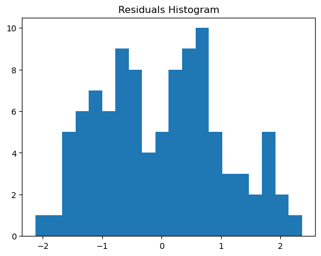

# 통계학에서 정규성 검정의 응용

정규성 검정은 통계 분석의 필수적인 부분이다. 흔히 쓰는 많은 통계 방법이 자료가 정규분포를 따른다는 가정에 기대기 때문이다.

---

## 1. 언제 정규성 검정을 적용하는가

정규성 검정은 보통 정규성을 가정하는 모수적 통계 방법을 쓰기 전에 적용한다. 흔한 상황은 다음과 같다.

- **$t$ 검정**: 일표본과 이표본 $t$ 검정 모두 각 집단 안의 자료가 정규분포를 따른다고 가정한다.
- **분산분석**: 분산분석은 집단들에 걸쳐 잔차가 정규분포를 따른다고 가정한다.
- **선형회귀**: 회귀분석은 모형의 잔차(오차)가 정규분포를 따른다고 가정한다.
- **신뢰구간**: 모수의 신뢰구간을 만들 때, 특히 표본이 작을 때 정규성을 흔히 가정한다.

정규성 검정은 이런 방법을 쓰는 것이 적절한지, 아니면 대안(변수변환이나 비모수 검정)을 고려해야 하는지 판단하는 데 유용하다.

---

## 2. 사례 1: t 검정 가정의 정규성 확인

이표본 $t$ 검정은 각 표본 안의 자료가 정규분포를 따른다고 가정한다. $t$ 검정을 수행하기 전에 두 집단의 정규성을 확인하는 것이 필수적이다.

<div class="exbox" markdown>

**보기 1.** <span class="diff easy" title="쉬움"></span> 정규성은 통과했는데 $t$ 검정이 기각하지 못한다. $\mathcal{N}(0,1)$과 $\mathcal{N}(0.5,1)$에서 각각 50개를 뽑아, 두 집단의 정규성을 확인한 뒤 이표본 $t$ 검정을 수행한다.

**(1)** 두 집단의 샤피로–윌크 $p$값과 $t$ 검정의 $p$값을 구하시오. 참 평균차가 $0.5$인데도 5% 수준에서 기각하지 못한다. 이 설계의 **이론 검정력**을 비중심 $t$ 분포로 계산해 그것이 뜻밖의 일이 아님을 보이시오. 검정력 80%를 얻으려면 집단당 몇 개가 필요한가.

**(2)** 이 코드는 정규성 검정의 결과에 따라 $t$ 검정과 비모수 검정 가운데 하나를 고른다. 널리 쓰이는 관행이지만 무엇이 문제인가.

</div>

??? success "풀이"

    **(1) 먼저 코드를 그대로 돌린다.**

    ```python
    import numpy as np
    from scipy.stats import ttest_ind, shapiro

    np.random.seed(0)

    # 두 집단 모두 실제로 정규분포에서 나왔다.
    group1 = np.random.normal(0, 1, 50)
    group2 = np.random.normal(0.5, 1, 50)

    # 집단마다 따로 검정한다. t 검정이 요구하는 것은 각 집단의 정규성이다.
    _, p_value_group1 = shapiro(group1)
    _, p_value_group2 = shapiro(group2)

    # 검정 결과에 따라 다음 절차를 고르는 흐름이다. 다만 이렇게 자료를 보고
    # 검정을 고르면 최종 p-값이 명목수준보다 커진다는 점은 알고 있어야 한다.
    if p_value_group1 > 0.05 and p_value_group2 > 0.05:
        stat, p_value = ttest_ind(group1, group2)
        print(f"Two-sample t-test: p-value={p_value}")
    else:
        print("One or both groups fail the normality test. Consider using a non-parametric alternative.")
    ```

    출력:

    ```text
    Two-sample t-test: p-value=0.09856078338184512
    ```

    두 집단의 샤피로–윌크 $p$값은 각각 $0.877$과 $0.837$로 정규성 확인을 가뿐히 통과하고, 이어진 $t$ 검정의 $p$값은 $0.0986$이다. **정규성은 문제가 아니었다.** 자료는 실제로 정규분포에서 나왔고 검정도 그렇게 말한다. 기각하지 못한 것은 전혀 다른 이유다.

    **이론 검정력을 계산해 보자.** 참 효과크기는 $d = (\mu_2 - \mu_1)/\sigma = 0.5$이고, 등표본 이표본 $t$ 검정의 표준오차는 $\mathrm{SE} = \sigma\sqrt{2/n}$이므로 대립가설 아래 통계량은 비중심모수

    $$
    \delta = \frac{\mu_2 - \mu_1}{\sigma\sqrt{2/n}} = d\sqrt{\frac{n}{2}}
    $$

    를 갖는 자유도 $2n-2$의 비중심 $t$ 분포를 따른다. $n = 50$, $d = 0.5$에서

    $$
    \delta = 0.5\sqrt{25} = 2.5, \qquad \nu = 98
    $$

    이고, 양쪽 검정의 임계값은 $t_{0.975,\,98} = 1.9845$이다. 따라서 검정력은

    $$
    1 - \beta = P(T_{98,\,2.5} > 1.9845) + P(T_{98,\,2.5} < -1.9845) = 0.6969
    $$

    이다. 곧 **이 설계는 애초에 열 번 가운데 세 번은 놓치도록 되어 있었다.** 이번 표본이 그 세 번 가운데 하나였을 뿐이다.

    ```python
    import numpy as np
    from scipy import stats

    np.random.seed(0)
    group1 = np.random.normal(0, 1, 50)
    group2 = np.random.normal(0.5, 1, 50)

    W1, p1 = stats.shapiro(group1)
    W2, p2 = stats.shapiro(group2)
    print(f"Shapiro group1: W = {W1:.4f}, p = {p1:.4f}")
    print(f"Shapiro group2: W = {W2:.4f}, p = {p2:.4f}")

    t, p = stats.ttest_ind(group1, group2)
    diff = group2.mean() - group1.mean()
    sp = np.sqrt((group1.var(ddof=1) + group2.var(ddof=1)) / 2)
    se = sp * np.sqrt(2 / 50)
    print(f"표본 평균차 = {diff:.4f}  (참값 0.5),  SE = {se:.4f}")
    print(f"t = {t:.4f},  p = {p:.4f}")

    # 이론 검정력: 비중심 t 분포
    d, n, df = 0.5, 50, 98
    ncp = d * np.sqrt(n / 2)
    tc = stats.t.ppf(0.975, df)
    power = stats.nct.sf(tc, df, ncp) + stats.nct.cdf(-tc, df, ncp)
    print(f"ncp = {ncp:.2f},  t_crit = {tc:.4f},  이론 검정력 = {power:.4f}")

    for m in range(10, 300):
        nc, dd = d * np.sqrt(m / 2), 2 * m - 2
        q = stats.t.ppf(0.975, dd)
        if stats.nct.sf(q, dd, nc) + stats.nct.cdf(-q, dd, nc) >= 0.80:
            print(f"검정력 80% 에 필요한 집단당 표본 = {m}")
            break
    ```

    출력:

    ```text
    Shapiro group1: W = 0.9876, p = 0.8766
    Shapiro group2: W = 0.9866, p = 0.8366
    표본 평균차 = 0.3385  (참값 0.5),  SE = 0.2030
    t = -1.6677,  p = 0.0986
    ncp = 2.50,  t_crit = 1.9845,  이론 검정력 = 0.6969
    검정력 80% 에 필요한 집단당 표본 = 64
    ```

    손으로 구한 $\delta = 2.50$, $t_{0.975,98} = 1.9845$, 검정력 $0.6969$가 코드와 그대로 맞는다. 표본에서 실제로 관측된 평균차는 $0.3385$로 참값 $0.5$보다 작게 나왔고, $\mathrm{SE} = 0.2030$으로 나누면 $0.3385/0.2030 = 1.668$이 되어 임계값 $1.9845$에 미치지 못한다. **검정력 80%를 원하면 집단당 64개**가 필요하다.

    **(2) 자료를 보고 검정을 고르면 최종 수준이 명목값에서 벗어난다.** 보고되는 $p$값은 "$t$ 검정을 쓰기로 미리 정했을 때"의 귀무분포에서 계산된 것인데, 실제로 수행된 절차는 "샤피로–윌크를 먼저 돌려 통과하면 $t$ 검정, 아니면 만–휘트니"라는 **두 단계 복합 절차**다. 복합 절차의 귀무분포는 $t$ 분포도 아니고 만–휘트니의 귀무분포도 아니다. 1단계의 선택이 같은 자료에 의존하므로 두 단계가 독립이 아니고, 그래서 최종 제1종 오류율이 $0.05$에서 비껴난다.

    더 실용적인 문제도 있다. 1단계의 검정력은 $n$에 지배되므로 **작은 표본에서는 무엇을 뽑아도 통과하고 큰 표본에서는 실무상 무해한 이탈도 걸러 낸다.** 곧 이 분기 규칙은 "자료가 정규인가"가 아니라 "표본이 큰가"에 따라 갈라진다. 정작 비모수 대안이 절실한 작은 표본에서 가장 쓸모가 없는 셈이다.

    실무에서는 ① 분석 방법을 자료를 보기 전에 정하거나, ② 두 결과를 모두 보고하거나, ③ 애초에 정규성에 덜 의존하는 절차(부트스트랩, 웰치 $t$)를 기본값으로 두는 편이 낫다.

한 집단이라도 정규성 검정을 통과하지 못하면 **Mann-Whitney U 검정** 같은 비모수 대안을 써야 한다.

!!! warning "정규성 검정 결과로 분석을 분기하는 것의 위험"
    위 코드처럼 "정규성 검정을 통과하면 $t$ 검정, 아니면 비모수 검정"으로 자동 분기하는 것은 널리 쓰이는 관행이지만 문제가 있다. 최종 검정의 선택이 같은 자료에 의존하게 되어 실제 제1종 오류율이 명목값에서 벗어난다. 실무에서는 사전에 분석 방법을 정하거나, 두 결과를 모두 보고하는 편이 낫다.

---

## 3. 사례 2: 선형회귀 잔차의 정규성

선형회귀에서는 잔차(관측값과 예측값의 차이)가 정규분포를 따른다고 가정한다. 잔차에 정규성 검정을 적용하여 이 가정이 성립하는지 확인할 수 있다.

<div class="exbox" markdown>

**보기 2.** <span class="diff easy" title="쉬움"></span> 정규성은 $y$ 가 아니라 잔차의 성질이다. $X \sim \mathcal{N}(0,1)$, $y = 2X + \varepsilon$, $\varepsilon \sim \mathcal{N}(0,1)$로 $n = 100$을 만들어 최소제곱 적합의 잔차에 샤피로–윌크를 건다.

**(1)** 잔차의 $p$값을 구하시오. 같은 자료의 **반응변수 $y$** 에 똑같이 샤피로–윌크를 걸면 어떻게 되는가. $y$의 분포를 해석적으로 구해 그 결과를 설명하시오.

**(2)** (1)의 결과 때문에 **이 모의자료로는 "$y$ 가 아니라 잔차"라는 요점을 보일 수 없다.** 설계를 어떻게 바꾸면 보일 수 있는가. 수로 보이시오.

**(3)** 풀이의 히스토그램이 정규성 판정에 얼마나 쓸모가 있는가.

</div>

??? success "풀이"

    **(1) 쪽의 코드를 그대로 돌린다.**

    ```python
    import numpy as np
    import statsmodels.api as sm
    import matplotlib.pyplot as plt
    from scipy.stats import shapiro

    # 오차를 정규분포에서 만들었으므로 잔차도 정규여야 한다.
    np.random.seed(0)
    X = np.random.normal(0, 1, 100)
    y = 2 * X + np.random.normal(0, 1, 100)

    X = sm.add_constant(X)
    model = sm.OLS(y, X).fit()

    # 회귀에서 정규성을 요구받는 것은 반응변수 y 가 아니라 잔차다.
    # y 자체는 X 에 따라 중심이 옮겨 다니므로 정규일 까닭이 없다.
    residuals = model.resid
    _, p_value = shapiro(residuals)

    print(f"Shapiro-Wilk Test on Residuals: p-value={p_value}")

    # 검정과 그림을 함께 본다.
    plt.hist(residuals, bins=20)
    plt.title('Residuals Histogram')
    plt.show()

    if p_value > 0.05:
        print("Residuals are normally distributed.")
    else:
        print("Residuals are not normally distributed.")
    ```

    출력:

    ```text
    Shapiro-Wilk Test on Residuals: p-value=0.11418410564039025
    Residuals are normally distributed.
    ```

    

    잔차는 $p = 0.114$로 정규성 확인을 통과한다. 오차를 정규분포에서 만들었으니 당연한 결과다. (엄밀히 말하면 "잔차가 정규분포를 따른다"가 아니라 "잔차가 정규성과 일관된다"가 옳은 표현이다. 기각하지 못한 것이 정규성을 증명하지는 않는다.)

    **그런데 같은 자료의 $y$ 에 걸어도 통과한다.** 해석적으로 당연하다. $X \sim \mathcal{N}(0,1)$과 $\varepsilon \sim \mathcal{N}(0,1)$이 독립이므로 둘의 선형결합은 다시 정규이고

    $$
    y = 2X + \varepsilon \sim \mathcal{N}\bigl(0,\ 2^2 \cdot 1 + 1\bigr) = \mathcal{N}(0, 5)
    $$

    이다. 표준편차는 $\sqrt{5} = 2.2361$이다. 곧 **이 설계에서는 $y$ 도 엄밀히 정규**이고, 샤피로–윌크가 통과시키는 것이 옳다.

    **(2) 그러므로 코드 주석의 "$y$ 자체는 정규일 까닭이 없다"는 말은 이 자료로 확인되지 않는다.** 주석이 겨냥한 요점 자체는 맞다. 회귀에서 정규성을 요구받는 것은 조건부 분포 $y \mid X$이고, 주변분포 $y$는 $X$의 분포가 섞여 들어간 것이라 일반적으로 정규가 아니다. 다만 $X$를 **정규에서 뽑으면** 그 섞임이 다시 정규가 되어 차이가 사라진다. 요점을 보이려면 $X$를 비정규로 두어야 한다.

    $X \sim \text{Exponential}(1)$로 바꾸면 갈라진다.

    ```python
    import numpy as np
    import statsmodels.api as sm
    from scipy import stats

    # --- 같은 자료에서 y 와 잔차를 모두 검정한다.
    np.random.seed(0)
    X = np.random.normal(0, 1, 100)
    y = 2 * X + np.random.normal(0, 1, 100)
    resid = sm.OLS(y, sm.add_constant(X)).fit().resid

    print(f"X ~ N(0,1) 일 때")
    print(f"  y    shapiro p = {stats.shapiro(y)[1]:.4f},  y 표준편차 = {y.std(ddof=1):.4f}"
          f"  (이론 sqrt(5) = {np.sqrt(5):.4f})")
    print(f"  잔차 shapiro p = {stats.shapiro(resid)[1]:.4f}")
    print(f"  잔차 g1 = {stats.skew(resid):+.4f}, g2 = {stats.kurtosis(resid):+.4f}"
          f"   (bias=True 기본값)")

    # --- X 를 치우친 분포로 바꾸면 y 와 잔차가 갈라진다.
    rng = np.random.default_rng(0)
    Xs = rng.exponential(1.0, 100)
    ys = 2 * Xs + rng.normal(0, 1, 100)
    rs = sm.OLS(ys, sm.add_constant(Xs)).fit().resid

    print(f"X ~ Exp(1) 일 때")
    print(f"  y    shapiro p = {stats.shapiro(ys)[1]:.3g},  g1 = {stats.skew(ys):+.4f}")
    print(f"  잔차 shapiro p = {stats.shapiro(rs)[1]:.4f},  g1 = {stats.skew(rs):+.4f}")
    ```

    출력:

    ```text
    X ~ N(0,1) 일 때
      y    shapiro p = 0.7502,  y 표준편차 = 2.3783  (이론 sqrt(5) = 2.2361)
      잔차 shapiro p = 0.1142
      잔차 g1 = +0.2096, g2 = -0.7378   (bias=True 기본값)
    X ~ Exp(1) 일 때
      y    shapiro p = 0.000578,  g1 = +0.9816
      잔차 shapiro p = 0.2509,  g1 = -0.3300
    ```

    해석적으로 구한 $y$의 표준편차 $\sqrt 5 = 2.236$이 표본값 $2.378$과 맞는다($n = 100$에서 표준편차 추정의 상대 표준오차가 약 $1/\sqrt{2n} = 7\%$이므로 $6\%$ 차이는 그 안이다).

    아래 두 줄이 요점이다. $X$를 지수분포에서 뽑으면 $y$의 표본왜도가 $g_1 = +0.98$이 되어 샤피로–윌크가 $p = 0.00058$로 **기각**하지만, 같은 적합의 잔차는 $p = 0.251$로 통과한다. 모형은 조금도 틀리지 않았다. 오차는 여전히 정규이고 선형성도 성립한다. **$y$ 에 정규성 검정을 걸었다면 멀쩡한 모형을 버렸을 것이다.** 치우친 설명변수는 통계학에서 예외가 아니라 보통이다(소득, 거래량, 인구).

    왜도·첨도는 판본을 밝혀야 수가 맞는다. 위 값은 모두 `scipy.stats.skew`·`kurtosis`의 기본값이므로 보정하지 않은 $g_1$과 초과첨도 $g_2$다. pandas `.skew()`를 쓰면 보정판 $G_1$이 나와 값이 조금 달라진다.

    **(3) 히스토그램은 이 판정에 거의 쓸모가 없다.** $n = 100$에 구간을 20개 주었으니 구간마다 평균 5개다. 포아송 변동만으로도 높이가 $\pm\sqrt5 \approx \pm 2.2$, 곧 $\pm 45\%$씩 흔들리므로 들쭉날쭉한 모양이 자료의 성질인지 구간 분할의 잡음인지 분간할 수 없다. 실제로 잔차의 초과첨도는 $g_2 = -0.74$로 정규보다 다소 납작한데, 이것이 참인 성질이 아니라 표본 변동임을 히스토그램만으로는 알 수 없다. 정규성 진단에는 Q-Q 그림이 낫다. 구간을 나누지 않으므로 분할 선택에 흔들리지 않고, 벗어남이 어느 분위수에서 생기는지도 함께 보여 준다.

잔차가 정규분포를 따르지 않으면 회귀분석 결과를 믿기 어려워질 수 있으며, 변수변환이나 대안 회귀모형 같은 교정 조치가 필요할 수 있다.

---

## 4. 사례 3: 분산분석의 정규성

**분산분석**은 집단들에 걸친 자료의 잔차가 정규분포를 따른다고 가정한다. 이 가정이 위배되면 분산분석의 결과가 오도할 수 있다.

<div class="exbox" markdown>

**보기 3.** <span class="diff easy" title="쉬움"></span> 집단별로 세 번 검정하는 것과 잔차 하나를 검정하는 것. $\mathcal{N}(0,1)$, $\mathcal{N}(0.5,1)$, $\mathcal{N}(1,1)$에서 각각 30개를 뽑아 집단마다 샤피로–윌크를 돌린 뒤 일원분산분석을 수행한다.

**(1)** 세 집단의 $p$값과 분산분석의 $F$, $p$를 구하시오. 분산분석이 요구하는 정규성은 집단별 자료가 아니라 **잔차**의 것이다. 집단평균을 뺀 잔차 하나($n = 90$)에 검정을 걸면 결론이 같은가.

**(2)** 중심화하지 **않고** 그냥 통합한 자료에 검정을 걸면 어떻게 되는가. 이 자료에서는 통과한다. 왜 그런지 설명하고, 집단 평균을 간격 $d$로 벌려 가며 언제 깨지는지 수로 보이시오.

**(3)** 간격이 $d$인 등간격 3성분 정규혼합의 **초과첨도를 닫힌 꼴로** 구하고 (2)의 모의값과 맞추시오.

</div>

??? success "풀이"

    **(1) 쪽의 코드를 그대로 돌린다.**

    ```python
    import numpy as np
    from scipy.stats import f_oneway, shapiro

    np.random.seed(0)

    # 세 집단의 평균은 다르지만 분산은 같다.
    group1 = np.random.normal(0, 1, 30)
    group2 = np.random.normal(0.5, 1, 30)
    group3 = np.random.normal(1, 1, 30)

    # 분산분석에서도 정규성은 잔차에 요구된다. 집단마다 평균을 뺀 값이
    # 곧 잔차이므로, 집단별로 검정하는 것이 그 일을 대신한다.
    _, p_value_group1 = shapiro(group1)
    _, p_value_group2 = shapiro(group2)
    _, p_value_group3 = shapiro(group3)

    # 자료가 정규인지 확인한다
    if p_value_group1 > 0.05 and p_value_group2 > 0.05 and p_value_group3 > 0.05:
        # 분산분석 수행
        stat, p_value = f_oneway(group1, group2, group3)
        print(f"ANOVA test: p-value={p_value}")
    else:
        print("One or more groups fail the normality test. Consider using a non-parametric alternative.")
    ```

    출력:

    ```text
    ANOVA test: p-value=0.039981492411499175
    ```

    **(3) 닫힌 꼴 먼저.** 세 집단의 평균이 $-d$, $0$, $d$이고(위치 이동은 첨도를 바꾸지 않으므로 간격만 중요하다) 각 성분이 분산 1인 정규라 하자. 집단을 고르는 확률변수를 $M$($\{-d,0,d\}$에 각각 $1/3$), 집단 안 변동을 $Z \sim \mathcal{N}(0,1)$이라 두면 통합 자료는 $X = M + Z$이고 둘은 독립이다. $E[M] = E[M^3] = 0$, $E[M^2] = \tfrac23 d^2$, $E[M^4] = \tfrac23 d^4$이므로

    $$
    \operatorname{Var}(X) = E[M^2] + 1 = 1 + \tfrac{2}{3}d^2
    $$

    이고, 홀수 적률이 사라지는 것을 쓰면

    $$
    E[X^4] = E[M^4] + 6E[M^2]E[Z^2] + E[Z^4] = \tfrac{2}{3}d^4 + 4d^2 + 3
    $$

    이다. 따라서 초과첨도는

    $$
    \gamma_2(d) = \frac{\tfrac{2}{3}d^4 + 4d^2 + 3}{\bigl(1 + \tfrac{2}{3}d^2\bigr)^2} - 3 .
    $$

    $d = 0$이면 $3/1 - 3 = 0$으로 정규가 되고, $d \to \infty$이면 $\tfrac23 d^4 / \tfrac49 d^4 - 3 = \tfrac32 - 3 = -\tfrac32$로 간다. **상한이 $-1.5$라는 것이 요점이다.** 평균을 벌려 통합하면 꼬리가 두꺼워지는 것이 아니라 가운데가 평평해진다. 비정규성이 **납작한 쪽**으로 생긴다.

    **(1)(2) 수치 확인.**

    ```python
    import numpy as np
    from scipy import stats

    np.random.seed(0)
    g1 = np.random.normal(0, 1, 30)
    g2 = np.random.normal(0.5, 1, 30)
    g3 = np.random.normal(1, 1, 30)

    for name, g in [("group1", g1), ("group2", g2), ("group3", g3)]:
        W, p = stats.shapiro(g)
        print(f"{name}: W = {W:.4f}, p = {p:.4f},  평균 = {g.mean():+.4f},"
              f"  표준편차 = {g.std(ddof=1):.4f}")

    F, p = stats.f_oneway(g1, g2, g3)
    print(f"F = {F:.4f}, p = {p:.4f},  임계 F(2, 87) = {stats.f.ppf(0.95, 2, 87):.4f}")

    # 분산분석이 요구하는 것은 집단평균을 뺀 잔차의 정규성이다.
    resid = np.concatenate([g - g.mean() for g in (g1, g2, g3)])
    print(f"집단중심화 잔차 (n = {resid.size}): shapiro p = {stats.shapiro(resid)[1]:.4f}")

    # 중심화하지 않고 그냥 통합하면?
    raw = np.concatenate([g1, g2, g3])
    print(f"중심화 안 한 통합자료:   shapiro p = {stats.shapiro(raw)[1]:.4f}")

    # 평균 간격을 d, 2d 로 벌려 가며 본다.
    print("\n평균간격 d   통합자료 shapiro p   표본 g2    닫힌꼴 초과첨도")
    for d in [0, 1, 2, 3, 4]:
        pooled = np.concatenate([resid[:30], resid[30:60] + d, resid[60:] + 2 * d])
        closed = ((2 / 3) * d**4 + 4 * d**2 + 3) / (1 + (2 / 3) * d**2) ** 2 - 3
        print(f"   {d}        {stats.shapiro(pooled)[1]:>10.2e}      "
              f"{stats.kurtosis(pooled):+.3f}      {closed:+.3f}")
    ```

    출력:

    ```text
    group1: W = 0.9695, p = 0.5254,  평균 = +0.4429,  표준편차 = 1.1003
    group2: W = 0.9835, p = 0.9085,  평균 = +0.2105,  표준편차 = 0.9142
    group3: W = 0.9763, p = 0.7204,  평균 = +0.8663,  표준편차 = 0.9650
    F = 3.3415, p = 0.0400,  임계 F(2, 87) = 3.1013
    집단중심화 잔차 (n = 90): shapiro p = 0.9106
    중심화 안 한 통합자료:   shapiro p = 0.8701

    평균간격 d   통합자료 shapiro p   표본 g2    닫힌꼴 초과첨도
       0          9.11e-01      -0.023      +0.000
       1          9.00e-01      +0.281      -0.240
       2          8.11e-01      -0.549      -0.793
       3          6.25e-02      -0.989      -1.102
       4          2.49e-03      -1.194      -1.254
    ```

    **(1) 결론은 같다.** 집단별 $p$값은 $0.525$, $0.909$, $0.720$이고 집단중심화 잔차 하나($n = 90$)의 $p$값은 $0.911$로, 모두 넉넉히 통과한다. 분산분석은 $F = 3.3415$로 임계값 $F_{0.95}(2,87) = 3.1013$을 겨우 넘어 $p = 0.0400$을 준다. 5% 수준에서 기각하지만 **임계값과의 여유가 $0.24$뿐**이라 결론이 단단하다고 말하기는 어렵다. 집단 표준편차도 $1.100$, $0.914$, $0.965$로 가장 큰 쪽이 가장 작은 쪽의 $1.20$배에 그쳐 등분산 가정에 무리가 없다.

    집단별 세 번과 잔차 한 번 가운데 **원칙에 맞는 것은 잔차 한 번**이다. 분산분석 모형 $y_{ij} = \mu + \alpha_i + \varepsilon_{ij}$에서 정규성을 요구받는 것은 $\varepsilon_{ij}$뿐이다. 실무적 차이도 있다. 집단별로 세 번 검정하면 세 번 다 통과해야 하므로 **전체 제1종 오류율이 부풀고**(독립이라 가정하면 $1 - 0.95^3 = 14.3\%$), 집단 수가 늘면 더 나빠진다. 게다가 집단마다 $n = 30$으로 쪼개므로 검정력도 낮다. 잔차를 모아 한 번 검정하면 $n = 90$을 다 쓰고 검정도 한 번이다.

    **(2) 중심화하지 않아도 이 자료에서는 통과한다($p = 0.870$).** 집단 평균이 $0.211$부터 $0.866$까지, 곧 $\sigma = 1$에 비해 $0.66$만큼만 떨어져 있어서다. 성분이 이렇게 겹치면 혼합이 단봉인 정규와 거의 구별되지 않는다. (3)의 닫힌 꼴에 등간격 근사 $d = (0.8663 - 0.2105)/2 = 0.328$을 넣으면 $\gamma_2 = -0.0067$로, 정규에서 사실상 떨어져 있지 않다.

    간격을 벌리면 깨진다. 표에서 $d = 2$까지는 $p$가 $0.8$ 위에 머물다가 $d = 3$에서 $0.0625$로 내려오고 $d = 4$에서 $0.0025$로 기각된다. **$\sigma$의 세 배쯤 떨어져야 비로소 샤피로–윌크가 알아챈다**는 뜻이고, $n = 90$에서도 그렇다. 그런데 중심화한 잔차는 이 모든 경우에 **똑같다** — 집단 평균을 어디로 옮기든 잔차는 변하지 않으므로 $p = 0.9106$이 그대로다. 이것이 중심화해야 하는 이유다. 중심화하지 않으면 **집단 평균의 차이, 곧 분산분석이 찾으려는 바로 그 효과**를 비정규성으로 오인한다.

    **(3) 닫힌 꼴과 모의값의 대조.** 표의 마지막 두 열이다.

    | $d$ | 닫힌 꼴 $\gamma_2$ | 표본 $g_2$ ($n=90$) |
    |---|---|---|
    | 0 | $+0.000$ | $-0.023$ |
    | 1 | $-0.240$ | $+0.281$ |
    | 2 | $-0.793$ | $-0.549$ |
    | 3 | $-1.102$ | $-0.989$ |
    | 4 | $-1.254$ | $-1.194$ |

    추세가 맞고 $d \ge 2$에서는 값도 가깝다. $d = 1$의 $0.52$ 차이가 눈에 걸리지만 $n = 90$에서 초과첨도의 귀무 표준오차가 $\sqrt{24/n} = \sqrt{24/90} = 0.516$이므로 1 표준오차 안이다. **표본 하나로 첨도를 재면 이만큼 흔들린다.** 추세를 보려면 표본 하나가 아니라 닫힌 꼴이 필요하다는 것이 이 대조의 교훈이다.

    (닫힌 꼴은 몬테카를로로도 확인했다. $4\times10^6$개를 뽑으면 $d = 1,2,3,4$에서 각각 $-0.2388$, $-0.7946$, $-1.1023$, $-1.2536$이 나와 닫힌 꼴 $-0.2400$, $-0.7934$, $-1.1020$, $-1.2539$와 소수 둘째 자리까지 맞는다.) 표본 $g_2$는 `scipy.stats.kurtosis`의 기본값이므로 보정하지 않은 초과첨도다.

세 집단의 샤피로–윌크 $p$값은 각각 $0.525$, $0.909$, $0.720$으로 모두 정규성 확인을 통과하고, 분산분석은 $p = 0.040$으로 5% 수준에서 집단 평균의 차이를 탐지한다.

분산분석을 적용하기 전에 Shapiro-Wilk 검정으로 각 집단의 자료가 정규분포를 따르는지 확인한다. 한 집단 이상이 검정을 통과하지 못하면 **Kruskal-Wallis 검정** 같은 비모수 대안이 더 적절할 수 있다.

---

## 5. 결론

정규성 검정은 $t$ 검정, 분산분석, 선형회귀 같은 모수적 방법을 쓰는 여러 응용에서 결정적이다. 자료(또는 잔차)가 정규분포를 따르는지 확인해야 이 방법들이 타당한 결과를 낸다. 정규성 가정이 위배되면 변수변환이나 비모수 대안을 적용할 수 있다. 실무에서는 정규성 검정을 시각적 평가와 결합할 때 바탕 자료 분포를 더 뚜렷하게 파악할 수 있다.

---

## 연습문제

<div class="drillbox" markdown>

**연습문제 1.** <span class="diff med" title="중간"></span>
어떤 연구자가 관측값 $n = 15$개에 일표본 t 검정을 수행하여 $t = 2.35$를 얻었다. 결과를 해석하기 전에 정규성을 확인해야 한다. 그 이유를 설명하고, 자료가 심하게 치우쳐 있다면 무엇이 잘못될 수 있는지 기술하라.

</div>

??? success "풀이"
    일표본 t 검정은 자료가 정규분포에서 온다고 가정한다(또는 $n$이 중심극한정리를 쓸 만큼 크다고 가정한다). $n = 15$이면 자료가 심하게 치우쳐 있을 때 중심극한정리가 충분한 근사를 제공하지 못할 수 있다.

    자료가 오른쪽으로 치우쳐 있으면 $\bar{X}$의 표집분포도 치우치며 t 분포가 나쁜 근사가 된다. 그러면 (1) p값이 틀리고(실제 제1종 오류율이 명목 $\alpha$와 다르다), (2) 신뢰구간의 포함확률이 틀리며, (3) 실제 효과를 탐지할 검정력이 떨어진다. 치우침이 심하고 $n = 15$라면 비모수 검정(Wilcoxon 부호순위)이나 붓스트랩 검정이 더 믿을 만하다.

<div class="drillbox" markdown>

**연습문제 2.** <span class="diff med" title="중간"></span>
정규성 가정에 기대는 통계 방법 세 가지를 들고 각각이 비정규성에 얼마나 로버스트한지 서술하라.

</div>

??? success "풀이"

    1. **평균에 대한 t 검정:** 중간 정도로 로버스트하다. $n \geq 30$이고 치우침이 중간 정도이면 중심극한정리가 근사적 타당성을 보장한다. 작은 표본에서 두꺼운 꼬리나 극단적 이상점에는 로버스트하지 않다.

    2. **분산의 동일성에 대한 F 검정:** 로버스트하지 않다. F 검정은 비정규성에 매우 민감하여 가벼운 이탈만으로도 제1종 오류율이 심각하게 부풀려질 수 있다. Levene 검정이나 Brown-Forsythe 검정이 선호되는 대안이다.

    3. **선형회귀(OLS):** OLS 추정값 자체는 정규성 없이도 타당하다(불편, BLUE). 그러나 추론(t 검정, F 검정, 신뢰구간)에는 오차의 정규성이나 큰 $n$이 필요하다. 예측구간은 비정규성에 특히 민감하다.

<div class="drillbox" markdown>

**연습문제 3.** <span class="diff med" title="중간"></span>
통계검정을 수행하기 전에 정규성을 확인하는 실용적 절차를 설명하라.

</div>

??? success "풀이"
    권장 절차:

    1. **먼저 시각적으로 점검한다:** 자료(회귀에서는 잔차)의 히스토그램이나 밀도 그림과 Q-Q 그림을 만든다. 치우침, 두꺼운 꼬리, 이상점, 다봉성을 살핀다.

    2. **형식적 검정:** 시각적 방법을 보완하기 위해 정규성 검정을 적용한다($n < 50$이면 Shapiro-Wilk, 더 큰 표본에는 Anderson-Darling이나 D'Agostino).

    3. **결과를 함께 해석한다:** Q-Q 그림이 대략 선형이고 형식적 검정이 합리적인 수준에서 기각하지 않으면 정규론 방법으로 진행한다. 둘 다 비정규성을 시사하면 대안을 고려한다.

    4. **필요하면 대책을 고른다:** 변환(로그, Box-Cox), 비모수 검정, 붓스트랩 방법을 적용한다.

    5. **평가를 보고한다:** 정규성이 뒷받침되더라도 어떤 정규성 확인을 수행했고 그 결과가 무엇이었는지 서술한다.

<div class="drillbox" markdown>

**연습문제 4.** <span class="diff med" title="중간"></span>
큰 표본($n = 5000$)에서 Shapiro-Wilk 검정이 $p < 0.001$로 정규성을 기각했지만 Q-Q 그림은 거의 선형으로 보인다. 어떻게 진행해야 하는가?

</div>

??? success "풀이"
    $n = 5000$이면 형식적 검정의 검정력이 극도로 높아, 추론에 실질적 영향이 없는 사소한 이탈까지 탐지한다. Shapiro-Wilk $p < 0.001$은 자료가 정규에서 "멀다"는 뜻이 아니라 그 이탈이 통계적으로 탐지 가능하다는 뜻이다.

    Q-Q 그림이 거의 선형이므로 이탈은 작을 가능성이 높다. 다음과 같이 진행한다.

    1. **정규론 방법으로 진행한다:** $n = 5000$이면 중심극한정리의 보호가 강력하여 약간의 비정규성이 있어도 t 검정, 분산분석, 회귀 추론이 매우 정확하다.
    2. **두 결과를 모두 보고한다:** 형식적 검정은 정규성을 기각했지만 시각적 점검은 근사적 정규성을 시사한다고 밝힌다.
    3. **효과 크기를 고려한다:** 이분법적 기각/비기각 판정에 기대는 대신 왜도와 첨도 계수로 비정규성의 정도를 수량화한다.

<div class="drillbox" markdown>

**연습문제 5.** <span class="diff med" title="중간"></span>
보기 1 은 비중심 $t$ 분포로 $n = 50$, $d = 0.5$ 에서 검정력 $0.6969$ 를, 그리고 검정력 80% 에 필요한 집단당 표본 $64$ 를 얻었다. 비중심 $t$ 를 쓰지 않고 정규근사만으로 같은 두 수를 구해 보자. 자유도가 크면 대립가설 아래 통계량을 근사적으로 $\mathcal{N}(\delta, 1)$, $\delta = d\sqrt{n/2}$ 로 볼 수 있다.

**(1)** 아래쪽 꼬리를 무시한 근사 검정력 $\Phi(\delta - z_{0.975})$ 를 $n = 50$, $d = 0.5$ 에서 계산하고 보기 1 의 $0.6969$ 와 비교하시오. 어느 쪽으로 틀리는가.

**(2)** 검정력 $1 - \beta$ 에 필요한 집단당 표본수 공식을 유도하고 $d = 0.5$, $\alpha = 0.05$, $1 - \beta = 0.80$ 에서 계산하시오. 보기 1 의 $64$ 와 하나 차이가 나는 까닭을 (1) 과 같은 이유로 설명하시오.

</div>

??? success "풀이"
    **(1)** $\delta = 0.5\sqrt{50/2} = 0.5 \times 5 = 2.5$ 이고 $z_{0.975} = 1.95996$ 이므로

    $$
    \Phi(\delta - z_{0.975}) = \Phi(2.5 - 1.95996) = \Phi(0.54004) = 0.70541 .
    $$

    버린 아래쪽 꼬리는 $\Phi(-2.5 - 1.95996) = \Phi(-4.460) = 4.1 \times 10^{-6}$ 으로 소수 넷째 자리에도 닿지 않는다. 따라서 근사 검정력은 $0.7054$ 이고, 보기 1 의 정확값 $0.6969$ 보다 $0.0085$, 곧 **0.85 퍼센트포인트 크게** 나온다.

    근사가 **검정력을 부풀리는** 까닭은 분모를 상수로 바꿨기 때문이다. 실제 통계량은

    $$
    T = \frac{\bar{X}_2 - \bar{X}_1}{s_p\sqrt{2/n}}
    $$

    로 분모 $s_p$ 가 확률변수여서 분포가 $\mathcal{N}(\delta,1)$ 보다 넓게 퍼진다. 중심 $\delta = 2.5$ 가 임계값 $1.9845$ 보다 **위에** 있으므로, 퍼짐이 커지면 경계 아래로 넘어가는 질량이 늘어 기각확률이 줄어든다. 정규근사는 이 손실을 세지 않는다.

    **(2)** $\Phi(\delta - z_{1-\alpha/2}) = 1 - \beta$ 로 두면 $\delta - z_{1-\alpha/2} = z_{1-\beta}$, 곧 $d\sqrt{n/2} = z_{1-\alpha/2} + z_{1-\beta}$ 이므로

    $$
    n = \frac{2\bigl(z_{1-\alpha/2} + z_{1-\beta}\bigr)^2}{d^2} .
    $$

    수를 넣으면 $z_{0.975} = 1.95996$, $z_{0.80} = 0.84162$, 둘의 합이 $2.80158$ 이고 그 제곱이 $7.84888$ 이므로

    $$
    n = \frac{2 \times 7.84888}{0.5^2} = \frac{15.69776}{0.25} = 62.79
    $$

    에서 올림하여 **집단당 63 개**를 얻는다. 보기 1 의 정확값은 64 개였다.

    차이는 하나뿐이지만 방향이 (1) 과 같다. 근사가 검정력을 과대평가하므로 필요한 표본수는 과소평가된다. 실제로 비중심 $t$ 로 재면 $n = 63$ 의 검정력은 $0.7952$ 로 $0.80$ 에 못 미치고 $n = 64$ 에서 $0.8015$ 가 되어 비로소 넘는다. **정규근사 공식은 설계 단계의 눈대중으로 쓰고, 경계에 걸리면 비중심 $t$ 로 확인해야 한다.** 효과크기가 작고 $n$ 이 커질수록 이 한 개 차이는 상대적으로 더 작아지므로, 어긋남이 문제가 되는 곳은 늘 표본이 작은 쪽이다.

<div class="drillbox" markdown>

**연습문제 6.** <span class="diff med" title="중간"></span>
보기 3 은 집단별로 샤피로–윌크를 세 번 돌리고 "세 번 다 통과" 를 조건으로 삼으면 전체 제1종 오류율이 $1 - 0.95^3 = 14.3\%$ 로 부푼다고 했다.

**(1)** 집단 수가 $k$ 일 때 참으로 정규인 자료를 적어도 한 번 기각할 확률을 쓰고 $k = 5$, $k = 10$ 에서 계산하시오. 이 확률이 처음으로 $50\%$ 를 넘는 $k$ 는 몇인가.

**(2)** 보기 3 은 "독립이라 가정하면" 이라고 적었다. 이 설계에서 그 가정이 실은 근사가 아니라 정확한 까닭을 말하시오. 집단중심화 잔차 하나에 검정을 한 번 거는 쪽에는 왜 같은 계산이 필요하지 않은가.

**(3)** 각 검정의 수준을 $\alpha/k$ 로 낮추면 전체 오류율은 잡힌다. 그래도 집단별 검정이 잔차 한 번보다 나쁜 까닭을 보기 3 의 $n = 30$ 과 $n = 90$ 의 대비로 설명하시오.

</div>

??? success "풀이"
    **(1)** 집단마다 수준 $\alpha = 0.05$ 로 독립한 검정을 한 번씩 하므로, 모두 통과할 확률이 $(1-\alpha)^k$ 이고 적어도 하나가 기각할 확률은

    $$
    1 - (1-\alpha)^k = 1 - 0.95^k .
    $$

    $k = 3$ 에서 $1 - 0.857375 = 0.1426$ 으로 보기 3 의 $14.3\%$ 가 나오고,

    $$
    k = 5: \ 1 - 0.95^5 = 1 - 0.773781 = 0.2262, \qquad k = 10: \ 1 - 0.95^{10} = 1 - 0.598737 = 0.4013
    $$

    이다. $50\%$ 를 넘는 조건은 $0.95^k < 0.5$, 곧

    $$
    k > \frac{\ln 0.5}{\ln 0.95} = \frac{-0.693147}{-0.051293} = 13.513
    $$

    이므로 **$k = 14$** 이다. 실제로 $k = 13$ 에서 $0.4867$, $k = 14$ 에서 $0.5123$ 이다. 집단이 열네 개면 **자료가 완벽히 정규여도 절반 넘는 실험에서 "정규성 위반" 이라는 경고를 받는다.**

    **(2) 이 설계에서는 독립이 정확하다.** 집단 $i$ 의 샤피로–윌크 통계량은 집단 $i$ 의 자료만의 함수이고, 집단들은 서로 독립인 표본이다. 독립인 확률변수들의 함수는 독립이므로 $k$ 개 사건의 확률은 정확히 곱으로 쪼개진다. 근사가 들어가는 자리는 독립성이 아니라 각 검정의 실제 크기가 명목값 $0.05$ 와 얼마나 맞는지 쪽이다.

    집단중심화 잔차 쪽에는 검정이 **하나뿐**이므로 다중성 계산 자체가 필요 없다. 덧붙여, 잔차끼리는 독립도 아니다. 집단마다 평균을 뺐으므로 각 집단 안에서 잔차의 합이 0 이라는 제약이 걸려 자유도가 $n$ 이 아니라 $n - k$ 다. 쪼개서 곱할 거리가 애초에 없다는 뜻이고, 그래서 한 번만 검정하는 쪽이 맞는 설계다.

    **(3)** 본페로니로 $\alpha/k$ 를 쓰면 전체 오류율은 $0.05$ 아래로 내려오지만, 잃는 것이 둘이다.

    첫째, **검정력이다.** 집단별 검정은 자료를 $n_0 = 30$ 씩 쪼개 쓰는데, 보기 3 의 $d$ 를 벌린 표가 보인 대로 샤피로–윌크는 $n = 90$ 에서도 $\sigma$ 의 세 배쯤 벌어져야 알아챌 만큼 둔하다. 여기서 $n = 30$ 으로 줄이고 수준마저 $0.05/3 = 0.0167$ 로 낮추면 남는 검정력이 거의 없다. 잔차를 모으면 $n = 90$ 을 다 쓰고 수준도 $0.05$ 를 그대로 쓴다.

    둘째, **가설 자체가 하나다.** 분산분석 모형 $y_{ij} = \mu + \alpha_i + \varepsilon_{ij}$ 에서 정규성을 요구받는 것은 모든 집단에 공통인 오차분포 $\varepsilon_{ij}$ 하나다. 그것을 $k$ 개 가설로 쪼개는 것은 다중성 문제이기 전에 **모형을 잘못 읽은 것**이고, 본페로니는 잘못 쪼갠 것의 뒤처리일 뿐 쪼갠 손실을 되돌려 주지 않는다.

<div class="drillbox" markdown>

**연습문제 7.** <span class="diff hard" title="어려움"></span>
보기 3 의 **(3)** 은 평균이 $-d$, $0$, $d$ 이고 무게가 각각 $1/3$, 성분분산이 1 인 3성분 정규혼합의 초과첨도를 닫힌 꼴로 구했다. 무게를 $(p,\ 1-2p,\ p)$, $0 < p \le 1/2$ 로 일반화한다.

**(1)** $M \in \{-d, 0, d\}$ 와 $Z \sim \mathcal{N}(0,1)$ 이 독립이고 $X = M + Z$ 라 할 때 $\operatorname{Var}(X)$ 와 $E[X^4]$ 를 구해 초과첨도 $\gamma_2(p,d)$ 를 쓰시오. $p = 1/3$ 에서 보기 3 의 식이 되는지 확인하시오.

**(2)** **모든** $d > 0$ 에 대해 $\gamma_2(p,d) = 0$ 이 되는 $p$ 를 구하시오.

**(3)** 그 $p$ 와 $d = 4$ 에서 분포가 정규와 얼마나 다른지 밀도값 셋($x = 0$, $x = 2.465$, $x = 4$)으로 보이고, 이 분포에 자크–베라 검정을 걸면 표본크기를 아무리 키워도 무엇을 못 하는지 설명하시오.

</div>

??? success "풀이"
    **(1)** $M$ 의 분포가 0 에 대해 대칭이므로 홀수 적률은 모두 0 이고

    $$
    E[M^2] = 2pd^2, \qquad E[M^4] = 2pd^4 .
    $$

    독립이므로 $\operatorname{Var}(X) = E[M^2] + \operatorname{Var}(Z) = 1 + 2pd^2$ 이고, 이항전개에서 $E[M]=E[M^3]=E[Z]=E[Z^3]=0$ 인 항이 사라져

    $$
    E[X^4] = E[M^4] + 6E[M^2]E[Z^2] + E[Z^4] = 2pd^4 + 12pd^2 + 3
    $$

    이다. 따라서

    $$
    \gamma_2(p,d) = \frac{2pd^4 + 12pd^2 + 3}{\bigl(1 + 2pd^2\bigr)^2} - 3 .
    $$

    $p = 1/3$ 을 넣으면 $2p = 2/3$, $12p = 4$ 이므로

    $$
    \gamma_2(\tfrac13, d) = \frac{\tfrac23 d^4 + 4d^2 + 3}{\bigl(1 + \tfrac23 d^2\bigr)^2} - 3
    $$

    로 보기 3 의 식과 글자까지 같다.

    **(2)** $\gamma_2 = 0$ 은 분자가 $3(1+2pd^2)^2$ 과 같다는 뜻이므로

    $$
    2pd^4 + 12pd^2 + 3 = 3 + 12pd^2 + 12p^2d^4 .
    $$

    양변에서 $3 + 12pd^2$ 이 지워지고 $2pd^4 = 12p^2d^4$ 가 남는다. $d > 0$, $p > 0$ 이므로 $d^4$ 와 $p$ 로 나누면 $2 = 12p$, 곧

    $$
    p = \frac{1}{6} .
    $$

    **$d$ 가 식에서 완전히 떨어져 나간다는 것이 요점이다.** 무게 $(1/6,\ 2/3,\ 1/6)$ 로 두면 성분을 얼마나 멀리 벌려도 초과첨도가 **정확히** 0 이다. 그리고 대칭이므로 왜도도 $\gamma_1 = 0$ 이다. (2장의 하한 $\beta_2 \ge 1 + \gamma_1^2$ 는 $3 \ge 1$ 로 넉넉히 만족되니 모순도 없다.)

    **(3)** $p = 1/6$, $d = 4$ 에서 분산은 $1 + 2 \times \tfrac16 \times 16 = \tfrac{19}{3} = 6.3333$, 표준편차는 $2.5166$ 이다. 같은 분산의 정규밀도와 나란히 적으면

    | $x$ | 혼합 $f(x)$ | $\mathcal{N}(0, 19/3)$ | 비 |
    |---|---|---|---|
    | $0$ | $0.2660$ | $0.1585$ | $1.678$ |
    | $2.465$ | $0.0332$ | $0.0981$ | $0.339$ |
    | $4$ | $0.0666$ | $0.0448$ | $1.485$ |

    가운데는 정규보다 $1.68$ 배 높고, $x = 2.465$ 의 골짜기에서는 $0.34$ 배로 내려앉고, $x = 4$ 에서 다시 $1.49$ 배로 솟는다. 곧 **봉우리가 셋인 분포**다($x = 2.465$ 가 밀도의 국소최솟값이다). 눈으로 한 번 보면 정규와 혼동할 수 없다.

    그런데 자크–베라 통계량은

    $$
    JB = \frac{n}{6}\Bigl(g_1^2 + \frac{g_2^2}{4}\Bigr)
    $$

    로 3차·4차 표본적률만 본다. 이 분포의 모수준 값이 $\gamma_1 = 0$, $\gamma_2 = 0$ 이므로 $g_1$ 과 $g_2$ 는 둘 다 0 근처에서 흔들릴 뿐 자라지 않고, $JB$ 도 귀무분포인 $\chi^2_2$ 를 벗어나지 않는다. **$n$ 을 백만으로 키워도 기각률은 명목수준 $0.05$ 에 머문다.** 검정력이 1 로 가지 않는 것이 아니라, 아예 $\alpha$ 에 붙어 있다.

    반면 샤피로–윌크나 앤더슨–달링은 순서통계량 전체가 직선에서 벗어나는 모양을 보므로 이런 다봉성을 잡아낸다. **검정은 자기가 재는 양만 본다.** 왜도와 첨도가 0 이라는 것은 정규성의 필요조건일 뿐이고, 자크–베라를 통과한 것은 "정규다" 가 아니라 "3차·4차 적률이 정규와 어긋나지 않는다" 는 뜻이다.

<div class="drillbox" markdown>

**연습문제 8.** <span class="diff hard" title="어려움"></span>
보기 3 의 **(3)** 은 등무게 3성분 혼합의 초과첨도가 $d \to \infty$ 에서 $-3/2$ 로 가므로 "상한이 $-1.5$" 라고 했다. 연습문제 7 에서 얻은 $\gamma_2(p,d)$ 로 이 말의 범위를 따져 보자.

**(1)** $\lim_{d \to \infty} \gamma_2(p,d)$ 를 구하고, $p = 1/3$ 에서 $-1.5$, $p = 1/6$ 에서 $0$ 이 되는지 확인하시오.

**(2)** 이 극한을 $p \in (0, 1/2]$ 에서 최소화하시오. 그 최솟값이 2장의 하한 $\beta_2 \ge 1 + \gamma_1^2$ 과 어떻게 만나는지 설명하고, 그 하한이 이 꼴의 혼합에서는 제약 $p \le 1/2$ 와 같은 말임을 보이시오.

**(3)** 극한이 음수가 되는 $p$ 의 범위를 구하시오. 그로부터 "집단 평균을 벌려 통합한 자료의 비정규성은 늘 납작한 쪽으로 생긴다" 는 말이 언제 참이고 언제 거짓인지 말하고, 보기 3 의 $d = 3, 4$ 행의 $g_2$ 부호와 맞는지 확인하시오.

</div>

??? success "풀이"
    **(1)** $d \to \infty$ 에서 분자는 $2pd^4$, 분모는 $(2pd^2)^2 = 4p^2d^4$ 가 지배하므로

    $$
    \lim_{d \to \infty} \gamma_2(p,d) = \frac{2p}{4p^2} - 3 = \frac{1}{2p} - 3 .
    $$

    $p = 1/3$ 이면 $\tfrac{3}{2} - 3 = -1.5$ 로 보기 3 의 값이고, $p = 1/6$ 이면 $3 - 3 = 0$ 으로 연습문제 7 의 결과와 맞는다($p = 1/6$ 에서는 모든 $d$ 에서 0 이었으니 극한도 0 이어야 한다).

    **(2)** $1/(2p) - 3$ 은 $p$ 에 대해 감소하므로 허용된 가장 큰 $p$ 에서 최소가 된다. 무게의 합 제약 $1 - 2p \ge 0$ 에서 $p \le 1/2$ 이므로

    $$
    \min_{0 < p \le 1/2} \ \lim_{d \to \infty} \gamma_2 = \frac{1}{2 \cdot \tfrac12} - 3 = 1 - 3 = -2 ,
    $$

    $p = 1/2$ 에서 달성된다. $p = 1/2$ 는 가운데 성분의 무게가 0 이라는 뜻이고, $d \to \infty$ 에서 성분의 퍼짐 1 은 간격 $d$ 에 비해 사라지므로 극한의 분포는 $\pm d$ 에 질량 $1/2$ 씩인 **두점분포**다.

    2장의 하한과 정확히 맞는다. 여기서 $\gamma_1 = 0$ 이므로 하한은 $\beta_2 \ge 1$, 곧 $\gamma_2 \ge -2$ 이고, 등호는 두점분포에서만 성립한다. 한편 이 혼합의 극한첨도는 $\beta_2 = \gamma_2 + 3 = 1/(2p)$ 이므로

    $$
    \beta_2 \ge 1 \iff \frac{1}{2p} \ge 1 \iff p \le \frac12
    $$

    가 되어, **적률의 하한이 무게의 제약과 같은 부등식**이 된다. 바꾸어 말하면 $-2$ 는 혼합이라는 특수한 꼴에서 나온 우연한 바닥이 아니라 모든 분포가 지키는 첨도의 바닥이고, 등무게 혼합의 $-1.5$ 는 거기에 가운데 성분이 질량 $1/3$ 을 붙들고 있어 $0.5$ 만큼 못 내려간 값이다.

    **(3)** $1/(2p) - 3 < 0 \iff 2p > 1/3 \iff p > 1/6$ 이다. 정리하면

    - $p > 1/6$: 극한이 음수 — 납작하고 다봉인 쪽으로 어긋난다.
    - $p = 1/6$: 0 — 연습문제 7 의 자크–베라 맹점.
    - $p < 1/6$: **극한이 양수** — 꼬리가 두꺼운 쪽으로 어긋난다. 예를 들어 $p = 0.01$ 이면 극한이 $1/0.02 - 3 = +47$ 이다.

    따라서 "평균을 벌리면 납작해진다" 는 말은 **바깥 집단들이 충분한 무게를 가질 때만** 참이다. 보기 3 처럼 세 집단의 크기가 같으면 $p = 1/3 > 1/6$ 이라 늘 음수이고, 실제로 표의 $d = 3$ 에서 $g_2 = -0.989$(닫힌 꼴 $-1.102$), $d = 4$ 에서 $g_2 = -1.194$(닫힌 꼴 $-1.254$) 로 둘 다 음수이며 바닥 $-1.5$ 를 넘지 않는다.

    반대로 **크기가 작은 집단 둘만 멀리 떨어져 있으면**(예: 거의 모든 관측이 한 수준에 있고 소수의 집단만 바깥에 있는 불균형 설계) 통합자료는 두꺼운 꼬리로 보인다. 진단으로 쓸 수 있는 결론은 이렇다. 집단 크기가 고르다면 통합자료의 $g_2$ 가 **양수**로 나왔을 때 그것을 집단 평균 차이 탓으로 돌릴 수 없고, 꼬리나 이상점 같은 다른 원인을 찾아야 한다. 어느 쪽이든 잔차를 중심화해 검정하면 이 혼란이 처음부터 생기지 않는다.

<div class="drillbox" markdown>

**연습문제 9.** <span class="diff hard" title="어려움"></span>
보기 2 의 **(2)** 는 $X \sim \text{Exponential}(1)$, $y = 2X + \varepsilon$, $\varepsilon \sim \mathcal{N}(0,1)$ 로 $n = 100$ 을 만들어 $y$ 의 표본왜도 $g_1 = +0.9816$ 을 얻고 샤피로–윌크가 $p = 0.00058$ 로 기각했다. 이 $g_1$ 이 모수준에서 얼마여야 했는지 따져 보자. $\text{Exponential}(1)$ 은 분산 1, 3차 중심적률 2 다.

**(1)** $y$ 의 모왜도 $\gamma_1$ 을 해석적으로 구하시오.

**(2)** 기울기를 일반화해 $y = \beta X + \varepsilon$ 로 두고 $\gamma_1(\beta)$ 를 구하시오. $\beta \to 0$ 과 $\beta \to \infty$ 의 극한을 말하고, $\gamma_1 = 1$ 이 되는 $\beta$ 를 닫힌 꼴로 구하시오.

**(3)** (1) 의 모왜도와 표본값 $0.9816$ 의 차를 정규이론 표준오차 $\sqrt{6/n}$ 으로 재면 몇 배인가. 그 수를 그대로 믿으면 안 되는 까닭을 말하고, 이 차이가 보기 2 의 결론("$y$ 는 기각, 잔차는 통과")을 흔드는지 답하시오.

</div>

??? success "풀이"
    **(1)** $X$ 와 $\varepsilon$ 이 독립이고 $\varepsilon$ 이 대칭이므로 3차 중심적률은 더해진다.

    $$
    \operatorname{Var}(y) = 2^2 \cdot 1 + 1 = 5, \qquad \mu_3(y) = 2^3 \cdot \mu_3(X) + \mu_3(\varepsilon) = 8 \cdot 2 + 0 = 16 .
    $$

    따라서

    $$
    \gamma_1 = \frac{\mu_3}{\sigma^3} = \frac{16}{5^{3/2}} = \frac{16}{11.18034} = 1.4311 .
    $$

    **(2)** 같은 계산을 $\beta$ 로 하면 $\operatorname{Var}(y) = \beta^2 + 1$, $\mu_3(y) = 2\beta^3$ 이므로

    $$
    \gamma_1(\beta) = \frac{2\beta^3}{(\beta^2+1)^{3/2}} .
    $$

    $\beta \to 0$ 이면 $\gamma_1 \to 0$ 이다. 신호가 사라지고 정규 오차만 남으므로 $y$ 가 정규가 된다. $\beta \to \infty$ 이면 분자와 분모가 모두 $\beta^3$ 이므로 $\gamma_1 \to 2$, 곧 $\text{Exponential}(1)$ 자신의 왜도로 간다. 오차가 설명변수에 비해 무시되면 $y$ 는 $X$ 를 늘려 놓은 것에 지나지 않는다. $\beta = 2$ 는 $1.4311$ 로 그 중간이다.

    $\gamma_1 = 1$ 은 $2\beta^3 = (\beta^2+1)^{3/2}$ 이고 양변을 $2/3$ 제곱하면 $2^{2/3}\beta^2 = \beta^2 + 1$, 곧

    $$
    \beta = \frac{1}{\sqrt{2^{2/3} - 1}} = \frac{1}{\sqrt{0.587401}} = 1.3048 .
    $$

    **(3)** 차는 $1.4311 - 0.9816 = 0.4495$ 이고 정규이론 표준오차는 $\sqrt{6/100} = 0.2449$ 이므로

    $$
    \frac{0.4495}{0.2449} = 1.835
    $$

    배다. 2 표준오차에 가까우니 "모왜도와 표본왜도가 심각하게 어긋났다" 고 읽기 쉽다. **그 읽기가 틀렸다.** $\sqrt{6/n}$ 은 **자료가 정규일 때** $g_1$ 의 표준편차이고, $g_1$ 의 분산은 6차 적률까지 끌어들이므로 치우친 분포에서는 전혀 다른 값이 된다. 지금은 $y$ 가 정규가 아니라는 바로 그 자리에서 정규용 표준오차를 쓴 셈이다.

    같은 자료생성을 20000 번 되풀이하면 $n = 100$ 에서 $g_1$ 의 평균이 $1.27$, 표준편차가 $0.50$ 이다. 정규용 표준오차의 **두 배**가 넘는다. 이 두 수로 $0.4495$ 를 쪼개면

    - 편의: $1.4311 - 1.27 = 0.16$. 표본왜도는 치우친 분포에서 0 쪽으로 끌려가는 하향편의를 가진다. 왜도의 추정에는 꼬리 쪽 소수의 관측이 거의 전부를 결정하는데, $n = 100$ 에서는 그런 관측이 몇 개뿐이라 모왜도를 채우지 못한다.
    - 표집변동: $1.27 - 0.9816 = 0.29$, 곧 참 표준편차 $0.50$ 의 $0.57$ 배.

    합쳐 보면 $0.9816$ 은 평범한 표본값이고, $1.835$ 라는 수는 쓴 표준오차가 틀려서 생긴 허상이다.

    **보기 2 의 결론은 흔들리지 않는다.** 모왜도 $1.4311$ 과 표본왜도 $0.9816$ 은 크기만 다르고 둘 다 뚜렷한 양수이며, 샤피로–윌크는 $p = 0.00058$ 로 $y$ 를 기각하고 같은 적합의 잔차는 $p = 0.251$ 로 통과시킨다. 오히려 $g_1$ 의 하향편의는 치우침을 **덜** 보이게 하는 방향이므로, 적률에 기대는 검정은 이런 표본에서 보수적으로 움직인다. $y$ 가 기각된 것은 치우침이 그만큼 커서이고, 잔차가 통과한 것은 모형이 옳아서다.

<div class="drillbox" markdown>

**연습문제 10.** <span class="diff hard" title="어려움"></span>
연습문제 1 은 $n = 15$ 의 치우친 자료를 걱정하고, 연습문제 4 는 $n = 5000$ 에서 기각된 정규성을 무시하라고 한다. 두 조언이 왜 반대 방향인지 수로 재 보자. $\sigma$ 를 아는 일표본 상단 $z$ 검정($\alpha = 0.05$, 기각역 $Z_n > 1.645$)의 참 유의수준은 1차 에지워스 전개로

$$
P(Z_n > z) = 1 - \Phi(z) + \frac{\gamma_1}{6\sqrt{n}}\bigl(z^2 - 1\bigr)\varphi(z) + O(n^{-1})
$$

이다. 모왜도는 $\gamma_1 = 2$($\text{Exponential}$ 꼴)로 둔다. $\varphi(1.645) = 0.10311$, $1 - \Phi(1.645) = 0.04998$ 이다.

**(1)** 보정항의 계수 $\dfrac{\gamma_1}{6}(z^2-1)\varphi(z)$ 를 계산하고 $n = 15$, $100$, $5000$ 에서 참 유의수준을 구하시오.

**(2)** 보정항이 $0.001$(0.1 퍼센트포인트) 아래로 내려가는 가장 작은 $n$ 을 구하시오.

**(3)** 샤피로–윌크의 검정력은 $n$ 이 커지면 1 로 가고 (1) 의 왜곡은 $n^{-1/2}$ 로 0 으로 간다. 이로부터 연습문제 1 과 4 의 조언이 반대인 까닭을, 그리고 정규성 검정을 분석 분기 규칙으로 쓰는 것이 왜 **정확히 거꾸로** 작동하는지 쓰시오.

**(4)** $t$ 통계량에 대해서는 같은 차수의 보정항이 $\dfrac{\gamma_1}{6\sqrt n}(z^2-1)\varphi(z)$ 대신 $-\dfrac{\gamma_1}{6\sqrt n}(2z^2+1)\varphi(z)$ 로 바뀐다. $n = 100$ 에서 참 유의수준을 구하고 $z$ 검정과 부호가 반대인 것을 해석하시오. 같은 식을 $n = 15$ 에 쓰면 무엇이 잘못되는가.

</div>

??? success "풀이"
    **(1)** $z = 1.645$ 에서 $z^2 - 1 = 2.706025 - 1 = 1.706025$ 이므로 계수는

    $$
    \frac{\gamma_1}{6}(z^2-1)\varphi(z) = \frac{2}{6} \times 1.706025 \times 0.10311 = 0.333333 \times 0.175911 = 0.058637 .
    $$

    참 유의수준은 $0.04998 + 0.058637/\sqrt{n}$ 이다.

    | $n$ | $\sqrt n$ | 보정항 | 참 유의수준 |
    |---|---|---|---|
    | $15$ | $3.873$ | $+0.01514$ | $0.0651$ |
    | $100$ | $10$ | $+0.00586$ | $0.0558$ |
    | $5000$ | $70.71$ | $+0.00083$ | $0.0508$ |

    명목 5% 가 $n = 15$ 에서 $6.5\%$(상대오차 $+30\%$), $n = 100$ 에서 $5.6\%$($+12\%$), $n = 5000$ 에서 $5.08\%$($+1.7\%$) 가 된다.

    **(2)** $0.058637/\sqrt n < 0.001$ 은 $\sqrt n > 58.637$, 곧 $n > 3438.2$ 이므로 가장 작은 $n$ 은 **3439** 다. 왜도가 $\gamma_1 = 2$ 나 되는 분포에서도 **표본이 3400 을 넘으면 평균에 관한 추론의 수준 왜곡은 0.1 퍼센트포인트 아래로 내려간다.**

    **(3)** 두 조언이 반대인 까닭은 **해악과 탐지력이 $n$ 에 반대로 반응하기 때문**이다.

    - 해악(수준 왜곡)은 $c/\sqrt n$ 으로 **줄어든다**. 비정규성이 추론을 망치는 정도는 $n$ 이 커지면 사라진다.
    - 탐지력(정규성 검정의 검정력)은 **1 로 커진다**. 고정된 비정규 분포에서 표본을 늘리면 샤피로–윌크는 결국 거의 확실하게 기각한다.

    그래서 연습문제 1 의 $n = 15$ 에서는 **해악이 가장 큰데**($+30\%$) 정규성 검정은 거의 아무것도 못 잡아 조용히 통과시키고, 연습문제 4 의 $n = 5000$ 에서는 **해악이 사실상 없는데**($+1.7\%$, 그마저 $\gamma_1 = 2$ 라는 센 치우침에서) 검정이 $p < 0.001$ 로 비명을 지른다.

    분기 규칙이 거꾸로라는 말이 이것이다. 자동 분기는 "검정이 기각하면 비모수" 로 움직이므로, **비모수가 꼭 필요한 작은 표본에서는 발동하지 않고 필요 없는 큰 표본에서만 발동한다.** 보기 1 의 **(2)** 가 말한 "이 분기 규칙은 자료가 정규인가가 아니라 표본이 큰가에 따라 갈라진다" 를 수로 적은 것이 위의 표다. 올바른 판단 기준은 $p$값이 아니라 **왜도·첨도로 잰 이탈의 크기와 쓰려는 절차의 강건성**이다. $\gamma_1$ 을 추정해 $c/\sqrt n$ 을 직접 계산해 보는 것이 정규성 검정을 돌리는 것보다 훨씬 많은 것을 말해 준다.

    **(4)** $2z^2 + 1 = 2 \times 2.706025 + 1 = 6.41205$ 이므로 $t$ 쪽 계수는

    $$
    -\frac{2}{6} \times 6.41205 \times 0.10311 = -0.220384
    $$

    이고, $n = 100$ 에서 참 유의수준은

    $$
    0.04998 - \frac{0.220384}{10} = 0.04998 - 0.02204 = 0.0279 .
    $$

    같은 자료, 같은 명목 5% 인데 $z$ 검정은 $5.6\%$ 로 **부풀고** $t$ 검정은 $2.8\%$ 로 **쪼그라든다.** 까닭은 분모다. 오른쪽으로 치우친 자료에서는 큰 관측값이 $\bar X$ 와 $s$ 를 동시에 끌어올려 둘이 양으로 상관되고, 분자가 커질 때 분모도 커져 $T$ 가 덜 커진다. 상단 검정에서는 이 상쇄가 왜도의 효과를 지나치게 되돌려 검정을 보수적으로 만든다. 부호가 뒤집혔으니 하단 검정($T < -1.645$)에서는 거꾸로 수준이 부푼다. **$t$ 통계량은 분자와 분모 두 자리에서 정규성에 기대고, 두 자리의 어긋남이 같은 방향이 아니다.**

    $n = 15$ 에 그대로 넣으면

    $$
    0.04998 - \frac{0.220384}{3.873} = 0.04998 - 0.05690 = -0.0069
    $$

    로 **음수**가 나온다. 확률이 음수일 수 없으니 이것은 전개가 깨졌다는 신호다. 1차 보정항 $0.0569$ 가 주항 $0.04998$ 보다 커졌으므로 $O(n^{-1})$ 이하를 버린 근거가 사라진 것이다. 곧 $\gamma_1 = 2$ 와 $n = 15$ 라는 조합에서는 **왜곡의 크기를 점근전개로 추정할 수조차 없다.** 연습문제 1 이 $n = 15$ 의 심한 치우침에 윌콕슨 부호순위나 붓스트랩을 권한 것은 이 뜻이다. 보정이 클 뿐 아니라 보정의 크기를 믿을 수 없다.

---

## 정리하며

정규성 확인이 **어디에 필요한지**를 정리한다.

| 절차 | 정규성 필요도 | 대안 |
|---|---|---|
| $t$ 검정 | 낮음(대표본에서 강건) | 만–휘트니, 부트스트랩 |
| 분산분석 | 낮음 | 크루스칼–월리스, 웰치 |
| 회귀 계수 추론 | 낮음 | 로버스트 표준오차, 부트스트랩 |
| **분산 추론** | **높음** | 레빈, 부트스트랩 |
| **예측구간** | **높음** | 분위수 회귀, 부트스트랩 |

- **평균에 기반한 절차는 중심극한정리의 보호를 받는다.** 그래서 정규성 위반에 비교적 관대하다.
- **분산과 꼬리에 관한 절차는 그렇지 않다.** 4차적률에 의존하며 **표본을 늘려도 나아지지 않는다.** 이 책에서 여러 번 확인한 비대칭이다.
- **검정 결과를 판정 규칙으로 쓰지 않는다.** 그림으로 이탈의 모양과 크기를 보고, 쓰려는 절차의 강건성에 비추어 판단한다.
- **의심스러우면 여러 방법으로 돌려 본다.** 결론이 일치하면 안심할 수 있고, 갈리면 그 사실 자체가 보고할 내용이다.

**이것으로 14장이 끝난다.** 정규성의 뜻과 필요한 자리, 시각적·수치적·형식적 진단, 검정의 한계, 그리고 위반했을 때의 세 가지 대처(변환·부트스트랩·비모수)를 보았다.

다음 장 **분산 검정**으로 넘어간다. 이 장에서 거듭 확인한 "분산 추론은 정규성에 취약하다"는 사실을 정면으로 다룬다.
