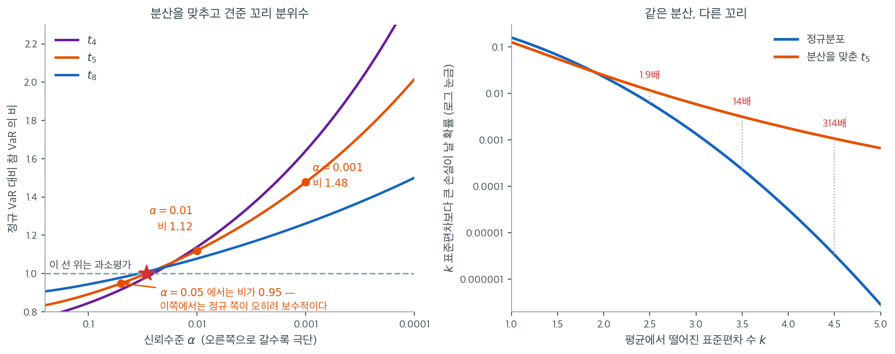
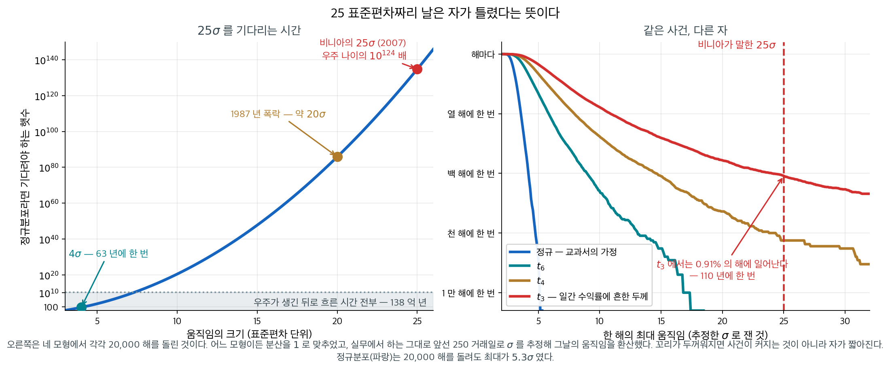

# 금융 수익률의 정규성

## 1. 동기

금융 수익률은 응용통계학에서 가장 많이 연구된 자료 가운데 하나이며, 그것이 정규분포를 따르는지에 대한 질문은 깊은 함의를 갖는다. 포트폴리오 최적화, 옵션 가격결정, 위험 관리가 모두 수익률 분포에 대한 가정에 의존한다. 수익률이 정규라면 많은 문제에 닫힌 형태의 해가 존재한다. 그렇지 않다면 그 해들이 위험을 과소평가하여 나쁜 결정으로 이어질 수 있다. 이 절은 수익률 분포에 대한 경험적 증거와 그 결과를 살펴본다.

---

## 2. 로그수익률과 정규 모형

한 기간 동안 자산의 **로그수익률**(연속복리 수익률)은

$$
r_t = \ln\left(\frac{P_t}{P_{t-1}}\right)
$$

여기서 $P_t$는 시점 $t$의 자산 가격이다. 정규 모형은 다음을 가정한다.

$$
r_t \overset{\text{iid}}{\sim} N(\mu, \sigma^2)
$$

이 모형은 (정규의 합이 정규이므로) 다기간 수익률도 정규임을 뜻하며, 가격 과정이 기하 브라운 운동을 따름을 함의한다.

$$
\ln P_T - \ln P_0 = \sum_{t=1}^{T} r_t \sim N(T\mu, T\sigma^2)
$$

정규 모형은 수학적으로 편리하지만 경험 자료는 그 예측을 일관되게 위배한다.

---

## 3. 정규성에 반하는 경험적 증거

### 두꺼운 꼬리

가장 견고한 경험적 발견은 금융 수익률 분포가 정규분포보다 **두꺼운 꼬리**를 갖는다는 것이다. 수익률이 정말로 평균 $\mu$, 표준편차 $\sigma$인 정규분포를 따른다면 평균에서 4 표준편차 넘게 벗어날 확률은

$$
P(|r_t - \mu| > 4\sigma) \approx 6.3 \times 10^{-5}
$$

곧 일간 자료로 약 63년에 한 번이다. 실제로 그런 사건은 훨씬 자주 일어난다. 1987년 10월 19일 주식시장 붕괴 때 일간 수익률이 약 $-22\%$였는데, 이는 정규 모형에서 대략 20 표준편차에 해당하며 사실상 확률이 0인 사건이다.

일간 주식 수익률의 **초과첨도**는 흔히 3에서 50 사이로, 정규분포의 0보다 훨씬 크다. 정규분포와 비교하여 꼬리와 중앙에 질량이 더 많고 그 중간 구역에는 더 적다는 뜻이다.

### 음의 왜도

주식 수익률은 **음의 왜도**를 보이는 경향이 있다. 같은 크기의 큰 양의 수익률보다 큰 음의 수익률이 더 흔하다는 뜻이다. 이 비대칭은 정규분포의 대칭성을 위배한다. 일간 주식 수익률의 전형적인 왜도 값은 $-0.5$에서 $-1.0$ 사이이다.

### 변동성 군집

수익률은 **변동성 군집**을 보인다. (부호와 무관하게) 큰 수익률 뒤에 큰 수익률이, 작은 수익률 뒤에 작은 수익률이 따라오는 경향이 있다. 곧 $r_t$와 $r_{t+1}$은 근사적으로 무상관일 수 있어도 독립은 아니다. 형식적으로 $|r_t|$나 $r_t^2$의 자기상관이 여러 시차에서 유의하게 양수이다.

$$
\text{Corr}(r_t^2, r_{t+h}^2) > 0 \quad (h = 1, 2, \ldots)
$$

이 패턴은 정규 모형의 독립동일분포 가정을 위배하며, 분산이 시간에 따라 변하도록 허용하는 GARCH 같은 모형을 낳는다.

### 집계에 따른 정규화

수익률의 기간이 길어질수록(일간에서 주간, 월간, 연간으로) 수익률의 분포가 정규에 가까워진다. 이는 중심극한정리의 한 형태와 일관된다. 일간 수익률이 분산이 유한하고 약하게 종속되어 있다면 더 긴 기간의 합은 정규로 수렴한다. 다만 수렴이 느려서 월간 수익률조차 탐지 가능한 초과첨도를 보이는 일이 많다.

---

## 4. 위험가치에 대한 함의

신뢰수준 $1 - \alpha$의 **위험가치**(VaR)는 확률 $\alpha$로 초과되는 손실 문턱값이다. 정규 모형에서는

$$
\text{VaR}_\alpha = -(\mu + z_\alpha \sigma)
$$

여기서 $z_\alpha$는 표준정규의 $\alpha$ 분위수이다. 정규분포가 꼬리 확률을 과소평가하므로 이 공식은 VaR를 체계적으로 과소평가한다.

예를 들어 1% 수준에서 정규 모형은 $z_{0.01} = -2.326$을 주므로

$$
\text{VaR}_{0.01} = -\mu + 2.326\,\sigma
$$

수익률이 실제로는 자유도 $\nu = 5$인 $t$ 분포를 따른다면(경험적으로 흔한 결과) 얼마나 달라질까?

!!! warning "분산을 맞추고 비교해야 한다"
    $t_5$ 분포의 1% 분위수는 $-3.365$이다. 이를 $z_{0.01} = -2.326$과 곧바로 비교하여 "45% 더 크다"고 말하는 것은 **틀렸다**. $t_5$의 분산은 1이 아니라 $\nu/(\nu-2) = 5/3$이므로 표준편차가 $1.291$이다. 두 분포의 분산을 맞춘 뒤 비교해야 공정하다.

    분산을 1로 표준화한 $t_5$의 1% 분위수는 $-3.365/1.291 = -2.607$이다. 정규의 $-2.326$보다 **12% 더 극단적**이다.

    다만 더 극단적인 수준으로 갈수록 격차가 빠르게 벌어진다.

    | $\alpha$ | 표준화한 $t_5$ 분위수 | 정규 $z_\alpha$ | 비 |
    |---|---|---|---|
    | 0.05 | $-1.561$ | $-1.645$ | 0.95 |
    | 0.01 | $-2.607$ | $-2.326$ | **1.12** |
    | 0.001 | $-4.565$ | $-3.090$ | **1.48** |

    5% 수준에서는 오히려 정규 쪽이 더 보수적이고(비 0.95), 1%에서 12%, 0.1%에서는 48% 과소평가가 된다. "정규 VaR가 꼬리 위험을 과소평가한다"는 명제는 **충분히 꼬리로 들어갔을 때** 성립하며, 그 정도는 신뢰수준에 크게 의존한다.

??? warning "정규 VaR는 꼬리 위험을 과소평가한다"
    VaR 계산에 정규분포를 쓰면 극단적 손실의 빈도와 크기를 체계적으로 과소평가하게 된다. Basel III 같은 규제 체계는 은행이 위험 모형에서 두꺼운 꼬리를 반영하도록 요구한다.

### 언제부터 과소평가가 되는가

위 표의 세 줄은 곡선 위의 세 점일 뿐이다. 곡선 전체를 그려 보면 "정규 VaR는 위험을 과소평가한다"는 명제가 조건부 명제임이 분명해진다.



왼쪽 칸의 가로축은 신뢰수준 $\alpha$이고 오른쪽으로 갈수록 극단으로 들어간다. 세로축은 참 VaR를 정규 VaR로 나눈 비이며, $1$보다 커야 정규 모형이 위험을 과소평가하는 것이다. $t_5$ 곡선(주황)이 $1$을 가로지르는 지점은 $\alpha = 0.029$다. 그보다 느슨한 수준 — 5%, 10% VaR — 에서는 비가 $1$보다 작아 **정규 모형이 오히려 더 보수적**이다. 꼬리가 두꺼운 분포는 같은 분산을 유지하려고 가운데를 좁게 모으기 때문에, 중간 정도의 분위수에서는 정규보다 덜 극단적이다.

$1\%$를 지나면서 상황이 뒤집힌다. $\alpha = 0.01$에서 비가 $1.12$, $\alpha = 0.001$에서 $1.48$이다. $t_4$(보라)처럼 꼬리가 더 두꺼우면 $0.001$ 수준에서 비가 $1.64$로 올라가고, $t_8$(파랑)처럼 가벼우면 $1.26$에 머문다. $0.0001$ 수준까지 내려가면 셋이 각각 $2.48$, $2.02$, $1.50$으로 벌어진다. **정규 가정의 위험은 신뢰수준과 꼬리의 두께에 함께 달려 있으며, 두 축 모두 극단으로 갈수록 빠르게 커진다.**

오른쪽 칸은 같은 사실을 규제 담당자의 언어로 옮긴 것이다. 평균에서 $k$ 표준편차 넘게 손실이 날 확률을 두 분포에서 비교하면, $k = 2.5$에서는 $1.9$배 차이에 불과하지만 $k = 3.5$에서 $14$배, $k = 4.5$에서 $314$배로 벌어진다. 앞 절에서 본 "4 표준편차 사건은 63년에 한 번"이라는 계산이 실제 시장에서 왜 그토록 빗나가는지가 이 비율에 들어 있다.

실무적 결론은 이렇다. 일상적인 $95\%$ VaR 보고서라면 정규 가정의 오차가 크지 않고 방향도 보수적인 쪽이다. 문제는 스트레스 테스트와 꼬리 위험 측정처럼 $99\%$ 너머로 들어가는 계산이다. 하필 그 영역에서 정규 가정의 오차가 가장 크고, 경험분위수로 그것을 대체하려 해도 표본이 부족해 추정이 가장 불안정하다.

<div class="storybox" markdown>

**「$25$ 표준편차짜리 날」**

2007 년 8 월, 신용시장이 처음 흔들리던 주에 골드만삭스의 재무책임자 데이비드 비니아가 파이낸셜 타임스에 이렇게 말했다.

> 우리는 $25$ 표준편차짜리 움직임을 **며칠 연속으로** 보고 있었습니다.

앞 절에서 $4\sigma$ 가 $63$ 년에 한 번이라고 계산했다. 같은 계산을 $25$ 까지 밀어 보자.

<figure markdown>
{ width="900" }
  <figcaption markdown>왼쪽 회색 띠는 우주가 생긴 뒤로 흐른 시간 **전부**다. $4\sigma$ 는 그 안에 들어가지만 $20\sigma$ 와 $25\sigma$ 는 눈금 바깥으로 한참 나간다.</figcaption>
</figure>

정규분포에서 $25\sigma$ 인 날을 기다리는 시간은 $6.5 \times 10^{134}$ 년이다. 우주의 나이가 $1.38 \times 10^{10}$ 년이니, **우주가 생긴 뒤로 흐른 시간의 $10^{124}$ 배**다. 그런 일이 사흘 연속으로 일어났다는 말이다.

그러니 저 문장은 둘 중 하나로 읽어야 한다.

- **(가)** 우주의 역사를 $10^{124}$ 번 되풀이해야 한 번 올 일이 사흘 내리 일어났다.
- **(나)** $25$ 라는 수를 만든 **자**가 틀렸다.

(나)다. 그리고 이것이 이 쪽에서 가장 중요한 문장이다. **$\sigma$ 는 하늘에서 주어진 상수가 아니라 자료에서 추정한 값이다.** 실무에서는 보통 앞선 $250$ 거래일, 곧 조용했던 지난 한 해로 추정한다. 큰 사건이 없던 창에서 잰 자를 들고 큰 사건을 재면 눈금이 터무니없이 커진다. **$25\sigma$ 는 사건의 크기가 아니라 자의 짧음을 잰 수다.**

오른쪽 그림이 그것이다. 특별한 모형을 쓰지 않았다 — 분산을 $1$ 로 맞춘 $t$ 분포에서 자료를 만들고, 실무자가 하는 그대로 앞선 $250$ 일로 $\sigma$ 를 추정해 환산했을 뿐이다.

| 모형 | 한 해 최댓값의 중앙값 | $\ge 10\sigma$ 인 해 | $\ge 25\sigma$ 인 해 |
|---|---|---|---|
| 정규 | $3.03\sigma$ | $0$ | $0$ |
| $t_6$ | $4.09\sigma$ | $0.5\%$ | $0$ |
| $t_4$ | $4.88\sigma$ | $4.2\%$ | $0.08\%$ |
| $t_3$ | $5.85\sigma$ | $12.9\%$ | $\mathbf{0.91\%}$ |

$t_3$ 는 기이한 분포가 아니라 일간 수익률에 흔한 두께다. 거기서는 $25\sigma$ 짜리 날이 **$110$ 년에 한 번** 생긴다. 반면 정규분포는 $20{,}000$ 해를 돌려도 최대가 $5.3\sigma$ 였다.

이 지적은 새것이 아니다. 만델브로는 1963 년에 목화 가격 자료에서 수익률이 정규가 아님을 보이며 꼬리가 거듭제곱으로 떨어진다고 주장했고, 1998 년 LTCM 이 무너질 때도 같은 말이 되풀이되었다. 그보다 앞서 1947 년에 기어리는 이렇게 썼다.

> 정규성은 신화다. 정규분포는 있었던 적도 없고 앞으로도 없을 것이다.
>
> — R. C. Geary, *Biometrika* (1947)

그는 모든 통계학 교과서가 이 문장을 **쪽마다 각주로** 달아야 한다고 덧붙였다.

</div>

---

## 5. 수익률의 정규성 검정

수익률 계열이 정규분포를 따르는지 검정하려면 표준적인 정규성 검정을 적용한다.

1. **Jarque-Bera 검정**: 왜도와 첨도가 정규값과 맞는지 검정한다. 가장 두드러진 두 이탈을 직접 겨냥하므로 금융에서 가장 흔히 쓰인다.
2. **Shapiro-Wilk 검정**: 검정력이 높은 범용 정규성 검정.
3. **Anderson-Darling 검정**: 꼬리 이탈에 특히 민감하여 금융 자료에 잘 맞는다.
4. **Q-Q 그림**: 오른쪽 꼬리가 위로, 왼쪽 꼬리가 아래로 휘는 모습으로 두꺼운 꼬리를 시각적으로 드러낸다.

<div class="exbox" markdown>

**보기 1.** <span class="diff easy" title="쉬움"></span> 모집단 왜도가 0인데 표본왜도가 $+1.43$ 이다. 자유도 5인 $t$ 분포에 $0.01$을 곱해 일간 수익률 1000일을 만들고, 요약통계·정규성 검정·1% VaR를 함께 구한다.

**(1)** $t_5$ 의 **모집단** 왜도와 초과첨도를 닫힌 꼴로 구하시오. 표본값은 $g_1 = +1.4292$, $g_2 = +17.3412$ 다. 왜 이렇게 벌어지는가. $t_5$ 에서 몇 차 적률까지 존재하는지로 설명하시오.

**(2)** 자르크–베라 통계량을 $g_1$, $g_2$ 로 직접 계산해 출력의 $12870.3735$ 와 맞추시오.

**(3)** 1% VaR 비가 $1.02$ 로 나왔다. 그런데 이 모형의 **참** 비는 앞 표의 $1.12$ 다. 어긋남이 어디서 왔는지 수로 분리하시오.

</div>

??? success "풀이"

    **쪽의 코드를 먼저 그대로 돌린다.**

    ```python
    import numpy as np
    from scipy import stats

    # ===================================================================
    # 모의 수익률로 정규성 검정 — 그리고 그것이 위험 측정에 미치는 영향
    # ===================================================================

    np.random.seed(42)

    # 자유도 5 인 t 로 일별 수익률을 만든다. 실제 수익률처럼 꼬리가 두껍다.
    n_days = 1000
    df = 5
    daily_returns = stats.t.rvs(df=df, size=n_days) * 0.01

    # 먼저 요약통계로 훑는다. 정규라면 왜도 0, 초과첨도 0 이어야 한다.
    skew = stats.skew(daily_returns)
    kurt = stats.kurtosis(daily_returns)  # excess kurtosis

    # 세 검정을 함께 돌린다. 셋의 결론이 갈리는 일은 드물지만, 무엇에
    # 민감한지가 서로 달라 함께 보면 이탈의 성격을 짐작할 수 있다.
    sw_stat, sw_p = stats.shapiro(daily_returns)
    jb_stat, jb_p = stats.jarque_bera(daily_returns)
    ad_result = stats.anderson(daily_returns, dist="norm")

    # 정규성이 깨졌을 때 실무에서 치르는 대가를 숫자로 본다. 정규를 가정한
    # VaR 은 꼬리 쪽 손실을 실제보다 작게 잡는다. 아래 비가 1 보다 크면
    # 정규 가정이 위험을 그만큼 과소평가하고 있다는 뜻이다.
    alpha = 0.01
    var_normal = -(np.mean(daily_returns)
                   + stats.norm.ppf(alpha) * np.std(daily_returns, ddof=1))
    var_empirical = -np.quantile(daily_returns, alpha)

    if __name__ == "__main__":
        print(f"Simulated daily returns (t-distribution, df={df})")
        print(f"  Skewness:        {skew:.4f}")
        print(f"  Excess kurtosis: {kurt:.4f}")
        print(f"\nNormality tests:")
        print(f"  Shapiro-Wilk:  W = {sw_stat:.4f}, p = {sw_p:.4f}")
        print(f"  Jarque-Bera:   JB = {jb_stat:.4f}, p = {jb_p:.4f}")
        print(f"  Anderson-Darling: A2 = {ad_result.statistic:.4f}")
        print(f"\n1% VaR comparison:")
        print(f"  Normal VaR:    {var_normal:.6f}")
        print(f"  Empirical VaR: {var_empirical:.6f}")
        print(f"  Ratio:         {var_empirical / var_normal:.2f}")
    ```

    출력:

    ```text
    Simulated daily returns (t-distribution, df=5)
      Skewness:        1.4292
      Excess kurtosis: 17.3412

    Normality tests:
      Shapiro-Wilk:  W = 0.9177, p = 0.0000
      Jarque-Bera:   JB = 12870.3735, p = 0.0000
      Anderson-Darling: A2 = 6.4988

    1% VaR comparison:
      Normal VaR:    0.030028
      Empirical VaR: 0.030613
      Ratio:         1.02
    ```

    세 검정이 모두 압도적으로 기각한다. 자료가 $t_5$ 에서 나왔으니 당연하다. 재미있는 것은 그다음이다.

    **(1) $t_5$ 의 모집단 왜도는 0이고 초과첨도는 6이다.** $t_\nu$ 는 0을 중심으로 **대칭**이므로 3차 중심적률이 존재하는 한(곧 $\nu > 3$) 왜도는 정확히 0이다. 초과첨도는 $\nu > 4$에서

    $$
    \gamma_2(\nu) = \frac{6}{\nu - 4}
    $$

    이고, $\nu = 5$면 $6/1 = 6$이다. 표본값과 나란히 놓으면

    | | 모집단 | 표본($n = 1000$) |
    |---|---|---|
    | 왜도 | $0$ | $g_1 = +1.4292$ |
    | 초과첨도 | $6$ | $g_2 = +17.3412$ |

    **왜도는 0이어야 하는데 $+1.43$이 나왔고, 초과첨도는 6이어야 하는데 세 배 가까운 $17.34$가 나왔다.** 자료가 1000개인데도 그렇다.

    까닭은 적률의 존재 범위다. $t_\nu$ 는 **$\nu$보다 낮은 차수의 적률만 갖는다.** $\nu = 5$면 1차부터 4차까지 존재하고 **5차 이상은 발산한다.** 그런데 표본왜도 $\hat g_1$의 분산을 계산하려면 **6차 적률**이, 표본 초과첨도 $\hat g_2$의 분산을 계산하려면 **8차 적률**이 필요하다. 둘 다 $t_5$ 에는 없다. 곧 이 두 추정량은 **분산이 무한**하다. 큰수의 법칙으로 참값에 수렴하기는 하지만(일치성은 4차 적률만 있으면 되므로 $g_2$는 아슬아슬하게 일치, $g_1$은 넉넉히 일치), **중심극한정리가 적용되지 않으므로 "표준오차 ± 몇 배" 같은 말을 할 수 없다.**

    모의실험으로 그 표집분포를 직접 보면 뚜렷하다.

    ```python
    import numpy as np
    from scipy import stats

    np.random.seed(42)
    r = stats.t.rvs(df=5, size=1000) * 0.01
    n, nu = 1000, 5
    g1, g2 = stats.skew(r), stats.kurtosis(r)   # 둘 다 bias=True 기본값

    print("(1) 모집단 대 표본")
    print(f"  왜도      모집단 0        표본 g1 = {g1:+.4f}")
    print(f"  초과첨도  모집단 {6/(nu-4):.1f}      표본 g2 = {g2:+.4f}")

    print("\n(2) 자르크-베라")
    print(f"  (n/6)(g1^2 + g2^2/4) = {(n/6)*(g1**2 + g2**2/4):.4f}")
    print(f"  scipy.stats.jarque_bera = {stats.jarque_bera(r)[0]:.4f}")

    print("\n(3) VaR 1% 분해")
    sig, z = 0.01*np.sqrt(nu/(nu-2)), stats.norm.ppf(0.01)
    s, m = r.std(ddof=1), r.mean()
    print(f"  참 sigma = {sig:.6f},  표본 s = {s:.6f},  s/sigma = {s/sig:.4f}")
    print(f"  정규 VaR (참 모수)  = {-(0 + z*sig):.6f}")
    print(f"  정규 VaR (표본 모수) = {-(m + z*s):.6f}")
    print(f"  참 t5 VaR           = {-0.01*stats.t.ppf(0.01, nu):.6f}")
    print(f"  경험 VaR            = {-np.quantile(r, 0.01):.6f}")
    print(f"  참 비 = {(-0.01*stats.t.ppf(0.01,nu))/(-(z*sig)):.4f}"
          f"   표본 비 = {(-np.quantile(r,0.01))/(-(m+z*s)):.4f}")
    f0 = stats.t.pdf(stats.t.ppf(0.01, nu), nu) / 0.01
    se = np.sqrt(0.01*0.99/n) / f0
    print(f"  1% 경험분위수 점근 SE = {se:.6f}"
          f"  (부족분 {(-0.01*stats.t.ppf(0.01,nu)) - (-np.quantile(r,0.01)):.6f}"
          f" = {((-0.01*stats.t.ppf(0.01,nu)) - (-np.quantile(r,0.01)))/se:.2f} SE)")

    print("\n(1) 보충 — g1, g2 의 표집분포 (t5, n=1000, 2000 회)")
    rng = np.random.default_rng(1)
    G1, G2 = [], []
    for _ in range(2000):
        x = stats.t.rvs(df=nu, size=n, random_state=rng)
        G1.append(stats.skew(x)); G2.append(stats.kurtosis(x))
    G1, G2 = np.array(G1), np.array(G2)
    print(f"  g1: 중앙값 {np.median(G1):+.3f}  2.5~97.5% [{np.percentile(G1,2.5):+.2f},"
          f" {np.percentile(G1,97.5):+.2f}]  최대절대 {np.abs(G1).max():.2f}")
    print(f"  g2: 중앙값 {np.median(G2):.2f}   2.5~97.5% [{np.percentile(G2,2.5):.2f},"
          f" {np.percentile(G2,97.5):.2f}]   최대 {G2.max():.1f}")
    print(f"  관측 g1 의 백분위 {100*(G1<g1).mean():.1f}%,  g2 의 백분위 {100*(G2<g2).mean():.1f}%")
    ```

    출력:

    ```text
    (1) 모집단 대 표본
      왜도      모집단 0        표본 g1 = +1.4292
      초과첨도  모집단 6.0      표본 g2 = +17.3412

    (2) 자르크-베라
      (n/6)(g1^2 + g2^2/4) = 12870.3735
      scipy.stats.jarque_bera = 12870.3735

    (3) VaR 1% 분해
      참 sigma = 0.012910,  표본 s = 0.012907,  s/sigma = 0.9998
      정규 VaR (참 모수)  = 0.030033
      정규 VaR (표본 모수) = 0.030028
      참 t5 VaR           = 0.033649
      경험 VaR            = 0.030613
      참 비 = 1.1204   표본 비 = 1.0195
      1% 경험분위수 점근 SE = 0.002884  (부족분 0.003036 = 1.05 SE)

    (1) 보충 — g1, g2 의 표집분포 (t5, n=1000, 2000 회)
      g1: 중앙값 -0.006  2.5~97.5% [-0.89, +0.95]  최대절대 16.65
      g2: 중앙값 2.95   2.5~97.5% [1.18, 14.65]   최대 422.1
      관측 g1 의 백분위 99.0%,  g2 의 백분위 98.2%
    ```

    표집분포가 사정을 전부 말해 준다. $g_1$의 **중앙값은 $-0.006$으로 참값 0에 정확히 앉아 있는데** 95% 구간이 $[-0.89,\ +0.95]$로 벌어지고 2000번 가운데 최대 절대값은 $16.65$까지 간다. 관측된 $+1.43$은 그 분포의 99 백분위다. 드물지만 놀랄 일은 아니다.

    $g_2$는 더 고약하다. 참값이 6인데 **중앙값이 $2.95$**로 절반도 안 되고, 95% 구간은 $[1.18,\ 14.65]$이며 최대는 $422$다. 분포가 극도로 오른쪽으로 치우쳐 있어서 **대부분의 표본은 참값을 크게 밑돌고 소수의 표본이 참값을 크게 넘어 평균을 맞춘다.** 관측된 $17.34$는 98 백분위에 해당한다. 그러므로 "초과첨도 17이니 꼬리가 $t_5$ 보다도 훨씬 두껍다"고 읽으면 **틀린다.** 자료는 정확히 $t_5$ 에서 나왔고, 17은 운이 나쁜(또는 극단값이 하나 더 들어온) 표본의 값일 뿐이다.

    실무적 함의가 있다. 본문이 "일간 주식 수익률의 초과첨도는 흔히 3에서 50 사이"라고 한 그 폭의 상당 부분은 **자산의 차이가 아니라 추정량의 변동**일 수 있다. 표본 첨도 하나로 꼬리 두께를 보고할 때는 점추정값만 적지 말고 부트스트랩 구간을 함께 적어야 하며, 꼬리지수 $\hat\nu$ 를 직접 추정하는 편이 더 안정적이다.

    **(2) 자르크–베라는 $g_1$과 $g_2$ 를 그대로 쓴다.**

    $$
    \mathrm{JB} = \frac{n}{6}\Bigl(g_1^2 + \frac{g_2^2}{4}\Bigr)
    $$

    에 $n = 1000$, $g_1 = 1.4292$, $g_2 = 17.3412$를 넣으면

    $$
    \frac{1000}{6}\Bigl(1.4292^2 + \frac{17.3412^2}{4}\Bigr) = 166.6667\,(2.0426 + 75.1793) = 12870.37
    $$

    이고, 코드가 준 $12870.3735$와 소수 넷째 자리까지 맞는다. `scipy.stats.jarque_bera`도 같은 값을 준다.

    여기서 판본이 결정적이다. 위 식에 들어가는 것은 **보정하지 않은** $g_1$, $g_2$ 이고, `scipy.stats.skew`·`kurtosis`의 기본값(`bias=True`, `fisher=True`)이 바로 그것이다. 보정판 $G_1$, $G_2$ 를 넣으면 값이 달라져 맞지 않는다. 또 분해를 보면 첨도 항 $g_2^2/4 = 75.18$이 왜도 항 $2.04$의 **37배**다. 이 자료의 JB를 밀어 올린 것은 거의 전부 첨도이며, 자유도 2의 $\chi^2$ 임계값 $5.99$에 비해 $12870$은 사실상 무한대다.

    **(3) 어긋남은 전부 경험분위수에서 왔다.** 네 수를 나란히 놓자.

    | | 값 |
    |---|---|
    | 정규 VaR, **참** 모수 $\sigma = 0.01\sqrt{5/3} = 0.012910$ | $0.030033$ |
    | 정규 VaR, **표본** 모수 $s = 0.012907$ | $0.030028$ |
    | **참** $t_5$ VaR $= -0.01\,t_{0.01,5} = 0.01 \times 3.36493$ | $0.033649$ |
    | **경험** VaR (1% 표본분위수) | $0.030613$ |

    분모 쪽은 거의 움직이지 않았다. $s/\sigma = 0.9998$이므로 표본 표준편차가 참 $\sigma$와 **소수 넷째 자리까지 같고**, 정규 VaR도 $0.030033$에서 $0.030028$로 $0.02\%$만 달라졌다. 어긋남은 분자 쪽이다. 경험 VaR $0.030613$이 참값 $0.033649$보다 $0.003036$ 작다.

    그 크기가 설명된다. 1% 표본분위수의 점근 표준오차는

    $$
    \mathrm{SE} = \frac{\sqrt{\alpha(1-\alpha)/n}}{f(q_\alpha)}
    $$

    이고, $\alpha = 0.01$, $n = 1000$, $f$ 가 자료의 밀도(척도 $0.01$인 $t_5$)일 때 $0.002884$다. 부족분 $0.003036$은 정확히 $1.05$ 표준오차다. **곧 이 표본의 비 $1.02$는 참값 $1.12$에서 한 표준오차만큼 벗어난 것이고, 그것으로 전부 설명된다.** 이유가 하나뿐인 셈이다. $n = 1000$에서 1% 분위수는 사실상 10번째로 작은 값이 어디에 떨어지느냐에 달려 있고, 이 표본에서는 그것이 $-0.0313$으로 참값보다 안쪽이었다.

    !!! warning "본문의 두 번째 이유는 이 표본에서 작동하지 않는다"
        바로 아래 주의 상자는 "정규 VaR가 표본 표준편차를 쓰는데 그 표준편차가 두꺼운 꼬리 때문에 이미 부풀려져 있어 정규 VaR도 함께 커진다"를 둘째 이유로 든다. 그러나 이 표본에서는 $s/\sigma = 0.9998$로 **부풀려지지 않았다.** 더 근본적으로, $t_5$ 는 4차 적률이 존재하므로 $s^2$ 은 $\sigma^2$ 의 **불편추정량**이고 꼬리가 두껍다는 사실만으로 체계적으로 커지지는 않는다. 두꺼운 꼬리가 하는 일은 $s$ 를 **크게 흔드는** 것이지 한쪽으로 밀어 올리는 것이 아니다. 그래서 어떤 표본에서는 정규 VaR가 커지고 어떤 표본에서는 작아진다.

        이 쪽에서 $1.12$가 $1.02$로 내려앉은 것은 **첫째 이유 하나로 충분히** 설명된다(부족분 $= 1.05\,\mathrm{SE}$).

!!! note "VaR 비가 1.02밖에 안 되는 이유"
    이론적으로 이 자료의 참 VaR 비는 위 표의 $1.12$여야 하는데 모의실험에서는 $1.02$가 나왔다. 두 가지 이유가 있다. 첫째, 관측값 1000개에서 추정한 1% 경험분위수는 사실상 10번째로 작은 값 근처이므로 변동이 매우 크다. 둘째, 정규 VaR가 **표본** 표준편차를 쓰는데 그 표준편차가 두꺼운 꼬리 때문에 이미 부풀려져 있어 정규 VaR도 함께 커진다.

    이것이 실무에서 중요한 교훈이다. 표본에서 추정한 변동성으로 정규 VaR를 계산하면 1% 수준에서는 문제가 잘 드러나지 않는다. 문제가 뚜렷해지는 것은 0.1% 같은 더 극단적인 수준이며, 하필 그때 경험분위수의 추정도 가장 불안정해진다.

---

## 연습문제

<div class="drillbox" markdown>

**연습문제 1.** <span class="diff med" title="중간"></span>
어떤 주식의 일간 수익률이 표본왜도 $-0.3$, 표본 초과첨도 $4.2$를 보인다. 이 기술통계에 근거할 때 정규 Q-Q 그림이 선형일 것으로 기대하는가? 설명하라.

</div>

??? success "풀이"
    아니다. 정규 자료는 왜도 $= 0$, 초과첨도 $= 0$이다. 초과첨도 4.2는 정규보다 훨씬 두꺼운 꼬리(고첨)를 나타내며, 극단적 수익률이 정규 모형의 예측보다 자주 일어난다는 뜻이다. 왜도 $-0.3$은 약간의 왼쪽 꼬리 비대칭을 나타낸다(큰 음의 수익률이 큰 양의 수익률보다 더 극단적이다).

    Q-Q 그림에서 두꺼운 꼬리는 양 끝에서 기준선에서 벗어나는 모습으로 나타난다(양의 첨도이므로 왼쪽은 선 아래, 오른쪽은 선 위). 음의 왜도는 왼쪽 꼬리의 이탈을 더 두드러지게 만든다. 중앙 부분은 대략 선형으로 보일 수 있다.

<div class="drillbox" markdown>

**연습문제 2.** <span class="diff med" title="중간"></span>
정규분포가 일간 주식 수익률의 나쁜 모형인 이유를 설명하라. 금융 수익률의 어떤 정형화된 사실이 정규성을 위배하는가?

</div>

??? success "풀이"
    정규성을 위배하는 핵심적인 정형화된 사실:

    1. **두꺼운 꼬리(초과첨도):** 극단적 수익률(폭락, 급등)이 정규분포의 예측보다 훨씬 자주 일어난다. 일간 수익률의 초과첨도는 대개 3–10 이상이다.
    2. **음의 왜도:** 큰 음의 수익률(폭락)이 큰 양의 수익률보다 더 극단적인 경향이 있다.
    3. **변동성 군집:** 변동성이 높은 시기가 몰려 나타나며(GARCH 효과) 정규 모형의 바탕인 독립동일분포 가정을 위배한다.
    4. **시간에 따라 변하는 모수:** 수익률의 평균과 분산이 시간에 따라 변한다.

    이런 특징 때문에 정규성에 기초한 위험 측도(예: 정규분위수로 계산한 VaR)는 꼬리 위험을 체계적으로 과소평가한다.

<div class="drillbox" markdown>

**연습문제 3.** <span class="diff med" title="중간"></span>
자유도 $\nu$인 $t$ 분포를 수익률 모형화에서 정규분포의 대안으로 쓰기도 한다. 두꺼운 꼬리를 더 잘 포착하는 이유는 무엇인가?

</div>

??? success "풀이"
    $t$ 분포는 정규분포보다 꼬리가 두꺼우며 그 두꺼움을 자유도 $\nu$가 조절한다. $\nu$가 작으면(예: 3–5) 꼬리가 훨씬 두껍고, $\nu \to \infty$이면 $t$ 분포가 정규로 수렴한다.

    꼬리 확률 $P(|X| > x)$가 $t$ 분포에서는 다항식으로($\sim x^{-\nu}$), 정규분포에서는 지수적으로($\sim e^{-x^2/2}$) 감소한다. 곧 $t$ 분포는 극단적 사건에 훨씬 높은 확률을 부여하여 큰 주가 변동이 관측되는 빈도와 더 잘 맞는다.

    일간 수익률에 $t$ 분포를 적합하면 대개 $\hat{\nu} \approx 3\text{–}8$이 나오며, 정규분포보다 현실적인 VaR와 기대손실 추정을 준다.

<div class="drillbox" markdown>

**연습문제 4.** <span class="diff med" title="중간"></span>
어떤 위험 관리자가 일간 수익률 252개에 Jarque-Bera 검정을 수행하여 $p < 0.001$을 얻었다. 무엇을 결론짓고 어떤 조치를 취해야 하는가?

</div>

??? success "풀이"
    Jarque-Bera 검정이 정규성을 강하게 기각하며, 이는 일간 금융 수익률에서 거의 보편적으로 참인 사실을 확인해 준다. 결론은 정규 기반 위험 모형이 꼬리 위험을 과소평가하리라는 것이다.

    조치:

    1. VaR와 기대손실 계산에 **꼬리가 두꺼운 분포**(스튜던트 $t$, 일반화 쌍곡분포)를 쓴다.
    2. 모수적 정규 방법 대신 **역사적 시뮬레이션**이나 **필터링된 역사적 시뮬레이션**을 적용한다.
    3. 변동성 군집을 반영하기 위해 **GARCH 모형**을 고려한다(분산이 시간에 따라 변하는 조건부 정규성).
    4. **스트레스 테스트:** 통계 모형을 극단적 사건에 대한 시나리오 기반 스트레스 테스트로 보완한다.

<div class="drillbox" markdown>

**연습문제 5.** <span class="diff med" title="중간"></span>
3절은 정규 모형에서 $P(\lvert r_t - \mu \rvert > 4\sigma) \approx 6.3 \times 10^{-5}$ 이고 이것이 "일간 자료로 약 63년에 한 번"이라고 했다. 한 해를 252 거래일로 둔다.

**(1)** 63년이라는 수가 어디서 나왔는지 보이시오.

**(2)** 4절 그림의 오른쪽 칸은 $k = 4.5$ 에서 꼬리 확률의 비가 $314$ 배라고 했다. 정규 모형과 분산을 맞춘 $t_5$ 각각에서 "$4.5$ 표준편차 넘는 손실"의 평균 대기시간을 거래일과 해 단위로 구하시오. 정규 쪽 꼬리 확률은 $2\{1 - \Phi(4.5)\} = 6.795 \times 10^{-6}$ 이다.

**(3)** 1987년 10월 19일의 $-22\%$ 는 정규 모형에서 약 20 표준편차다. $P(Z < -z) \approx \varphi(z)/z$ 로 대기시간을 어림하고, 본문이 이를 "사실상 확률이 0인 사건"이라 부른 까닭을 한 줄로 쓰시오.

</div>

??? success "풀이"
    **(1)** 사건이 하루에 확률 $6.3 \times 10^{-5}$ 로 독립하게 일어난다면 평균 대기시간은 그 역수다.

    $$
    \frac{1}{6.3 \times 10^{-5}} = 15873\ \text{거래일}, \qquad \frac{15873}{252} = 63.0\ \text{해}
    $$

    정확한 값 $2\{1 - \Phi(4)\} = 6.3343 \times 10^{-5}$ 을 쓰면 $15787$ 거래일, 곧 $62.6$ 해다. 본문의 63년은 이 계산이다.

    **(2)** 정규 모형에서는

    $$
    \frac{1}{6.795 \times 10^{-6}} = 147160\ \text{거래일} = 584\ \text{해}
    $$

    분산을 맞춘 $t_5$ 에서는 꼬리 확률이 $314$ 배이므로

    $$
    314 \times 6.795 \times 10^{-6} = 2.134 \times 10^{-3}, \qquad \frac{1}{2.134 \times 10^{-3}} = 469\ \text{거래일} = 1.86\ \text{해}
    $$

    확률의 비가 $314$ 이면 대기시간의 비도 정확히 $314$ 다($584/1.86 = 314$). **같은 사건이 한 모형에서는 584년에 한 번이고 다른 모형에서는 1년 10개월에 한 번이다.** 분산이 같은 두 분포 사이에서 벌어진 차이다.

    **(3)** $z = 20$ 에서

    $$
    \varphi(20) = \frac{e^{-200}}{\sqrt{2\pi}} = \frac{1.384 \times 10^{-87}}{2.5066} = 5.52 \times 10^{-88}
    $$

    이므로 한쪽 꼬리가 $\varphi(20)/20 = 2.76 \times 10^{-89}$, 양쪽이 $5.5 \times 10^{-89}$ 다. 대기시간은

    $$
    \frac{1}{5.5 \times 10^{-89}} = 1.8 \times 10^{88}\ \text{거래일} = 7.2 \times 10^{85}\ \text{해}
    $$

    우주의 나이 $1.4 \times 10^{10}$ 해의 약 $5 \times 10^{75}$ 배다. 정규 꼬리는 $e^{-k^2/2}$ 로 줄기 때문에 $k$ 가 $4$ 에서 $20$ 으로 다섯 배가 되는 동안 대기시간은 $63$ 해에서 $10^{85}$ 해로 뛴다. **그러니 이 사건이 한 번 관측되었다는 사실 하나만으로도 정규 모형은 기각된다.** 어떤 표본크기도 필요하지 않다.

<div class="drillbox" markdown>

**연습문제 6.** <span class="diff med" title="중간"></span>
5절은 자르크–베라를 "왜도와 첨도가 정규값과 맞는지" 보는 검정으로 소개했다. 이 검정이 3차·4차 적률만 본다는 사실의 대가를 반례로 확인한다.

확률변수 $X$ 가 세 값 $-a,\ 0,\ +a$ ($a > 0$) 를 각각 확률 $q,\ 1 - 2q,\ q$ 로 갖는다고 하자($0 < q \le 1/2$).

**(1)** $X$ 의 왜도가 $0$ 임을 보이고 초과첨도 $\gamma_2$ 를 $q$ 로 나타내시오.

**(2)** $\gamma_2 = 0$ 이 되는 $q$ 를 구하시오. 2장의 부등식 $\beta_2 \ge 1 + \gamma_1^2$ 와 견주어, 이 족에서 $\beta_2$ 가 갖는 값의 범위를 적으시오.

**(3)** (2)의 분포에서 뽑은 크기 $n$ 의 표본에 자르크–베라를 적용한다. 보기 1 의 $\mathrm{JB} = (n/6)(g_1^2 + g_2^2/4)$ 를 써서, $n \to \infty$ 에서 통계량이 발산하지 **않는** 까닭을 쓰시오.

**(4)** 5절이 든 네 도구 가운데 이 이탈을 잡아내는 것은 무엇인가. Q-Q 그림은 어떤 모양이 되는가.

</div>

??? success "풀이"
    **(1)** 분포가 $0$ 을 중심으로 대칭이므로 $E[X] = 0$ 이고 홀수차 중심적률이 모두 $0$ 이다. 특히 $\mu_3 = 0$ 이므로 $\gamma_1 = \mu_3/\mu_2^{3/2} = 0$ 이다. 짝수차 적률은

    $$
    \mu_2 = 2qa^2, \qquad \mu_4 = 2qa^4
    $$

    이므로

    $$
    \beta_2 = \frac{\mu_4}{\mu_2^2} = \frac{2qa^4}{4q^2a^4} = \frac{1}{2q}, \qquad \gamma_2 = \frac{1}{2q} - 3
    $$

    $a$ 는 약분되어 사라진다. 척도는 왜도·첨도를 바꾸지 못하므로 당연하다.

    **(2)** $1/(2q) = 3$ 에서 $q = 1/6$ 이다. 곧

    $$
    P(X = -a) = P(X = +a) = \tfrac{1}{6}, \qquad P(X = 0) = \tfrac{2}{3}
    $$

    이 분포는 **왜도 $0$, 초과첨도 $0$ 인데 정규가 아니다.** 값이 셋뿐인 이산분포이고 전체 질량의 $2/3$ 가 한 점에 얹혀 있다. $a = \sqrt{3}$ 으로 두면 분산이 $1$ 이 되어 표준정규와 1·2·3·4차 적률이 **모두** 같아진다. 갈라지는 것은 6차부터다. $\mu_6 = 2 \cdot \tfrac16 \cdot 27 = 9$ (정규는 $15$), $\mu_8 = 2 \cdot \tfrac16 \cdot 81 = 27$ (정규는 $105$).

    $q$ 가 $(0, 1/2]$ 를 움직이면 $\beta_2 = 1/(2q)$ 가 $[1, \infty)$ 를 쓸고 간다. 아래끝 $\beta_2 = 1$ 은 $q = 1/2$ 곧 $\pm a$ 두 점에 반반인 분포이고, 이것이 2장의 하한 $\beta_2 \ge 1 + \gamma_1^2 = 1$ 을 등호로 만족한다. 정규값 $\beta_2 = 3$ 은 그 범위의 **안쪽** 점이므로 반례가 존재할 수밖에 없다.

    **(3)** $g_1$ 과 $g_2$ 는 모집단 값 $0$ 과 $0$ 으로 수렴하고, 4차까지의 적률이 모두 유한하므로 각각 $O_p(n^{-1/2})$ 다. 따라서 $n g_1^2$ 과 $n g_2^2$ 은 $O_p(1)$ 이고

    $$
    \mathrm{JB} = \frac{n}{6}\Bigl(g_1^2 + \frac{g_2^2}{4}\Bigr) = O_p(1)
    $$

    곧 $n$ 이 커져도 통계량이 커지지 않는다. 기각확률이 $1$ 로 가지 않으므로 **자르크–베라는 이 대안에 대해 일치검정이 아니다.**

    모의실험으로 보면 사정이 더 나쁘다($a = \sqrt3$, 2만 회, 유의수준 5%).

    | $n$ | JB 기각률 | JB 평균 |
    |---|---|---|
    | $100$ | $1.6\%$ | $0.90$ |
    | $1000$ | $0.6\%$ | $0.75$ |
    | $10000$ | $0.6\%$ | $0.76$ |

    기각률이 명목수준 $5\%$ 에도 못 미친다. $\mu_6,\ \mu_8$ 이 정규의 값보다 작아 $g_1,\ g_2$ 가 $\chi^2_2$ 눈금이 전제하는 것보다 **덜** 흔들리기 때문이다. 자료가 아무리 많아도 자르크–베라는 이 분포를 정규로 통과시킨다.

    **(4)** 섀피로–윌크와 앤더슨–달링, 그리고 Q-Q 그림이 즉시 잡아낸다. 같은 모의실험에서 $n = 100$ 만으로도 섀피로–윌크의 기각률이 $100.0\%$ 다. 순서통계량 전체를 보는 검정이기 때문이다. Q-Q 그림은 세 개의 **수평 고원**이 된다. 가로축이 정규 분위수로 퍼지는 동안 세로축의 값은 $-a,\ 0,\ +a$ 셋만 나오므로, 가운데 고원 하나에 점의 $2/3$ 가 일직선으로 눌려 앉는다.

    교훈은 이렇다. 자르크–베라는 자료에서 **두 개의 수만** 읽는다. 그 두 수를 정규값에 맞추면서 정규와 전혀 다를 수 있으므로, 금융에서 흔히 쓰인다는 사실이 이 검정을 통과한 자료를 정규로 믿을 근거가 되지는 못한다. 자르크–베라의 강점은 금융 자료의 이탈이 **하필 3차·4차에 크게 나타난다**는 경험적 사실에 기대고 있을 뿐이다.

<div class="drillbox" markdown>

**연습문제 7.** <span class="diff hard" title="어려움"></span>
4절은 분산을 맞춘 $t_5$ 의 VaR 비 곡선이 $1$ 을 가로지르는 지점이 $\alpha = 0.029$ 라고 했다. 그 교차점이 왜 **존재해야** 하는지를 보인다.

$c = \sqrt{\nu/(\nu-2)}$, 분산을 $1$ 로 맞춘 $t_\nu$ 의 $\alpha$ 분위수를 $q^*_\alpha = t_{\alpha,\nu}/c$, 그 밀도를 $f^*$ 라 하고

$$
R(\alpha) = \frac{q^*_\alpha}{z_\alpha} \quad (0 < \alpha < 1/2)
$$

로 둔다. 본문 표의 세 값은 $R(0.05) = 0.95$, $R(0.01) = 1.12$, $R(0.001) = 1.48$ 이다.

**(1)** $\alpha \to 0^+$ 에서 $R(\alpha) \to \infty$ 임을 설명하시오. 연습문제 3 의 두 꼬리 $x^{-\nu}$ 와 $e^{-x^2/2}$ 를 쓰라.

**(2)** $\alpha \to 1/2^-$ 에서 $R(\alpha) \to \varphi(0)/f^*(0)$ 임을 보이고 $\nu = 5$ 에서 그 값을 구하시오. $f_{t_5}(0) = 0.37961$ 이다.

**(3)** (1)(2)로 교차점의 존재를 결론짓고, 두꺼운 꼬리를 가진 분포가 가운데에서는 오히려 덜 극단적이어야 하는 까닭을 한 줄로 쓰시오.

**(4)** $97.1\%$ VaR 만 보고하는 은행은 정규 가정의 오차를 전혀 보지 못한다. 같은 은행이 $99.9\%$ 와 $99.99\%$ 로 옮기면 오차가 얼마가 되는가.

</div>

??? success "풀이"
    **(1)** 두 꼬리의 모양이 분위수의 증가 속도를 정한다. $t_\nu$ 는 $P(T < -x) \sim C_\nu x^{-\nu}$ 이므로 $\alpha = C_\nu \lvert q_\alpha \rvert^{-\nu}$ 에서

    $$
    \lvert q^*_\alpha \rvert \asymp \alpha^{-1/\nu}
    $$

    곧 $1/\alpha$ 의 **거듭제곱**으로 커진다. 정규는 $1 - \Phi(x) \approx \varphi(x)/x$ 이므로 $\alpha \approx e^{-z^2/2}$ 꼴에서

    $$
    \lvert z_\alpha \rvert \sim \sqrt{2 \ln(1/\alpha)}
    $$

    곧 $\ln(1/\alpha)$ 의 **제곱근**으로만 커진다. 따라서

    $$
    R(\alpha) \asymp \frac{\alpha^{-1/\nu}}{\sqrt{2\ln(1/\alpha)}} \longrightarrow \infty
    $$

    거듭제곱이 로그의 제곱근을 이기기 때문이다. $\nu = 5$ 에서 실제 값은 $R(10^{-4}) = 2.02$, $R(10^{-5}) = 2.82$, $R(10^{-6}) = 4.04$, $R(10^{-8}) = 8.61$ 이다. 발산은 하지만 매우 느리다.

    **(2)** $\alpha \to 1/2$ 면 두 분위수가 모두 $0$ 으로 간다. 분포함수를 $0$ 에서 전개하면

    $$
    \alpha = F^*(q^*_\alpha) = \tfrac12 + f^*(0)\, q^*_\alpha + O\bigl((q^*_\alpha)^3\bigr)
    $$

    이므로 $q^*_\alpha \approx (\alpha - 1/2)/f^*(0)$ 이고, 정규도 같은 꼴로 $z_\alpha \approx (\alpha - 1/2)/\varphi(0)$ 이다. 비를 취하면 $(\alpha - 1/2)$ 가 약분되어

    $$
    R(\alpha) \to \frac{\varphi(0)}{f^*(0)}
    $$

    $f^*$ 는 $T/c$ 의 밀도이므로 $f^*(x) = c\,f_{t_\nu}(cx)$ 이고 $f^*(0) = c\,f_{t_5}(0)$ 이다. $c = \sqrt{5/3} = 1.29099$ 이므로

    $$
    f^*(0) = 1.29099 \times 0.37961 = 0.49007, \qquad \frac{\varphi(0)}{f^*(0)} = \frac{0.39894}{0.49007} = 0.8141
    $$

    **(3)** $R$ 는 $(0, 1/2)$ 에서 연속이고 오른쪽 끝에서 $0.814 < 1$, 왼쪽 끝에서 $+\infty$ 이므로 중간값 정리로 $R(\alpha^*) = 1$ 인 $\alpha^*$ 가 존재한다. 본문 표만으로도 $R(0.05) = 0.95 < 1 < 1.12 = R(0.01)$ 이니 $\alpha^* \in (0.01, 0.05)$ 이고, 실제로 $\alpha^* = 0.0292$ 다.

    까닭은 분산을 맞췄다는 데 있다. **분산이 같은데 꼬리에 질량을 더 보냈으면 그만큼을 가운데에서 가져올 수밖에 없다.** 그 결과 표준화한 $t_5$ 의 중앙 밀도 $0.49007$ 이 정규의 $0.39894$ 보다 $23\%$ 높고, 중간 정도의 분위수에서는 $t_5$ 가 정규보다 $0$ 에 더 가깝다.

    꼬리가 두꺼울수록 교차점이 왼쪽으로 간다. $\nu = 4,\ 5,\ 8$ 에서 $\alpha^* = 0.0253,\ 0.0292,\ 0.0344$ 다. 꼬리가 두꺼운 자료일수록 "정규가 보수적인" 구간이 **좁아진다.**

    **(4)** $\alpha^* = 0.029$ 는 신뢰수준 $97.1\%$ 다. 하필 그 수준에서는 정규 VaR 와 참 VaR 가 **정확히 같아서** 오차가 $0$ 이다. 그러나 $\alpha = 0.001$ 에서 비가 $1.48$, $\alpha = 0.0001$ 에서 $2.02$ 다. 곧 $99.9\%$ 에서 $48\%$, $99.99\%$ 에서 $102\%$ 과소평가다. **"정규 가정으로 해 보니 괜찮았다"는 경험은 어느 신뢰수준에서 확인했는지를 적지 않으면 아무 뜻이 없다.**

<div class="drillbox" markdown>

**연습문제 8.** <span class="diff hard" title="어려움"></span>
3절의 "집계에 따른 정규화"를 검정력의 말로 옮긴다. 일간 로그수익률 $r_t$ 가 독립이고 보기 1 처럼 초과첨도 $\gamma_2 = 6$, 왜도 $0$ 이라 하자. 한 달을 21 거래일, 한 해를 252 거래일로 둔다.

**(1)** 독립인 $m$ 개의 합 $S_m = r_1 + \cdots + r_m$ 의 초과첨도가 $\gamma_2/m$ 임을 4차 누적률의 가법성으로 보이시오.

**(2)** 25년 자료, 곧 $6300$ 거래일이 있다. 일간 수익률 $6300$ 개와 월간 수익률 $300$ 개에 각각 자르크–베라를 적용할 때의 통계량을 구하시오(표본 적률이 모집단 적률과 같다고 두라). 자유도 2 의 $5\%$ 임계값은 $5.991$ 이다.

**(3)** 월간 수익률만으로 정규성을 기각하려면 몇 달이 필요한가. 몇 해인가.

**(4)** 주간(5 거래일)은 어떤가. 그리고 본문이 "월간 수익률조차 탐지 가능한 초과첨도를 보이는 일이 많다"고 한 것과 (2)(3)을 어떻게 화해시킬 수 있는가. 두 가지를 들라.

</div>

??? success "풀이"
    **(1)** 누적률은 독립인 확률변수의 합에서 더해진다. $\kappa_2(S_m) = m\kappa_2$, $\kappa_4(S_m) = m\kappa_4$ 이고 초과첨도는 $\gamma_2 = \kappa_4/\kappa_2^2$ 이므로

    $$
    \gamma_2(S_m) = \frac{m\kappa_4}{(m\kappa_2)^2} = \frac{1}{m}\cdot\frac{\kappa_4}{\kappa_2^2} = \frac{\gamma_2}{m}
    $$

    왜도도 같은 셈으로 $\gamma_1(S_m) = \gamma_1/\sqrt{m}$ 이다. 이것이 "집계하면 정규에 가까워진다"의 정량적 내용이며, 수렴 속도는 $1/m$ 과 $1/\sqrt m$ 이다.

    **(2)** 일간은 $n = 6300$, $\gamma_2 = 6$ 이므로

    $$
    \mathrm{JB} = \frac{6300}{6}\Bigl(0 + \frac{6^2}{4}\Bigr) = 1050 \times 9 = 9450
    $$

    월간은 $m = 21$ 이므로 $\gamma_2 = 6/21 = 0.2857$ 이고 $n = 300$ 이므로

    $$
    \mathrm{JB} = \frac{300}{6}\Bigl(\frac{0.2857^2}{4}\Bigr) = 50 \times 0.020408 = 1.02
    $$

    $5.991$ 에 한참 못 미친다. **같은 자료를 25년 모아도 월간으로 집계하면 정규성을 기각할 수 없고, 일간으로 보면 $9450$ 으로 압살한다.** 두 통계량의 비가 $9260$ 배다.

    **(3)** $\gamma_1 = 0$ 이므로 조건은

    $$
    \frac{n}{6}\cdot\frac{\gamma_2^2}{4} \ge 5.991 \iff n \ge \frac{24 \times 5.991}{\gamma_2^2} = \frac{143.79}{0.2857^2} = \frac{143.79}{0.081633} = 1761.5
    $$

    곧 $1762$ 달 $= 146.8$ 해, 약 **147년**이다. 일간 자료로는 $143.79/36 = 4.0$, 곧 나흘이면 끝나는 판정을 월간 자료로는 147년 치를 모아야 한다. $\gamma_2$ 가 $m$ 에 반비례하고 검정력은 $\gamma_2^2$ 에 비례하므로, 집계는 필요 표본수를 $m^2$ 배로 밀어 올린다. 반면 집계로 줄어드는 표본수는 $m$ 배뿐이다. 그래서 순손실이 $m$ 배, 여기서는 21 배다.

    **(4)** 주간은 $m = 5$ 이므로 $\gamma_2 = 1.2$, $n = 6300/5 = 1260$ 이고

    $$
    \mathrm{JB} = \frac{1260}{6}\Bigl(\frac{1.2^2}{4}\Bigr) = 210 \times 0.36 = 75.6
    $$

    기각에 필요한 주 수는 $143.79/1.44 = 99.9$, 곧 100주 약 2년이다. 주간까지는 쉽게 잡힌다.

    화해하는 길이 둘이다.

    첫째, 실제 일간 초과첨도가 $6$ 보다 훨씬 크다. 본문은 일간 초과첨도가 흔히 3에서 50 사이라고 했다. $\gamma_2 = 20$ 이면 월간이 $20/21 = 0.952$ 이고 $n = 300$ 에서

    $$
    \mathrm{JB} = 50 \times \frac{0.952^2}{4} = 11.3 > 5.991
    $$

    로 기각된다. 월간에서도 탐지되려면 일간 첨도가 꽤 커야 한다는 조건부 진술인 셈이다.

    둘째, **일간 수익률은 독립이 아니다.** 3절의 변동성 군집이 바로 그 위배이고, $r_t^2$ 의 자기상관이 양수이면 합의 4차 누적률이 $m\kappa_4$ 보다 커져 초과첨도가 $\gamma_2/m$ 보다 **느리게** 줄어든다. 곧 (1)의 $1/m$ 은 독립일 때의 가장 빠른 감소이고, 실제 자료의 집계는 그보다 정규화가 덜 된다. 본문이 "수렴이 느려서"라고 적은 것의 정체가 이것이다.

<div class="drillbox" markdown>

**연습문제 9.** <span class="diff hard" title="어려움"></span>
5절은 앤더슨–달링을 "꼬리 이탈에 특히 민감하여 금융 자료에 잘 맞는다"고 했다. 그 민감함이 어디서 오고 무엇을 뜻하는지 가중함수로 따진다. 콜모고로프–스미르노프의 통계량과 나란히 둔다.

$$
D = \sup_x \lvert F_n(x) - F(x) \rvert, \qquad A^2 = n\int \frac{\{F_n(x) - F(x)\}^2}{F(x)\{1 - F(x)\}}\, dF(x)
$$

**(1)** $u = F(x)$ 로 바꾸면 $F_n - F$ 의 분산이 $u(1-u)/n$ 이다. 이 사실로 $A^2$ 의 가중함수 $1/\{u(1-u)\}$ 가 하는 일을 설명하시오.

**(2)** 가중함수의 값을 $u = 0.5,\ 0.05,\ 0.01,\ 0.001$ 에서 구하고, $u = 0.001$ 의 이탈이 중앙의 이탈보다 몇 배로 셈해지는지 적으시오.

**(3)** $F(x) < 0.01$ 인 영역에서 $F(x) - F_n(x)$ 가 가질 수 있는 값의 상한을 적으시오. 보기 1 의 자료에서는 $D = 0.0544$ 이고 그 최대가 $F = 0.747$ 에서 일어났으며, $F < 0.01$ 영역의 최대 이탈은 $0.0033$ 이었다. $D$ 가 꼬리를 볼 수 없는 구조적 이유를 쓰시오.

**(4)** 보기 1 의 자료에서 $A^2 = 6.4988$ 을 영역별로 쪼개면 아래와 같다. 가중을 뺀 크라메르–폰 미제스 통계량 $W^2 = n\int (F_n - F)^2 dF = 0.9992$ 의 쪼갬을 나란히 적었다.

| 영역 | $A^2$ 의 몫 | $W^2$ 의 몫 |
|---|---|---|
| $F < 0.05$ | $0.082\ (1.3\%)$ | $0.0022\ (0.2\%)$ |
| $0.05 \le F \le 0.95$ | $6.232\ (95.9\%)$ | $0.9949\ (99.6\%)$ |
| $F > 0.95$ | $0.185\ (2.8\%)$ | $0.0021\ (0.2\%)$ |

"앤더슨–달링이 꼬리에 민감하다"는 말을 이 표에 비추어 정확히 다시 쓰시오. 꼬리가 두꺼운 자료인데도 중앙의 몫이 이렇게 큰 까닭은 무엇인가(연습문제 7 을 쓰라).

</div>

??? success "풀이"
    **(1)** 경험분포 과정 $F_n - F$ 의 표준편차가 $\sqrt{u(1-u)/n}$ 이므로 양 끝 $u \to 0,\ 1$ 에서 흔들림 자체가 $0$ 으로 줄어든다. 가중하지 않은 적분은 **이탈의 절대 크기**를 재므로 꼬리에서 거의 아무 기여도 받지 못한다. 꼬리에 신호가 없어서가 아니라 꼬리에서는 모든 것의 눈금이 작기 때문이다.

    $u(1-u)$ 로 나누면 피적분함수가

    $$
    \frac{\{F_n - F\}^2}{u(1-u)} = \frac{1}{n}\left(\frac{F_n - F}{\sqrt{u(1-u)/n}}\right)^2
    $$

    곧 **표준화한 이탈의 제곱**이 된다. 모든 분위수가 같은 눈금으로 환산되어 똑같은 무게로 더해진다. 그러므로 앤더슨–달링은 꼬리를 과대평가하는 것이 아니라 **꼬리를 과소평가하기를 그만두는** 통계량이다.

    **(2)** $w(u) = 1/\{u(1-u)\}$ 이므로

    | $u$ | $w(u)$ | 중앙 대비 |
    |---|---|---|
    | $0.5$ | $4.00$ | $1$ 배 |
    | $0.05$ | $21.05$ | $5.3$ 배 |
    | $0.01$ | $101.01$ | $25.3$ 배 |
    | $0.001$ | $1001.0$ | $250.3$ 배 |

    $0.1\%$ 분위수 근처의 이탈은 중앙의 같은 크기 이탈보다 $250$ 배로 셈해진다.

    **(3)** $F_n \ge 0$ 이므로 그 영역에서

    $$
    F(x) - F_n(x) \le F(x) < 0.01
    $$

    곧 **모형이 자료보다 꼬리를 두껍게 보는 방향의 이탈은 $0.01$ 로 꽉 막혀 있다.** 반대 방향 $F_n - F$ 도 자료가 그 영역에 가진 질량만큼만 커질 수 있고, 꼬리의 과잉이 두 배라도 $0.01$ 규모를 넘지 못한다. 그래서 이 자료에서도 $F < 0.01$ 영역의 최대 이탈이 $0.0033$ 에 그쳤다.

    한편 중앙에서는 $u(1-u)$ 가 크므로 이탈이 $0.05$ 규모로 쉽게 나온다. 실제로 $D = 0.0544$ 가 $F = 0.747$ 에서, 곧 중앙 오른쪽에서 달성되었고 이는 꼬리 이탈의 $16$ 배다. **$D$ 는 가중 없는 상한이므로 거의 언제나 중앙에서 결정된다.** 자료의 꼬리가 아무리 두껍든 꼬리는 $D$ 의 값에 끼어들 기회가 없다. 이것이 콜모고로프–스미르노프가 금융 자료에 약한 구조적 이유다.

    **(4)** 표가 말하는 것은 **상대적** 사실이다. 꼬리 두 영역의 몫이 $W^2$ 에서는 $0.43\%$ 인데 $A^2$ 에서는 $4.1\%$ 다. 가중함수가 꼬리의 발언권을 약 $10$ 배로 키웠다. 그러므로 정확한 진술은 "앤더슨–달링은 **같은 류의 가중 없는 통계량에 비해** 꼬리의 이탈에 훨씬 큰 무게를 준다"이고, "앤더슨–달링의 값은 주로 꼬리에서 온다"는 아니다.

    중앙의 몫이 여전히 $96\%$ 인 까닭은 연습문제 7 에 있다. 분산을 맞춘 $t_5$ 와 정규는 **중앙에서 밀도가 가장 크게 어긋난다**($0.49007$ 대 $0.39894$, $23\%$ 차이). 자료가 꼬리에서 두껍다는 것은 분포함수의 **차이**가 꼬리에서 크다는 뜻이 아니다. 꼬리에서는 두 분포함수가 둘 다 $0$ 에 붙어 있어 차이가 작을 수밖에 없고, 어긋남이 눈에 보이는 규모로 나타나는 곳은 가운데다.

    실무적으로 둘을 갈라 읽어야 한다. 정규성을 **기각**하는 일이라면 중앙의 이탈만으로도 충분하고 어떤 통계량을 쓰든 기각된다($A^2 = 6.4988$ 은 $5\%$ 임계값 $0.784$ 의 $8.3$ 배다). 그러나 꼬리의 모양을 **재는** 일, 곧 VaR 와 스트레스 테스트라면 중앙에서 잘 맞는 적합은 아무 보증도 주지 않으므로 꼬리를 직접 겨냥한 가중이 필요하다.

<div class="drillbox" markdown>

**연습문제 10.** <span class="diff hard" title="어려움"></span>
3절은 변동성 군집 때문에 $r_t$ 와 $r_{t+1}$ 이 무상관이어도 독립은 아니라고 했고, 연습문제 4 의 풀이는 GARCH 를 "분산이 시간에 따라 변하는 조건부 정규성"이라 불렀다. **날마다 조건부로는 완벽히 정규인 모형**이 무조건부로는 얼마나 두꺼운 꼬리를 낼 수 있는지 따진다.

$$
r_t = \sigma_t z_t, \qquad z_t \sim N(0, 1), \qquad \sigma_t > 0,\ \ \sigma_t \perp z_t, \ \ E[\sigma_t^4] < \infty
$$

**(1)** $r_t$ 의 왜도가 $0$ 이고 초과첨도가

$$
\gamma_2 = \frac{3\,\mathrm{Var}(\sigma_t^2)}{\{E[\sigma_t^2]\}^2}
$$

임을 보이시오.

**(2)** 이 모형에서 $\gamma_2 \ge 0$ 이고 등호가 언제 성립하는지 적으시오. 3절이 말한 초과첨도 3 과 50 을 내려면 $\sigma_t^2$ 의 변동계수가 각각 얼마여야 하는가.

**(3)** 평온한 날의 일간 변동성이 $0.8\%$, 격동하는 날이 $3.0\%$ 이고 격동일이 전체의 $5\%$ 라 하자. 무조건부 표준편차와 $\gamma_2$ 를 구하고 $t_5$ 의 $6$ 과 견주시오.

**(4)** (3)의 수익률에 자르크–베라를 적용하면 정규성이 크게 기각된다. 그런데 표준화 잔차 $r_t/\sigma_t$ 에 같은 검정을 적용하면 어떻게 되는가. "정규성이 기각되었다"가 실무에서 뜻하는 것을 한 줄로 정리하시오.

**(5)** 이 모형은 3절의 정형화된 사실 가운데 하나를 결코 만들어내지 못한다. 무엇이며 어떤 가정을 깨야 하는가.

</div>

??? success "풀이"
    **(1)** $\sigma_t \perp z_t$ 이므로 적률이 갈라진다. $E[z] = E[z^3] = 0$, $E[z^2] = 1$, $E[z^4] = 3$ 을 쓰면

    $$
    E[r_t] = E[\sigma_t]E[z_t] = 0, \qquad E[r_t^2] = E[\sigma_t^2]E[z_t^2] = E[\sigma_t^2]
    $$

    $$
    E[r_t^3] = E[\sigma_t^3]E[z_t^3] = 0, \qquad E[r_t^4] = E[\sigma_t^4]E[z_t^4] = 3E[\sigma_t^4]
    $$

    세 번째 식에서 $\gamma_1 = 0$ 이다. 네 번째로 첨도를 만들면

    $$
    \beta_2 = \frac{E[r_t^4]}{\{E[r_t^2]\}^2} = \frac{3E[\sigma_t^4]}{\{E[\sigma_t^2]\}^2}
    $$

    여기서 $E[\sigma_t^4] = \mathrm{Var}(\sigma_t^2) + \{E[\sigma_t^2]\}^2$ 를 넣으면

    $$
    \beta_2 = 3\left(1 + \frac{\mathrm{Var}(\sigma_t^2)}{\{E[\sigma_t^2]\}^2}\right), \qquad \gamma_2 = \beta_2 - 3 = \frac{3\,\mathrm{Var}(\sigma_t^2)}{\{E[\sigma_t^2]\}^2} \qquad \square
    $$

    **(2)** 분산은 음이 아니므로 $\gamma_2 \ge 0$ 이고, 등호는 $\mathrm{Var}(\sigma_t^2) = 0$ 곧 $\sigma_t$ 가 거의 확실히 상수일 때, 그때만 성립한다. **변동성이 움직이면 꼬리는 반드시 두꺼워진다.** 가늘어지는 일은 이 모형에서 불가능하며, 금융 수익률에서 음의 초과첨도가 사실상 관측되지 않는 까닭의 절반이 여기 있다.

    변동계수를 $\mathrm{CV} = \sqrt{\mathrm{Var}(\sigma_t^2)}/E[\sigma_t^2]$ 라 하면 $\gamma_2 = 3\,\mathrm{CV}^2$ 이므로 $\mathrm{CV} = \sqrt{\gamma_2/3}$ 다.

    | $\gamma_2$ | $\mathrm{CV}$ |
    |---|---|
    | $3$ | $1.00\ (100\%)$ |
    | $6$ | $1.41\ (141\%)$ |
    | $50$ | $4.08\ (408\%)$ |

    본문이 말한 범위의 윗끝 $50$ 은 일간 분산이 평균의 네 배가 넘는 표준편차로 흔들려야 한다는 뜻이다.

    **(3)** $\sigma^2$ 이 두 값을 갖는다. $a = 0.008^2 = 6.4 \times 10^{-5}$, $b = 0.030^2 = 9.0 \times 10^{-4}$ 이고 $b/a = 14.06$, $p = 0.05$ 다.

    $$
    E[\sigma^2] = 0.95 \times 6.4\times10^{-5} + 0.05 \times 9.0\times10^{-4} = 1.058 \times 10^{-4}
    $$

    이므로 무조건부 표준편차는 $\sqrt{1.058\times10^{-4}} = 0.010286$, 곧 일간 $1.03\%$ 다. 4차는

    $$
    E[\sigma^4] = 0.95 \times (6.4\times10^{-5})^2 + 0.05 \times (9.0\times10^{-4})^2 = 3.891\times10^{-9} + 4.050\times10^{-8} = 4.439\times10^{-8}
    $$

    이고 $\{E[\sigma^2]\}^2 = 1.1194\times10^{-8}$ 이므로

    $$
    \frac{E[\sigma^4]}{\{E[\sigma^2]\}^2} = 3.9658, \qquad \gamma_2 = 3(3.9658 - 1) = 8.90
    $$

    $t_5$ 의 $6$ 보다 크다. 격동일에 기여하는 4차 적률의 몫을 보면 왜 그런지 보인다. $4.050\times10^{-8}$ 대 $3.891\times10^{-9}$ 로, **전체 날의 $5\%$ 가 4차 적률의 $91\%$ 를 만든다.** 참고로 $\mathrm{CV} = \sqrt{2.9658} = 1.72$ 다.

    **(4)** $r_t/\sigma_t = z_t$ 는 정확히 독립인 표준정규다. 따라서 표준화 잔차에 자르크–베라를 적용하면 통계량이 정확히 귀무분포를 따르고 유의수준만큼만, 곧 $5\%$ 만 기각한다. **원 수익률의 정규성 기각은 조건부 정규성이 깨졌다는 증거가 아니다.** 그 기각은 "날마다의 분포가 정규가 아니다"와 "분산이 날마다 다르다"를 구별하지 못하며, (3)에서 보듯 둘째 하나만으로도 $\gamma_2 = 8.90$ 이 나온다.

    실무의 순서가 이래서 둘로 갈린다. 먼저 변동성 모형($\hat\sigma_t$)으로 수익률을 표준화하고, 그 **잔차**에 정규성 검정을 한다. 잔차가 정규를 통과하면 조건부 정규 GARCH 로 충분하고, 그래도 기각되면 조건부 분포 자체를 $t$ 로 바꾼다. 연습문제 4 의 풀이가 GARCH 와 꼬리가 두꺼운 분포를 **따로** 적은 것이 이 때문이다.

    **(5)** **음의 왜도**다. (1)에서 $E[r_t^3] = E[\sigma_t^3]E[z_t^3] = 0$ 이므로 이 모형의 왜도는 항상 정확히 $0$ 이고, 3절이 보고한 $-0.5$ 에서 $-1.0$ 을 결코 낼 수 없다. 깨야 하는 가정은 $\sigma_t \perp z_t$ 다. 음의 충격이 다음 기의 변동성을 더 크게 올리는 **레버리지 효과**(예: EGARCH, GJR-GARCH)를 넣어 $\sigma_{t+1}$ 을 $z_t$ 의 부호에 의존시키거나, 조건부 분포를 비대칭인 것으로 바꾸어야 한다. 곧 두꺼운 꼬리는 변동성이 움직이는 것만으로 공짜로 얻어지지만, 비대칭은 따로 값을 치러야 한다.

---

## 정리하며

경험적 금융 수익률은 두꺼운 꼬리, 음의 왜도, 변동성 군집을 통해 정규성을 위배한다. 이 이탈은 주변적이지 않다. 위험 측정(VaR 과소평가), 옵션 가격결정(꼬리 위험의 잘못된 가격), 가설검정(왜곡된 $p$값)에 직접적인 결과를 낳는다. Jarque-Bera 검정과 Anderson-Darling 검정이 이런 이탈을 탐지하는 데 특히 알맞다. 금융 자료를 다루는 실무자는 정규성을 일상적으로 검정하고 두꺼운 꼬리와 시간에 따라 변하는 변동성을 수용하는 모형을 써야 한다.
