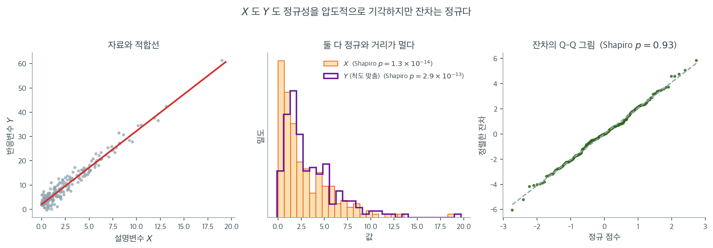

# 회귀에서의 정규성 (잔차 진단)

## 1. 가정이 요구하는 것

흔한 오해 가운데 하나는 선형회귀가 설명변수나 반응변수의 정규분포를 요구한다는 것이다. 사실 회귀의 정규성 가정은 변수 자체가 아니라 **오차항**에 적용된다. 표준적인 선형회귀 모형

$$
Y_i = \beta_0 + \beta_1 X_{i1} + \cdots + \beta_p X_{ip} + \varepsilon_i
$$

에서 가정은

$$
\varepsilon_i \overset{\text{iid}}{\sim} N(0, \sigma^2)
$$

이다. 이는 설명변수를 조건으로 할 때 반응변수가 정규분포를 따른다는 말과 같다.

$$
Y_i \mid X_i \sim N(\beta_0 + \beta_1 X_{i1} + \cdots + \beta_p X_{ip},\; \sigma^2)
$$

설명변수 $X_{ij}$는 어떤 분포든 가질 수 있다. 치우친 설명변수, 이진 설명변수, 꼬리가 두꺼운 설명변수 모두 정규성 가정을 위배하지 않는다.

??? warning "정규성은 설명변수가 아니라 잔차에 적용된다"
    설명변수나 $Y$의 무조건 분포에 정규성을 검정하는 것은 흔하지만 잘못된 관행이다. 정규성 확인은 관측되지 않는 오차 $\varepsilon_i$를 추정하는 잔차 $\hat{\varepsilon}_i = Y_i - \hat{Y}_i$에 대해 수행해야 한다.

### 한 자료에서 셋을 모두 검정해 보면

이 구분이 말장난이 아니라는 것은 인공 자료 하나로 바로 확인할 수 있다. 아래 자료는 $X \sim \text{Exp}(1/3)$에서 설명변수를 뽑고 $Y = 2 + 3X + \varepsilon$, $\varepsilon \sim N(0, 2^2)$로 만든 $n = 200$개의 관측값이다. **가정을 조금도 어기지 않은** 교과서적인 회귀 자료다.



가운데 칸을 보라. 설명변수 $X$는 지수분포이므로 오른쪽으로 크게 치우쳐 있고 Shapiro-Wilk $p = 1.3 \times 10^{-14}$이다. 반응변수 $Y$는 그 $X$를 세 배 해서 정규 잡음을 더한 것이니 역시 치우쳐 있고 $p = 2.9 \times 10^{-13}$이다. 둘 다 "정규성 검정 통과"와는 거리가 멀다. 여기서 "정규성이 위배되었으니 회귀를 쓸 수 없다"고 판단한다면 완전히 잘못된 결론이다.

오른쪽 칸이 실제로 확인해야 할 것이다. 잔차의 Q-Q 그림에서 점들이 직선에 붙어 있고 Shapiro-Wilk $p = 0.93$이다. 모형이 요구한 바로 그 가정 — $\varepsilon_i \sim N(0, \sigma^2)$ — 이 완벽하게 지켜지고 있다. 적합된 계수도 $\hat\beta_0 = 2.00$, $\hat\beta_1 = 3.03$으로 참값 $(2, 3)$에 정확히 맞는다.

왜 이런 일이 일어나는지는 모형 식을 다시 보면 분명하다. 정규성은 $Y_i \mid X_i$의 조건부 분포에 대한 가정이지 $Y_i$의 **무조건** 분포에 대한 가정이 아니다. $Y$의 무조건 분포는 서로 다른 평균 $\beta_0 + \beta_1 X_i$를 갖는 정규분포 200개를 $X$의 분포에 따라 섞은 것이므로, $X$가 치우쳐 있으면 $Y$도 따라 치우친다. 섞는 비율이 무엇이든 각 성분은 여전히 정규이고 오차도 여전히 정규다.

실무적으로 이 오해는 두 방향 모두에서 해를 끼친다. 멀쩡한 모형을 "정규성 위배"로 버리게 만들기도 하고, 반대로 $Y$가 우연히 종 모양이라는 이유로 잔차가 심하게 치우친 모형을 통과시키기도 한다. 회귀에서 `shapiro`에 넣어야 할 배열은 언제나 `residuals`다.

---

## 2. 회귀에서 정규성이 중요한 이유

OLS 추정값 $\hat{\beta}$가 불편이거나 일치성을 갖는 데는 오차의 정규성이 필요하지 않다. Gauss-Markov 정리는 더 약한 조건(선형성, 외생성, 등분산성, 다중공선성 없음) 아래에서 OLS가 최소분산 선형불편추정량(BLUE)임을 보장한다. 정규성은 다음이 필요할 때 들어온다.

1. **정확한 $t$ 검정과 $F$ 검정.** 정규성 아래에서 $H_0: \beta_j = 0$의 검정통계량

    $$
    t_j = \frac{\hat{\beta}_j}{\text{SE}(\hat{\beta}_j)}
    $$

    는 자유도 $n - p - 1$의 $t$ 분포를 정확히 따른다. 정규성이 없으면 이 분포 결과는 (큰 $n$에서 중심극한정리를 통해) 근사적으로만 성립한다.

2. **정확한 신뢰구간.** $100(1-\alpha)\%$ 신뢰구간

    $$
    \hat{\beta}_j \pm t_{\alpha/2,\, n-p-1} \cdot \text{SE}(\hat{\beta}_j)
    $$

    는 정규성 아래에서만 정확한 포함확률을 갖는다. 정규성이 없으면 포함확률이 근사적이다.

3. **예측구간.** 새 관측값에 대한 예측구간은

    $$
    \hat{Y}_{\text{new}} \pm t_{\alpha/2,\, n-p-1} \cdot \hat{\sigma}\sqrt{1 + \mathbf{x}_{\text{new}}^\top (\mathbf{X}^\top\mathbf{X})^{-1} \mathbf{x}_{\text{new}}}
    $$

    이 구간은 예측오차가 정규분포를 따름을 보장하기 위해 오차의 정규성에 기댄다. 오차가 정규가 아니면 실제 포함확률이 $1 - \alpha$에서 크게 벗어날 수 있다.

---

## 3. 잔차의 정규성 확인

참 오차 $\varepsilon_i$는 관측할 수 없으므로 **잔차** $\hat{\varepsilon}_i = Y_i - \hat{Y}_i$로 정규성을 확인한다. 표준적인 진단 도구는 다음과 같다.

### 잔차의 Q-Q 그림

Q-Q 그림은 잔차의 분위수를 표준정규분포의 분위수와 비교한다. 오차가 정규이면 점들이 대략 직선을 따라 놓인다. 흔한 이탈 패턴은

- **S자 곡선**: 두꺼운 꼬리(양의 초과첨도)를 나타낸다
- **위로 휘는 곡률**: 오른쪽 치우침을 나타낸다
- **양 끝이 아래로 휨**: 얇은 꼬리(저첨)를 나타낸다

### 잔차에 대한 Shapiro-Wilk 검정

잔차에 Shapiro-Wilk 검정을 적용한다.

- $H_0$: 잔차가 정규분포를 따른다
- $H_1$: 잔차가 정규분포를 따르지 않는다

$n$이 크면 사소한 이탈로도 기각할 수 있으므로 그런 경우에는 시각적 방법이 더 유익하다.

### 잔차의 히스토그램

잔차의 히스토그램은 빠른 시각적 확인을 제공한다. 대략적인 대칭성과 종 모양 윤곽을 살핀다. 강한 치우침이나 여러 개의 봉우리는 비정규성의 신호이다.

---

## 4. 잔차가 정규가 아닐 때의 결과

정규가 아닌 잔차의 영향은 분석의 목표에 달려 있다.

**점추정.** 나머지 Gauss-Markov 조건이 성립하는 한 OLS 추정량은 오차 분포와 무관하게 불편이고 일치성을 갖는다. 비정규성은 $\hat{\beta}$에 영향을 주지 않는다.

**가설검정과 신뢰구간.** $n$이 작으면 정규가 아닌 오차가 $p$값과 포함확률을 왜곡할 수 있다. $n$이 크면 중심극한정리가 $\hat{\beta}_j$의 근사적 정규성을 보장하므로 $t$ 검정과 신뢰구간이 근사적으로 타당하게 유지된다.

**예측구간.** 예측구간은 $\hat{\beta}_j$의 신뢰구간보다 비정규성에 더 민감하다. 예측오차가 오차항 $\varepsilon_{\text{new}}$ 전체를 포함하며 그 분포가 구간에 직접 들어오기 때문이다.

<div class="exbox" markdown>

**보기 1.** <span class="diff easy" title="쉬움"></span> 벗어남을 표준오차로 재기. $X \sim \text{Uniform}(0,10)$, $Y = 2 + 3X + \varepsilon$, $\varepsilon \sim \mathcal{N}(0, 2^2)$로 $n = 100$을 만들어 최소제곱 적합하고 잔차를 진단한다. 추정값은 $\hat\beta_0 = 2.430$, $\hat\beta_1 = 2.908$이 나온다.

**(1)** $\sigma = 2$를 알고 있으므로 $\mathrm{SE}(\hat\beta_0)$와 $\mathrm{SE}(\hat\beta_1)$을 **닫힌 꼴로** 구할 수 있다. 참값 $(2, 3)$에서의 벗어남이 각각 몇 표준오차인지 재시오.

**(2)** 두 벗어남의 **부호가 반대**다($\hat\beta_0$은 크게, $\hat\beta_1$은 작게 나왔다). 우연인가? $\operatorname{Cov}(\hat\beta_0, \hat\beta_1)$을 구해 답하시오.

**(3)** 이 자료에서 $X$, $Y$, 잔차 **셋 모두에** 샤피로–윌크를 걸어 보시오. 어느 것이 통과하는가. $X$와 $Y$의 초과첨도를 닫힌 꼴로 구해 표본값과 맞추시오.

</div>

??? success "풀이"

    **쪽의 코드를 먼저 그대로 돌린다.**

    ```python
    import numpy as np
    from scipy import stats

    # ===================================================================
    # 회귀 잔차의 정규성 확인
    #
    # 회귀에서 정규성은 반응변수가 아니라 오차항에 요구되는 가정이다.
    # 게다가 계수 추정의 불편성에는 필요 없고, 작은 표본에서 t 검정과
    # 신뢰구간을 쓰기 위해 필요하다.
    # ===================================================================

    np.random.seed(42)
    n = 100

    # 오차를 정규분포에서 만든다. 그러므로 잔차도 정규로 나와야 한다.
    X = np.random.uniform(0, 10, size=n)
    beta_0, beta_1 = 2.0, 3.0
    epsilon = np.random.normal(0, 2, size=n)
    Y = beta_0 + beta_1 * X + epsilon

    # 정규방정식을 직접 풀어 적합한다. 첫 열의 1 이 절편에 대응한다.
    X_design = np.column_stack([np.ones(n), X])
    beta_hat = np.linalg.lstsq(X_design, Y, rcond=None)[0]
    Y_hat = X_design @ beta_hat
    residuals = Y - Y_hat

    # 잔차에 대한 정규성 검정
    sw_stat, sw_p = stats.shapiro(residuals)

    # 검정이 기각되었을 때 무엇이 문제인지는 이 둘이 알려 준다.
    # 왜도가 크면 치우침, 초과첨도가 크면 두꺼운 꼬리다.
    skew_r = stats.skew(residuals)
    kurt_r = stats.kurtosis(residuals)  # excess kurtosis

    if __name__ == "__main__":
        print(f"Estimated coefficients: beta_0 = {beta_hat[0]:.3f}, "
              f"beta_1 = {beta_hat[1]:.3f}")
        print(f"\nResidual diagnostics:")
        print(f"  Shapiro-Wilk: W = {sw_stat:.4f}, p = {sw_p:.4f}")
        print(f"  Skewness:     {skew_r:.4f}")
        print(f"  Excess kurtosis: {kurt_r:.4f}")

        if sw_p > 0.05:
            print("\n  Residuals are consistent with normality.")
        else:
            print("\n  Evidence of non-normality in residuals.")
    ```

    출력:

    ```text
    Estimated coefficients: beta_0 = 2.430, beta_1 = 2.908

    Residual diagnostics:
      Shapiro-Wilk: W = 0.9846, p = 0.2984
      Skewness:     0.2173
      Excess kurtosis: -0.0712

      Residuals are consistent with normality.
    ```

    **(1) 표준오차는 닫힌 꼴로 나온다.** 단순회귀의 설계행렬 $\mathbf{X} = [\mathbf{1}\ \ \mathbf{x}]$에 대해

    $$
    (\mathbf{X}^{\!\top}\mathbf{X})^{-1} = \frac{1}{n S_{xx}}\begin{bmatrix} \sum x_i^2 & -\sum x_i \\ -\sum x_i & n \end{bmatrix},
    \qquad S_{xx} = \sum_i (x_i - \bar x)^2
    $$

    이고 $\operatorname{Var}(\hat{\boldsymbol\beta}) = \sigma^2 (\mathbf{X}^{\!\top}\mathbf{X})^{-1}$이므로

    $$
    \mathrm{SE}(\hat\beta_1) = \frac{\sigma}{\sqrt{S_{xx}}},
    \qquad
    \mathrm{SE}(\hat\beta_0) = \sigma\sqrt{\frac{1}{n} + \frac{\bar x^2}{S_{xx}}} .
    $$

    이 표본에서 $\bar x = 4.7018$, $S_{xx} = 876.15$이고 $\sigma = 2$를 **알고 있으므로**(모의실험이니까) 추정하지 않고 바로 넣을 수 있다.

    $$
    \mathrm{SE}(\hat\beta_1) = \frac{2}{\sqrt{876.15}} = 0.0676,
    \qquad
    \mathrm{SE}(\hat\beta_0) = 2\sqrt{\frac{1}{100} + \frac{4.7018^2}{876.15}} = 0.3754
    $$

    따라서 벗어남은

    $$
    \frac{\hat\beta_0 - 2}{0.3754} = \frac{+0.4302}{0.3754} = +1.146,
    \qquad
    \frac{\hat\beta_1 - 3}{0.0676} = \frac{-0.0920}{0.0676} = -1.361
    $$

    이다. **둘 다 1.5 표준오차 안이다.** 절편이 $0.43$이나 벗어난 것이 커 보이지만, 절편의 표준오차가 $0.375$나 되므로 평범한 변동이다. 반대로 기울기의 $0.092$는 작아 보이지만 표준오차가 $0.068$뿐이어서 상대적으로는 더 멀리 간 것이다. **벗어남의 크기는 눈으로 재는 것이 아니라 표준오차로 재는 것이다.**

    **(2) 우연이 아니다.** 위 역행렬의 비대각 성분에서

    $$
    \operatorname{Cov}(\hat\beta_0, \hat\beta_1) = -\frac{\sigma^2 \bar x}{S_{xx}},
    \qquad
    \operatorname{Corr}(\hat\beta_0, \hat\beta_1) = \frac{-\bar x}{\sqrt{\overline{x^2}}}
    $$

    이다. $\bar x > 0$이면 **언제나 음의 상관**이다. 이 자료에서는 $\operatorname{Cov} = -4 \times 4.7018/876.15 = -0.02147$, 상관 $-0.8463$이다. 곧 절편이 참값보다 크게 나오면 기울기는 작게 나오는 쪽으로 $0.85$만큼 묶여 있다.

    기하적으로 분명하다. 최소제곱 적합선은 **반드시 $(\bar x, \bar y)$를 지난다**(코드에서 $\hat\beta_0 + \hat\beta_1 \bar x = 16.1033 = \bar y$로 확인된다). 그 한 점에 못이 박혀 있으니 선을 시계 방향으로 돌리면 기울기가 줄고 절편이 늘어난다. 두 추정값은 독립적으로 흔들릴 수 없다.

    그러므로 둘을 따로 보면 안 된다. 이변량으로 재면 마할라노비스 거리의 제곱이

    $$
    (\hat{\boldsymbol\beta} - \boldsymbol\beta)^{\!\top} \operatorname{Var}(\hat{\boldsymbol\beta})^{-1} (\hat{\boldsymbol\beta} - \boldsymbol\beta) = 1.8522
    $$

    이고 $\chi^2_2$ 의 꼬리확률이 $0.396$이다. **합동으로 보아도 완전히 평범한 표본이다.**

    **(3) 통과하는 것은 잔차뿐이다.** 이 쪽의 주제가 보기 안에서 그대로 재현된다.

    | | 샤피로–윌크 $p$ | $g_1$ | $g_2$ | 이론 초과첨도 |
    |---|---|---|---|---|
    | $X$ | $0.000218$ | $+0.1117$ | $-1.2788$ | $-1.2$ |
    | $Y$ | $0.000636$ | $+0.1990$ | $-1.2004$ | $-1.0816$ |
    | 잔차 | $0.298$ | $+0.2173$ | $-0.0712$ | $0$ |

    $X$와 $Y$ 모두 $p < 0.001$로 **강하게 기각**되고 잔차만 $p = 0.298$로 통과한다. 모형은 조금도 틀리지 않았다. $X$에 검정을 걸었다면 멀쩡한 교과서적 회귀를 "정규성 위배"로 버렸을 것이다.

    이론값이 그 까닭을 말해 준다. $\text{Uniform}(a,b)$의 초과첨도는 $-6/5 = -1.2$이고, 표본값 $-1.279$가 거기에 맞는다($n = 100$에서 초과첨도의 귀무 표준오차가 $\sqrt{24/100} = 0.49$이므로 넉넉히 안쪽이다). $Y$는 독립인 $3(X - 5) \sim \text{Uniform}(-15, 15)$와 $\varepsilon \sim \mathcal{N}(0,4)$의 합이므로 중심적률이 더해져

    $$
    \mu_4(Y) = \frac{30^4}{80} + 6 \cdot 75 \cdot 4 + 3 \cdot 4^2 = 10125 + 1800 + 48 = 11973,
    \qquad \operatorname{Var}(Y) = 75 + 4 = 79
    $$

    이고 초과첨도는 $11973/79^2 - 3 = -1.0816$이다. 표본값 $-1.200$과 맞는다. (닫힌 꼴은 $8\times10^6$개 몬테카를로로도 확인했다. $-1.0817$이 나온다.) **곧 $X$도 $Y$도 정규가 아닌 것이 참이다.** 평평한 균등분포가 정규보다 납작하기 때문이고, 정규 잡음을 더해도 $-1.08$까지만 끌어올린다.

    왜도·첨도는 모두 `scipy.stats.skew`·`kurtosis`의 기본값이므로 보정하지 않은 $g_1$과 초과첨도 $g_2$다. 잔차의 보정판은 $G_1 = +0.2206$, $G_2 = -0.0124$로 조금 다르다. $n = 100$에서는 차이가 작지만, 보고할 때는 어느 판본인지 밝혀야 한다.

    ```python
    import numpy as np
    from scipy import stats

    np.random.seed(42)
    n = 100
    X = np.random.uniform(0, 10, size=n)
    Y = 2.0 + 3.0 * X + np.random.normal(0, 2, size=n)
    Xd = np.column_stack([np.ones(n), X])
    b = np.linalg.lstsq(Xd, Y, rcond=None)[0]
    resid = Y - Xd @ b

    sigma = 2.0                      # 참값을 알고 있으므로 이론 SE 를 쓸 수 있다
    xbar, Sxx = X.mean(), ((X - X.mean())**2).sum()
    se0 = sigma * np.sqrt(1/n + xbar**2 / Sxx)
    se1 = sigma / np.sqrt(Sxx)
    print(f"xbar = {xbar:.4f},  Sxx = {Sxx:.2f}")
    print(f"SE(b0) = {se0:.4f}   b0 = {b[0]:.4f}  편차 {b[0]-2:+.4f} = {(b[0]-2)/se0:+.3f} SE")
    print(f"SE(b1) = {se1:.4f}   b1 = {b[1]:.4f}  편차 {b[1]-3:+.4f} = {(b[1]-3)/se1:+.3f} SE")

    V = sigma**2 * np.linalg.inv(Xd.T @ Xd)
    print(f"Cov(b0, b1) = {V[0,1]:.5f},  Corr = {V[0,1]/np.sqrt(V[0,0]*V[1,1]):.4f}")
    d = np.array([b[0] - 2, b[1] - 3])
    m2 = d @ np.linalg.inv(V) @ d
    print(f"마할라노비스^2 = {m2:.4f},  chi2_2 꼬리확률 = {stats.chi2.sf(m2, 2):.4f}")
    print(f"b0 + b1*xbar = {b[0] + b[1]*xbar:.4f},  ybar = {Y.mean():.4f}")

    print("\n정규성 검정을 어디에 걸어야 하는가")
    for name, v, closed in [("X   ", X, -6/5), ("Y   ", Y, 30**4/80/79**2 + (6*75*4 + 3*16)/79**2 - 3),
                            ("잔차", resid, 0.0)]:
        print(f"  {name}: shapiro p = {stats.shapiro(v)[1]:>9.3g},"
              f"  g1 = {stats.skew(v):+.4f},  g2 = {stats.kurtosis(v):+.4f}"
              f"   (이론 초과첨도 {closed:+.4f})")
    ```

    출력:

    ```text
    xbar = 4.7018,  Sxx = 876.15
    SE(b0) = 0.3754   b0 = 2.4302  편차 +0.4302 = +1.146 SE
    SE(b1) = 0.0676   b1 = 2.9080  편차 -0.0920 = -1.361 SE
    Cov(b0, b1) = -0.02147,  Corr = -0.8463
    마할라노비스^2 = 1.8522,  chi2_2 꼬리확률 = 0.3961
    b0 + b1*xbar = 16.1033,  ybar = 16.1033

    정규성 검정을 어디에 걸어야 하는가
      X   : shapiro p =  0.000218,  g1 = +0.1117,  g2 = -1.2788   (이론 초과첨도 -1.2000)
      Y   : shapiro p =  0.000636,  g1 = +0.1990,  g2 = -1.2004   (이론 초과첨도 -1.0816)
      잔차: shapiro p =     0.298,  g1 = +0.2173,  g2 = -0.0712   (이론 초과첨도 +0.0000)
    ```

    손으로 구한 $\mathrm{SE} = (0.3754,\ 0.0676)$, 벗어남 $(+1.146,\ -1.361)$ 표준오차, 상관 $-0.8463$, 마할라노비스 $1.8522$가 모두 코드와 맞는다. 이론 초과첨도 $-1.2$와 $-1.0816$도 표본값과 맞는다.

잔차의 왜도 $0.217$과 초과첨도 $-0.071$이 모두 0에 가깝고 Shapiro-Wilk $p = 0.298$로 기각하지 못한다. 정규 오차로 자료를 생성했으므로 기대한 결과이다. 추정된 계수 $(2.430, 2.908)$이 참값 $(2.0, 3.0)$과 정확히 일치하지 않는 것은 $n = 100$에서의 표집변동일 뿐이다.

---

## 5. 정규가 아닌 잔차에 대한 대책

잔차 진단이 비정규성을 드러내면 몇 가지 접근이 도움이 된다.

1. **반응변수를 변환한다.** $Y$에 로그나 Box-Cox 변환을 적용하면 잔차의 치우침을 줄일 수 있다. 변환된 모형은 $g(Y_i) = \beta_0 + \beta_1 X_{i1} + \cdots + \varepsilon_i$이다.

2. **이상점을 조사한다.** 비정규성이 몇 개의 극단적 잔차 때문이라면 그 관측값이 자료 오류인지 영향점인지 살펴본다.

3. **로버스트 표준오차를 쓴다.** 이분산 일치(HC) 표준오차는 적어도 점근적으로는 정규성 없이도 타당한 추론을 제공한다.

4. **붓스트랩 추론을 쓴다.** 붓스트랩 신뢰구간과 $p$값은 정규성 가정을 요구하지 않는다.

5. **일반화선형모형을 쓴다.** 반응변수가 본래 정규가 아니라면(예: 계수, 이진 결과) 변환한 OLS보다 적절한 연결함수를 가진 GLM이 더 낫다.

<div class="aibox" markdown>

**AI로 보는 통계학 1.** 잔차를 고치지 않고 잔차에게 눈금을 묻는다

$3$ 절은 잔차의 정규성을 확인하라 하고, 바로 위의 다섯 대책은 **정규로 되돌리거나
정규성을 비켜 가는** 길이다. 요즘 예측 모형은 둘 중 어느 쪽도 하지 않는다. 검정도
변환도 하지 않고, **잔차의 분위수를 그대로 구간의 눈금으로 쓴다.** 이 쪽이 재는 바로
그 $\hat\varepsilon_i$ 가, 정규인지 묻는 대상이 아니라 **눈금 그 자체**가 되는 것이다.

절차는 한 줄이다. 자료를 둘로 나누어 한쪽으로 모형을 맞추고, 손대지 않은 쪽의 잔차에서
$2.5$ 백분위와 $97.5$ 백분위를 읽어 예측값에 붙인다. $4$ 절이 「예측구간은 비정규성에
가장 민감하다」고 적은 자리를, 민감한 양을 **가정하는 대신 재어서** 지나간다.

```python
import numpy as np

rng = np.random.default_rng(14)
n_tr, n_cal, n_te = 1_000, 2_000, 20_000
x = rng.uniform(0, 10, n_tr + n_cal + n_te)
y = 2 + 3 * x + (np.exp(rng.normal(0, 1.0, x.size)) - np.exp(0.5)) * 1.2
tr, cal, te = slice(0, n_tr), slice(n_tr, n_tr + n_cal), slice(n_tr + n_cal, None)

b1, b0 = np.polyfit(x[tr], y[tr], 1)          # 훈련 몫으로 적합한다
r = y - (b0 + b1 * x)                         # 모든 점의 잔차
s = r[tr].std(ddof=2)

lv = np.ceil((n_cal + 1) * np.array([0.025, 0.975])) / n_cal
band = {"정규를 믿는 구간 ": (-1.959964 * s, 1.959964 * s),
        "잔차가 정하는 구간": tuple(np.quantile(r[cal], lv))}
for name, (lo, hi) in band.items():
    u, o = np.mean(r[te] < lo), np.mean(r[te] > hi)
    print(f"{name}  폭 {hi - lo:5.2f}  [{lo:+6.2f}, {hi:+6.2f}]   "
          f"포함률 {1 - u - o:.4f}   아래로 샘 {u:.4f}   위로 샘 {o:.4f}")

# 분산이 x 와 함께 커지면 전체는 맞고 자리마다 틀어진다
y2 = 2 + 3 * x + rng.normal(0, 0.5 + 0.6 * x)
c1, c0 = np.polyfit(x[tr], y2[tr], 1)
r2 = np.abs(y2 - (c0 + c1 * x))
q = np.quantile(r2[cal], np.ceil((n_cal + 1) * 0.95) / n_cal)
print(f"\n분산이 x 와 함께 커지는 자료 — 전체 포함률 {np.mean(r2[te] <= q):.4f}")
for name, sel in zip(("x 작은 쪽", "가운데   ", "x 큰 쪽  "),
                     np.array_split(np.argsort(x[te]), 3)):
    print(f"   {name} 포함률 {np.mean(r2[te][sel] <= q):.4f}")
```

출력:

```
정규를 믿는 구간   폭  9.75  [ -4.88,  +4.88]   포함률 0.9582   아래로 샘 0.0000   위로 샘 0.0418
잔차가 정하는 구간  폭  8.93  [ -1.69,  +7.24]   포함률 0.9527   아래로 샘 0.0250   위로 샘 0.0222

분산이 x 와 함께 커지는 자료 — 전체 포함률 0.9553
   x 작은 쪽 포함률 1.0000
   가운데    포함률 0.9822
   x 큰 쪽   포함률 0.8836
```

첫 줄의 포함률 $0.9582$ 만 보면 정규를 믿은 구간도 멀쩡해 보인다. 그 뒤의 두 수가
무너진 자리다. **구간을 벗어난 점이 모두 위쪽에 있다** — 아래로 샌 것이 $0.0000$,
위로 샌 것이 $0.0418$ 이다. 「$95\%$ 구간」이라는 말에는 양쪽으로 $2.5\%$ 씩이라는
약속이 들어 있는데, 잔차가 오른쪽으로 치우쳐 있으면 대칭인 구간은 그 약속을 아예
지키지 못한다. 둘째 줄은 같은 자료에서 $[-1.69, +7.24]$ 라는 **비대칭** 구간을 읽어
내고 $0.0250$ 과 $0.0222$ 로 양쪽을 맞춘다. 그러면서 폭은 $9.75$ 에서 $8.93$ 으로
오히려 **좁다.** 정규를 믿은 대가는 넓은 구간이 아니라 **엉뚱한 자리에 놓인 구간**이었다.

한계는 아래쪽 출력이 말한다. 이 눈금은 **평균적으로만** 맞는다. 분산이 $x$ 와 함께
커지는 자료에서 전체 포함률은 $0.9553$ 으로 약속대로지만, $x$ 가 작은 쪽에서는
$1.0000$ 이고 큰 쪽에서는 $0.8836$ 이다. 한 사람 한 사람에게 「당신의 예측은 이 구간
안에 $95\%$ 로 들어옵니다」라고 말하려면 잔차를 분위수로 읽는 것만으로는 모자라고,
$x$ 마다 눈금을 따로 주어야 한다. **정규성 가정을 버린 것이 조건부 보증까지 사 오지는
않는다.**

</div>

---

## 연습문제

<div class="drillbox" markdown>

**연습문제 1.** <span class="diff med" title="중간"></span>
선형회귀를 적합한 뒤 잔차의 Q-Q 그림을 그렸더니 오른쪽 꼬리의 점들은 기준선 위로, 왼쪽 꼬리의 점들은 기준선 아래로 벗어나 S자 모양을 이룬다. 이는 잔차 분포에 대해 무엇을 시사하는가?

</div>

??? success "풀이"
    오른쪽 꼬리가 선 위로, 왼쪽 꼬리가 선 아래로 벗어나 S자를 이루는 것은 **두꺼운 꼬리**(고첨)를 나타낸다. 잔차에 정규분포가 예측하는 것보다 극단적인 값이 많다는 뜻이다.

    (양 끝이 **모두 위로** 휘는 것은 다른 패턴, 곧 오른쪽 치우침을 나타낸다는 점에 유의하라.)

    원인으로는 이상점, 모형 오설정(비선형 항이나 중요한 설명변수의 누락), 또는 바탕 오차 분포가 실제로 두꺼운 꼬리를 갖는 경우가 있다. 회귀계수 추정값은 여전히 불편이지만(OLS는 정규성을 요구하지 않는다) 추론(p값, 신뢰구간)은 특히 작은 표본에서 믿을 수 없어질 수 있다.

<div class="drillbox" markdown>

**연습문제 2.** <span class="diff med" title="중간"></span>
선형회귀에서 정규성을 평가하는 잔차 그림 두 가지와 등분산성을 평가하는 그림 한 가지를 기술하라.

</div>

??? success "풀이"
    **정규성 진단:**

    1. **잔차의 Q-Q 그림:** 잔차 분위수를 이론적 정규분위수에 대해 그린다. 선형이면 정규성을 나타낸다.
    2. **잔차의 히스토그램:** 0을 중심으로 대략 종 모양이고 대칭이어야 한다.

    **등분산성 진단:**

    1. **잔차-적합값 그림:** $e_i$를 $\hat{y}_i$에 대해 그린다. 등분산성 아래에서는 흩어짐이 일정해야 한다(수평 띠). 깔때기 모양($\hat{y}$가 커질수록 흩어짐이 커짐)은 이분산을 나타낸다.

<div class="drillbox" markdown>

**연습문제 3.** <span class="diff med" title="중간"></span>
$n = 40$인 회귀 잔차에 대한 Shapiro-Wilk 검정이 $p = 0.12$를 준다. 오차가 정규분포를 따른다고 결론지을 수 있는가?

</div>

??? success "풀이"
    아니다. 귀무가설을 기각하지 못한 것($p = 0.12 > 0.05$)은 잔차가 정규가 아니라고 결론지을 증거가 부족하다는 뜻이다. 정규성을 증명하지는 않으며, 특히 $n = 40$에서는 검정력이 낮은 것을 반영할 뿐일 수 있다.

    올바른 해석은 "자료가 정규성과 일관되지만 정규성이 증명된 것은 아니다"이다. 증거의 부재가 부재의 증거가 아니라는 가설검정의 고전적 한계이다. Q-Q 그림으로 보완하고, 관심 있는 이탈을 탐지할 만한 검정력을 표본크기가 제공하는지 고려하라.

<div class="drillbox" markdown>

**연습문제 4.** <span class="diff med" title="중간"></span>
회귀 잔차가 정규성 검정을 통과하지 못했을 때 문제를 해결하는 접근 세 가지를 선호 순서대로 들어라.

</div>

??? success "풀이"

    1. **반응변수 변환:** $Y$에 Box-Cox, 로그, 제곱근 변환을 적용한다. 잔차를 정규화하면서 동시에 분산도 안정화하는 경우가 많다. 모형을 다시 적합하고 잔차를 다시 확인한다.

    2. **로버스트 추론이나 붓스트랩 추론:** 잔차가 정규가 아니지만 모형 구조가 옳다면 이분산 일치(HC) 표준오차나 붓스트랩 신뢰구간을 쓴다. 정규성 없이도 타당하다.

    3. **일반화선형모형:** 반응변수가 본래 정규가 아니라면(예: 계수, 비율, 순양수) 올바른 분포를 직접 모형화하는 적절한 GLM(Poisson, 로지스틱, 감마)으로 갈아탄다.

    덧붙여, 오차 분포를 탓하기 전에 모형 오설정(누락된 설명변수, 비선형 항)이 있는지 확인하라. 정규가 아닌 잔차는 분포의 문제라기보다 모형의 문제를 나타내는 경우가 많다.

<div class="drillbox" markdown>

**연습문제 5.** <span class="diff med" title="중간"></span>
3 절은 Q-Q 그림의 이탈 패턴 셋을 열거하면서 **위로 휘는 곡률**이 오른쪽 치우침을 뜻한다고 했다. 이것을 한 분포에서 실제로 확인해 보자. 오차가 정규가 아니라 1 절이 설명변수에 썼던 것과 같은 지수분포를 중심화한 것, 곧

$$
\varepsilon = W - 3, \qquad W \sim \text{Exp}(1/3)
$$

이라고 하자. $n$ 이 아주 커서 잔차의 Q-Q 그림이 이론적 곡선 $z \mapsto Q(z) = F_\varepsilon^{-1}(\Phi(z))$ 로 수렴한다고 본다.

**(1)** $Q(z)$ 를 닫힌 꼴로 적고, $Q''(z) > 0$ 이 모든 $z$ 에서 성립함을 보이시오. (표준정규의 위험률이 $\varphi(z)/(1-\Phi(z)) > z$ 를 만족한다는 사실을 써도 좋다.)

**(2)** $z = -1.96,\ -1,\ 0,\ 1,\ 1.96$ 에서 $Q(z)$ 를 구하고, 왼쪽 구간 $[-1.96, -1]$ 과 오른쪽 구간 $[1, 1.96]$ 에서의 평균 기울기를 비교하시오.

**(3)** $z \to -\infty$ 에서 $Q(z)$ 는 어디로 가는가. 그 답이 "왼쪽 꼬리가 기준선 **위로** 벗어난다"는 관찰과 어떻게 이어지는지 설명하시오.

</div>

??? success "풀이"
    **(1) 지수분포의 분위수함수를 끼워 넣으면 된다.** $W \sim \text{Exp}(1/3)$ 는 평균 $3$ 이므로 $P(W > w) = e^{-w/3}$ 이고 $F_W^{-1}(p) = -3\ln(1-p)$ 이다. $\varepsilon = W - 3$ 이니

    $$
    Q(z) = -3\ln\bigl(1 - \Phi(z)\bigr) - 3 .
    $$

    미분하면 $1-\Phi(z)$ 의 도함수가 $-\varphi(z)$ 이므로

    $$
    Q'(z) = \frac{3\varphi(z)}{1 - \Phi(z)} = 3\lambda(z) > 0,
    $$

    여기서 $\lambda(z) = \varphi(z)/(1-\Phi(z))$ 는 표준정규의 위험률이다. 한 번 더 미분한다. $\varphi'(z) = -z\varphi(z)$ 를 쓰면

    $$
    Q''(z) = 3 \cdot \frac{-z\varphi(z)\bigl(1-\Phi(z)\bigr) + \varphi(z)^2}{\bigl(1-\Phi(z)\bigr)^2}
    = \frac{3\varphi(z)}{1-\Phi(z)}\bigl(\lambda(z) - z\bigr) .
    $$

    앞의 인수는 양수이므로 부호는 $\lambda(z) - z$ 가 결정한다. $z \le 0$ 이면 $\lambda(z) > 0 \ge z$ 로 자명하고, $z > 0$ 이면 표준정규의 꼬리 부등식 $1 - \Phi(z) < \varphi(z)/z$ 에서 $\lambda(z) > z$ 를 얻는다. 따라서 모든 $z$ 에서 $Q''(z) > 0$ 이고 **곡선은 어디서나 엄격히 볼록**하다. $\square$

    볼록한 곡선은 어떤 직선과도 많아야 두 점에서 만나고, 그 두 점 사이에서는 직선 아래, 바깥에서는 직선 위에 있다. 기준선을 어떻게 그려도 **양 끝이 모두 위로** 벗어난다는 말이다. 이것이 3 절의 "위로 휘는 곡률 = 오른쪽 치우침"의 정체다.

    **(2) 오른쪽 끝이 왼쪽 끝보다 12.5 배 가파르다.**

    | $z$ | $\Phi(z)$ | $Q(z)$ |
    |---|---|---|
    | $-1.96$ | $0.0250$ | $-2.9241$ |
    | $-1.00$ | $0.1587$ | $-2.4817$ |
    | $0.00$ | $0.5000$ | $-0.9206$ |
    | $+1.00$ | $0.8413$ | $+2.5231$ |
    | $+1.96$ | $0.9750$ | $+8.0669$ |

    예를 들어 $z = 1.96$ 에서 $1 - \Phi(1.96) = 0.0249979$ 이므로 $Q(1.96) = -3\ln(0.0249979) - 3 = -3(-3.688964) - 3 = 8.0669$ 다($1 - \Phi(z)$ 가 꼭 $0.025$ 가 되는 $z = 1.95996$ 을 쓰면 $8.0666$). 평균 기울기는

    $$
    \frac{Q(-1) - Q(-1.96)}{0.96} = \frac{-2.4817 + 2.9241}{0.96} = 0.4608,
    \qquad
    \frac{Q(1.96) - Q(1)}{0.96} = \frac{8.0669 - 2.5231}{0.96} = 5.7748
    $$

    이고 비는 $5.7748/0.4608 = 12.53$ 이다. 가운데 기울기 $Q'(0) = 3\varphi(0)/0.5 = 3 \times 0.79788 = 2.394$ 는 그 중간에 있다. 곧 Q-Q 그림의 점들은 왼쪽에서 촘촘히 뭉쳐 있다가 오른쪽으로 갈수록 급격히 벌어진다.

    **(3) 왼쪽 꼬리에는 바닥이 있다.** $z \to -\infty$ 이면 $\Phi(z) \to 0$ 이므로 $\ln(1-\Phi(z)) \to 0$ 이고

    $$
    \lim_{z \to -\infty} Q(z) = -3 .
    $$

    곡선은 수평 점근선 $y = -3$ 을 갖는다. 당연한 결과다. $W \ge 0$ 이니 $\varepsilon \ge -3$ 이어서 왼쪽 꼬리가 **물리적으로 더 내려갈 수 없다**. 반면 오른쪽은 $Q(z) \to \infty$ 로 끝없이 간다.

    기준선은 (어떻게 적합하든) 유한한 기울기를 가진 직선이므로 왼쪽으로 가면 $-\infty$ 로 내려간다. 그런데 곡선은 $-3$ 에서 멈춘다. 그러므로 왼쪽 꼬리의 점들은 기준선보다 **위에** 놓인다. 오른쪽 꼬리는 직선보다 빠르게 치솟으니 역시 위에 놓인다. 두 끝이 같은 쪽으로 벗어나는 것이 치우침의 서명이고, 두 끝이 **반대** 쪽으로 벗어나 S자를 그리는 것이 연습문제 1 의 두꺼운 꼬리다. **Q-Q 그림에서 두 끝의 부호가 같은지 다른지만 보아도 치우침과 첨도를 구별할 수 있다.**

<div class="drillbox" markdown>

**연습문제 6.** <span class="diff med" title="중간"></span>
1 절의 인공 자료는 $X \sim \text{Exp}(1/3)$, $Y = 2 + 3X + \varepsilon$, $\varepsilon \sim N(0, 2^2)$, $n = 200$ 이었고 샤피로–윌크 $p$ 값이 $X$ 는 $1.3 \times 10^{-14}$, $Y$ 는 $2.9 \times 10^{-13}$ 으로 나왔다. $Y$ 쪽이 열 배쯤 덜 극단적인데, 이 차이가 어디서 오는지를 적률로 설명하자.

**(1)** $X$ 와 $Y$ 의 왜도 $\gamma_1$ 과 초과첨도 $\gamma_2 = \beta_2 - 3$ 을 닫힌 꼴로 구하시오.

**(2)** 일반적으로 $Y = \beta_0 + \beta_1 X + \varepsilon$ 에서 $X \perp \varepsilon$ 이고 $\varepsilon$ 이 정규일 때, $Y$ 의 왜도와 초과첨도가 $X$ 의 것에 모집단 $R^2 = \beta_1^2\operatorname{Var}(X)/\operatorname{Var}(Y)$ 의 거듭제곱을 곱한 꼴로 나옴을 보이시오.

**(3)** 그 공식을 써서, $X$ 의 분포는 그대로 두고 $\sigma$ 만 키워 $Y$ 의 초과첨도를 $0.5$ 까지 떨어뜨리려면 $\sigma$ 가 얼마여야 하는지 구하고, 그때의 $R^2$ 를 말하시오.

</div>

??? success "풀이"
    **(1) 지수분포의 왜도와 초과첨도는 척도와 무관하다.** $W \sim \text{Exp}(\theta)$ 의 중심적률은 $\mu_2 = \theta^2$, $\mu_3 = 2\theta^3$, $\mu_4 = 9\theta^4$ 이므로

    $$
    \gamma_1(X) = \frac{2\theta^3}{\theta^3} = 2,
    \qquad
    \gamma_2(X) = \frac{9\theta^4}{\theta^4} - 3 = 6 .
    $$

    $\theta = 3$ 이지만 값은 $\theta$ 에 의존하지 않는다. $Y$ 는 독립인 $3X$ 와 $\varepsilon$ 의 합이다. $\operatorname{Var}(3X) = 9 \cdot 9 = 81$, $\operatorname{Var}(\varepsilon) = 4$ 이므로 $\operatorname{Var}(Y) = 85$ 이고, 중심적률은

    $$
    \mu_3(Y) = 27\mu_3(X) + 0 = 27 \cdot 54 = 1458,
    $$

    $$
    \mu_4(Y) = 81\mu_4(X) + 6 \cdot 81 \cdot 4 + 3 \cdot 4^2 = 59049 + 1944 + 48 = 61041
    $$

    이다(독립합의 4 차 중심적률 공식 $\mu_4(A+B) = \mu_4(A) + 6\mu_2(A)\mu_2(B) + \mu_4(B)$ 를 썼고, 정규의 $\mu_3 = 0$, $\mu_4 = 3\sigma^4$ 를 넣었다). 따라서

    $$
    \gamma_1(Y) = \frac{1458}{85^{3/2}} = \frac{1458}{783.66} = 1.8605,
    \qquad
    \gamma_2(Y) = \frac{61041}{85^2} - 3 = 8.4486 - 3 = 5.4486 .
    $$

    **(2) 큐뮬런트로 보면 한 줄이다.** 3 차 이상의 큐뮬런트는 독립합에서 더해지고, 정규는 3 차 이상이 모두 $0$ 이다. 그러므로 $A = \beta_1 X$, $\sigma_A^2 = \beta_1^2\operatorname{Var}(X)$, $\sigma_Y^2 = \sigma_A^2 + \sigma^2$ 에 대해

    $$
    \kappa_3(Y) = \kappa_3(A), \qquad \kappa_4(Y) = \kappa_4(A) .
    $$

    표준화만 바뀐다. $\gamma_1 = \kappa_3/\sigma^3$, $\gamma_2 = \kappa_4/\sigma^4$ 이고 $\kappa_3(A) = \gamma_1(X)\sigma_A^3$, $\kappa_4(A) = \gamma_2(X)\sigma_A^4$ (왜도·첨도는 척도불변이므로 $\gamma_j(A) = \gamma_j(X)$) 이므로

    $$
    \gamma_1(Y) = \gamma_1(X)\left(\frac{\sigma_A^2}{\sigma_Y^2}\right)^{3/2} = \gamma_1(X)\,(R^2)^{3/2},
    \qquad
    \gamma_2(Y) = \gamma_2(X)\,(R^2)^2 . \qquad \square
    $$

    확인해 보자. 이 자료의 모집단 $R^2 = 81/85 = 0.95294$ 이므로

    $$
    \gamma_1(Y) = 2 \times 0.95294^{3/2} = 2 \times 0.93023 = 1.8605,
    \qquad
    \gamma_2(Y) = 6 \times 0.95294^2 = 6 \times 0.90810 = 5.4486
    $$

    으로 (1) 과 정확히 맞는다.

    **감쇠인자가 $0.93$ 과 $0.91$ 뿐이다.** 그래서 $Y$ 는 $X$ 보다 겨우 $7\!\sim\!9\%$ 덜 치우치고 덜 뾰족하다. 샤피로–윌크 $p$ 값이 $1.3 \times 10^{-14}$ 에서 $2.9 \times 10^{-13}$ 으로 한 자릿수 움직인 것이 바로 이만큼의 희석이다. $Y$ 를 "정규 200 개의 혼합"이라고 불러도, 혼합하는 비율이 지수분포라면 $Y$ 는 여전히 왜도 $1.86$ 의 심하게 치우친 분포다.

    **(3) 모형을 거의 망가뜨려야 한다.** $\gamma_2(Y) = 6(R^2)^2 = 0.5$ 에서

    $$
    (R^2)^2 = \frac{1}{12}, \qquad R^2 = \frac{1}{\sqrt{12}} = 0.28868 .
    $$

    $R^2 = 81/(81 + \sigma^2)$ 이므로 $81 + \sigma^2 = 81/0.28868 = 280.59$, 곧

    $$
    \sigma^2 = 199.59, \qquad \sigma = 14.13 .
    $$

    그때 왜도는 $2 \times 0.28868^{3/2} = 0.3103$ 으로 떨어지고 $R^2 = 0.289$ 다. 실제로 쓴 $\sigma = 2$ 의 **일곱 배**를 잡음으로 쏟아부어야 하고, 그러면 설명력이 $95.3\%$ 에서 $28.9\%$ 로 주저앉는다.

    **해석.** $Y$ 의 무조건 비정규성은 모형이 설명하는 몫이 클수록 선명해진다. 곧 $Y$ 에 정규성 검정을 거는 관행은 **모형이 잘 맞을 때 가장 심하게 오작동한다.** 거꾸로 $Y$ 가 종 모양으로 보일 만큼 $R^2$ 가 낮다면 그 회귀는 애초에 별로 쓸 데가 없다. 1 절의 결론 — 검정은 `residuals` 에 걸어야 한다 — 이 양쪽에서 확인된다.

<div class="drillbox" markdown>

**연습문제 7.** <span class="diff hard" title="어려움"></span>
4 절은 예측구간이 $\hat\beta_j$ 의 신뢰구간보다 비정규성에 더 민감하다고 했다. 이것을 수치로 재자. 오차가 정규가 아니라 분산 $\sigma^2 = 2^2$ 의 **라플라스분포**라고 하자. 곧 밀도가 $f(e) = (2b)^{-1}e^{-\lvert e \rvert / b}$ 이고 $\operatorname{Var} = 2b^2 = 4$ 이다. $n \to \infty$ 이고 $\mathbf{x}_{\text{new}} = \bar{\mathbf{x}}$ 라고 보아, 2 절의 $95\%$ 예측구간이 $\hat Y_{\text{new}} \pm z_{0.025}\,\sigma$ 로 수렴한다고 하자($z_{0.025} = 1.95996$).

**(1)** $b$ 를 구하고, 이 예측구간의 **실제** 포함확률을 구하시오.

**(2)** 같은 자료에서 $\beta_1$ 의 $95\%$ 신뢰구간의 실제 포함확률은 $n \to \infty$ 에서 얼마인가. 두 답이 다른 까닭을 한 문장으로 말하시오.

**(3)** 라플라스에서 참으로 $95\%$ 를 맞추려면 예측구간의 반폭이 $\sigma$ 의 몇 배여야 하는가.

**(4)** 오차가 라플라스가 아니라 분산 $2^2$ 의 균등분포였다면 (1) 의 답은 어떻게 달라지는가.

</div>

??? success "풀이"
    **(1) 포함확률은 $93.75\%$ 다.** $2b^2 = 4$ 에서

    $$
    b = \sqrt{2} = 1.41421 .
    $$

    라플라스의 꼬리확률은 $P(\lvert \varepsilon \rvert > t) = e^{-t/b}$ 이다. 구간의 반폭은 $t = 1.95996 \times 2 = 3.91993$ 이므로

    $$
    \frac{t}{b} = \frac{3.91993}{1.41421} = 2.77186,
    \qquad
    P(\lvert \varepsilon \rvert > t) = e^{-2.77186} = 0.06255 .
    $$

    따라서 실제 포함확률은

    $$
    1 - 0.06255 = 0.93745 .
    $$

    명목 $95\%$ 가 실제로는 $93.7\%$ 다. 놓치는 비율로 보면 $5\%$ 가 아니라 $6.25\%$, 곧 **상대적으로 $25\%$ 더 많이** 빗나간다. 라플라스의 초과첨도가 $3$ 인 두꺼운 꼬리이므로 구간 밖으로 나가는 새 관측값이 더 많은 것이다.

    **(2) $\beta_1$ 의 신뢰구간은 $95\%$ 를 그대로 지킨다.** $\hat\beta_1 - \beta_1 = \sum_i w_i\varepsilon_i$, $w_i = (x_i - \bar x)/S_{xx}$ 는 오차들의 **가중평균**이다. 린데베르그 조건이 성립하는 설계라면 중심극한정리가 $\hat\beta_1$ 의 점근 정규성을 보장하므로, $n \to \infty$ 에서 포함확률은 오차 분포가 무엇이든 $0.95$ 로 수렴한다.

    까닭은 한 문장이다. **신뢰구간에는 오차가 $n$ 개 평균되어 들어가지만 예측구간에는 새 오차 $\varepsilon_{\text{new}}$ 가 단 하나, 평균되지 않은 채로 들어간다.** 중심극한정리는 앞쪽만 구해 주고 뒤쪽은 구해 주지 못한다. 4 절이 "예측오차가 오차항 전체를 포함하며 그 분포가 구간에 직접 들어온다"고 한 것이 이 뜻이다. 표본을 늘려도 이 간격은 줄지 않는다.

    **(3) $2.1183\sigma$, 곧 $8.1\%$ 더 넓어야 한다.** $e^{-t/b} = 0.05$ 에서 $t = b\ln 20$ 이므로

    $$
    t = 1.41421 \times 2.99573 = 4.23664 = 2.11832\,\sigma
    $$

    ($\sigma = 2$). $1.95996$ 과 비교하면 $2.11832/1.95996 = 1.0808$ 이다. 두꺼운 꼬리에 맞추려면 구간을 $8\%$ 넓혀야 한다.

    **(4) 포함확률이 정확히 $1$ 이 된다.** 분산 $\sigma^2$ 의 균등분포는 $\text{Uniform}(-\sqrt{3}\sigma,\ \sqrt{3}\sigma)$ 이므로 $\lvert \varepsilon \rvert \le 1.7321\sigma$ 가 **항상** 성립한다. 반폭 $1.95996\sigma$ 가 그보다 크므로 새 관측값은 하나도 구간을 벗어나지 못한다.

    | 오차 분포 | 초과첨도 | 명목 $95\%$ 예측구간의 실제 포함확률 |
    |---|---|---|
    | 정규 | $0$ | $0.9500$ |
    | 라플라스 | $+3$ | $0.9375$ |
    | 균등 | $-1.2$ | $1.0000$ |

    **해석.** 비정규성이 예측구간을 **어느 쪽으로** 틀어 놓는지는 꼬리의 두께가 결정한다. 두꺼우면 과소포함(위험을 낮춰 본다), 얇으면 과대포함(쓸모없이 넓다)이다. 어느 쪽이든 $n$ 을 늘려 고칠 수 없다는 점이 $\hat\beta$ 의 추론과 결정적으로 다르다. 그래서 예측이 목표일 때는 잔차의 정규성을 훨씬 심각하게 받아들여야 한다.

<div class="drillbox" markdown>

**연습문제 8.** <span class="diff hard" title="어려움"></span>
보기 1 의 잔차는 왜도 $g_1 = 0.2173$, 초과첨도 $g_2 = -0.0712$ 였고 샤피로–윌크는 $p = 0.298$ 로 기각하지 못했다. 정규성 아래에서 표본왜도의 표준오차가 $\sqrt{6/n}$ 임을 써서 3 절의 경고 — "$n$ 이 크면 사소한 이탈로도 기각할 수 있다" — 를 수치로 만들자.

**(1)** $n = 100$ 에서 왜도검정통계량 $z = g_1/\sqrt{6/n}$ 과 양쪽 $p$ 값을 구하시오. 또 $n = 100$ 에서 유의해지려면 $\lvert g_1 \rvert$ 이 얼마 이상이어야 하는가.

**(2)** 관측된 왜도가 $0.2173$ 으로 **고정**되어 있다고 할 때, 유의수준 $5\%$ 에서 기각하게 되는 가장 작은 $n$ 을 구하시오.

**(3)** 보기 1 의 오차는 참으로 정규($\gamma_1 = 0$)였다. 그렇다면 (2) 의 계산은 어느 상황을 묘사하는 것인가. 참왜도가 $\gamma_1 = 0.2173$ 인 오차에 대해, (2) 의 $n$ 에서 $t$ 검정의 실제 유의수준이 명목값에서 벗어나는 크기를 $\gamma_1/\sqrt{n}$ 자리로 어림하고, 두 결론을 나란히 놓고 해석하시오.

</div>

??? success "풀이"
    **(1) $z = 0.887$, $p = 0.375$ 다.** $n = 100$ 에서 표준오차는

    $$
    \sqrt{\frac{6}{100}} = \sqrt{0.06} = 0.24495
    $$

    이므로

    $$
    z = \frac{0.2173}{0.24495} = 0.8871,
    \qquad
    p = 2\bigl(1 - \Phi(0.8871)\bigr) = 0.3750 .
    $$

    샤피로–윌크의 $p = 0.298$ 과 같은 결론이다. 기각하려면

    $$
    \lvert g_1 \rvert \ge 1.95996 \times 0.24495 = 0.4801
    $$

    이어야 한다. 관측값 $0.2173$ 은 이 문턱의 절반도 안 된다. **$n = 100$ 에서는 왜도가 $0.48$ 쯤 되어야 비로소 보인다.** 지수분포($\gamma_1 = 2$)는 쉽게 걸리지만 가볍게 치우친 분포는 통과한다.

    **(2) $n = 489$ 부터 기각한다.** 조건은

    $$
    \frac{0.2173}{\sqrt{6/n}} \ge 1.95996
    \iff
    n \ge 6\left(\frac{1.95996}{0.2173}\right)^2 = 6 \times 81.357 = 488.14
    $$

    이므로 가장 작은 정수는 $n = 489$ 다. 확인하면

    $$
    n = 488:\ z = \frac{0.2173}{\sqrt{6/488}} = \frac{0.2173}{0.110882} = 1.9598 < 1.95996,
    $$

    $$
    n = 489:\ z = \frac{0.2173}{\sqrt{6/489}} = \frac{0.2173}{0.110771} = 1.9617 > 1.95996 .
    $$

    자료의 모양은 **한 치도 바뀌지 않았는데** $n$ 만 $100 \to 489$ 로 늘리면 "정규성과 완전히 일관됨"이 "정규성 위배"로 바뀐다.

    **(3) 고정된 왜도는 참왜도라야 뜻이 있다.** 보기 1 처럼 오차가 참으로 정규이면 $g_1$ 은 $\sqrt{6/n}$ 의 속도로 $0$ 으로 줄어들므로 $z$ 는 커지지 않는다. 검정은 제대로 작동해서 $n$ 이 아무리 커도 $5\%$ 만 기각한다. 따라서 (2) 가 묘사하는 것은 **참왜도가 $\gamma_1 = 0.2173$ 로 고정된, 조금 치우친 오차**다. 이때 $z = \gamma_1\sqrt{n/6} \to \infty$ 이므로 검정은 $n$ 이 크면 **반드시** 기각한다. 이것은 결함이 아니라 일치성이다.

    문제는 그 이탈이 추론에 얼마나 해로운지다. 중심극한정리의 1 차 보정(에지워스 전개)에서 $t$ 통계량의 꼬리확률 오차는 $\gamma_1/\sqrt{n}$ 자리다. $n = 489$ 에서

    $$
    \frac{\gamma_1}{\sqrt{n}} = \frac{0.2173}{\sqrt{489}} = \frac{0.2173}{22.113} = 0.0098
    $$

    곧 $1$ 퍼센트포인트 정도다. $n = 100$ 이었다면 $0.2173/10 = 0.0217$ 로 두 배 넘게 컸다.

    | $n$ | 왜도검정 $z$ | 왜도검정 $p$ | $t$ 검정 수준 오차 $\gamma_1/\sqrt{n}$ |
    |---|---|---|---|
    | $100$ | $0.887$ | $0.375$ | $0.022$ |
    | $489$ | $1.962$ | $0.0498$ | $0.0098$ |

    **해석.** 두 열이 **반대 방향으로** 움직인다. $n$ 이 커지면 정규성 검정은 점점 더 단호하게 기각하는데, 정작 그 비정규성이 $t$ 검정에 끼치는 해는 $1/\sqrt{n}$ 으로 줄어든다. 그래서 "$p < 0.05$ 이므로 $t$ 검정을 쓸 수 없다"는 추론은 큰 $n$ 에서 정확히 거꾸로다. 3 절이 큰 $n$ 에서는 시각적 방법이 더 유익하다고 한 까닭이고, 연습문제 3 의 작은 $n$ 문제와 짝을 이루는 반대쪽 함정이다. 검정의 $p$ 값이 아니라 **이탈의 크기**($g_1$, $g_2$)를 보고 판단해야 한다.

<div class="drillbox" markdown>

**연습문제 9.** <span class="diff hard" title="어려움"></span>
1 절은 이 오해가 반대 방향으로도 해를 끼친다고 했다. "$Y$ 가 우연히 종 모양이라는 이유로 잔차가 심하게 치우친 모형을 통과시키기도 한다"는 것이다. 그런 예를 실제로 만들어 보자. $X \sim N(0,1)$, $\beta_0 = 0$, $\beta_1 = 1$ 이고 오차는 $X$ 와 독립인 **두 점 분포**

$$
P(\varepsilon = +c) = P(\varepsilon = -c) = \tfrac12, \qquad c > 0
$$

라고 하자.

**(1)** $\varepsilon$ 의 왜도 $\gamma_1$ 과 $\beta_2 = \mu_4/\sigma^4$ 를 구하고, 2 장의 부등식 $\beta_2 \ge 1 + \gamma_1^2$ 과 비교하시오.

**(2)** $Y = X + \varepsilon$ 의 왜도와 초과첨도를 $c$ 의 식으로 구하고, $c = 0.5$ 에서의 값을 말하시오.

**(3)** 어떤 $c > 0$ 에 대해 $Y$ 가 **정확히** 정규일 수 있는가. 답과 근거를 말하시오.

**(4)** $c = 0.5$ 에서 $Y$ 에 거는 정규성 검정과 잔차에 거는 정규성 검정의 운명을 비교하고, 잔차의 Q-Q 그림이 3 절의 세 패턴 가운데 어느 것으로 보일지 말하시오.

</div>

??? success "풀이"
    **(1) 부등식이 등호로 달성된다.** $\varepsilon$ 은 $0$ 을 중심으로 대칭이므로 $\mu_3 = 0$, 곧 $\gamma_1 = 0$ 이다. 또 $\lvert \varepsilon \rvert = c$ 가 확률 $1$ 로 성립하니

    $$
    \sigma^2 = \mu_2 = c^2, \qquad \mu_4 = c^4,
    \qquad
    \beta_2 = \frac{c^4}{c^4} = 1 .
    $$

    초과첨도는 $\gamma_2 = 1 - 3 = -2$ 다. 2 장의 부등식은

    $$
    \beta_2 \ge 1 + \gamma_1^2 = 1 + 0 = 1
    $$

    을 말하므로 **등호가 성립한다**. 두 점 분포는 가능한 모든 분포 가운데 가장 납작한 것, 곧 초과첨도의 하한 $-2$ 를 달성하는 분포다. 정규($\gamma_2 = 0$)에서 이보다 멀리 떨어진 대칭분포는 없다.

    **(2) $Y$ 는 거의 정규로 보인다.** $X$ 와 $\varepsilon$ 이 독립이므로 $\operatorname{Var}(Y) = 1 + c^2$ 이고, 대칭성에서 $\mu_3(Y) = 0$ 이니 $\gamma_1(Y) = 0$ 이다. 4 차는

    $$
    \mu_4(Y) = \mu_4(X) + 6\mu_2(X)\mu_2(\varepsilon) + \mu_4(\varepsilon) = 3 + 6c^2 + c^4
    $$

    이므로

    $$
    \gamma_2(Y) = \frac{3 + 6c^2 + c^4}{(1+c^2)^2} - 3
    = \frac{3 + 6c^2 + c^4 - 3 - 6c^2 - 3c^4}{(1+c^2)^2}
    = \frac{-2c^4}{(1+c^2)^2} .
    $$

    (연습문제 6(2) 의 공식과 같은 것이다. $\varepsilon$ 쪽의 큐뮬런트 $\kappa_4(\varepsilon) = -2c^4$ 만 살아남고 $\sigma_Y^4 = (1+c^2)^2$ 로 나뉜다.) $c = 0.5$ 를 넣으면

    $$
    \operatorname{Var}(Y) = 1.25,
    \qquad
    \gamma_2(Y) = \frac{-2 \times 0.0625}{1.5625} = -0.0800 .
    $$

    왜도 $0$, 초과첨도 $-0.08$. 게다가 두 봉우리의 거리 $2c = 1$ 이 성분 표준편차 $2\sigma = 2$ 보다 작으므로 밀도는 **단봉**이다. 어떤 눈으로 보아도 종 모양이다.

    **(3) 어떤 $c$ 에서도 정확히 정규일 수 없다.** 크라메르의 분해정리에 따르면, 독립인 두 확률변수의 합이 정규이면 두 변수가 **각각** 정규(또는 상수)여야 한다. $Y = X + \varepsilon$ 에서 $X$ 는 정규지만 $\varepsilon$ 은 두 값만 갖는 이산분포이고 $c > 0$ 이니 상수도 아니다. 따라서 $Y$ 는 정규가 아니다. $\square$

    더 직접적으로는 (2) 가 $\gamma_2(Y) = -2c^4/(1+c^2)^2 < 0$ 를 주므로 네 번째 적률만 보아도 정규가 아니다. 곧 1 절의 "우연히 종 모양"은 **정확한 정규가 아니라 검정이 구별하지 못할 만큼 가까운 것**을 뜻한다.

    **(4) $Y$ 는 통과하고 잔차는 걸린다.**

    | 검정 대상 | $\gamma_1$ | $\gamma_2$ | 운명 |
    |---|---|---|---|
    | $Y$ | $0$ | $-0.08$ | 어지간한 $n$ 에서는 통과 |
    | 오차·잔차 | $0$ | $-2$ | 작은 $n$ 에서도 기각 |

    $Y$ 의 초과첨도 $-0.08$ 은 $n = 100$ 에서의 귀무 표준오차 $\sqrt{24/100} = 0.49$ 의 $1/6$ 밖에 안 되므로 적률로는 검출 불가능하고, 샤피로–윌크도 사실상 아무것도 보지 못한다. 반면 잔차는 $\hat\varepsilon_i \approx \varepsilon_i$ 로서 사실상 $\pm 0.5$ 두 값만 갖는 표본이다. 초과첨도 $-2$ 는 같은 표준오차로 재면 $4$ 표준오차 밖이고, 분포가 연속이 아니라 두 점에 쌓이므로 샤피로–윌크는 아주 작은 $n$ 에서도 기각한다.

    Q-Q 그림은 3 절의 세 번째 패턴, 곧 **얇은 꼬리(저첨)** 로 보인다. 잔차가 두 값에 몰려 있으므로 점들은 두 개의 수평 띠를 이루고, 양 끝의 극단 순서통계량이 정규가 예측하는 값보다 훨씬 덜 극단적이어서 곡선이 기준선보다 **납작**하다. 연습문제 1 의 S자(두꺼운 꼬리)와 정반대 모양이다.

    **해석.** 적률 몇 개만 보는 검정은 속일 수 있다. $Y$ 에 정규성 검정을 걸었다면 "정규성 확인"이라는 도장을 받고 지나갔겠지만, 정작 모형이 요구한 가정 $\varepsilon_i \sim N(0,\sigma^2)$ 은 생각할 수 있는 가장 극단적인 방식으로 깨져 있다. 점추정은 그래도 불편이지만(4 절), 예측구간은 연습문제 7(4) 의 균등분포처럼 터무니없이 넓어진다. **검정을 어디에 거는가가 검정을 무엇으로 하는가보다 먼저다.**

<div class="drillbox" markdown>

**연습문제 10.** <span class="diff hard" title="어려움"></span>
3 절은 참 오차를 볼 수 없으니 잔차로 정규성을 확인한다고 했다. 그런데 잔차는 오차의 복사판이 아니다. 모자행렬 $\mathbf{H} = \mathbf{X}(\mathbf{X}^{\!\top}\mathbf{X})^{-1}\mathbf{X}^{\!\top}$, $\mathbf{M} = \mathbf{I} - \mathbf{H}$ 에 대해 $\hat{\boldsymbol\varepsilon} = \mathbf{M}\boldsymbol\varepsilon$ 이다. $\boldsymbol\varepsilon$ 의 성분이 iid 이고 분산 $\sigma^2$, 초과첨도 $\gamma_2$ 라고 하자. 설계행렬의 열 수를 $k = p+1$ 로 쓴다.

**(1)** $\operatorname{Var}(\hat\varepsilon_i)$ 와 $\operatorname{Cov}(\hat\varepsilon_i, \hat\varepsilon_j)$ 를 $h_{ii}$, $h_{ij}$ 로 적고, 잔차가 iid 표본일 수 없는 이유를 두 가지 대시오.

**(2)** $\hat\varepsilon_i$ 의 초과첨도를 $\gamma_2$ 와 $\mathbf{M}$ 의 성분으로 닫힌 꼴로 구하시오. 비대각 성분의 4 제곱을 버리면 어떤 간단한 근사가 되는가.

**(3)** 보기 1 의 자료($n = 100$, 단순회귀, $\bar x = 4.7018$, $S_{xx} = 876.15$)에서 $h_{ii}$ 의 최솟값과 최댓값은 $0.01000$ 과 $0.04047$ (후자는 $x = 9.8689$ 에서)이다. 이 값들을 (2) 에 넣어 잔차가 오차의 비정규성을 얼마나 보존하는지 말하시오. $\sum_i h_{ii}$ 는 얼마인가.

**(4)** $n = 100$ 에 설명변수를 $p = 49$ 개 넣었다면 (3) 의 답이 어떻게 달라지는가. 이것이 이 장의 어느 주제와 같은 이야기인지 말하시오.

</div>

??? success "풀이"
    **(1) 분산이 다르고 서로 종속이다.** $\mathbf{M}$ 은 대칭이고 멱등($\mathbf{M}^2 = \mathbf{M}$)이며 $\operatorname{Var}(\boldsymbol\varepsilon) = \sigma^2\mathbf{I}$ 이므로

    $$
    \operatorname{Var}(\hat{\boldsymbol\varepsilon}) = \sigma^2\mathbf{M}\mathbf{M}^{\!\top} = \sigma^2\mathbf{M},
    $$

    곧

    $$
    \operatorname{Var}(\hat\varepsilon_i) = \sigma^2(1 - h_{ii}),
    \qquad
    \operatorname{Cov}(\hat\varepsilon_i, \hat\varepsilon_j) = -\sigma^2 h_{ij} \quad (i \ne j) .
    $$

    iid 가 깨지는 자리가 두 곳이다.

    1. **등분산이 아니다.** $h_{ii}$ 가 관측값마다 다르므로 잔차의 분산도 다르다. 영향력(레버리지)이 큰 점의 잔차는 더 작게 눌린다.
    2. **독립이 아니다.** $h_{ij} \ne 0$ 이면 상관이 있다. 더 강하게, 정규방정식에서 $\sum_i \hat\varepsilon_i = 0$ 과 $\sum_i x_{ij}\hat\varepsilon_i = 0$ 이 **정확히** 성립한다. $k$ 개의 선형제약이 걸린 $n$ 개의 수는 결코 iid 표본이 아니다. ($\mathbf{M}$ 의 계수가 $n - k$ 인 것이 같은 말이다.)

    오차가 정규이면 $\hat{\boldsymbol\varepsilon} = \mathbf{M}\boldsymbol\varepsilon$ 은 정규의 선형변환이므로 각 $\hat\varepsilon_i$ 는 **정확히** 정규다. 그래서 귀무가설 쪽은 큰 문제가 아니다. 문제는 검정력 쪽이고, 그것이 (2) 다.

    **(2) 큐뮬런트는 4 제곱으로 섞인다.** $\hat\varepsilon_i = \sum_j M_{ij}\varepsilon_j$ 는 독립인 것들의 선형결합이므로 $r$ 차 큐뮬런트가 $\kappa_r(\hat\varepsilon_i) = \sum_j M_{ij}^r\,\kappa_r(\varepsilon)$ 로 더해진다. $\kappa_4(\varepsilon) = \gamma_2\sigma^4$ 이고 $\operatorname{Var}(\hat\varepsilon_i) = \sigma^2 M_{ii}$ 이므로

    $$
    \gamma_2(\hat\varepsilon_i) = \frac{\kappa_4(\hat\varepsilon_i)}{\operatorname{Var}(\hat\varepsilon_i)^2}
    = \gamma_2 \cdot \frac{\sum_j M_{ij}^4}{M_{ii}^2}
    = \gamma_2 \cdot \frac{(1-h_{ii})^4 + \sum_{j \ne i} h_{ij}^4}{(1-h_{ii})^2} .
    $$

    (멱등성에서 $\sum_j M_{ij}^2 = M_{ii} = 1 - h_{ii}$ 임을 쓰면 분모가 그 제곱이라는 것이 확인된다.) 비대각 성분은 전형적으로 $O(1/n)$ 이고 그 4 제곱의 합은 무시할 만하므로

    $$
    \gamma_2(\hat\varepsilon_i) \approx \gamma_2 \,(1 - h_{ii})^2 .
    $$

    왜도도 같은 방식으로 $\gamma_1(\hat\varepsilon_i) \approx \gamma_1 (1-h_{ii})^{3/2}$ 다. 곧 잔차는 오차보다 항상 **조금 더 정규에 가깝다**. 평균을 섞어 넣는 만큼 중심극한정리가 작동한 것이다.

    **(3) 보기 1 에서는 손실이 거의 없다.** 단순회귀에서 $h_{ii} = 1/n + (x_i - \bar x)^2/S_{xx}$ 이고, 최댓값은 $x$ 가 가장 멀리 있는 점에서 나온다.

    $$
    h_{\max} = \frac{1}{100} + \frac{(9.8689 - 4.7018)^2}{876.15} = 0.01 + \frac{26.699}{876.15} = 0.01 + 0.03047 = 0.04047
    $$

    이고 최솟값 $0.01000$ 은 $x_i \approx \bar x$ 인 점($x = 4.7221$)에서 나온다. (2) 의 근사에 넣으면 보존율이

    $$
    (1 - 0.01000)^2 = 0.9801,
    \qquad
    (1 - 0.04047)^2 = 0.9207
    $$

    이다. 잔차는 오차의 초과첨도를 $92\!\sim\!98\%$ 나 간직한다. 표준편차 쪽도 $\sqrt{1-h_{ii}}$ 가 $0.9796$ 에서 $0.9950$ 사이로 $2\%$ 안쪽의 차이뿐이다. **그러므로 보기 1 처럼 $k \ll n$ 인 단순회귀에서는 잔차를 오차처럼 다루어도 거의 손해가 없다.** 3 절의 처방이 정당화되는 자리다.

    $\mathbf{H}$ 는 $k$ 차원 공간으로의 사영이므로

    $$
    \sum_i h_{ii} = \operatorname{tr}(\mathbf{H}) = k = 2 .
    $$

    평균 레버리지는 $k/n = 0.02$ 이고, 평균 보존율은 대략 $(1 - k/n)^2 = 0.98^2 = 0.9604$ 다.

    **(4) $p = 49$ 면 보이는 것이 $4$ 분의 $1$ 로 줄어든다.** $k = 50$ 이므로 평균 레버리지가 $k/n = 0.5$ 로 뛴다. 평균 보존율은

    $$
    (1 - k/n)^2 = 0.5^2 = 0.25
    $$

    로, 오차의 초과첨도가 $\gamma_2 = 6$ 이어도 잔차에서는 $1.5$ 쯤으로만 나타난다. 자유도도 $n - k = 50$ 으로 반토막이다. 정규성 검정이 볼 수 있는 신호가 네 배 묽어지고 유효 표본도 절반이니, 검정은 **심하게 보수적**이 되어 실제 비정규성을 놓친다. 극단으로 $h_{ii} \to 1$ 인 점에서는 $\hat\varepsilon_i \to 0$ 이어서 그 관측값은 아무리 이상해도 자기 잔차로는 전혀 드러나지 않는다.

    **해석.** 이것은 이 장에서 되풀이되는 주제 — **모수를 추정하면 검정이 보는 대상이 바뀐다** — 의 회귀판이다. KS 검정에 표본평균과 표본표준편차를 꽂으면 통계량이 작아져서 원래 임계값으로는 보수적이 되고(릴리에포르 보정이 필요한 까닭), 회귀에서 $k$ 개의 계수를 추정하면 잔차가 오차보다 정규에 가까워져서 같은 방향으로 보수적이 된다. 둘 다 "추정된 양에 검정을 걸면 귀무분포가 달라진다"는 한 가지 사실이다. 실무적으로는, 설명변수가 많은 모형에서 잔차의 정규성 검정이 통과했다는 것은 생각보다 훨씬 약한 증거다.

---

## 정리하며

선형회귀에서 정규성 가정은 설명변수나 무조건 반응변수가 아니라 오차항에 적용된다. 정확한 $t$ 검정, $F$ 검정, 예측구간에는 정규성이 필요하지만, OLS 점추정값은 정규성 없이도 타당하다. 진단은 Q-Q 그림, 형식적 검정, 히스토그램으로 잔차에 대해 수행해야 한다. 비정규성이 탐지되면 그 실질적 영향은 표본크기와, 목표가 추정인지 검정인지 예측인지에 달려 있다.
