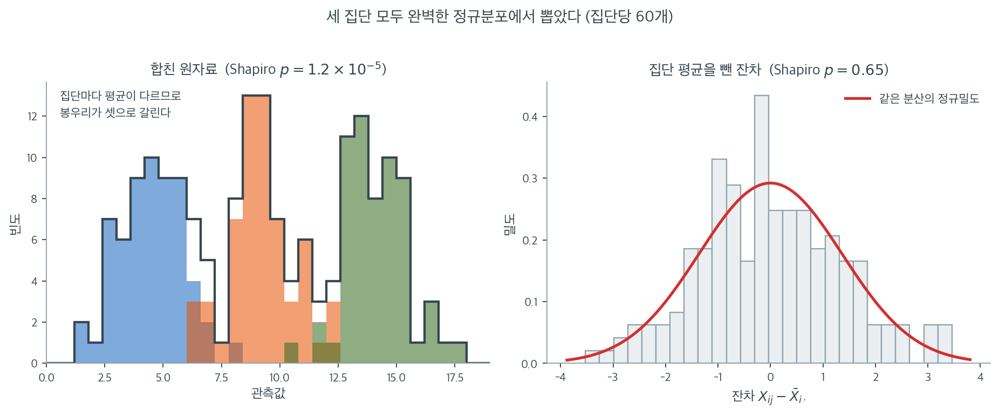

# t 검정과 분산분석에서의 정규성

## 1. 가정이 들어오는 지점

$t$ 검정과 분산분석 모두 정규성을 요구하지만 가정의 정확한 형태는 둘이 다르다. $t$ 검정에서는 바탕 모집단(들)이 정규분포를 따른다고 가정한다. 분산분석에서는 각 집단 안의 관측값이 정규 모집단에서 뽑혔다고 가정한다. 두 경우 모두 정규성 가정이 검정통계량이 기준분포를 정확히 따르도록 보장하여 $p$값과 임계값이 정확해진다.

이 절차들을 적용하기 전에 정규성을 확인하는 것이 좋은 실무 관행이다. 이 절은 가정이 어디에서 들어오는지, 위배를 어떻게 진단하는지, 각 절차가 이탈에 얼마나 로버스트한지를 설명한다.

---

## 2. 일표본 t 검정

평균 $\mu$, 분산 $\sigma^2$인 모집단에서 뽑은 표본 $X_1, X_2, \ldots, X_n$에 대해 일표본 $t$ 검정은 다음을 가정한다.

$$
X_i \overset{\text{iid}}{\sim} N(\mu, \sigma^2)
$$

이 가정 아래에서 검정통계량

$$
t = \frac{\bar{X} - \mu_0}{S / \sqrt{n}}
$$

는 자유도 $n - 1$의 $t$ 분포를 정확히 따른다. $X_i$의 정규성이 두 성질을 동시에 보장한다. $\bar{X}$가 정규분포를 따른다는 것과, $\bar{X}$와 $S^2$이 독립이라는 것이다. $t$ 분포가 성립하려면 둘 다 필요하다.

---

## 3. 이표본 t 검정

독립인 이표본 $t$ 검정은 두 모집단의 정규성을 가정한다.

$$
X_{1i} \overset{\text{iid}}{\sim} N(\mu_1, \sigma^2), \quad X_{2j} \overset{\text{iid}}{\sim} N(\mu_2, \sigma^2)
$$

분산이 같으면 합동 $t$ 통계량이 자유도 $n_1 + n_2 - 2$의 $t$ 분포를 따른다. Welch의 $t$ 검정은 등분산 가정을 완화하지만, 근사 자유도가 타당하려면 여전히 각 집단의 정규성이 필요하다.

---

## 4. 일원배치 분산분석

집단이 $k$개인 일원배치 분산분석의 모형은

$$
X_{ij} = \mu_i + \varepsilon_{ij}, \quad \varepsilon_{ij} \overset{\text{iid}}{\sim} N(0, \sigma^2)
$$

$i = 1, \ldots, k$이고 $j = 1, \ldots, n_i$이다. 정규성 가정은 오차항 $\varepsilon_{ij}$에 적용되며, 이는 각 집단 안의 관측값이 집단 평균 주위에서 정규분포를 따른다고 가정하는 것과 같다. $F$ 통계량

$$
F = \frac{\text{MSB}}{\text{MSW}}
$$

는 $H_0$과 정규성 가정 아래에서 자유도 $k - 1$과 $N - k$의 $F$ 분포를 따른다.

---

## 5. 실무에서의 정규성 확인

### t 검정의 경우

$t$ 검정은 원자료(또는 각 집단의 자료)의 정규성을 가정하므로 확인도 표본값에 직접 적용해야 한다.

1. 표본값의 정규분위수에 대한 **Q-Q 그림**.
2. 표본값에 대한 **Shapiro-Wilk 검정**.
3. 대칭성과 꼬리 거동을 눈으로 평가하는 **히스토그램**.

### 분산분석의 경우

분산분석에서 정규성은 잔차 $\hat{\varepsilon}_{ij} = X_{ij} - \bar{X}_{i\cdot}$에 대한 가정이다. 여기서 $\bar{X}_{i\cdot}$는 집단 평균이다. 진단 절차는

1. 각 관측값에서 집단 평균을 빼서 **잔차를 계산**한다.
2. 합쳐진 잔차의 정규분위수에 대한 **Q-Q 그림**.
3. 합쳐진 잔차에 대한 **Shapiro-Wilk 검정**.

원자료가 아니라 잔차를 확인하는 것이 중요하다. 모든 집단이 정규여도 원자료는 (평균이 다른) $k$개 분포의 혼합이기 때문이다.

??? tip "분산분석에서는 원자료가 아니라 잔차를 확인하라"
    집단 평균이 크게 다르면 각 집단이 완벽하게 정규여도 합친 원자료는 (다봉으로 보이는 등) 정규가 아닌 것처럼 보일 수 있다. 언제나 잔차를 확인하라. 잔차는 집단 평균의 차이를 제거하여 분포 가정만 분리해 준다.

### 봉우리가 셋인데 각 집단은 완벽한 정규다

아래 자료는 평균이 $4$, $9$, $14$이고 표준편차가 모두 $1.4$인 정규분포에서 집단당 60개씩 뽑은 것이다. 세 모집단 모두 **정확히** 정규이고 분산도 같으므로 분산분석의 가정을 하나도 어기지 않았다. 집단별로 Shapiro-Wilk를 돌려도 각각 $p = 0.97$, $0.41$, $0.46$으로 아무 문제가 없다.



그런데 왼쪽 칸처럼 세 집단을 **합쳐** 놓으면 봉우리가 셋인 분포가 된다. 여기에 Shapiro-Wilk를 걸면 $p = 1.2 \times 10^{-5}$로 정규성을 기각한다. 자료 자체에는 아무 잘못이 없는데 검정만 보고 "정규성 위배"라고 적게 되는 것이다. 흔히 저지르는 실수이며, 집단 평균의 차이가 클수록 — 다시 말해 분산분석이 기각할 가능성이 높을수록 — 이 착시도 심해진다는 점이 특히 고약하다.

오른쪽 칸은 각 관측값에서 제 집단의 평균을 뺀 잔차 $\hat\varepsilon_{ij} = X_{ij} - \bar{X}_{i\cdot}$이다. 세 봉우리가 원점 하나로 포개지고 Shapiro-Wilk $p = 0.65$로 정규성과 잘 맞는다. 빨간 정규밀도 곡선과도 잘 겹친다. 모형이 가정한 것이 정확히 이 $\varepsilon_{ij}$였으므로, 확인해야 할 대상도 이것이다.

한 가지 덧붙일 것이 있다. 왼쪽의 $p = 1.2 \times 10^{-5}$는 봉우리가 눈으로도 뚜렷이 셋인 것치고는 그리 작지 않다. Shapiro-Wilk를 포함한 대부분의 정규성 검정이 다봉성에 특별히 강하지 않기 때문이다. 그래서 잔차를 쓰는 습관과 함께 히스토그램을 한 번 그려 보는 습관이 필요하다. 만약 잔차의 히스토그램에서도 봉우리가 둘 이상 보인다면, 그것은 정규성 문제가 아니라 **모형에 넣지 않은 집단 변수가 남아 있다**는 신호일 가능성이 높다.

---

## 6. 비정규성에 대한 로버스트성

### t 검정

일표본과 이표본 $t$ 검정은 다음 조건에서 중간 정도의 정규성 이탈에 로버스트하다.

- 분포가 대칭일 때(꼬리가 두꺼워도 괜찮다).
- 집단당 표본크기가 최소 $n \geq 20$일 때.
- 이탈이 치우침이 아니라 꼬리에서 일어날 때.

치우친 모집단에서는 작은 표본에서 $t$ 검정의 제1종 오류율이 부풀려질 수 있다. 왜곡은 대체로 크지 않아, 명목 수준이 0.05일 때 실제로 0.06–0.08 정도이다.

### 분산분석

분산분석의 $F$ 검정은 다음 조건에서 비정규성에 중간 정도로 로버스트하다.

- 집단 크기가 같을 때(균형 설계).
- 분포가 대칭일 때.
- 집단당 관측값이 최소 15–20개일 때.

불균형 설계와 비정규성이 겹치면 더 문제가 된다. 그런 경우 (등분산을 가정하지 않는) Welch 분산분석과 더 큰 표본크기가 더 나은 보호를 제공한다.

<div class="exbox" markdown>

**보기 1.** <span class="diff easy" title="쉬움"></span> 잔차에 검정을 걸 때 자유도는 몇인가. 평균 $5.0$, $5.5$, $6.0$에 공통 표준편차 $1.5$인 세 정규 집단에서 각각 30개를 뽑아, 집단중심화 잔차에 샤피로–윌크를 걸고 일원분산분석을 수행한다.

**(1)** 출력의 $F = 6.3788$을 **분산분해로 손계산**해 맞추시오. $\hat\sigma = \sqrt{\mathrm{MSW}}$ 는 참값 $1.5$에서 얼마나 떨어져 있는가.

**(2)** 중심화하지 **않고** 그냥 통합한 자료에 샤피로–윌크를 걸면 어떻게 되는가. 이 자료에서는 통과한다. 본문은 "집단 평균이 크게 다르면 다봉으로 보인다"고 했는데, 왜 여기서는 그렇게 되지 않는가.

**(3)** 잔차는 90개이지만 집단마다 합이 0이라는 **제약 3개**를 받으므로 독립이 아니다. 샤피로–윌크는 독립 표본을 가정한다. 그러면 검정의 실제 크기가 명목 $0.05$에서 벗어나는가? 모의실험으로 재고, 집단 수 $k$를 늘리면 어떻게 되는지 보이시오.

</div>

??? success "풀이"

    **쪽의 코드를 먼저 그대로 돌린다.**

    ```python
    import numpy as np
    from scipy import stats

    # ===================================================================
    # 분산분석 잔차의 정규성 확인
    #
    # 집단마다 평균이 다르므로 자료 전체를 한 번에 검정하면 안 된다.
    # 각 관측값에서 제 집단의 평균을 뺀 것이 잔차이고, 정규성은 여기에 요구된다.
    # ===================================================================

    np.random.seed(42)

    # 평균이 조금씩 다른 세 집단. 분산은 모두 같다.
    group1 = np.random.normal(loc=5.0, scale=1.5, size=30)
    group2 = np.random.normal(loc=5.5, scale=1.5, size=30)
    group3 = np.random.normal(loc=6.0, scale=1.5, size=30)

    # 집단별 평균을 빼면 세 집단이 같은 중심으로 모인다. 이렇게 모은 뒤라야
    # 하나의 검정으로 정규성을 물을 수 있다.
    residuals = np.concatenate([
        group1 - np.mean(group1),
        group2 - np.mean(group2),
        group3 - np.mean(group3),
    ])

    # 잔차에 대한 Shapiro-Wilk 검정
    sw_stat, sw_p = stats.shapiro(residuals)

    # 가정을 확인했으니 본 검정으로 넘어간다.
    f_stat, f_p = stats.f_oneway(group1, group2, group3)

    if __name__ == "__main__":
        print("Normality check on ANOVA residuals:")
        print(f"  Shapiro-Wilk: W = {sw_stat:.4f}, p = {sw_p:.4f}")
        print(f"\nOne-way ANOVA:")
        print(f"  F = {f_stat:.4f}, p = {f_p:.4f}")

        if sw_p > 0.05:
            print("\n  Residuals are consistent with normality (p > 0.05).")
        else:
            print("\n  Evidence of non-normality in residuals (p <= 0.05).")
    ```

    출력:

    ```text
    Normality check on ANOVA residuals:
      Shapiro-Wilk: W = 0.9925, p = 0.8948

    One-way ANOVA:
      F = 6.3788, p = 0.0026

      Residuals are consistent with normality (p > 0.05).
    ```

    **(1) 분산분해.** 집단이 $k = 3$, 전체 $N = 90$, 집단당 $n_i = 30$이다. 집단평균은 $4.7178$, $5.3183$, $6.0193$이고 대평균은 $\bar x_{\cdot\cdot} = 5.3518$이다.

    $$
    \mathrm{SSB} = \sum_{i=1}^{3} n_i (\bar x_{i\cdot} - \bar x_{\cdot\cdot})^2 = 30\,(0.4020 + 0.0011 + 0.4456) = 25.4610
    $$

    $$
    \mathrm{SSW} = \sum_{i}\sum_{j} (x_{ij} - \bar x_{i\cdot})^2 = 173.6298
    $$

    자유도는 각각 $k - 1 = 2$와 $N - k = 87$이므로

    $$
    \mathrm{MSB} = \frac{25.4610}{2} = 12.7305,
    \qquad
    \mathrm{MSW} = \frac{173.6298}{87} = 1.9957
    $$

    $$
    F = \frac{\mathrm{MSB}}{\mathrm{MSW}} = \frac{12.7305}{1.9957} = 6.3788
    $$

    로 출력의 $6.3788$과 소수 넷째 자리까지 맞는다. 임계값 $F_{0.95}(2, 87) = 3.1013$을 두 배 넘게 넘으므로 $p = 0.0026$이다. (보기 1의 분산분석은 앞 쪽 `applications.md` 의 $F = 3.3415$처럼 아슬아슬하지 않다. 집단당 30개에 표준편차 $1.5$, 평균 간격 $0.5$라 효과가 뚜렷하다.)

    $\mathrm{MSW}$ 는 $\sigma^2$ 의 불편추정량이므로 $\hat\sigma = \sqrt{1.9957} = 1.4127$이다. 참값 $1.5$보다 $5.8\%$ 작다. 이것도 표본변동이다. $(N-k)\mathrm{MSW}/\sigma^2 \sim \chi^2_{87}$이므로 $\hat\sigma/\sigma$ 의 상대 표준오차는 약 $1/\sqrt{2(N-k)} = 1/\sqrt{174} = 0.0758$이고, 관측된 $-0.0582$는 $-0.77$ 표준오차다.

    **(2) 여기서는 통합해도 통과한다($p = 0.5458$).** 본문의 다봉 그림은 평균이 $4$, $9$, $14$이고 표준편차가 $1.4$인 자료였다. 간격을 표준편차로 재면 $5/1.4 = 3.6$이다. 반면 이 보기는 간격 $0.5$에 표준편차 $1.5$이므로

    $$
    \frac{\text{평균 간격}}{\sigma} = \frac{0.5}{1.5} = 0.333
    $$

    에 지나지 않는다. **열 배 이상 좁다.** 성분이 이만큼 겹치면 혼합은 단봉이고 정규와 거의 구별되지 않는다. 본문의 경고가 틀린 것이 아니라, 경고가 발동하는 **조건**이 간격 대 표준편차의 비라는 뜻이다. 간격이 $\sigma$ 의 세 배쯤 되어야 비로소 통합 자료가 기각되기 시작한다.

    그러므로 "중심화하지 않아도 통과했으니 괜찮다"고 읽으면 안 된다. 통과한 것은 **효과가 작아서**이고, 효과가 클 때 — 곧 분산분석이 기각할 때 — 정확히 그때 통합 검정이 오작동한다. 통과 여부와 무관하게 중심화하는 것이 옳다.

    **(3) 제약 3개는 거의 아무 일도 하지 않는다. 그러나 $k$가 커지면 달라진다.**

    ```python
    import numpy as np
    from scipy import stats

    np.random.seed(42)
    gs = [np.random.normal(loc=m, scale=1.5, size=30) for m in (5.0, 5.5, 6.0)]
    N, k = 90, 3
    grand = np.concatenate(gs).mean()

    print("(1) 분산분해로 F 를 손계산")
    SSB = sum(30 * (g.mean() - grand)**2 for g in gs)
    SSW = sum(((g - g.mean())**2).sum() for g in gs)
    MSB, MSW = SSB / (k - 1), SSW / (N - k)
    print(f"  집단평균 {np.round([g.mean() for g in gs], 4)},  대평균 {grand:.4f}")
    print(f"  SSB = {SSB:.4f},  SSW = {SSW:.4f}")
    print(f"  MSB = {MSB:.4f},  MSW = {MSW:.4f}")
    print(f"  F = MSB/MSW = {MSB/MSW:.4f}   scipy = {stats.f_oneway(*gs)[0]:.4f}")
    print(f"  p = {stats.f.sf(MSB/MSW, k-1, N-k):.4f},  임계 F = {stats.f.ppf(0.95, k-1, N-k):.4f}")
    print(f"  sigma-hat = sqrt(MSW) = {np.sqrt(MSW):.4f}  (참 1.5,"
          f" 상대편차 {(np.sqrt(MSW)-1.5)/1.5:+.4f} = {((np.sqrt(MSW)-1.5)/1.5)*np.sqrt(2*(N-k)):+.2f} SD)")

    print("\n(2) 중심화의 효과")
    resid = np.concatenate([g - g.mean() for g in gs])
    print(f"  잔차 shapiro p         = {stats.shapiro(resid)[1]:.4f}  (집단별 합 모두 0)")
    print(f"  중심화 안 한 통합 p    = {stats.shapiro(np.concatenate(gs))[1]:.4f}")
    print(f"  평균간격 / sigma = 0.5/1.5 = {0.5/1.5:.4f}")

    print("\n(3) 잔차에 샤피로를 걸면 크기가 명목값을 지키는가 (명목 0.05, R = 20000)")
    rng, R = np.random.default_rng(2026), 20000
    print(f"  몬테카를로 SE = {np.sqrt(0.05*0.95/R):.4f}")
    cnt = sum(stats.shapiro(rng.normal(0, 1, 90))[1] < 0.05 for _ in range(R))
    print(f"  iid n=90 (제약 없음)      크기 = {cnt/R:.4f}")
    for kk, m in [(3, 30), (9, 10), (30, 3)]:
        c = 0
        for _ in range(R):
            x = rng.normal(0, 1, (kk, m))
            c += stats.shapiro((x - x.mean(axis=1, keepdims=True)).ravel())[1] < 0.05
        print(f"  잔차 k={kk:<2d} 집단당 {m:<2d} (k/N = {kk/90:.3f})  크기 = {c/R:.4f}")
    ```

    출력:

    ```text
    (1) 분산분해로 F 를 손계산
      집단평균 [4.7178 5.3183 6.0193],  대평균 5.3518
      SSB = 25.4610,  SSW = 173.6298
      MSB = 12.7305,  MSW = 1.9957
      F = MSB/MSW = 6.3788   scipy = 6.3788
      p = 0.0026,  임계 F = 3.1013
      sigma-hat = sqrt(MSW) = 1.4127  (참 1.5, 상대편차 -0.0582 = -0.77 SD)

    (2) 중심화의 효과
      잔차 shapiro p         = 0.8948  (집단별 합 모두 0)
      중심화 안 한 통합 p    = 0.5458
      평균간격 / sigma = 0.5/1.5 = 0.3333

    (3) 잔차에 샤피로를 걸면 크기가 명목값을 지키는가 (명목 0.05, R = 20000)
      몬테카를로 SE = 0.0015
      iid n=90 (제약 없음)      크기 = 0.0496
      잔차 k=3  집단당 30 (k/N = 0.033)  크기 = 0.0500
      잔차 k=9  집단당 10 (k/N = 0.100)  크기 = 0.0482
      잔차 k=30 집단당 3  (k/N = 0.333)  크기 = 0.0316
    ```

    명목 $0.05$에 몬테카를로 표준오차가 $\sqrt{0.05 \times 0.95/20000} = 0.0015$이므로, $0.05$에서 $\pm 0.003$ 밖으로 나가면 유의한 차이다.

    | 설계 | $k/N$ | 실제 크기 | 명목값과의 차 |
    |---|---|---|---|
    | iid $n = 90$ | — | $0.0496$ | $-0.3\,\mathrm{SE}$ |
    | $k = 3$, 집단당 30 | $0.033$ | $0.0500$ | $0.0\,\mathrm{SE}$ |
    | $k = 9$, 집단당 10 | $0.100$ | $0.0482$ | $-1.2\,\mathrm{SE}$ |
    | $k = 30$, 집단당 3 | $0.333$ | $0.0316$ | $-12\,\mathrm{SE}$ |

    **이 보기의 설계($k = 3$, 집단당 30)에서는 걱정할 것이 없다.** 크기가 $0.0500$으로 명목값과 구별되지 않는다. 자유도 90 가운데 3을 쓴 것뿐이라 잔차가 $\mathrm{iid}$ 표본과 거의 다르지 않다.

    그러나 $k$를 늘리면 이야기가 달라진다. $k = 30$에 집단당 3개면 실제 크기가 $0.0316$으로 명목값의 **63%**에 지나지 않는다. 몬테카를로 표준오차의 12배나 벗어난 것이니 우연이 아니다. **검정이 지나치게 보수적**이 되어 실제로 비정규인 자료도 통과시키게 된다.

    까닭은 이 장 전체를 꿰는 주제와 같다. 모수를 추정한 뒤 남은 잔차는 **실제보다 더 정규처럼 보인다.** 집단당 $m$개에서 평균 하나를 뺐으니 집단 안의 자유도가 $m$에서 $m-1$로 줄고, 그 손실 비율이 $1/m$이다. $m = 30$이면 $3\%$라 무시할 수 있지만 $m = 3$이면 $33\%$다. 모수를 추정하고도 추정하지 않은 경우의 임계값을 쓰면 검정의 크기가 명목값 아래로 내려앉는다는 것, 그것이 콜모고로프–스미르노프에 릴리에포르 보정이 필요한 이유와 정확히 같은 구조다.

    실무 지침은 간단하다. **집단당 관측값이 넉넉하면($m \gtrsim 10$) 잔차에 그대로 검정을 걸어도 좋고, 집단은 많은데 집단당 관측값이 몇 개뿐이면 잔차 기반 정규성 검정의 $p$값을 그대로 믿지 말아야 한다.** 후자라면 모의실험으로 귀무분포를 직접 만들거나 Q-Q 그림으로 눈으로 보는 편이 낫다.

잔차가 정규성과 잘 맞고($p = 0.895$) 분산분석은 집단 평균의 차이를 유의하게 탐지한다($p = 0.0026$, 표본평균은 각각 4.72, 5.32, 6.02). 정규성 진단은 통과하고 관심 있는 검정은 기각하는, 이상적인 상황이다.

---

## 7. 정규성이 무너졌을 때

$t$ 검정이나 분산분석 상황에서 진단이 비정규성을 드러내면 몇 가지 대안이 있다.

1. **표본크기를 늘린다.** 중심극한정리가 평균 기반 검정에 점근적 보호를 제공한다.
2. **변환을 적용한다.** 로그나 제곱근 변환이 치우침을 줄일 수 있다.
3. **비모수 검정을 쓴다.** Wilcoxon 순위합 검정이 이표본 $t$ 검정을, Kruskal-Wallis 검정이 일원배치 분산분석을 대신한다.
4. **순열검정을 쓴다.** 순열 기반 $p$값은 분포 가정을 요구하지 않는다.

---

## 연습문제

<div class="drillbox" markdown>

**연습문제 1.** <span class="diff med" title="중간"></span>
어떤 연구자가 중간 정도로 오른쪽으로 치우친 관측값 $n = 12$개에 t 검정을 적용한다. 정규성 가정을 걱정해야 하는가?

</div>

??? success "풀이"
    $n = 12$이면 중심극한정리의 보호가 제한적이므로 중간 정도의 치우침도 걱정거리이다. t 검정은 정확한 타당성을 위해 정규성을 가정한다. 치우친 자료와 작은 $n$에서는 실제 제1종 오류율이 명목 $\alpha$에서 벗어날 수 있고 신뢰구간의 포함확률도 틀릴 수 있다.

    연구자는 (1) Q-Q 그림으로 치우침의 정도를 평가하고, (2) 비모수 대안(Wilcoxon 부호순위 검정)을 고려하고, (3) 자료가 양수이고 오른쪽으로 치우쳤다면 로그 변환을 시도해야 한다. 치우침이 가벼우면 t 검정도 근사적으로 타당할 수 있지만, 민감도 분석을 함께 보고하는 것이 좋은 관행이다.

<div class="drillbox" markdown>

**연습문제 2.** <span class="diff med" title="중간"></span>
분산분석은 흔히 "비정규성에 로버스트하다"고 기술된다. 이 서술을 한정하라. 분산분석은 언제 로버스트하고 언제 그렇지 않은가?

</div>

??? success "풀이"
    분산분석이 로버스트한 경우: (1) 표본크기가 클 때(집단당 $n_j \geq 20$–$30$). 중심극한정리가 집단 평균을 정규화한다. (2) 집단 크기가 같을 때(균형 설계). 분산의 이질성에 대한 보호가 된다. (3) 정규성 이탈이 중간 정도일 때(가벼운 치우침, 극단적 이상점 없음).

    분산분석이 로버스트하지 **않은** 경우: (1) 표본크기가 작고 불균등하며 분산이 이질적일 때, (2) 작은 표본에서 자료가 심하게 치우쳤거나 이상점이 있을 때, (3) 자료가 심하게 비정규일 때(예: 이봉, 두꺼운 꼬리). 이런 경우 F 검정의 제1종 오류율이 크게 부풀려지거나 축소될 수 있다.

<div class="drillbox" markdown>

**연습문제 3.** <span class="diff med" title="중간"></span>
정규성이 의심스러울 때의 대안으로 Welch t 검정과 Mann-Whitney U 검정을 비교하라. 각각은 언제 선호되는가?

</div>

??? success "풀이"
    **Welch t 검정:** 등분산을 가정하지 않지만 여전히 근사적 정규성(또는 큰 $n$)을 가정한다. 평균이 다른지를 검정한다. 자료가 근사적으로 정규이거나 $n$이 크고 연구 질문이 평균에 관한 것일 때 선호된다.

    **Mann-Whitney U 검정:** 정규성을 가정하지 않는 비모수 검정이다. 분포의 모양이 같다는 가정 아래에서 한 집단이 더 큰 값을 갖는 경향이 있는지(확률적 우위)를 검정한다. 자료가 순서형이거나 심하게 치우쳤거나 이상점이 있거나 $n$이 작을 때 선호된다.

    핵심 차이: Welch 검정은 평균에 관한 것이고, Mann-Whitney는 분포 전체(대칭이면 중앙값)에 관한 것이다. 분포의 모양이 다르면 Mann-Whitney는 위치 이동이 아닌 다른 것을 검정하게 된다.

<div class="drillbox" markdown>

**연습문제 4.** <span class="diff med" title="중간"></span>
집단이 $k = 4$개이고 집단당 $n_j = 8$인 일원배치 분산분석이 $H_0$을 기각했다($p = 0.02$). 잔차에 대한 Shapiro-Wilk 검정은 $p = 0.04$를 준다. 분산분석 결과를 믿어야 하는가?

</div>

??? success "풀이"
    Shapiro-Wilk의 기각($p = 0.04$)은 우려를 낳지만 그 자체로 분산분석을 무효화하지는 않는다. $n_j = 8$(작은 집단)이면 t/F 분포 근사가 비정규성에 더 민감하다.

    권장 조치:

    1. 잔차의 Q-Q 그림과 히스토그램을 살펴 비정규성의 정도를 평가한다.
    2. 민감도 확인으로 비모수 대안(Kruskal-Wallis 검정)을 수행한다. 그것도 기각하면 분산분석의 결론이 뒷받침된다.
    3. 비정규성이 이상점 때문이라면 로버스트 분산분석이나 절사평균을 고려한다.
    4. 정규성에 대한 우려를 명시하면서 분산분석과 Kruskal-Wallis 결과를 모두 보고한다.

    Kruskal-Wallis도 $p < 0.05$를 준다면 결론에 대한 신뢰가 높아진다. 결과가 갈리면 정규성 위배가 원인일 수 있다.

<div class="drillbox" markdown>

**연습문제 5.** <span class="diff med" title="중간"></span>
연습문제 4의 설계($k = 4$, 집단당 $n_j = 8$)에 보기 1의 (3)에서 얻은 표를 적용해 보자. 그 표는 균형 설계에서 $k/N$ 이 커질수록 잔차에 건 샤피로–윌크의 실제 크기가 명목 $0.05$ 아래로 내려앉는다고 말한다.

**(1)** 균형 설계에서는 $k/N$ 이 집단당 관측값 $m$ 만으로 정해진다는 것을 보이고, 연습문제 4의 설계에서 그 값을 구하시오. 표의 두 행 $k = 9$(집단당 10)과 $k = 30$(집단당 3) 사이에서 선형보간하여 실제 크기를 어림하시오.

**(2)** 그 어림값이 맞다면, 연습문제 4에서 관측된 $p = 0.04$ 는 정규성에 대한 증거를 과대평가하는가 과소평가하는가. 연습문제 4의 결론이 바뀌는가.

**(3)** 같은 설계에서 $F$ 검정 쪽은 어떤가. 6절의 로버스트성 조건과 견주어, 이 설계에서 더 걱정해야 할 것이 진단의 왜곡인지 $F$ 검정의 왜곡인지 판단하시오.

</div>

??? success "풀이"
    **(1) 균형 설계에서 $k/N$ 은 곧 $1/m$ 이다.** 집단이 $k$ 개이고 집단당 $m$ 개면 $N = km$ 이므로

    $$
    \frac{k}{N} = \frac{k}{km} = \frac{1}{m}
    $$

    이다. 표의 세 행이 실제로 그렇다. $k = 3$, $m = 30$ 에서 $1/30 = 0.033$, $k = 9$, $m = 10$ 에서 $1/10 = 0.100$, $k = 30$, $m = 3$ 에서 $1/3 = 0.333$. 그러니 표의 $k/N$ 열은 집단 수가 아니라 **집단당 관측값**이 쥐고 있는 양이다. 보기 1의 풀이가 "손실 비율이 $1/m$"이라고 적은 것과 같은 수다.

    연습문제 4는 $k = 4$, $m = 8$, $N = 32$ 이므로

    $$
    \frac{k}{N} = \frac{4}{32} = \frac{1}{8} = 0.125
    $$

    다. 표의 $1/10 = 0.100$(크기 $0.0482$)과 $1/3 = 0.333$(크기 $0.0316$) 사이, 왼쪽 끝에 바싹 붙어 있다. 선형보간하면

    $$
    0.0482 + \frac{0.0316 - 0.0482}{0.333 - 0.100}\,(0.125 - 0.100)
    = 0.0482 - 0.0712 \times 0.025 = 0.0464
    $$

    로 명목값의 $93\%$ 다. 실제로 이 설계를 $40000$ 번 모의하면 크기가 $0.0477$(몬테카를로 표준오차 $0.0011$)로 나온다. 보간값이 왜곡을 조금 크게 본 셈인데, 크기가 $1/m$ 에 대해 볼록하게 떨어지기 때문이다. $1/m$ 이 작은 쪽에서는 거의 평평하고 $1/3$ 근처에서 급히 꺾인다.

    **(2) 과소평가한다. 연습문제 4의 결론은 바뀌지 않고 오히려 조금 강해진다.** 검정이 보수적이라는 말은 귀무가설(참된 정규성) 아래에서 $p$ 값이 균등분포보다 **크게** 쏠린다는 뜻이다. 즉 $H_0$ 아래에서 $\Pr(p \le 0.04) < 0.04$ 다. 같은 모의실험에서 이 설계의 $\Pr(p \le 0.04) = 0.0380$ 이 나오므로, 관측된 $p = 0.04$ 는 정확한 귀무분포로 환산하면 $p \approx 0.038$ 에 해당한다.

    그러므로 "제약 때문에 $p$ 값이 작게 나온 것일 뿐"이라는 반론은 성립하지 않는다. 왜곡의 방향이 정반대다. 자유도를 추정에 쓰고 나면 잔차는 실제보다 **더** 정규처럼 보이므로, 그런 잔차가 $p = 0.04$ 까지 내려갔다는 것은 비정규성의 증거가 액면가보다 조금 세다는 말이다. 다만 $0.04$ 와 $0.038$ 의 차이는 실질적으로 무의미하므로, 연습문제 4의 권고(Q-Q 그림을 보고 크러스컬–월리스로 민감도를 확인하라)는 그대로 유효하다.

    **(3) 걱정해야 할 것은 진단이 아니라 $F$ 검정이다.** 6절은 분산분석의 로버스트성 조건으로 균형 설계, 대칭성, **집단당 최소 $15$–$20$개**를 들었다. 이 설계는 균형은 맞지만 집단당 $8$개로 세 번째 조건을 한참 밑돈다. 중심극한정리가 집단평균을 정규로 끌어올 여지가 거의 없으므로, 잔차가 실제로 비정규라면 $F$ 통계량의 기준분포가 어긋나고 $p = 0.02$ 도 믿을 수 없게 된다.

    두 왜곡의 크기를 나란히 적으면 분명하다.

    | 대상 | 명목 | 실제 | 왜곡 |
    |---|---|---|---|
    | 잔차의 샤피로–윌크 | $0.05$ | $0.0477$ | $-5\%$, 보수적 |
    | 집단당 8개의 $F$ 검정 | $0.05$ | 비정규성의 정도에 따라 $0.05$ 를 크게 벗어날 수 있다 | 방향도 크기도 보장 없음 |

    진단의 $5\%$ 보수성은 어느 쪽으로 틀리는지 알고 그 크기도 작다. $F$ 검정의 왜곡은 어느 쪽으로 틀리는지조차 모른다. 아는 왜곡보다 모르는 왜곡이 무섭다.

<div class="drillbox" markdown>

**연습문제 6.** <span class="diff hard" title="어려움"></span>
보기 1의 풀이 (2)는 통합 자료가 기각되기 시작하는 조건이 "평균 간격 대 표준편차의 비"이며 그 문턱이 "$\sigma$ 의 세 배쯤"이라고 적었다. 이 문턱을 밀도의 모양이 바뀌는 문턱과 견주어 보자. 가장 단순한 경우로 집단이 둘이고 크기가 같은 설계를 생각한다. 통합 원자료의 분포는

$$
f(x) = \tfrac{1}{2}\varphi_\sigma(x + a) + \tfrac{1}{2}\varphi_\sigma(x - a),
\qquad a = \frac{d}{2}
$$

이고 $\varphi_\sigma$ 는 $N(0, \sigma^2)$ 의 밀도, $d$ 는 두 집단평균의 간격이다.

**(1)** $f$ 가 봉우리를 둘 갖는 것이 $d > 2\sigma$ 와 동치임을 보이시오. $d \le 2\sigma$ 일 때는 $f$ 가 단봉임도 보여야 한다.

**(2)** $\sigma = 1$ 로 두고 $d = 2.2$ 와 $d = 2.5$ 에서 봉우리의 위치와 골의 깊이 $f(0)/f(x^*)$ 를 구하시오($x^*$ 는 봉우리의 위치).

**(3)** $n = 180$ 에서 샤피로–윌크가 $\alpha = 0.05$ 로 기각하는 확률은 $d = 2.0$ 에서 $0.21$, $d = 2.2$ 에서 $0.34$, $d = 2.5$ 에서 $0.66$, $d = 3.0$ 에서 $0.97$ 이다. (1)과 (2)의 결과로 이 수들을 설명하고, 보기 1의 "세 배" 문턱과 밀도의 문턱 $2\sigma$ 가 왜 다른 자리에 있는지 말하시오.

**(4)** 보기 1의 자료는 $d/\sigma = 0.333$ 이었다. (1)에 비추어, 그 자료의 통합 검정이 통과한 것이 "다봉성을 놓쳤다"는 증거가 되는가.

</div>

??? success "풀이"
    **(1) 문턱은 정확히 $d = 2\sigma$ 다.** $f$ 는 원점에 대해 대칭이므로 $f'(0) = 0$ 이다. 따라서 원점이 극소인지 극대인지만 보면 된다. $\varphi_\sigma'(u) = -(u/\sigma^2)\varphi_\sigma(u)$ 이므로

    $$
    f'(x) = -\frac{1}{2\sigma^2}\Big[(x+a)\varphi_\sigma(x+a) + (x-a)\varphi_\sigma(x-a)\Big]
    $$

    $$
    f''(x) = \frac{1}{2\sigma^4}\Big[\big((x+a)^2 - \sigma^2\big)\varphi_\sigma(x+a) + \big((x-a)^2 - \sigma^2\big)\varphi_\sigma(x-a)\Big]
    $$

    이다. $x = 0$ 을 넣으면 $\varphi_\sigma(a) = \varphi_\sigma(-a)$ 이므로 두 항이 포개져

    $$
    f''(0) = \frac{a^2 - \sigma^2}{\sigma^4}\,\varphi_\sigma(a)
    $$

    가 된다. $\varphi_\sigma(a) > 0$ 이니 $f''(0) > 0 \iff a > \sigma \iff d > 2\sigma$ 다. 즉 $d > 2\sigma$ 이면 원점이 극소이고, 대칭성과 $f(\pm\infty) = 0$ 에 의해 양쪽에 봉우리가 하나씩 생긴다.

    역방향, 곧 $d \le 2\sigma$ 이면 단봉이라는 것도 보여야 한다. $x > 0$ 에서 $f'(x) < 0$ 임을 보이면 된다. $x \ge a$ 이면 위 $f'$ 의 대괄호 안 두 항이 모두 $\ge 0$ 이므로 $f'(x) < 0$ 이다. $0 < x < a$ 에서는 $\varphi_\sigma(x-a) = \varphi_\sigma(a-x)$ 이므로

    $$
    f'(x) < 0
    \iff (x+a)\varphi_\sigma(x+a) > (a-x)\varphi_\sigma(a-x)
    \iff \frac{x+a}{a-x} > \frac{\varphi_\sigma(a-x)}{\varphi_\sigma(x+a)} = e^{2ax/\sigma^2}
    $$

    다. 마지막 등호는 $(x+a)^2 - (a-x)^2 = 4ax$ 에서 나온다. 그러므로

    $$
    L(x) = \ln\frac{x+a}{a-x} - \frac{2ax}{\sigma^2}
    $$

    가 $(0, a)$ 에서 양수인지만 보면 된다. $L(0) = 0$ 이고

    $$
    L'(x) = \frac{1}{x+a} + \frac{1}{a-x} - \frac{2a}{\sigma^2} = \frac{2a}{a^2 - x^2} - \frac{2a}{\sigma^2}
    $$

    이다. $a \le \sigma$ 이면 $0 < a^2 - x^2 < a^2 \le \sigma^2$ 이므로 $L'(x) > 0$ 이고, 따라서 $L(x) > L(0) = 0$ 이다. 곧 $f$ 는 $(0, \infty)$ 에서 강하게 감소하여 단봉이다. (반대로 $a > \sigma$ 이면 $L'(0) = 2(\sigma^2 - a^2)/(a\sigma^2) < 0$ 이라 원점 바로 오른쪽에서 $L < 0$, 즉 $f' > 0$ 이 되어 다시 (1)의 결론이 나온다.) $\square$

    **(2) 봉우리는 생겼지만 골이 거의 없다.** $f'(x^*) = 0$ 은 (1)의 동치식에서 등호를 취한 것이므로 $0 < x^* < a$ 는

    $$
    \frac{x^* + a}{a - x^*} = e^{2ax^*/\sigma^2}
    $$

    를 푼 값이다. $\sigma = 1$ 에서 수치로 풀면 다음을 얻는다.

    | $d$ | $a = d/2$ | 봉우리 $x^*$ | $f(0)$ | $f(x^*)$ | 골의 깊이 $f(0)/f(x^*)$ |
    |---|---|---|---|---|---|
    | $2.0$ | $1.00$ | $0$ | $0.2420$ | $0.2420$ | $1.0000$ |
    | $2.2$ | $1.10$ | $0.7369$ | $0.2179$ | $0.2237$ | $0.9740$ |
    | $2.5$ | $1.25$ | $1.0997$ | $0.1826$ | $0.2098$ | $0.8704$ |
    | $3.0$ | $1.50$ | $1.4632$ | $0.1295$ | $0.2018$ | $0.6418$ |
    | $3.571$ | $1.786$ | $1.7793$ | $0.0810$ | $0.1998$ | $0.4055$ |

    확인해 보자. $d = 2.2$, $x^* = 0.7369$ 에서 좌변은 $1.8369/0.3631 = 5.059$, 우변은 $e^{2 \times 1.1 \times 0.7369} = e^{1.6212} = 5.059$ 로 맞는다. 골의 깊이는 $f(0) = \varphi(a) = \varphi(1.1) = 0.2179$ 와

    $$
    f(x^*) = \tfrac{1}{2}\big[\varphi(0.3631) + \varphi(1.8369)\big] = \tfrac{1}{2}(0.3735 + 0.0738) = 0.2237
    $$

    에서 $0.2179/0.2237 = 0.9740$ 다. $d = 2.5$ 에서는 $f(0) = \varphi(1.25) = 0.1826$, $f(1.0997) = 0.2098$ 로 $0.8704$ 다.

    요점은 **문턱을 갓 넘은 쌍봉은 쌍봉이라 부르기 민망하다**는 것이다. $d = 2.2\sigma$ 에서 골은 봉우리보다 $2.6\%$ 낮을 뿐이다. 관측값 $180$ 개의 히스토그램에서 칸마다 $\sqrt{\text{도수}}$ 정도의 요동이 있는데, $2.6\%$ 의 골이 그 요동을 넘어 보일 이유가 없다.

    **(3) 두 문턱은 "모양이 바뀌는 자리"와 "자료가 그 모양을 증언할 수 있는 자리"로 서로 다르다.** 검정력 $0.21$, $0.34$, $0.66$, $0.97$ 을 (2)의 골 깊이 $1.000$, $0.974$, $0.870$, $0.642$ 와 나란히 놓으면 둘이 같이 움직인다.

    | $d/\sigma$ | 골의 깊이 | 샤피로–윌크 검정력($n = 180$) |
    |---|---|---|
    | $2.0$ | $1.000$(골 없음) | $0.21$ |
    | $2.2$ | $0.974$ | $0.34$ |
    | $2.5$ | $0.870$ | $0.66$ |
    | $3.0$ | $0.642$ | $0.97$ |

    $d = 2\sigma$ 에서 검정력이 $0$ 이 아니라 $0.21$ 인 것은, 그 자리에서 밀도가 아직 단봉이어도 이미 정규가 아니기 때문이다. 초과첨도가 $-2a^4/(\sigma^2 + a^2)^2 = -0.5$ 로 평평해져 있고 샤피로–윌크는 봉우리가 아니라 순서통계량의 모양을 보므로 그 평평함을 조금은 집어낸다. 그리고 $d$ 가 $2\sigma$ 에서 $3\sigma$ 로 가는 동안 골이 $0\%$ 에서 $36\%$ 로 깊어지면서 검정력이 $0.21 \to 0.97$ 로 올라간다.

    그러므로 **밀도의 문턱은 $2\sigma$ 지만 검정의 문턱은 $3\sigma$ 다.** 그 사이 구간 $2\sigma < d < 3\sigma$ 가 이 쪽에서 가장 조심할 자리다. 자료는 진짜로 쌍봉인데 $n = 180$ 의 샤피로–윌크가 $d = 2.2\sigma$ 에서는 세 번에 두 번, $d = 2.5\sigma$ 에서도 세 번에 한 번 놓친다. "검정이 통과했으니 단봉이다"라고 읽으면 이 구간에서 틀린다. 5절이 "대부분의 정규성 검정이 다봉성에 특별히 강하지 않다"고 적고 히스토그램을 함께 보라고 권한 것이 바로 이 구간을 겨눈 말이다. 다만 골이 $2.6\%$ 인 $d = 2.2\sigma$ 라면 히스토그램으로도 보이지 않으니, 끝까지 남는 보호 장치는 집단 변수를 모형에 넣는 것 하나뿐이다.

    **(4) 증거가 되지 않는다. 그 자료의 통합분포는 애초에 단봉이다.** $d/\sigma = 0.333$ 은 문턱 $2$ 의 $6$ 분의 $1$ 밖에 안 된다. (1)에 따라 $f$ 는 **엄밀히** 단봉이고, 초과첨도도 $-2(0.1667)^4/(1 + 0.1667^2)^2 = -0.0015$ 로 정규와 사실상 구별되지 않는다. 그러니 샤피로–윌크의 $p = 0.5458$ 은 검정이 무엇을 놓친 결과가 아니라 **놓칠 것이 없었던** 결과다.

    이 구별이 중요하다. 보기 1의 풀이가 "통과한 것은 효과가 작아서"라고 한 말을 (1)이 정량화해 준다. 통합 검정이 오작동할 수 있는 영역은 $d > 2\sigma$ 이고, 보기 1의 자료는 그 영역에 들어가 있지도 않다. 그래도 중심화해야 하는 까닭은 지금의 $d$ 가 작기 때문이 아니라, $d$ 가 커지는 쪽 — 곧 분산분석이 기각하는 쪽 — 으로 갈 때만 통합 검정이 망가지기 때문이다. 진단의 타당성이 검정하려는 효과의 크기에 달려 있으면 그 진단은 쓸 수 없다.

<div class="drillbox" markdown>

**연습문제 7.** <span class="diff hard" title="어려움"></span>
2절은 $X_i$ 의 정규성이 두 성질을 동시에 보장한다고 했다. $\bar X$ 가 정규분포를 따르는 것과 $\bar X \perp S^2$ 이라는 것이다. 중심극한정리는 첫째만 고쳐 준다. 둘째가 얼마나 어긋나는지 재어 보자. $X_1, \ldots, X_n$ 이 평균 $\mu$, 분산 $\sigma^2$ 인 분포에서 뽑은 iid 표본이고 $\mu_3 = E(X - \mu)^3$, $\mu_4 = E(X - \mu)^4$, $\gamma_1 = \mu_3/\sigma^3$, $\beta_2 = \mu_4/\sigma^4$ 라 한다.

**(1)** 다음을 보이시오.

$$
\operatorname{Cov}(\bar X, S^2) = \frac{\mu_3}{n}
$$

**(2)** $n \to \infty$ 일 때 $\operatorname{Var}(S^2) = (\mu_4 - \sigma^4)/n + O(n^{-2})$ 임을 받아들이고, 상관계수의 극한을 구하시오. 그 극한이 $n$ 에 의존하지 않음을 지적하고, 지수분포($\gamma_1 = 2$, $\beta_2 = 9$)에서 값을 구하시오.

**(3)** (2)에서 얻은 식이 $\lvert \rho \rvert \le 1$ 을 만족해야 한다는 것만으로 2장의 부등식 $\beta_2 \ge 1 + \gamma_1^2$ 이 따라 나온다는 것을 보이시오.

**(4)** (1)–(3)을 써서 6절의 로버스트성 조건 중 "분포가 대칭일 때(꼬리가 두꺼워도 괜찮다)"가 왜 그런 모양인지 설명하시오. 왜 치우침은 $n$ 을 늘려도 꼬리처럼 쉽게 사라지지 않는가.

</div>

??? success "풀이"
    **(1)** 일반성을 잃지 않고 $\mu = 0$ 으로 둔다(공분산은 평행이동에 불변이다). 그러면 $E\bar X = 0$ 이므로 $\operatorname{Cov}(\bar X, S^2) = E[\bar X S^2]$ 이다. 항등식

    $$
    (n-1)S^2 = \sum_{i=1}^n X_i^2 - n\bar X^2
    $$

    을 쓰면

    $$
    (n-1)E[\bar X S^2] = E\Big[\bar X \sum_i X_i^2\Big] - n\,E[\bar X^3]
    $$

    이다. 첫째 항은

    $$
    E\Big[\bar X \sum_i X_i^2\Big]
    = \frac{1}{n}\sum_{j}\sum_{i} E[X_j X_i^2]
    = \frac{1}{n}\Big[\sum_i E[X_i^3] + \sum_{j \ne i} E[X_j]E[X_i^2]\Big]
    = \frac{1}{n}\,n\mu_3 = \mu_3
    $$

    이다($E[X_j] = 0$ 이라 교차항이 모두 죽는다). 둘째 항은

    $$
    E[\bar X^3] = \frac{1}{n^3}E\Big[\Big(\sum_i X_i\Big)^3\Big] = \frac{1}{n^3}\,n\mu_3 = \frac{\mu_3}{n^2}
    $$

    인데, 세제곱을 펼쳤을 때 살아남는 항은 세 첨자가 모두 같은 $n$ 개뿐이기 때문이다. 따라서

    $$
    (n-1)E[\bar X S^2] = \mu_3 - n\cdot\frac{\mu_3}{n^2} = \mu_3\Big(1 - \frac{1}{n}\Big) = \mu_3\,\frac{n-1}{n}
    $$

    $$
    \operatorname{Cov}(\bar X, S^2) = \frac{\mu_3}{n}
    $$

    이다. $\square$

    이 식은 정확식이고 근사가 아니다. 그리고 $\mu_3 \ne 0$ 이면 **모든 $n$ 에서** 공분산이 $0$ 이 아니므로 $\bar X \perp S^2$ 가 깨진다. 거꾸로 $\mu_3 = 0$ 이면 공분산은 $0$ 이지만, 그것은 무상관이지 독립이 아니다. 독립은 정규분포만의 성질이다.

    **(2)** $\operatorname{Var}(\bar X) = \sigma^2/n$ 은 정확하고 $\operatorname{Var}(S^2) \approx (\mu_4 - \sigma^4)/n$ 이므로

    $$
    \operatorname{Corr}(\bar X, S^2)
    = \frac{\mu_3/n}{\sqrt{\sigma^2/n}\;\sqrt{(\mu_4 - \sigma^4)/n}}
    = \frac{\mu_3/n}{\dfrac{\sigma\sqrt{\mu_4 - \sigma^4}}{n}}
    = \frac{\mu_3}{\sigma\sqrt{\mu_4 - \sigma^4}}
    $$

    이다. $\mu_3 = \gamma_1\sigma^3$ 과 $\mu_4 - \sigma^4 = \sigma^4(\beta_2 - 1)$ 을 넣으면

    $$
    \rho \;=\; \lim_{n\to\infty}\operatorname{Corr}(\bar X, S^2)
    \;=\; \frac{\gamma_1 \sigma^3}{\sigma \cdot \sigma^2\sqrt{\beta_2 - 1}}
    \;=\; \frac{\gamma_1}{\sqrt{\beta_2 - 1}}
    $$

    이다. **$n$ 이 식에서 완전히 사라졌다.** 분자의 공분산과 분모의 두 표준편차가 모두 $1/n$ 또는 $1/\sqrt{n}$ 의 같은 차수로 줄어들어 비가 남지 않는다. 지수분포에서는

    $$
    \rho = \frac{2}{\sqrt{9 - 1}} = \frac{2}{2\sqrt{2}} = 0.7071
    $$

    이다. $n = 20$ 에서 정확한 $\operatorname{Var}(S^2) = \mu_4/n - (n-3)\sigma^4/(n(n-1)) = 0.4053\sigma^4$ 로 계산하면 $0.7025$ 이니 극한값과 거의 같다. 즉 지수분포 자료에서 $t$ 통계량의 분자와 분모는 $n$ 을 얼마로 키워도 상관계수 $0.7$ 로 붙어 있다.

    **(3)** (2)의 $\rho$ 는 상관계수의 극한이므로 $\lvert \rho \rvert \le 1$ 이어야 한다. 그러면

    $$
    \frac{\gamma_1^2}{\beta_2 - 1} \le 1
    \quad\Longleftrightarrow\quad
    \gamma_1^2 \le \beta_2 - 1
    \quad\Longleftrightarrow\quad
    \beta_2 \ge 1 + \gamma_1^2
    $$

    이다($\beta_2 - 1 > 0$ 은 자명하지 않은 분포에서 성립한다). $\square$

    2장에서 코시–슈바르츠로 얻은 부등식이 여기서는 **$\bar X$ 와 $S^2$ 의 상관계수가 $1$ 을 넘을 수 없다**는 말로 다시 나타난 것이다. 등호 $\beta_2 = 1 + \gamma_1^2$ 는 두 점 분포에서만 성립하고, 그때 $\lvert \rho \rvert = 1$ 이므로 $S^2$ 이 $\bar X$ 의 함수가 된다. 두 점 분포에서는 표본평균을 알면 두 값의 개수가 정해지고 따라서 표본분산도 정해지니 과연 그렇다.

    **(4)** 6절의 조건이 왜 "대칭이면 꼬리가 두꺼워도 괜찮다"는 비대칭적인 모양인지가 (1)–(3)으로 설명된다.

    $t$ 통계량 $t = (\bar X - \mu_0)/(S/\sqrt{n})$ 이 $t_{n-1}$ 을 따르려면 분자가 정규이고 분모가 분자와 독립이어야 한다. 두 요구가 서로 다른 속도로 회복된다.

    - **분자의 정규성**은 중심극한정리가 고쳐 준다. 베리–에센에 따라 오차가 $O(n^{-1/2})$ 이고, 치우침이든 두꺼운 꼬리든 분산이 유한하면 사라진다.
    - **분자와 분모의 독립성**은 고쳐지지 않는다. (2)에 따라 상관계수가 $\gamma_1/\sqrt{\beta_2 - 1}$ 로 $n$ 에 무관한 상수에 머문다.

    그런데 이 남는 상관계수를 켜는 스위치가 **왜도 하나**다. $\gamma_1 = 0$ 이면 $\rho = 0$ 이고, $\beta_2$ 가 아무리 커도 — 꼬리가 아무리 두꺼워도 — 분자는 분모와 적어도 무상관이다. $\gamma_1 \ne 0$ 이면 $\beta_2$ 가 크든 작든 $\rho \ne 0$ 이 상수로 남는다. 6절의 두 문장이 정확히 이 구조다. "대칭일 때 로버스트하다"는 $\gamma_1 = 0$ 이 $\rho$ 를 끄기 때문이고, "꼬리가 두꺼워도 괜찮다"는 $\beta_2$ 가 $\rho$ 의 **분모**에만 들어가 오히려 상관을 **약화**시키기 때문이다.

    왜곡의 방향까지 읽을 수 있다. 오른쪽으로 치우친 분포는 $\mu_3 > 0$ 이라 $\bar X$ 가 클 때 $S^2$ 도 크다. 그러면 $t$ 의 분자가 양수로 큰 경우에 분모도 함께 커져 $t$ 가 오른쪽으로 덜 뻗고, 반대로 분자가 음수일 때는 분모가 작아 $t$ 가 왼쪽으로 더 뻗는다. 한쪽 꼬리가 기준 $t$ 분포보다 두꺼워지는 것이니 양측검정의 실제 크기가 명목값을 넘는다. 6절이 적은 "명목 $0.05$ 일 때 실제로 $0.06$–$0.08$"이 바로 이 비대칭에서 나오는 값이며, $n$ 을 늘려 사라지는 속도가 $O(n^{-1/2})$ 로 느린 까닭도 같다.

<div class="drillbox" markdown>

**연습문제 8.** <span class="diff hard" title="어려움"></span>
3절은 "Welch의 $t$ 검정은 등분산 가정을 완화하지만, 근사 자유도가 타당하려면 여전히 각 집단의 정규성이 필요하다"고 적었다. 그 두 문장이 어디서 갈라지는지 수로 보자. 두 집단이 정규이고 $\sigma_1^2 = 1$, $\sigma_2^2 = 9$ 이며 총 $N = n_1 + n_2 = 50$ 이다. 합동 $t$ 검정은 분모로 $S_p^2(1/n_1 + 1/n_2)$ 를 쓰는데, 여기서

$$
S_p^2 = \frac{(n_1 - 1)S_1^2 + (n_2 - 1)S_2^2}{n_1 + n_2 - 2}
$$

이다.

**(1)** 배분 $(n_1, n_2)$ 가 $(25, 25)$, $(10, 40)$, $(40, 10)$ 인 세 경우에 참값 $\operatorname{Var}(\bar X_1 - \bar X_2)$ 와 합동 분모의 기댓값 $E[S_p^2](1/n_1 + 1/n_2)$ 를 각각 구하시오.

**(2)** 일반적으로 두 양의 차가

$$
E[S_p^2]\Big(\frac{1}{n_1} + \frac{1}{n_2}\Big) - \Big(\frac{\sigma_1^2}{n_1} + \frac{\sigma_2^2}{n_2}\Big)
= \frac{(N-1)(n_1 - n_2)(\sigma_1^2 - \sigma_2^2)}{(N-2)\,n_1 n_2}
$$

임을 보이시오. 이로부터 합동 검정이 정확해지는 조건과, 보수적이 되는 조건·과대기각하는 조건을 각각 읽어 내시오.

**(3)** $(40, 10)$ 에서 Welch 자유도

$$
\nu = \frac{(\sigma_1^2/n_1 + \sigma_2^2/n_2)^2}{\dfrac{(\sigma_1^2/n_1)^2}{n_1 - 1} + \dfrac{(\sigma_2^2/n_2)^2}{n_2 - 1}}
$$

를 구하고, 합동 자유도 $48$ 과 견주시오. Welch가 고친 것과 고치지 못한 것을 6절의 조건에 비추어 말하시오.

</div>

??? success "풀이"
    **(1)** $E[S_1^2] = \sigma_1^2$, $E[S_2^2] = \sigma_2^2$ 이므로

    $$
    E[S_p^2] = \frac{(n_1 - 1)\sigma_1^2 + (n_2 - 1)\sigma_2^2}{N - 2}
    $$

    이고 참값은 $\operatorname{Var}(\bar X_1 - \bar X_2) = \sigma_1^2/n_1 + \sigma_2^2/n_2$ 다. 세 배분에 넣는다.

    $(25, 25)$ 에서는

    $$
    \text{참값} = \frac{1}{25} + \frac{9}{25} = 0.4000,
    \qquad
    E[S_p^2] = \frac{24 \cdot 1 + 24 \cdot 9}{48} = 5,
    \qquad
    5 \times \frac{2}{25} = 0.4000
    $$

    $(10, 40)$ 에서는

    $$
    \text{참값} = \frac{1}{10} + \frac{9}{40} = 0.3250,
    \qquad
    E[S_p^2] = \frac{9 \cdot 1 + 39 \cdot 9}{48} = 7.5,
    \qquad
    7.5 \times \frac{1}{8} = 0.9375
    $$

    $(40, 10)$ 에서는

    $$
    \text{참값} = \frac{1}{40} + \frac{9}{10} = 0.9250,
    \qquad
    E[S_p^2] = \frac{39 \cdot 1 + 9 \cdot 9}{48} = 2.5,
    \qquad
    2.5 \times \frac{1}{8} = 0.3125
    $$

    정리하면 다음과 같다. 마지막 열은 명목 $0.05$ 양측검정의 실제 크기를 $200000$ 번 모의해 얻은 값이다.

    | $(n_1, n_2)$ | 참 $\operatorname{Var}$ | 합동 분모 기댓값 | 비 | 표준오차의 비 | 합동 $t$ 의 실제 크기 |
    |---|---|---|---|---|---|
    | $(25, 25)$ | $0.4000$ | $0.4000$ | $1.000$ | $1.000$ | $0.054$ |
    | $(10, 40)$ | $0.3250$ | $0.9375$ | $2.885$ | $1.698$ | $0.001$ |
    | $(40, 10)$ | $0.9250$ | $0.3125$ | $0.338$ | $0.581$ | $0.257$ |

    분산이 $9$ 배나 다른데도 **균형 설계에서는 합동 분모가 참값과 정확히 같다.** 불균형이 되면 참값의 $2.9$ 배가 되기도 하고 $0.34$ 배가 되기도 하며, 후자에서는 명목 $5\%$ 검정의 실제 크기가 $25.7\%$ 로 다섯 배가 된다.

    **(2)** 공통분모 $(N-2)n_1n_2$ 로 묶는다. $1/n_1 + 1/n_2 = N/(n_1n_2)$ 이므로 좌변은

    $$
    \frac{N\big[(n_1 - 1)\sigma_1^2 + (n_2 - 1)\sigma_2^2\big] - (N - 2)\big(n_2\sigma_1^2 + n_1\sigma_2^2\big)}{(N-2)\,n_1 n_2}
    $$

    이다. 분자에서 $\sigma_1^2$ 의 계수는 $N(n_1 - 1) - (N-2)n_2$ 이고, $N = n_1 + n_2$ 를 넣으면

    $$
    N n_1 - N - N n_2 + 2n_2 = N(n_1 - n_2) - (n_1 + n_2) + 2n_2 = N(n_1 - n_2) - (n_1 - n_2) = (N-1)(n_1 - n_2)
    $$

    이다. $\sigma_2^2$ 의 계수는 $1 \leftrightarrow 2$ 를 바꾼 것이므로 $(N-1)(n_2 - n_1)$ 이다. 따라서 분자는

    $$
    (N-1)(n_1 - n_2)\sigma_1^2 + (N-1)(n_2 - n_1)\sigma_2^2 = (N-1)(n_1 - n_2)(\sigma_1^2 - \sigma_2^2)
    $$

    이고 주어진 식이 나온다. $\square$

    검산해 보자. $(10, 40)$ 에서 $49 \times (-30) \times (1 - 9)/(48 \times 400) = 11760/19200 = 0.6125$ 이고 $0.3250 + 0.6125 = 0.9375$ 로 (1)의 값과 맞는다.

    식이 곱 $(n_1 - n_2)(\sigma_1^2 - \sigma_2^2)$ 하나로 결정된다는 것이 핵심이다.

    - **$n_1 = n_2$ 이면 분산이 아무리 달라도 차가 $0$ 이다.** 등분산 가정이 틀렸어도 합동 분모가 옳은 양을 추정한다. 6절이 분산분석의 로버스트성 조건으로 균형 설계를 앞세운 까닭이 여기 있다. 균형은 등분산 위배를 **상쇄**한다.
    - **$\sigma_1^2 = \sigma_2^2$ 이면 불균형이어도 차가 $0$ 이다.** 가정이 맞으면 당연한 이야기다.
    - **$(n_1 - n_2)(\sigma_1^2 - \sigma_2^2) > 0$, 곧 큰 표본이 큰 분산에 붙으면** 합동 분모가 참값보다 크다. 검정이 보수적이 되어 실제 크기가 명목값 아래로 간다($(10, 40)$ 의 $0.001$).
    - **$(n_1 - n_2)(\sigma_1^2 - \sigma_2^2) < 0$, 곧 큰 표본이 작은 분산에 붙으면** 합동 분모가 참값보다 작다. 과대기각이다($(40, 10)$ 의 $0.257$).

    두 위배가 함께 올 때 더 나쁘다는 6절의 말이 이렇게 수식 하나로 요약된다. 불균형만으로도, 이분산만으로도 아무 일이 없고, 둘이 겹칠 때만 틀어진다.

    **(3)** $a = \sigma_1^2/n_1 = 1/40 = 0.025$, $b = \sigma_2^2/n_2 = 9/10 = 0.9$ 이므로

    $$
    \nu = \frac{(0.025 + 0.9)^2}{\dfrac{0.025^2}{39} + \dfrac{0.9^2}{9}}
    = \frac{0.855625}{1.603 \times 10^{-5} + 0.09}
    = \frac{0.855625}{0.0900160}
    = 9.505
    $$

    다. 합동 자유도 $48$ 의 **$5$ 분의 $1$** 이다. 임계값도 $t_{0.975}(48) = 2.011$ 에서 $t_{0.975}(9.505) = 2.244$ 로 올라간다. 모의실험에서 Welch의 실제 크기는 세 배분 모두 $0.050$ 전후($0.0501$, $0.0495$, $0.0507$)로 명목값을 지킨다.

    **Welch가 고친 것.** 분모가 추정하는 대상을 $\sigma^2(1/n_1 + 1/n_2)$ 에서 $\sigma_1^2/n_1 + \sigma_2^2/n_2$ 로 바꾸었다. (2)의 차가 통째로 사라지므로 불균형과 이분산이 겹쳐도 크기가 유지된다.

    **Welch가 고치지 못한 것.** $\nu = 9.5$ 라는 수 자체다. $b \gg a$ 이면 $\nu$ 의 분모가 $b^2/(n_2 - 1)$ 에 지배되어

    $$
    \nu \approx \frac{b^2}{b^2/(n_2-1)} = n_2 - 1 = 9
    $$

    가 된다. 다시 말해 **유효 표본크기가 분산이 큰 쪽 집단의 크기로 떨어진다.** $40$ 개를 더 모았지만 검정은 사실상 $10$ 개짜리 표본으로 돌아가는 것이다. 그런데 6절은 $t$ 검정의 로버스트성 조건으로 "집단당 최소 $n \ge 20$"을 요구했다. $\nu = 9.5$ 는 그 절반이다.

    그래서 3절의 두 문장이 갈라지는 자리가 보인다. Welch는 **분산의 문제를 정규성의 문제로 바꾼다.** 등분산 위배는 완전히 처리하지만, 그 대가로 자유도를 큰 분산 쪽 집단의 크기까지 끌어내리므로 이제 그 작은 집단이 얼마나 정규인지가 결정적이 된다. 사타스웨이트 근사가 $S_1^2$, $S_2^2$ 이 카이제곱이라는 데 기대고 있는데 그 성질이야말로 정규성에서만 나오는 것이고, $n_2 = 10$ 에서는 중심극한정리가 메워 줄 여지도 없다. 설계 단계에서 할 수 있는 최선은 간단하다. **분산이 클 것으로 예상되는 집단에 관측값을 더 배분하라.** $(10, 40)$ 으로 뒤집으면 $\nu = 43.8$ 로 올라가 자유도의 손실이 거의 없다.

<div class="drillbox" markdown>

**연습문제 9.** <span class="diff hard" title="어려움"></span>
5절은 통합 원자료의 샤피로–윌크 $p = 1.2 \times 10^{-5}$ 가 "봉우리가 눈으로도 뚜렷이 셋인 것치고는 그리 작지 않다"고 적고, 그 까닭을 "대부분의 정규성 검정이 다봉성에 특별히 강하지 않기 때문"이라 했다. 3차·4차 적률만 보는 검정에서는 이것을 정확히 계산할 수 있다. 그림의 자료는 평균 $4$, $9$, $14$, 공통 표준편차 $\sigma = 1.4$, 집단당 $60$ 개이므로 통합분포는 간격 $d = 5$ 인 등가중 혼합

$$
F = \tfrac{1}{3}N(-d, \sigma^2) + \tfrac{1}{3}N(0, \sigma^2) + \tfrac{1}{3}N(d, \sigma^2)
$$

이다(중심을 옮겼다). 자크–베라 통계량은 $\mathrm{JB} = n\big[\gamma_1^2/6 + (\beta_2 - 3)^2/24\big]$ 이고 귀무분포는 $\chi^2_2$, 임계값은 $5.991$ 이다.

**(1)** $F$ 의 왜도를 구하고, 초과첨도가

$$
\beta_2 - 3 = -\frac{\tfrac{2}{3}d^4}{\big(\sigma^2 + \tfrac{2}{3}d^2\big)^2}
$$

임을 보이시오. $d = 5$, $\sigma = 1.4$ 에서 값을 구하시오.

**(2)** $n = 180$ 에서 $\mathrm{JB}$ 와 그 $p$ 값을 구하고, 본문의 샤피로–윌크 $p = 1.2 \times 10^{-5}$ 와 견주시오. 또 이 혼합에서 자크–베라가 $\alpha = 0.05$ 로 기각하려면 $n$ 이 최소 얼마여야 하는가.

**(3)** $d \to \infty$ 로 보내시오. 초과첨도의 극한을 구하고, 세 집단을 **아무리 멀리 떼어 놓아도** 자크–베라가 기각하려면 $n$ 이 최소 얼마여야 하는지 구하시오.

**(4)** 2장의 $\beta_2 \ge 1 + \gamma_1^2$ 를 써서, 대칭이면서 평평한($\beta_2 < 3$) 어떤 분포에 대해서도 자크–베라가 $n$ 이 어느 수 미만이면 결코 기각할 수 없음을 보이시오. 이것이 적률 기반 검정이 다봉성에는 약하고 두꺼운 꼬리에는 강한 구조적 까닭임을 설명하시오.

</div>

??? success "풀이"
    **(1)** $F$ 는 원점에 대해 대칭이므로 $\mu_3 = 0$, 곧 $\gamma_1 = 0$ 이다. 세 성분의 중심이 $-d, 0, d$ 로 대칭이고 척도가 같으니 홀수 차 중심적률이 모두 $0$ 이다.

    적률은 성분별 적률의 평균이다. 중심 $c$ 와 $Z \sim N(0, \sigma^2)$ 에 대해 $E[(c + Z)^2] = c^2 + \sigma^2$ 이고 $E[(c + Z)^4] = c^4 + 6c^2\sigma^2 + 3\sigma^4$ 이므로, $c \in \{-d, 0, d\}$ 를 각각 $1/3$ 로 평균하면

    $$
    \mu_2 = \sigma^2 + \frac{1}{3}(d^2 + 0 + d^2) = \sigma^2 + \frac{2}{3}d^2
    $$

    $$
    \mu_4 = \frac{1}{3}(d^4 + 0 + d^4) + 6\sigma^2 \cdot \frac{1}{3}(d^2 + 0 + d^2) + 3\sigma^4
    = \frac{2}{3}d^4 + 4\sigma^2 d^2 + 3\sigma^4
    $$

    이다. 한편

    $$
    3\mu_2^2 = 3\Big(\sigma^2 + \frac{2}{3}d^2\Big)^2 = 3\sigma^4 + 4\sigma^2 d^2 + \frac{4}{3}d^4
    $$

    이므로 두 식을 빼면 $\sigma^4$ 항과 $\sigma^2 d^2$ 항이 통째로 사라지고

    $$
    \mu_4 - 3\mu_2^2 = \frac{2}{3}d^4 - \frac{4}{3}d^4 = -\frac{2}{3}d^4
    $$

    만 남는다. 양변을 $\mu_2^2$ 로 나누면 주어진 식이다. $\square$

    **초과첨도는 모든 $d > 0$ 에서 음수다.** 집단을 떼어 놓는 일은 분포를 뾰족하게 하는 것이 아니라 평평하게 하는 것이다. $d = 5$, $\sigma = 1.4$ 를 넣으면

    $$
    \mu_2 = 1.96 + \frac{2}{3}(25) = 18.6267,
    \qquad
    \mu_4 = \frac{2}{3}(625) + 4(1.96)(25) + 3(3.8416) = 624.19
    $$

    $$
    \beta_2 = \frac{624.19}{18.6267^2} = \frac{624.19}{346.95} = 1.7991,
    \qquad
    \beta_2 - 3 = -1.2009
    $$

    이다(공식으로 직접 계산해도 $-\frac{2}{3}(625)/346.95 = -1.2009$ 로 같다).

    **(2)** $\gamma_1 = 0$ 이므로 자크–베라는 첨도 항만으로 간다.

    $$
    \mathrm{JB} = 180\Big[\frac{0^2}{6} + \frac{(-1.2009)^2}{24}\Big] = 180 \times 0.060093 = 10.82
    $$

    $$
    p = \Pr(\chi^2_2 > 10.82) = e^{-10.82/2} = e^{-5.41} = 0.0045
    $$

    본문의 샤피로–윌크는 $p = 1.2 \times 10^{-5}$ 였다. **자크–베라의 $p$ 값이 $375$ 배나 크다.** 둘 다 기각하지만 증거의 강도가 전혀 다르다. 샤피로–윌크는 순서통계량 전체의 모양을 보는 반면 자크–베라는 $\gamma_1$ 과 $\beta_2$ 라는 수 **두 개**로 자료를 압축하고, 그중 하나($\gamma_1$)는 대칭 때문에 $0$ 이라 아무 정보도 싣지 못한다. 봉우리가 셋이라는 사실이 통계량에 들어가는 통로는 $\beta_2 - 3 = -1.2$ 하나뿐이다.

    기각에 필요한 최소 $n$ 은 $n \times 0.060093 \ge 5.991$ 에서

    $$
    n \ge \frac{5.991}{0.060093} = 99.7
    \quad\Longrightarrow\quad
    n \ge 100
    $$

    이다. 본문의 $n = 180$ 은 이 문턱을 겨우 넘은 것이다. 집단당 $60$ 개가 아니라 $30$ 개였다면($n = 90$) 봉우리가 그림에서 똑같이 뚜렷해도 자크–베라는 **통과시켰을 것이다.**

    **(3)** $d \to \infty$ 에서 분자와 분모가 모두 $d^4$ 차이므로

    $$
    \beta_2 - 3 \;\longrightarrow\; -\frac{\tfrac{2}{3}d^4}{\big(\tfrac{2}{3}d^2\big)^2} = -\frac{\tfrac{2}{3}}{\tfrac{4}{9}} = -\frac{3}{2}
    $$

    이다. 즉 $\beta_2 \to 1.5$ 로 멈춘다. 그러면 관측값 하나가 통계량에 보태는 양의 상한이

    $$
    \frac{(3/2)^2}{24} = \frac{2.25}{24} = 0.09375
    $$

    이므로 기각에 필요한 최소 표본크기는

    $$
    n \ge \frac{5.991}{0.09375} = 63.9
    \quad\Longrightarrow\quad
    n \ge 64
    $$

    다. **봉우리 세 개를 무한히 멀리 떼어 놓아 분포가 사실상 세 점에 몰린 스파이크가 되어도, 자크–베라는 $n \le 63$ 이면 유의수준 $0.05$ 에서 결코 기각할 수 없다.** 더 떼어 놓는다고 통계량이 더 커지지 않는다. 신호가 포화되는 것이다. 이것이 5절의 "대부분의 정규성 검정이 다봉성에 특별히 강하지 않다"를 적률 검정에서 정량화한 결과다.

    **(4)** 2장의 부등식 $\beta_2 \ge 1 + \gamma_1^2$ 는 $\gamma_1$ 이 무엇이든 $\beta_2 \ge 1$ 을 함의한다. 따라서 **모든** 분포에서

    $$
    \beta_2 - 3 \ge -2
    $$

    다. 평평한 쪽의 이탈은 $-2$ 에서 멈춘다. 그런데 대칭($\gamma_1 = 0$)이고 평평하면 자크–베라의 왜도 항이 $0$ 이므로

    $$
    \mathrm{JB} = n\,\frac{(\beta_2 - 3)^2}{24} \le n\,\frac{4}{24} = \frac{n}{6}
    $$

    이다. $n/6 \ge 5.991$ 이려면 $n \ge 35.95$, 곧 $n \ge 36$ 이어야 한다. **대칭이고 평평한 분포라면 그것이 무엇이든 $n \le 35$ 에서는 자크–베라가 결코 기각하지 못한다.** 등호에 가장 가까운 것은 $\beta_2 = 1$ 인 두 점 분포, 즉 두 값만 번갈아 나오는 자료다. 정규성에서 이보다 멀어질 수 없는 자료에서도 $n = 35$ 면 손을 들어야 한다.

    여기에 적률 검정의 구조가 다 들어 있다. $\beta_2$ 는 **아래로는 막혀 있고 위로는 열려 있다.** 평평함(다봉, 균등, 두 점)은 $\lvert \beta_2 - 3 \rvert \le 2$ 라는 천장 아래에 갇히므로 자크–베라의 통계량을 $n/6$ 이상으로 밀어 올릴 수 없고, 검정력은 결국 $n$ 을 키우는 것으로만 산다. 반대로 두꺼운 꼬리는 $\beta_2$ 를 얼마든지 크게 만들 수 있어 — 자유도 $5$ 의 $t$ 분포만 해도 $\beta_2 = 9$ 로 $\beta_2 - 3 = 6$ 이고 $\mathrm{JB}/n = 1.5$ 이므로 $n \ge 4$ 면 기각한다 — 작은 표본에서도 쉽게 잡힌다.

    한 가지 단서를 달아 둔다. (3)과 (4)의 "$n$ 이 이 수 미만이면 결코 기각하지 못한다"는 **$\chi^2_2$ 임계값 $5.991$ 을 쓰는 한에서** 하는 말이다. $\chi^2_2$ 는 점근 귀무분포일 뿐이고 자크–베라의 수렴은 느려서, 작은 표본의 정확한 $5\%$ 임계값은 그보다 작다(모의실험으로 $n = 36$ 에서 약 $4.8$, $n = 64$ 에서 약 $5.2$, $n = 180$ 에서도 약 $5.6$ 이다). 그러니 표본별 정확 임계값을 쓰면 문턱이 조금 내려간다. 바뀌지 않는 것은 구조다. 통계량 자체가 $n(\beta_2 - 3)^2/24 \le n/6$ 으로 막혀 있어 평평한 쪽의 신호가 포화된다는 사실은 임계값을 어디에 두든 그대로다.

    그러니 적률 기반 검정은 **꼬리 탐지기**이지 모양 탐지기가 아니다. 분산분석에서 염려하는 비정규성이 집단 변수를 빼먹어 생기는 다봉성이라면, 그것은 바로 적률 검정이 가장 못 보는 종류의 이탈이다. 5절이 검정 하나로 끝내지 말고 히스토그램을 그려 보라고 권한 데에는 이런 이유가 있다.

<div class="drillbox" markdown>

**연습문제 10.** <span class="diff hard" title="어려움"></span>
5절은 분산분석의 정규성을 합쳐진 잔차로 확인하라고 지시한다. 그 지시에는 한 가지 사각지대가 있다. 집단별 **분산**이 다를 때 무슨 일이 일어나는지 보자. 집단이 $k = 2$, 집단당 $n_j = 60$, 두 집단 안의 오차가 각각 정확히 $N(0, \sigma_1^2)$ 과 $N(0, \sigma_2^2)$ 를 따른다. 집단 수가 적고 집단당 관측값이 많으므로(보기 1의 (3)에 따라 $1/m$ 의 효과는 무시한다) 합쳐진 잔차 $N = 120$ 개의 분포는 등가중 척도혼합

$$
G = \tfrac{1}{2}N(0, \sigma_1^2) + \tfrac{1}{2}N(0, \sigma_2^2)
$$

로 본다. 분산비를 $r = \sigma_2^2/\sigma_1^2$ 라 한다.

**(1)** $G$ 의 왜도를 구하고, 초과첨도가 $3(r-1)^2/(r+1)^2$ 임을 보이시오. $r \to \infty$ 에서의 극한도 구하시오.

**(2)** 표준편차의 비가 $2$ 배($r = 4$)일 때 초과첨도와 자크–베라 통계량을 구하시오. 모의실험으로 재면 $N = 120$ 에서 자크–베라는 $45\%$, 샤피로–윌크는 $40\%$ 의 확률로 정규성을 기각한다. 각 집단 안의 오차가 **정확히 정규**임을 염두에 두고 이 결과가 무엇을 뜻하는지 쓰시오.

**(3)** 연습문제 9의 (3)·(4)와 견주시오. 두 결함 — 집단 평균을 빼먹은 것과 집단 분산이 다른 것 — 이 합쳐진 자료의 첨도에 남기는 흔적은 어떻게 다른가. 잔차의 초과첨도 부호를 보고 무엇을 읽을 수 있는가.

**(4)** 잔차 검정이 기각했을 때 (2)와 같은 상황을 "정규성 위배"로 처리하면 7절의 네 가지 대안 중 어느 것도 문제를 고치지 못하는 까닭을 말하고, 올바른 진단 절차와 조치를 제시하시오.

</div>

??? success "풀이"
    **(1)** $G$ 는 두 대칭분포의 혼합이므로 대칭이고 $\gamma_1 = 0$ 이다. 분산을 $v_1 = \sigma_1^2$, $v_2 = \sigma_2^2$ 라 쓰면, $N(0, v)$ 에서 $E[X^2] = v$, $E[X^4] = 3v^2$ 이므로

    $$
    \mu_2 = \frac{v_1 + v_2}{2},
    \qquad
    \mu_4 = \frac{3v_1^2 + 3v_2^2}{2}
    $$

    이다. 따라서

    $$
    \beta_2 = \frac{\mu_4}{\mu_2^2} = \frac{3(v_1^2 + v_2^2)/2}{(v_1 + v_2)^2/4} = \frac{6(v_1^2 + v_2^2)}{(v_1 + v_2)^2}
    $$

    이고

    $$
    \beta_2 - 3 = \frac{6(v_1^2 + v_2^2) - 3(v_1 + v_2)^2}{(v_1 + v_2)^2}
    = \frac{3\big(2v_1^2 + 2v_2^2 - v_1^2 - 2v_1v_2 - v_2^2\big)}{(v_1 + v_2)^2}
    = \frac{3(v_1 - v_2)^2}{(v_1 + v_2)^2}
    $$

    다. 분자와 분모를 $v_1^2$ 으로 나누면 $r = v_2/v_1$ 로

    $$
    \beta_2 - 3 = \frac{3(r - 1)^2}{(r + 1)^2}
    $$

    를 얻는다. $\square$

    이번에는 부호가 **양수**다. $r = 1$ 에서만 $0$ 이고 $r \ne 1$ 이면 언제나 양수다. $r \to \infty$ 에서는

    $$
    \beta_2 - 3 \;\longrightarrow\; 3
    $$

    로 올라가고, 분산비가 어떻든 $3$ 을 넘지는 못한다(등가중 두 성분에 한한다).

    **(2)** $r = 4$ 이면

    $$
    \beta_2 - 3 = \frac{3 \times 9}{25} = 1.08
    $$

    $$
    \mathrm{JB} = 120\Big[0 + \frac{1.08^2}{24}\Big] = 120 \times 0.0486 = 5.83
    $$

    이다. 임계값 $5.991$ 에 간발의 차로 못 미치는 값인데, 이는 **점근 기댓값**이고 실제 표본의 $\hat\beta_2$ 는 그 주위로 요동하므로 절반에 가까운 확률로 임계값을 넘는다. 모의실험의 $45\%$ 가 그것이다.

    이 결과가 말하는 것은 분명하다. **모형의 정규성 가정은 한 점도 위배되지 않았는데 정규성 검정이 열 번에 네다섯 번 기각한다.** 오차는 두 집단 안에서 각각 정확히 정규다. 위배된 것은 4절의 모형 $\varepsilon_{ij} \sim N(0, \sigma^2)$ 에서 정규성이 아니라 $\sigma^2$ 이 **공통**이라는 부분이다. 그런데 잔차를 합쳐 버리면 그 둘이 구별되지 않는다. 척도가 섞인 정규들의 혼합은 더 이상 정규가 아니므로, 합쳐진 잔차에 건 검정은 "정규성 위배"라고 보고하면서 실제로는 등분산 위배를 가리킨다. 검정은 기각의 **까닭**을 말해 주지 않는다.

    분산비가 작으면 이 혼선은 잠복한다. $r = 2$ 면 초과첨도가 $0.333$ 이라 $\mathrm{JB}/n = 0.0046$ 이고 기각에 $n \ge 1295$ 가 필요하다. 반대로 $r = 9$(표준편차 $3$ 배)면 초과첨도 $1.92$ 에 $n \ge 40$ 으로 떨어지고, $r \to \infty$ 의 극한에서는 $n \ge 16$ 이면 기각한다.

    **(3)** 두 결함이 남기는 흔적은 **부호가 반대**다.

    | 결함 | 합쳐진 자료의 왜도 | 초과첨도 | 극단에서의 한계 |
    |---|---|---|---|
    | 집단 평균을 빼먹음(연습문제 9) | $0$ | 음수 | $d \to \infty$ 에서 $-1.5$ |
    | 집단 분산이 다름(이 문제) | $0$ | 양수 | $r \to \infty$ 에서 $+3$ |

    위치가 섞이면 분포가 넓게 퍼져 평평해진다. 중심에 몰릴 질량이 좌우로 흩어지므로 분산은 커지는데 꼬리는 그만큼 길어지지 않아 $\beta_2 = \mu_4/\mu_2^2$ 가 떨어진다. 척도가 섞이면 반대다. 분산이 큰 성분이 꼬리만 길게 늘여 주므로 $\mu_4$ 가 $\mu_2^2$ 보다 빨리 커지고 $\beta_2$ 가 올라간다.

    실무에서는 이렇게 쓸 수 있다. 잔차가 비정규로 판정되었을 때 **초과첨도의 부호**가 1차 분류를 해 준다. 음수이면 모형에 넣지 않은 집단 변수나 혼합 구조를 의심하고(잔차 히스토그램에서 봉우리를 찾는다), 양수이면 이분산이나 이상점을 의심한다(집단별 잔차의 산포를 비교하고 잔차 대 적합값 그림을 본다). 왜도는 둘 다 $0$ 이므로 이 분류에 쓸 수 없고, 왜도가 큰 경우는 제3의 원인 — 바탕 분포 자체의 치우침 — 을 가리킨다. 아울러 **두 방향의 크기가 비대칭**임도 기억할 만하다. 연습문제 9의 (4)에서 보았듯 평평한 쪽은 $-2$ 에서 막혀 있고 뾰족한 쪽은 열려 있으므로, 같은 심각도라면 이분산이 다봉성보다 훨씬 쉽게 발각된다. 다시 말해 잔차 검정이 조용하다는 사실은 "이분산은 아마 없다"의 증거는 되지만 "빼먹은 집단 변수가 없다"의 증거는 되지 못한다.

    **(4)** 7절의 네 대안은 모두 **오차분포의 모양**을 겨눈 처방이다. 그런데 (2)의 상황에서 모양은 이미 정규다. 처방이 겨눈 대상이 거기 없다.

    1. **표본크기를 늘린다.** 가장 나쁜 선택이다. 초과첨도 $1.08$ 은 $n$ 과 무관한 모집단 양이고 $\mathrm{JB} = 0.0486\,n$ 이므로, $n$ 을 키우면 기각이 **확실해질** 뿐이다. 다봉성에서처럼 포화되는 것도 아니다. 진단은 점점 더 요란하게 울리는데 가리키는 곳은 계속 틀렸다.
    2. **변환을 적용한다.** 로그나 제곱근은 왜도를 겨눈 것인데 여기서 $\gamma_1 = 0$ 이다. 게다가 두 집단의 중심이 다르면 같은 변환이 집단마다 다른 배율로 작용해 등분산을 오히려 더 망칠 수 있다. 분산안정화 변환이 맞는 경우가 있지만, 그것은 분산이 평균의 함수일 때이고 그 판단에는 집단별 산포를 봐야 한다. 곧 (3)의 진단을 먼저 해야 한다.
    3. **비모수 검정을 쓴다.** 크러스컬–월리스도 집단마다 분포가 같은 모양이라고 가정한다. 분산이 다르면 그 가정이 깨지므로 같은 병을 물려받는다.
    4. **순열검정을 쓴다.** 순열검정의 귀무가설은 교환가능성이다. 분산이 다르면 집단 표지를 섞을 수 없으므로 이 역시 보호가 되지 않는다.

    옳은 순서는 다음과 같다.

    1. **집단별로 나누어 본다.** 합친 잔차 하나가 아니라 집단마다 표준편차 $S_j$ 와 Q-Q 그림을 따로 본다. (2)의 자료에서는 $S_1 \approx 1$, $S_2 \approx 2$ 가 바로 드러나고 각 집단의 Q-Q 그림은 둘 다 직선이다. 합친 그림 하나만 보면 양쪽 꼬리가 들린 모양이 나와 "두꺼운 꼬리"로 오독한다.
    2. **등분산을 검정한다.** 레빈 검정이나 브라운–포사이드 검정으로 $\sigma_1^2 = \sigma_2^2$ 를 직접 묻는다. 이것이 실제로 위배된 가정이다.
    3. **등분산을 요구하지 않는 절차로 간다.** 6절이 이미 답을 적어 두었다. Welch 분산분석이다. 정규성은 이미 성립하므로 다른 손질은 필요 없다.
    4. **표준화 잔차로 정규성을 다시 확인한다.** $\hat\varepsilon_{ij}/S_j$ 로 집단별 척도를 걷어 내면 척도혼합이 풀려 초과첨도가 $0$ 으로 돌아오고, 그제야 합친 검정이 정규성만을 묻는다.

    5절의 지시 "원자료가 아니라 잔차를 확인하라"는 집단 **평균**의 차이를 걷어 내는 절차였다. (2)가 보여 주는 것은 그 걷어 내기가 절반뿐이라는 것이다. 집단마다 다른 것이 평균만이 아니라면, 평균만 맞춘 잔차는 여전히 가정에 관한 질문과 모형에 관한 질문을 뒤섞어 둔 채로 있다. 중심화가 1단계고 표준화가 2단계다.

---

## 정리하며

$t$ 검정의 정규성 가정은 원자료에, 분산분석의 정규성 가정은 잔차에 적용된다. 두 절차 모두 비정규성에 중간 정도로 로버스트하며 $t$ 검정이 $F$ 검정보다 더 로버스트하다. 정규성 확인에는 시각적 방법(잔차의 Q-Q 그림)과 형식적 검정(Shapiro-Wilk)을 모두 써야 한다. 위배가 탐지되면 대안 방법으로 갈아타기 전에 그 이탈이 실질적으로 유의한지 먼저 평가해야 한다.
