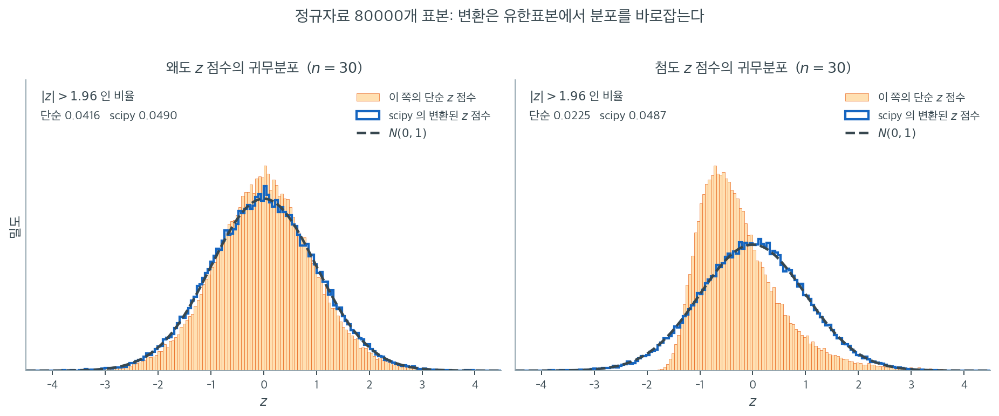

# D'Agostino의 K 제곱 검정

## 개요

**D'Agostino의 $K^2$ 검정**은 두 핵심 측도인 **왜도**와 **첨도**를 결합하여 주어진 표본이 정규분포를 따르는지 평가하는 형식적 통계검정이다. 자료 분포의 비대칭성(왜도)과 꼬리의 두꺼움(첨도)을 함께 살펴 정규성에서의 전반적 이탈을 재는 결합 검정통계량을 계산한다. 왜도와 첨도를 하나의 검정으로 함께 고려하고 싶을 때 특히 유용하다.

### 가설

- **귀무가설** ($H_0$): 자료가 정규분포를 따른다.
- **대립가설** ($H_1$): 자료가 정규분포를 따르지 않는다.

검정통계량은 왜도와 첨도의 z 점수를 하나의 값으로 결합한다. 이 검정통계량이 유의하고 그에 딸린 $p$값이 작으면(주어진 유의수준, 보통 0.05 미만) 귀무가설을 기각하고 자료가 정규분포를 따르지 않는다고 결론짓는다.

---

## 1. D'Agostino의 K 제곱 검정이 작동하는 방식

1. **왜도 계산**: 먼저 표본의 왜도, 곧 분포의 비대칭성을 잰다. 완전한 정규분포에서 왜도는 0에 가까워야 한다.

2. **첨도 계산**: 다음으로 첨도를 잰다. 첨도는 분포의 꼬리 두꺼움을 기술한다. 정규분포의 첨도는 3(중첨)이다.

3. **두 측도의 결합**: 왜도와 첨도의 z 점수 $Z_{\text{skewness}}$와 $Z_{\text{kurtosis}}$를 계산하고, 이 z 점수들의 제곱을 더해 검정통계량 $K^2$을 만든다.

    $$
    K^2 = Z_{\text{skewness}}^2 + Z_{\text{kurtosis}}^2
    $$

    이 검정통계량은 자유도 2인 카이제곱분포를 따른다.

4. **p값 계산**: $K^2$의 값에 근거하여 $p$값을 계산한다. 이는 귀무가설 아래에서 그만큼의 정규성 이탈을 관측할 확률을 알려준다.

---

## 2. Z_skewness를 계산하는 법

$Z_{\text{skewness}}$의 계산은 정규성이라는 귀무가설 아래에서 표본의 왜도가 0에서 유의하게 벗어나는지 검정하기 위해 왜도를 표준화하는 과정이다.

크기 $n$인 표본이 주어졌을 때:

**1. 표본왜도 $S$를 계산한다:**

$$
S = \frac{\frac{1}{n} \sum_{i=1}^n (x_i - \bar{x})^3}{\left(\frac{1}{n} \sum_{i=1}^n (x_i - \bar{x})^2\right)^{3/2}}
$$

여기서 $x_i$는 $i$번째 관측값, $\bar{x}$는 표본평균이며, 분자는 3차 적률(비대칭)을 재고 분모는 이를 무차원으로 정규화한다.

**2. $S$를 표준화한다:**

2.1 왜도의 표준오차 $\text{SE}_{S}$를 계산한다.

$$
\text{SE}_{S} = \sqrt{\frac{6n (n-1)}{(n-2)(n+1)(n+3)}}
$$

2.2 $S$를 표준화하여 $Z_{\text{skewness}}$를 얻는다.

$$
Z_{\text{skewness}} = \frac{S}{\text{SE}_{S}}
$$

**핵심 사항:**

- $Z_{\text{skewness}}$는 정규성이라는 귀무가설 아래에서 근사적으로 표준정규분포 $N(0, 1)$를 따른다.
- $|Z_{\text{skewness}}|$가 크면 왜도로 인한 유의한 정규성 이탈을 나타낸다.

---

## 3. Z_kurtosis를 계산하는 법

크기 $n$인 표본이 주어졌을 때:

**1. 표본첨도 $K$를 계산한다:**

$$
K = \frac{\frac{1}{n} \sum_{i=1}^n (x_i - \bar{x})^4}{\left(\frac{1}{n} \sum_{i=1}^n (x_i - \bar{x})^2\right)^2}
$$

여기서 $x_i$는 $i$번째 관측값, $\bar{x}$는 표본평균이며, 분자는 4차 적률(꼬리의 두꺼움)을 재고 분모는 이를 정규화한다.

**2. $K$를 초과첨도로 조정한다:**

$$
K_{\text{excess}} = K - 3
$$

**3. 첨도의 표준오차 $\text{SE}_{K}$를 계산한다:**

$$
\text{SE}_{K} = \sqrt{\frac{24n(n-1)^2}{(n-3)(n-2)(n+3)(n+5)}}
$$

**4. $K_{\text{excess}}$를 표준화한다:**

$$
Z_{\text{kurtosis}} = \frac{K_{\text{excess}}}{\text{SE}_{K}}
$$

**핵심 사항:**

- $Z_{\text{kurtosis}}$는 정규성이라는 귀무가설 아래에서 근사적으로 표준정규분포 $N(0, 1)$를 따른다.
- $|Z_{\text{kurtosis}}|$가 크면 첨도로 인한 유의한 정규성 이탈을 나타낸다.

!!! warning "위의 단순 z 점수는 scipy가 계산하는 값과 다르다"
    표준오차로 나누는 위의 z 점수는 $n \to \infty$일 때에만 표준정규로 수렴하는 **점근적** 근사이다. `scipy.stats.skewtest`와 `kurtosistest`는 D'Agostino와 Pearson이 제안한 추가 **정규화 변환**을 적용하여 유한표본에서 표준정규 근사를 훨씬 정확하게 만든다.

    두 값의 차이는 표본이 작을수록 커진다. 같은 자료에 대해

    | $n$ | 단순 $Z_{\text{skewness}}$ | scipy | 단순 $Z_{\text{kurtosis}}$ | scipy |
    |---|---|---|---|---|
    | 1000 | 0.4378 | 0.4402 | $-0.3026$ | $-0.1980$ |
    | 30 | $-1.1943$ | $-1.2927$ | 0.3925 | 0.9176 |

    $n = 30$에서 첨도 z 점수는 2배 이상 차이가 난다. 따라서 위 공식은 원리를 이해하는 용도로만 쓰고 실제 계산에는 `scipy.stats.normaltest`를 써야 한다.

### 변환이 정확히 무엇을 고치는가

위 경고 상자의 표는 한 표본에서 두 값이 다르다는 것만 보여준다. 그것이 왜 문제인지는 **귀무분포 전체**를 봐야 드러난다. 아래 그림은 진짜 $N(0,1)$ 자료에서 $n = 30$짜리 표본을 80000번 뽑아, 그때마다 단순 $z$ 점수(주황 히스토그램)와 `scipy`의 변환된 $z$ 점수(파란 윤곽선)를 계산한 결과다. 검은 파선이 두 통계량이 따라야 할 $N(0,1)$이다.



왼쪽 왜도 칸에서는 두 분포가 제법 비슷하다. 주황 히스토그램이 $N(0,1)$보다 가운데가 약간 높고 꼬리가 짧을 뿐이다. 그 결과 $|z| > 1.96$을 기각선으로 삼았을 때 실제 기각률이 $0.0416$이 된다. 약속한 $0.05$보다 17% 낮다. 변환을 거친 쪽은 $0.0490$으로 거의 정확하다.

오른쪽 첨도 칸은 사정이 전혀 다르다. 주황 히스토그램이 $-2$ 근처에서 벽에 부딪힌 듯 뚝 끊기고, 봉우리가 $-0.6$ 근처로 밀려 있으며, 오른쪽으로 길게 늘어져 있다. 표준정규와 닮은 구석이 거의 없다. 이렇게 생긴 이유는 간단하다. 초과첨도는 아래로 $-2$라는 수학적 한계가 있는 반면 위로는 끝이 없다. $n = 30$에서 그 비대칭이 고스란히 드러나는 것이다. 이 분포에 $|z| > 1.96$을 적용하면 실제 기각률은 $0.0225$, 약속한 값의 **절반도 되지 않는다**. 변환을 거친 파란 곡선은 $0.0487$로 $N(0,1)$에 잘 포개진다.

D'Agostino와 Pearson의 변환이 하는 일이 바로 이것이다. 표준오차로 나누는 것만으로는 **중심과 퍼짐**밖에 맞출 수 없다. 변환은 그 위에 비대칭까지 바로잡아 통계량의 모양 자체를 정규 쪽으로 옮긴다. $K^2 = Z_1^2 + Z_2^2$이 $\chi^2_2$을 따른다는 말은 $Z_1$과 $Z_2$가 각각 표준정규라는 전제 위에 서 있으므로, 이 교정 없이는 $K^2$의 $p$값도 믿을 수 없다.

<div class="exbox" markdown>

**보기 1.** <span class="diff easy" title="쉬움"></span> K-제곱이 두 검정의 합임을 확인하기. $\mathcal{N}(0,1)$에서 $n = 1000$개를 뽑아 세 함수를 모두 불러 본다.

**(1)** `normaltest`의 통계량이 `skewtest`와 `kurtosistest`의 $Z$ 제곱합과 같은지 확인하고, $p$값을 $K^2$만의 닫힌 꼴로 쓰시오.

**(2)** 제곱합을 $\chi^2_2$로 읽으려면 $Z_1$과 $Z_2$가 **독립인 표준정규**여야 한다. 정규 자료에서 실제로 그런지 모의실험으로 확인하시오. 상관계수, 두 표준편차, $K^2$의 평균·분산, 그리고 실제 기각률을 각각 이론값과 나란히 적으시오.

</div>

??? success "풀이"

    **(1) 끝자리까지 같고, $p = e^{-K^2/2}$다.** 이 표본에서 $Z_1 = 0.4402147002$, $Z_2 = -0.1979898523$이므로

    $$
    K^2 = Z_1^2 + Z_2^2 = 0.1937889... + 0.0392000... = 0.2329889638562599
    $$

    이고 `stats.normaltest`가 돌려주는 값이 **같은 부동소수점 수**다. `normaltest`가 두 검정을 내부에서 그대로 불러 제곱해 더하는 것이니 당연하지만, 직접 확인해 보면 $K^2$이 새로운 통계량이 아니라 **묶음**일 뿐이라는 점이 분명해진다.

    자유도 2인 카이제곱은 평균 2인 지수분포이므로 생존함수가 $e^{-x/2}$다. 따라서

    $$
    p = P(\chi^2_2 > K^2) = e^{-K^2/2} = e^{-0.11649448} = 0.8900350082402695
    $$

    이고, 이 역시 `normaltest`의 $p$값과 마지막 자리까지 일치한다. $K^2$이 작으니 기각하지 못한다.

    **(2) 네 가지 모두 이론값과 맞는다.** $n = 1000$인 정규 표본을 4만 번 뽑아 재면

    | 재는 것 | 이론값 | 모의값 | 몬테카를로 오차 |
    |---|---|---|---|
    | $\operatorname{corr}(Z_1, Z_2)$ | $0$ | $-0.0019$ | $\pm 0.0050$ |
    | $\mathrm{SD}(Z_1)$ | $1$ | $0.9922$ | — |
    | $\mathrm{SD}(Z_2)$ | $1$ | $0.9995$ | — |
    | $\mathbb{E}[K^2]$ | $2$ | $1.9834$ | — |
    | $\mathrm{Var}(K^2)$ | $4$ | $4.1826$ | — |
    | $P(K^2 > 5.991)$ | $0.05$ | $0.0502$ | $\pm 0.0011$ |

    이다. 상관계수가 $-0.0019$로 몬테카를로 오차 $1/\sqrt{R} = 0.0050$의 절반도 안 되니 **0과 구별되지 않는다.** 이것은 우연이 아니다. 정규분포는 대칭이므로 홀수 차수 적률에서 나온 $g_1$과 짝수 차수 적률에서 나온 $g_2$가 상관을 갖지 않는다. 부호를 뒤집어도 $g_2$는 그대로인데 $g_1$은 뒤집히므로, 둘의 공분산이 자기 자신의 음수와 같아야 하고 따라서 0이다.

    두 표준편차가 1에 붙고 상관이 0이므로 $K^2$은 제대로 $\chi^2_2$를 따른다. 기각률 $0.0502$가 명목 $0.05$에서 몬테카를로 표준오차의 $0.2$배 안이다. **$n = 1000$에서 다고스티노 $K^2$은 약속한 크기를 정확히 지킨다.**

    한 가지 짚어 둘 것이 있다. 위 본문의 두 표준오차

    $$
    \mathrm{SE}_S = \sqrt{\frac{6n(n-1)}{(n-2)(n+1)(n+3)}}, \qquad
    \mathrm{SE}_K = \sqrt{\frac{24n(n-1)^2}{(n-3)(n-2)(n+3)(n+5)}}
    $$

    는 **보정판** $G_1$, $G_2$의 것이다. 본문이 $S$와 $K$를 $1/n$ 적률로 정의했으므로 그것은 비보정판 $g_1$, $b_2$이고, 그 분산은

    $$
    \mathrm{Var}(g_1) = \frac{6(n-2)}{(n+1)(n+3)}, \qquad
    \mathrm{Var}(b_2) = \frac{24n(n-2)(n-3)}{(n+1)^2(n+3)(n+5)}
    $$

    이다. 두 쌍은 보정 계수로 정확히 이어진다. $G_1 = \frac{\sqrt{n(n-1)}}{n-2}g_1$에서

    $$
    \mathrm{Var}(G_1) = \frac{n(n-1)}{(n-2)^2}\cdot\frac{6(n-2)}{(n+1)(n+3)} = \frac{6n(n-1)}{(n-2)(n+1)(n+3)}
    $$

    이고, $G_2 = \frac{(n+1)(n-1)}{(n-2)(n-3)}\bigl(b_2 - \mathbb{E}[b_2]\bigr)$에서

    $$
    \mathrm{Var}(G_2) = \frac{(n+1)^2(n-1)^2}{(n-2)^2(n-3)^2}\cdot\frac{24n(n-2)(n-3)}{(n+1)^2(n+3)(n+5)} = \frac{24n(n-1)^2}{(n-2)(n-3)(n+3)(n+5)}
    $$

    이다. 두 항등식을 수로 확인하면 $n = 1000$에서 좌변과 우변이 열 자리까지 같다. 실제 값은 $\mathrm{SD}(g_1) = 0.07723$ 대 $\mathrm{SD}(G_1) = 0.07734$, $\mathrm{SD}(g_2) = 0.15376$ 대 $\mathrm{SD}(G_2) = 0.15453$이다. $n = 1000$에서는 차이가 $0.1$–$0.5\%$에 지나지 않지만, **비보정 통계량을 보정판의 표준오차로 나누면 $z$ 점수가 그만큼 틀어진다.** 작은 표본에서는 그 틀어짐이 커진다.

    ```python
    import numpy as np
    from scipy import stats

    np.random.seed(0)

    data = np.random.normal(0, 1, 1000)

    # D'Agostino 의 K^2 은 왜도 검정과 첨도 검정을 하나로 묶은 것이다.
    # 각 검정의 Z 를 제곱해 더하면 정확히 K^2 이 된다는 것을 아래에서 확인한다.
    # 두 Z 가 대략 독립인 표준정규이므로 그 합이 자유도 2 인 카이제곱을 따른다.
    Z_skewtest, p_value = stats.skewtest(data)
    Z_kurtosistest, p_value = stats.kurtosistest(data)
    print(f"{Z_skewtest**2 + Z_kurtosistest**2 = }")

    # scipy 에서는 normaltest 가 곧 D'Agostino 의 K^2 검정이다.
    stat, p_value = stats.normaltest(data)

    print(f"D'Agostino's K-squared Test: Statistic={stat}, p-value={p_value}")

    alpha = 0.05
    if p_value > alpha:
        print("Fail to reject H_0: The data is normally distributed.")
    else:
        print("Reject H_0: The data is not normally distributed.")
    ```

    출력:

    ```text
    Z_skewtest**2 + Z_kurtosistest**2 = 0.2329889638562599
    D'Agostino's K-squared Test: Statistic=0.2329889638562599, p-value=0.8900350082402695
    Fail to reject H_0: The data is normally distributed.
    ```

    $p$값의 닫힌 꼴과 독립성·보정을 함께 확인한다.

    ```python
    import numpy as np
    from scipy import stats

    np.random.seed(0)
    data = np.random.normal(0, 1, 1000)
    z1 = stats.skewtest(data)[0]
    z2 = stats.kurtosistest(data)[0]
    K2 = z1**2 + z2**2
    print(f"Z1 = {z1:.10f},  Z2 = {z2:.10f}")
    print(f"exp(-K2/2)   = {np.exp(-K2 / 2)!r}")
    print(f"normaltest p = {stats.normaltest(data)[1]!r}")

    # 두 Z 가 독립인 표준정규인가 — 정규 자료에서 직접 잰다.
    rng = np.random.default_rng(21)
    R, n = 40_000, 1000
    X = rng.standard_normal((R, n))
    Z1 = np.array([stats.skewtest(x)[0] for x in X])
    Z2 = np.array([stats.kurtosistest(x)[0] for x in X])
    print(f"\ncorr(Z1, Z2) = {np.corrcoef(Z1, Z2)[0, 1]:+.4f}   (MC SE 약 {1 / np.sqrt(R):.4f})")
    print(f"sd(Z1) = {Z1.std(ddof=1):.4f},  sd(Z2) = {Z2.std(ddof=1):.4f}   (이론 1)")
    K2s = Z1**2 + Z2**2
    print(f"K^2 평균 {K2s.mean():.4f} (이론 2),  분산 {K2s.var(ddof=1):.4f} (이론 4)")
    print(f"기각률 = {np.mean(K2s > stats.chi2.ppf(0.95, 2)):.4f}"
          f"  (명목 0.05, MC SE {np.sqrt(0.05 * 0.95 / R):.4f})")

    # 본문의 두 SE 가 어느 판본의 것인가 — 보정 항등식을 수로 확인한다.
    var_g1 = 6.0 * (n - 2) / ((n + 1) * (n + 3))
    var_G1 = 6.0 * n * (n - 1) / ((n - 2) * (n + 1) * (n + 3))
    var_b2 = 24.0 * n * (n - 2) * (n - 3) / ((n + 1) ** 2 * (n + 3) * (n + 5))
    var_G2 = 24.0 * n * (n - 1) ** 2 / ((n - 3) * (n - 2) * (n + 3) * (n + 5))
    c = (n + 1) * (n - 1) / ((n - 2) * (n - 3))
    print(f"\nn(n-1)/(n-2)^2 * Var(g1) = {n * (n - 1) / (n - 2)**2 * var_g1:.10f}"
          f"   Var(G1) = {var_G1:.10f}")
    print(f"c^2 * Var(b2)            = {c * c * var_b2:.10f}   Var(G2) = {var_G2:.10f}")
    print(f"SD(g1) = {np.sqrt(var_g1):.5f}, SD(G1) = {np.sqrt(var_G1):.5f}, "
          f"SD(g2) = {np.sqrt(var_b2):.5f}, SD(G2) = {np.sqrt(var_G2):.5f}")
    ```

    출력:

    ```text
    Z1 = 0.4402147002,  Z2 = -0.1979898523
    exp(-K2/2)   = 0.8900350082402695
    normaltest p = 0.8900350082402695

    corr(Z1, Z2) = -0.0019   (MC SE 약 0.0050)
    sd(Z1) = 0.9922,  sd(Z2) = 0.9995   (이론 1)
    K^2 평균 1.9834 (이론 2),  분산 4.1826 (이론 4)
    기각률 = 0.0502  (명목 0.05, MC SE 0.0011)

    n(n-1)/(n-2)^2 * Var(g1) = 0.0059820658   Var(G1) = 0.0059820658
    c^2 * Var(b2)            = 0.0238808359   Var(G2) = 0.0238808359
    SD(g1) = 0.07723, SD(G1) = 0.07734, SD(g2) = 0.15376, SD(G2) = 0.15453
    ```

    $e^{-K^2/2}$가 `normaltest`의 $p$값과 열여섯 자리까지 같고, 두 보정 항등식의 좌우가 열 자리까지 같다. 유도한 것이 모두 맞는다. $\square$

---

## 4. 응용

D'Agostino의 $K^2$ 검정은 정규성 가정이 결정적인 다음과 같은 상황에서 흔히 쓰인다.

- 정규분포 자료를 요구하는 **모수적 통계검정**($t$ 검정, 분산분석 등).
- 잔차의 정규성을 가정하는 **회귀분석**.
- 모형화와 의사결정에서 흔히 정규성을 가정하는 **품질관리**와 **금융 모형화**.

---

## 5. 한계

- **표본크기 민감성**: 다른 많은 정규성 검정과 마찬가지로 D'Agostino의 $K^2$ 검정도 표본크기에 민감하다. 표본이 작으면 정규성 이탈을 탐지할 검정력이 부족할 수 있다. 표본이 크면 정규성에서 아주 조금만 벗어나도 귀무가설을 기각할 수 있다.
- **연속 자료를 가정**: 이 검정은 연속 자료를 위해 설계되었다. 범주형이나 순서형 자료에 적용하는 것은 적절하지 않다.

D'Agostino의 $K^2$ 검정은 왜도와 첨도를 함께 반영하여 자료의 정규성을 확인하는 강력한 방법이다. 분포 모양의 두 중요한 측면을 결합하여 정규성을 견실하게 평가한다. 다만 모든 정규성 검정과 마찬가지로 자료의 분포를 종합적으로 이해하려면 시각적 방법(예: Q-Q 그림)과 다른 통계검정을 함께 써야 한다.

---

## 연습문제

<div class="drillbox" markdown>

**연습문제 1.** <span class="diff med" title="중간"></span>
D'Agostino의 $K^2$ 검정은 왜도 검정과 첨도 검정을 결합한다. 귀무가설과 검정통계량의 공식을 서술하라.

</div>

??? success "풀이"
    귀무가설은 $H_0$: 자료가 정규분포에서 왔다.

    검정통계량은

    $$
    K^2 = Z_1^2 + Z_2^2
    $$

    여기서 $Z_1$은 표준화된 왜도 통계량(표본왜도 $\sqrt{b_1}$의 변환)이고 $Z_2$는 표준화된 첨도 통계량(표본첨도 $b_2$의 변환)이다. $H_0$ 아래에서 $K^2 \sim \chi^2_2$가 근사적으로 성립한다.

    이 검정은 전방위적이다. 왜도, 첨도, 또는 둘 다에서 오는 정규성 이탈을 탐지한다. $K^2$가 크면(p값이 작으면) 비정규성을 나타낸다.

<div class="drillbox" markdown>

**연습문제 2.** <span class="diff med" title="중간"></span>
$n = 100$인 표본의 왜도가 $0.8$, 초과첨도가 $1.5$이다. 정확한 검정통계량을 계산하지 않고 D'Agostino 검정이 정규성을 기각할 가능성이 높은지 정성적으로 설명하라.

</div>

??? success "풀이"
    두 값 모두 정규분포의 기준값(왜도 $= 0$, 초과첨도 $= 0$)에서 눈에 띄게 벗어나 있다. 왜도 0.8은 중간 정도의 오른쪽 치우침을, 초과첨도 1.5는 정규보다 두꺼운 꼬리를 나타낸다.

    $n = 100$이면 이런 이탈을 탐지할 만한 검정력이 있다. 왜도의 기여 $Z_1^2$이 상당히 크고 첨도의 기여 $Z_2^2$도 양수일 것이다. $K^2 = Z_1^2 + Z_2^2$이므로 두 성분이 함께 검정통계량을 키워 기각할 가능성이 높다.

<div class="drillbox" markdown>

**연습문제 3.** <span class="diff med" title="중간"></span>
D'Agostino 검정을 Shapiro-Wilk 검정과 비교하라. 각각의 상대적 강점은 무엇인가?

</div>

??? success "풀이"
    **D'Agostino의 $K^2$:**

    - 강점: 중간에서 큰 표본($n \geq 20$)에서 잘 작동한다. 왜도와 첨도에 대한 별도의 통찰을 준다. 계산이 간단하다.
    - 약점: 작은 표본에서는 Shapiro-Wilk보다 검정력이 낮다. 왜도나 첨도에 영향을 주지 않는 이탈(예: 봉우리가 대칭인 이봉분포)은 놓칠 수 있다.

    **Shapiro-Wilk:**

    - 강점: 작거나 중간 크기의 $n$에서 가장 강력한 검정이다. 적률만으로는 잡히지 않는 것을 포함해 폭넓은 이탈을 탐지한다.
    - 약점: 본래 $n \leq 5000$으로 제한되었다(현대 구현은 더 큰 $n$도 다룬다). 왜도로 인한 이탈과 첨도로 인한 이탈을 구별해 주지 않는다.

<div class="drillbox" markdown>

**연습문제 4.** <span class="diff med" title="중간"></span>
D'Agostino 검정이 왜 "적률 기반" 정규성 검정이라 불리는지, 그리고 이것이 Jarque-Bera 검정과 어떻게 이어지는지 설명하라.

</div>

??? success "풀이"
    D'Agostino 검정이 "적률 기반"인 이유는 3차와 4차 중심적률(왜도와 첨도)을 통해 정규성을 평가하기 때문이다. 많은 대립분포에서 이 두 적률이 정규값과 가장 먼저 달라진다.

    **Jarque-Bera 검정**도 비슷한 접근을 쓴다.

    $$
    JB = \frac{n}{6}\left(S^2 + \frac{(K-3)^2}{4}\right)
    $$

    여기서 $S$는 표본왜도, $K$는 표본첨도이다. $H_0$ 아래에서 $JB \sim \chi^2_2$이다.

    주된 차이: D'Agostino 검정은 왜도와 첨도 통계량을 결합하기 전에 정규화 변환을 적용하여 유한표본에서 카이제곱 근사를 개선한다. Jarque-Bera 검정은 원래의 적률을 그대로 써서 유한표본 성질이 나쁠 수 있다. 따라서 표본크기가 200 아래일 때는 D'Agostino 검정이 선호된다.

<div class="drillbox" markdown>

**연습문제 5.** <span class="diff med" title="중간"></span>
연습문제 2 를 수로 끝까지 밀어 본다. $n = 100$, 표본왜도 $S = 0.8$, 초과첨도 $K_{\text{excess}} = 1.5$ 인 표본이다.

**(1)** 본문 2 절과 3 절의 단순 $z$ 점수 공식으로 $\text{SE}_{S}$, $\text{SE}_{K}$, $Z_{\text{skewness}}$, $Z_{\text{kurtosis}}$, $K^2$ 을 차례로 구하라.

**(2)** 보기 1 에서 얻은 닫힌 꼴 $p = e^{-K^2/2}$ 로 $p$값을 구하라.

**(3)** $K^2$ 에 왜도와 첨도가 각각 몇 %씩 기여했는지 적고, 연습문제 2 의 정성적 답과 비교하라.

</div>

??? success "풀이"
    **(1)** 두 표준오차를 먼저 구한다. $n = 100$ 이므로

    $$
    \text{SE}_{S} = \sqrt{\frac{6 \cdot 100 \cdot 99}{98 \cdot 101 \cdot 103}} = \sqrt{\frac{59400}{1019494}} = \sqrt{0.0582640} = 0.2413798
    $$

    $$
    \text{SE}_{K} = \sqrt{\frac{24 \cdot 100 \cdot 99^2}{97 \cdot 98 \cdot 103 \cdot 105}} = \sqrt{\frac{23522400}{102807390}} = \sqrt{0.2288007} = 0.4783311
    $$

    이다. 따라서

    $$
    Z_{\text{skewness}} = \frac{0.8}{0.2413798} = 3.31428, \qquad
    Z_{\text{kurtosis}} = \frac{1.5}{0.4783311} = 3.13590
    $$

    이고

    $$
    K^2 = 3.31428^2 + 3.13590^2 = 10.98445 + 9.83389 = 20.81833
    $$

    이다.

    **(2)** 자유도 2 의 카이제곱은 평균 2 인 지수분포이므로

    $$
    p = e^{-K^2/2} = e^{-10.40917} = 3.015 \times 10^{-5}
    $$

    이다. 유의수준 $0.05$ 의 1600 분의 1 이다.

    **(3)** 기여도는 $10.98445/20.81833 = 52.8\%$ (왜도)와 $9.83389/20.81833 = 47.2\%$ (첨도)로 거의 반반이다. 연습문제 2 는 "왜도의 기여가 상당히 크고 첨도의 기여도 양수"라고만 말했는데, 실제로는 **두 성분이 거의 같은 크기**이고 어느 하나만으로도 이미 $1.96^2 = 3.84$ 를 크게 넘는다. 즉 이 표본은 왜도 검정만으로도, 첨도 검정만으로도 따로따로 기각된다.

    한 가지 유보를 달아 둔다. 위의 $p$값은 **단순 $z$ 점수**로 계산한 것이어서 `scipy.stats.normaltest` 의 값과 정확히 같지 않다. 본문 경고 상자가 보여 준 것처럼 두 판본의 차이는 $n$ 이 작을수록 커지고 $n = 100$ 은 중간 자리다. 그러나 $p \sim 10^{-5}$ 라는 **자릿수**는 변환으로 바뀌지 않으므로 기각이라는 결론은 안전하다.

<div class="drillbox" markdown>

**연습문제 6.** <span class="diff med" title="중간"></span>
본문은 "초과첨도는 아래로 $-2$ 라는 수학적 한계가 있는 반면 위로는 끝이 없다"고 했다. 이 한계를 $z$ 점수의 눈금으로 옮겨 본다.

**(1)** 임의의 표본에서 $K \ge 1$, 곧 $K_{\text{excess}} \ge -2$ 임을 보이고, 등호가 성립하는 표본의 모양을 말하라.

**(2)** 그러므로 단순 $Z_{\text{kurtosis}}$ 는 $-2/\text{SE}_{K}$ 보다 작아질 수 없다. 이 하한이 $-1.96$ 보다 **큰** $n$, 곧 단순 $z$ 점수로는 왼쪽 기각이 원리적으로 불가능한 $n$ 의 범위를 구하라.

**(3)** $n = 30$ 에서 하한을 구하라. 이 경우 왼쪽 기각은 원리적으로는 가능하다. 그러려면 $K$ 가 얼마보다 작아야 하는지 구하고, 본문 그림의 기각률 $0.0225$ 가 사실상 전부 오른쪽 꼬리에서 온다고 결론지어라.

</div>

??? success "풀이"
    **(1)** $d_i = x_i - \bar{x}$ 라 두면 $K = m_4/m_2^2$ 이고 $m_2 = \frac1n\sum d_i^2$, $m_4 = \frac1n\sum d_i^4$ 이다. 수 $d_1^2, \dots, d_n^2$ 의 표본분산이 음수가 아니므로

    $$
    \frac{1}{n}\sum_{i=1}^n (d_i^2)^2 - \left(\frac{1}{n}\sum_{i=1}^n d_i^2\right)^2 \ge 0
    \quad\Longrightarrow\quad m_4 \ge m_2^2
    \quad\Longrightarrow\quad K \ge 1
    $$

    이고 따라서 $K_{\text{excess}} \ge -2$ 다. 등호는 모든 $d_i^2$ 이 같을 때, 곧 모든 $\lvert x_i - \bar{x} \rvert$ 가 같을 때다. 자료가 $\bar{x} \pm a$ 두 값에만 절반씩 놓인 **두 점 표본**이다. 정규성에서 가장 멀리 간 평첨 배치가 바로 하한을 때린다.

    **(2)** 하한 $-2/\text{SE}_{K}$ 가 $-1.96$ 보다 크다는 것은 $2/\text{SE}_{K} < 1.96$, 곧

    $$
    \text{SE}_{K} > \frac{2}{1.96} = 1.020408
    $$

    이라는 뜻이다. $\text{SE}_{K}$ 는 $n$ 에 대해 감소하므로 경계만 찾으면 된다.

    $$
    \text{SE}_{K}(18) = 1.037795 > 1.020408, \qquad \text{SE}_{K}(19) = 1.014270 < 1.020408
    $$

    이므로 **$n \le 18$ 에서는 왼쪽 기각이 아예 불가능**하고 $n \ge 19$ 에서 비로소 가능해진다. 하한 자체는 $n = 18$ 에서 $-1.9272$, $n = 19$ 에서 $-1.9719$ 다. 본문 정리하며가 $n \ge 20$ 정도를 요구하는 것과 거의 같은 자리다. 소표본에서 첨도 검정이 한쪽 눈을 감는다는 말을 수로 쓴 것이 이것이다.

    **(3)** $n = 30$ 에서

    $$
    \text{SE}_{K} = \sqrt{\frac{24 \cdot 30 \cdot 29^2}{27 \cdot 28 \cdot 33 \cdot 35}} = \sqrt{\frac{605520}{873180}} = 0.832746,
    \qquad -\frac{2}{0.832746} = -2.4017
    $$

    이다. $-2.4017 < -1.96$ 이니 왼쪽 기각이 수학적으로 금지되지는 않는다. 다만 그러려면

    $$
    K - 3 < -1.96 \times 0.832746 = -1.63218
    \quad\Longrightarrow\quad K < 1.36782
    $$

    여야 한다. $K$ 의 절대 하한이 1 이므로, 정규 표본 30 개가 두 점 배치에서 $0.368$ 안쪽까지 들어가야 한다는 뜻이다. 실제로 $N(0,1)$ 에서 $n = 30$ 을 40 만 번 뽑으면 $K$ 의 최솟값이 $1.359$, $K < 1.36782$ 인 비율이 백만 분의 2.5 에 지나지 않고, $P(Z_{\text{kurtosis}} < -1.96)$ 은 소수 다섯째 자리까지 $0$ 이다. 같은 모의에서 $P(Z_{\text{kurtosis}} > 1.96) = 0.02256$ 으로 본문의 $0.0225$ 와 맞는다.

    즉 본문이 말한 $0.0225$ 는 **양쪽 꼬리 합이 아니라 오른쪽 꼬리 하나**다. 왼쪽을 사실상 쓸 수 없으니 명목 $0.05$ 가 애초에 $0.025$ 를 넘을 수 없었던 것이다. 하한 $-2.4017$ 이 $z$ 눈금에서 $-2$ 근처로 보이는 것이 본문 그림의 "벽에 부딪힌 듯 뚝 끊기는" 왼쪽 끝이다.

<div class="drillbox" markdown>

**연습문제 7.** <span class="diff hard" title="어려움"></span>
연습문제 4 의 Jarque-Bera 통계량

$$
JB = \frac{n}{6}\left(S^2 + \frac{(K-3)^2}{4}\right)
$$

와 본문의 단순 $z$ 점수판 $K^2$ 의 관계를 밝힌다.

**(1)** $n \to \infty$ 일 때 $n\,\text{SE}_{S}^2 \to 6$ 이고 $n\,\text{SE}_{K}^2 \to 24$ 임을 보이고, 이것으로 $JB$ 가 **단순 $z$ 점수판 $K^2$ 에서 두 표준오차를 점근근사 $\sqrt{6/n}$, $\sqrt{24/n}$ 로 갈아 끼운 것**임을 설명하라.

**(2)** $H_0$ 아래에서 $\mathbb{E}[JB]$ 를 정확히 계산하라. 보기 1 의 풀이에 있는 $\mathrm{Var}(g_1)$, $\mathrm{Var}(b_2)$ 와 $\mathbb{E}[b_2] = 3(n-1)/(n+1)$ 을 써도 좋다. $n = 30$ 과 $n = 100$ 에서 값을 구하고 $\mathbb{E}[\chi^2_2] = 2$ 와 비교하라.

**(3)** (2) 의 답으로 연습문제 4 의 마지막 문장 — "표본크기가 200 아래일 때는 D'Agostino 검정이 선호된다" — 을 정량적으로 뒷받침하라.

</div>

??? success "풀이"
    **(1)** 두 분수를 $n$ 으로 정리한다.

    $$
    n\,\text{SE}_{S}^2 = \frac{6n^2(n-1)}{(n-2)(n+1)(n+3)}
    = 6 \cdot \frac{n^3 - n^2}{n^3 + 2n^2 - 5n - 6} \longrightarrow 6
    $$

    $$
    n\,\text{SE}_{K}^2 = \frac{24n^2(n-1)^2}{(n-3)(n-2)(n+3)(n+5)}
    = 24 \cdot \frac{n^4 - 2n^3 + n^2}{n^4 + 3n^3 - 19n^2 - 27n + 90} \longrightarrow 24
    $$

    둘 다 분자와 분모가 같은 차수이고 최고차 계수가 같으므로 극한이 상수 $6$, $24$ 다. 그러므로 $\text{SE}_{S}^2 \approx 6/n$, $\text{SE}_{K}^2 \approx 24/n$ 이고

    $$
    Z_{\text{skewness}}^2 + Z_{\text{kurtosis}}^2
    = \frac{S^2}{\text{SE}_{S}^2} + \frac{(K-3)^2}{\text{SE}_{K}^2}
    \approx \frac{nS^2}{6} + \frac{n(K-3)^2}{24}
    = \frac{n}{6}\left(S^2 + \frac{(K-3)^2}{4}\right) = JB
    $$

    가 된다. $JB$ 는 새로운 발상이 아니라 **단순 $z$ 점수판 $K^2$ 의 점근 형태**다. 본문이 유한표본용 정확한 표준오차를 쓰는 자리에서 $JB$ 는 $n \to \infty$ 의 값을 쓰는 것이다.

    **(2)** $S = g_1$, $K = b_2$ 이고 정규 자료에서 $g_1$ 의 분포는 0 에 대해 대칭이므로 $\mathbb{E}[g_1] = 0$, 따라서 $\mathbb{E}[g_1^2] = \mathrm{Var}(g_1)$ 이다. 첨도 쪽은 $b_2$ 가 치우쳐 있어 편향 제곱이 남는다.

    $$
    \mathbb{E}[b_2] - 3 = \frac{3(n-1)}{n+1} - 3 = -\frac{6}{n+1},
    \qquad \mathbb{E}\bigl[(b_2-3)^2\bigr] = \mathrm{Var}(b_2) + \frac{36}{(n+1)^2}
    $$

    그러므로

    $$
    \mathbb{E}[JB] = \frac{n}{6}\mathrm{Var}(g_1) + \frac{n}{24}\left(\mathrm{Var}(b_2) + \frac{36}{(n+1)^2}\right)
    = \frac{n(n-2)}{(n+1)(n+3)} + \frac{n}{24}\left(\frac{24n(n-2)(n-3)}{(n+1)^2(n+3)(n+5)} + \frac{36}{(n+1)^2}\right)
    $$

    이다. 첫 항에서 $\frac{n}{6}\cdot\frac{6(n-2)}{(n+1)(n+3)} = \frac{n(n-2)}{(n+1)(n+3)}$ 로 약분된 것을 썼다. $n = 30$ 에서

    $$
    \frac{30 \cdot 28}{31 \cdot 33} = 0.82111, \qquad
    \frac{30}{24}\left(0.490398 + 0.037461\right) = 1.25 \times 0.527859 = 0.65982
    $$

    이므로 $\mathbb{E}[JB] = 1.48094$ 다. $n = 100$ 에서는 $0.94204 + 0.87635 = 1.81839$ 다.

    **(3)** $JB$ 를 $\chi^2_2$ 로 읽는다는 것은 그 평균이 2 라는 전제를 깔고 있다. 그런데 실제 평균은 $n = 30$ 에서 $1.481$, 명목값의 $74\%$ 밖에 안 된다. 통계량이 전체적으로 작게 나오니 임계값 $5.991$ 을 넘는 일이 덜 생긴다. 실제로 모의로 재면 $n = 30$ 에서 $JB$ 의 기각률은 $0.031$ 로 약속한 $0.05$ 의 $62\%$ 다. 같은 $n$ 에서 단순 $z$ 점수판 $K^2$ 은 $0.037$, 변환을 거친 `scipy` 판은 $0.058$ 이다.

    두 결손이 포개져 있다는 점이 요점이다. $JB$ 는 **점근 표준오차를 쓴 탓에** 분모가 너무 커서($n = 30$ 에서 $\sqrt{24/30} = 0.894$ 대 실제 $\mathrm{SD}(b_2) = 0.700$) 통계량을 깎고, 그 위에 **정규화 변환이 없어서** 연습문제 6 에서 본 비대칭까지 그대로 안고 간다. $n = 100$ 에서도 평균이 $1.818$ 로 여전히 $9\%$ 낮다. $n$ 이 200 쯤 되어야 두 결손이 눈감아 줄 만큼 작아지는 것이고, 그 아래에서는 보수적으로 어긋나는 $JB$ 대신 D'Agostino 검정을 쓰라는 말이 바로 이 뜻이다.

<div class="drillbox" markdown>

**연습문제 8.** <span class="diff hard" title="어려움"></span>
연습문제 3 은 $K^2$ 가 "왜도나 첨도에 영향을 주지 않는 이탈은 놓칠 수 있다"고 했다. 그 반례를 손으로 만든다.

**(1)** $P(X = -c) = P(X = c) = q$, $P(X = 0) = 1 - 2q$ 인 세 점 분포의 왜도와 첨도를 $q$ 로 구하고, $S = 0$ 과 $K = 3$ 을 **동시에** 만드는 $q$ 를 구하라.

**(2)** 그 분포를 연속으로 번지게 한 혼합

$$
f(x) = \frac{1}{6}\phi_\sigma(x+c) + \frac{2}{3}\phi_\sigma(x) + \frac{1}{6}\phi_\sigma(x-c)
$$

($\phi_\sigma$ 는 $\mathcal{N}(0,\sigma^2)$ 의 밀도)를 생각한다. 모든 $c > 0$, $\sigma > 0$ 에 대해 $K = 3$ 이 **정확히** 성립함을 보여라.

**(3)** 이 분포에서 표본을 뽑을 때 $n \to \infty$ 라도 $K^2$ 의 검정력이 1 로 가지 않음을 설명하라. $\gamma_1 \ne 0$ 인 대립분포에서 $K^2$ 이 어떻게 자라는지와 대조하라.

</div>

??? success "풀이"
    **(1)** 분포가 0 에 대해 대칭이므로 $\mathbb{E}[X] = 0$ 이고 홀수 차수 적률이 모두 0 이다. 따라서 $m_3 = 0$ 이고 $S = 0$ 이 $q$ 와 무관하게 성립한다. 짝수 적률은

    $$
    m_2 = 2qc^2, \qquad m_4 = 2qc^4
    $$

    이므로

    $$
    K = \frac{m_4}{m_2^2} = \frac{2qc^4}{4q^2c^4} = \frac{1}{2q}
    $$

    다. $K = 3$ 은 $q = 1/6$ 과 같은 말이다. 곧

    $$
    P(X = \pm c) = \frac{1}{6}, \qquad P(X = 0) = \frac{2}{3}
    $$

    이면 왜도가 0, 첨도가 정확히 3, 초과첨도가 정확히 0 이다. $c$ 는 아무 값이어도 된다.

    **(2)** 세 성분이 모두 분산 $\sigma^2$ 의 정규이므로 각 성분 안에서 $\mathbb{E}[(Z\sigma)^2] = \sigma^2$, $\mathbb{E}[(Z\sigma)^4] = 3\sigma^4$ 이고, 중심이 $\mu$ 인 성분에서는

    $$
    \mathbb{E}[X^2] = \mu^2 + \sigma^2, \qquad
    \mathbb{E}[X^4] = \mu^4 + 6\mu^2\sigma^2 + 3\sigma^4
    $$

    이다. 가중치 $\frac16, \frac23, \frac16$ 로 섞으면 $\mu = \pm c$ 인 두 성분의 가중치 합이 $\frac13$ 이므로

    $$
    m_2 = \frac{c^2}{3} + \sigma^2, \qquad
    m_4 = \frac{1}{3}\left(c^4 + 6c^2\sigma^2 + 3\sigma^4\right) + \frac{2}{3}\cdot 3\sigma^4
    = \frac{c^4}{3} + 2c^2\sigma^2 + 3\sigma^4
    $$

    이다. 한편

    $$
    3m_2^2 = 3\left(\frac{c^2}{3} + \sigma^2\right)^2
    = 3\left(\frac{c^4}{9} + \frac{2c^2\sigma^2}{3} + \sigma^4\right)
    = \frac{c^4}{3} + 2c^2\sigma^2 + 3\sigma^4
    $$

    이다. 두 식이 **항마다 같다.** 따라서 $m_4 = 3m_2^2$, 곧 $K = 3$ 이 $c$ 와 $\sigma$ 의 모든 값에서 정확히 성립한다. 대칭이므로 $S = 0$ 이기도 하다. $\square$

    예를 들어 $c = 6$, $\sigma = 1$ 이면 $m_2 = 13$, $m_4 = 507 = 3 \times 169$ 다. 이 밀도는 $-6, 0, 6$ 에 뚜렷한 봉우리 셋이 선 삼봉분포이고, 정규분포와 눈으로 혼동할 여지가 전혀 없다. 그런데 $K^2$ 이 보는 두 적률은 정규와 한 치도 다르지 않다.

    **(3)** 검정이 **일치성**을 가지려면 $n$ 이 커질 때 통계량이 발산해야 한다. $\gamma_1 \ne 0$ 인 대립분포라면 $S \to \gamma_1 \ne 0$ 이고 $\text{SE}_{S} \approx \sqrt{6/n}$ 이므로

    $$
    Z_{\text{skewness}}^2 \approx \frac{n\gamma_1^2}{6} \longrightarrow \infty
    $$

    로 $n$ 에 비례해 자란다. 그래서 $p = e^{-K^2/2} \to 0$ 이고 검정력이 1 로 간다. 첨도 쪽도 $\gamma_2 \ne 0$ 이면 같은 이유로 $n\gamma_2^2/24$ 로 자란다.

    그런데 위의 삼봉분포에서는 $S \to 0$, $K - 3 \to 0$ 이므로 분자가 함께 0 으로 가 버린다. 두 $z$ 점수는 발산하지 않고 $O_p(1)$ 에 머문다. $K^2$ 의 분포가 $n$ 과 거의 무관하게 제자리에 있으므로 **표본을 아무리 늘려도 기각률이 올라가지 않는다.** 실제로 모의로 재면 평균 $K^2$ 이 $n = 50$ 에서 약 $1.3$, $n = 200$ 에서 약 $0.92$, $n = 5000$ 에서 약 $0.80$ 으로 오히려 줄고, 기각률은 $n = 200$ 에서 약 $0.004$, $n = 5000$ 에서 약 $0.0015$ 로 명목 $0.05$ 보다도 **낮다**.

    이유는 분명하다. $K^2$ 은 3 차·4 차 적률 **두 개만** 본다. 두 적률을 정규와 맞춰 놓은 대립분포는 이 검정의 맹점에 정확히 들어앉는다. 봉우리의 개수는 2 차·3 차·4 차 적률에 흔적을 남기지 않고 6 차 이상에서야 드러난다. 순서통계량 전체를 쓰는 샤피로–윌크나 경험분포함수 전체를 보는 앤더슨–달링은 이런 자료를 바로 잡아낸다. 연습문제 3 이 말한 $K^2$ 의 약점이 바로 이것이고, 본문 마지막 문장이 Q-Q 그림을 함께 보라고 하는 까닭도 이것이다.

<div class="drillbox" markdown>

**연습문제 9.** <span class="diff hard" title="어려움"></span>
2 장에서 어떤 분포든 $\beta_2 \ge 1 + \gamma_1^2$ 임을 보았다. 이 부등식이 $K^2$ 의 두 성분을 어떻게 묶는지 본다.

**(1)** 표본적률에 대해서도 $K \ge 1 + S^2$ 가 성립함을 보여라. (힌트: 수 $d_i = x_i - \bar{x}$ 와 $d_i^2 - m_2$ 에 코시–슈바르츠를 쓴다.)

**(2)** $n = 30$ 이고 $Z_{\text{kurtosis}} = -2.0$ 인 표본을 생각한다. $\lvert Z_{\text{skewness}} \rvert$ 가 가질 수 있는 최댓값과 그에 따른 $K^2$ 의 최댓값을 구하고, 이 표본이 유의수준 $0.05$ 에서 기각될 수 있는지 판정하라.

**(3)** $n = 30$ 에서 기각이 **원리적으로 불가능한** $Z_{\text{kurtosis}}$ 의 구간을 구하라.

</div>

??? success "풀이"
    **(1)** $d_i = x_i - \bar{x}$, $m_k = \frac1n\sum d_i^k$ 라 하면 $m_1 = 0$ 이다. 두 수열 $\{d_i\}$ 와 $\{d_i^2 - m_2\}$ 에 코시–슈바르츠를 쓴다.

    $$
    \left(\frac{1}{n}\sum_{i=1}^n d_i\,(d_i^2 - m_2)\right)^2
    \le \left(\frac{1}{n}\sum_{i=1}^n d_i^2\right)\left(\frac{1}{n}\sum_{i=1}^n (d_i^2 - m_2)^2\right)
    $$

    좌변의 괄호는 $m_3 - m_2 m_1 = m_3$ 이고 우변의 둘째 괄호는 $m_4 - m_2^2$ 이므로

    $$
    m_3^2 \le m_2\left(m_4 - m_2^2\right)
    $$

    이다. 양변을 $m_2^3 > 0$ 으로 나누면

    $$
    S^2 = \frac{m_3^2}{m_2^3} \le \frac{m_4}{m_2^2} - 1 = K - 1
    \quad\Longrightarrow\quad K \ge 1 + S^2
    $$

    가 된다. $\square$ 연습문제 6 (1) 의 $K \ge 1$ 은 이 부등식에서 $S = 0$ 인 경우다. 표본이든 모집단이든 같은 꼴로 성립한다는 점이 요점이다.

    **(2)** $n = 30$ 의 두 표준오차는

    $$
    \text{SE}_{S} = \sqrt{\frac{6 \cdot 30 \cdot 29}{28 \cdot 31 \cdot 33}} = \sqrt{0.1822371} = 0.426892,
    \qquad \text{SE}_{K} = 0.832746
    $$

    이다. $Z_{\text{kurtosis}} = -2.0$ 이면

    $$
    K - 3 = -2.0 \times 0.832746 = -1.665491 \quad\Longrightarrow\quad K = 1.334509
    $$

    이고, (1) 의 부등식에서

    $$
    S^2 \le K - 1 = 0.334509 \quad\Longrightarrow\quad \lvert S \rvert \le 0.578368
    $$

    이다. 따라서

    $$
    \lvert Z_{\text{skewness}} \rvert \le \frac{0.578368}{0.426892} = 1.354832
    $$

    이고

    $$
    K^2 \le 1.354832^2 + (-2.0)^2 = 1.835570 + 4 = 5.835570
    $$

    이다. 임계값은 $\chi^2_{2,\,0.95} = 5.991465$ 다. $5.8356 < 5.9915$ 이므로 **이 표본은 어떤 왜도를 갖더라도 5% 에서 기각될 수 없다.** 최댓값에서의 $p$값조차 $e^{-5.835570/2} = 0.0541$ 로 $0.05$ 위다.

    **(3)** $Z_2 = Z_{\text{kurtosis}} < 0$ 을 고정하면 $K = 3 + Z_2\text{SE}_{K}$ 이고 (1) 에서

    $$
    K^2_{\max}(Z_2) = \frac{K - 1}{\text{SE}_{S}^2} + Z_2^2
    = \frac{2 + Z_2 \text{SE}_{K}}{\text{SE}_{S}^2} + Z_2^2
    $$

    이다. $1/\text{SE}_{S}^2 = 5.4873563$, $\text{SE}_{K}/\text{SE}_{S}^2 = 4.5695719$ 를 넣고 $K^2_{\max} = 5.991465$ 로 놓으면 $Z_2$ 에 대한 이차방정식

    $$
    Z_2^2 + 4.5695719\,Z_2 + 4.9832481 = 0
    $$

    을 얻는다. 판별식이 $0.9479953$ 이므로 두 근은

    $$
    Z_2 = \frac{-4.5695719 \pm 0.9736505}{2} = -1.797961,\ -2.771611
    $$

    이다. 아래쪽 근 $-2.7716$ 은 연습문제 6 의 하한 $-2/\text{SE}_{K} = -2.401694$ 보다 작아 도달할 수 없으므로 실제로 쓸 수 있는 경계는 $-2.4017$ 이다. 결론은

    $$
    Z_{\text{kurtosis}} \in [-2.4017,\ -1.7980]
    $$

    이면 $n = 30$ 에서 $K^2$ 검정이 **왜도가 무엇이든 기각하지 못한다**는 것이다.

    왜 이렇게 되는가. 음수 쪽 초과첨도는 두 점 배치로 가는 길인데, 그 길에서는 자료가 대칭에 가까워질 수밖에 없어 왜도가 함께 눌린다. $K \ge 1 + S^2$ 가 바로 그 눌림을 적은 식이다. 그래서 $K^2$ 의 두 성분이 **음수 첨도 쪽에서는 동시에 커질 수 없다.** 꼬리가 두꺼운 쪽($Z_2 > 0$)에서는 이런 제약이 없어 두 성분이 함께 자라므로 $K^2$ 의 결합이 제값을 한다. 균등분포처럼 평첨인 대립분포에 $K^2$ 이 유독 약한 데에는 검정력 문제 이전에 이런 **대수적 천장**이 깔려 있다.

    한 가지 덧붙이면, 위 계산은 본문의 단순 $z$ 점수판에 대한 것이다. `scipy` 의 변환된 $z$ 점수는 $K$ 의 단조함수이므로 천장이 있다는 성질 자체는 그대로 남지만 구간의 수치는 달라진다.

<div class="drillbox" markdown>

**연습문제 10.** <span class="diff hard" title="어려움"></span>
5 절의 "표본크기 민감성"을 수로 못 박는다. 왜도는 0 이고 초과첨도만 $\gamma_2$ 인 대립분포를 생각하고, 단순 $z$ 점수의 중심값 $\gamma_2/\text{SE}_{K}(n)$ 이 $1.96$ 을 넘는 자리를 **검정력 50% 의 자리**로 읽는다.

**(1)** $K^2$ 검정에 필요한 최소 표본으로 본문이 든 $n = 20$ 에서, 검정력 50% 를 얻으려면 $\gamma_2$ 가 얼마 이상이어야 하는가? $t$ 분포의 초과첨도가 자유도 $d > 4$ 에서 $6/(d-4)$ 임을 써서, 어떤 $t$ 분포가 걸리고 어떤 것이 빠져나가는지 말하라.

**(2)** 반대로 $\gamma_2 = 0.2$ 라는 **실무적으로 무해한** 이탈을 검정력 50% 로 잡으려면 $n$ 이 얼마여야 하는가? 점근근사 $\text{SE}_{K} \approx \sqrt{24/n}$ 로 먼저 어림한 뒤 정확한 공식으로 확인하라.

**(3)** 두 수를 나란히 놓고, 5 장의 $t$ 검정이 정규성에 기대는 자리와 견주어 이 역설을 한 단락으로 정리하라.

</div>

??? success "풀이"
    **(1)** $n = 20$ 에서

    $$
    \text{SE}_{K}(20) = \sqrt{\frac{24 \cdot 20 \cdot 19^2}{17 \cdot 18 \cdot 23 \cdot 25}}
    = \sqrt{\frac{173280}{175950}} = \sqrt{0.984825} = 0.992383
    $$

    이므로 필요한 초과첨도는

    $$
    \gamma_2 \ge 1.96 \times 0.992383 = 1.9451
    $$

    이다. $t$ 분포의 초과첨도 $6/(d-4)$ 와 맞춰 보면

    | 분포 | $\gamma_2 = 6/(d-4)$ | $n = 20$ 에서 검정력 50% 인가 |
    |---|---|---|
    | $t_6$ | $3.0$ | 넘는다 |
    | $t_7$ | $2.0$ | 겨우 넘는다 |
    | $t_8$ | $1.5$ | 못 넘는다 |
    | $t_{10}$ | $1.0$ | 못 넘는다 |

    이다. 즉 $n = 20$ 에서 $K^2$ 검정은 $t_8$ 보다 가벼운 꼬리를 절반도 못 잡는다. 실제 상황은 이보다 더 나쁘다. $\text{SE}_{K}$ 는 **귀무가설 아래**의 표준편차이고, 꼬리가 두꺼운 대립분포에서는 $b_2$ 의 퍼짐이 이보다 커지므로 필요한 $\gamma_2$ 는 위 값보다 올라간다.

    **(2)** 점근근사로 어림한다. $0.2 \ge 1.96\sqrt{24/n}$ 에서

    $$
    n \ge 24\left(\frac{1.96}{0.2}\right)^2 = 24 \times 96.04 = 2304.96
    $$

    이므로 $n \approx 2305$ 다. 정확한 공식으로 확인하면 $1.96\,\text{SE}_{K}(2299) = 0.200042 > 0.2$, $1.96\,\text{SE}_{K}(2300) = 0.199998 < 0.2$ 이므로 답은 $n = 2300$ 이다. 점근근사가 다섯 개 차이로 맞았다. $\text{SE}_{K}$ 가 $n = 2300$ 쯤에서는 이미 점근값과 거의 같다는 뜻이기도 하다.

    **(3)** 두 수는 $2300/20 = 115$ 배 떨어져 있다. 이 간격이 5 절의 두 문장이 말하는 역설의 전부다.

    정규성 검정이 **정말 필요한 자리**는 소표본이다. $n = 20$ 짜리 두 표본 $t$ 검정에서는 중심극한정리가 거의 일을 하지 않아 $t$ 통계량의 분자(표본평균의 정규성)와 분모(표본분산의 독립·카이제곱성)가 모두 자료의 정규성에 직접 기댄다. 그런데 바로 그 자리에서 $K^2$ 검정은 $t_8$ 짜리 꼬리를 절반 넘게 통과시킨다. 검정이 "정규성을 기각하지 못했다"는 말이 "정규성이 성립한다"는 말과 전혀 다르다는 것이 이 수의 뜻이다.

    거꾸로 $n = 2300$ 에서는 중심극한정리가 충분히 일을 해서 $\gamma_2 = 0.2$ 쯤의 꼬리 차이가 $t$ 검정의 유의수준에 거의 영향을 주지 않는다. 그런데 바로 그 자리에서 검정은 $\gamma_2 = 0.2$ 를 유의하다고 선언한다. **검정이 필요할 때 침묵하고 필요 없을 때 소리친다.** 그러므로 $p$값만 보고 모수적 방법을 버릴지 결정해서는 안 되고, 이탈의 **크기**($S$ 와 $K - 3$ 자체)와 표본크기를 함께 보아야 한다. 본문 마지막 문장이 Q-Q 그림을 함께 보라고 하는 까닭이 여기에도 있다.

<div class="drillbox" markdown>

**연습문제 11.** <span class="diff hard" title="어려움"></span> 다고스티노 $K^2$ 검정은 $G_1$ 과 $G_2$, 곧 3차·4차 표본적률만 본다. 그 검정이 원리상 보지 못하는 분포를 손으로 만든다. 좁은 정규 네 개를 섞은 밀도

$$
f(x) = \frac{q}{2}\varphi_s(x + a) + \frac{1 - q}{2}\varphi_s(x + b) + \frac{1 - q}{2}\varphi_s(x - b) + \frac{q}{2}\varphi_s(x - a)
$$

를 쓴다. 여기서 $\varphi_s$는 $\mathcal{N}(0, s^2)$의 밀도이고 $q = 0.2$, $s = 0.15$, $0 < b < a$다.

**(1)** $f$는 대칭이므로 왜도가 0이다. 분산이 1이고 초과첨도도 0이 되도록 $a$와 $b$를 구하시오. 봉우리 자리를 확률변수 $M \in \{\pm a, \pm b\}$로 두고 $X = M + sZ$($Z$는 표준정규, $M$과 독립)로 적으면 $\mathbb{E}[M^2]$과 $\mathbb{E}[M^4]$에 대한 2차식 하나로 줄어든다.

**(2)** 그 분포에서 $n = 300$인 표본 하나를 뽑아 $G_1$, $G_2$, 다고스티노 $K^2$와 샤피로–윌크의 $p$값, 그리고 보기 1에서 쓴 봉우리 세기로 구간 15개 히스토그램의 봉우리 수를 구하시오. 이어 $n = 30$과 $n = 300$에서 두 검정의 기각률을 모의실험으로 재시오.

**(3)** '정리하며'의 표가 히스토그램과 Q-Q에 각각 적어 둔 '잘 보이는 것'과 견주어 결과를 해석하고, 보기 1의 교훈과 나란히 놓으시오.

</div>

??? success "풀이"

    **(1) 봉우리 자리를 적률에서 푼다.** $X = M + sZ$이고 $M \perp Z$, $M$은 $\pm a$를 각각 확률 $q/2$, $\pm b$를 각각 확률 $(1-q)/2$로 갖는다. $M$이 대칭이므로 홀수 적률이 모두 0이고

    $$
    \operatorname{Var}(X) = \mathbb{E}[M^2] + s^2, \qquad
    \mathbb{E}[X^4] = \mathbb{E}[M^4] + 6 s^2 \mathbb{E}[M^2] + 3 s^4
    $$

    이다($\mathbb{E}[Z^2] = 1$, $\mathbb{E}[Z^4] = 3$을 쓰고 교차항은 $M$ 또는 $Z$의 홀수 적률로 사라진다). 분산 1과 초과첨도 0, 곧 $\mathbb{E}[X^4] = 3\operatorname{Var}(X)^2 = 3$을 요구하면 $M_1 = \mathbb{E}[M^2]$, $M_2 = \mathbb{E}[M^4]$에 대해

    $$
    M_1 = 1 - s^2 = 0.9775, \qquad
    M_2 = 3 - 6 s^2 M_1 - 3 s^4 = 2.866519
    $$

    를 얻는다. 이제 $u = a^2$, $v = b^2$로 두면 $q = 0.2$에서

    $$
    0.2u + 0.8v = M_1, \qquad 0.2u^2 + 0.8v^2 = M_2.
    $$

    첫 식에서 $u = 5M_1 - 4v$를 얻어 둘째 식에 넣으면

    $$
    0.2(5M_1 - 4v)^2 + 0.8v^2 = 5M_1^2 - 8M_1 v + 4v^2 = M_2,
    $$

    곧 $4v^2 - 8M_1 v + (5M_1^2 - M_2) = 0$이고

    $$
    v = M_1 \pm \tfrac{1}{2}\sqrt{M_2 - M_1^2}.
    $$

    $M_2 - M_1^2 = 2.866519 - 0.955506 = 1.911012$이므로 $\tfrac12\sqrt{\cdot} = 0.691197$이다. 더하기 근 $v = 1.6687$은 $u = 5M_1 - 4v = -1.787 < 0$을 주어 버리니 버린다. 따라서

    $$
    v = 0.286303, \quad u = 3.742288, \qquad a = 1.934499, \quad b = 0.535073.
    $$

    이 분포는 $\mathcal{N}(0,1)$과 **1차부터 4차까지 적률이 모두 같다.** 그런데 봉우리가 네 개다.

    **(2) 수치.**

    ```python
    import numpy as np
    from scipy import stats

    q, s = 0.2, 0.15

    # 분산 1, 초과첨도 0 조건에서 봉우리 자리를 푼다.
    M1 = 1 - s ** 2                            # E[M^2],  M 은 봉우리 자리
    M2 = 3 - 6 * s ** 2 * M1 - 3 * s ** 4      # E[M^4]
    v = M1 - 0.5 * np.sqrt(M2 - M1 ** 2)       # = b^2  (다른 근은 a^2 < 0 이 되어 버린다)
    u = 5 * M1 - 4 * v                         # = a^2
    a, b = np.sqrt(u), np.sqrt(v)
    print(f"E[M^2] = {M1:.6f}   E[M^4] = {M2:.6f}")
    print(f"a = {a:.6f}   b = {b:.6f}")

    w = np.array([q / 2, (1 - q) / 2, (1 - q) / 2, q / 2])
    ctr = np.array([-a, -b, b, a])
    m2 = np.sum(w * (ctr ** 2 + s ** 2))
    m4 = np.sum(w * (ctr ** 4 + 6 * ctr ** 2 * s ** 2 + 3 * s ** 4))
    print(f"Var = {m2:.10f}   E[X^4] = {m4:.10f}   초과첨도 = {m4 / m2 ** 2 - 3:.1e}")


    def draw(rng, size):
        k = rng.choice(4, size=size, p=w)
        return ctr[k] + s * rng.standard_normal(size)


    def n_peaks(counts):
        pad = np.r_[-1.0, counts.astype(float), -1.0]
        return int(np.sum((pad[1:-1] > pad[:-2]) & (pad[1:-1] >= pad[2:])))


    rng = np.random.default_rng(0)
    one = draw(rng, 300)
    cnt, _ = np.histogram(one, bins=15)
    print(f"\nn = 300 한 표본:  G1 = {stats.skew(one, bias=False):+.4f}"
          f"   G2 = {stats.kurtosis(one, bias=False):+.4f}")
    print(f"  D'Agostino K2 p = {stats.normaltest(one).pvalue:.4f}")
    print(f"  Shapiro-Wilk  p = {stats.shapiro(one).pvalue:.2e}")
    print(f"  구간 15개 도수: {cnt}   봉우리 {n_peaks(cnt)}개")

    reps = 5000
    print(f"\n{reps}회 기각률 (alpha = 0.05)")
    for n in (30, 300):
        rk = rs = 0
        for _ in range(reps):
            x = draw(rng, n)
            rk += stats.normaltest(x).pvalue < 0.05
            rs += stats.shapiro(x).pvalue < 0.05
        print(f"  n = {n:3d}   K2 = {rk / reps:.4f}   Shapiro-Wilk = {rs / reps:.4f}")
    ```

    출력:

    ```text
    E[M^2] = 0.977500   E[M^4] = 2.866519
    a = 1.934499   b = 0.535073
    Var = 1.0000000000   E[X^4] = 3.0000000000   초과첨도 = 4.4e-16

    n = 300 한 표본:  G1 = -0.0530   G2 = -0.2491
      D'Agostino K2 p = 0.6180
      Shapiro-Wilk  p = 1.18e-09
      구간 15개 도수: [19 13  0  0  6 70 27  3 24 85 11  0  0 14 28]   봉우리 4개

    5000회 기각률 (alpha = 0.05)
      n =  30   K2 = 0.0216   Shapiro-Wilk = 0.6286
      n = 300   K2 = 0.0000   Shapiro-Wilk = 1.0000
    ```

    **(3) 해석.** 적률 조건이 정확히 맞았다. 분산은 $1$, 네 번째 적률은 $3$이고 초과첨도는 $4.4 \times 10^{-16}$으로 반올림 오차뿐이다. 그 결과 다고스티노 $K^2$는 **눈이 멀었다.** $n = 300$에서 기각률이 $0.0000$이다. 유의수준 $0.05$보다도 낮다. $G_1$과 $G_2$가 평균적으로 귀무가설의 값에 앉아 있을 뿐 아니라, 봉우리가 $\pm 1.93$에서 끊기는 유계에 가까운 분포라 $G_2$의 표집변동이 정규이론이 가정하는 것보다 작아서 검정이 보수적으로까지 된 것이다. $n = 30$에서도 $0.0216$으로 명목 수준에 못 미친다. $G_1$과 $G_2$의 모집단 값이 귀무가설과 똑같으므로 **자료를 300개에서 3만 개로 늘려도 이 검정의 기각률은 올라가지 않는다.**

    반면 샤피로–윌크는 $n = 300$에서 기각률 $1.0000$, 한 표본의 $p$값이 $1.18 \times 10^{-9}$다. 순서통계량 전체를 기대값과 견주므로 적률 두 개에 갇히지 않는다. $n = 30$에서도 이미 $0.63$이다.

    그림은 어떤가. 구간 15개 도수가

    $$
    19,\ 13,\ 0,\ 0,\ 6,\ 70,\ 27,\ 3,\ 24,\ 85,\ 11,\ 0,\ 0,\ 14,\ 28
    $$

    으로 **봉우리 4개**와 빈 구간 4개를 그대로 드러낸다. 연습문제 6의 기준으로 보아도 $n = 300$, $m = 15$에서 잡음은 $\sqrt{15/300} = 22\%$인데 $70 \to 3 \to 85$의 골은 $96\%$ 깊이라 잡음의 네 배를 넘는다. 참된 다봉성이다. Q-Q 그림에서는 봉우리마다 평평한 구간이, 봉우리 사이의 빈 곳마다 수직에 가까운 도약이 나타난다. 3절 표의 '계단 모양'은 이산성 또는 반올림이라 적혀 있는데, 이 분포가 바로 그 연속판이다.

    따라서 '정리하며'의 표가 히스토그램의 강점으로 적은 다봉성이 여기서 결정적이다. 그리고 보기 1과 나란히 놓으면 교훈이 완성된다. **보기 1에서는 그림이 거짓말을 하고 검정이 참을 말했다**(정규 자료에서 가짜 봉우리 5개). **여기서는 검정이 거짓말을 하고 그림이 참을 말한다**(적률이 정규와 같은 4봉 분포). 어느 하나만 보아서는 안 되는 까닭이 이 한 쌍이다. $\square$

---


---

## 정리하며

다고스티노 $K^2$ 는 **왜도와 첨도를 합친** 옴니버스 검정이다.

$$
K^2=Z_{\gamma_1}^2+Z_{\gamma_2}^2\;\sim\;\chi^2_2
$$

- **두 $Z$ 점수의 제곱합이다.** 각각 근사적으로 표준정규이므로 합이 자유도 2 의 카이제곱이 된다.
- **한쪽만 보는 검정보다 넓은 범위를 잡는다.** 치우침만 있거나 꼬리만 두꺼운 경우를 모두 탐지한다.
- **기각했을 때 원인을 알려면 개별 검정을 본다.** $K^2$ 자체는 "어딘가 다르다"까지만 말하며, 11장의 $F$ 검정과 같은 구조다.
- **$n\ge20$ 정도가 필요하다.** 첨도 검정의 요건 때문이며, 소표본에서는 샤피로–윌크가 낫다.
- **`scipy.stats.normaltest` 가 이 검정이다.** 이름만 보고 일반적인 정규성 검정으로 오해하기 쉽다.

다음 절 **Jarque-Bera 검정**으로 넘어간다.
