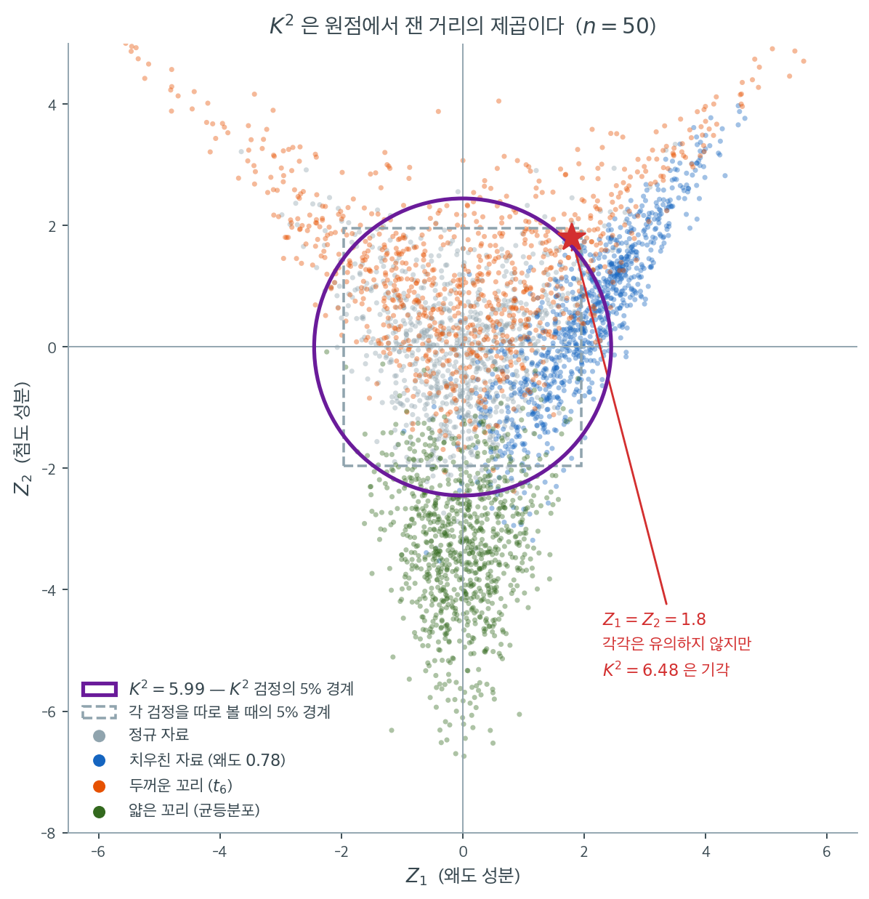

# D'Agostino K제곱 검정

## 개요

D'Agostino $K^2$ 검정은 왜도 검정과 첨도 검정을 하나의 통계량으로 결합한 옴니버스 정규성 검정이다. 왜도와 초과첨도가 모두 0과 일관되는지 동시에 검정함으로써, 어느 한쪽 검정만으로는 잡지 못하는 더 넓은 범위의 정규성 이탈을 탐지한다. SciPy에는 `stats.normaltest`로 구현되어 있다.

---

## 1. 검정통계량

$K^2$ 통계량은 왜도 검정과 첨도 검정에서 나온 $Z$ 점수의 제곱합이다.

$$
K^2 = Z_1^2 + Z_2^2,
$$

여기서 $Z_1$은 D'Agostino 왜도 통계량, $Z_2$는 D'Agostino 첨도 통계량이다(자세한 내용은 각 검정 페이지 참조). $H_0$(정규성) 아래에서 $Z_1$과 $Z_2$는 근사적으로 독립인 표준정규이므로

$$
K^2 \;\underset{H_0}{\sim}\; \chi^2_2 \quad \text{(점근적으로)}.
$$

---

## 2. 가설

$$
H_0: \text{자료가 정규분포를 따른다}, \qquad H_1: \text{자료가 정규분포를 따르지 않는다}.
$$

$p$값은

$$
p = P(\chi^2_2 \geq K^2_{\text{obs}}).
$$

$p < \alpha$일 때 $H_0$을 기각한다.

<div class="exbox" markdown>

**보기 1.** <span class="diff easy" title="쉬움"></span> 섞인 자료에 K-제곱 검정. $\mathcal{N}(0,1)$ 240개에 $\text{Lognormal}(0, 0.6^2)$ 60개를 섞은 $n = 300$ 표본에서 $K^2 = 22.2123$이 나온다.

**(1)** 두 성분의 제곱이 $K^2$을 이루는지 확인하고, $p$값을 $K^2$만의 닫힌 꼴로 쓰시오. 기각을 이끈 것은 치우침인가 꼬리인가.

**(2)** **같은 자료**에 자크–베라를 걸면 $JB = 47.5606$으로 $K^2$의 두 배가 넘는다. 두 통계량을 왜도 항과 첨도 항으로 각각 쪼개어, 그 차이가 **어느 항에서** 오는지 수로 밝히시오. $JB$가 더 크다는 것이 검정력이 더 좋다는 뜻인가.

</div>

??? success "풀이"

    **(1) 첨도 성분이 $69.8\%$다.** 분해는 정확히 맞아떨어진다.

    $$
    K^2 = Z_1^2 + Z_2^2 = 2.5915^2 + 3.9365^2 = 6.7159 + 15.4964 = 22.2123
    $$

    $\chi^2_2$의 생존함수가 $e^{-x/2}$이므로

    $$
    p = e^{-K^2/2} = e^{-11.10615} = 1.502\times10^{-5}
    $$

    이고 `normaltest`의 $p$값과 일치한다. 두 성분 모두 $\lvert Z\rvert > 1.96$을 넘으므로 둘 다 혼자서도 기각하는데, 첨도 쪽이 $15.50$ 대 $6.72$로 $2.3$배 크다. **대수정규 오염이 치우침과 두꺼운 꼬리를 동시에 들여왔고 꼬리 쪽 신호가 더 강하다.**

    **(2) 차이는 전부 첨도 항에서 온다.** 두 통계량을 나란히 쪼개면

    | 항 | $K^2$ | $JB$ | 비 |
    |---|---|---|---|
    | 왜도 | $Z_1^2 = 6.7159$ | $\frac{n}{6}g_1^2 = 6.8005$ | $1.01$ |
    | 첨도 | $Z_2^2 = 15.4964$ | $\frac{n}{24}g_2^2 = 40.7601$ | $2.63$ |
    | 합 | $22.2123$ | $47.5606$ | $2.14$ |

    이다. **왜도 항은 $1\%$ 안에서 같다.** $JB$의 왜도 항이 $\frac{n}{6}g_1^2 = (g_1/\sqrt{6/n})^2$, 곧 $\mathrm{Var}(g_1) \approx 6/n$을 쓴 단순 표준화의 제곱인데, $n = 300$에서 왜도 쪽 변환은 거의 아무것도 바꾸지 않으므로 $Z_1^2$과 사실상 같은 값이 된다.

    첨도 항은 $2.63$배 벌어진다. 까닭은 앞 쪽에서 본 대로 **$b_2$의 귀무분포가 크게 치우쳐 있다**는 데 있다. $JB$는 $g_2$를 그대로 제곱하므로 그 치우침을 전혀 고려하지 않고, $K^2$은 윌슨–힐퍼티 세제곱근 변환으로 치우침을 먼저 펴 준 다음 제곱한다. 두꺼운 꼬리 쪽 이탈에서는 변환이 값을 크게 깎으므로 $Z_2^2$이 작아진다.

    **그러므로 $JB$가 크다는 것은 검정력이 좋다는 뜻이 아니다.** 통계량이 커진 만큼 그 귀무분포도 함께 부풀어야 $\chi^2_2$가 맞는데, $JB$는 중간 크기 표본에서 그 보정 없이 $\chi^2_2$를 쓴다. 그래서 $p$값이 $4.70\times10^{-11}$까지 내려가지만, 이 쪽에서 $K^2$이 주는 $1.50\times10^{-5}$가 더 믿을 만한 수다. **두 $p$값의 자릿수 차이 여섯은 증거의 차이가 아니라 보정의 차이다.**

    ```python
    import numpy as np
    from scipy import stats

    # 정규 240개에 로그정규 60개를 섞었다. 겉보기에는 정규 같지만 오른쪽이
    # 조금 늘어난 자료다. 검정이 이것을 잡아내는지 본다.
    rng = np.random.default_rng(0)
    x = np.concatenate([rng.normal(0, 1, size=240),
                        rng.lognormal(0, 0.6, size=60)])

    # K^2 과 그것을 이루는 두 성분을 함께 구한다. 어느 쪽이 큰지를 보면
    # 정규에서 벗어난 까닭이 치우침인지 꼬리인지 알 수 있다.
    K2, p = stats.normaltest(x)
    z1, _ = stats.skewtest(x)
    z2, _ = stats.kurtosistest(x)

    print(f"Sample size n = {x.size}")
    print(f"D'Agostino's K^2 statistic = {K2:.4f}")
    print(f"  components: Z1 = {z1:.4f}, Z2 = {z2:.4f}")
    print(f"p-value = {p:.4g}")
    if p < 0.05:
        print("=> Reject normality at alpha = 0.05.")
    else:
        print("=> Fail to reject normality at alpha = 0.05.")
    ```

    출력:

    ```text
    Sample size n = 300
    D'Agostino's K^2 statistic = 22.2123
      components: Z1 = 2.5915, Z2 = 3.9365
    p-value = 1.502e-05
    => Reject normality at alpha = 0.05.
    ```

    두 통계량의 분해를 나란히 확인한다.

    ```python
    import numpy as np
    from scipy import stats

    rng = np.random.default_rng(0)
    x = np.concatenate([rng.normal(0, 1, size=240),
                        rng.lognormal(0, 0.6, size=60)])
    n = x.size
    K2, p = stats.normaltest(x)
    z1, _ = stats.skewtest(x)
    z2, _ = stats.kurtosistest(x)
    print(f"Z1^2 = {z1**2:.4f},  Z2^2 = {z2**2:.4f},  합 = {z1**2 + z2**2:.4f}  (K2 = {K2:.4f})")
    print(f"첨도 성분의 비중 = {100 * z2**2 / K2:.1f}%")
    print(f"p = exp(-K2/2) = {np.exp(-K2 / 2):.4g},  normaltest p = {p:.4g}")

    g1, g2 = stats.skew(x), stats.kurtosis(x)
    jb, pjb = stats.jarque_bera(x)
    jb_s, jb_k = n / 6 * g1**2, n / 24 * g2**2
    print(f"\nJB = {jb:.4f} = {jb_s:.4f} + {jb_k:.4f},  첨도 비중 {100 * jb_k / jb:.1f}%")
    print(f"  p(JB) = {pjb:.4g}")
    print(f"\n왜도 쪽:  JB 항 {jb_s:.4f}  대  Z1^2 {z1**2:.4f}   (비 {jb_s / z1**2:.2f})")
    print(f"첨도 쪽:  JB 항 {jb_k:.4f}  대  Z2^2 {z2**2:.4f}   (비 {jb_k / z2**2:.2f})")
    ```

    출력:

    ```text
    Z1^2 = 6.7159,  Z2^2 = 15.4964,  합 = 22.2123  (K2 = 22.2123)
    첨도 성분의 비중 = 69.8%
    p = exp(-K2/2) = 1.502e-05,  normaltest p = 1.502e-05

    JB = 47.5606 = 6.8005 + 40.7601,  첨도 비중 85.7%
      p(JB) = 4.703e-11

    왜도 쪽:  JB 항 6.8005  대  Z1^2 6.7159   (비 1.01)
    첨도 쪽:  JB 항 40.7601  대  Z2^2 15.4964   (비 2.63)
    ```

    분해가 양쪽 모두 끝까지 맞고, $e^{-K^2/2}$가 `normaltest`의 $p$값과 일치한다. 마지막 두 줄이 (2)의 답이다. **같은 자료에서 두 옴니버스 검정이 왜도에는 똑같이 반응하고 첨도에만 다르게 반응한다.** $\square$

---

## 3. 왜 옴니버스 검정인가

두 상황을 생각해 보자.

1. **오른쪽으로 치우쳤지만 첨도는 정상인 자료:** 왜도 검정은 기각하지만 첨도 검정은 기각하지 않을 수 있다. $Z_1^2$이 크므로 $K^2$ 검정은 여전히 기각한다.
2. **대칭이지만 꼬리가 두꺼운 자료:** 왜도 검정은 기각하지 않지만($Z_1 \approx 0$) 첨도 검정은 기각한다. 이번에도 $K^2$이 기각한다.

두 적률을 결합함으로써 $K^2$은 어느 방향의 이탈에도 민감해진다. 나아가 자료가 *약간* 치우쳤고 *동시에* 약간 고첨인 경우처럼 각 성분의 증거가 개별적으로는 유의하지 않아도, 둘을 합친 증거가 $K^2$을 임계값 너머로 밀어 올릴 수 있다. 예컨대 $Z_1 = 1.8$, $Z_2 = 1.8$이면 각각은 $p = 0.072$로 기각하지 못하지만 $K^2 = 6.48$은 $p = 0.039$로 기각한다.

### 평면 위에서 보면 한눈에 들어온다

$K^2 = Z_1^2 + Z_2^2$이라는 식은 피타고라스 정리다. $(Z_1, Z_2)$를 평면 위의 한 점으로 보면 $K^2$은 그 점이 원점에서 떨어진 **거리의 제곱**이고, 기각역은 반지름 $\sqrt{5.991} = 2.447$인 원의 바깥이다. 아래 그림은 $n = 50$인 표본을 네 종류의 모집단에서 900개씩 뽑아 이 평면 위에 찍은 것이다.



회색 점(정규 자료)은 원점 주위에 둥글게 모여 있다. 두 성분의 중앙값이 각각 $-0.03$과 $0.05$로, 표준정규 두 개가 독립으로 흩어진 모습 그대로다. 보라색 원 바깥으로 나가는 회색 점의 비율이 곧 검정의 크기이며 $0.060$이 나왔다.

나머지 세 무리는 각자 **다른 방향으로** 날아간다. 치우친 자료(파랑)는 오른쪽으로 뻗어 $Z_1$ 중앙값이 $2.03$이고 $Z_2$는 $0.48$에 머문다. 두꺼운 꼬리($t_6$, 주황)는 위쪽으로 올라가 $Z_2$ 중앙값이 $1.25$이다. 얇은 꼬리(균등분포, 초록)는 아래로 곤두박질쳐 $Z_2$ 중앙값이 $-3.27$까지 내려간다. 세 무리 모두 원점에서 멀어지지만 멀어지는 방향이 제각각이다. 이것이 "옴니버스"라는 말의 그림이다. **원은 방향을 가리지 않는다.**

회색 점선 정사각형은 두 검정을 따로 볼 때의 기각역 경계, 곧 $|Z_1| < 1.96$이고 $|Z_2| < 1.96$인 영역이다. 원과 정사각형이 서로를 완전히 포함하지 않는다는 점이 중요하다. 빨간 별로 찍은 $Z_1 = Z_2 = 1.8$이 그 차이가 드러나는 자리다. 정사각형 **안**이므로 두 검정 어느 쪽도 기각하지 못하지만, 원점에서의 거리는 $\sqrt{1.8^2 + 1.8^2} = 2.55$로 원의 반지름 $2.447$을 넘어 $K^2$은 기각한다. 반대로 $Z_1 = 2.3$, $Z_2 = 0$ 같은 점은 정사각형 밖이지만 원 안이라 왜도 검정만 기각하고 $K^2$은 기각하지 못한다. 세 검정을 다 돌려놓고 마음에 드는 결과를 고르면 안 되는 이유가 여기에 있다. **어느 검정을 쓸지는 자료를 보기 전에 정해야 한다.**

---

## 4. 해석

혼합 보기(정규 + 대수정규)에서 자료는 대수정규 성분에서 0이 아닌 왜도와 0이 아닌 초과첨도를 모두 물려받는다. $K^2 = 22.21$, $p = 1.5 \times 10^{-5}$로 강하게 기각한다. 성분을 보면 $Z_1 = 2.59$, $Z_2 = 3.94$로 첨도 성분이 조금 더 크지만 둘 다 기여한다.

실무에서 $K^2$이 기각하면 `stats.skewtest`와 `stats.kurtosistest`로 $Z_1$과 $Z_2$를 따로 살펴 *어느* 적률이 기각을 이끌었는지 파악하는 것이 유용하다.

**표본크기 요구조건.** SciPy의 `stats.normaltest`는 $n \geq 20$을 요구한다. 왜도 변환과 첨도 변환 모두 최소 표본크기가 필요하기 때문이다.

---

## 연습문제

<div class="drillbox" markdown>

**연습문제 1.** <span class="diff easy" title="쉬움"></span> 표준정규 관측값 $n = 500$개를 생성하라. D'Agostino $K^2$ 검정을 수행하고 $p > 0.05$임을 확인하라.

</div>

??? success "풀이"

    ```python
    import numpy as np
    from scipy import stats

    rng = np.random.default_rng(0)
    x = rng.normal(0, 1, size=500)

    K2, p = stats.normaltest(x)
    print(f"K^2 = {K2:.4f}, p = {p:.4f}")
    ```

    출력:

    ```text
    K^2 = 5.9058, p = 0.0522
    ```

    $p = 0.0522$로 0.05를 **간신히** 넘었다. 형식적으로는 기각하지 못하지만 문턱에 아슬아슬하게 걸쳐 있다.

    자료를 정확히 표준정규에서 생성했으므로 이것이 우연임을 우리는 안다. 귀무가설 아래에서 $p$값은 $\text{Uniform}(0,1)$을 따르므로 0.05 근처의 값이 나올 확률도 다른 구간과 똑같다.

    이 예는 **$\alpha = 0.05$라는 문턱의 자의성**을 잘 보여준다. $p = 0.0522$와 $p = 0.0478$은 증거로서 사실상 구별되지 않는데도 이분법적 판정은 정반대가 된다. $p$값을 그대로 보고하고 문턱 통과 여부만 말하지 않는 편이 낫다. $\square$

<div class="drillbox" markdown>

**연습문제 2.** <span class="diff easy" title="쉬움"></span> $\text{Uniform}(0,1)$ 분포에서 관측값 $n = 300$개를 생성하라. $K^2$ 검정을 수행하라. 기각의 주된 원인은 어느 성분($Z_1$ 또는 $Z_2$)인가?

</div>

??? success "풀이"

    ```python
    import numpy as np
    from scipy import stats

    rng = np.random.default_rng(1)
    x = rng.uniform(0, 1, size=300)

    K2, p = stats.normaltest(x)
    z1, p1 = stats.skewtest(x)
    z2, p2 = stats.kurtosistest(x)

    print(f"K^2 = {K2:.4f}, p = {p:.4g}")
    print(f"Skewness:  Z1 = {z1:.4f}, p = {p1:.4g}")
    print(f"Kurtosis:  Z2 = {z2:.4f}, p = {p2:.4g}")
    ```

    출력:

    ```text
    K^2 = 194.4187, p = 6.06e-43
    Skewness:  Z1 = 0.2788, p = 0.7804
    Kurtosis:  Z2 = -13.9406, p = 3.588e-44
    ```

    균등분포는 대칭이고($\gamma_1 = 0$) 저첨이다($\gamma_2 = -1.2$). 따라서 $Z_1 = 0.279$는 작고 유의하지 않은 반면 $Z_2 = -13.94$는 크고 매우 유의하다.

    분해를 보면 기여가 명확하다.

    $$
    K^2 = 0.279^2 + (-13.941)^2 = 0.078 + 194.34 = 194.42.
    $$

    왜도 성분의 기여가 전체의 $0.04\%$에 불과하다. $K^2$의 기각은 **전적으로 첨도 성분이 이끈다**. $\square$

<div class="drillbox" markdown>

**연습문제 3.** <span class="diff med" title="중간"></span> $H_0$ 아래에서 $K^2$이 $\chi^2_2$ 분포를 따르는 이유를 설명하고, 이 근사가 성립하는 데 필요한 조건을 서술하라.

</div>

??? success "풀이"

    $H_0$ 아래에서 D'Agostino의 변환은 $g_1$과 $g_2$를 각각 근사적으로 $\mathcal{N}(0,1)$인 $Z_1$과 $Z_2$로 보낸다. 이 변환들은 $Z_1$과 $Z_2$가 근사적으로 독립이 되도록 설계되어 있다(하나는 홀수 차수 중심적률에, 다른 하나는 짝수 차수에 의존한다). 독립인 두 표준정규의 제곱합은 정의상 $\chi^2_2$이다.

    근사가 성립하려면 다음이 필요하다.

    1. $Z_1$과 $Z_2$의 정규근사가 성립할 만큼 $n$이 커야 한다(SciPy는 $Z_1$에 $n \geq 8$, $Z_2$에 $n \geq 20$을 요구한다).
    2. 자료가 i.i.d.여야 한다. 자료에 계열상관이 있으면 $g_1$과 $g_2$의 분산이 달라져 $\chi^2_2$ 근사가 무너진다.

    독립성 가정도 근사에 불과하다는 점을 유념하라. 유한표본에서 $Z_1$과 $Z_2$ 사이에는 약한 상관이 남아 있으며, 이것이 연습문제 4에서 관찰할 크기 왜곡의 한 원인이다. $\square$

<div class="drillbox" markdown>

**연습문제 4.** <span class="diff med" title="중간"></span> 10,000회 반복의 몬테카를로 모의실험으로 $n = 50$일 때 $\alpha = 0.05$에서 $K^2$ 검정의 경험적 크기가 근사적으로 0.05인지 확인하라.

</div>

??? success "풀이"

    ```python
    import numpy as np
    from scipy import stats

    rng = np.random.default_rng(0)
    n, reps, alpha = 50, 10000, 0.05
    rejections = 0

    for _ in range(reps):
        x = rng.normal(0, 1, size=n)
        _, p = stats.normaltest(x)
        if p < alpha:
            rejections += 1

    empirical_size = rejections / reps
    print(f"Empirical size: {empirical_size:.4f}")
    ```

    출력:

    ```text
    Empirical size: 0.0571
    ```

    추정값의 표준오차는 $\sqrt{0.05 \times 0.95 / 10000} = 0.0022$이다. 관측된 $0.0571$은 명목값 $0.05$보다 $3.2$ 표준오차 위에 있다. **우연으로 설명하기 어렵다.**

    반복수를 20,000회로 늘려 여러 $n$에서 확인하면 체계적인 경향이 드러난다.

    | $n$ | 경험적 크기 | 명목값과의 차이 |
    |---|---|---|
    | 50 | 0.0583 | $+0.0083$ ($5.4$ SE) |
    | 100 | 0.0559 | $+0.0059$ ($3.8$ SE) |
    | 500 | 0.0519 | $+0.0019$ ($1.2$ SE) |

    (SE $= 0.0015$.)

    곧 $K^2$ 검정은 **작은 표본에서 약간 자유주의적(liberal)**이다. 실제 제1종 오류율이 명목값보다 높다. $n$이 커지면서 차이가 줄어들어 $n = 500$에서는 무시할 만해진다.

    원인은 두 가지이다. 하나는 $Z_1$, $Z_2$ 각각의 정규근사가 작은 $n$에서 불완전하다는 것이고, 다른 하나는 연습문제 3에서 언급한 대로 유한표본에서 두 통계량이 완전히 독립이 아니라는 것이다.

    실용적 함의: $n = 50$에서 $\alpha = 0.05$로 $K^2$ 검정을 쓰면 실제 크기는 약 0.058이다. 크기 조정이 결정적으로 중요하다면 모의실험으로 임계값을 얻거나, 작은 표본에서 크기가 더 정확한 Shapiro-Wilk를 쓰는 편이 낫다. $\square$

<div class="drillbox" markdown>

**연습문제 5.** <span class="diff hard" title="어려움"></span> $Z_1$과 $Z_2$가 독립인 $\mathcal{N}(0,1)$ 확률변수이면 $K^2 = Z_1^2 + Z_2^2$의 CDF가 $k \geq 0$에 대해 $F_{K^2}(k) = 1 - e^{-k/2}$임을 증명하라.

</div>

??? success "풀이"

    $Z_1, Z_2 \overset{\text{iid}}{\sim} \mathcal{N}(0,1)$이면 정의상 $Z_1^2 \sim \chi^2_1$이고 $Z_2^2 \sim \chi^2_1$이다. 두 변수가 독립이므로 $K^2 = Z_1^2 + Z_2^2 \sim \chi^2_2$이다. $\chi^2_2$ 분포의 밀도는

    $$
    f_{K^2}(k) = \frac{1}{2} e^{-k/2}, \qquad k \geq 0,
    $$

    이며 이는 $\text{Exponential}(1/2)$의 밀도이다. 적분하면

    $$
    F_{K^2}(k) = \int_0^k \frac{1}{2} e^{-t/2}\, dt = \bigl[-e^{-t/2}\bigr]_0^k = 1 - e^{-k/2}.
    $$

    주장이 확인되었다. 자유도 2인 카이제곱분포가 평균 2인 지수분포와 같다는 사실은 유용한 특수 성질이다.

    한 가지 따름 결과로, $K^2$ 검정의 $p$값을 닫힌 형태로 계산할 수 있다.

    $$
    p = 1 - F_{K^2}(K^2_{\text{obs}}) = e^{-K^2_{\text{obs}}/2}.
    $$

    본문 보기로 확인해 보자. $K^2 = 22.2123$이므로 $p = e^{-11.106} = 1.50 \times 10^{-5}$이고, SciPy가 보고한 $1.502 \times 10^{-5}$와 일치한다. $\square$

<div class="drillbox" markdown>

**연습문제 6.** <span class="diff hard" title="어려움"></span> 3절은 원형 기각역과 정사각형 기각역이 서로를 포함하지 않는다고 했다. 그 말을 수로 마무리하자. $H_0$ 아래에서 $Z_1, Z_2$는 독립인 표준정규라고 본다.

**(1)** "$\lvert Z_1 \rvert > 1.96$ 또는 $\lvert Z_2 \rvert > 1.96$이면 기각"하는 절차의 크기를 구하시오. $K^2$ 검정의 $0.05$와 공정하게 견주려면 정사각형의 반폭을 얼마로 잡아야 하는가. 그때의 크기도 구하시오.

**(2)** (1)에서 얻은 정사각형과 반지름 $2.4477$인 원을 견주어, **원만 기각하는** 점이 놓이는 대각선 $Z_1 = Z_2 = z$ 위의 구간과 **정사각형만 기각하는** 점이 놓이는 축 $Z_2 = 0$ 위의 구간을 구하시오. 본문의 빨간 별 $(1.8, 1.8)$은 어느 구간에 들어가는가.

**(3)** 두 절차 가운데 하나가 다른 쪽보다 낫다고 말할 수 있는가. 각자 유리한 이탈의 방향을 짚고, 연습문제 4의 결과가 (1)의 크기 비교에 어떤 그림자를 드리우는지 한 줄로 쓰시오.

</div>

??? success "풀이"

    **(1) 그냥 둘을 걸면 크기가 $0.0975$로 두 배가 된다.** 독립이므로 두 성분이 모두 정사각형 안에 있을 확률이 곱으로 쪼개진다.

    $$
    P(\lvert Z_1 \rvert < 1.96,\ \lvert Z_2 \rvert < 1.96) = 0.95^2 = 0.9025
    $$

    이므로 합집합의 확률은 $1 - 0.9025 = 0.0975$다. 검정을 둘 돌려 하나라도 걸리면 기각하는 것은 $\alpha = 0.0975$의 검정이며, $K^2$의 $0.05$와 견줄 수 있는 절차가 아니다.

    공정하게 맞추려면 각 검정을 $\alpha/2 = 0.025$에서 돌려야 한다(본페로니). 반폭은 $z_{0.9875} = 2.2414$이고 크기는

    $$
    1 - 0.975^2 = 0.049375
    $$

    로 $0.05$보다 아주 조금 작다($0.000625$ 차이로 보수적이다).

    **(2) 대각선에서는 $1.7308 < \lvert z \rvert < 2.2414$, 축에서는 $2.2414 < \lvert Z_1 \rvert < 2.4477$이다.** 대각선 위에서 $K^2 = 2z^2$이므로 원이 기각하는 조건은

    $$
    2z^2 > 5.9915 \iff \lvert z \rvert > \frac{2.4477}{\sqrt{2}} = 1.7308
    $$

    이고, 본페로니 정사각형이 기각하지 못하는 조건은 $\lvert z \rvert < 2.2414$다. 두 조건이 겹치는 폭 $0.5106$의 구간이 **원만 기각하는 띠**다. 별 $(1.8, 1.8)$은 $1.7308 < 1.8 < 2.2414$이므로 이 띠 안에 있다. 이 띠의 안쪽 끝에서 두 성분의 개별 $p$값은 각각 $2\{1 - \Phi(1.7308)\} = 0.0835$로, **어느 적률도 혼자서는 $0.08$ 수준의 증거조차 못 되는데 합치면 정확히 $0.05$가 된다.**

    축 위에서는 $K^2 = Z_1^2$이므로 원은 $\lvert Z_1 \rvert > 2.4477$에서만 기각한다. 정사각형은 $2.2414$부터 기각하므로 **정사각형만 기각하는 구간**은 폭 $0.2063$뿐이다. 두 띠의 폭이 $0.5106$ 대 $0.2063$으로 대각선 쪽이 두 배 반 넓다.

    **(3) 어느 쪽도 이기지 못한다.** 크기가 $0.05$와 $0.049375$로 사실상 같은데도 두 기각역이 서로를 포함하지 않으므로, 한쪽이 다른 쪽을 지배할 수 없다. 유리한 방향은 갈린다.

    - **원(옴니버스)**: 두 적률이 조금씩 함께 어긋나는 이탈. 대각선 쪽으로 $\alpha$를 더 많이 배분한다. 본문의 혼합 보기처럼 대수정규 오염이 치우침과 꼬리를 **동시에** 들여올 때가 그렇다.
    - **정사각형(본페로니)**: 한 적률만 어긋나고 다른 쪽은 깨끗한 이탈. 연습문제 2의 균등분포가 극단적인 예로, $Z_1 = 0.28$, $Z_2 = -13.94$처럼 축 방향으로만 날아간다(물론 이 경우는 어느 절차든 기각한다).

    연습문제 4의 그림자: $n = 50$에서 $K^2$의 **실제** 크기가 $0.0583$이었다. 명목 크기의 차이 $0.05 - 0.049375 = 0.000625$는 그 보정 오차 $0.0083$의 **$13$분의 $1$**에 불과하다. 곧 작은 표본에서 소수 넷째 자리까지 크기를 맞추어 두 절차를 고르는 일은 뜻이 없고, 선택의 근거는 크기가 아니라 **겨냥하는 이탈의 방향**이어야 한다. $\square$

<div class="drillbox" markdown>

**연습문제 7.** <span class="diff hard" title="어려움"></span> 보기 1(2)는 같은 자료에서 첨도 항이 $JB$ 쪽 $40.7601$, $K^2$ 쪽 $15.4964$로 $2.63$배 벌어진 까닭을 "$b_2$의 귀무분포가 치우쳐 있다"는 데 돌렸다. 그 설명을 **유한표본 보정**과 **세제곱근 변환**의 두 몫으로 쪼개어 확인하자. 정규성 아래의 적률

$$
\mathbb{E}[b_2] = \frac{3(n-1)}{n+1}, \qquad
\mathrm{Var}(b_2) = \frac{24n(n-2)(n-3)}{(n+1)^2(n+3)(n+5)}
$$

을 쓰고 $n = 300$으로 둔다.

**(1)** $JB$의 첨도 항 $\frac{n}{24}g_2^2 = 40.7601$에서 $g_2$와 $b_2 = g_2 + 3$을 되찾으시오.

**(2)** 단순 표준화 $u = \{b_2 - \mathbb{E}[b_2]\}/\mathrm{SD}(b_2)$를 구하고 $u^2$을 $JB$ 항과 $Z_2^2$ 사이에 놓으시오. 유한표본 보정이 $2.63$배의 간격을 메우는가?

**(3)** 비 $\frac{n}{24}g_2^2 \big/ u^2$을 중심 보정 인자와 분산 보정 인자의 곱으로 쪼개고, 세제곱근 변환이 짊어지는 몫이 얼마인지 결론을 쓰시오.

</div>

??? success "풀이"

    **(1) $g_2 = 1.805771$, $b_2 = 4.805771$이다.** 항을 뒤집으면

    $$
    g_2 = \sqrt{\frac{24}{n}\cdot 40.7601} = \sqrt{0.08 \times 40.7601} = \sqrt{3.260808} = 1.805771
    $$

    이고 비보정 첨도는 $b_2 = 4.805771$이다.

    **(2) 보정은 간격을 메우지 않고 오히려 벌린다.** $n = 300$에서

    $$
    \mathbb{E}[b_2] = \frac{3 \times 299}{301} = 2.980066, \qquad
    \mathrm{Var}(b_2) = \frac{24 \times 300 \times 298 \times 297}{301^2 \times 303 \times 305} = 0.0761079
    $$

    이므로 $\mathrm{SD}(b_2) = 0.275877$이고

    $$
    u = \frac{4.805771 - 2.980066}{0.275877} = \frac{1.825705}{0.275877} = 6.617829, \qquad u^2 = 43.7957.
    $$

    세 수를 크기순으로 놓으면

    | 표준화 방식 | 첨도 항 | $Z_2^2$에 대한 비 |
    |---|---|---|
    | 단순 표준화 $u^2$ (정확한 평균·분산) | $43.7957$ | $2.826$ |
    | $JB$ 항 $\frac{n}{24}g_2^2$ | $40.7601$ | $2.630$ |
    | $K^2$ 항 $Z_2^2$ (윌슨–힐퍼티) | $15.4964$ | $1$ |

    이다. **정확한 평균과 분산을 써서 고치면 값이 $40.76$에서 $43.80$으로 더 커진다.** 간격을 메우는 쪽이 아니라 반대 방향이다. 까닭은 $\mathrm{SD}(b_2) = 0.275877$이 $JB$가 쓰는 $\sqrt{24/n} = 0.282843$보다 **작다**는 데 있다. 같은 이탈을 더 작은 척도로 재니 표준화값이 커진다.

    **(3) 두 보정 인자는 각각 1 보다 작고, 남는 $2.826$배는 전부 변환의 몫이다.** 비를 그대로 쪼개면

    $$
    \frac{\frac{n}{24}g_2^2}{u^2}
    = \underbrace{\left(\frac{g_2}{b_2 - \mathbb{E}[b_2]}\right)^2}_{\text{중심 보정}} \times \underbrace{\frac{\mathrm{Var}(b_2)}{24/n}}_{\text{분산 보정}}
    = \left(\frac{1.805771}{1.825705}\right)^2 \times \frac{0.0761079}{0.08}
    $$

    이고 값은 $0.978283 \times 0.951349 = 0.930688$이다. $JB$는 중심을 $3$으로 잡아 $2.2\%$, 분산을 $24/n$으로 잡아 $4.9\%$만큼 항을 깎고 있었고, 둘을 합쳐 $7\%$다. **$2.63$배와는 자릿수가 다르다.**

    그러므로 보기 1(2)의 $2.63$배는 유한표본 적률의 문제가 전혀 아니다. 올바르게 표준화한 $u^2 = 43.7957$에서 $Z_2^2 = 15.4964$까지 내려가는 $2.826$배가 **순수하게 윌슨–힐퍼티 세제곱근 변환이 하는 일**이고, $JB$가 그중 $7\%$만 우연히 깎아 먹어 $2.63$배로 보인 것이다.

    $p$값으로 옮기면 차이가 더 선명하다. 같은 첨도 하나를 놓고 $u$를 표준정규 분위수로 읽으면 $p = 3.65\times10^{-11}$, $g_2/\sqrt{24/n} = 6.3844$로 읽으면 $p = 1.72\times10^{-10}$, 변환을 거친 $Z_2 = 3.9365$로 읽으면 $p = 8.27\times10^{-5}$다. **정확한 적률로 표준화해도 $p$값은 거의 안 고쳐지고, 치우침을 펴 주어야 비로소 여섯 자릿수가 제자리로 돌아온다.** 적률을 정밀하게 맞추는 것과 분포의 모양을 맞추는 것은 다른 일이다. $\square$

<div class="drillbox" markdown>

**연습문제 8.** <span class="diff hard" title="어려움"></span> $K^2$은 3차와 4차 적률만 본다. 그렇다면 $\gamma_1 = 0$이고 $\gamma_2 = 0$인데 정규가 전혀 아닌 분포를 만들어 놓으면 이 검정은 무엇을 하는가.

반폭이 둘뿐인 대칭 균등 혼합 $p\,\mathrm{U}(-0.3,\,0.3) + (1-p)\,\mathrm{U}(-1,\,1)$을 생각한다.

**(1)** 대칭성에서 $\gamma_1 = 0$이다. $\gamma_2 = 0$이 되는 $p$가 이차방정식 $41405p^2 - 61243p + 20000 = 0$의 작은 뿌리임을 보이고 값을 구하시오.

**(2)** 그 $p$로 $n = 50, 200, 1000, 5000$에서 $K^2$·자크–베라·섀피로–윌크의 기각률을 각각 $20{,}000$번 반복으로 재고, $Z_1$과 $Z_2$의 표본표준편차도 함께 구하시오.

**(3)** $n$이 커질 때 $K^2$의 기각률이 어디로 가는가. 명목 크기 $0.05$와 견주어 그 값을 설명하고, 왜 하필 그 방향인지를 (2)의 $\mathrm{SD}(Z_2)$로 밝히시오.

</div>

??? success "풀이"

    **(1) $p = 0.486744$다.** 반폭 $h$인 대칭 균등분포는 $\mathbb{E}[X^2] = h^2/3$, $\mathbb{E}[X^4] = h^4/5$이므로 혼합의 중심적률은

    $$
    m_2 = \frac{p a^2 + (1-p) b^2}{3}, \qquad m_4 = \frac{p a^4 + (1-p) b^4}{5}
    $$

    이고 $\gamma_2 = 0 \iff m_4 = 3m_2^2$, 곧

    $$
    \frac{p a^4 + (1-p) b^4}{5} = \frac{\{p a^2 + (1-p) b^2\}^2}{3}
    \iff 3\{p a^4 + (1-p) b^4\} = 5\{p a^2 + (1-p) b^2\}^2
    $$

    이다. $a = 0.3$, $b = 1$을 넣으면 $a^2 = 0.09$, $a^4 = 0.0081$이므로

    $$
    3(1 - 0.9919p) = 5(1 - 0.91p)^2
    \iff 41405p^2 - 61243p + 20000 = 0
    $$

    이 되고 두 뿌리는 $p = 0.486744$와 $p = 0.992377$이다. 뒤쪽 뿌리는 거의 전부가 좁은 균등분포인 경우로 같은 조건을 푸는 또 하나의 해이지만, 두 성분이 실제로 섞이는 앞쪽 뿌리를 쓴다. 이 모집단은 가운데가 솟은 **계단 모양**이고 꼬리는 $\lvert x \rvert > 1$에서 딱 끊긴다. 정규분포와 닮은 데가 없는데도 왜도와 초과첨도는 $0$이다.

    **(2)–(3) $n$이 커지면 기각률이 $0.05$가 아니라 $0.0005$로 간다.**

    ```python
    import numpy as np
    from scipy import stats

    # 48.67% 가 U(-0.3, 0.3), 51.33% 가 U(-1, 1) 인 대칭 혼합이다. 왜도는 대칭성에서
    # 0 이고, 섞는 비율 p 를 아래 이차식의 뿌리로 잡으면 초과첨도도 정확히 0 이 된다.
    a, b = 0.3, 1.0
    p = (61243 - np.sqrt(61243**2 - 4 * 41405 * 20000)) / (2 * 41405)
    m2 = (p * a**2 + (1 - p) * b**2) / 3
    m4 = (p * a**4 + (1 - p) * b**4) / 5
    print(f"p = {p:.6f},  모집단 왜도 = 0,  모집단 초과첨도 = {m4 / m2**2 - 3:.1e}")

    def sample(size, rng):
        half = np.where(rng.random(size) < p, a, b)
        return rng.uniform(-1, 1, size) * half

    # 표본크기를 100 배로 늘려 가며 세 검정의 기각률을 재고, 두 Z 의 흩어짐도 함께 본다.
    rng = np.random.default_rng(0)
    reps = 20000
    print("\n    n      K^2       JB   Shapiro   sd(Z1)  sd(Z2)")
    for n in (50, 200, 1000, 5000):
        X = sample((reps, n), rng)
        _, pk = stats.normaltest(X, axis=1)
        _, pj = stats.jarque_bera(X, axis=1)
        z1, _ = stats.skewtest(X, axis=1)
        z2, _ = stats.kurtosistest(X, axis=1)
        sw = np.array([stats.shapiro(row).pvalue for row in X[:3000]])
        print(f"{n:5d}   {np.mean(pk < 0.05):.4f}   {np.mean(pj < 0.05):.4f}    {np.mean(sw < 0.05):.4f}    {z1.std():.3f}   {z2.std():.3f}")
    ```

    출력:

    ```text
    p = 0.486744,  모집단 왜도 = 0,  모집단 초과첨도 = -4.4e-16

        n      K^2       JB   Shapiro   sd(Z1)  sd(Z2)
       50   0.0135   0.0109    0.1863    0.781   0.729
      200   0.0024   0.0029    0.9757    0.674   0.658
     1000   0.0006   0.0008    1.0000    0.645   0.633
     5000   0.0005   0.0007    1.0000    0.643   0.629
    ```

    세 가지를 읽을 수 있다.

    첫째, **$K^2$의 기각률은 $n$이 커질수록 떨어진다.** $0.0135 \to 0.0024 \to 0.0006 \to 0.0005$다. 검정력이 1로 가는 것이 아니라 명목 크기 $0.05$의 $100$분의 $1$로 내려앉는다. 자크–베라도 똑같다. 표본을 $100$배 늘려도 소용이 없으니 이 대립가설에 대해 두 적률 검정은 **일치추정적(consistent)이 아니다**. 반례가 성립했다.

    둘째, **섀피로–윌크는 본다.** $n = 200$에서 이미 $0.9757$, $n = 1000$부터는 $1.0000$이다. 순서통계량과 정규점수의 상관을 재므로 적률 두 개가 맞아떨어진다는 사실에 속지 않는다. 같은 자료에서 한 검정은 기각률 $0.0006$, 다른 검정은 $1.0000$이다.

    셋째, **왜 $0.05$ 아래로 내려가는가.** $\mathrm{SD}(Z_2)$가 $0.63$으로 수렴한다. $Z_1$, $Z_2$의 분모는 **정규성 아래의** 분산 $24/n$, $6/n$으로 만들어진 것인데, 이 모집단은 꼬리가 유계라 $g_2$의 참 분산이 그보다 훨씬 작다. 중심이 맞으므로($\gamma_2 = 0$) $Z_2 \approx 0.63 \cdot \mathcal{N}(0,1)$이고, 따라서

    $$
    P(K^2 > 5.9915) \approx P\bigl(0.63^2 \chi^2_2 > 5.9915\bigr) = P(\chi^2_2 > 15.1) = 5.3\times10^{-4}
    $$

    로 관측된 $0.0005$와 맞는다. **분모가 과대평가되어 검정이 극단적으로 보수적이 된 것이다.**

    연습문제 4의 "작은 표본에서 자유주의적"과 방향이 반대임을 눈여겨보라. 거기서는 귀무가설 아래의 근사 오차 때문에 크기가 $0.058$로 조금 올라갔고, 여기서는 대립가설이 적률의 척도 자체를 바꿔 기각률이 $0.0005$로 떨어졌다. **$K^2$은 "정규인가"를 묻지 않고 "왜도와 초과첨도가 0 인가"를 묻는다.** 두 질문은 같지 않으며, 그 간격을 메우는 것은 Q-Q 그림과 섀피로–윌크 같은 다른 종류의 검정이다. $\square$

<div class="drillbox" markdown>

**연습문제 9.** <span class="diff hard" title="어려움"></span> 오염 정규 $f_\varepsilon = (1-\varepsilon)\,\mathcal{N}(0,1) + \varepsilon\,\mathcal{N}(0, 3^2)$에 대해 첨도 성분의 검정력을 $\varepsilon$의 함수로 따져 보자.

**(1)** $\gamma_1 = 0$임을 확인하고

$$
\gamma_2(\varepsilon) = \frac{192\,\varepsilon(1-\varepsilon)}{(1 + 8\varepsilon)^2}
$$

임을 유도하시오. $\varepsilon \to 0$과 $\varepsilon \to 1$에서의 값, 그리고 최댓값과 그 위치를 구하시오.

**(2)** $Z_2$의 중심이 $\sqrt{n/24}\,\gamma_2$만큼 옮겨가고 흩어짐은 그대로라고 보는 델타법 근사 아래에서, $n = 300$, $\alpha = 0.05$ 양쪽검정의 검정력이 $0.5$가 되는 $\varepsilon$을 **둘** 구하시오.

**(3)** 작은 뿌리를 해석하시오. $n = 300$에서 오염 관측값은 평균 몇 개인가. 오염이 **하나도** 섞이지 않은 표본의 비율은 얼마인가. 그 수를 보고도 검정력 $0.5$라는 예측을 믿을 수 있는지, 믿을 수 없다면 나머지 표본이 짊어져야 하는 기각률을 구해 논하시오.

</div>

??? success "풀이"

    **(1) $\gamma_2$는 $\varepsilon = 0.1$에서 $16/3$까지 올랐다가 다시 $0$으로 내려온다.** 두 성분이 모두 평균 $0$의 대칭분포이므로 홀수 차수 중심적률이 전부 $0$이고 $\gamma_1 = 0$이다. 짝수 차수는 성분별 적률의 가중평균으로

    $$
    m_2 = (1-\varepsilon)\cdot 1 + \varepsilon \cdot 9 = 1 + 8\varepsilon, \qquad
    m_4 = (1-\varepsilon)\cdot 3 + \varepsilon \cdot 3 \cdot 81 = 3(1 + 80\varepsilon)
    $$

    이다($\mathcal{N}(0,\sigma^2)$의 4차 적률이 $3\sigma^4$). 따라서

    $$
    \gamma_2 = \frac{3(1 + 80\varepsilon)}{(1+8\varepsilon)^2} - 3
    = \frac{3\{1 + 80\varepsilon - (1 + 16\varepsilon + 64\varepsilon^2)\}}{(1+8\varepsilon)^2}
    = \frac{192\,\varepsilon(1-\varepsilon)}{(1+8\varepsilon)^2}.
    $$

    양 끝에서 $\gamma_2(0) = \gamma_2(1) = 0$이다. 당연하다. $\varepsilon = 0$은 $\mathcal{N}(0,1)$, $\varepsilon = 1$은 $\mathcal{N}(0,9)$이고 **둘 다 정규분포**다. 최댓값은 분자·분모를 미분해

    $$
    (1-2\varepsilon)(1+8\varepsilon) - 16\varepsilon(1-\varepsilon) = 1 - 10\varepsilon = 0
    $$

    에서 $\varepsilon = 0.1$이고 $\gamma_2(0.1) = \frac{192 \times 0.1 \times 0.9}{1.8^2} = \frac{17.28}{3.24} = \frac{16}{3} = 5.3333$이다. **$\gamma_2$는 $\varepsilon$에 대해 단조가 아니라 봉우리를 그린다.** 그러므로 $(0, 16/3)$ 안의 어떤 값도 서로 다른 두 $\varepsilon$에서 나오고, 첨도만 보는 검정은 그 두 경우를 구별할 수 없다.

    **(2) $\varepsilon = 0.003039$ 와 $\varepsilon = 0.802000$이다.** 중심이 $\delta = \sqrt{n/24}\,\gamma_2$인 표준정규라면 $P(\lvert Z_2 \rvert > 1.96) = 0.5$가 되는 지점은 $\delta = 1.96$이다(반대쪽 꼬리 기여는 $10^{-4}$ 아래라 무시한다). $n = 300$에서

    $$
    \gamma_2 = 1.96\sqrt{\frac{24}{300}} = 1.96 \times 0.282843 = 0.554372
    $$

    이다. $\gamma_2(\varepsilon) = c$를 정리하면 $(192 + 64c)\varepsilon^2 - (192 - 16c)\varepsilon + c = 0$, 곧

    $$
    227.4798\,\varepsilon^2 - 183.1301\,\varepsilon + 0.5543717 = 0
    $$

    이고 근의 공식에서

    $$
    \varepsilon = \frac{183.1301 \pm 181.7476}{454.9596} = 0.003039 \ \text{ 또는 } \ 0.802000.
    $$

    (1)의 봉우리가 낳은 두 뿌리다. 하나는 "거의 모두 $\mathcal{N}(0,1)$인데 극소수가 오염된" 쪽, 다른 하나는 "거의 모두 $\mathcal{N}(0,9)$인데 $20\%$가 좁은 성분인" 쪽이다.

    **(3) 믿을 수 없다.** $n\varepsilon = 300 \times 0.003039 = 0.912$로 **평균 한 개도 안 되는** 오염 관측값이다. 오염이 하나도 없을 확률은

    $$
    (1 - 0.003039)^{300} = e^{300\ln(0.996961)} = e^{-0.9130} = 0.4013
    $$

    이다. 표본의 $40.1\%$는 글자 그대로 i.i.d. $\mathcal{N}(0,1)$ 표본이고, 거기서 기각이 일어나는 비율은 검정 자신의 크기밖에 안 된다. 연습문제 4의 표는 $n = 100$에서 $0.0559$, $n = 500$에서 $0.0519$였으니 $n = 300$에서는 $0.053$쯤으로 보면 된다. 전체 검정력이 $0.5$이려면 나머지 $59.9\%$가

    $$
    \frac{0.5 - 0.4013 \times 0.053}{0.5987} = \frac{0.4787}{0.5987} = 0.800
    $$

    의 기각률을 짊어져야 한다. 곧 **$\mathcal{N}(0,9)$에서 나온 점이 한두 개 섞인 표본의 $80\%$에서 첨도 검정이 기각해야 한다**는 뜻인데, 표준편차 $3$인 성분에서 뽑힌 점이 $\lvert x \rvert < 2$에 떨어질 확률만 해도 $0.50$이므로 그런 표본의 절반은 겉보기에 오염 없는 표본과 구별되지 않는다. 예측이 과장임이 분명하다.

    과장의 뿌리는 델타법이 쓴 가정이다. $g_2$가 평균만 옮겨간 정규라고 보았지만, 이탈의 신호 전부가 관측값 **한 개**에 실려 있을 때 $g_2$의 분포는 정규와 거리가 멀고 오른쪽으로 길게 늘어진다. 게다가 보기 1과 연습문제 7에서 본 대로 윌슨–힐퍼티 변환은 $b_2$의 큰 값을 $2.8$배가량 깎아 내린다. **델타법은 깎이기 전의 척도로 검정력을 센 것이다.** 실제 값은 연습문제 10에서 재자. $\square$

<div class="drillbox" markdown>

**연습문제 10.** <span class="diff hard" title="어려움"></span> 연습문제 9의 예측을 모의실험으로 검증하자. $n = 300$, 반복 $40{,}000$회로

$$
\varepsilon \in \{0.0030387,\ 0.0100,\ 0.0129,\ 0.0200,\ 0.0500,\ 0.8020\}
$$

에서 `kurtosistest`와 `normaltest`의 기각률($\alpha = 0.05$)을 재고, 각 $\varepsilon$에 대한 델타법 예측 이동 $\sqrt{n/24}\,\gamma_2$와 예측 검정력, 그리고 $Z_2$의 **표본평균**을 함께 찍으시오.

**(1)** 작은 뿌리에서 델타법은 검정력을 몇 배 과장하는가. 실제로 검정력 $0.5$를 주는 $\varepsilon$은 예측값의 몇 배인가.

**(2)** $\varepsilon = 0.0030387$과 $\varepsilon = 0.8020$은 $\gamma_2$가 똑같다. 실제 기각률도 같은가. 이것이 연습문제 9(1)의 "두 $\varepsilon$을 구별할 수 없다"는 말과 어긋나지 않는 까닭을 밝히시오.

**(3)** 평균 $Z_2$ 열을 보고 과장의 출처를 지목하시오.

</div>

??? success "풀이"

    ```python
    import numpy as np
    from scipy import stats

    # (1-eps) 는 N(0,1), eps 는 N(0,9) 에서 오는 오염 혼합이다. 분산만 다르므로
    # 왜도는 0 이고 초과첨도는 gamma2(eps) = 192 eps (1-eps) / (1 + 8 eps)^2 이다.
    def sample(eps, n, reps, rng):
        scale = np.where(rng.random((reps, n)) < eps, 3.0, 1.0)
        return rng.normal(0, 1, (reps, n)) * scale

    def gamma2(e):
        return 192 * e * (1 - e) / (1 + 8 * e) ** 2

    rng = np.random.default_rng(0)
    n, reps = 300, 40000

    # 델타법 예측은 Z2 가 평균 sqrt(n/24)*gamma2, 분산 1 인 정규라고 보고 센 것이다.
    # 평균 Z2 를 함께 찍어 그 가정이 어디서 깨지는지 본다.
    print("   eps    gamma2   예측 이동   예측 검정력   평균 Z2   실제(첨도)   실제(K^2)")
    for eps in (0.0030387, 0.0100, 0.0129, 0.0200, 0.0500, 0.8020):
        X = sample(eps, n, reps, rng)
        _, pk = stats.normaltest(X, axis=1)
        z2, p2 = stats.kurtosistest(X, axis=1)
        shift = np.sqrt(n / 24) * gamma2(eps)
        pred = stats.norm.sf(1.96 - shift) + stats.norm.cdf(-1.96 - shift)
        print(f"{eps:7.4f}  {gamma2(eps):7.4f}    {shift:7.3f}      {pred:.4f}     {z2.mean():6.3f}      {np.mean(p2 < 0.05):.4f}      {np.mean(pk < 0.05):.4f}")
    ```

    출력:

    ```text
       eps    gamma2   예측 이동   예측 검정력   평균 Z2   실제(첨도)   실제(K^2)
     0.0030   0.5544      1.960      0.5001      0.705      0.1812      0.1864
     0.0100   1.6296      5.762      0.9999      1.967      0.4209      0.4247
     0.0129   2.0088      7.102      1.0000      2.432      0.5053      0.5100
     0.0200   2.7967      9.888      1.0000      3.269      0.6606      0.6592
     0.0500   4.6531     16.451      1.0000      5.131      0.9348      0.9301
     0.8020   0.5544      1.960      0.5000      1.626      0.3506      0.2968
    ```

    **(1) 검정력은 $2.8$배, 필요한 오염 비율은 $4.2$배 과장되었다.** 델타법이 $0.5001$을 약속한 $\varepsilon = 0.0030387$에서 실제 기각률은 $0.1812$다. 비는 $0.5001/0.1812 = 2.76$이다. 거꾸로 실제 검정력이 $0.5$가 되는 지점은 $\varepsilon = 0.0129$($0.5053$)이고, 델타법의 뿌리 $0.0030387$의 $4.25$배다. 초과첨도로 환산하면 $\gamma_2 = 2.0088$이 필요한데 델타법은 $0.5544$면 된다고 했으니 $3.6$배다. 그 사이의 $\varepsilon = 0.01$에서 예측 검정력은 이미 $0.9999$인데 실제는 $0.4209$다. **예측이 $1$에 붙어 버린 구간에서 실제는 아직 반도 못 갔다.**

    **(2) 같지 않다. $0.1812$ 대 $0.3506$으로 두 배 가까이 다르다.** $\gamma_2$가 같으므로 **점근적으로는** 두 경우의 신호가 같고, 그 뜻에서 9(1)의 말은 옳다. 어긋나지 않는 까닭은 유한표본 기각률이 $\gamma_2$ 하나로 정해지지 않기 때문이다. $g_2$의 분포는 모집단의 $6$차·$8$차 적률까지 끌어오며, $\varepsilon = 0.0030$ 쪽은 신호가 한 점에 몰려 극도로 치우친 반면 $\varepsilon = 0.8020$ 쪽은 $240$개쯤의 점이 고르게 거드는 훨씬 정규에 가까운 상황이다. **같은 점근 모수, 다른 유한표본 검정력** — 점근 근사로 검정력을 셀 때 늘 조심할 자리다.

    덧붙여 $K^2$의 기각률이 이 줄에서만 첨도 검정보다 **낮다**($0.2968 < 0.3506$). $Z_1$에는 신호가 없으니($\gamma_1 = 0$) 자유도 하나를 공짜로 버린 셈이고, 이것이 옴니버스 검정이 치르는 값이다. 다른 줄에서는 두 수가 소수 둘째 자리까지 붙어 있다.

    **(3) 평균 $Z_2$가 예측 이동의 절반도 안 된다.** 첫 줄에서 델타법은 중심이 $1.960$으로 옮겨간다고 했는데 실제 평균은 $0.705$로 $36\%$뿐이다. $\varepsilon = 0.01$에서는 $5.762$ 대 $1.967$로 $34\%$, $\varepsilon = 0.05$에서는 $16.451$ 대 $5.131$로 $31\%$다. 비가 $2.78$, $2.93$, $3.21$로 거의 일정한데, 이것이 바로 연습문제 7에서 센 윌슨–힐퍼티 변환의 압축률 $2.83$이다. **델타법은 변환 전 척도의 이동을 변환 후 임계값 $1.96$과 견주는 잘못을 저지른다.** $\gamma_2$를 $\sqrt{24/n}$으로 나눈 값은 $Z_2$가 아니라 연습문제 7의 $u$에 가까운 양이고, 그 둘 사이에는 세제곱근 변환이 놓여 있다. $\square$

---

## 정리하며

`scipy.stats.normaltest` 로 **$K^2$ 검정을 구현**했다.

- **두 $Z$ 의 제곱합이라는 구조가 코드에서 확인된다.** `skewtest` 와 `kurtosistest` 를 각각 호출해 제곱해 더하면 `normaltest` 와 같은 값이 나온다.
- **옴니버스라 원인을 말하지 않는다.** 기각한 뒤 개별 검정으로 내려가 어느 쪽이 문제인지 확인하는 것이 절차다.
- **$n\ge20$ 요건을 확인한다.** 작은 표본에서는 경고 없이 부정확한 결과가 나올 수 있다.
- **Q-Q 그림과 함께 보고한다.** 검정은 하나의 수를 주고 그림은 모양을 주며, 둘이 함께 있어야 독자가 판단할 수 있다.
- **다른 검정들과 결과가 갈릴 수 있다.** 각 검정이 겨냥하는 이탈의 방향이 다르기 때문이며, **여러 검정을 돌려 유의한 것만 보고하는 것은 $p$-해킹이다.**

다음 절 **Jarque-Bera 검정 (코드)** 로 넘어간다.
