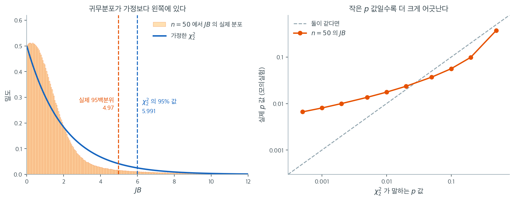

# Jarque-Bera 검정

## 개요

Jarque-Bera 검정은 자료의 두 핵심 특징인 왜도와 첨도를 평가하여 자료가 정규분포를 따르는지 판정하는 통계검정이다. 정규성이 많은 통계 모형과 방법의 결정적 가정인 계량경제학과 금융 응용에서 널리 쓰인다.

### 가설

- **귀무가설** ($H_0$): 자료가 정규분포를 따른다.
- **대립가설** ($H_1$): 자료가 정규분포를 따르지 않는다.

---

## 1. Jarque-Bera 검정통계량의 계산

검정통계량 $JB$는 다음 공식으로 계산한다.

$$
JB = \frac{n}{6} \left( S^2 + \frac{(K - 3)^2}{4} \right)
$$

여기서

- $n$은 표본크기,
- $S$는 표본왜도,
- $K$는 표본첨도,
- 분모의 6은 왜도와 첨도의 기여를 표준화하는 척도 상수이다.

### 검정통계량 계산 단계

1. **표본평균 계산**:

    $$
    \bar{X} = \frac{1}{n} \sum_{i=1}^{n} X_i
    $$

2. **표본왜도 $S$ 계산**:

    $$
    S = \frac{1}{n} \sum_{i=1}^{n} \left( \frac{X_i - \bar{X}}{\sigma} \right)^3
    $$

    여기서 $\sigma^2$은 표본분산이다.

    $$
    \sigma^2 = \frac{1}{n} \sum_{i=1}^{n} (X_i - \bar{X})^2
    $$

3. **표본첨도 $K$ 계산**:

    $$
    K = \frac{1}{n} \sum_{i=1}^{n} \left( \frac{X_i - \bar{X}}{\sigma} \right)^4
    $$

4. **Jarque-Bera 통계량 $JB$ 계산**:

    $$
    JB = \frac{n}{6} \left( S^2 + \frac{(K - 3)^2}{4} \right)
    $$

    이 통계량은 왜도의 제곱과 첨도가 3(정규분포의 첨도)에서 벗어난 정도의 제곱을 표본크기 $n$으로 가중하여 결합한다.

!!! note "적률에는 $1/n$을 쓴다"
    위의 $\sigma^2$은 $1/(n-1)$이 아니라 $1/n$로 나눈 편향된 표본분산이다. `scipy.stats.skew`, `scipy.stats.kurtosis`, `scipy.stats.jarque_bera`가 모두 이 규약을 쓰므로, 손으로 계산한 값과 라이브러리 값을 맞추려면 이 규약을 따라야 한다.

---

## 2. p값 유도

Jarque-Bera 검정통계량 $JB$는 귀무가설 아래에서 자유도 2인 카이제곱($\chi^2$) 분포를 따른다(왜도와 첨도라는 두 성분으로 계산하기 때문이다). $p$값을 얻으려면

1. 계산한 $JB$ 통계량을 자유도 2인 카이제곱분포의 임계값과 비교한다.

2. **$p$값**은 귀무가설($H_0$)이 참이라는 가정 아래에서 검정통계량 $JB$가 관측값만큼 또는 그보다 더 극단적일 확률이다.

    - $p$값이 작으면(보통 유의수준 $\alpha = 0.05$ 미만) 자료가 정규성에서 유의하게 벗어남을 시사하며 귀무가설을 기각한다.
    - $p$값이 크면 귀무가설을 기각할 증거가 부족하다는 뜻이며, 자료가 정규분포에서 왔을 수 있다.

### 판정 규칙

- $p$값이 유의수준 $\alpha$(예: 0.05)보다 작으면 $H_0$을 기각하고 자료가 정규분포를 따르지 않는다고 결론짓는다.
- $p$값이 $\alpha$ 이상이면 $H_0$을 기각하지 못하며 자료가 정규분포를 따를 수 있다고 결론짓는다.

### 해석

- **$JB$ 통계량이 크면** 자료의 왜도나 첨도(또는 둘 다)가 정규분포에서 유의하게 벗어났다는 뜻이다.
- **$JB$ 통계량이 작으면** 표본자료의 왜도와 첨도가 정규분포와 일관된다는 뜻이다.

<div class="exbox" markdown>

**보기 1.** <span class="diff easy" title="쉬움"></span> JB 통계량을 정의대로 구하기. $\mathcal{N}(0,1)$에서 $n = 1000$개를 뽑아 위 공식을 손으로 계산한다.

**(1)** 공식의 $S$와 $K$에 들어갈 표본적률은 **어느 판본**인가. 그 판본으로 계산한 값이 `scipy.stats.jarque_bera`와 일치함을 수로 확인하시오. 보정판 $G_1$, $G_2$를 넣으면 무엇이 달라지는가.

**(2)** $\chi^2_2$의 생존함수가 닫힌 꼴임을 이용해 $p$값을 $JB$만의 함수로 쓰시오. 그 식이 `scipy`가 돌려준 $p$값과 몇 자리까지 맞는가.

</div>

??? success "풀이"

    **(1) 판본은 비보정 $1/n$ 적률이다.** 중심적률을 $m_k = \frac1n\sum(x_i - \bar x)^k$라 두면

    $$
    S = g_1 = \frac{m_3}{m_2^{3/2}}, \qquad K - 3 = g_2 = \frac{m_4}{m_2^{2}} - 3
    $$

    이고, 이것이 `scipy.stats.skew`와 `scipy.stats.kurtosis`의 **기본값**(`bias=True`, 첨도는 `fisher=True`)이 돌려주는 값이다. `scipy.stats.jarque_bera`도 같은 규약을 쓰므로 둘이 맞아떨어진다. 곧 공식은

    $$
    JB = \frac{n}{6}\left(g_1^2 + \frac{g_2^2}{4}\right)
    $$

    로 읽어야 한다. 이 표본에서 재면 $m_3/m_2^{3/2} = 0.0338590$, $m_4/m_2^2 = 2.953234$이므로 $g_1 = 0.0338590$, $g_2 = -0.0467663$이고

    $$
    JB = \frac{1000}{6}\left(0.0338590^2 + \frac{(-0.0467663)^2}{4}\right) = 0.191071 + 0.091129 = 0.282200
    $$

    이다. 왜도항이 $0.191$, 첨도항이 $0.091$로 둘 다 작다. 정규 자료이니 당연한 결과다.

    **보정판을 넣으면 답이 달라진다.** 같은 표본에서 $G_1 = 0.0339098$, $G_2 = -0.0409769$이고 이것으로 계산하면 $JB = 0.261609$다. 통계량이 7% 작아지는데, $n = 1000$에서도 그 정도 차이가 난다. $JB$는 **$g$ 판본으로 정의된 통계량**이므로 $G$ 판본을 넣으면 그것은 더 이상 자크–베라 통계량이 아니다. 어느 판본인지 밝히지 않으면 수가 맞지 않는다.

    **(2) $p$값은 지수함수 한 번으로 끝난다.** 자유도 2인 카이제곱의 밀도는

    $$
    f(x) = \frac{1}{2^{k/2}\Gamma(k/2)}\,x^{k/2 - 1}e^{-x/2} \bigg|_{k=2} = \frac{1}{2}e^{-x/2}, \qquad x > 0
    $$

    곧 평균 2인 지수분포다. 그러므로 생존함수가 $P(\chi^2_2 > x) = e^{-x/2}$이고

    $$
    p = e^{-JB/2}
    $$

    이다. $JB = 0.2822002$를 넣으면 $p = e^{-0.1411001} = 0.8684024$다.

    ```python
    import numpy as np
    from scipy import stats

    np.random.seed(0)

    n = 1000

    # 주석을 바꿔 가며 정규와 지수를 견주어 볼 수 있다.
    data = np.random.normal(0, 1, n)
    # data = np.random.exponential(1, n)

    # JB 통계량을 정의대로 구한다. 왜도의 제곱과 초과첨도의 제곱을 더하되
    # 첨도 쪽에 1/4 을 곱한다. 정규라면 둘 다 0 이므로 JB 도 0 에 가깝다.
    skewness_value = stats.skew(data)
    kurtosis_value = stats.kurtosis(data)
    JB = n / 6 * (skewness_value**2 + kurtosis_value**2 / 4)
    print(f"{JB = }")

    # scipy 의 결과와 맞는지 확인한다. JB 는 자유도 2 인 카이제곱을 따르지만,
    # 그 근사는 표본이 아주 클 때라야 쓸 만하다.
    stat, p_value = stats.jarque_bera(data)
    print(f"Jarque-Bera Test: Statistic={stat}, p-value={p_value}")

    alpha = 0.05
    if p_value <= alpha:
        print("Reject H_0: The data is not normally distributed.")
    else:
        print("Fail to reject H_0: The data is normally distributed.")
    ```

    출력:

    ```text
    JB = 0.28220016508625234
    Jarque-Bera Test: Statistic=0.28220016508625234, p-value=0.8684023954281485
    Fail to reject H_0: The data is normally distributed.
    ```

    손으로 계산한 $JB = 0.28220016508625234$가 `scipy.stats.jarque_bera`의 값과 **마지막 자리까지** 같다. $e^{-JB/2}$ 역시 $0.8684023954281485$로 `scipy`의 $p$값과 끝까지 일치한다(배정도 한계인 16자리). `stats.kurtosis`가 이미 **초과**첨도 $K - 3$을 돌려주므로 코드의 `kurtosis_value**2 / 4`가 공식의 $(K-3)^2/4$에 해당한다는 점에 유의하라. 3을 한 번 더 빼면 안 된다.

    한 가지 단서를 달아 두어야 한다. $p = e^{-JB/2}$는 **$\chi^2_2$에 대해서는 정확하다.** 그러나 "$JB$가 $\chi^2_2$를 따른다"는 것 자체가 점근적 주장이어서, 그 근사가 어긋나면 이 깔끔한 식도 어긋난 값을 준다. 바로 아래에서 $n = 50$일 때 95백분위가 $\chi^2_2$의 $5.991$이 아니라 $4.97$임을 보인다. $n = 1000$인 이 보기에서는 근사가 쓸 만하다.

---

## 3. 카이제곱 근사는 얼마나 맞는가

"$JB$는 귀무가설 아래에서 $\chi^2_2$를 따른다"는 문장에는 보이지 않는 단서가 하나 붙어 있다. **점근적으로** 그렇다는 것이다. $n$이 얼마나 커야 그 말을 믿을 수 있을까. 아래는 진짜 정규자료에서 $n = 50$짜리 표본을 240만 번 뽑아 $JB$를 계산한 결과이다.



왼쪽 칸을 보라. 주황 히스토그램(실제 분포)과 파란 곡선($\chi^2_2$)이 모양부터 다르다. $\chi^2_2$은 0에서 밀도가 가장 높은 지수분포인데, 실제 $JB$의 분포는 $0.3$ 근처에 봉우리를 갖는다. 기각 판정에 쓰이는 95백분위는 $4.97$로, $\chi^2_2$이 말하는 $5.991$보다 한참 작다. 다시 말해 $5.991$을 임계값으로 쓰면 실제 유의수준이 $0.0371$이 된다. 5%라고 약속한 검정이 3.7%로 굴러가고, 그만큼 검정력을 잃는다.

오른쪽 칸은 같은 사실을 $p$값의 언어로 옮긴 것이다. 가로축은 `scipy`가 $\chi^2_2$에서 읽어 내놓는 $p$값이고, 세로축은 모의실험으로 잰 **진짜** $p$값이다. 둘이 같다면 점들이 파선 위에 놓여야 한다. 실제로는 곡선이 파선을 가로지른다. $p = 0.05$ 언저리에서는 곡선이 파선 아래에 있어 검정이 보수적이지만, 작은 $p$값 쪽으로 갈수록 곡선이 파선 위로 크게 벌어진다. $\chi^2_2$이 $p = 0.001$이라고 말할 때 실제 확률은 $0.0080$, 곧 **여덟 배**다. $p = 0.0005$에서는 $0.0066$으로 열세 배가 된다.

실무적 교훈은 두 가지다. 첫째, 중간 크기 표본에서 $JB$가 내놓는 매우 작은 $p$값을 액면 그대로 읽지 말라. $p = 10^{-6}$ 같은 숫자는 근사가 가장 못 미더운 영역에서 나온 것이다. 둘째, 기각 여부 자체가 중요한 상황이라면 $n$이 수백 이하일 때는 $\chi^2_2$ 임계값 대신 모의실험으로 만든 임계값을 쓰거나, 유한표본 보정이 들어간 D'Agostino $K^2$을 쓰는 편이 낫다. 다음 절에서 두 검정의 차이를 자세히 본다.

---

## 4. Jarque-Bera 검정과 D'Agostino의 K 제곱 검정

Jarque-Bera 검정은 D'Agostino의 $K^2$ 검정의 근사가 **아니다**. 두 검정 모두 왜도와 첨도를 살펴 정규성을 평가하지만 검정통계량을 계산하는 방식이 근본적으로 다르다.

### 핵심 차이

**Jarque-Bera 검정**:

- 표본의 **왜도**와 **첨도**를 직접 써서 검정통계량을 계산한다.
- 검정통계량은

    $$
    JB = \frac{n}{6} \left( S^2 + \frac{(K - 3)^2}{4} \right)
    $$

- 왜도와 첨도를 하나의 검정통계량으로 결합하며, 귀무가설 아래에서 자유도 2인 카이제곱분포를 따른다고 가정한다.

**D'Agostino의 $K^2$ 검정**:

- 왜도와 첨도를 각각 독립적인 **Z 점수**로 변환한다.
    - **$Z_{\text{skewness}}$**: 표본왜도를 정규화하는 변환.
    - **$Z_{\text{kurtosis}}$**: 표본첨도를 정규화하는 변환.
- 검정통계량은

    $$
    K^2 = Z_{\text{skewness}}^2 + Z_{\text{kurtosis}}^2
    $$

- Jarque-Bera와 마찬가지로 $K^2$도 자유도 2인 카이제곱분포를 따르지만, D'Agostino 검정은 왜도와 첨도에 각각 별도의 변환을 적용하므로 정규성 이탈에 더 로버스트하고 민감하다.

### 왜 서로 다른가

- **접근 방식의 차이**: Jarque-Bera 검정은 원래의 왜도와 첨도 값에 기초한 단순하고 직접적인 공식을 쓰는 반면, D'Agostino의 $K^2$ 검정은 표본크기를 반영하고 왜도·첨도의 분포를 정규화하는 변환을 적용한다.

- **검정통계량의 구성**: Jarque-Bera는 왜도와 첨도를 곧바로 하나의 통계량으로 결합하지만, D'Agostino 검정은 둘을 분리하여 각각을 개별 검정통계량으로 변환한 뒤 제곱하여 더한다.

- **민감도**: D'Agostino의 $K^2$ 검정이 특히 표본이 클 때 정규성 이탈에 더 민감하다. Z 변환 덕분에 표본크기가 커질수록 정확해지는 반면, Jarque-Bera는 작은 표본에서 성능이 나빠지거나 꼬리 이탈에 덜 민감할 수 있다.

### 결론

Jarque-Bera 검정은 D'Agostino의 $K^2$ 검정을 근사하는 것이 아니다. 둘은 서로 다른 통계적 토대를 가진 별개의 정규성 검정 방법이다. 두 검정 모두 왜도와 첨도를 쓰지만, D'Agostino 검정은 변환 기반 접근 덕분에 더 로버스트한 것으로 평가되고 Jarque-Bera는 더 단순하며 계량경제학에서 흔히 쓰인다.

---

## 연습문제

<div class="drillbox" markdown>

**연습문제 1.** <span class="diff easy" title="쉬움"></span>
Jarque-Bera 검정으로 자료의 정규성을 검정하는 통계량 $JB$는 다음과 같이 정의된다.

$$
JB = \frac{n}{6} \left( S^2 + \frac{(K - 3)^2}{4} \right) \sim \chi^2_2
$$

여기서

- $n$: 표본크기
- $S$: 표본왜도
- $K$: 표본첨도
- 분모의 $6$은 왜도와 첨도의 기여를 표준화하는 척도 상수이다.

**(a)** 정규분포에서 $S$의 이론값을 구하라.

**(b)** 적분 $\int_{-\infty}^\infty x^4 e^{-x^2} dx$를 계산하라.

**(c)** $JB$를 계산할 때 왜 $K$에서 $3$을 빼는가?

**(d)** $JB = 3.2189$일 때 $\chi^2_2$의 누적분포함수 $F$로 $p$값을 표현하라.

**(e)** $p$값이 0.2이고 유의수준($\alpha$)이 5%라면 검정의 결론은 무엇인가?

</div>

??? success "풀이"

    **(a)** 정규분포에서 이론적 왜도 $S$는

    $$
    S = \mathbb{E}\left(\frac{X - \mu}{\sigma}\right)^3 = \mathbb{E}Z^3 = \int_{-\infty}^\infty x^3 \cdot \frac{1}{\sqrt{2\pi}} e^{-x^2/2} dx = 0
    $$

    피적분함수가 기함수이므로 적분이 0이다.

    **(b)**

    $$
    I
    = \int_{-\infty}^\infty x^4 e^{-x^2} dx
    = 2 \int_0^\infty x^4 e^{-x^2} dx
    $$

    $u = x^2$로 두면 $x = u^{1/2}$, $dx = \frac{1}{2} u^{-1/2} du$이므로 적분은

    $$
    I
    = 2 \int_0^\infty (u^{1/2})^4 e^{-u} \cdot \frac{1}{2} u^{-1/2} du
    = \int_0^\infty u^{\frac{5}{2}-1} e^{-u} du
    = \Gamma\left(\frac{5}{2}\right)
    = \frac{3}{2}\cdot\Gamma\left(\frac{3}{2}\right)
    = \frac{3}{2}\cdot\frac{1}{2}\cdot\Gamma\left(\frac{1}{2}\right)
    = \frac{3}{4}\sqrt{\pi} \approx 1.3293
    $$

    여기서 감마함수는 다음으로 정의된다.

    $$
    \Gamma(n) = \int_0^\infty x^{n-1} e^{-x} dx
    $$

    감마함수는 다음을 만족한다.

    $$
    \Gamma(n+1) = n \cdot \Gamma(n),\quad
    \Gamma\left(\frac{1}{2}\right)=\sqrt{\pi}
    $$

    **(c)** 정규분포의 이론적 첨도 $K$는 $3$이다. $3$을 빼면 정규 자료에서 $K - 3 = 0$이 된다. 그러면 정규성이라는 귀무가설 아래에서 검정통계량이 간단해진다.

    **(d)** $p$값은

    $$
    p = 1 - F(3.2189)
    $$

    $\chi^2_2$의 누적분포함수가 $F(x) = 1 - e^{-x/2}$이므로 $p = e^{-3.2189/2} = e^{-1.60945} = 0.2000$이다.

    **(e)** $p = 0.2 > \alpha = 0.05$이므로 귀무가설을 기각할 증거가 부족하다. 따라서 주어진 유의수준에서 자료가 정규성을 위배하지 않으며 정규성 가정을 유지한다고 결론짓는다.

<div class="drillbox" markdown>

**연습문제 2.** <span class="diff med" title="중간"></span>
**Jarque-Bera 검정이 소표본과 대표본에서 각각 어떻게 행동하는지** 모의실험으로 확인하라. 샤피로–윌크 검정과 견주어 보라.

</div>

??? success "풀이"
    Jarque-Bera 통계량은 표본 왜도 $S$와 초과첨도 $K$를 결합한다.

    $$
    \text{JB} = \frac{n}{6}\left(S^2 + \frac{K^2}{4}\right) \;\xrightarrow{d}\; \chi^2_2
    $$

    정규분포에서 $S$와 $K$가 각각 $0$이어야 한다는 사실을 쓴 것이다.

    ```python
    import numpy as np
    from scipy import stats

    rng = np.random.default_rng(1)

    print("정규 자료에서의 1종 오류율 (명목 0.05)")
    for n in (20, 50, 200, 1000, 5000):
        jb = np.mean([stats.jarque_bera(rng.normal(0, 1, n))[1] < 0.05 for _ in range(5000)])
        sw = np.mean([stats.shapiro(rng.normal(0, 1, n))[1] < 0.05 for _ in range(5000)])
        print(f"  n={n:>5}: JB {jb:.4f}   샤피로–윌크 {sw:.4f}")

    print("\nt(10) 자료를 정규가 아니라고 판정할 확률 (검정력)")
    for n in (20, 50, 200, 1000):
        jb = np.mean([stats.jarque_bera(rng.standard_t(10, n))[1] < 0.05 for _ in range(3000)])
        sw = np.mean([stats.shapiro(rng.standard_t(10, n))[1] < 0.05 for _ in range(3000)])
        print(f"  n={n:>5}: JB {jb:.4f}   샤피로–윌크 {sw:.4f}")
    ```

    출력:

    ```
    정규 자료에서의 1종 오류율 (명목 0.05)
      n=   20: JB 0.0228   샤피로–윌크 0.0478
      n=   50: JB 0.0408   샤피로–윌크 0.0458
      n=  200: JB 0.0400   샤피로–윌크 0.0484
      n= 1000: JB 0.0512   샤피로–윌크 0.0494
      n= 5000: JB 0.0524   샤피로–윌크 0.0468

    t(10) 자료를 정규가 아니라고 판정할 확률 (검정력)
      n=   20: JB 0.0843   샤피로–윌크 0.1037
      n=   50: JB 0.1837   샤피로–윌크 0.1650
      n=  200: JB 0.4500   샤피로–윌크 0.3483
      n= 1000: JB 0.9350   샤피로–윌크 0.8967
    ```

    **소표본에서 JB는 신뢰할 수 없다.** $n = 20$에서 1종 오류율이 $0.023$으로 명목의 절반이다. $\chi^2_2$ 근사가 $S$와 $K$의 느린 수렴 때문에 작은 $n$에서 나쁘기 때문이다. 샤피로–윌크는 모든 $n$에서 $0.05$를 지킨다.

    **검정력은 $n$이 커지면 JB가 앞선다.** $t(10)$에 대해 $n = 200$에서 $0.450$ 대 $0.348$이다. JB는 꼬리(첨도)를 직접 겨냥하므로 두꺼운 꼬리 이탈에 민감하다. 반면 **소표본에서는 검정력조차 낮다**($n = 20$에서 $0.084$).

    **더 근본적인 문제는 대표본이다.**

    ```python
    import numpy as np
    from scipy import stats

    rng = np.random.default_rng(1)

    def tiny(n):
        """98% 는 N(0,1), 2% 는 N(0,2). 실질적으로는 정규와 다를 바 없다."""
        m = rng.random(n) < 0.02
        return np.where(m, rng.normal(0, 2.0, n), rng.normal(0, 1, n))

    x = tiny(2_000_000)
    print(f"이 분포: 왜도 {stats.skew(x):+.4f}   초과첨도 {stats.kurtosis(x):+.4f}")
    print("\n표본이 커지면 이 정도 이탈도 반드시 기각된다")
    for n in (100, 1000, 10_000, 100_000):
        r = np.mean([stats.jarque_bera(tiny(n))[1] < 0.05 for _ in range(400)])
        print(f"  n={n:>7}: 기각률 {r:.4f}")
    ```

    출력:

    ```
    이 분포: 왜도 +0.0016   초과첨도 +0.4599

    표본이 커지면 이 정도 이탈도 반드시 기각된다
      n=    100: 기각률 0.1425
      n=   1000: 기각률 0.5525
      n=  10000: 기각률 1.0000
      n= 100000: 기각률 1.0000
    ```

    **초과첨도가 $0.46$에 불과한 이 분포가 $n = 10000$에서 $100\%$ 기각된다.** 실무적으로는 정규와 구별할 이유가 없는 자료인데도 그렇다.

    **이것이 표본크기와 유의성의 일반적인 문제가 정규성 검정에 나타난 것이다.** 정규성 검정은 "정확히 정규인가"를 묻는데, 현실의 자료가 정확히 정규인 경우는 없다. $n$이 크면 어떤 검정이든 반드시 기각한다.

    !!! tip "정규성은 검정하지 말고 진단하라"
        - **소표본**: 검정력이 없어 기각하지 못한다. "기각되지 않았다"가 "정규다"를 뜻하지 않는다.
        - **대표본**: 무의미한 이탈도 기각한다. "기각되었다"가 "문제가 있다"를 뜻하지 않는다.
        - **어느 쪽이든 쓸모없는 구간이 있다.**

        올바른 질문은 "정규인가"가 아니라 **"내가 쓰려는 방법이 이 정도 이탈에 견디는가"** 이다. 표본평균의 추론은 중심극한정리 덕분에 상당한 이탈에도 견디고, 예측구간이나 극단 분위수는 훨씬 민감하다.

        그러므로 **Q-Q 그림을 그려 어디서 얼마나 벗어나는지 보는 것**이 $p$ 값 하나보다 언제나 많은 정보를 준다. 이 장 [Q-Q 그림](../graphical_methods/qq_plots.md) 절이 그 목적을 위한 것이다. $\square$

<div class="drillbox" markdown>

**연습문제 3.** <span class="diff med" title="중간"></span>
§2 는 $p = e^{-JB/2}$ 라는 닫힌 꼴을 얻었고, §3 은 $n = 50$ 에서 그 식이 어긋나는 모습을 모의실험으로 보였다. 두 결과를 맞물려 보자.

**(a)** 유의수준 $\alpha$ 에서 $H_0$ 을 기각하는 $JB$ 의 임계값을 $\alpha$ 의 함수로 쓰고, $\alpha = 0.05,\ 0.01,\ 0.001$ 에 대해 값을 구하라.

**(b)** §3 은 $n = 50$ 에서 $JB$ 의 참 95 백분위가 $4.97$ 이라고 했다. `scipy` 가 돌려주는 $p$ 값을 그대로 쓰면서 실제 유의수준을 $0.05$ 로 맞추려면 그 $p$ 를 어느 문턱과 견주어야 하는가.

**(c)** §3 은 또 $\chi^2_2$ 가 $p = 0.001$ 이라 말할 때 참 확률은 $0.0080$ 이라고 했다. (b) 의 "$4.97 < 5.991$" 과 이 사실을 각각 "참 귀무분포와 $\chi^2_2$ 가운데 어느 쪽 꼬리가 무거운가" 로 번역하라. 두 답이 서로 모순이 아닌 까닭을 말하고, $n = 50$ 에서 $JB$ 의 참 $99.9$ 백분위가 $13.82$ 보다 큰지 작은지 답하라.

</div>

??? success "풀이"

    **(a)** $p = e^{-JB/2}$ 는 $JB$ 의 감소함수이므로

    $$
    p < \alpha \iff e^{-JB/2} < \alpha \iff JB > -2\ln\alpha
    $$

    이다. 곧 임계값은 $c(\alpha) = -2\ln\alpha$ 이고

    | $\alpha$ | $c(\alpha) = -2\ln\alpha$ |
    |---|---|
    | $0.05$ | $5.9915$ |
    | $0.01$ | $9.2103$ |
    | $0.001$ | $13.8155$ |

    이다. $\chi^2_2$ 표를 찾을 일이 없다. 자유도 2 의 카이제곱이 평균 2 인 지수분포이므로 분위수가 로그 한 번으로 나온다.

    **(b)** 실제 유의수준을 $0.05$ 로 맞추려면 $JB > 4.97$ 일 때 기각해야 한다. 이것을 $p$ 의 언어로 옮기면

    $$
    JB > 4.97 \iff p = e^{-JB/2} < e^{-4.97/2} = e^{-2.485} = 0.0833
    $$

    이다. 곧 `scipy` 의 $p$ 값을 $0.05$ 가 아니라 **$0.083$** 과 견주어야 한다. 거꾸로 $0.05$ 와 견주면 실제 유의수준은 §3 이 말한 $0.0371$ 로 내려간다.

    **(c)** 두 사실은 서로 다른 지점에서의 꼬리확률을 말한다.

    - $x = 5.9915$ 에서 $\chi^2_2$ 의 꼬리는 $0.05$, 참 꼬리는 $0.0371$ 이다. 그 자리에서는 참 분포의 꼬리가 **가볍다**.
    - $x = 13.8155$ 에서 $\chi^2_2$ 의 꼬리는 $0.001$, 참 꼬리는 $0.0080$ 이다. 그 자리에서는 참 분포의 꼬리가 **여덟 배 무겁다**.

    모순이 아니다. 두 생존함수의 대소는 점마다 다를 수 있고, 여기서는 두 곡선이 $5.99$ 와 $13.82$ 사이 어딘가에서 **교차**할 뿐이다. §3 이 말한 모양의 차이가 그 교차의 원인이다. 참 분포는 $0.3$ 근처에 봉우리를 갖는 반면 $\chi^2_2$ 는 $0$ 에서 밀도가 가장 높으므로, 참 분포는 가운데로 질량이 몰리고 그 대가로 아주 먼 꼬리가 두꺼워진다.

    $99.9$ 백분위는 $13.82$ **보다 크다**. $P(JB > 13.8155) = 0.0080 > 0.001$ 이니 $0.1\%$ 를 남기려면 문턱을 더 올려야 한다.

    한 번의 근사 오차가 중간 꼬리에서는 보수적으로, 먼 꼬리에서는 반대 방향으로 작용한다. 그래서 "소표본의 $JB$ 는 보수적이다" 와 "소표본 $JB$ 의 아주 작은 $p$ 값을 믿지 말라" 가 둘 다 참이다.

<div class="drillbox" markdown>

**연습문제 4.** <span class="diff med" title="중간"></span>
연습문제 3 의 답을 직접 모의실험으로 확인하라. $n = 50$ 인 정규자료에서 $JB$ 를 200 만 번 모의하여

**(a)** 명목 $\alpha = 0.05,\ 0.01,\ 0.001,\ 0.0005$ 에 해당하는 $\chi^2_2$ 임계값 $-2\ln\alpha$ 에서 참 꼬리확률을 재고,

**(b)** 참 95 백분위와 그에 대응하는 $p$ 문턱을 구하라.

그 결과로 생존함수가 뒤집히는 구간을 좁히고, §3 에 적힌 수치($0.0371$, $0.0080$, $0.0066$, $4.97$)와 맞는지 보라. 200 만 번이 $0.0066$ 같은 작은 확률을 네 자리까지 말하기에 충분한지도 따져라.

</div>

??? success "풀이"

    `scipy.stats.jarque_bera` 를 200 만 번 부르면 오래 걸리므로 $(반복, n)$ 모양의 배열에서 중심적률을 한꺼번에 구한다. $JB$ 의 정의가 $1/n$ 적률뿐이므로 그대로 벡터화된다.

    ```python
    import numpy as np
    from scipy import stats

    rng = np.random.default_rng(0)
    n = 50


    def jb_rows(x):
        """행마다 JB 통계량을 구한다. x 의 모양은 (반복, n)."""
        d = x - x.mean(axis=1, keepdims=True)
        m2 = (d**2).mean(axis=1)
        g1 = (d**3).mean(axis=1) / m2**1.5
        g2 = (d**4).mean(axis=1) / m2**2 - 3
        return x.shape[1] / 6 * (g1**2 + g2**2 / 4)


    # 진짜 정규자료에서 JB 의 귀무분포를 200 만 번 모의한다.
    jb = np.concatenate([jb_rows(rng.normal(0, 1, (25_000, n))) for _ in range(80)])

    for a in (0.05, 0.01, 0.001, 0.0005):
        c = -2 * np.log(a)                 # chi2_2 의 상위 a 분위수
        print(f"명목 {a:<7} 임계값 {c:7.4f}   실제 꼬리확률 {np.mean(jb > c):.4f}")

    print(f"\n실제 95 백분위       {np.percentile(jb, 95):.4f}")
    print(f"그에 대응하는 p 문턱 {np.exp(-np.percentile(jb, 95) / 2):.4f}")
    print(f"chi2_2 의 95 백분위  {stats.chi2.ppf(0.95, 2):.4f}")
    ```

    출력:

    ```text
    명목 0.05    임계값  5.9915   실제 꼬리확률 0.0371
    명목 0.01    임계값  9.2103   실제 꼬리확률 0.0176
    명목 0.001   임계값 13.8155   실제 꼬리확률 0.0080
    명목 0.0005  임계값 15.2018   실제 꼬리확률 0.0066

    실제 95 백분위       4.9705
    그에 대응하는 p 문턱 0.0833
    chi2_2 의 95 백분위  5.9915
    ```

    **(a)** $0.0371$, $0.0080$, $0.0066$ 이 §3 의 수치와 네 자리까지 같다. $0.0176$ 은 §3 에 없던 수인데, 이것이 교차 구간을 좁혀 준다. $\alpha = 0.05$ 에서는 참 확률 $0.0371 < 0.05$ 로 아직 뒤집히지 않았고, $\alpha = 0.01$ 에서는 이미 $0.0176 > 0.01$ 로 뒤집혔다. 곧 **두 생존함수는 $JB = 5.9915$ 와 $9.2103$ 사이에서 교차한다.**

    **(b)** 참 95 백분위가 $4.9705$, 그에 대응하는 $p$ 문턱이 $0.0833$ 으로 연습문제 3(b) 의 손계산과 맞는다. $\chi^2_2$ 가 말하는 $5.9915$ 보다 $17\%$ 낮다.

    **반복 횟수는 충분한가.** $\hat p = 0.0066$ 의 표준오차는

    $$
    \sqrt{\frac{0.0066 \times 0.9934}{2\,000\,000}} = 5.7 \times 10^{-5}
    $$

    이므로 네 자리째가 $\pm 1$ 안에서 뜻을 갖는다. 반복을 2000 번으로 줄이면 표준오차가 $0.0018$ 이 되어 $0.0066$ 과 $0.001$ 을 구별조차 못 한다. 작은 기각률을 재려면 반복 횟수가 확률의 역수보다 훨씬 커야 한다.

    같은 하나의 근사가 $\alpha = 0.05$ 에서는 검정을 보수적으로 만들고 $\alpha = 0.001$ 에서는 여덟 배 낙관적으로 만든다. "$JB \sim \chi^2_2$" 를 어느 분위수에서 쓰는지가 오차의 부호까지 바꾼다.

<div class="drillbox" markdown>

**연습문제 5.** <span class="diff med" title="중간"></span>
연습문제 2 가 쓴 혼합분포를 다시 본다. 확률 $0.98$ 로 $\mathcal{N}(0,1)$, 확률 $0.02$ 로 $\mathcal{N}(0,2^2)$ 에서 뽑는 분포다.

**(a)** 이 분포의 $\gamma_1$, $\mu_2$, $\mu_4$, $\beta_2$, 초과첨도를 정확히 구하라.

**(b)** 표본적률이 모집단값과 정확히 같다고 가정하면, $\alpha = 0.05$ 에서 기각되기 시작하는 가장 작은 표본크기 $n$ 은 얼마인가. 일반적으로 $(\gamma_1, \beta_2)$ 가 주어졌을 때의 공식을 먼저 쓰라.

**(c)** 연습문제 2 의 출력은 기각률이 $n = 100$ 에서 $0.1425$, $n = 1000$ 에서 $0.5525$ 였다. (b) 가 준 $n$ 에서 기각률이 $1/2$ 이 되지 않는 까닭을 표본 초과첨도 $g_2$ 의 표집분포 모양으로 설명하라. 그 기각률은 $1/2$ 보다 큰가 작은가.

**(d)** 연습문제 2 는 200 만 개 표본에서 초과첨도를 $0.4599$ 로 재었다. (a) 의 정확한 값과 $2\%$ 어긋난다. 200 만 개를 써도 그만큼 어긋날 수 있는 까닭을 말하라.

</div>

??? success "풀이"

    **(a)** 두 성분이 모두 평균 $0$ 이고 좌우대칭이므로 홀수 적률이 모두 $0$ 이고 $\gamma_1 = 0$ 이다. 혼합분포의 적률은 성분 적률의 가중평균이므로

    $$
    \mu_2 = 0.98 \times 1 + 0.02 \times 4 = 1.06, \qquad \mu_4 = 0.98 \times 3 + 0.02 \times 3 \times 16 = 3 \times 1.3 = 3.9
    $$

    이다($\mathcal{N}(0,\sigma^2)$ 의 4 차 적률이 $3\sigma^4$ 임을 썼다). 따라서

    $$
    \beta_2 = \frac{3.9}{1.06^2} = \frac{3.9}{1.1236} = 3.470986, \qquad g_2 = \beta_2 - 3 = 0.470986
    $$

    이다. 분산이 $6\%$ 늘어난 대가로 첨도가 $0.47$ 올라갔다.

    **(b)** 표본적률이 모집단값과 같다면

    $$
    JB = \frac{n}{6}\left(\gamma_1^2 + \frac{(\beta_2 - 3)^2}{4}\right) > c(\alpha) \iff n > \frac{6\,c(\alpha)}{\gamma_1^2 + (\beta_2-3)^2/4}
    $$

    이다. 이 분포에서는 $\gamma_1 = 0$, $(\beta_2-3)^2/4 = 0.470986^2/4 = 0.0554571$ 이므로

    $$
    n > \frac{6 \times 5.991465}{0.0554571} = \frac{35.94879}{0.0554571} = 648.23
    $$

    곧 $n = 649$ 부터다. $JB$ 가 $n$ 에 **비례**하므로, 이탈의 크기가 아무리 작아도 $n$ 을 그 역수만큼 키우면 반드시 유의해진다. 연습문제 2 의 교훈이 공식 한 줄로 나타난 것이다.

    **(c)** (b) 의 계산은 $g_2$ 를 그 모집단값 $0.4710$ 으로 **고정**한 것이다. 실제로는 $g_2$ 가 표본마다 흔들리므로 $n = 649$ 에서의 기각률은 $P(g_2^2 > 0.4710^2)$ 꼴의 확률이 되고, 그것이 $1/2$ 이 되려면 $g_2$ 의 **중앙값**이 $0.4710$ 이어야 한다. 그런데 꼬리가 두꺼운 혼합분포에서 $g_2$ 의 표집분포는 오른쪽으로 길게 늘어진다. $g_2$ 를 끌어올리는 것은 $2\%$ 성분에서 나온 몇 개의 큰 관측인데, 그런 관측이 평균보다 적게 들어오는 표본이 절반보다 많고 가끔 많이 들어온 표본이 $g_2$ 를 크게 밀어올려 평균을 맞춘다. 따라서

    $$
    \text{중앙값}(g_2) < \mathbb{E}(g_2) \approx 0.4710
    $$

    이고 $n = 649$ 에서의 기각률은 **$1/2$ 보다 작다.** 연습문제 2 의 출력과도 맞는다. 기각률이 $0.5525$ 로 $1/2$ 을 넘는 것은 $n = 1000$ 에서이고, 이는 $649$ 보다 한참 큰 값이다. (b) 의 공식은 필요한 표본크기의 **낙관적인 하한**으로 읽어야 한다.

    **(d)** $g_2$ 의 표집 표준편차는 모집단의 **8 차** 적률까지 걸려 있다. 이 분포에서

    $$
    \mu_8 = 0.98 \times 105 + 0.02 \times 105 \times 2^8 = 102.9 + 537.6 = 640.5
    $$

    로 정규분포의 $105$ 보다 여섯 배 크다. 정규자료라면 $\mathrm{sd}(g_2) \approx \sqrt{24/n} = 0.0035$ 지만 이 분포에서는 그 몇 배인 $0.01$ 대가 되고, 관측된 어긋남 $0.4710 - 0.4599 = 0.011$ 은 그 한 표준편차 정도에 지나지 않는다.

    첨도 추정은 느리다. 자료가 두꺼운 꼬리를 가질 때 더욱 그렇다. 바로 그 두꺼운 꼬리를 재려고 첨도를 쓰는데, 재려는 대상이 추정의 정밀도를 망가뜨리는 구조다.

<div class="drillbox" markdown>

**연습문제 6.** <span class="diff hard" title="어려움"></span>
§3 은 "5% 라고 약속한 검정이 3.7% 로 굴러가고, 그만큼 검정력을 잃는다" 고 했다. 그 손실을 수로 재라. $n = 50$ 에서 임계값을 $\chi^2_2$ 의 $5.9915$ 로 쓸 때와 연습문제 4 가 모의로 얻은 $4.9705$ 로 쓸 때의 기각률을 $\mathcal{N}(0,1)$(귀무), $t(5)$, $\mathrm{Exp}(1)$, $\mathrm{LogN}(0,0.5)$, $U(0,1)$ 에서 각각 구하라.

균일분포 줄에서 나온 수는 다른 줄과 성격이 다르다. 무엇이 이상한지 말하고, $g_2$ 가 취할 수 있는 값의 범위로 그 까닭을 설명하라. $n = 50$ 에서 $\gamma_1 = 0$ 인 대립분포가 $JB$ 에 잡히려면 $\beta_2$ 가 어느 구간에 있어야 하는가.

</div>

??? success "풀이"

    ```python
    import numpy as np

    rng = np.random.default_rng(0)
    n = 50
    c_chi2 = 5.991464547107982          # chi2_2 의 95 백분위
    c_cal = 4.9705                      # 모의로 잰 n=50 의 참 95 백분위


    def jb_rows(x):
        """행마다 JB 통계량을 구한다. x 의 모양은 (반복, n)."""
        d = x - x.mean(axis=1, keepdims=True)
        m2 = (d**2).mean(axis=1)
        g1 = (d**3).mean(axis=1) / m2**1.5
        g2 = (d**4).mean(axis=1) / m2**2 - 3
        return x.shape[1] / 6 * (g1**2 + g2**2 / 4)


    def rates(gen, reps=400_000, chunk=25_000):
        """두 임계값에서의 기각률을 같은 표본으로 잰다."""
        s = np.concatenate([jb_rows(gen(chunk)) for _ in range(reps // chunk)])
        return np.mean(s > c_chi2), np.mean(s > c_cal)


    cases = [
        ("N(0,1)   (귀무)", lambda m: rng.normal(0, 1, (m, n))),
        ("t(5)           ", lambda m: rng.standard_t(5, (m, n))),
        ("Exp(1)         ", lambda m: rng.exponential(1.0, (m, n))),
        ("LogN(0,0.5)    ", lambda m: np.exp(rng.normal(0, 0.5, (m, n)))),
        ("U(0,1)         ", lambda m: rng.random((m, n))),
    ]

    print("분포              JB>5.9915   JB>4.9705")
    for name, gen in cases:
        a, b = rates(gen)
        print(f"{name}     {a:.4f}      {b:.4f}")
    ```

    출력:

    ```text
    분포              JB>5.9915   JB>4.9705
    N(0,1)   (귀무)     0.0370      0.0498
    t(5)                0.3941      0.4296
    Exp(1)              0.9546      0.9763
    LogN(0,0.5)         0.7977      0.8448
    U(0,1)              0.0002      0.0085
    ```

    **보정은 공짜로 검정력을 준다.** 첫 줄에서 실제 유의수준이 $0.0370 \to 0.0498$ 로 제자리를 찾고, 그 대가로 검정력이 $t(5)$ 에서 $0.3941 \to 0.4296$, $\mathrm{Exp}(1)$ 에서 $0.9546 \to 0.9763$, 로그정규에서 $0.7977 \to 0.8448$ 로 $3{\sim}5$ 퍼센트포인트 오른다. 잃은 유의수준 $0.013$ 을 되찾은 것이 검정력 $0.035$ 로 돌아온 셈이다. $n$ 이 수백 이하라면 임계값을 모의로 만드는 것이 왜 남는 장사인지 보여 준다.

    **균일분포는 성격이 다르다.** 기각률이 $0.0002$ 로, 명목 유의수준 $0.05$ 는 물론 실제 유의수준 $0.0370$ 보다도 **훨씬 작다.** 정규자료보다 비정규자료를 덜 기각하는 것이니, 이 대립분포에 대해 $JB$ 는 단순히 약한 검정이 아니라 **편향된(biased)** 검정이다.

    까닭은 $g_2$ 의 범위에 있다. 연습문제 7 에서 보듯 $g_2 \ge g_1^2 - 2 \ge -2$ 이므로 평평한 쪽으로는 $g_2$ 가 $-2$ 보다 아래로 갈 수 없다. $\gamma_1 = 0$ 인 대립분포에서 $JB$ 가 쓸 수 있는 것은 첨도항뿐이고

    $$
    \frac{n}{6}\cdot\frac{g_2^2}{4} > c \iff \lvert g_2 \rvert > \sqrt{\frac{24c}{n}}
    $$

    이다. $n = 50$, $c = 5.9915$ 면 $\lvert g_2 \rvert > \sqrt{2.87592} = 1.6958$ 이 필요하다. 그런데 평평한 쪽에서 $g_2$ 가 쓸 수 있는 범위는 $[-2, 0)$ 뿐이므로, 잡히는 분포는

    $$
    \beta_2 \le 3 - 1.6958 = 1.304
    $$

    인 것들만이다. 뾰족한 쪽은 $\beta_2 \ge 3 + 1.6958 = 4.696$ 이고 위로 막힌 데가 없어 $[4.696, \infty)$ 로 열려 있다. 반면 평평한 쪽은 가능한 최소 첨도가 $\beta_2 = 1$(두 점 분포)이니 창이 $[1,\ 1.304]$ 로 아주 좁다. 곧 잡히는 구간은 $[1,\ 1.304] \cup [4.696, \infty)$ 로, 한쪽만 사실상 쓸 수 있다. 균일분포는 $\beta_2 = 1.8$, 곧 $g_2 = -1.2$ 라서 창 밖이다. 모집단값을 그대로 꽂으면 $JB = \frac{50}{6}\cdot\frac{1.2^2}{4} = 3.0$ 으로 $5.99$ 에 한참 못 미친다. 보정 임계값 $4.9705$ 를 써도 필요한 것은 $\lvert g_2\rvert > 1.5447$, 곧 $\beta_2 \le 1.455$ 여서 역시 균일분포는 잡히지 않는다.

    게다가 균일분포에서는 $g_2$ 의 표집분포가 좁다. 표준화 적률이 $\mathbb{E}Z^6 = 27/7 = 3.857$, $\mathbb{E}Z^8 = 9$ 로 정규의 $15$, $105$ 보다 훨씬 작기 때문이다. 그래서 $JB$ 가 $3.0$ 근처에 촘촘히 모이고 오른쪽 꼬리가 거의 없다. 반면 귀무가설 아래에서는 이따금 큰 $\lvert g_2 \rvert$ 가 나와 $3.7\%$ 를 만든다. 기각률의 역전이 바로 이 꼬리의 차이다.

    $JB$ 는 이름만 양측검정이고 **실질적으로는 뾰족한 쪽을 겨냥한 검정**이다. 꼬리가 두꺼운 이탈은 $g_2$ 가 위로 얼마든지 커질 수 있어 잘 잡지만, 평평한 이탈은 $g_2$ 의 하한 $-2$ 에 막혀 소표본에서 거의 잡지 못한다.

<div class="drillbox" markdown>

**연습문제 7.** <span class="diff hard" title="어려움"></span>
2 장의 부등식 $\beta_2 \ge 1 + \gamma_1^2$ 은 표본적률에도 그대로 성립한다.

**(a)** $m_k = \frac1n\sum(x_i - \bar x)^k$, $z_i = (x_i - \bar x)/\sqrt{m_2}$ 로 두고, 자료의 경험분포에 코시–슈바르츠 부등식을 써서 $g_2 \ge g_1^2 - 2$ 를 보이라. 등호는 언제 성립하는가.

**(b)** 따라서 $JB \ge \frac{n}{6}g_1^2$ 이다. $n = 50$ 에서 **첨도를 보지 않고도** $\alpha = 0.05$ 기각이 확정되는 $\lvert g_1 \rvert$ 의 문턱을 $\chi^2_2$ 임계값 $5.9915$ 와 연습문제 4 의 보정 임계값 $4.9705$ 각각에 대해 구하라.

**(c)** $\lvert g_1 \rvert = 3$ 인 표본이라면 (a) 를 함께 써서 $JB$ 의 하한을 구하라. $n = 50$ 이면 얼마이고, 그때 $p$ 값의 상한은 얼마인가.

**(d)** 표본왜도 자체에도 한계 $\lvert g_1 \rvert \le (n-2)/\sqrt{n-1}$ 가 있다. $n = 50$ 에서 이 상한과 (b) 의 문턱을 견주어, (b) 가 공허한 조건이 아님을 확인하라. 그 상한을 달성하는 표본이 (a) 의 등호도 달성함을 지적하라.

</div>

??? success "풀이"

    **(a)** 자료에 균등확률 $1/n$ 을 주는 경험분포에서 기댓값을 $\hat{\mathbb{E}}$ 로 쓰면 $z_i$ 의 구성에서

    $$
    \hat{\mathbb{E}}Z = 0, \qquad \hat{\mathbb{E}}Z^2 = 1, \qquad \hat{\mathbb{E}}Z^3 = g_1, \qquad \hat{\mathbb{E}}Z^4 = g_2 + 3
    $$

    이다. 여기서 $Z$ 와 $Z^2$ 의 경험공분산과 경험분산을 보면

    $$
    \widehat{\mathrm{Cov}}(Z, Z^2) = \hat{\mathbb{E}}Z^3 - \hat{\mathbb{E}}Z \cdot \hat{\mathbb{E}}Z^2 = g_1, \qquad \widehat{\mathrm{Var}}(Z^2) = \hat{\mathbb{E}}Z^4 - \left(\hat{\mathbb{E}}Z^2\right)^2 = g_2 + 2
    $$

    이고 $\widehat{\mathrm{Var}}(Z) = 1$ 이다. 코시–슈바르츠 부등식 $\mathrm{Cov}(U,V)^2 \le \mathrm{Var}(U)\mathrm{Var}(V)$ 를 $U = Z$, $V = Z^2$ 에 쓰면

    $$
    g_1^2 \le 1 \times (g_2 + 2) \quad\Longrightarrow\quad g_2 \ge g_1^2 - 2
    $$

    이다. 등호는 $Z^2$ 가 $Z$ 의 **일차함수**일 때, 곧 $z_i^2 = a + bz_i$ 가 모든 $i$ 에 대해 성립할 때다. 이차방정식의 해가 둘뿐이므로 이것은 $z_i$ 가 서로 다른 값을 **두 개 이하**로 갖는다는 뜻이고, 곧 자료가 두 값만으로 이루어진 표본일 때다. 예를 들어 $0$ 이 40 개, $1$ 이 10 개인 표본은 $g_1 = 1.5$, $g_2 = 0.25 = 1.5^2 - 2$ 로 등호를 달성한다. $\square$

    **(b)** 첨도항은 언제나 음이 아니므로

    $$
    JB = \frac n6\left(g_1^2 + \frac{g_2^2}{4}\right) \ge \frac n6 g_1^2
    $$

    이고, 따라서 $\lvert g_1 \rvert > \sqrt{6c/n}$ 이면 $g_2$ 를 보지 않아도 $JB > c$ 가 확정된다. $n = 50$ 에서

    $$
    \sqrt{\frac{6 \times 5.9915}{50}} = \sqrt{0.71898} = 0.8479, \qquad \sqrt{\frac{6 \times 4.9705}{50}} = \sqrt{0.59646} = 0.7723
    $$

    이다. 곧 표본왜도의 절댓값이 $0.85$(보정판으로는 $0.77$)를 넘으면 그것만으로 기각이다.

    **(c)** $\lvert g_1 \rvert = 3$ 이면 (a) 에서 $g_2 \ge 9 - 2 = 7$ 이므로 첨도항까지 커진다.

    $$
    JB \ge \frac n6\left(9 + \frac{7^2}{4}\right) = \frac n6 \times 21.25 = 3.5417\,n
    $$

    $n = 50$ 이면 $JB \ge 177.08$ 이고, $p = e^{-JB/2} \le e^{-88.54} = 3.5 \times 10^{-39}$ 다. 왜도항만 쓴 하한 $\frac{50}{6}\times 9 = 75$ 보다 (a) 를 함께 쓴 하한이 두 배 이상 크다. **왜도가 크면 첨도도 클 수밖에 없어서** $JB$ 의 두 항이 같은 방향으로 함께 커진다. 두 항이 독립적인 증거라고 생각하면 안 되는 까닭이다.

    **(d)** $n = 50$ 에서 $\lvert g_1 \rvert \le 48/\sqrt{49} = 6.857$ 이다. (b) 의 문턱 $0.8479$ 는 이 상한의 $12\%$ 에 지나지 않으므로 조건이 공허하지 않다. 실제 자료에서 $\lvert g_1\rvert > 0.85$ 는 흔한 일이다. (c) 가 다룬 $\lvert g_1\rvert = 3$ 도 $6.857$ 안쪽이라 $n = 50$ 에서 실현 가능하다.

    상한을 달성하는 표본은 한 점만 아주 크고 나머지 $n-1$ 개가 같은 값인 표본이다. 그런데 그것은 **값이 두 개뿐인 표본**이므로 (a) 의 등호도 함께 달성한다. $n = 50$ 에서 그 표본은 $g_1 = 6.857$, $g_2 = 45.02 = 6.857^2 - 2$ 를 준다. 왜도의 극단과 부등식의 등호가 같은 자리에서 만난다.

<div class="drillbox" markdown>

**연습문제 8.** <span class="diff hard" title="어려움"></span>
$JB$ 는 3 차·4 차 적률만 본다. 그러니 그 둘이 정규와 똑같은 비정규 분포는 $JB$ 를 그냥 통과한다. 반례를 만들어 보자. $\pm c$ 에 각각 확률 $p$, $0$ 에 확률 $1 - 2p$ 를 주는 세 점 분포를 생각한다.

**(a)** 이 분포의 $\gamma_1$ 을 구하고 $\beta_2$ 를 $p$ 만의 함수로 쓰라. $\beta_2 = 3$ 이 되는 $p$ 는 얼마인가. 이하 $p = 1/6$, $c = 1$ 인 분포를 $T$ 라 한다.

**(b)** $T$ 에서 $n = 100,\ 1000,\ 10^4,\ 10^5$ 짜리 표본을 뽑아 $JB$ 의 기각률과 $JB$ 의 중앙값을 재라. $n$ 이 커져도 기각률이 $1$ 로 가지 않음을 보이고, 같은 자료에 샤피로–윌크를 쓰면 어떻게 되는지 견주어라.

**(c)** 기각률이 명목 $0.05$ 가 아니라 그보다 **작은** 값으로 수렴한다. 대칭 모집단에서 표본 왜도·첨도의 점근분산이

$$
n\operatorname{Var}(g_1) \to \tau_1^2 = \beta_6 - 6\beta_4 + 9, \qquad n\operatorname{Var}(g_2) \to \tau_2^2 = \beta_8 - \beta_4^2 + 4\beta_4^3 - 4\beta_4\beta_6
$$

이고 둘이 점근적으로 독립임을 쓴다($\beta_k = \mu_k/\mu_2^{k/2}$). 먼저 정규분포에서 $\tau_1^2 = 6$, $\tau_2^2 = 24$ 가 나옴을 확인한 뒤, $T$ 에서 $JB$ 의 극한분포와 극한 기각률·극한 중앙값을 구하고 (b) 의 표와 맞는지 보라.

</div>

??? success "풀이"

    **(a)** 좌우대칭이라 $\mu_3 = 0$, $\gamma_1 = 0$ 이다. 적률은

    $$
    \mu_2 = 2pc^2, \qquad \mu_4 = 2pc^4 \quad\Longrightarrow\quad \beta_2 = \frac{2pc^4}{(2pc^2)^2} = \frac{1}{2p}
    $$

    로 $c$ 가 지워진다. $\beta_2 = 3$ 은 $p = 1/6$ 이다. $p = 1/6$, $c = 1$ 이면 $\mu_2 = 1/3$, $\mu_4 = 1/3$ 이고 $\beta_2 = (1/3)/(1/9) = 3$ 으로 정규분포와 정확히 같다. $p$ 를 줄이면($\le 1/6$) 뾰족해지고 키우면 평평해진다. $p = 1/2$ 는 두 점 분포로 $\beta_2 = 1$, 곧 연습문제 7 의 하한이다.

    **(b)** 표본 하나가 $10^5$ 까지 커지므로 메모리가 터지지 않게 토막 내어 모은다.

    ```python
    import numpy as np
    from scipy import stats

    rng = np.random.default_rng(0)


    def three(m, n):
        """{-1, 0, +1} 에 확률 (1/6, 2/3, 1/6) 을 준 분포에서 (m, n) 짜리 표본."""
        u = rng.integers(0, 6, size=(m, n))
        return np.where(u == 0, -1.0, np.where(u == 1, 1.0, 0.0))


    def jb_rows(x):
        """행마다 JB 통계량을 구한다. x 의 모양은 (반복, n)."""
        d = x - x.mean(axis=1, keepdims=True)
        m2 = (d**2).mean(axis=1)
        g1 = (d**3).mean(axis=1) / m2**1.5
        g2 = (d**4).mean(axis=1) / m2**2 - 3
        return x.shape[1] / 6 * (g1**2 + g2**2 / 4)


    def jb_many(n, reps):
        """표본 하나가 커도 메모리가 터지지 않게 토막 내어 모은다."""
        rows = max(1, 2_000_000 // n)
        out = []
        done = 0
        while done < reps:
            m = min(rows, reps - done)
            out.append(jb_rows(three(m, n)))
            done += m
        return np.concatenate(out)


    x = three(1, 4_000_000)[0]
    print(f"적률 확인: 왜도 {stats.skew(x):+.5f}   초과첨도 {stats.kurtosis(x):+.5f}")

    c = 5.991464547107982
    print("\nJB 의 기각률 (명목 0.05)")
    for n, reps in ((100, 200_000), (1_000, 100_000), (10_000, 20_000), (100_000, 4_000)):
        s = jb_many(n, reps)
        print(f"  n={n:>6}: 기각률 {np.mean(s > c):.4f}   JB 의 중앙값 {np.median(s):.3f}")

    print("\n같은 자료에 샤피로–윌크를 쓰면")
    for n in (30, 50, 100):
        r = np.mean([stats.shapiro(three(1, n)[0])[1] < 0.05 for _ in range(2_000)])
        print(f"  n={n:>6}: 기각률 {r:.4f}")
    ```

    출력:

    ```text
    적률 확인: 왜도 -0.00000   초과첨도 +0.00151

    JB 의 기각률 (명목 0.05)
      n=   100: 기각률 0.0161   JB 의 중앙값 0.368
      n=  1000: 기각률 0.0059   JB 의 중앙값 0.360
      n= 10000: 기각률 0.0052   JB 의 중앙값 0.338
      n=100000: 기각률 0.0040   JB 의 중앙값 0.340

    같은 자료에 샤피로–윌크를 쓰면
      n=    30: 기각률 1.0000
      n=    50: 기각률 1.0000
      n=   100: 기각률 1.0000
    ```

    400 만 개 표본에서 왜도가 $-0.00000$, 초과첨도가 $+0.00151$ 로 둘 다 $0$ 이다(아래에서 보듯 $\mathrm{sd}(g_2) = \sqrt{18/4{\times}10^6} = 0.0021$ 이므로 $0.0015$ 는 한 표준편차 안이다).

    **기각률이 $1$ 로 가지 않는다.** $n$ 을 천 배 늘려도 $0.016 \to 0.004$ 로 오히려 내려간다. $JB$ 의 중앙값은 $0.34$ 근처에 머물며 $\chi^2_2$ 의 중앙값 $2\ln 2 = 1.386$ 에도 못 미친다. 자료가 **세 값만 갖는 이산분포**인데도 그렇다. 한편 샤피로–윌크는 $n = 30$ 에서 이미 기각률 $1.0000$ 이다. 분포함수 전체를 보는 검정에게는 숨길 수 없는 이탈이, 적률 두 개만 보는 검정에게는 전혀 보이지 않는다.

    **(c)** $JB$ 를 $\sqrt n$ 로 표준화한 양으로 다시 쓰면

    $$
    JB = \frac{n}{6}g_1^2 + \frac{n}{24}g_2^2 = \frac{(\sqrt n\,g_1)^2}{6} + \frac{(\sqrt n\,g_2)^2}{24}
    $$

    이다. 정규분포에서는 $\beta_4 = 3$, $\beta_6 = 15$, $\beta_8 = 105$ 이므로

    $$
    \tau_1^2 = 15 - 18 + 9 = 6, \qquad \tau_2^2 = 105 - 9 + 4 \times 27 - 4 \times 3 \times 15 = 105 - 9 + 108 - 180 = 24
    $$

    이고, 두 항이 각각 $\chi^2_1$ 이 되어 $JB \xrightarrow{d} \chi^2_2$ 가 된다. **공식의 $6$ 과 $24$ 는 바로 이 두 분산이다.**

    $T$ 의 표준화 적률은 $\mu_2 = \mu_4 = \mu_6 = \mu_8 = 1/3$ 이므로

    $$
    \beta_4 = \frac{1/3}{(1/3)^2} = 3, \qquad \beta_6 = \frac{1/3}{(1/3)^3} = 9, \qquad \beta_8 = \frac{1/3}{(1/3)^4} = 27
    $$

    이고 따라서

    $$
    \tau_1^2 = 9 - 18 + 9 = 0, \qquad \tau_2^2 = 27 - 9 + 4 \times 27 - 4 \times 3 \times 9 = 27 - 9 + 108 - 108 = 18
    $$

    이다. $\tau_1^2 = 0$ 이니 왜도항은 극한에서 아예 사라지고

    $$
    JB \xrightarrow{d} \frac{18}{24}\chi^2_1 = \frac34 \chi^2_1
    $$

    이다. 그러므로 극한 기각률은

    $$
    P\left(\tfrac34\chi^2_1 > 5.9915\right) = P\left(\chi^2_1 > 7.9886\right) = 0.00471
    $$

    이고 극한 중앙값은 $\frac34 \times 0.45494 = 0.3412$ 다. (b) 의 표에서 중앙값이 $0.368 \to 0.340$ 으로 $0.3412$ 에 수렴하고, 기각률도 $0.0161 \to 0.0040$ 으로 $0.00471$ 로 내려간다($n = 10^5$ 은 반복이 4000 회뿐이라 표준오차가 $0.0011$ 이다). 손으로 구한 극한과 맞는다.

    $JB$ 의 분모 $6$ 과 $24$ 는 **정규 귀무가설 아래의** 분산이다. 3 차·4 차 적률만 정규와 맞춘 분포에서는 6 차·8 차 적률이 작아져 분모가 과대평가되고, 자유도마저 $2$ 에서 $1$ 로 줄어든다. 그래서 $\chi^2_2$ 임계값이 지나치게 높은 문턱이 되고, 검정은 기각하지 못하는 정도를 넘어 명목보다 열 배 보수적이 된다.

<div class="drillbox" markdown>

**연습문제 9.** <span class="diff hard" title="어려움"></span>
연습문제 8 의 세 점 분포가 통과한 진짜 까닭을 누적률(cumulant)로 다시 말해 보자. $\gamma_1 = \kappa_3/\kappa_2^{3/2}$, $\beta_2 - 3 = \kappa_4/\kappa_2^2$ 임을 쓴다.

**(a)** $T$ 의 $\kappa_2$, $\kappa_3$, $\kappa_4$ 를 구하라.

**(b)** 독립인 두 확률변수의 합에서 누적률이 더해진다는 사실과 $\kappa_j(aX) = a^j\kappa_j(X)$ 를 써서, $Z$ 가 $T$ 와 독립인 표준정규일 때 $X_\tau = T + \tau Z$ 가 **모든** $\tau > 0$ 에 대해 $\gamma_1 = 0$, $\beta_2 = 3$ 임을 보이라. $\tau = 0.3$ 에서 $\mu_2$ 와 $\mu_4$ 를 실제로 계산해 확인하라.

**(c)** (b) 는 $JB$(그리고 다고스티노 $K^2$)가 통과시키는 것이 한 분포가 아니라 **매개변수족 전체**임을 뜻한다. 반면 KS·릴리에포르나 앤더슨–달링은 이 족의 어느 원소에 대해서도 $n \to \infty$ 에서 기각률이 $1$ 로 간다. 두 종류 검정의 통계량이 각각 무엇과 무엇 사이의 거리인지로 그 차이를 설명하라.

**(d)** 그래도 한 가지는 구제된다. 3 장의 베리–에센 상한이 3 차 적률에 걸려 있었던 것과 같은 이유로, 일표본 $t$ 통계량의 분포가 정규근사에서 벗어나는 $O(n^{-1/2})$ 항은 $\gamma_1$ 에 비례한다. 이 사실로부터 "$JB$ 가 못 보는 이탈" 과 "평균에 대한 추론이 걱정해야 하는 이탈" 의 관계를 한 줄로 쓰라.

</div>

??? success "풀이"

    **(a)** 평균이 $0$ 이므로 $\kappa_2 = \mu_2 = 1/3$, $\kappa_3 = \mu_3 = 0$ 이고

    $$
    \kappa_4 = \mu_4 - 3\mu_2^2 = \frac13 - 3\left(\frac13\right)^2 = \frac13 - \frac13 = 0
    $$

    이다. 세 점 분포 $T$ 는 **3 차와 4 차 누적률이 정확히 $0$** 인 분포다. 연습문제 8(a) 의 $\beta_2 = 3$ 이 바로 $\kappa_4 = 0$ 을 다르게 쓴 것이다.

    **(b)** 누적률은 독립인 합에서 더해지고 $\kappa_j(\tau Z) = \tau^j \kappa_j(Z)$ 다. 표준정규는 $\kappa_3(Z) = \kappa_4(Z) = 0$ 이므로

    $$
    \kappa_3(X_\tau) = \kappa_3(T) + \tau^3\kappa_3(Z) = 0, \qquad \kappa_4(X_\tau) = \kappa_4(T) + \tau^4\kappa_4(Z) = 0
    $$

    이고 $\kappa_2(X_\tau) = \frac13 + \tau^2 > 0$ 이다. 따라서

    $$
    \gamma_1 = \frac{0}{\kappa_2^{3/2}} = 0, \qquad \beta_2 - 3 = \frac{0}{\kappa_2^2} = 0
    $$

    이 모든 $\tau > 0$ 에 대해 성립한다. $\tau > 0$ 이면 $X_\tau$ 는 정규밀도 세 개를 섞은 **연속**분포이고 매끄러운 밀도를 갖는다.

    적률로 직접 확인해도 같다. $\mu_2 = \frac13 + \tau^2$ 이고, 독립합의 4 차 중심적률 공식에서

    $$
    \mu_4(X_\tau) = \mu_4(T) + 6\mu_2(T)\tau^2 + 3\tau^4 = \frac13 + 2\tau^2 + 3\tau^4 = 3\left(\frac13 + \tau^2\right)^2 = 3\mu_2^2
    $$

    이다. $\tau = 0.3$ 이면

    $$
    \mu_2 = \frac13 + 0.09 = 0.4233333, \qquad \mu_4 = \frac13 + 2(0.09) + 3(0.0081) = 0.5376333
    $$

    이고 $3\mu_2^2 = 3 \times 0.1792111 = 0.5376333$ 으로 $\mu_4 = 3\mu_2^2$ 가 정확히 성립한다. 곧 $\beta_2 = 3$ 이다.

    **(c)** $JB$ 와 $K^2$ 의 통계량은 $(g_1, g_2)$ 라는 **2 차원 요약** 위에서만 정의된다. 모집단에서 그 요약이 정규의 값 $(0,0)$ 과 일치하면 $\sqrt n(g_1, g_2)$ 가 발산하지 않으므로 통계량이 $O_p(1)$ 에 머물고 기각률이 유의수준 근처에 머문다. 다고스티노는 같은 두 수를 더 정교하게 표준화할 뿐이므로 **똑같이 눈이 멀었다.**

    KS·릴리에포르와 앤더슨–달링의 통계량은 경험분포함수 $\hat F_n$ 과 적합된 정규분포함수 $\Phi((\cdot - \bar x)/s)$ 사이의 거리(최대 차이 또는 꼬리 가중 적분)다. 글리벤코–칸텔리에 의해 $\hat F_n \to F$ 이고 $(\bar x, s) \to (\mu, \sigma)$ 이므로 통계량은

    $$
    d\left(F,\ \Phi\!\left(\frac{\cdot - \mu}{\sigma}\right)\right)
    $$

    로 수렴한다. 이 거리는 $F$ 가 정규분포함수 **그 자체**일 때만 $0$ 이고, $X_\tau$ 는 정규가 아니므로 양수다. 임계값은 유계로 남는데 통계량에 $\sqrt n$ 이 곱해져 발산하므로 기각률이 $1$ 로 간다. 곧 EDF 기반 검정은 **모든** 고정 비정규 대립분포에 대해 일치성을 갖고, 적률 기반 검정은 그렇지 않다. 요약이 무손실이 아니면 검정은 일치성을 잃는다.

    **(d)** $JB$ 가 못 보는 것은 $\gamma_1 = 0$, $\kappa_4 = 0$ 인 이탈인데, $t$ 통계량의 정규근사가 가장 크게 어긋나는 $O(n^{-1/2})$ 항도 바로 $\gamma_1$ 에 비례한다. 곧 **$JB$ 가 놓치는 이탈은 평균에 대한 $t$ 추론이 가장 걱정하지 않아도 되는 이탈이다**($\gamma_1 = 0$ 이면 그 항이 사라져 오차가 $O(1/n)$ 로 떨어진다).

    그래서 "$JB$ 를 통과했으니 정규다" 는 틀렸지만, "$JB$ 를 통과했으니 평균의 $t$ 구간은 믿을 만하다" 는 상당히 옳다. 검정을 가설의 참·거짓으로 읽지 말고 **내가 쓰려는 방법이 기대는 양을 재는 도구**로 읽으라는 연습문제 2 의 조언이 여기서 가장 또렷해진다.

<div class="drillbox" markdown>

**연습문제 10.** <span class="diff hard" title="어려움"></span>
연습문제 9(b) 의 족에서 $\tau = 0.3$ 을 골라 실제로 재어 보자. $X = T + 0.3Z$ 에서 뽑은 자료에 $JB$, 샤피로–윌크, 앤더슨–달링을 각각 적용해 $n = 50,\ 200,\ 1000$ 에서 기각률을 비교하라. 먼저 모의로 $\gamma_1 \approx 0$, $\beta_2 - 3 \approx 0$ 임을 확인하라. 앤더슨–달링은 `scipy.stats.anderson` 이 돌려주는 `critical_values[2]` 가 $5\%$ 임계값이다.

표를 보고, "정규성 검정" 이라는 한 이름 아래 묶인 검정들이 실제로는 서로 얼마나 다른 것을 재는지 한 문단으로 쓰라. 세 수가 $n$ 에 따라 어디로 가는지도 밝히라.

</div>

??? success "풀이"

    ```python
    import numpy as np
    from scipy import stats

    rng = np.random.default_rng(0)
    tau = 0.3


    def smooth(m, n):
        """T + tau*Z. T 는 세 점 분포, Z 는 표준정규. 연속이고 좌우대칭이다."""
        u = rng.integers(0, 6, size=(m, n))
        t = np.where(u == 0, -1.0, np.where(u == 1, 1.0, 0.0))
        return t + tau * rng.normal(0, 1, size=(m, n))


    x = smooth(1, 4_000_000)[0]
    print(f"적률 확인: 왜도 {stats.skew(x):+.5f}   초과첨도 {stats.kurtosis(x):+.5f}")

    c = 5.991464547107982


    def jb_rate(n, reps):
        rows = max(1, 1_000_000 // n)
        hit = tot = 0
        while tot < reps:
            m = min(rows, reps - tot)
            y = smooth(m, n)
            d = y - y.mean(axis=1, keepdims=True)
            m2 = (d**2).mean(axis=1)
            g1 = (d**3).mean(axis=1) / m2**1.5
            g2 = (d**4).mean(axis=1) / m2**2 - 3
            hit += np.sum(n / 6 * (g1**2 + g2**2 / 4) > c)
            tot += m
        return hit / tot


    print("\n기각률 (명목 0.05)")
    print("       n        JB   샤피로–윌크   앤더슨–달링")
    for n in (50, 200, 1000):
        jb = jb_rate(n, 100_000)
        sw = ad = 0
        for _ in range(2_000):
            y = smooth(1, n)[0]
            sw += stats.shapiro(y)[1] < 0.05
            r = stats.anderson(y, "norm")
            ad += r.statistic > r.critical_values[2]
        print(f"  {n:>6}    {jb:.4f}       {sw/2000:.4f}        {ad/2000:.4f}")
    ```

    출력:

    ```text
    적률 확인: 왜도 +0.00113   초과첨도 +0.00182

    기각률 (명목 0.05)
           n        JB   샤피로–윌크   앤더슨–달링
          50    0.0147       0.1550        0.2950
         200    0.0070       0.8395        0.9250
        1000    0.0034       1.0000        1.0000
    ```

    400 만 개 표본에서 $g_1 = +0.00113$, $g_2 = +0.00182$ 로 둘 다 $0$ 이다. 연습문제 9(b) 가 말한 대로 $X_{0.3}$ 은 $JB$ 가 보는 두 수에서 정규와 구별되지 않는다.

    **세 수가 서로 다른 방향으로 간다.** $JB$ 는 $0.0147 \to 0.0070 \to 0.0034$ 로 **내려가고**, 두 EDF 기반 검정은 $1$ 로 **올라간다.** 연습문제 8(c) 의 공식을 $X_{0.3}$ 에 적용하면 $\beta_4 = 3$, $\beta_6 = 12.071$, $\beta_8 = 57.580$ 이므로 $\tau_1^2 = 3.071$, $\tau_2^2 = 11.730$ 이고

    $$
    JB \xrightarrow{d} \frac{3.071}{6}\chi^2_1 + \frac{11.730}{24}\chi^2_1
    $$

    로 두 가중치가 모두 $1$ 보다 작다. 그 극한 기각률은 $0.0025$ 이고, 표의 $0.0034$ 가 그 값으로 내려가는 중이다. 표본을 더 늘려도 $JB$ 는 결코 $0.05$ 를 넘지 못한다.

    **"정규성 검정" 은 한 물음의 이름이 아니다.** $JB$ 와 다고스티노 $K^2$ 는 "3 차·4 차 적률이 정규의 값과 같은가" 를 묻고, 샤피로–윌크는 "정규 분위수와 순서통계량이 직선 위에 놓이는가", 앤더슨–달링과 KS·릴리에포르는 "분포함수 전체가 적합된 정규 분포함수와 가까운가" 를 묻는다. $X_{0.3}$ 은 첫 번째 물음에 정확히 "예" 라고 답하면서 나머지 물음에는 "아니오" 라고 답하는 분포다. 그러므로 §4 가 말한 자크–베라와 다고스티노의 차이(같은 두 수를 어떻게 표준화하는가)는, 요약 자체를 바꾸는 EDF 기반 검정과의 차이에 비하면 사소하다. 여기서 앤더슨–달링이 샤피로–윌크보다 앞서는 것($n = 50$ 에서 $0.295$ 대 $0.155$)은 이 대립분포의 이탈이 세 개의 봉우리라는 분포 **몸통**의 모양에 있고, 앤더슨–달링이 전 구간의 작은 차이를 적분으로 모아 주기 때문이다.

    검정을 고르는 일은 **어느 요약을 신뢰할지 고르는 일**이다. 자크–베라를 쓰기로 한 순간 3 차·4 차 적률 외의 모든 이탈을 보지 않기로 한 것이고, 그 선택은 $p$ 값 어디에도 적혀 있지 않다.

---

## 정리하며

자크–베라도 **왜도와 첨도 기반**이지만 공식이 더 단순하다.

$$
\text{JB}=\frac n6\left(g_1^2+\frac{g_2^2}{4}\right)\;\sim\;\chi^2_2
$$

- **표본 왜도와 초과첨도를 직접 쓴다.** 다고스티노처럼 정교한 표준화를 거치지 않아 계산이 간단하다.
- **대신 대표본에서만 잘 맞는다.** 점근 분포가 $\chi^2_2$ 이며, **소표본에서는 제1종 오류율이 명목값과 크게 다르다.**
- **계량경제학과 금융의 기본 진단이다.** 많은 소프트웨어의 회귀 출력에 기본 포함되며, 잔차의 정규성 확인에 쓰인다.
- **$n$ 에 비례하므로 표본이 크면 거의 언제나 기각한다.** 금융 자료처럼 수천 개 관측이 있으면 사실상 항상 기각되므로, **$g_1$ 과 $g_2$ 의 크기를 보는 편이 유용하다.**
- **다고스티노와 비교하면** 소표본에서는 다고스티노가, 대표본에서는 둘이 비슷하다.

다음 절부터 각 검정의 **구현**을 다룬다.
