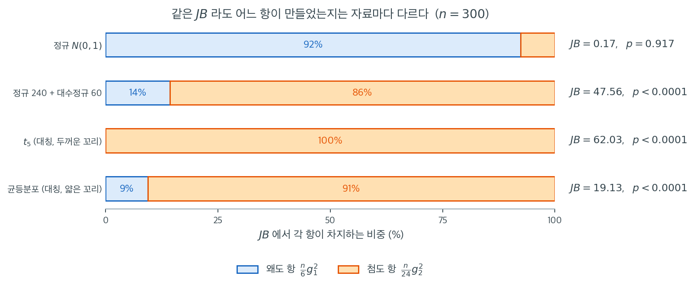
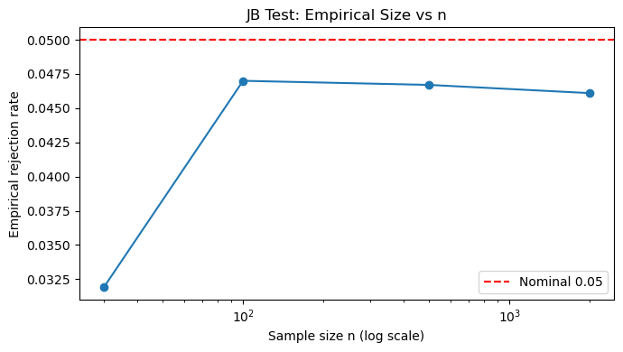

# Jarque-Bera 검정

## 개요

Jarque-Bera(JB) 검정은 계량경제학과 금융에서 널리 쓰이는 정규성 검정으로, D'Agostino $K^2$ 검정처럼 왜도와 첨도를 함께 평가한다. 표본왜도와 표본 초과첨도에 직접 기반한 더 단순한 공식을 쓰며, 귀무분포는 점근적으로 $\chi^2_2$이다. 큰 표본에 가장 적합하며 많은 계량경제 소프트웨어의 기본 정규성 진단이다.

---

## 1. 검정통계량

표본왜도 $g_1$, 표본 초과첨도 $g_2$를 갖는 표본 $X_1, \ldots, X_n$에 대해 Jarque-Bera 통계량은

$$
\text{JB} = \frac{n}{6}\!\left(g_1^2 + \frac{g_2^2}{4}\right).
$$

근거는 간단하다. 정규성 아래에서 $\mathbb{E}[g_1] = 0$, $\mathbb{E}[g_2] = 0$이고 근사 분산은 $\text{Var}(g_1) \approx 6/n$, $\text{Var}(g_2) \approx 24/n$이다. 표준화하여 제곱합을 취하면

$$
\text{JB} \approx \left(\frac{g_1}{\sqrt{6/n}}\right)^2 + \left(\frac{g_2}{\sqrt{24/n}}\right)^2 \;\underset{H_0}{\sim}\; \chi^2_2.
$$

---

## 2. 가설

$$
H_0: \gamma_1 = 0 \text{ 이고 } \gamma_2 = 0, \qquad H_1: \gamma_1 \neq 0 \text{ 또는 } \gamma_2 \neq 0.
$$

$p$값은 $p = P(\chi^2_2 \geq \text{JB}_{\text{obs}})$이며 $p < \alpha$일 때 $H_0$을 기각한다.

<div class="exbox" markdown>

**보기 1.** <span class="diff easy" title="쉬움"></span> 섞인 자료에 Jarque-Bera 검정. $\mathcal{N}(0,1)$ 240개에 $\text{Lognormal}(0, 0.6^2)$ 60개를 섞은 $n = 300$ 표본에 검정을 걸면 $JB = 47.5606$이 나온다. 그런데 같은 코드가 찍어 주는 왜도·첨도는 $0.3707$과 $1.8565$다.

**(1)** 출력된 두 값을 공식 $JB = \frac{n}{6}(g_1^2 + g_2^2/4)$에 그대로 넣으면 얼마가 나오는가. `scipy`가 준 $47.5606$과 맞는가. 맞지 않으면 그 까닭은 무엇인가.

**(2)** $JB$를 왜도 항 $\frac{n}{6}g_1^2$과 첨도 항 $\frac{n}{24}g_2^2$으로 나누어, 기각을 끌고 온 것이 치우침인지 두꺼운 꼬리인지 수로 판정하시오.

</div>

??? success "풀이"

    **(1) 맞지 않는다. $49.9516$이 나온다.** 출력된 값은 `bias=False`로 구한 **보정판** $G_1 = 0.37074$, $G_2 = 1.85650$인데, `scipy.stats.jarque_bera`는 **비보정판** $g_1$, $g_2$로 통계량을 만든다. 둘을 나란히 놓으면

    | 판본 | 왜도 | 초과첨도 | 왜도 항 | 첨도 항 | 합 |
    |---|---|---|---|---|---|
    | 비보정 (`bias=True`, 기본값) | $g_1 = 0.36880$ | $g_2 = 1.80578$ | $6.8005$ | $40.7601$ | $\mathbf{47.5606}$ |
    | 보정 (`bias=False`) | $G_1 = 0.37074$ | $G_2 = 1.85650$ | $6.8691$ | $43.0825$ | $49.9516$ |

    이다. 아래쪽 합이 $49.95$로 `scipy`가 돌려준 $47.5606$보다 $5.0\%$ 크다. **$n = 300$이나 되는데도 그만큼 어긋난다.** 왜도의 보정 계수는

    $$
    G_1 = \frac{\sqrt{n(n-1)}}{n-2}\,g_1, \qquad n = 300 \ \Rightarrow\ \frac{\sqrt{300\cdot 299}}{298} = 1.00503
    $$

    로 $0.5\%$에 지나지 않지만, 첨도 쪽 보정은 $1.85650/1.80578 = 1.02809$로 더 크고 공식이 이들을 **제곱**하므로 차이가 두 배로 증폭된다.

    그러므로 코드가 찍는 `Skewness g1`·`Excess kurtosis g2`라는 이름은 사실 $G_1$, $G_2$이고, **그 값으로는 같은 출력에 찍힌 $JB$를 재현할 수 없다.** 코드의 주석이 "둘 다 scipy 의 기본값과 다르니 다른 책의 숫자와 견줄 때 확인해야 할 대목이다"라고 경고하는 것이 바로 이 일이다. 손으로 $JB$를 확인하려면 `bias` 인자를 떼고 기본값으로 다시 불러야 한다.

    **(2) 첨도 항이 $85.7\%$다.** 비보정 판본으로

    $$
    \frac{n}{6}g_1^2 = \frac{300}{6}(0.36880)^2 = 6.8005, \qquad
    \frac{n}{24}g_2^2 = \frac{300}{24}(1.80578)^2 = 40.7601
    $$

    이고 합이 정확히 $47.5606$이다. 비율은 왜도 $14.3\%$, 첨도 $85.7\%$다. $g_2 = +1.81$로 **부호가 양수**이니 꼬리가 두꺼운 쪽이며, 대수정규 오염이 들여온 몇 개의 큰 값이 네제곱 적률을 지배한 것이다. 치우침($g_1 = 0.37$)도 있지만 기각을 끌고 온 주범은 아니다.

    ```python
    import numpy as np
    from scipy import stats

    # 정규 240개에 로그정규 60개를 섞은 자료다.
    rng = np.random.default_rng(0)
    x = np.concatenate([rng.normal(0, 1, size=240),
                        rng.lognormal(0, 0.6, size=60)])

    jb_stat, p = stats.jarque_bera(x)

    # bias=False 는 유한표본 보정을 적용한다는 뜻이다. fisher=True 는 첨도에서
    # 3 을 빼 정규를 0 으로 맞춘 초과첨도를 준다. 둘 다 scipy 의 기본값과 다르니
    # 다른 책의 숫자와 견줄 때 확인해야 할 대목이다.
    g1 = stats.skew(x, bias=False)
    g2 = stats.kurtosis(x, fisher=True, bias=False)

    print(f"Sample size n = {x.size}")
    print(f"Skewness g1 = {g1:.4f}")
    print(f"Excess kurtosis g2 = {g2:.4f}")
    print(f"Jarque-Bera: JB = {jb_stat:.4f}, p-value = {p:.4g}")
    if p < 0.05:
        print("=> Reject normality at alpha = 0.05.")
    else:
        print("=> Fail to reject normality at alpha = 0.05.")
    ```

    출력:

    ```text
    Sample size n = 300
    Skewness g1 = 0.3707
    Excess kurtosis g2 = 1.8565
    Jarque-Bera: JB = 47.5606, p-value = 4.703e-11
    => Reject normality at alpha = 0.05.
    ```

    $p$값은 $e^{-JB/2} = e^{-23.78} = 4.703\times10^{-11}$로 사실상 0이다. 같은 자료에 다고스티노 $K^2$를 걸면 $K^2 = 22.21$($p = 1.50\times10^{-5}$)로 훨씬 작은데, 이는 검정력의 차이가 아니라 $K^2$가 $g_2$를 비선형 변환으로 먼저 길들이기 때문이다. 유한표본에서 $g_2$의 분포가 오른쪽으로 크게 치우쳐 있어 $JB$가 쉽게 부풀려진다.

    출력의 두 수에 속지 말 것. 아래 "해석"에서 다시 쓰는 분해 $6.80 + 40.76$은 비보정 $g_1 = 0.3688$, $g_2 = 1.8058$로 계산한 것이고, **그 합만이** $47.5606$과 끝자리까지 일치한다. $\square$

---

## 3. D'Agostino K제곱과의 비교

JB 검정과 D'Agostino $K^2$ 검정은 모두 왜도와 첨도를 결합하지만 구성이 다르다.

| 특징 | Jarque-Bera | D'Agostino $K^2$ |
|---|---|---|
| 공식 | $g_1, g_2$에 대한 직접적인 2차식 | $Z_1, Z_2$로의 비선형 변환 |
| 귀무분포 | $\chi^2_2$ (점근적) | $\chi^2_2$ (유한표본 적합이 더 좋음) |
| 작은 표본 정확도 | $n < 100$에서 나쁨 | $n \geq 20$에서 더 나음 |
| 전형적 용도 | 계량경제학, 금융 | 일반 통계학 |

$n$이 크면 두 검정은 비슷한 결과를 준다. 중간 정도의 $n$에서는 D'Agostino $K^2$ 검정의 $p$값이 더 정확한 경향이 있다.

같은 자료에 대한 두 검정의 값을 비교해 보자. 위 혼합 보기에서 $K^2 = 22.21$($p = 1.5 \times 10^{-5}$)인 반면 $\text{JB} = 47.56$($p = 4.7 \times 10^{-11}$)이다. JB가 훨씬 큰 값을 내는데, 이는 검정력이 더 좋아서가 아니라 JB가 $g_2$를 D'Agostino의 비선형 변환 없이 그대로 제곱하기 때문이다. 유한표본에서 $g_2$는 오른쪽으로 크게 치우쳐 있으므로 JB 통계량이 부풀려지기 쉽다.

---

## 4. 해석

혼합 보기에서 대수정규 성분이 양의 왜도와 양의 초과첨도를 모두 들여온다. JB 통계량이 크고 $p$값이 사실상 0이다.

왜도와 첨도의 상대적 기여는 JB 공식의 두 항을 나누어 보면 알 수 있다. 이 자료에서

$$
\frac{n}{6} g_1^2 = 6.80, \qquad \frac{n}{24} g_2^2 = 40.76,
$$

이므로 (편향 추정값 $g_1 = 0.3688$, $g_2 = 1.8058$ 사용) 첨도 항이 전체 $47.56$의 $86\%$를 차지한다. 기각이 주로 두꺼운 꼬리에서 비롯됨을 알 수 있다.

### 분해는 진단이 된다

이 분해는 이 자료에만 쓸 수 있는 요령이 아니다. $JB$를 보고할 때마다 두 항의 비율을 함께 적으면 "정규가 아니다"라는 결론에 **어떻게** 정규가 아닌지를 덧붙일 수 있다. 아래는 $n = 300$인 네 가지 자료에 같은 분해를 적용한 것이다.



맨 위 정규자료는 $JB = 0.17$, $p = 0.917$로 기각하지 못한다. 비율이 $92\%$ 대 $8\%$로 왜도 항 쪽에 쏠려 있지만 아무 의미가 없다. 총량이 $0.17$밖에 되지 않아 두 항 모두 잡음에 불과하기 때문이다. **비율은 총량이 유의할 때에만 읽어야 한다.**

두 번째가 이 쪽의 보기로, $14\%$ 대 $86\%$다. 대수정규 오염이 치우침과 두꺼운 꼬리를 동시에 들여왔는데 첨도 쪽이 훨씬 크게 반응했다. 세 번째 $t_5$ 자료는 극단적인 경우다. 대칭분포이므로 표본왜도가 $g_1 = 0.001$로 사실상 0이고, $JB = 62.03$이 사실상 전부 첨도 항에서 나온다. 네 번째 균등분포는 반대쪽 꼬리 문제다. 초과첨도가 $-1.18$로 **음수**인데 공식에서는 제곱되므로 첨도 항이 $91\%$를 차지한다.

마지막 두 줄이 알려주는 것이 있다. 첨도 항이 지배한다는 사실만으로는 꼬리가 두꺼운지 얇은지 알 수 없다. $g_2^2$은 부호를 지워 버리기 때문이다. $JB$가 기각했다면 비율과 함께 $g_1$과 $g_2$의 **부호가 붙은 값**을 반드시 같이 보아야 한다. $g_2 = +1.81$과 $g_2 = -1.18$은 검정 입장에서는 둘 다 "정규가 아님"이지만, 분석가 입장에서는 전혀 다른 문제다. 앞쪽은 이상점을 걱정해야 하고 뒤쪽은 자료가 어딘가에서 잘려 있는지를 의심해야 한다.

---

## 연습문제

<div class="drillbox" markdown>

**연습문제 1.** <span class="diff easy" title="쉬움"></span> 표준정규 관측값 $n = 500$개를 생성하라. JB 통계량과 $p$값을 계산하라. $\alpha = 0.05$에서 기각하지 않음을 확인하라.

</div>

??? success "풀이"

    ```python
    import numpy as np
    from scipy import stats

    rng = np.random.default_rng(42)
    x = rng.normal(0, 1, size=500)

    jb, p = stats.jarque_bera(x)
    print(f"JB = {jb:.4f}, p = {p:.4f}")
    ```

    출력:

    ```text
    JB = 0.7827, p = 0.6762
    ```

    $\text{JB} = 0.783$은 $\chi^2_2$의 95백분위수 $5.99$보다 훨씬 작고 $p = 0.676$이므로 기각하지 않는다. 자료가 참으로 정규이므로 기대한 결과이다.

    $\chi^2_2$의 평균이 2이므로 $\text{JB} = 0.783$은 오히려 평균보다 작은 값이다. 귀무가설 아래에서 흔히 일어나는 일이다. $\square$

---

<div class="drillbox" markdown>

**연습문제 2.** <span class="diff easy" title="쉬움"></span> $\frac{n}{6}(g_1^2 + g_2^2/4)$를 손으로 계산하여 `stats.jarque_bera`의 출력과 비교함으로써 JB 공식을 확인하라.

</div>

??? success "풀이"

    ```python
    import numpy as np
    from scipy import stats

    rng = np.random.default_rng(0)
    x = np.concatenate([rng.normal(0, 1, 240), rng.lognormal(0, 0.6, 60)])

    g1 = stats.skew(x, bias=True)
    g2 = stats.kurtosis(x, fisher=True, bias=True)
    n = x.size
    jb_manual = (n / 6) * (g1**2 + g2**2 / 4)

    jb_scipy, _ = stats.jarque_bera(x)

    print(f"g1 (biased) = {g1:.4f}, g2 (biased) = {g2:.4f}")
    print(f"Manual JB:  {jb_manual:.4f}")
    print(f"SciPy JB:   {jb_scipy:.4f}")
    ```

    출력:

    ```text
    g1 (biased) = 0.3688, g2 (biased) = 1.8058
    Manual JB:  47.5606
    SciPy JB:   47.5606
    ```

    수치 정밀도까지 정확히 일치한다.

    **중요한 함정:** `stats.jarque_bera`는 왜도와 첨도의 **편향 추정값**(`bias=True`)을 쓴다. 손으로 계산할 때도 반드시 같게 맞춰야 한다. 편향 보정판($g_1 = 0.3707$, $g_2 = 1.8565$)을 쓰면 $\text{JB} = 49.95$가 나와 SciPy 값 $47.56$과 어긋난다. 차이가 5%다.

    $n$이 크면 두 추정값의 차이가 사라지지만, 작은 표본에서는 어느 쪽을 쓰는지가 실질적으로 중요하다. $\square$

---

<div class="drillbox" markdown>

**연습문제 3.** <span class="diff med" title="중간"></span> Jarque-Bera 검정이 작은 표본(예: $n = 30$)에서 크기 조절이 나쁜 이유를 설명하라.

</div>

??? success "풀이"

    JB 통계량은 점근 분산 $\text{Var}(g_1) \approx 6/n$과 $\text{Var}(g_2) \approx 24/n$에서 유도된다. 작은 $n$에서는 이 근사가 부정확하다. 참된 유한표본 분산이 다르고, $g_1$과 $g_2$의 분포가 정규로 잘 근사되지 않는다. 게다가 작은 $n$에서 $g_1$과 $g_2$가 독립이 아닐 수 있다.

    특히 $g_2$의 유한표본 분포는 **오른쪽으로 심하게 치우쳐** 있다. 정규성 아래에서도 $g_2$는 아래로는 $-2$ 정도까지밖에 갈 수 없지만 위로는 얼마든지 커질 수 있다. 그 결과 $g_2^2$의 분포가 $\chi^2_1$과 크게 다르다.

    결과적으로 $\chi^2_2$ 기준분포가 잘 맞지 않는다. JB의 실제 귀무분포는 $\chi^2_2$보다 **작은 값 쪽에 더 몰려 있어서** 명목 $\alpha = 0.05$ 임계값($\approx 5.99$)이 너무 크다. 검정이 *과소기각*하며(경험적 크기 $< 0.05$) 그만큼 검정력이 낮아진다. 연습문제 4에서 수치로 확인한다.

    작은 표본에는 D'Agostino $K^2$ 검정이나 Shapiro-Wilk 검정이 선호된다. $\square$

---

<div class="drillbox" markdown>

**연습문제 4.** <span class="diff med" title="중간"></span> $n \in \{30, 100, 500, 2000\}$에 대해 $\alpha = 0.05$에서 JB 검정의 경험적 크기를 추정하는 10,000회 반복 몬테카를로 연구를 수행하라. 결과를 그림으로 그리고 경험적 크기가 0.05 근처에서 안정되는 표본크기를 찾아라.

</div>

??? success "풀이"

    ```python
    import numpy as np
    from scipy import stats
    import matplotlib.pyplot as plt

    rng = np.random.default_rng(0)
    reps, alpha = 10000, 0.05
    ns = [30, 100, 500, 2000]
    sizes = []

    for n in ns:
        rej = sum(1 for _ in range(reps)
                  if stats.jarque_bera(rng.normal(0, 1, n))[1] < alpha)
        sizes.append(rej / reps)
        print(f"n = {n:>4}: empirical size = {rej/reps:.4f}")

    fig, ax = plt.subplots(figsize=(7, 4))
    ax.plot(ns, sizes, marker="o")
    ax.axhline(0.05, color="red", linestyle="--", label="Nominal 0.05")
    ax.set_xscale("log")
    ax.set_xlabel("Sample size n (log scale)")
    ax.set_ylabel("Empirical rejection rate")
    ax.set_title("JB Test: Empirical Size vs n")
    ax.legend()
    plt.tight_layout()
    plt.show()
    ```

    출력:

    ```text
    n =   30: empirical size = 0.0319
    n =  100: empirical size = 0.0470
    n =  500: empirical size = 0.0467
    n = 2000: empirical size = 0.0461
    ```

    

    $n = 30$에서 경험적 크기 $0.0319$는 명목값의 **64%에 불과하다**. 연습문제 3에서 설명한 과소기각을 확인해 준다. 실제 유의수준이 0.032라면 검정력도 그만큼 떨어진다.

    $n = 100$에서 $0.047$로 크게 개선되며 사실상 여기서 안정된다.

    다만 눈여겨볼 점이 있다. **$n = 100$에서 $n = 2000$으로 가도 더 나아지지 않는다**($0.0470 \to 0.0467 \to 0.0461$). 여전히 명목값보다 살짝 낮은 수준에 머문다. 몬테카를로 표준오차가 $\sqrt{0.05 \times 0.95/10000} = 0.0022$이므로 $0.046$과 $0.05$의 차이는 약 1.8 표준오차로 경계선상이지만, 세 표본크기에서 일관되게 같은 방향으로 나타난다는 점이 우연이 아님을 시사한다.

    이는 JB 검정의 잘 알려진 성질이다. $\chi^2_2$ 근사로의 수렴이 **매우 느리다**. $g_2$의 유한표본 분포가 치우쳐 있어 아주 큰 표본에서도 잔여 왜곡이 남는다. 실무적 결론: $n \geq 100$이면 JB를 쓸 만하지만, 크기 정확도가 결정적이면 모의실험 임계값을 쓰라. $\square$

---

<div class="drillbox" markdown>

**연습문제 5.** <span class="diff hard" title="어려움"></span> JB 공식에서 $g_2^2$에 붙은 가중치 $1/4$이 점근 분산의 비율 $\text{Var}(g_2)/\text{Var}(g_1) \to 4$에서 나옴을 보여라.

</div>

??? success "풀이"

    점근 분산에서 $\text{Var}(g_1) \to 6/n$, $\text{Var}(g_2) \to 24/n$이다. 비율은

    $$
    \frac{\text{Var}(g_2)}{\text{Var}(g_1)} = \frac{24/n}{6/n} = 4.
    $$

    JB 공식에서 각 적률을 표준화하면

    $$
    \left(\frac{g_1}{\sqrt{6/n}}\right)^2 + \left(\frac{g_2}{\sqrt{24/n}}\right)^2 = \frac{n}{6} g_1^2 + \frac{n}{24} g_2^2 = \frac{n}{6}\left(g_1^2 + \frac{g_2^2}{4}\right).
    $$

    따라서 $g_2^2$에 붙은 인자 $1/4$은 $g_2$의 분산이 $g_1$의 네 배라는 사실을 보정하며, 두 표준화 성분이 모두 단위분산을 갖고 그 합이 $\chi^2_2$을 따르도록 보장한다.

    실무적 함의: 이 가중치 때문에 **JB는 같은 크기의 왜도보다 첨도에 덜 민감하다**. $|g_1| = |g_2| = c$이면 왜도 항이 첨도 항의 네 배를 기여한다. 그러나 실제 자료에서는 비정규성이 흔히 첨도 쪽에서 더 큰 값으로 나타나므로(본문 보기에서 $g_2 = 1.86$ 대 $g_1 = 0.37$), 결국 첨도 항이 지배하는 경우가 많다. $\square$

---

<div class="drillbox" markdown>

**연습문제 6.** <span class="diff hard" title="어려움"></span> 이 쪽의 가설은 $H_0: \gamma_1 = 0$ 이고 $\gamma_2 = 0$ 이다. 그러므로 JB가 보는 것은 분포가 아니라 **두 수뿐**이다. 그 사각지대를 손으로 만들어 보자.

**(1)** $P(X = -c) = P(X = c) = p$, $P(X = 0) = 1 - 2p$ 인 세 점 대칭분포를 생각하라. $\gamma_1$ 과 $\gamma_2$ 를 $p$ 로 적고, $\gamma_2 = 0$ 이 되는 $p$ 를 구하라. 아울러 분산이 1 이 되도록 $c$ 를 정하라.

**(2)** 이 분포가 2장의 부등식 $\beta_2 \geq 1 + \gamma_1^2$ 을 어떻게 만족하는지 확인하고, 그 부등식이 (1) 의 반례를 막지 못하는 까닭을 적으라.

**(3)** 연속분포로도 같은 일을 할 수 있다. 분산이 1 인 라플라스분포와 분산이 1 인 균등분포 $\mathcal{U}(-\sqrt{3}, \sqrt{3})$ 을 확률 $q$, $1 - q$ 로 섞어 $\gamma_1 = \gamma_2 = 0$ 이 되게 하는 $q$ 를 구하라.

**(4)** $H_0$ 의 꼴만 보고, JB가 원리적으로 결코 잡을 수 없는 이탈이 무엇인지 한 줄로 적으라.

</div>

??? success "풀이"

    **(1) $p = 1/6$, $c = \sqrt{3}$.** 분포가 0 에 대해 대칭이므로 평균은 0 이고 모든 홀수 적률이 0 이다. 따라서 $p$ 가 무엇이든 $\mu_3 = 0$, 곧 $\gamma_1 = 0$ 이다. 짝수 적률은

    $$
    \mu_2 = 2pc^2, \qquad \mu_4 = 2pc^4
    $$

    이므로

    $$
    \beta_2 = \frac{\mu_4}{\mu_2^2} = \frac{2pc^4}{4p^2c^4} = \frac{1}{2p}, \qquad \gamma_2 = \frac{1}{2p} - 3.
    $$

    $c$ 가 깨끗이 지워진다는 점이 핵심이다. 첨도는 **질량의 배치**만 보고 간격은 보지 않는다. $\gamma_2 = 0$ 은 $1/(2p) = 3$, 즉

    $$
    p = \frac{1}{6}
    $$

    에서 일어난다. 이때 $\mu_2 = 2 \cdot \frac{1}{6} c^2 = c^2/3$ 이므로 분산을 1 로 맞추려면 $c = \sqrt{3}$ 이다. 정리하면

    $$
    P\!\left(X = -\sqrt{3}\right) = P\!\left(X = \sqrt{3}\right) = \frac{1}{6}, \qquad P(X = 0) = \frac{2}{3}
    $$

    이 분포는 평균 0, 분산 1, $\gamma_1 = 0$, $\gamma_2 = 0$ 이다. **JB의 귀무가설을 정확히 만족한다.** 그런데 값이 셋뿐인 이산분포이니 정규분포와는 닮은 데가 없다. 분포함수를 견주면 $x = 0^-$ 에서 $F(0^-) = 1/6$ 이고 $\Phi(0) = 1/2$ 이므로 두 분포함수의 최대 거리가 $1/3$ 이나 된다. 콜모고로프–스미르노프라면 한눈에 기각할 간격이다.

    **(2) 부등식은 하한만 준다.** 여기서 $\beta_2 = 3$ 이고 $1 + \gamma_1^2 = 1$ 이므로 $3 \geq 1$ 로 부등식은 넉넉히 성립한다. 여유가 2 나 남는다. 2장의 부등식은 "왜도가 크면 첨도도 반드시 크다"는 **아래쪽 제약**일 뿐이고, 등호는 두 값만 갖는 분포에서만 선다. $\gamma_1 = 0$ 인 분포에게 $\beta_2 = 3$ 은 하한 1 과 무한대 사이의 평범한 한 점이며, 그 점을 지나는 분포가 무수히 많다. 정규분포는 그 가운데 하나일 뿐이다.

    **(3) $q = 2/7$.** 분산이 1 인 라플라스분포는 척도 $b$ 에 대해 $\text{Var} = 2b^2 = 1$, $\mu_4 = 24b^4 = 24 \cdot (1/2)^2 = 6$ 이다. 분산이 1 인 균등분포 $\mathcal{U}(-\sqrt{3}, \sqrt{3})$ 은

    $$
    \mu_4 = \frac{(\sqrt{3})^4}{5} = \frac{9}{5} = 1.8
    $$

    이다. 두 성분이 모두 평균 0, 분산 1 이므로 혼합의 평균도 0, 분산도 1 이고, 적률은 성분 적률의 혼합이다.

    $$
    \mu_4^{\text{mix}} = 6q + 1.8(1 - q) = 1.8 + 4.2q = 3 \quad \Longrightarrow \quad q = \frac{1.2}{4.2} = \frac{2}{7}.
    $$

    두 성분이 모두 대칭이므로 $\gamma_1 = 0$ 이고, $\beta_2 = 3$ 이므로 $\gamma_2 = 0$ 이다. 그런데 이 혼합의 밀도는 $x = 0$ 에서 꺾이고 $x = \pm\sqrt{3}$ 에서 뛴다. 정규밀도와 전혀 다른 모양인데도 JB의 귀무가설 안에 있다.

    **(4) 처음 네 적률을 보존하는 모든 이탈.** JB는 $(g_1, g_2)$ 의 함수이고 그 둘은 3차·4차 적률만 쓴다. 평균 0, 분산 1, $\gamma_1 = 0$, $\gamma_2 = 0$ 인 분포들의 모임은 무한차원이며 그 안에는 이산분포도, 밀도가 꺾이는 분포도, 유계인 분포도 들어 있다. 그러므로 **JB는 "정규가 아님" 전체에 대해 일치검정이 아니다.** $n$ 을 아무리 키워도 이 방향의 이탈에 대한 검정력은 명목 유의수준으로 수렴할 뿐 1 로 가지 않는다. 적률 몇 개를 보는 검정은 적률 몇 개만큼만 본다. $\square$

---

<div class="drillbox" markdown>

**연습문제 7.** <span class="diff hard" title="어려움"></span> 연습문제 6 (1) 의 분포 $P(X = \pm\sqrt{3}) = 1/6$, $P(X = 0) = 2/3$ 에서 $n = 300$ 표본을 20,000 번 뽑아 $\alpha = 0.05$ 에서 JB와 Shapiro-Wilk의 기각률을 재라.

아울러 $g_1$ 과 $g_2$ 의 표본표준편차를 재어 이 쪽 1절이 쓴 정규이론 값 $\sqrt{6/n}$, $\sqrt{24/n}$ 과 견주고, JB 기각률이 명목 $0.05$ 보다도 **작게** 나오는 까닭을 그 두 수로 설명하라.

</div>

??? success "풀이"

    ```python
    import numpy as np
    from scipy import stats

    # P(X = +-sqrt(3)) = 1/6, P(X = 0) = 2/3 인 세 점 대칭분포다.
    rng = np.random.default_rng(0)
    c = np.sqrt(3.0)
    vals = np.array([-c, 0.0, c])
    probs = np.array([1 / 6, 2 / 3, 1 / 6])

    m2 = (probs * vals**2).sum()
    m3 = (probs * vals**3).sum()
    m4 = (probs * vals**4).sum()
    print(f"population: var = {m2:.4f}, gamma1 = {m3 / m2**1.5:.4f}, "
          f"gamma2 = {m4 / m2**2 - 3:.4f}")

    reps, n, alpha = 20000, 300, 0.05
    jb_rej = sw_rej = 0
    g1s = np.empty(reps)
    g2s = np.empty(reps)
    for i in range(reps):
        x = rng.choice(vals, size=n, p=probs)
        g1s[i] = stats.skew(x)
        g2s[i] = stats.kurtosis(x)
        if stats.jarque_bera(x)[1] < alpha:
            jb_rej += 1
        if stats.shapiro(x)[1] < alpha:
            sw_rej += 1

    print(f"n = {n}, reps = {reps}")
    print(f"mean g1 = {g1s.mean():.4f}, mean g2 = {g2s.mean():.4f}")
    print(f"sd   g1 = {g1s.std():.4f}  (normal theory {np.sqrt(6/n):.4f})")
    print(f"sd   g2 = {g2s.std():.4f}  (normal theory {np.sqrt(24/n):.4f})")
    print(f"Jarque-Bera   rejection rate = {jb_rej / reps:.4f}")
    print(f"Shapiro-Wilk  rejection rate = {sw_rej / reps:.4f}")
    ```

    출력:

    ```text
    population: var = 1.0000, gamma1 = 0.0000, gamma2 = 0.0000
    n = 300, reps = 20000
    mean g1 = 0.0001, mean g2 = 0.0214
    sd   g1 = 0.0150  (normal theory 0.1414)
    sd   g2 = 0.2489  (normal theory 0.2828)
    Jarque-Bera   rejection rate = 0.0115
    Shapiro-Wilk  rejection rate = 1.0000
    ```

    **JB는 $1.15\%$, Shapiro-Wilk는 $100.00\%$ 다.** 값이 셋뿐인 자료를 20,000 번 보여 주었는데 JB는 그 가운데 $98.85\%$ 를 "정규성을 기각할 수 없다"로 돌려보냈다. 명목 $0.05$ 보다도 작으니 검정력이 낮은 정도가 아니라 **정규성을 적극적으로 증명해 주는** 꼴이다.

    까닭은 출력의 두 표준편차에 있다. JB의 $\chi^2_2$ 눈금은 $\text{Var}(g_1) \approx 6/n$, $\text{Var}(g_2) \approx 24/n$ 이라는 **정규이론** 값으로 만든 것이다. 이 분포에서는 둘 다 그 값이 아니다. 분산이 1 인 대칭분포에 델타법을 쓰면, $\mu_3 = 0$ 이므로 $g_1 \approx m_3 \approx a_3 - 3\bar{X}$ ($a_k = \frac{1}{n}\sum X_i^k$) 이고

    $$
    n\,\text{Var}(g_1) \to \text{Var}(X^3 - 3X) = \mu_6 - 6\mu_4 + 9
    $$

    이며, 같은 식으로 $g_2 \approx (a_4 - \mu_4) - 2\mu_4(a_2 - 1)$ 에서

    $$
    n\,\text{Var}(g_2) \to \text{Var}(X^4 - 2\mu_4 X^2) = \mu_8 - \mu_4^2 - 4\mu_4\mu_6 + 4\mu_4^3
    $$

    이다. 정규분포는 $\mu_4 = 3$, $\mu_6 = 15$, $\mu_8 = 105$ 이므로 각각 $15 - 18 + 9 = 6$ 과 $105 - 9 - 180 + 108 = 24$ 로 이 쪽의 두 값이 그대로 나온다. 그런데 우리 세 점 분포는 $\mu_{2k} = 2pc^{2k} = \frac{1}{3} \cdot 3^k = 3^{k-1}$ 이므로 $\mu_2 = 1$, $\mu_4 = 3$, $\mu_6 = 9$, $\mu_8 = 27$ 이고

    $$
    n\,\text{Var}(g_1) \to 9 - 18 + 9 = 0, \qquad n\,\text{Var}(g_2) \to 27 - 9 - 108 + 108 = 18
    $$

    이다. **왜도 쪽은 1차 항이 아예 사라진다.** 그래서 $g_1$ 의 표준편차가 $O(n^{-1})$ 로 줄고 모의값 $0.0150$ 이 정규이론 $0.1414$ 의 $11\%$ 밖에 안 된다. 첨도 쪽은 $\sqrt{18/300} = 0.2449$ 가 예측인데 모의값 $0.2489$ 로 잘 맞고, 정규이론 $0.2828$ 보다 작다.

    그러므로 실제로는 왜도 항이 사실상 0 이고

    $$
    \text{JB} \approx \frac{n}{24} g_2^2 \approx \frac{n}{24} \cdot \frac{18}{n} \chi^2_1 = 0.75\,\chi^2_1
    $$

    이다. 기각률은 $P(0.75\,\chi^2_1 > 5.99146) = P(\chi^2_1 > 7.9886) = 0.0047$ 로 예측되고, 모의값 $0.0115$ 가 그보다 조금 큰 것은 $g_2$ 의 유한표본 분포가 오른쪽으로 치우쳐(평균 $0.0214 > 0$) 큰 값을 더 자주 내기 때문이다. 연습문제 3·4 에서 본 그 치우침이다.

    Shapiro-Wilk는 적률이 아니라 **순서통계량을 정규분위수에 맞춘** 상관 비슷한 양을 쓴다. 300 개 값이 세 자리에만 쌓여 있으면 Q-Q 그림이 계단이 되므로 한 번도 놓치지 않는다. 한 줄로: 적률 두 개로 요약하는 검정은 그 두 개를 맞춰 놓은 자료 앞에서 눈이 멀고, 그 눈먼 정도는 "검정력이 낮다"가 아니라 "귀무가설 쪽으로 밀려난다"는 형태로 나타난다. $\square$

---

<div class="drillbox" markdown>

**연습문제 8.** <span class="diff hard" title="어려움"></span> $\chi^2_d$ 의 왜도는 $\sqrt{8/d}$, 초과첨도는 $12/d$ 다.

**(1)** $\mathbb{E}[g_1^2] \approx \gamma_1^2 + 6/n$ 과 $\mathbb{E}[g_2^2] \approx \gamma_2^2 + 24/n$ 을 써서

$$
\mathbb{E}[\text{JB}] \approx 2 + \frac{n}{6}\!\left(\gamma_1^2 + \frac{\gamma_2^2}{4}\right)
$$

을 유도하라. 귀무가설에서 이 값이 $\chi^2_2$ 의 평균과 맞는지 확인하라.

**(2)** $d = 800$ 인 모집단을 생각하라. $\gamma_1$ 과 $\gamma_2$ 를 구하고, $\mathbb{E}[\text{JB}]$ 가 $\chi^2_2$ 의 95백분위수 $5.99146$ 에 이르는 표본크기 $n$ 을 구하라.

**(3)** 거꾸로 $n = 30$ 에서 같은 문턱에 닿으려면 대칭분포($\gamma_1 = 0$)의 초과첨도가 얼마여야 하는가. 초과첨도가 0 인 분포라면 왜도는 얼마여야 하는가.

**(4)** 잡아낼 수 있는 이탈의 크기가 $n$ 에 어떻게 의존하는지 적고, 연습문제 4 의 결과가 (3) 의 답을 어느 쪽으로 밀어내는지 말하라.

</div>

??? success "풀이"

    **(1)** 기대값은 선형이므로

    $$
    \mathbb{E}[\text{JB}] = \frac{n}{6}\!\left(\mathbb{E}[g_1^2] + \frac{\mathbb{E}[g_2^2]}{4}\right) \approx \frac{n}{6}\!\left(\gamma_1^2 + \frac{6}{n} + \frac{\gamma_2^2 + 24/n}{4}\right)
    $$

    이고, 괄호 안의 잡음 부분만 따로 모으면

    $$
    \frac{n}{6}\!\left(\frac{6}{n} + \frac{24/n}{4}\right) = \frac{n}{6} \cdot \frac{12}{n} = 2
    $$

    이다. 따라서

    $$
    \mathbb{E}[\text{JB}] \approx \underbrace{\frac{n}{6}\!\left(\gamma_1^2 + \frac{\gamma_2^2}{4}\right)}_{=\;\lambda} + 2.
    $$

    귀무가설 $\gamma_1 = \gamma_2 = 0$ 에서는 $\lambda = 0$ 이므로 $\mathbb{E}[\text{JB}] \approx 2$ 이고, 이는 $\chi^2_2$ 의 평균과 정확히 같다. $\lambda$ 는 비중심 카이제곱의 비중심모수 구실을 하며 $n$ 에 **비례**해서 커진다. 이것이 이 문제의 전부다.

    **(2) $n \approx 2382$.** $d = 800$ 이면

    $$
    \gamma_1 = \sqrt{\frac{8}{800}} = \sqrt{0.01} = 0.1, \qquad \gamma_2 = \frac{12}{800} = 0.015
    $$

    이고

    $$
    \gamma_1^2 + \frac{\gamma_2^2}{4} = 0.01 + \frac{0.000225}{4} = 0.01 + 0.00005625 = 0.01005625.
    $$

    $\mathbb{E}[\text{JB}] = 2 + \lambda = 5.99146$ 은 $\lambda = 3.99146$ 을 뜻하므로

    $$
    n = \frac{6 \times 3.99146}{0.01005625} = \frac{23.94876}{0.01005625} = 2381.5
    $$

    에서 $n \approx 2382$ 다. 첨도가 보태는 몫은 $0.00005625/0.01005625 = 0.56\%$ 에 지나지 않으므로 왜도만 세어 $23.94876/0.01 = 2394.9$ 로 보아도 거의 같다. 이 모집단은 왜도가 $0.1$, 초과첨도가 $0.015$ 로 어떤 실무 기준으로도 "정규로 보아도 무방한" 분포인데, $n$ 이 2400 쯤 되면 JB가 절반쯤의 확률로 기각하기 시작한다. ($\mathbb{E}[\text{JB}]$ 가 임계값에 닿는 자리는 검정력 $50\%$ 를 조금 밑돈다. JB의 분포가 오른쪽으로 치우쳐 중앙값이 평균보다 작기 때문이다. 연습문제 9 에서 $n = 2500$ 일 때 $0.4235$ 로 확인한다.)

    **(3) $\gamma_2 = 1.787$ 또는 $\gamma_1 = 0.894$.** $n = 30$ 에서 $\lambda = 3.99146$ 이 되려면

    $$
    \gamma_1^2 + \frac{\gamma_2^2}{4} = \frac{6 \times 3.99146}{30} = 0.798292
    $$

    이다. $\gamma_1 = 0$ 이면 $\gamma_2^2 = 4 \times 0.798292 = 3.193168$, 곧

    $$
    \gamma_2 = 1.7869
    $$

    다. $t_d$ 의 초과첨도가 $6/(d - 4)$ 이므로 이는 $d \approx 7.4$, 즉 $t_7$ 쯤 되는 꼬리다. $\gamma_2 = 0$ 이면

    $$
    \gamma_1 = \sqrt{0.798292} = 0.8935
    $$

    로, 이는 $\chi^2_{10}$ 의 왜도 $\sqrt{8/10} = 0.894$ 와 같다.

    **(4) 문턱에 닿는 이탈의 크기는 $n^{-1/2}$ 로 줄어든다.** $\lambda = \frac{n}{6}\gamma_1^2$ 을 고정하면 $\gamma_1 = \sqrt{23.94876/n}$ 이다. 실제로

    $$
    n = 30 \ \Rightarrow\ \gamma_1 = 0.894, \qquad n = 2382 \ \Rightarrow\ \gamma_1 = 0.100
    $$

    이고 비율 $0.894/0.100 = 8.94$ 는 $\sqrt{2382/30} = 8.91$ 과 맞는다. $n$ 을 80 배 키우면 9 배 작은 이탈까지 유의해진다. 이것이 이 장의 역설이다. **검정이 재는 것은 "정규에서 얼마나 멀리 있나"가 아니라 "그 거리를 이 표본크기로 분간할 수 있나"이고, 뒤쪽은 실무적 중요도와 아무 상관이 없다.**

    연습문제 4 에서 $n = 30$ 의 경험적 크기가 $0.0319$ 였다. 명목 임계값 $5.99$ 가 실제로는 귀무분포의 상위 $3.2\%$ 자리에 있다는 뜻이고, 따라서 (3) 의 답은 **낙관적**이다. 진짜 $5\%$ 짜리 검정보다 임계값이 높게 걸려 있으므로 같은 검정력을 얻으려면 $\gamma_2$ 가 $1.787$ 보다 더 커야 한다. 소표본에서 JB의 눈먼 정도는 (3) 의 계산보다 더 심하다. $\square$

---

<div class="drillbox" markdown>

**연습문제 9.** <span class="diff hard" title="어려움"></span> 연습문제 8 (2) 의 모집단 $\chi^2_{800}$ 에서 $n \in \{100, 1000, 2500, 10000\}$ 로 20,000 번씩 표본을 뽑아 두 가지를 재라. (i) JB 기각률, (ii) 같은 표본으로 **참값** $\mu = 800$ 을 검정한 단일표본 $t$ 검정의 양측·단측 기각률(곧 $t$ 검정의 실제 유의수준). $\mathbb{E}[\text{JB}]$ 의 예측값도 함께 찍어 연습문제 8 의 계산과 맞는지 보라.

$n = 10000$ 의 두 수를 나란히 놓고, "정규성 검정이 기각했으니 $t$ 검정을 쓰면 안 된다"는 흔한 추론이 어디서 틀리는지 적으라.

</div>

??? success "풀이"

    ```python
    import numpy as np
    from scipy import stats

    # chi2_800 은 gamma1 = sqrt(8/800) = 0.1, gamma2 = 12/800 = 0.015 인 분포다.
    df = 800
    g1_pop, g2_pop = np.sqrt(8 / df), 12 / df
    print(f"population: gamma1 = {g1_pop:.4f}, gamma2 = {g2_pop:.4f}")

    rng = np.random.default_rng(0)
    reps, alpha = 20000, 0.05
    chi2_crit = stats.chi2.ppf(1 - alpha, 2)

    print(f"{'n':>6} {'E[JB] approx':>13} {'JB reject':>10} "
          f"{'t two-sided':>12} {'t one-sided':>12}")
    for n in [100, 1000, 2500, 10000]:
        lam = n / 6 * (g1_pop**2 + g2_pop**2 / 4)
        t_crit2 = stats.t.ppf(1 - alpha / 2, n - 1)
        t_crit1 = stats.t.ppf(1 - alpha, n - 1)
        jb_rej = t2_rej = t1_rej = 0
        chunk = max(1, 2_000_000 // n)
        done = 0
        while done < reps:
            m = min(chunk, reps - done)
            x = rng.chisquare(df, size=(m, n))
            mu = x.mean(axis=1)
            sd = x.std(axis=1, ddof=1)
            # JB 를 공식 그대로 벡터로 계산한다 (비보정 g1, g2).
            z = x - mu[:, None]
            m2 = (z**2).mean(axis=1)
            g1 = (z**3).mean(axis=1) / m2**1.5
            g2 = (z**4).mean(axis=1) / m2**2 - 3
            jb = n / 6 * (g1**2 + g2**2 / 4)
            jb_rej += int((jb > chi2_crit).sum())
            # 참값 mu = df 를 검정하므로 기각률이 곧 t 검정의 실제 유의수준이다.
            tstat = (mu - df) / (sd / np.sqrt(n))
            t2_rej += int((np.abs(tstat) > t_crit2).sum())
            t1_rej += int((tstat > t_crit1).sum())
            done += m
        print(f"{n:>6} {2 + lam:>13.3f} {jb_rej / reps:>10.4f} "
              f"{t2_rej / reps:>12.4f} {t1_rej / reps:>12.4f}")
    ```

    출력:

    ```text
    population: gamma1 = 0.1000, gamma2 = 0.0150
         n  E[JB] approx  JB reject  t two-sided  t one-sided
       100         2.168     0.0539       0.0488       0.0477
      1000         3.676     0.1904       0.0488       0.0496
      2500         6.190     0.4235       0.0506       0.0520
     10000        18.760     0.9633       0.0482       0.0479
    ```

    **연습문제 8 의 계산이 그대로 맞는다.** 예측값 $2 + \lambda$ 가 $5.99146$ 을 넘는 자리는 $n \approx 2382$ 였고, 과연 $n = 1000$ ($\mathbb{E}[\text{JB}] = 3.676$) 에서 기각률 $0.1904$, $n = 2500$ ($6.190$) 에서 $0.4235$ 다. 기대값이 임계값을 넘었는데도 기각률이 절반에 못 미치는 것은 JB의 분포가 오른쪽으로 치우쳐 중앙값이 평균보다 작기 때문이다. $n = 10000$ 에서는 $\mathbb{E}[\text{JB}] = 18.76$ 으로 임계값의 세 배가 넘고 기각률이 $0.9633$ 이 된다.

    그런데 같은 표본으로 한 $t$ 검정의 실제 유의수준은 네 표본크기에서 모두

    $$
    0.0482 \ \text{--} \ 0.0506 \ (\text{양측}), \qquad 0.0477 \ \text{--} \ 0.0520 \ (\text{단측})
    $$

    이다. 몬테카를로 표준오차가 $\sqrt{0.05 \times 0.95/20000} = 0.0015$ 이므로 모든 수가 명목 $0.05$ 에서 $1.3$ 표준오차 안에 있다. **$n = 100$ 에서도 이미 $t$ 검정은 멀쩡하고, $n = 10000$ 에서 JB가 $96\%$ 기각하는 동안에도 멀쩡하다.**

    추론이 틀리는 자리는 **두 검정이 서로 다른 것을 묻는다**는 데 있다. JB가 묻는 것은 "모집단이 정규인가"이고 $t$ 검정이 필요한 것은 "$(\bar{X} - \mu)/(S/\sqrt{n})$ 이 $t_{n-1}$ 에 가까운가"다. 3장의 중심극한정리와 베리–에센이 알려주듯 뒤쪽의 오차는 $\gamma_1/\sqrt{n}$ 꼴로 **줄어든다**. $\gamma_1 = 0.1$, $n = 10000$ 이면 $0.1/100 = 0.001$ 수준이다. 반면 JB 통계량은 $\frac{n}{6}\gamma_1^2$ 으로 **커진다**. 두 양이 $n$ 에 대해 정반대로 움직이므로

    $$
    n \uparrow \quad \Longrightarrow \quad t\ \text{검정은 더 안전해지고 정규성 검정은 더 시끄러워진다}
    $$

    가 된다. 양측 검정이 특히 둔감한 것은 왜도가 들여오는 에지워스 1차 보정항이 두 꼬리에서 부호가 같아 서로 지워지기 때문이다. 이 모의에서는 $\gamma_1 = 0.1$ 이 너무 작아 단측에서도 차이가 보이지 않는다.

    실무적 결론은 하나다. **정규성 검정의 $p$ 값을 전처리 스위치로 쓰지 말라.** 보아야 할 것은 $g_1$ 과 $g_2$ 의 **크기**, 그리고 쓰려는 절차가 그 크기에 얼마나 민감한지다. 이 쪽 "정리하며"가 "대표본에서 거의 언제나 기각한다는 점을 기억한다"고 적은 것이 바로 이 일이다. $\square$

---

<div class="drillbox" markdown>

**연습문제 10.** <span class="diff hard" title="어려움"></span> 2장의 부등식 $\beta_2 \geq 1 + \gamma_1^2$ 은 **어떤 확률분포에도** 성립한다. 그리고 비보정 $g_1$, $g_2$ 는 관측값마다 질량 $1/n$ 을 준 경험분포의 $\gamma_1$, $\gamma_2$ 와 같다.

**(1)** 이로부터 $g_2 \geq g_1^2 - 2$ 를 적고, 등호가 서는 자료의 모양을 말하라.

**(2)** 꼬리가 얇은 쪽, 곧 $g_2 \leq 0$ 에서 $\text{JB} \leq n/3$ 임을 보이고 등호가 서는 자료를 찾으라.

**(3)** 자료가 대칭이어서 $g_1 = 0$ 이면 (2) 의 상한이 $n/6$ 로 줄어듦을 보이라.

**(4)** $\alpha = 0.05$ 에서 JB가 **어떤 얇은 꼬리 자료로도** 결코 기각할 수 없는 $n$ 의 범위를 (2) 와 (3) 각각에 대해 구하라.

**(5)** 본문 "해석" 절의 균등분포 사례($n = 300$, $g_2 = -1.18$, 첨도 항이 $91\%$)를 같은 자료를 $n = 30$ 으로 줄였을 때와 견주고 한 줄 해석을 붙이라.

</div>

??? success "풀이"

    **(1) $g_2 \geq g_1^2 - 2$, 등호는 서로 다른 값이 둘뿐인 자료.** 경험분포는 그 자체로 하나의 확률분포이고 그 왜도·첨도가 바로 $g_1$, $\beta_2 = g_2 + 3$ 이다. 부등식을 경험분포에 걸면

    $$
    g_2 + 3 \geq 1 + g_1^2 \quad \Longleftrightarrow \quad g_2 \geq g_1^2 - 2.
    $$

    2장에서 $\beta_2 = 1 + \gamma_1^2$ 의 등호는 두 값만 갖는 분포에서만 선다. 경험분포가 두 값만 갖는다는 것은 자료에 서로 다른 값이 딱 두 개뿐이라는 뜻이다. 특별한 경우로 $g_1 = 0$ 이면 $g_2 \geq -2$ 이고, 등호는 두 값이 같은 개수씩 있는 자료다.

    **(2) $\text{JB} \leq n/3$.** $g_2 \leq 0$ 이면 (1) 에서 $g_1^2 - 2 \leq g_2 \leq 0$ 이므로 먼저 $g_1^2 \leq 2$ 이고, 또 $\lvert g_2 \rvert \leq 2 - g_1^2$ 이므로 $g_2^2 \leq (2 - g_1^2)^2$ 이다. $u = g_1^2 \in [0, 2]$ 로 두면

    $$
    \text{JB} = \frac{n}{6} g_1^2 + \frac{n}{24} g_2^2 \leq \frac{n}{6} u + \frac{n}{24}(2 - u)^2 =: f(u).
    $$

    미분하면

    $$
    f'(u) = \frac{n}{6} - \frac{n}{12}(2 - u) = \frac{n}{12}\big(2 - (2 - u)\big) = \frac{n u}{12} \geq 0
    $$

    이므로 $f$ 는 $[0, 2]$ 에서 증가하고 최대는

    $$
    f(2) = \frac{n}{6} \cdot 2 + \frac{n}{24} \cdot 0 = \frac{n}{3}
    $$

    이다. 등호는 $g_1^2 = 2$ 이고 $g_2 = 0$ 인 꼭짓점에서만 서고, 그러려면 (1) 의 등호가 필요하니 자료가 두 값만 가져야 한다. 한쪽 비율을 $p$ 로 둔 두 값 자료의 왜도는 $g_1 = (1 - 2p)/\sqrt{p(1-p)}$ 이므로 $q = p(1-p)$ 로 쓰면

    $$
    g_1^2 = \frac{(1 - 2p)^2}{q} = \frac{1 - 4q}{q} = 2 \quad \Longrightarrow \quad q = \frac{1}{6}
    $$

    이고 $p = \frac{1}{2}\!\left(1 \pm \frac{1}{\sqrt{3}}\right)$, 곧 $p = 0.2113$ 또는 $0.7887$ 이다. 이 비율을 정확히 맞출 수 있으면 $\text{JB} = n/3$ 에 닿는다.

    **(3) $g_1 = 0$ 이면 $\text{JB} \leq n/6$.** (2) 의 상한에 $u = 0$ 을 넣으면

    $$
    \text{JB} \leq f(0) = \frac{n}{24} \cdot 4 = \frac{n}{6}
    $$

    이다. 등호는 $g_2 = -2$ 일 때, 곧 두 값이 반반씩 있는 자료다. 가장 얇은 꼬리를 가진 자료조차 첨도 항에 $n/6$ 이라는 천장이 씌워져 있다.

    **(4) $n \leq 17$ 과 $n \leq 35$.** 임계값은 $\chi^2_2$ 의 95백분위수 $5.99146$ 이다. (2) 에서

    $$
    \frac{n}{3} \leq 5.99146 \quad \Longleftrightarrow \quad n \leq 17.97
    $$

    이므로 $n \leq 17$ 이면 $g_2 \leq 0$ 인 **어떤** 자료로도 기각이 불가능하다. (3) 에서

    $$
    \frac{n}{6} \leq 5.99146 \quad \Longleftrightarrow \quad n \leq 35.95
    $$

    이므로 대칭 자료라면 $n \leq 35$ 까지 기각이 불가능하다. "검정력이 낮다"가 아니라 기각역이 **도달 불가능한 영역**에 놓여 있다는 뜻이다.

    **(5)** 본문의 균등 자료는 $n = 300$ 에서 첨도 항이

    $$
    \frac{300}{24}(-1.18)^2 = 12.5 \times 1.3924 = 17.41
    $$

    이고 이것이 전체의 $91\%$ 이니 $\text{JB} \approx 19.1$ 로 임계값 $5.99$ 를 넉넉히 넘어 기각한다. 같은 모집단에서 $n = 30$ 만 뽑으면 $g_2$ 는 여전히 $-1.18$ 쯤이겠지만 첨도 항은

    $$
    \frac{30}{24}(1.18)^2 = 1.74
    $$

    로 쪼그라든다. 표본이 대칭에 가까워 $g_1 \approx 0$ 이고 $g_2 \leq 0$ 이면 (3) 의 천장이 $30/6 = 5$ 이므로 아무리 얇은 꼬리가 나와도 $5.99$ 에 닿지 못한다. 다만 (3) 은 $g_1 = 0$ 을 가정한 상한이고, (2) 의 일반 상한은 $30/3 = 10$ 으로 임계값을 넘으므로 "원리적으로 불가능"까지는 아니다. 실제로 $\mathcal{U}(-1, 1)$ 에서 $n = 30$ 을 20만 번 뽑으면 기각률이 $0.0002$ 로 0 은 아니다(표본 $g_2$ 가 우연히 양수가 되는 드문 경우다). **$n = 30$ 에서 JB로 균등분포를 가려내는 일은 사실상 포기해야 한다.**

    한 줄 해석. 꼬리가 두꺼운 쪽은 $g_2$ 가 위로 열려 있어 소표본에서도 운이 좋으면 잡히지만, 얇은 쪽은 $g_2 \geq g_1^2 - 2$ 라는 적률 부등식이 통계량 자체에 천장을 씌운다. JB의 소표본 보수성(연습문제 3·4)은 단순히 $\chi^2_2$ 근사가 나빠서만이 아니라, 기각역의 한쪽이 **아예 비어 있기** 때문이기도 하다. 자료가 어딘가에서 잘려 있거나 균등꼴이라고 의심되는데 표본이 작다면, JB가 아니라 순서통계량을 보는 검정(Shapiro-Wilk, Anderson-Darling)을 써야 한다. $\square$

---

## 정리하며

자크–베라를 **직접 구현하고 검산**했다.

- **공식이 단순해 손으로 적기 쉽다.** $g_1$ 과 $g_2$ 만 계산하면 되며, `scipy.stats.jarque_bera` 와 대조해 확인할 수 있다.
- **`scipy` 의 왜도·첨도 기본값에 주의한다.** `skew(x)` 와 `kurtosis(x)` 는 기본이 **편향 보정 없음**(`bias=True`)이고 첨도는 초과첨도(`fisher=True`)다. 보정 여부에 따라 통계량이 달라진다.
- **점근 분포라 소표본에서 부정확하다.** $n<50$ 이면 제1종 오류율이 명목값에서 눈에 띄게 벗어나며, 정확한 $p$ 값이 필요하면 몬테카를로로 귀무분포를 만든다.
- **회귀 잔차 진단으로 가장 자주 쓰인다.** `statsmodels` 의 요약표에 기본 포함되어 있다.
- **대표본에서 거의 언제나 기각한다는 점을 기억한다.** 그 자체로는 정보가 적으며, $g_1$·$g_2$ 값과 Q-Q 그림이 실질적 판단의 근거다.

다음 절부터 **형식적 정규성 검정**들로 넘어간다.
