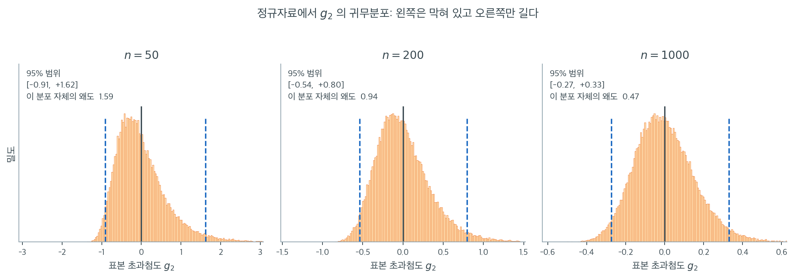

# 첨도 검정

## 개요

D'Agostino 첨도 검정은 자료의 초과첨도가 정규성 아래에서 기대되는 값인 0과 유의하게 다른지 평가한다. 초과첨도는 정규분포에 견준 꼬리의 두꺼움을 잰다. 이 검정은 표본 초과첨도를 귀무가설 아래에서 근사적으로 표준정규를 따르는 $Z$ 통계량으로 변환하여 꼬리 거동을 겨냥한 확인을 제공한다.

---

## 1. 표본 초과첨도

표본 $X_1, \ldots, X_n$에 대한 편향 보정 Fisher 초과첨도는

$$
g_2 = \frac{n(n+1)}{(n-1)(n-2)(n-3)} \sum_{i=1}^{n} \left(\frac{X_i - \bar{X}}{S}\right)^4 - \frac{3(n-1)^2}{(n-2)(n-3)}.
$$

정규성 아래에서 $\mathbb{E}[g_2] = 0$이다. $g_2 > 0$인 분포를 *고첨*(leptokurtic, 정규보다 꼬리가 두꺼움), $g_2 < 0$인 분포를 *저첨*(platykurtic, 꼬리가 얇음)이라 한다.

---

## 2. D'Agostino 첨도 변환

왜도 검정과 비슷하게, D'Agostino와 Pearson은 $g_2$를 비선형 사상으로 변환하여 $H_0$ 아래에서 근사적으로 $\mathcal{N}(0,1)$인 통계량 $Z_2$를 만든다. 정규성 아래에서 $g_2$의 분산은 근사적으로

$$
\text{Var}(g_2) \approx \frac{24n(n-2)(n-3)}{(n+1)^2(n+3)(n+5)}.
$$

표준화와 추가 보정을 거친 $Z_2$를 추론에 쓴다.

### g2의 귀무분포는 왜 표준화만으로 부족한가

위 분산 공식만 보면 $g_2$를 $\sqrt{\text{Var}(g_2)}$로 나누기만 하면 될 것 같다. 그렇지 않은 이유는 $g_2$의 귀무분포가 **대칭이 아니기** 때문이다. 아래 그림은 진짜 정규자료에서 표본을 60000번씩 뽑아 $g_2$의 분포를 세 표본크기에 대해 그린 것이다.



$n = 50$에서 히스토그램은 왼쪽이 $-1.2$ 근처에서 뚝 끊기고 오른쪽으로는 $+3$ 너머까지 늘어진다. 95% 범위가 $[-0.91, +1.62]$로 0을 중심으로 전혀 대칭이 아니다. 이 분포 자체의 왜도를 재면 $1.59$다. 정규성을 검정하겠다고 쓰는 통계량의 귀무분포가 정작 크게 치우쳐 있는 셈이다.

구조적인 이유가 있다. 초과첨도는 정의상 아래로 막혀 있다. 어떤 자료를 가져와도 $g_2$가 $-2$보다 작아질 수 없는 반면 위로는 한계가 없다. 게다가 앞에서 본 대로 $g_2$는 꼬리의 몇 안 되는 관측값이 좌우하므로, 우연히 큰 값 하나가 들어오면 값이 위로 크게 튄다. 한쪽으로만 튈 수 있는 통계량은 대칭일 수 없다.

표본을 키우면 나아지기는 한다. $n = 200$에서 95% 범위는 $[-0.54, +0.80]$이고 분포 자체의 왜도는 $0.94$, $n = 1000$에서는 $[-0.27, +0.33]$에 왜도 $0.47$이다. 그런데 이 속도를 보라. 표본을 20배로 늘렸는데도 왜도가 $1.59$에서 $0.47$로 줄었을 뿐 0에 가깝다고는 말하기 어렵다. **실무에서 만나는 거의 모든 표본크기에서 $g_2$의 귀무분포는 눈에 띄게 치우쳐 있다.** 그래서 단순 표준화로는 $N(0,1)$ 근사를 얻을 수 없고, D'Agostino와 Pearson이 고안한 비선형 변환이 필요한 것이다.

---

## 3. 가설

$$
H_0: \gamma_2 = 0 \quad (\text{모집단 초과첨도가 0이다}), \qquad H_1: \gamma_2 \neq 0.
$$

양측 $p$값은 $p = 2\,\Phi(-|Z_2|)$이다.

<div class="aibox" markdown>

**AI로 보는 통계학 1.** 가장 정규답지 않은 방향을 고르는 일

$1$ 절의 $g_2$ 는 이 쪽에서 **검정통계량**이다. 섞인 신호를 되가르는 기계 안에서 같은
$g_2$ 는 **목적함수**가 된다. 부호도 바꾸지 않고, 변환도 거치지 않고, 식 그대로다.

까닭은 중심극한정리를 거꾸로 읽은 데 있다. 독립인 비정규 신호 여럿을 섞으면 섞은
것은 어느 원천보다도 **정규에 가까워진다.** 그렇다면 되가르는 길은 하나다. 관측한
자료를 백색화한 뒤, 가능한 모든 방향 가운데 **가장 정규답지 않은 방향**을 고르면
그 방향이 원천 하나다. 「정규답지 않음」을 무엇으로 재는가 — 가장 오래되고 가장
단순한 자가 $|g_2|$ 다. 정규에서 $0$ 이고, 멀어질수록 커지며, 네제곱 하나로 계산이
끝난다. 독립성분분석이 그렇게 돌아간다.

두 원천을 섞어 놓고 각도를 한 바퀴 돌려 보면 보인다.

```python
import numpy as np
from scipy.stats import kurtosis

rng = np.random.default_rng(14)
n = 50_000
s1 = rng.uniform(-np.sqrt(3), np.sqrt(3), n)        # 초과첨도 -1.2
s2 = rng.laplace(0, 1 / np.sqrt(2), n)              # 초과첨도 +3
th0 = 0.6
A = np.array([[np.cos(th0), -np.sin(th0)], [np.sin(th0), np.cos(th0)]])
x = np.c_[s1, s2] @ A.T                             # 섞는다

print("원천 두 개의 g2 :", np.round([kurtosis(s1, bias=False),
                                     kurtosis(s2, bias=False)], 4))
print("섞은 뒤의 g2    :", np.round(kurtosis(x, axis=0, bias=False), 4))

d, E = np.linalg.eigh(np.cov(x.T))                  # 백색화하면 남는 것은 회전각 하나
w = (x - x.mean(0)) @ E / np.sqrt(d)
th = np.linspace(0, np.pi, 721)
g2 = np.array([kurtosis(w @ [np.cos(t), np.sin(t)], bias=False) for t in th])

i_max = int(np.abs(g2).argmax())
for name, i in [("|g2| 최대   ", i_max),
                ("그 직교 방향", (i_max + 360) % 720),
                ("|g2| 최소   ", int(np.abs(g2).argmin()))]:
    y = w @ [np.cos(th[i]), np.sin(th[i])]
    r1 = abs(np.corrcoef(y, s1)[0, 1])
    r2 = abs(np.corrcoef(y, s2)[0, 1])
    print(f"{name}: {np.degrees(th[i]):6.2f}도   g2 = {g2[i]:+.4f}   "
          f"|상관| s1 {r1:.4f}  s2 {r2:.4f}")
```

출력:

```
원천 두 개의 g2 : [-1.1967  2.8139]
섞은 뒤의 g2    : [-0.2516  1.1475]
|g2| 최대   : 150.75도   g2 = +2.8144   |상관| s1 0.0120  s2 0.9999
그 직교 방향:  60.75도   g2 = -1.1964   |상관| s1 0.9999  s2 0.0100
|g2| 최소   : 100.00도   g2 = +0.0044   |상관| s1 0.7820  s2 0.6249
```

둘째 줄이 중심극한정리다. 원천의 $g_2$ 는 $-1.20$ 과 $+2.81$ 인데, 섞고 나니
$-0.25$ 와 $+1.15$ 로 둘 다 $0$ 쪽으로 끌려왔다. 셋째 줄이 되가르기다.
$|g_2|$ 를 최대로 만드는 각에서 $g_2 = +2.81$ 이 되살아나고, 그 방향은 라플라스
원천과 상관이 $0.9999$ 다. 직교하는 각에서는 $g_2 = -1.20$ 과 균등 원천이
$0.9999$ 로 나온다. **섞기 전의 두 수가 그대로 돌아왔다.**

마지막 줄이 이 자의 한계다. $g_2 = +0.004$ 인 각이 하나 있다. 첨도만 보면 완벽하게
정규인 방향인데, 실제로는 두 원천이 $0.78$ 과 $0.62$ 로 섞여 있는 방향이다. 고첨
성분과 저첨 성분이 상쇄되어 $0$ 이 된 것뿐이다. $g_2$ 는 정규성을 재는 자가 아니라
**네제곱 적률 하나**를 재는 자이고, $2$ 절에서 본 대로 그 네제곱은 꼬리의 몇 점이
좌우한다. 그래서 이 방법을 쓰는 구현들은 첨도 말고 더 둔한 대비함수를 함께 두고,
첨도는 선택지의 하나로 남겨 둔다.

</div>

<div class="exbox" markdown>

**보기 1.** <span class="diff easy" title="쉬움"></span> 꼬리만 두꺼운 자료의 첨도 검정. $\mathcal{N}(0,1)$ 220개에 $t_4$ 80개를 섞은 $n = 300$ 표본에서 $Z_2 = 2.7603$, $p = 0.00577$이 나온다.

**(1)** 변환 전의 **단순 표준화** $u = \{b_2 - \mathbb{E}[b_2]\}/\mathrm{SD}(b_2)$를 구하시오. 정규성 아래에서 $\mathbb{E}[b_2]$가 3이 아니라는 점에 주의하라. 변환은 $u$를 어디로 옮기며, 단순 표준화를 그대로 썼다면 $p$값이 몇 배 달라지는가.

**(2)** `scipy.stats.kurtosistest`가 쓰는 첨도는 어느 판본인가. 출력에 찍힌 $1.0493$과 같은 값인가.

</div>

??? success "풀이"

    **(1) $u = 3.7403$이고 변환이 그것을 $2.7603$으로 끌어내린다.** 먼저 중심이 3이 아니다. 정규성 아래에서 비보정 첨도 $b_2 = m_4/m_2^2$의 기댓값은

    $$
    \mathbb{E}[b_2] = \frac{3(n-1)}{n+1}
    $$

    이고 $n = 300$에서 $2.980066$이다. 3보다 작다. **표본첨도는 정규 자료에서도 3을 밑돌게 나오는 쪽으로 편향되어 있다.** 분산은 위 본문의 식

    $$
    \mathrm{Var}(b_2) = \frac{24n(n-2)(n-3)}{(n+1)^2(n+3)(n+5)}
    $$

    에서 $\mathrm{SD}(b_2) = 0.275877$이다. 이 표본의 $b_2 = 4.011938$을 넣으면

    $$
    u = \frac{4.011938 - 2.980066}{0.275877} = 3.740339
    $$

    이다. 변환은 앞 절의 왜도 검정과 달리 역쌍곡사인이 아니라 **윌슨–힐퍼티 꼴의 세제곱근**을 쓴다. $b_2$의 귀무분포가 치우친 정도를 $\sqrt{\beta_1}$로 재고, 그만큼 치우친 카이제곱을 펴는 세제곱근 변환을 적용하는 것이다.

    $$
    \sqrt{\beta_1} = \frac{6(n^2 - 5n + 2)}{(n+7)(n+9)}\sqrt{\frac{6(n+3)(n+5)}{n(n-2)(n-3)}}, \quad
    A = 6 + \frac{8}{\sqrt{\beta_1}}\left(\frac{2}{\sqrt{\beta_1}} + \sqrt{1 + \frac{4}{\beta_1}}\right)
    $$

    $$
    Z_2 = \frac{\bigl(1 - \frac{2}{9A}\bigr) - \left(\dfrac{1 - 2/A}{1 + u\sqrt{2/(A-4)}}\right)^{1/3}}{\sqrt{2/(9A)}}
    $$

    $n = 300$에서 $\sqrt{\beta_1} = 0.808923$, $A = 56.827255$이고 $Z_2 = 2.760321$이 나온다.

    **$p$값은 31배 달라진다.** 단순 표준화 $u = 3.7403$을 표준정규 분위수로 읽으면 $p = 0.000184$인데, 변환을 거친 참값은 $p = 0.005774$다. 비 $0.005774/0.000184 = 31.4$다. $b_2$의 귀무분포가 오른쪽으로 치우쳐 있어 큰 양의 값이 정규 자료에서도 흔히 나오는데, 단순 표준화는 그 사실을 모르고 과장한다. 이 보기에서는 어느 쪽이든 $\alpha = 0.05$에서 기각하지만, 결론의 **강도**가 "매우 유의"에서 "유의"로 내려앉는다.

    **(2) 쓰는 것은 비보정 $b_2$이고, 출력의 $1.0493$과 다르다.** 세 판본을 나란히 놓으면

    | 판본 | 값 |
    |---|---|
    | $b_2 = m_4/m_2^2$ (`fisher=False, bias=True`) | $4.011938$ |
    | $g_2 = b_2 - 3$ (`fisher=True, bias=True`, 기본값) | $1.011938$ |
    | 보정 초과첨도 $G_2$ (`fisher=True, bias=False`) | $1.049279$ |

    이고, `kurtosistest`가 쓰는 것은 첫 줄의 $b_2$다. 코드는 세 번째 줄의 $G_2 = 1.0493$을 찍으므로 **출력의 두 수가 서로 맞물리지 않는다.** 손으로 $Z_2$를 재현하려면 `fisher=False`에 `bias` 인자 없이 불러야 한다.

    같은 이유로 본문의 분산식은 **비보정판** $b_2$(또는 $g_2$, 상수 이동이니 분산은 같다)의 것이다. 모의실험으로 $n = 300$, 200만 번 반복해 재면 $\mathrm{SD}(b_2) = 0.27588$로 공식값 $0.275877$과 소수 다섯째 자리까지 맞는데, 같은 실험에서 보정판은 $\mathrm{SD}(G_2) = 0.2789$로 어긋난다.

    ```python
    import numpy as np
    from scipy import stats

    # 정규에 자유도 4 짜리 t 를 섞었다. 중심은 그대로이고 꼬리만 두꺼워진다.
    # 왜도 검정으로는 잡히지 않고 첨도 검정에만 걸리는 자료다.
    rng = np.random.default_rng(0)
    x = np.concatenate([rng.normal(0, 1, size=220),
                        rng.standard_t(df=4, size=80)])

    # 표본첨도를 바로 쓰지 않고 Z 로 바꾸는 까닭은, 첨도의 표집분포가 표본이
    # 상당히 클 때까지도 크게 치우쳐 있기 때문이다. 이 검정은 n>=20 부터 쓸 만하다.
    g2 = stats.kurtosis(x, fisher=True, bias=False)
    z, p = stats.kurtosistest(x)

    print(f"Sample size n = {x.size}")
    print(f"Sample excess kurtosis (Fisher) g2 = {g2:.4f}")
    print(f"D'Agostino kurtosis test: Z = {z:.4f}, p-value = {p:.4g}")
    if p < 0.05:
        print("=> Evidence of non-normal kurtosis (departing from normality).")
    else:
        print("=> No strong evidence of non-normal kurtosis.")
    ```

    출력:

    ```text
    Sample size n = 300
    Sample excess kurtosis (Fisher) g2 = 1.0493
    D'Agostino kurtosis test: Z = 2.7603, p-value = 0.005774
    => Evidence of non-normal kurtosis (departing from normality).
    ```

    변환을 한 단계씩 손으로 짚으면 다음과 같다.

    ```python
    import numpy as np
    from scipy import stats

    rng = np.random.default_rng(0)
    x = np.concatenate([rng.normal(0, 1, size=220),
                        rng.standard_t(df=4, size=80)])
    n = x.size

    b2 = stats.kurtosis(x, fisher=False)              # 비보정, 3 을 빼지 않은 것
    g2 = stats.kurtosis(x)                            # 비보정 초과첨도 = b2 - 3
    G2 = stats.kurtosis(x, fisher=True, bias=False)   # 보정 초과첨도
    print(f"b2 (비보정)      = {b2:.6f}")
    print(f"g2 = b2 - 3      = {g2:.6f}")
    print(f"G2 (보정)        = {G2:.6f}")

    # 1단계: 정규성 아래의 평균과 분산으로 표준화.
    E = 3.0 * (n - 1) / (n + 1)
    varb2 = 24.0 * n * (n - 2) * (n - 3) / ((n + 1) ** 2 * (n + 3) * (n + 5))
    u = (b2 - E) / np.sqrt(varb2)
    print(f"\nE[b2] = 3(n-1)/(n+1) = {E:.6f},  SD(b2) = {np.sqrt(varb2):.6f}")
    print(f"단순 표준화 u = {u:.6f}")

    # 2단계: 귀무분포의 왜도를 윌슨–힐퍼티 세제곱근으로 펴 준다.
    sqrtbeta1 = (6.0 * (n * n - 5 * n + 2) / ((n + 7) * (n + 9))
                 * np.sqrt(6.0 * (n + 3) * (n + 5) / (n * (n - 2) * (n - 3))))
    A = 6.0 + 8.0 / sqrtbeta1 * (2.0 / sqrtbeta1 + np.sqrt(1 + 4.0 / sqrtbeta1**2))
    term1 = 1 - 2 / (9.0 * A)
    term2 = ((1 - 2.0 / A) / (1 + u * np.sqrt(2 / (A - 4.0)))) ** (1 / 3)
    Z = (term1 - term2) / np.sqrt(2 / (9.0 * A))
    print(f"sqrt(beta1) = {sqrtbeta1:.6f},  A = {A:.6f}")
    print(f"손계산 Z2 = {Z:.6f},  p = {2 * stats.norm.sf(abs(Z)):.6f}")

    z_scipy, p_scipy = stats.kurtosistest(x)
    print(f"scipy  Z2 = {z_scipy:.6f},  p = {p_scipy:.6f}")
    print(f"\n단순 표준화만 했다면 p = {2 * stats.norm.sf(abs(u)):.6f}")
    ```

    출력:

    ```text
    b2 (비보정)      = 4.011938
    g2 = b2 - 3      = 1.011938
    G2 (보정)        = 1.049279

    E[b2] = 3(n-1)/(n+1) = 2.980066,  SD(b2) = 0.275877
    단순 표준화 u = 3.740339
    sqrt(beta1) = 0.808923,  A = 56.827255
    손계산 Z2 = 2.760321,  p = 0.005774
    scipy  Z2 = 2.760321,  p = 0.005774

    단순 표준화만 했다면 p = 0.000184
    ```

    손으로 밟은 $Z_2 = 2.760321$이 `scipy.stats.kurtosistest`의 값과 **소수점 여섯째 자리까지** 같다. 맨 아래 줄이 (1)의 요점이다. 변환을 생략하면 $p$값이 $0.005774$가 아니라 $0.000184$가 되어, 같은 자료를 두고 증거의 강도를 서른 배 넘게 부풀리게 된다. $\square$

---

## 4. 해석

위 예는 정규 추출값과 $t_4$ 추출값의 혼합이라 순수 정규표본보다 꼬리가 두껍다. 초과첨도 $g_2 = 1.049$로 뚜렷하게 양수이고 검정은 $\alpha = 0.05$에서 기각한다($p = 0.0058$).

첨도 검정은 두꺼운 꼬리의 오염, 이상점이 잘 생기는 분포, 균등분포 같은 얇은 꼬리 분포를 탐지하는 데 특히 유용하다.

**최소 표본크기.** SciPy의 `kurtosistest`는 $n \geq 20$을 요구한다. 더 작은 표본에서는 $Z_2$의 정규근사를 믿을 수 없다.

---

## 연습문제

<div class="drillbox" markdown>

**연습문제 1.** <span class="diff easy" title="쉬움"></span> 표준정규 관측값 $n = 300$개를 생성하라. $g_2$와 첨도 검정 $p$값을 계산하라. $g_2$가 0에 가깝고 검정이 기각하지 않음을 확인하라.

</div>

??? success "풀이"

    ```python
    import numpy as np
    from scipy import stats

    rng = np.random.default_rng(10)
    x = rng.normal(0, 1, size=300)

    g2 = stats.kurtosis(x, fisher=True, bias=False)
    z, p = stats.kurtosistest(x)

    print(f"g2 = {g2:.4f}")
    print(f"Z = {z:.4f}, p = {p:.4f}")
    ```

    출력:

    ```text
    g2 = 0.1380
    Z = 0.6014, p = 0.5476
    ```

    $g_2 = 0.138$로 0에 가깝고 $p = 0.548$이므로 검정은 귀무가설을 올바르게 유지한다.

    참고로 $n = 300$에서 $g_2$의 표준오차는 약 $\sqrt{24/300} = 0.283$이므로, $0.138$은 채 반 표준오차도 되지 않는다. $\square$

---

<div class="drillbox" markdown>

**연습문제 2.** <span class="diff easy" title="쉬움"></span> $\text{Uniform}(0,1)$ 분포에서 관측값 $n = 300$개를 생성하라. $g_2$를 계산하고 첨도 검정을 수행하라. 균등분포는 대칭이지만 저첨이다($\gamma_2 = -1.2$). 검정이 이를 탐지하는가?

</div>

??? success "풀이"

    ```python
    import numpy as np
    from scipy import stats

    rng = np.random.default_rng(0)
    x = rng.uniform(0, 1, size=300)

    g2 = stats.kurtosis(x, fisher=True, bias=False)
    z, p = stats.kurtosistest(x)

    print(f"g2 = {g2:.4f}, Z = {z:.4f}, p = {p:.4g}")
    ```

    출력:

    ```text
    g2 = -1.1951, Z = -12.5358, p = 4.755e-36
    ```

    표본 $g_2 = -1.195$가 이론값 $-1.2$에 거의 정확히 일치하고, $p$값이 $4.8 \times 10^{-36}$으로 초과첨도가 0이라는 귀무가설을 압도적으로 기각한다.

    첨도 검정이 **대칭인 비정규 분포도 탐지**할 수 있음을 보여준다. 같은 자료에서 왜도 검정은 $p = 0.307$로 기각하지 못한다(왜도 검정 페이지의 연습문제 2 참조). 두 검정이 서로 다른 이탈 방향을 담당하며, D'Agostino $K^2$가 둘을 결합하는 이유이다.

    저첨 자료에서 검정력이 유난히 높다는 점도 눈여겨볼 만하다. $|\gamma_2| = 1.2$는 $t_{10}$의 $\gamma_2 = 1$과 비슷한 크기인데도 $|Z| = 12.5$가 나온다. 균등분포는 유계이므로 $g_2$의 표집변동이 작기 때문이다. 연습문제 4의 두꺼운 꼬리 경우와 정반대이다. $\square$

---

<div class="drillbox" markdown>

**연습문제 3.** <span class="diff med" title="중간"></span> 바탕 분포가 정규이더라도 이상점이 많은 자료가 $g_2 > 0$을 만들어 내는 이유를 설명하고, 첨도 검정에 대한 함의를 논하라.

</div>

??? success "풀이"

    첨도 공식의 네제곱 $(X_i - \bar{X})^4$은 극단 관측값에 불균형하게 큰 영향력을 준다. $|X_i - \bar{X}|$가 큰 이상점 몇 개가 분모의 $S^4$을 부풀리는 것보다 분자를 훨씬 크게 부풀려 $g_2$를 0 위로 밀어 올린다.

    이상점이 진짜라면(곧 참 분포의 꼬리가 두껍다면) $g_2 > 0$은 고첨을 올바르게 탐지한 것이다. 그러나 이상점이 자료 입력 오류나 측정 이상이라면 첨도 검정이 잘못된 이유로 정규성을 기각할 수 있다.

    유의한 첨도 검정 결과를 해석하기 전에 반드시 이상 관측값이 있는지 자료를 살피고 그것이 진짜인지 평가해야 한다. 실용적인 절차는 이상점을 제외하고 검정을 다시 돌려 결론이 뒤집히는지 보는 것이다. 뒤집힌다면 결론이 소수의 점에 의존한다는 뜻이므로 그 사실을 보고해야 한다. $\square$

---

<div class="drillbox" markdown>

**연습문제 4.** <span class="diff med" title="중간"></span> 5,000회 반복의 몬테카를로 모의실험으로 $t_5$ 분포에서 뽑은 관측값 $n = 100$개에 대해 $\alpha = 0.05$에서 첨도 검정의 검정력을 추정하라. $t_{10}$에 대한 검정력과 비교하라.

</div>

??? success "풀이"

    ```python
    import numpy as np
    from scipy import stats

    rng = np.random.default_rng(0)
    n, reps, alpha = 100, 5000, 0.05

    for df in [5, 10]:
        rejections = 0
        for _ in range(reps):
            x = rng.standard_t(df=df, size=n)
            _, p = stats.kurtosistest(x)
            if p < alpha:
                rejections += 1
        print(f"t({df}): power = {rejections / reps:.4f}")
    ```

    출력:

    ```text
    t(5): power = 0.6058
    t(10): power = 0.2448
    ```

    $t_5$의 초과첨도는 $\gamma_2 = 6/(5-4) = 6$이고 $t_{10}$은 $\gamma_2 = 6/(10-4) = 1$이다. 예상대로 정규에서 더 멀리 떨어진 $t_5$에 대한 검정력($0.606$)이 $t_{10}$에 대한 검정력($0.245$)보다 훨씬 높다.

    !!! warning "$\gamma_2 = 6$인데도 검정력이 0.61밖에 안 되는 이유"
        $n = 100$에서 $g_2$의 귀무 표준오차는 $\sqrt{24/100} = 0.49$이므로, 신호 $\gamma_2 = 6$은 명목상 12 표준오차에 해당한다. 그렇다면 검정력이 1에 가까워야 할 것 같지만 실제로는 0.61이다.

        이유는 **$g_2$의 분산 공식이 귀무가설(정규성) 아래에서만 유효**하기 때문이다. 대립가설 아래에서 $g_2$의 분산은 바탕 분포의 **8차 적률**에 의존한다. $t_\nu$는 차수가 $\nu$ 미만인 적률만 가지므로 $t_5$에는 8차 적률이 존재하지 않는다. 곧 $t_5$ 아래에서 $g_2$의 분산은 **무한대**이다.

        결과적으로 $g_2$의 표집분포가 극도로 두꺼운 꼬리를 갖게 되어, 평균은 6 근처로 크게 이동하지만 개별 표본의 값이 심하게 요동한다. 상당수 표본에서 $g_2$가 임계값 아래로 떨어져 기각에 실패한다.

        $t_{10}$은 8차 적률이 존재하지만($\nu = 10 > 8$) 신호 $\gamma_2 = 1$이 작아서 검정력이 낮다.

    실무적 교훈: **첨도 검정은 두꺼운 꼬리를 탐지하는 데 생각보다 약하다.** 자기가 탐지하려는 바로 그 성질이 자신의 추정량을 불안정하게 만들기 때문이다. 두꺼운 꼬리가 의심되면 첨도 검정 하나에 의존하지 말고 Q-Q 그림과 Anderson-Darling 같은 꼬리 가중 검정을 함께 쓰라. $\square$

---

<div class="drillbox" markdown>

**연습문제 5.** <span class="diff hard" title="어려움"></span> 정확한 공식에서 출발하여 $n \to \infty$일 때 $\text{Var}(g_2) \to 24/n$임을 유도하라.

</div>

??? success "풀이"

    다음에서 출발한다.

    $$
    \text{Var}(g_2) = \frac{24n(n-2)(n-3)}{(n+1)^2(n+3)(n+5)}.
    $$

    분자에서 $n^3$을, 분모에서 $n^5$을 묶어낸다.

    $$
    \text{Var}(g_2) = \frac{24\, n^3\bigl(1 - \frac{2}{n}\bigr)\bigl(1 - \frac{3}{n}\bigr)}{n^5\bigl(1 + \frac{1}{n}\bigr)^2\bigl(1 + \frac{3}{n}\bigr)\bigl(1 + \frac{5}{n}\bigr)} = \frac{24}{n} \cdot \frac{(1 - 2/n)(1 - 3/n)}{(1 + 1/n)^2(1 + 3/n)(1 + 5/n)}.
    $$

    $n \to \infty$일 때 모든 보정 인자가 1로 가므로 $\text{Var}(g_2) \to 24/n$이다. 따라서 $g_2$의 표준오차는 근사적으로 $\sqrt{24/n}$이다.

    $g_1$의 표준오차 $\sqrt{6/n}$과 비교하면 $g_2$의 표준오차가 두 배임을 알 수 있다. 첨도가 왜도보다 추정하기 어렵다는 뜻이고, 이는 검정력에도 그대로 반영된다. $\square$

---

<div class="drillbox" markdown>

**연습문제 6.** <span class="diff hard" title="어려움"></span> 2절은 모의실험으로 $g_2$의 귀무분포의 왜도를 재어 $n = 50$에서 $1.59$, $n = 200$에서 $0.94$, $n = 1000$에서 $0.47$을 얻었다. 그런데 보기 1의 풀이에는 그 왜도의 **정확한 공식**

$$
\sqrt{\beta_1} = \frac{6(n^2 - 5n + 2)}{(n+7)(n+9)}\sqrt{\frac{6(n+3)(n+5)}{n(n-2)(n-3)}}
$$

가 이미 적혀 있다.

**(1)** 세 표본크기에서 $\sqrt{\beta_1}$을 계산하여 모의실험 값과 맞춰 보시오.

**(2)** $n \to \infty$에서 $\sqrt{\beta_1} \approx 6\sqrt{6/n}$임을 보이시오. 2절은 "표본을 20배로 늘렸는데도 왜도가 $1.59$에서 $0.47$로 줄었을 뿐"이라며 수렴이 느리다고 했다. $1/\sqrt{n}$ 법칙이라면 20배에 $\sqrt{20} = 4.47$배 줄어야 하는데 실제로는 $3.4$배만 줄었다. 어긋나는 까닭을 설명하시오.

**(3)** $\sqrt{\beta_1} < 0.1$이 되려면 $n$이 얼마나 커야 하는가.

</div>

??? success "풀이"

    **(1) 공식값은 $1.5821$, $0.9677$, $0.4581$이다.** $n = 50$에서 $n^2 - 5n + 2 = 2252$이므로 앞 인자는 $6 \cdot 2252 / (57 \cdot 59) = 13512/3363 = 4.01784$이고, 뿌리 안은 $6 \cdot 53 \cdot 55/(50 \cdot 48 \cdot 47) = 17490/112800 = 0.155053$이라 $\sqrt{\cdot} = 0.393768$이다. 곱하면

    $$
    \sqrt{\beta_1}(50) = 4.01784 \times 0.393768 = 1.582097.
    $$

    같은 계산으로 $\sqrt{\beta_1}(200) = 0.967701$, $\sqrt{\beta_1}(1000) = 0.458090$이다. 모의실험이 보고한 $1.59$, $0.94$, $0.47$과 각각 소수 둘째 자리 수준에서 일치한다. **2절의 그림은 공식이 예측한 그대로의 치우침을 보고 있었던 것이다.**

    **(2) 두 인자를 따로 보낸다.**

    $$
    \frac{6(n^2 - 5n + 2)}{(n+7)(n+9)} = \frac{6\bigl(1 - \frac{5}{n} + \frac{2}{n^2}\bigr)}{\bigl(1 + \frac{7}{n}\bigr)\bigl(1 + \frac{9}{n}\bigr)} \longrightarrow 6
    $$

    $$
    \sqrt{\frac{6(n+3)(n+5)}{n(n-2)(n-3)}} = \sqrt{\frac{6}{n}}\sqrt{\frac{\bigl(1 + \frac{3}{n}\bigr)\bigl(1 + \frac{5}{n}\bigr)}{\bigl(1 - \frac{2}{n}\bigr)\bigl(1 - \frac{3}{n}\bigr)}} \approx \sqrt{\frac{6}{n}}
    $$

    이므로 $\sqrt{\beta_1} \approx 6\sqrt{6/n} = 14.6969/\sqrt{n}$이다. 곧 왜도는 $1/\sqrt{n}$으로 줄어든다.

    **어긋나는 까닭은 $n = 50$이 아직 점근식에 들지 않았기 때문이다.** 점근식이 주는 값을 공식값과 나란히 놓으면

    | $n$ | 공식 $\sqrt{\beta_1}$ | 점근식 $14.6969/\sqrt{n}$ |
    |---|---|---|
    | $50$ | $1.5821$ | $2.0785$ |
    | $200$ | $0.9677$ | $1.0392$ |
    | $1000$ | $0.4581$ | $0.4648$ |

    $n = 50$에서 점근식은 참값을 $31\%$나 부풀리지만 $n = 1000$에서는 $1.5\%$밖에 어긋나지 않는다. 유한표본 보정이 **작은 $n$에서 왜도를 끌어내리는 쪽**으로 작동하므로, $n = 50$에서 출발하면 이미 "점근식보다 낮은" 자리에서 시작하는 셈이고 그만큼 줄어들 여지가 적다. 실제 비는

    $$
    \frac{1.5821}{0.4581} = 3.45
    $$

    로 $\sqrt{20} = 4.47$보다 작다. 거꾸로 $n = 200 \to 1000$(5배)만 보면 $0.9677/0.4581 = 2.11$로 $\sqrt{5} = 2.24$에 훨씬 가깝다. **이미 점근구간에 들어선 뒤에는 $1/\sqrt{n}$ 법칙이 잘 맞는다.**

    **(3) $n \geq 21{,}571$이다.** 점근식으로 어림하면 $14.6969/\sqrt{n} < 0.1$에서 $n > (146.969)^2 = 21{,}600$이고, 정확한 공식을 직접 풀면 $\sqrt{\beta_1}(21{,}570) = 0.100002$, $\sqrt{\beta_1}(21{,}571) = 0.099999$이므로 $n = 21{,}571$이 첫 값이다.

    $g_2$의 귀무분포를 "거의 대칭"이라 부를 수 있게 되기까지 관측값 **두 만 개**가 필요하다는 뜻이다. 2절의 주장 — 실무에서 만나는 거의 모든 표본크기에서 비선형 변환이 꼭 필요하다 — 이 수치로 확인된다. $\square$

---

<div class="drillbox" markdown>

**연습문제 7.** <span class="diff hard" title="어려움"></span> 보기 1의 풀이는 1절의 보정 초과첨도(여기서는 $G_2$로 적는다)와 `kurtosistest`가 실제로 쓰는 비보정 $b_2 = m_4/m_2^2$가 다른 양이라고 지적했다. 둘의 관계를 끝까지 밝힌다.

**(1)** $S^2 = \dfrac{n}{n-1}m_2$를 써서 1절의 정의로부터

$$
G_2 = \frac{n-1}{(n-2)(n-3)}\bigl[(n+1)(b_2 - 3) + 6\bigr]
$$

임을 보이시오.

**(2)** $\mathbb{E}[b_2] = 3(n-1)/(n+1)$을 써서 $\mathbb{E}[G_2] = 0$이 **정확히** 성립함을 보이시오. 반면 $\mathbb{E}[b_2 - 3]$은 얼마인가($n = 300$에서 수치로).

**(3)** $\mathrm{SD}(G_2)/\mathrm{SD}(b_2)$를 $n$의 식으로 구하고 $n = 20, 50, 300$에서 수치를 내시오. $n = 300$에서 $\mathrm{SD}(b_2) = 0.275877$이므로 $\mathrm{SD}(G_2)$는 얼마인가.

**(4)** 보기 1의 자료($G_2 = 1.049279$)에서 누군가 $b_2$ 대신 $G_2 + 3$을 표준화 식에 넣었다면 $u$와 $Z_2$, $p$값이 어떻게 달라지는가. 이 혼동이 작은 표본에서 더 위험한 까닭은 무엇인가.

</div>

??? success "풀이"

    **(1)** 1절의 정의에서 합 부분을 $b_2$로 바꾸는 것이 전부다. $m_2 = \frac{1}{n}\sum (X_i - \bar{X})^2$, $m_4 = \frac{1}{n}\sum (X_i - \bar{X})^4$이라 두면 $S^2 = \frac{n}{n-1}m_2$이므로 $S^4 = \frac{n^2}{(n-1)^2}m_2^2$이고

    $$
    \sum_{i=1}^{n}\left(\frac{X_i - \bar{X}}{S}\right)^4 = \frac{n\,m_4}{S^4} = \frac{n\,m_4 (n-1)^2}{n^2 m_2^2} = \frac{(n-1)^2}{n}\, b_2 .
    $$

    이것을 1절의 식에 넣으면 첫 항이

    $$
    \frac{n(n+1)}{(n-1)(n-2)(n-3)} \cdot \frac{(n-1)^2}{n} b_2 = \frac{(n+1)(n-1)}{(n-2)(n-3)} b_2
    $$

    이 되어

    $$
    G_2 = \frac{n-1}{(n-2)(n-3)}\bigl[(n+1)b_2 - 3(n-1)\bigr] = \frac{n-1}{(n-2)(n-3)}\bigl[(n+1)(b_2-3) + 6\bigr]
    $$

    이다. 마지막 등호는 $(n+1)(b_2-3) + 6 = (n+1)b_2 - 3n - 3 + 6 = (n+1)b_2 - 3(n-1)$에서 나온다. **$G_2$는 $b_2$의 일차함수**이므로 둘은 같은 정보를 담지만 중심과 눈금이 다르다.

    **(2)** $\mathbb{E}[b_2 - 3] = \dfrac{3(n-1)}{n+1} - 3 = \dfrac{3n - 3 - 3n - 3}{n+1} = -\dfrac{6}{n+1}$이므로

    $$
    \mathbb{E}[G_2] = \frac{n-1}{(n-2)(n-3)}\left[(n+1)\left(-\frac{6}{n+1}\right) + 6\right] = \frac{n-1}{(n-2)(n-3)}\bigl[-6 + 6\bigr] = 0 .
    $$

    **(1)의 대괄호 안 상수 $+6$이 바로 편향을 지우는 장치다.** $n$에 상관없이 정확히 0이 된다. 반면 비보정판의 편향은 $n = 300$에서 $-6/301 = -0.019934$로, 1절의 $\mathbb{E}[g_2] = 0$이라는 문장은 보정판에만 해당한다.

    **(3)** 일차함수의 분산은 기울기의 제곱만큼 커지므로

    $$
    \frac{\mathrm{SD}(G_2)}{\mathrm{SD}(b_2)} = \frac{(n-1)(n+1)}{(n-2)(n-3)} = \frac{n^2-1}{(n-2)(n-3)} .
    $$

    | $n$ | 비 |
    |---|---|
    | $20$ | $399/306 = 1.303922$ |
    | $50$ | $2499/2256 = 1.107713$ |
    | $300$ | $89999/88506 = 1.016869$ |

    $n = 300$에서 $\mathrm{SD}(G_2) = 1.016869 \times 0.275877 = 0.280530$이다. 본문의 분산 공식이 주는 $0.275877$과 어긋나고, 보기 1이 모의실험으로 지적한 바와 같은 결론이다. **$n = 20$에서는 두 표준편차가 $30\%$나 다르다.**

    **(4) $u$가 $3.740339$에서 $3.875690$으로 올라가고 $Z_2 = 2.826556$, $p = 0.004705$가 된다.** 실제로

    $$
    u' = \frac{(1.049279 + 3) - 2.980066}{0.275877} = \frac{1.069213}{0.275877} = 3.875690
    $$

    이고, 같은 $A = 56.827255$로 윌슨–힐퍼티 변환을 밟으면 $Z_2' = 2.826556$, $p' = 0.004705$다. 참값 $p = 0.005774$보다 $18\%$ 작다.

    혼동이 **작은 표본에서 더 위험한 까닭은 (3)의 비가 $n$이 작을 때 1에서 멀어지기 때문**이다. $n = 300$에서는 눈금이 $1.7\%$ 어긋나 $p$값이 $18\%$ 흔들리는 정도지만, $n = 20$에서는 눈금이 $30\%$ 어긋난다. 게다가 (2)의 편향 $-6/(n+1)$도 $n = 20$에서 $-0.286$으로 작지 않아, 중심과 눈금이 **동시에** 틀어진다. 표본이 작을 때 손계산을 맞춰 보려면 반드시 `fisher=False`로 부른 $b_2$를 써야 한다. $\square$

---

<div class="drillbox" markdown>

**연습문제 8.** <span class="diff hard" title="어려움"></span> 연습문제 2는 왜도 검정이 놓치는 분포를 첨도 검정이 잡아내는 것을 보였고, 4절은 둘을 함께 쓰라고 권한다. 그러나 두 검정을 합쳐도 못 보는 자리가 있다. 다음 대칭 혼합족을 보자.

$$
F_p = (1-p)\left[\tfrac{1}{2}\mathcal{N}(-2, 1) + \tfrac{1}{2}\mathcal{N}(2, 1)\right] + p\,\mathcal{N}(0, 3^2), \qquad 0 < p < 1 .
$$

**(1)** $F_p$의 중심적률이 $m_2 = 5 + 4p$, $m_4 = 43 + 200p$임을 보이고, 초과첨도 $\gamma_2$가 **정확히** 0이 되는 $p \in (0,1)$을 구하시오. 이차방정식의 다른 뿌리는 무엇을 뜻하는가.

**(2)** 그 $p$에서 $F_p$가 정규가 아님을 밀도로 보이시오. 밀도 $f(0)$과 $f(2)$를 비교하라.

**(3)** 그 $p$에서 $n = 2000$ 표본을 반복해서 뽑아 `skewtest`, `kurtosistest`, `normaltest`($K^2$), `shapiro`의 $\alpha = 0.05$ 기각률을 추정하라. 참 정규자료에서의 기각률과 비교하여 해석하시오.

</div>

??? success "풀이"

    **(1) $p = 2/3$이다.** $Z \sim \mathcal{N}(0,1)$일 때 $\mathbb{E}[(a + Z)^2] = a^2 + 1$, $\mathbb{E}[(a+Z)^4] = a^4 + 6a^2 + 3$이다. 혼합은 대칭이라 평균이 0이므로 중심적률은 성분별 적률의 가중평균이다. $a = \pm 2$ 성분은 $a^2 = 4$, $a^4 = 16$이고 $\mathcal{N}(0,9)$ 성분은 $\mathbb{E}[X^2] = 9$, $\mathbb{E}[X^4] = 3 \cdot 81 = 243$이므로

    $$
    m_2 = (1-p)(4+1) + 9p = 5 + 4p, \qquad m_4 = (1-p)(16 + 24 + 3) + 243p = 43 + 200p .
    $$

    $\gamma_2 = 0$은 $m_4 = 3m_2^2$와 같으므로

    $$
    43 + 200p = 3(5+4p)^2 = 75 + 120p + 48p^2 \;\Longrightarrow\; 48p^2 - 80p + 32 = 0 \;\Longrightarrow\; 3p^2 - 5p + 2 = 0
    $$

    이고 $p = \frac{5 \pm 1}{6}$, 곧 $p = 1$ 또는 $p = 2/3$이다. **다른 뿌리 $p = 1$은 혼합이 사라지고 순수한 $\mathcal{N}(0,9)$가 되는 자명한 경우**다. 참 정규가 $\gamma_2 = 0$을 만족하는 것은 당연하므로, 흥미로운 해는 $p = 2/3$ 쪽이다. 검산하면 $m_2 = 5 + 8/3 = 23/3$, $m_4 = 43 + 400/3 = 529/3$이고 $3m_2^2 = 3 \cdot (23/3)^2 = 529/3$으로 정확히 같다. 대칭이므로 $\gamma_1 = 0$도 당연하다. **3차·4차 적률만 보는 검정에게 이 분포는 정규와 구별되지 않는다.**

    **(2) 봉우리가 둘이다.** $p = 2/3$에서 밀도는 가중치 $1/6$, $1/6$, $2/3$으로

    $$
    f(x) = \tfrac{1}{6}\varphi(x+2) + \tfrac{1}{6}\varphi(x-2) + \tfrac{2}{9}\varphi(x/3)
    $$

    이다($\varphi$는 표준정규 밀도, 마지막 항의 $2/3 \cdot \frac{1}{3} = \frac{2}{9}$는 눈금 조정). 두 점에서 재면

    $$
    f(0) = \tfrac{1}{3}\varphi(2) + \tfrac{2}{9}\varphi(0) = 0.017997 + 0.088654 = 0.106651,
    $$

    $$
    f(2) = \tfrac{1}{6}\varphi(4) + \tfrac{1}{6}\varphi(0) + \tfrac{2}{9}\varphi(2/3) = 0.000022 + 0.066490 + 0.070989 = 0.137501
    $$

    로 **$f(2) > f(0)$이다.** 중심이 가라앉고 $\pm 1.771$ 근처에 봉우리가 서는 쌍봉분포다(그 자리의 밀도는 $0.139301$). 같은 분산 $\sigma^2 = 23/3$($\sigma = 2.768875$)의 정규밀도는 중심에서 $0.144081$이니, 이 분포는 중심이 정규보다 $26\%$ 낮다. 눈으로 보면 한눈에 비정규인 분포다.

    **(3) 적률 검정들은 거의 눈을 감고 섀피로–윌크는 백발백중이다.**

    ```python
    import numpy as np
    from scipy import stats

    rng = np.random.default_rng(0)
    p, mu, sig = 2 / 3, 2.0, 3.0

    # 모집단 적률: 대칭이라 왜도는 0, 초과첨도도 p = 2/3 에서 정확히 0
    m2 = (1 - p) * (mu**2 + 1) + p * sig**2
    m4 = (1 - p) * (mu**4 + 6 * mu**2 + 3) + 3 * p * sig**4
    print(f"m2 = {m2:.6f},  m4 = {m4:.6f},  gamma2 = {m4 / m2**2 - 3:.12f}")

    def mixture(n):           # 1/6 씩 +-2 에 봉우리, 2/3 은 넓은 N(0,9)
        heavy = rng.random(n) < p
        return np.where(heavy, rng.normal(0.0, sig, size=n),
                        rng.choice([-mu, mu], size=n) + rng.normal(0.0, 1.0, size=n))

    n, reps, alpha = 2000, 4000, 0.05
    for label, draw in [("혼합(비정규)", mixture), ("참 정규", lambda n: rng.normal(size=n))]:
        cnt = np.zeros(4)
        for _ in range(reps):
            x = draw(n)
            cnt += [stats.skewtest(x).pvalue < alpha,
                    stats.kurtosistest(x).pvalue < alpha,
                    stats.normaltest(x).pvalue < alpha,
                    stats.shapiro(x).pvalue < alpha]
        r = cnt / reps
        print(f"\n{label}: n = {n}, {reps} 회, alpha = {alpha}")
        print(f"  skewtest {r[0]:.3f}   kurtosistest {r[1]:.3f}   "
              f"normaltest(K2) {r[2]:.3f}   shapiro {r[3]:.3f}")
    ```

    출력:

    ```text
    m2 = 7.666667,  m4 = 176.333333,  gamma2 = -0.000000000000

    혼합(비정규): n = 2000, 4000 회, alpha = 0.05
      skewtest 0.085   kurtosistest 0.106   normaltest(K2) 0.109   shapiro 1.000

    참 정규: n = 2000, 4000 회, alpha = 0.05
      skewtest 0.050   kurtosistest 0.045   normaltest(K2) 0.050   shapiro 0.050
    ```

    관측값이 **2000개**나 있는데도 첨도 검정의 기각률은 $0.106$, $K^2$는 $0.109$에 그친다. 참 정규자료에서의 $0.045$, $0.050$보다 겨우 두 배다(기각률이 명목값을 조금 넘는 것은 대립가설 아래에서 $g_2$의 분산이 정규이론 값과 다르기 때문이고, $\gamma_2 = 0$이라 중심은 제자리다). 반면 섀피로–윌크는 4000번 가운데 4000번 기각한다.

    **까닭은 검정이 무엇을 보는지에 있다.** 자크–베라류와 D'Agostino $K^2$는 자료를 $(g_1, g_2)$ 두 수로 압축한 뒤 그 둘만 본다. 여기서는 설계상 두 수의 모집단 값이 모두 0이므로, 압축 단계에서 비정규성이 **전부 버려진다.** 섀피로–윌크는 순서통계량 전체를 정규 분위수와 맞춰 보므로 쌍봉이라는 모양을 그대로 본다.

    교훈은 4절의 권고를 한 칸 더 밀고 나간다. 왜도 검정과 첨도 검정을 **함께** 써도 그것은 여전히 3차·4차 적률만 보는 검정이다. 정규성을 진짜로 묻고 싶으면 적률 검정에 분포 전체를 보는 검정(섀피로–윌크, 앤더슨–달링)과 Q-Q 그림을 **반드시** 곁들여야 한다. $\square$

---

<div class="drillbox" markdown>

**연습문제 9.** <span class="diff hard" title="어려움"></span> 4절은 `kurtosistest`가 $n \geq 20$을 요구한다고 적고, $n$이 더 작으면 정규근사를 믿을 수 없다고 했다. 그 경계에서 근사가 실제로 어느 정도인지 재어 본다.

**(1)** 참 정규자료로 $n = 20, 50, 300, 2000$에서 $\alpha = 0.05$ 양측검정의 **실제 1종 오류율**을 모의실험으로 추정하라. 왼쪽 기각($Z_2 < -1.96$)과 오른쪽 기각($Z_2 > 1.96$)을 따로 세어라.

**(2)** 같은 모의실험에서 $b_2$의 왜도와 $Z_2$의 왜도를 재어, 윌슨–힐퍼티 변환이 연습문제 6에서 계산한 치우침을 실제로 지워 주는지 확인하라.

**(3)** $n = 20$에서 실제 유의수준이 명목값보다 **작게** 나오는 쪽인가 큰 쪽인가. 어느 꼬리가 모자라는가. 이것이 연습문제 4에서 본 낮은 검정력과 어떻게 이어지는가.

</div>

??? success "풀이"

    ```python
    import numpy as np
    from scipy import stats

    rng = np.random.default_rng(0)
    reps, alpha = 200_000, 0.05
    zc = stats.norm.ppf(1 - alpha / 2)

    def skewness(a):
        m = a.mean()
        d = a - m
        return (d ** 3).mean() / (d ** 2).mean() ** 1.5

    print(f"임계값 +-{zc:.4f},  반복 {reps} 회,  참 분포는 정규")
    print(f"{'n':>5} {'왼쪽기각':>9} {'오른쪽기각':>11} {'합계':>8} "
          f"{'SD(Z2)':>8} {'왜도(b2)':>9} {'왜도(Z2)':>9}")
    for n in [20, 50, 300, 2000]:
        left = right = 0
        zs, bs = [], []
        for _ in range(0, reps, 20_000):
            X = rng.normal(size=(20_000, n))
            z = stats.kurtosistest(X, axis=1).statistic
            b2 = stats.kurtosis(X, axis=1, fisher=False)
            left += int((z < -zc).sum())
            right += int((z > zc).sum())
            zs.append(z)
            bs.append(b2)
        z = np.concatenate(zs)
        b2 = np.concatenate(bs)
        print(f"{n:>5} {left/reps:>9.4f} {right/reps:>11.4f} {(left+right)/reps:>8.4f} "
              f"{z.std():>8.4f} {skewness(b2):>9.4f} {skewness(z):>9.4f}")
    ```

    출력:

    ```text
    임계값 +-1.9600,  반복 200000 회,  참 분포는 정규
        n      왼쪽기각       오른쪽기각       합계   SD(Z2)    왜도(b2)    왜도(Z2)
       20    0.0207      0.0265   0.0471   0.9870    1.7388    0.0691
       50    0.0287      0.0241   0.0528   1.0076    1.5717   -0.0979
      300    0.0277      0.0239   0.0516   1.0039    0.8126   -0.0649
     2000    0.0256      0.0248   0.0504   1.0005    0.3353   -0.0050
    ```

    **(1)** 합계 유의수준은 $n = 20$에서 $0.0471$, $n = 50$에서 $0.0528$, $n = 300$에서 $0.0516$, $n = 2000$에서 $0.0504$다. 네 경우 모두 명목값 $0.05$에서 $\pm 0.003$ 안쪽이다. $200{,}000$회 반복이면 모의실험 표준오차가 $\sqrt{0.05 \cdot 0.95/200000} = 0.00049$이므로 이 어긋남은 잡음이 아니라 실제 근사오차다.

    **(2) 변환은 제 몫을 한다.** $n = 20$에서 $b_2$의 왜도는 $1.7388$로 연습문제 6의 공식값 $\sqrt{\beta_1}(20) = 1.737522$와 소수 둘째 자리까지 맞는다. $n = 300$에서는 $0.8126$ 대 공식값 $0.808923$, $n = 2000$에서는 $0.3353$ 대 $0.326$이다. 그런데 **같은 표본에서 $Z_2$의 왜도는 $0.0691$, $-0.0979$, $-0.0649$, $-0.0050$으로 모두 0 근처다.** 곧 변환이 $1.74$짜리 치우침을 $0.07$로 줄였다. 표준편차도 $0.9870 \sim 1.0005$로 1에 붙어 있다. 2절이 요구한 일을 변환이 해내고 있는 셈이다.

    **(3) $n = 20$에서는 실제 유의수준이 명목값보다 작고(보수적), 모자라는 쪽은 왼쪽 꼬리다.** 왼쪽 기각률이 $0.0207$로 $0.025$에 미달하고 오른쪽은 $0.0265$로 넘친다. 남은 오차의 원인은 왜도가 아니라 **$Z_2$의 4차적률**이다. 변환은 3차까지 맞추도록 설계되었으므로 그 위의 어긋남은 그대로 남는다. $n = 50 \sim 300$에서는 좌우가 뒤집혀 왼쪽이 $0.0277 \sim 0.0287$로 넘치고 오른쪽이 $0.0239 \sim 0.0241$로 모자라며 합계가 $0.05$를 조금 넘는다.

    연습문제 4와의 연결은 이렇다. **작은 표본에서 왼쪽 꼬리가 모자란다는 것은 저첨 쪽 이탈을 잡을 힘이 약하다는 뜻**이고, 오른쪽이 넘친다는 것은 고첨 쪽에서 가짜 기각이 조금 더 잦다는 뜻이다. 연습문제 4가 $t_5$에서 검정력 $0.61$밖에 얻지 못한 것과 더불어, $n$이 작을 때 이 검정의 결론은 방향에 따라 다른 무게로 읽어야 한다는 결론이 나온다. 실무 지침: **$n \leq 50$에서 $p$값이 $0.05$ 근처면 세 자리까지 믿지 말라.** $\square$

---

<div class="drillbox" markdown>

**연습문제 10.** <span class="diff hard" title="어려움"></span> 2절은 "어떤 자료를 가져와도 $g_2$가 $-2$보다 작아질 수 없다"고 했다. 이 바닥이 보기 1의 변환식과 부딪히는 자리를 찾는다.

**(1)** 임의의 자료에서 $b_2 = m_4/m_2^2 \geq 1$, 곧 $g_2 \geq -2$임을 보이시오. 등호는 언제 성립하는가. 이로부터 $n = 300$에서 단순 표준화 $u$가 내려갈 수 있는 바닥을 구하시오.

**(2)** 보기 1의 변환식에서 세제곱근 안의 분모 $1 + u\sqrt{2/(A-4)}$가 양수여야 한다. $n = 300$에서 그 조건이 요구하는 $u$의 하한과 그에 대응하는 $g_2$의 하한을 구하시오. (1)의 바닥과 견주어 무엇이 드러나는가.

**(3)** $n = 300$에서 150개가 0, 150개가 1인 자료($g_2 = -2$)를 `kurtosistest`에 넣으면 무슨 일이 일어나는가. `scipy`는 분모가 음수일 때 $\mathrm{sign}(\cdot)\lvert \cdot \rvert^{1/3}$로 세제곱근을 계산한다. $Z_2$와 $p$값을 손으로 계산하시오.

**(4)** $n \to \infty$에서 이 문제가 사라지는가. $A \approx 6 + 4n/27$임을 써서 (2)의 $g_2$ 하한의 극한을 구하시오.

</div>

??? success "풀이"

    **(1) $Y_i = (X_i - \bar{X})^2$에 분산의 비음성을 쓰면 끝난다.** $Y_i \geq 0$의 표본평균은 $m_2$, 제곱의 표본평균은 $m_4$이므로

    $$
    0 \leq \frac{1}{n}\sum_{i=1}^{n}(Y_i - m_2)^2 = m_4 - m_2^2 \;\Longrightarrow\; b_2 = \frac{m_4}{m_2^2} \geq 1 .
    $$

    등호는 $Y_i$가 모두 같을 때, 곧 **모든 $\lvert X_i - \bar{X} \rvert$가 같을 때**다. $n$이 짝수이면 두 값에 각각 $n/2$개씩 놓으면 정확히 달성된다. 따라서 $g_2 = b_2 - 3 \geq -2$이고 이것이 2절의 바닥이다.

    $n = 300$에서 보기 1의 수치를 그대로 쓰면 $\mathbb{E}[b_2] = 2.980066$, $\mathrm{SD}(b_2) = 0.275877$이므로

    $$
    u \geq \frac{1 - 2.980066}{0.275877} = \frac{-1.980066}{0.275877} = -7.177363 .
    $$

    오른쪽으로는 한계가 없는데 왼쪽은 $-7.18$에서 끝난다. 2절이 말한 비대칭이 숫자로 박혀 있다.

    **(2) 변환이 요구하는 하한은 $u > -5.139419$, 곧 $g_2 > -1.437779$다.** $n = 300$에서 $A = 56.827255$이므로 $\sqrt{2/(A-4)} = \sqrt{2/52.827255} = 0.194575$이고

    $$
    1 + u \cdot 0.194575 > 0 \iff u > -\frac{1}{0.194575} = -5.139419 .
    $$

    $b_2$로 되돌리면 $b_2 > 2.980066 - 5.139419 \times 0.275877 = 1.562221$, 곧 $g_2 > -1.437779$다.

    **드러나는 것: 자료가 실제로 갈 수 있는 구간 $g_2 \in [-2, \infty)$ 가운데 $[-2,\, -1.4378)$ 토막이 변환식의 정의역 밖에 있다.** 바닥 $-7.18$이 극 $-5.14$보다 더 아래에 있으니, 극은 도달 불가능한 자리가 아니라 **실제로 밟을 수 있는 자리**다. (표본이 아주 작으면 사정이 다르다. $n = 20$에서는 바닥이 $u \geq -2.2524$인데 극은 $-2.6758$이라 극이 바닥보다 아래에 있어 안전하다. 극이 도달 가능 구간 안으로 들어오는 첫 표본크기는 $n = 35$다.)

    **(3) $Z_2 = +37.4371$, $p = 9.76 \times 10^{-307}$이 나온다. 가장 평평한 자료를 두고 "꼬리가 극도로 두껍다"고 선언하는 것이다.** 150개가 0, 150개가 1이면 $\lvert X_i - \bar{X} \rvert = 0.5$로 모두 같으니 (1)의 등호가 성립해 $b_2 = 1$, $g_2 = -2$다. 그러면 $u = -7.177363$이고

    $$
    1 + u\sqrt{\tfrac{2}{A-4}} = 1 - 7.177363 \times 0.194575 = -0.396532 < 0
    $$

    으로 분모가 음수다. `scipy`의 규칙을 따르면

    $$
    \left\lvert \frac{1 - 2/A}{-0.396532} \right\rvert = \frac{0.964807}{0.396532} = 2.433097, \qquad
    2.433097^{1/3} = 1.344995
    $$

    이고 부호를 붙여 두 번째 항이 $-1.344995$다. 첫 항은 $1 - \frac{2}{9 \times 56.827255} = 0.996090$, 분모는 $\sqrt{2/(9 \times 56.827255)} = 0.062534$이므로

    $$
    Z_2 = \frac{0.996090 - (-1.344995)}{0.062534} = \frac{2.341085}{0.062534} = 37.4371 .
    $$

    양측 $p$값은 $2\Phi(-37.4371) = 9.76 \times 10^{-307}$이다. **$Z_2$의 부호가 뒤집혔다.** 극을 지나면 분모가 음수가 되어 세제곱근 항이 음수로 바뀌고, 저첨이 심할수록 $Z_2$가 더 큰 **양수**가 된다. 경고도 나오지 않으므로 결과만 보고는 알아챌 수 없다.

    이것은 인공적인 자료만의 일이 아니다. 아크사인분포 $\text{Beta}(0.5, 0.5)$의 모집단 초과첨도는 $-1.5$로 $-1.4378$보다 아래이니, U자 모양 자료나 양 끝에 몰린 리커트 응답에서 충분히 만날 수 있는 자리다.

    **(4) 사라지지 않는다. 하한은 $-4/3$으로 수렴한다.** 연습문제 6의 $\sqrt{\beta_1} \approx 6\sqrt{6/n}$을 $A$의 식에 넣자. $\beta_1 = 36 \cdot 6/n = 216/n$이 작으므로 $\sqrt{1 + 4/\beta_1} \approx 2/\sqrt{\beta_1}$이고

    $$
    A = 6 + \frac{8}{\sqrt{\beta_1}}\left(\frac{2}{\sqrt{\beta_1}} + \sqrt{1 + \frac{4}{\beta_1}}\right) \approx 6 + \frac{32}{\beta_1} = 6 + \frac{32n}{216} = 6 + \frac{4n}{27}.
    $$

    따라서 극의 자리는 $u^* = -\sqrt{(A-4)/2} \approx -\sqrt{2n/27}$이고, $\mathrm{SD}(b_2) \approx \sqrt{24/n}$이므로

    $$
    g_2^* \approx -\sqrt{\frac{24}{n}} \cdot \sqrt{\frac{2n}{27}} = -\sqrt{\frac{48}{27}} = -\frac{4}{3}.
    $$

    같은 어림으로 바닥 쪽은 $u_{\min} \approx -2\sqrt{n/24}$이므로 비가

    $$
    \frac{u_{\min}}{u^*} \approx \frac{2\sqrt{n/24}}{\sqrt{2n/27}} = 2\sqrt{\frac{27}{48}} = \frac{3}{2}
    $$

    로 고정된다. 수치로 확인하면 $g_2^*$는 $n = 300$에서 $-1.4378$, $n = 1000$에서 $-1.3660$, $n = 10^4$에서 $-1.3367$, $n = 10^6$에서 $-1.3334$로 $-4/3$에 다가가고, 비는 $1.3965 \to 1.4662 \to 1.4965 \to 1.5000$으로 $3/2$에 다가간다.

    **결론: 표본을 얼마나 키워도 $g_2 \in [-2, -4/3)$ 구간은 영구히 변환식의 정의역 밖이다.** 정리하며 절은 "4차적률이 무한한 분포에서는 무의미하다"고 꼬리가 두꺼운 쪽의 한계를 적었는데, 반대쪽 끝에도 한계가 있는 셈이다. 실무 지침: 첨도 검정이 강한 저첨을 보고하면 먼저 $g_2$를 보라. $-4/3$ 아래면 $Z_2$는 읽지 말고 버려야 한다. $\square$

---

## 정리하며

첨도 검정은 **꼬리의 두꺼움**을 겨냥한다.

- **초과첨도 $g_2$ 를 $Z$ 로 변환한다.** 왜도보다도 수렴이 느려 변환이 더 복잡하며, `scipy` 는 $n\ge20$ 을 요구한다.
- **4차 적률에 의존해 추정이 불안정하다.** 표준오차가 크고 이상치 몇 개에 크게 흔들리므로, **$n$ 이 수백은 되어야 신뢰할 만하다.**
- **양수면 두꺼운 꼬리(급첨), 음수면 얇은 꼬리(평첨)다.** 금융 수익률은 거의 언제나 전자다.
- **대칭이지만 정규가 아닌 경우를 잡는다.** 왜도 검정이 놓치는 $t$ 분포나 균등분포를 이 검정이 잡아낸다. **둘을 함께 써야 하는 이유다.**
- **4차적률이 무한한 분포에서는 무의미하다.** $t_4$ 이하나 $\alpha\le4$ 인 파레토가 그런 경우다.

다음 절 **D'Agostino $K^2$ 검정 (코드)** 로 넘어간다.
