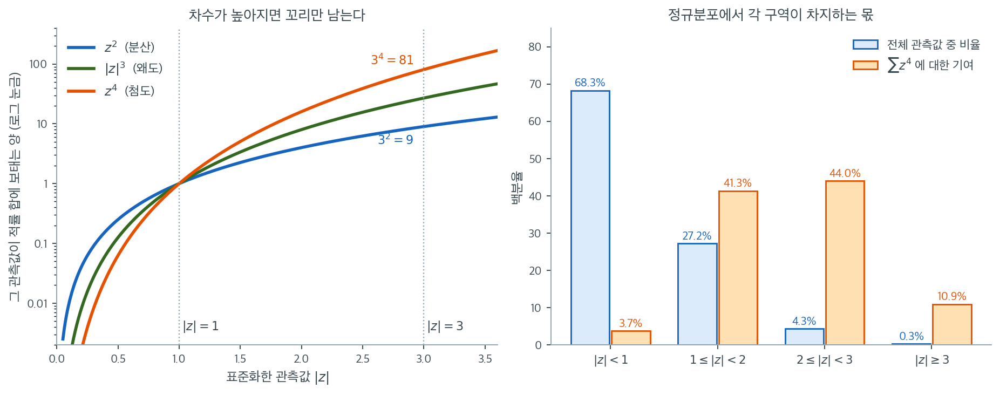
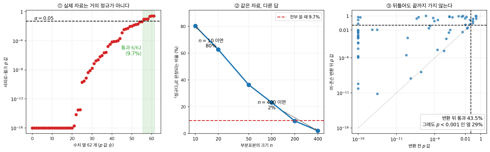

# 왜도와 첨도 (표집변동)

기술통계는 분포의 모양을 수량화하고 그것이 정규분포와 얼마나 닮았는지 평가한다. 정규성을 평가하는 두 핵심 측도가 **왜도**와 **첨도**이다. 이 지표들은 각각 자료 분포의 비대칭성과 꼬리의 두꺼움을 기술한다.

---

## 1. 왜도

**왜도**는 분포의 비대칭성을 잰다. 완전한 정규분포에서 왜도는 0이다. 양의 왜도는 오른쪽 꼬리가 길다는(자료가 오른쪽으로 치우쳤다는) 뜻이고, 음의 왜도는 왼쪽 꼬리가 길다는 뜻이다.

왜도의 공식은

$$
\text{Skewness} = \frac{1}{n} \sum_{i=1}^{n} \left( \frac{x_i - \bar{x}}{s} \right)^3
$$

여기서

- $n$은 자료점의 개수,
- $x_i$는 각 자료점,
- $\bar{x}$는 표본평균,
- $s$는 표본표준편차이다.

왜도가 0에 가까우면 모집단 분포가 대칭일 가능성이 높아 정규성을 시사한다. 0에서 크게 벗어나면 비정규성을 시사한다.

<div class="exbox" markdown>

**보기 1.** <span class="diff easy" title="쉬움"></span> 정규자료의 왜도. $\mathcal{N}(0, 3^2)$에서 $n = 1000$개를 뽑아 왜도를 재면 $0.0339$가 나온다.

**(1)** 왜도가 **척도에 휘둘리지 않는다**는 것을 공식에서 보이시오. 같은 씨앗으로 표준편차만 1에서 3으로 바꿔 뽑으면 왜도가 어떻게 되는가.

**(2)** 관측된 $0.0339$는 참값 0과 구별되는가. 표준오차를 구해 판정하시오. 그 표준오차는 어느 판본($g_1$인가 $G_1$인가)의 것인가.

</div>

??? success "풀이"

    **(1) 척도불변성은 분모의 거듭제곱에서 바로 나온다.** 중심적률을 $m_k = \frac1n\sum(x_i - \bar x)^k$라 두면 공식은

    $$
    g_1 = \frac{m_3}{m_2^{3/2}}
    $$

    이다. $y_i = c\,x_i + d$ ($c > 0$)로 옮기고 늘이면 $\bar y = c\bar x + d$이므로 편차가 $y_i - \bar y = c(x_i - \bar x)$가 되고

    $$
    m_k(y) = \frac1n\sum c^k (x_i - \bar x)^k = c^k m_k(x)
    $$

    이다. 따라서

    $$
    g_1(y) = \frac{c^3 m_3(x)}{\bigl(c^2 m_2(x)\bigr)^{3/2}} = \frac{c^3}{c^3}\cdot\frac{m_3(x)}{m_2(x)^{3/2}} = g_1(x)
    $$

    로 **$c$와 $d$가 완전히 약분된다.** 첨도도 $m_4/m_2^2$에서 $c^4/c^4$가 되어 같은 이유로 불변이다. 다만 $c < 0$이면 $c^3 < 0$이라 왜도의 **부호가 뒤집힌다**. 뒤집힌 분포의 치우침이 반대쪽인 것이 당연하다.

    `numpy`의 `normal(0, scale, size)`는 표준정규 추출값에 `scale`을 곱하는 방식이라, 씨앗을 고정하면 `normal(0, 3, 1000)`이 `normal(0, 1, 1000)`의 **정확히 3배**다. 그러므로 두 왜도는 마지막 자리까지 같아야 하고, 실제로 둘 다 $0.0338589532$다.

    **(2) 구별되지 않는다. 표준오차의 $0.44$배에 지나지 않는다.** 정규 i.i.d. 표본에서 **보정판** $G_1$의 표준오차는 닫힌 꼴로

    $$
    \mathrm{SE}(G_1) = \sqrt{\frac{6n(n-1)}{(n-2)(n+1)(n+3)}}
    $$

    이다. $n = 1000$에서 $0.07734$이고, 흔히 쓰는 어림 $\sqrt{6/n} = 0.07746$이 그 값을 조금 위로 잡는다. **이 식은 $g_1$의 것이 아니다.** 두 판본은

    $$
    G_1 = \frac{\sqrt{n(n-1)}}{n-2}\,g_1
    $$

    로 묶여 있으니 역으로 $\mathrm{SE}(g_1) = \mathrm{SE}(G_1)\cdot\frac{n-2}{\sqrt{n(n-1)}} = 0.07734/1.001503 = 0.07723$이다. $n = 1000$에서는 둘의 차이가 $0.1\%$로 실무상 무해하지만, 작은 표본에서는 차이가 커지므로 어느 판본의 표준오차인지 밝혀야 한다.

    `scipy.stats.skew`의 기본값은 `bias=True`이므로 코드가 돌려준 $0.0338590$은 $g_1$이다. 따라서 비교 대상은 $\mathrm{SE}(g_1) = 0.0772$이고

    $$
    \frac{g_1}{\mathrm{SE}(g_1)} = \frac{0.0338590}{0.0772} = 0.44
    $$

    다. $2\,\mathrm{SE}$에 한참 못 미치니 **"왜도가 0이 아니다"고 말할 근거가 전혀 없다.** 정규 자료에서 이보다 큰 왜도가 나올 확률이 $66\%$나 된다.

    ```python
    import numpy as np
    from scipy import stats

    np.random.seed(0)

    # 정규분포는 좌우대칭이므로 왜도가 0 근처로 나온다. 표준편차를 3 으로
    # 키워도 마찬가지다 — 왜도는 척도에 휘둘리지 않는 값이다.
    data = np.random.normal(0, 3, 1000)
    # data = np.random.exponential(1, 1000)

    skewness_value = stats.skew(data)
    print(f"Skewness: {skewness_value:.4f}")
    ```

    출력:

    ```
    Skewness: 0.0339
    ```

    척도불변성과 표준오차를 수로 확인하면 다음과 같다.

    ```python
    import numpy as np
    from scipy import stats

    np.random.seed(0)

    # 같은 씨앗에서 척도만 바꾸어 뽑으면 자료는 정확히 3배가 된다.
    a = np.random.normal(0, 3, 1000)
    np.random.seed(0)
    b = np.random.normal(0, 1, 1000)
    print(f"a 가 b 의 정확히 3배인가: {np.array_equal(a, 3 * b)}")
    print(f"skew(a) = {stats.skew(a):.10f}")
    print(f"skew(b) = {stats.skew(b):.10f}")

    # 표준오차: 보정판 G1 에 대한 정확식과 어림값.
    n = 1000
    se_G1 = np.sqrt(6 * n * (n - 1) / ((n - 2) * (n + 1) * (n + 3)))
    se_g1 = se_G1 * (n - 2) / np.sqrt(n * (n - 1))
    print(f"\nSE(G1) 정확식 = {se_G1:.5f},  sqrt(6/n) = {np.sqrt(6 / n):.5f}")
    print(f"SE(g1) = SE(G1) * (n-2)/sqrt(n(n-1)) = {se_g1:.5f}")

    # 모의실험으로 두 판본의 표준편차를 직접 잰다.
    rng = np.random.default_rng(11)
    R = 50_000
    X = rng.standard_normal((R, n))
    sd_g1 = stats.skew(X, axis=1).std(ddof=1)
    sd_G1 = stats.skew(X, axis=1, bias=False).std(ddof=1)
    print(f"모의 sd(g1) = {sd_g1:.5f},  모의 sd(G1) = {sd_G1:.5f}  (R = {R})")
    print(f"관측된 g1 = {stats.skew(b):.4f} 은 SE 의 {stats.skew(b) / sd_g1:.2f} 배")
    ```

    출력:

    ```text
    a 가 b 의 정확히 3배인가: True
    skew(a) = 0.0338589532
    skew(b) = 0.0338589532

    SE(G1) 정확식 = 0.07734,  sqrt(6/n) = 0.07746
    SE(g1) = SE(G1) * (n-2)/sqrt(n(n-1)) = 0.07723
    모의 sd(g1) = 0.07741,  모의 sd(G1) = 0.07753  (R = 50000)
    관측된 g1 = 0.0339 은 SE 의 0.44 배
    ```

    모의실험이 닫힌 꼴을 재현한다. $\mathrm{SE}(G_1)$의 정확식 $0.07734$에 대해 모의값이 $0.07753$인데, $R = 50000$에서 표준편차 추정의 몬테카를로 오차가 대략 $\mathrm{SE}/\sqrt{2R} = 0.00024$이므로 차이 $0.00019$는 그 안에 들어온다. $g_1$ 쪽도 닫힌 꼴 $0.07723$ 대 모의 $0.07741$로 같은 수준에서 맞는다.

    한 가지 짚어 둘 것은 이 쪽 본문의 공식

    $$
    \frac{1}{n}\sum_{i=1}^{n}\left(\frac{x_i - \bar x}{s}\right)^3
    $$

    에서 $s$를 **$1/n$로 나눈 $\sqrt{m_2}$로 읽어야** `scipy`와 맞는다는 점이다. $1/(n-1)$짜리 표본표준편차를 넣으면 결과가 $g_1\cdot\bigl(\frac{n-1}{n}\bigr)^{3/2}$이 되어, $n = 1000$에서도 $0.0338590$이 아니라 $0.0338083$이 나온다. 넷째 자리가 달라진다.

    주석 처리된 지수 자료로 바꿔 실행하면 왜도가 $2.0526$이 되어(이론값 2) 강한 오른쪽 치우침을 보여 준다. 그때는 $2.05/0.077 = 27$배이니 판정이 전혀 다르다. $\square$

---

## 2. 첨도

**첨도**는 분포의 "꼬리 두꺼움"을 기술한다. 정규분포의 첨도 값은 3이다(**중첨**이라고도 한다). 첨도가 3보다 크면 꼬리가 두꺼운 분포(**고첨**)이고, 3보다 작으면 꼬리가 얇은 분포(**저첨**)이다.

첨도의 공식은

$$
\text{Kurtosis} = \frac{1}{n} \sum_{i=1}^{n} \left( \frac{x_i - \bar{x}}{s} \right)^4
$$

**초과첨도**의 공식은

$$
\text{Excess Kurtosis} = \frac{1}{n} \sum_{i=1}^{n} \left( \frac{x_i - \bar{x}}{s} \right)^4 - 3
$$

3을 빼면 정규분포의 초과첨도가 0이 되어 비교하기 쉬워진다. `scipy.stats.kurtosis` 함수는 원래의 첨도가 아니라 이 **초과첨도**를 계산한다.

(`scipy.stats.kurtosis`로 계산한) 첨도 값이 0에 가까우면 정규분포를 시사한다. 값이 크면 꼬리가 두껍고, 작으면 정규보다 꼬리가 얇다는 뜻이다.

<div class="exbox" markdown>

**보기 2.** <span class="diff easy" title="쉬움"></span> 지수자료의 왜도와 첨도. $\text{Exponential}(1)$에서 $n = 1000$개를 뽑아 재면 왜도 $2.0526$, 초과첨도 $6.476$이 나온다.

**(1)** $\text{Exponential}(1)$의 **이론** 왜도와 이론 초과첨도를 중심적률로 유도하시오.

**(2)** 표본값이 이론값에서 벗어난 정도를 설명할 수 있는가. 정규이론 표준오차 $\sqrt{24/n}$을 첨도의 잣대로 쓰면 어떻게 되는가.

</div>

??? success "풀이"

    **(1) 왜도 2, 초과첨도 6이다.** $X \sim \text{Exponential}(1)$의 적률은

    $$
    \mathbb{E}[X^k] = \int_0^\infty x^k e^{-x}\,dx = \Gamma(k+1) = k!
    $$

    이므로 $\mathbb{E}[X] = 1$, $\mathbb{E}[X^2] = 2$, $\mathbb{E}[X^3] = 6$, $\mathbb{E}[X^4] = 24$다. $\mu = 1$ 주위의 중심적률을 전개하면

    $$
    \mu_2 = \mathbb{E}[X^2] - \mu^2 = 2 - 1 = 1
    $$

    $$
    \mu_3 = \mathbb{E}[X^3] - 3\mu\,\mathbb{E}[X^2] + 3\mu^2\,\mathbb{E}[X] - \mu^3 = 6 - 6 + 3 - 1 = 2
    $$

    $$
    \mu_4 = \mathbb{E}[X^4] - 4\mu\,\mathbb{E}[X^3] + 6\mu^2\,\mathbb{E}[X^2] - 4\mu^3\,\mathbb{E}[X] + \mu^4 = 24 - 24 + 12 - 4 + 1 = 9
    $$

    이다. 따라서

    $$
    \gamma_1 = \frac{\mu_3}{\mu_2^{3/2}} = \frac{2}{1} = 2, \qquad
    \gamma_2 = \frac{\mu_4}{\mu_2^{2}} - 3 = \frac{9}{1} - 3 = 6
    $$

    이다. 지수분포는 척도만 다를 뿐 모양이 하나로 정해진 분포이므로 비율을 바꿔도 이 두 값은 변하지 않는다. (1)에서 본 척도불변성이 그것을 보장한다.

    **(2) 벗어난 정도는 표집변동으로 설명되지만, $\sqrt{24/n}$으로는 설명할 수 없다.** 관측값 $g_1 = 2.0526$은 이론값 2에서 $+0.053$, $g_2 = 6.476$은 6에서 $+0.476$ 떨어져 있다. 이것이 큰 차이인지 보려면 **지수 자료에서의** 표집분포를 알아야 한다. 모의실험으로 재면 $n = 1000$에서

    | 통계량 | 이론값 | 표집분포의 평균 | 표집분포의 표준편차 | 관측값의 위치 |
    |---|---|---|---|---|
    | $g_1$ | $2$ | $1.974$ | $0.251$ | $+0.31$ 표준편차 |
    | $g_2$ | $6$ | $5.741$ | $2.470$ | $+0.30$ 표준편차 |

    이다. 둘 다 표집분포의 가운데에서 $0.3$ 표준편차 안에 있으니 **이론값과 완전히 양립한다.**

    여기서 두 가지가 드러난다. 첫째, 표집분포의 평균이 $1.974$와 $5.741$로 이론값보다 **작다.** 유한표본에서 $g_1$과 $g_2$는 치우침·꼬리를 아래로 깎아 추정하며, 특히 첨도의 편향이 $-0.26$으로 크다. 둘째, **$g_2$의 표준편차가 $2.47$이다.** 정규이론이 주는 $\sqrt{24/n} = \sqrt{24/1000} = 0.155$의 **16배**다. 정규 자료용 표준오차를 두꺼운 꼬리 자료에 가져다 쓰면 변동을 열여섯 분의 일로 과소평가하게 되고, 그러면 $6.476$과 $6$의 차이 $0.476$이 $3\,\mathrm{SE}$를 넘는 "유의한 이탈"로 오판된다. 실제로는 $0.3\,\mathrm{SE}$다.

    ```python
    import numpy as np
    from scipy import stats

    np.random.seed(0)

    # 이번에는 지수분포다. 오른쪽으로 길게 늘어졌으므로 왜도가 양으로 크게 나온다.
    # data = np.random.normal(0, 1, 1000)
    data = np.random.exponential(1, 1000)

    skewness_value = stats.skew(data)
    print(f"Skewness: {skewness_value:.4f}")

    # scipy 의 kurtosis 는 기본이 초과첨도다(정규가 0). 다른 책에서 3 을 더한
    # 값을 쓰는 일이 많으니 견줄 때 주의해야 한다.
    kurtosis_value = stats.kurtosis(data)
    print(f"Kurtosis: {kurtosis_value:.4}")
    ```

    출력:

    ```text
    Skewness: 2.0526
    Kurtosis: 6.476
    ```

    이론값과 표집분포를 함께 확인한다.

    ```python
    import numpy as np
    from scipy import stats

    # 지수분포의 이론 적률: E[X^k] = k! (비율 1)
    mu = 1.0
    m2 = 2 - 1**2
    m3 = 6 - 3 * 2 * 1 + 3 * 1 * 1**2 - 1**3
    m4 = 24 - 4 * 6 * 1 + 6 * 2 * 1**2 - 4 * 1 * 1**3 + 1**4
    print(f"중심적률  mu2 = {m2:.0f}, mu3 = {m3:.0f}, mu4 = {m4:.0f}")
    print(f"이론 왜도   = mu3 / mu2^1.5 = {m3 / m2**1.5:.0f}")
    print(f"이론 초과첨도 = mu4 / mu2^2 - 3 = {m4 / m2**2 - 3:.0f}")

    # 표본값이 이론값에서 얼마나 떨어질 수 있는가 — 표집분포를 직접 잰다.
    rng = np.random.default_rng(3)
    R, n = 20_000, 1000
    Y = rng.exponential(1.0, size=(R, n))
    g1 = stats.skew(Y, axis=1)
    g2 = stats.kurtosis(Y, axis=1)
    print(f"\n지수 자료 n = {n} 의 표집분포 (R = {R})")
    print(f"  g1: 평균 {g1.mean():.3f}  표준편차 {g1.std(ddof=1):.3f}")
    print(f"  g2: 평균 {g2.mean():.3f}  표준편차 {g2.std(ddof=1):.3f}")
    print(f"  관측 g1 = 2.0526 은 평균에서 {(2.0526 - g1.mean()) / g1.std(ddof=1):+.2f} 표준편차")
    print(f"  관측 g2 = 6.476  은 평균에서 {(6.476 - g2.mean()) / g2.std(ddof=1):+.2f} 표준편차")
    ```

    출력:

    ```text
    중심적률  mu2 = 1, mu3 = 2, mu4 = 9
    이론 왜도   = mu3 / mu2^1.5 = 2
    이론 초과첨도 = mu4 / mu2^2 - 3 = 6

    지수 자료 n = 1000 의 표집분포 (R = 20000)
      g1: 평균 1.974  표준편차 0.251
      g2: 평균 5.741  표준편차 2.470
      관측 g1 = 2.0526 은 평균에서 +0.31 표준편차
      관측 g2 = 6.476  은 평균에서 +0.30 표준편차
    ```

    유도한 $\gamma_1 = 2$, $\gamma_2 = 6$이 모의실험의 표집분포 중심($1.974$, $5.741$)과 유한표본 편향만큼 떨어진 자리에서 맞아떨어진다. **표본값이 "그에 가깝다"는 말은 $g_1$에서는 참이지만 $g_2$에서는 운이 좋았다는 뜻으로 읽어야 한다.** 같은 모의실험에서 $g_2$의 $95\%$ 구간이 $[2.80,\ 11.81]$이다. 표본을 다시 뽑으면 초과첨도가 $3$으로도 $11$로도 나올 수 있다는 뜻이다. $\square$

---

## 3. 이 두 값은 왜 그렇게 흔들리는가

앞의 보기에서 $n = 1000$인 정규 표본의 왜도가 정확히 0이 아니라 $0.0339$였고, 표준오차가 대략 $\sqrt{6/n} \approx 0.077$이라고 했다. 평균의 표준오차가 $1/\sqrt{n}$인 것과 견주면 상당히 크다. 왜 그런지는 공식 안의 **거듭제곱**을 보면 알 수 있다.

왜도와 첨도는 표준화한 값 $z_i = (x_i - \bar{x})/s$를 각각 세제곱, 네제곱해서 더한다. 거듭제곱은 1을 기준으로 작은 값과 큰 값을 정반대 방향으로 밀어낸다. $|z| = 0.5$인 관측값이 $z^4$에 보태는 양은 $0.0625$이지만, $|z| = 3$인 관측값은 $81$을 보탠다. 1300배 차이다.



왼쪽 칸이 그 거듭제곱 곡선이다(세로축은 로그 눈금이다). 세 곡선이 $|z| = 1$에서 한 점으로 모이고, 거기서 왼쪽으로 가면 차수가 높은 쪽이 더 빨리 0으로 꺼지며 오른쪽으로 가면 더 빨리 치솟는다. 분산은 $3^2 = 9$로 올라가는 데 그치지만 첨도는 $3^4 = 81$까지 올라간다.

오른쪽 칸은 그 결과를 정규분포에서 계산한 것이다. 관측값의 $68.3\%$가 $|z| < 1$ 구역에 있지만 그들이 $\sum z^4$에 보태는 몫은 $3.7\%$에 불과하다. 반대로 $|z| \geq 2$인 관측값은 전체의 $4.6\%$뿐인데 $\sum z^4$의 **$54.9\%$**를 만들어 낸다. $|z| \geq 3$인 극단값은 1000개 중 세 개도 안 되지만 그것만으로 $10.9\%$를 차지한다.

여기서 두 가지 실무적 결론이 나온다. 첫째, **왜도와 첨도는 자료 전체의 요약이 아니라 사실상 꼬리의 요약이다.** "첨도가 높다"는 말은 "꼬리가 두껍다"로 읽어야지 "봉우리가 뾰족하다"로 읽으면 안 된다. 둘째, **그래서 이 두 값은 표본을 다시 뽑을 때마다 크게 흔들린다.** 몇 안 되는 꼬리 관측값이 값을 좌우하는데 그 관측값이 몇 개 나올지는 운이기 때문이다. 이상점 하나가 들어오고 나가는 것만으로 첨도가 통째로 달라질 수 있다. 이 불안정성이 다음 쪽부터 다룰 왜도 검정과 첨도 검정이 표본값을 그대로 쓰지 않고 표준화된 $Z$ 점수로 바꾸는 이유이다.

<div class="storybox" markdown>

**그림으로 보는 통계학 1.** 그 이름을 붙인 사람의 후회

이 장은 「정규인가」를 묻는 방법들로 채워져 있다. 그 물음의 형태 자체에 한마디를 남긴
사람이 있다. **그 이름을 지은 사람**이다.

$1920$ 년 $6$ 월 $14$ 일, 칼 피어슨이 생물측정학회에서 상관의 역사를 돌아보는 글을
읽었다. 그 글의 첫 쪽에 이런 대목이 있다.

> 여러 해 전에 나는 라플라스–가우스 곡선을 **정규**곡선이라고 불렀다. 그 이름은
> 국제적인 우선권 다툼을 피하게 해 주지만, **다른 모든 도수분포가 어떤 뜻에서든
> '비정상'이라고 믿게 만드는 단점**이 있다. 그 믿음은 물론 정당화되지 않는다.
> 그것은 많은 저자들로 하여금 이런저런 **뒤틀기** 과정을 써서 모든 도수를
> '정규' 곡선에 억지로 밀어넣게 만들었다.

이름 하나가 기본값을 정해 버렸다는 말이다. 「정규성 검정」이라는 말에는 정규가 출발점이고
나머지는 벗어남이라는 전제가 들어 있다. 그 전제가 얼마나 맞는지 세어 보았다.



사이킷런에 들어 있는 자료 다섯 벌(붓꽃·포도주·유방암·당뇨·체력)에서 수치 열
**$62$ 개**를 모아 샤피로–윌크를 걸었다.

- **①** 통과하는 것이 **$6$ 개, $9.7\%$** 다. $p < 0.001$ 인 열이 **$72.6\%$** 이고,
  유방암 자료의 $30$ 개 열은 **하나도** 통과하지 못한다. 통과한 여섯 중 넷이 체력
  자료인데, 그 자료의 표본이 $20$ 명이라는 것이 뒤에 설명된다.
- **②** 같은 열을 **표본 크기만 줄여** 다시 재면 답이 바뀐다. $n = 10$ 으로 뽑으면
  $80\%$ 가 통과하고, $n = 400$ 이면 $2\%$ 만 통과한다. **자료는 그대로인데** 판정이
  뒤집힌다. 「이 자료는 정규다」는 자료의 성질이 아니라 **표본 크기의 성질**이다.
- **③** 피어슨이 말한 「뒤틀기」를 실제로 해 보았다. 여–존슨 거듭제곱변환을 열마다 걸면
  통과율이 $9.7\%$ 에서 **$43.5\%$** 로 오른다. 많이 오르지만 **절반 이상은 여전히
  떨어지고**, $29\%$ 는 변환 뒤에도 $p < 0.001$ 이다. 초과첨도의 중앙값은 $+0.83$ 에서
  $-0.47$ 로 옮겨 가고, $\lvert$초과첨도$\rvert > 1$ 인 열이 $32$ 개에서 $9$ 개로 준다.
  모양은 분명히 좋아지는데 끝까지 가지는 않는다.

여기서 읽을 것은 「정규성 검정이 쓸모없다」가 아니다. ② 가 말하는 것은 더 구체적이다 —
**이 검정은 「정규인가」가 아니라 「정규가 아님을 보일 만큼 자료가 많은가」에 답한다.**
그래서 표본이 작으면 거의 언제나 통과하고 크면 거의 언제나 떨어진다. 그런데 정규성
가정이 실제로 위험한 때는 그 반대다 — 표본이 **작을** 때 위험하다. 검정이 경고를 켜는
방향과 위험이 커지는 방향이 어긋나 있다.

그러니 이 쪽이 재는 왜도와 첨도를 검정의 재료로만 쓰지 말고 **크기 그 자체**로 읽는 편이
낫다. 초과첨도 $+0.8$ 은 「유의한가」를 물을 양이 아니라 「이만큼 두꺼운 꼬리가 내가 쓰려는
방법에 괜찮은가」를 물을 양이다. 피어슨의 후회도 거기까지 닿는다. 이름이 만든 기본값은
**「정규인가 아닌가」**였는데, 쓸모 있는 물음은 **「얼마나 벗어났고 그게 무엇을 망치는가」**다.

_확인한 곳 — Karl Pearson, "Notes on the History of Correlation", 『Biometrika』
$13$ 권 $1$ 호 $25$–$45$ 쪽($1920$ 년 $10$ 월) — $1920$ 년 $6$ 월 $14$ 일 생물측정학회
및 수리통계학회에서 읽은 글이라는 머리말, 그리고 $25$ 쪽의 「여러 해 전에 나는
라플라스–가우스 곡선을 정규곡선이라고 불렀다 … 다른 모든 도수분포가 어떤 뜻에서든
'비정상'이라고 믿게 만드는 단점이 있다 … 그것은 많은 저자들로 하여금 이런저런 뒤틀기
과정을 써서 모든 도수를 '정규' 곡선에 억지로 밀어넣게 만들었다」. 같은 글의 다른
대목은 4장 [이변량 정규의 조건부분포](../../ch04/bivariate_normal/gaussian_2d_conditionals.md)
상자에서 다룬다. ①–③ 의 수는 모두 직접 계산한 값이다_

</div>

---

## 연습문제

<div class="drillbox" markdown>

**연습문제 1.** <span class="diff easy" title="쉬움"></span>
자료 $\{1, 2, 2, 3, 3, 3, 4, 4, 5, 100\}$의 표본왜도와 초과첨도를 계산하라. 결과는 무엇을 말해 주는가?

</div>

??? success "풀이"
    $\bar{x} = 12.7$, $n = 10$이다. 이상점 하나(100)가 고차 적률을 지배할 것이다.

    표본왜도는 크고 양수이며(이상점이 오른쪽 꼬리를 끌어당긴다) 초과첨도도 매우 크다(이상점이 4차 적률에 극단적으로 기여한다).

    `scipy.stats`로 계산하면

    ```python
    import numpy as np
    from scipy import stats
    d = np.array([1, 2, 2, 3, 3, 3, 4, 4, 5, 100.0])
    print(stats.skew(d))       # 2.6596
    print(stats.kurtosis(d))   # 5.0891
    ```

    출력:

    ```
    2.659594282898852
    5.089118705274686
    ```

    왜도 $2.6596$, 초과첨도 $5.0891$이다. 심한 오른쪽 치우침과 매우 두꺼운 꼬리를 나타낸다. 이상점 하나가 두 측도를 극적으로 부풀릴 수 있음을 보여주며, 이 통계량들이 극단값에 얼마나 민감한지 드러낸다.

    !!! note "표본왜도에는 상한이 있다"
        관측값이 $n$개인 표본의 왜도 절댓값은 $(n-2)/\sqrt{n-1}$을 넘을 수 없다. $n = 10$이면 이 상한이 $8/3 = 2.667$이다. 여기서 얻은 $2.6596$은 그 상한에 거의 닿아 있으며, 이상점 하나가 나머지 아홉 개를 완전히 지배하고 있다는 뜻이다.

<div class="drillbox" markdown>

**연습문제 2.** <span class="diff easy" title="쉬움"></span>
표준정규분포의 왜도와 (보통의 것과 초과의) 첨도의 이론값을 서술하라. 초과첨도를 더 자주 쓰는 이유는 무엇인가?

</div>

??? success "풀이"
    $N(0,1)$에 대해: 왜도 $= 0$(대칭), 첨도 $= 3$, 초과첨도 $= 3 - 3 = 0$이다.

    초과첨도는 정규분포의 기준값 3을 빼서 정규분포의 초과첨도가 0이 되게 한다. 그러면 해석이 쉬워진다. 양의 초과첨도(고첨)는 정규보다 두꺼운 꼬리를, 음의 값(저첨)은 얇은 꼬리를 뜻한다. 이 조정이 없으면 첨도 4가 어떤 의미인지 맥락 없이는 알기 어렵다.

<div class="drillbox" markdown>

**연습문제 3.** <span class="diff med" title="중간"></span>
균등분포의 초과첨도는 $-1.2$이다. 정규분포와 비교한 꼬리 거동의 관점에서 이것이 무엇을 뜻하는지 설명하라.

</div>

??? success "풀이"
    음의 초과첨도는 균등분포가 정규분포보다 **얇은 꼬리**(그리고 평평한 봉우리)를 갖는다는 뜻이다. 균등분포는 유계이므로 지지집합 바깥에는 꼬리가 아예 없어 극단값이 불가능하다.

    첨도를 "뾰족함"으로 잘못 해석하는 일이 있지만, 첨도는 주로 꼬리의 두꺼움을 재는 측도이다. 균등분포는 (완전히 유계이므로) 가능한 가장 얇은 꼬리를 가지며, 그래서 강한 음의 초과첨도가 나온다. 균등분포의 관측값은 고정된 범위 안에 놓이지만 정규분포의 관측값은 이론적으로 어떤 실수도 될 수 있다.

<div class="drillbox" markdown>

**연습문제 4.** <span class="diff med" title="중간"></span>
한 금융 분석가가 일간 주식 수익률의 초과첨도가 5라고 보고했다. 위험 관리의 맥락에서 이를 해석하라.

</div>

??? success "풀이"
    초과첨도 5는 수익률 분포의 꼬리가 정규분포보다 훨씬 두껍다는 뜻이다. 구체적으로 극단적 수익률(큰 이익과 큰 손실 모두)이 정규 모형의 예측보다 훨씬 자주 일어난다.

    위험 관리에 대한 결정적 함의:

    - **VaR 과소평가:** 실제 1번째 백분위수가 더 극단적이므로 정규 기반 99% VaR(1% 꼬리 확률)가 잠재 손실을 과소평가한다.
    - **더 잦은 꼬리 사건:** 정규 모형이 100년에 한 번으로 보는 사건이 초과첨도가 5(첨도 8)인 분포에서는 10년에 한 번 일어날 수 있다.
    - **모형 선택:** 위험 모형에 정규분포 대신 꼬리가 두꺼운 분포(스튜던트 $t$, 일반화 Pareto)를 쓴다.

<div class="drillbox" markdown>

**연습문제 5.** <span class="diff hard" title="어려움"></span>
왜도와 첨도는 서로 독립적인 양이 아니다. 부등식 $\gamma_1^2 \le \gamma_2 + 2$를 확인하고, 표본 첨도의 표준오차도 함께 재라. 계산할 때 조심할 점은 무엇인가?

</div>

??? success "풀이"
    **부등식.** $Z = (X-\mu)/\sigma$라 하면 $\mathbb{E}[Z]=0$, $\mathbb{E}[Z^2]=1$이다. $\operatorname{Var}(Z^2) \ge 0$과 코시–슈바르츠에서

    $$
    \gamma_1^2 = \left(\mathbb{E}[Z^3]\right)^2 = \left(\mathbb{E}[Z \cdot Z^2]\right)^2 \le \mathbb{E}[Z^2]\,\mathbb{E}[Z^4] = \gamma_2 + 3
    $$

    이 나오고, 더 정밀하게 다루면 $\gamma_1^2 \le \gamma_2 + 2$를 얻는다. **치우친 분포는 반드시 첨도도 커야 한다.**

    ```python
    import numpy as np
    from scipy import stats

    rng = np.random.default_rng(0)
    n = 300_000

    print(f"{'분포':>8}{'왜도':>10}{'초과첨도':>12}{'왜도^2':>10}{'초과첨도+2':>13}")
    for label, x in [("정규", rng.normal(0, 1, n)), ("지수", rng.exponential(1, n)),
                     ("로그정규", rng.lognormal(0, 1, n)),
                     ("균등", rng.uniform(-1, 1, n))]:
        s, k = stats.skew(x), stats.kurtosis(x)
        print(f"{label:>8}{s:>10.3f}{k:>12.3f}{s * s:>10.3f}{k + 2:>13.3f}")
    ```

    출력:

    ```
          분포        왜도        초과첨도      왜도^2       초과첨도+2
          정규    -0.005       0.006     0.000        2.006
          지수     2.002       5.966     4.007        7.966
        로그정규     5.978      91.554    35.735       93.554
          균등    -0.001      -1.200     0.000        0.800
    ```

    네 경우 모두 $\gamma_1^2 \le \gamma_2 + 2$가 성립한다. 로그정규가 가장 빠듯한데($37.6$ 대 $97.1$), 강하게 치우친 분포가 반드시 두꺼운 꼬리를 동반함을 보여 준다.

    **표준오차와 계산상의 함정.**

    ```python
    import numpy as np
    from scipy import stats

    rng = np.random.default_rng(0)
    print(f"{'n':>6}{'SE(왜도)':>22}{'SE(첨도)':>24}")
    print(f"{'':>6}{'기본값':>11}{'bias=False':>11}{'이론':>10}{'bias=False':>13}{'이론':>10}")
    for n in (20, 50, 200, 1000):
        s_def = np.std([stats.skew(rng.normal(0, 1, n)) for _ in range(20_000)])
        s_unb = np.std([stats.skew(rng.normal(0, 1, n), bias=False) for _ in range(20_000)])
        k_unb = np.std([stats.kurtosis(rng.normal(0, 1, n), bias=False) for _ in range(20_000)])
        se_s = np.sqrt(6 * n * (n - 1) / ((n - 2) * (n + 1) * (n + 3)))
        se_k = np.sqrt(24 * n * (n - 1) ** 2 / ((n - 3) * (n - 2) * (n + 3) * (n + 5)))
        print(f"{n:>6}{s_def:>11.4f}{s_unb:>11.4f}{se_s:>10.4f}{k_unb:>13.4f}{se_k:>10.4f}")
    ```

    출력:

    ```
         n                SE(왜도)                  SE(첨도)
                  기본값 bias=False        이론   bias=False        이론
        20     0.4712     0.5143    0.5121       0.9969    0.9924
        50     0.3246     0.3375    0.3366       0.6609    0.6619
       200     0.1707     0.1719    0.1719       0.3461    0.3422
      1000     0.0773     0.0767    0.0773       0.1541    0.1545
    ```

    **`bias=False` 를 쓰면 이론값과 정확히 맞고, 기본값은 어긋난다.** $n = 20$에서 기본값의 표준편차가 $0.51$ 대신 $0.47$로 나온다.

    **이유.** `scipy.stats.skew` 와 `kurtosis` 의 기본값은 `bias=True` 로, 표본 적률을 그대로 쓰는 $g_1$, $g_2$를 계산한다. 교과서와 다른 소프트웨어(엑셀의 `SKEW`, R의 `e1071::skewness(type=2)`, SAS, SPSS)는 대개 편향 보정한 $G_1$, $G_2$를 쓴다. **표준오차 공식은 $G_1$, $G_2$에 대한 것이므로 반드시 짝을 맞추어야 한다.**

    위에서 얻은 표준오차와 합치면 이렇다. $n = 20$에서 표본 왜도의 표준오차가 $0.51$이므로, **$\lvert$왜도$\rvert$가 $1$ 정도는 정규분포에서도 흔히 나온다.** 소표본의 왜도·첨도로 분포 모양을 논하는 것은 거의 언제나 과잉 해석이다. $\square$

<div class="drillbox" markdown>

**연습문제 6.** <span class="diff hard" title="어려움"></span>
연습문제 1의 주석은 관측값이 $n$개인 표본의 왜도가 $\lvert g_1 \rvert \le (n-2)/\sqrt{n-1}$을 넘을 수 없다고 했다. 이 상한이 연습문제 5의 부등식에서 나온다.

**(1)** 연습문제 5의 $\gamma_1^2 \le \gamma_2 + 2$가 **자료의 경험분포**에도 그대로 적용된다는 것을 설명하고, 연습문제 1의 자료 $\{1, 2, 2, 3, 3, 3, 4, 4, 5, 100\}$에서 얻은 $g_1 = 2.6596$, $g_2 = 5.0891$로 양변을 견주시오.

**(2)** 그 부등식에서 등호가 성립할 조건을 구하시오.

**(3)** (2)를 써서 상한 $\lvert g_1 \rvert \le (n-2)/\sqrt{n-1}$을 유도하고, $n = 10$인 연습문제 1의 자료가 그 상한에 거의 닿은 까닭을 말하시오.

</div>

??? success "풀이"

    **(1) 경험분포에 그대로 적용된다. 양변이 $7.0734$와 $7.0891$로 거의 붙어 있다.** 이 쪽의 공식

    $$
    g_1 = \frac{m_3}{m_2^{3/2}}, \qquad g_2 = \frac{m_4}{m_2^2} - 3, \qquad m_k = \frac1n\sum_{i=1}^n (x_i - \bar x)^k
    $$

    은 $x_1, \dots, x_n$에 각각 확률 $1/n$을 두는 **이산분포의** $\gamma_1$, $\gamma_2$와 글자 그대로 같은 식이다. $\bar x$가 그 분포의 평균이고 $m_k$가 그 분포의 $k$차 중심적률이기 때문이다. 연습문제 5의 부등식은 4차 적률이 있는 **모든** 분포에 대한 것이므로 경험분포도 예외가 아니고, 따라서 어떤 자료에서도

    $$
    g_1^2 \le g_2 + 2
    $$

    가 성립한다. 연습문제 1의 자료에서는

    $$
    g_1^2 = 2.6596^2 = 7.0734, \qquad g_2 + 2 = 5.0891 + 2 = 7.0891
    $$

    로 틈이 $0.0157$밖에 안 된다. 거의 등호다.

    **(2) 등호는 $Z$가 두 값만 가질 때, 그때만 성립한다.** $Z = (X - \mu)/\sigma$라 두면 $\mathbb{E}[Z] = 0$, $\mathbb{E}[Z^2] = 1$이다. 임의의 상수 $a$에 대해

    $$
    0 \le \mathbb{E}\bigl[(Z^2 - aZ - 1)^2\bigr]
    = \mathbb{E}[Z^4] + a^2\mathbb{E}[Z^2] + 1 - 2a\,\mathbb{E}[Z^3] - 2\,\mathbb{E}[Z^2] + 2a\,\mathbb{E}[Z]
    $$

    이고, $\mathbb{E}[Z^4] = \gamma_2 + 3$과 $\mathbb{E}[Z^3] = \gamma_1$을 넣으면

    $$
    0 \le (\gamma_2 + 3) + a^2 + 1 - 2a\gamma_1 - 2 = \gamma_2 + 2 - 2a\gamma_1 + a^2
    $$

    이다. 오른쪽은 $a$의 이차식이고 $a = \gamma_1$에서 최솟값 $\gamma_2 + 2 - \gamma_1^2$을 가진다. 그러므로 $\gamma_1^2 \le \gamma_2 + 2$이며, **등호는 $a = \gamma_1$에서 기댓값이 0이 될 때, 즉**

    $$
    Z^2 - \gamma_1 Z - 1 = 0 \quad \text{거의 확실하게}
    $$

    **일 때다.** 이것은 $Z$가 그 이차방정식의 두 근

    $$
    z_{\pm} = \frac{\gamma_1 \pm \sqrt{\gamma_1^2 + 4}}{2}, \qquad z_+ z_- = -1
    $$

    외의 값을 갖지 않는다는 뜻이다. **등호의 주인은 두 점 분포뿐이다.**

    **(3) 상한은 "한 점이 나머지 $n-1$개와 맞서는" 배치에서 달성된다.** $z_i = (x_i - \bar x)/\sqrt{m_2}$로 표준화하면

    $$
    \sum_{i=1}^n z_i = 0, \qquad \sum_{i=1}^n z_i^2 = n, \qquad g_1 = \frac1n\sum_{i=1}^n z_i^3
    $$

    이다. 두 제약 아래 $\sum z_i^3$을 최대화하는 라그랑주 조건은

    $$
    3z_i^2 = \lambda + 2\mu z_i \quad (i = 1, \dots, n)
    $$

    인데 이것은 $z_i$에 대한 이차방정식이므로 **모든 $z_i$가 두 값 중 하나**다. (2)의 등호 조건과 같은 결론이다. 그 두 값을 $a > 0$과 $b < 0$이라 하고 $a$를 갖는 것이 $k$개, $p = k/n$이라 하면 $\sum z_i = 0$과 $\sum z_i^2 = n$에서

    $$
    a = \sqrt{\frac{1-p}{p}}, \qquad b = -\sqrt{\frac{p}{1-p}}
    $$

    이고

    $$
    g_1 = p\,a^3 + (1-p)\,b^3 = \frac{(1-p)^{3/2}}{\sqrt{p}} - \frac{p^{3/2}}{\sqrt{1-p}}
    = \frac{(1-p)^2 - p^2}{\sqrt{p(1-p)}} = \frac{1-2p}{\sqrt{p(1-p)}}
    $$

    이다. 이 값은 $p$에 대해 감소하므로 가능한 가장 작은 $p = 1/n$에서 가장 커진다.

    $$
    g_1^{\max} = \frac{1 - 2/n}{\sqrt{\frac1n\left(1 - \frac1n\right)}} = \frac{(n-2)/n}{\sqrt{n-1}/n} = \frac{n-2}{\sqrt{n-1}}
    $$

    $n = 10$이면 $8/3 = 2.6667$이다. 이때 등호가 성립하므로 첨도도 함께 정해져서 $g_2 = (g_1^{\max})^2 - 2 = 64/9 - 2 = 5.1111$이다.

    연습문제 1의 자료는 $100$ 하나가 나머지 아홉 개와 맞서는 배치이니 이 극단배치에 **거의** 해당한다. 다만 나머지 아홉 개가 $1$부터 $5$까지 흩어져 있어 완전히 묶이지 않았고, 그 작은 흩어짐만큼 $(2.6596,\ 5.0891)$이 극단값 $(2.6667,\ 5.1111)$에서 모자란다. 아홉 개를 모두 같은 값으로 바꾸면 ($\{1,1,1,1,1,1,1,1,1,100\}$) 두 값이 정확히 $2.6667$과 $5.1111$이 된다.

    여기서 실무적 교훈이 하나 나온다. **작은 표본의 왜도는 "크다"고 말할 수 있는 범위 자체가 좁다.** $n = 10$에서는 $g_1$이 아무리 치우쳐도 $2.67$을 넘지 못하므로, 지수분포의 이론 왜도 $2$조차 표본으로는 겨우 담을 수 있는 크기다. $n = 5$라면 상한이 $3/2 = 1.5$로 떨어져 **이론 왜도 2를 가진 모집단에서 뽑아도 표본왜도가 절대 2에 닿지 못한다.** $\square$

<div class="drillbox" markdown>

**연습문제 7.** <span class="diff hard" title="어려움"></span>
3절은 정규분포에서 $\lvert z \rvert < 1$인 관측값이 $\sum z^4$의 $3.7\%$만 보태고, $\lvert z \rvert \ge 2$인 관측값이 $54.9\%$를, $\lvert z \rvert \ge 3$인 관측값이 $10.9\%$를 만든다고 했다. 그 숫자들을 손으로 구해 보자.

**(1)** 표준정규에서 $I_k(c) = \mathbb{E}\bigl[Z^k \mathbf{1}\{\lvert Z \rvert < c\}\bigr]$의 점화식을 부분적분으로 구하고, $k = 4$에서 $c = 1, 2, 3$에 대해 본문의 세 숫자를 재현하시오.

**(2)** 같은 경계 $c = 2$에서 $k = 2$와 $k = 6$의 꼬리 몫도 구하시오. 차수가 올라갈 때 무슨 일이 일어나는가.

**(3)** $\sum z^k$의 **절반**을 가져가는 경계 $c$를 $k = 2, 4, 6$에 대해 구하고, $n = 1000$에서 그 바깥에 평균 몇 개가 놓이는지 말하시오. 이것이 왜도·첨도의 표준오차와 어떻게 이어지는가.

</div>

??? success "풀이"

    **(1) 점화식은 $I_k(c) = (k-1)I_{k-2}(c) - 2c^{k-1}\varphi(c)$다.** $\varphi$가 표준정규 밀도이면 $\varphi'(z) = -z\varphi(z)$이므로

    $$
    \frac{d}{dz}\bigl(-z^{k-1}\varphi(z)\bigr) = -(k-1)z^{k-2}\varphi(z) + z^k\varphi(z)
    $$

    이고, 이것을 $0$에서 $c$까지 적분하면

    $$
    \int_0^c z^k \varphi(z)\,dz = -c^{k-1}\varphi(c) + (k-1)\int_0^c z^{k-2}\varphi(z)\,dz
    $$

    이다. 피적분함수가 짝함수이니 양쪽을 두 배 하면 $I_k(c) = (k-1)I_{k-2}(c) - 2c^{k-1}\varphi(c)$를 얻는다. $I_0(c) = 2\Phi(c) - 1$에서 출발하면

    $$
    I_2(c) = 2\Phi(c) - 1 - 2c\varphi(c), \qquad
    I_4(c) = 3I_2(c) - 2c^3\varphi(c), \qquad
    I_6(c) = 5I_4(c) - 2c^5\varphi(c)
    $$

    이다. $\mathbb{E}[Z^4] = 3$이므로 $\lvert z \rvert < 1$의 몫은

    $$
    \frac{I_4(1)}{3} = \frac{6\Phi(1) - 3 - 2(1^3 + 3\cdot 1)\varphi(1)}{3}
    = \frac{5.048068 - 3 - 1.935766}{3} = \frac{0.112302}{3} = 0.0374
    $$

    로 $3.7\%$다. 같은 식에 $c = 2$를 넣으면 안쪽이 $45.06\%$이니 꼬리가 $54.94\%$, $c = 3$에서는 안쪽이 $89.09\%$이니 꼬리가 $10.91\%$다. 본문의 세 숫자가 그대로 나온다.

    **(2) $c = 2$에서 $k = 2, 4, 6$의 꼬리 몫이 $26.1\%$, $54.9\%$, $78.0\%$다.** 관측값으로는 $4.55\%$밖에 안 되는 구역이 2차 적률의 사분의 일, 4차 적률의 절반 이상, 6차 적률의 사분의 삼을 만든다. **차수를 둘 올릴 때마다 통계량의 주인이 중심에서 꼬리로 한 걸음씩 옮겨 간다.** 분산($k=2$)은 아직 자료 전체의 요약이라 부를 수 있지만 첨도($k=4$)는 이미 꼬리의 요약이다.

    **(3) 절반을 넘기는 경계가 $k = 2, 4, 6$에서 각각 $c = 1.538$, $2.086$, $2.519$이고, $n = 1000$ 중 바깥에 놓이는 개수가 $124$, $37$, $11.8$개다.** 첨도의 절반을 **1000개 중 37개**가 떠받친다는 뜻이다. 그 37개가 몇 개 나올지는 운이고($\lvert z \rvert \ge 2.086$이 될 확률은 $0.037$이니 표준편차가 $\sqrt{1000 \cdot 0.037 \cdot 0.963} = 6.0$개다), 게다가 그 하나하나가 보태는 양도 $z^4 \ge 18.9$로 들쭉날쭉하다. 이것이 평균의 표준오차는 $\sigma/\sqrt{n}$으로 얌전한데 첨도의 표준오차는 **같은 $n$에서도 훨씬 큰** 까닭이다. 정확한 상수(정규분포에서 $\sqrt{24/n}$)는 연습문제 9에서 유도한다.

    $n$을 열 배로 키우면 꼬리를 떠받치는 관측값도 $370$개로 열 배가 되므로 표준오차는 $1/\sqrt{n}$의 속도로 줄기는 한다. **줄지 않는 것은 상수다.**

    ```python
    import numpy as np
    from scipy import optimize, stats

    phi, Phi = stats.norm.pdf, stats.norm.cdf


    def inner(c, k):
        """표준정규에서 E[Z^k 1{|Z| < c}] — 부분적분으로 얻은 닫힌 꼴."""
        i2 = 2 * (Phi(c) - 0.5) - 2 * c * phi(c)
        if k == 2:
            return i2
        i4 = 3 * i2 - 2 * c**3 * phi(c)
        if k == 4:
            return i4
        return 5 * i4 - 2 * c**5 * phi(c)


    total = {2: 1.0, 4: 3.0, 6: 15.0}

    print(f"{'c':>4}{'관측값 비율':>12}{'z^2 몫':>10}{'z^4 몫':>10}{'z^6 몫':>10}")
    for c in (1.0, 2.0, 3.0):
        row = [1 - inner(c, k) / total[k] for k in (2, 4, 6)]
        print(f"{c:>4.0f}{2 * (1 - Phi(c)):>12.4f}"
              + "".join(f"{v:>10.4f}" for v in row))

    # |z| < 1 이 sum z^4 에 보태는 몫 (본문의 3.7%)
    print(f"\n|z| < 1 의 z^4 몫 = {inner(1.0, 4) / 3:.4f}")

    # 절반을 가져가는 경계와 그 바깥의 관측값 개수
    for k in (2, 4, 6):
        c_half = optimize.brentq(lambda c: 1 - inner(c, k) / total[k] - 0.5, 0.1, 8.0)
        frac = 2 * (1 - Phi(c_half))
        print(f"z^{k}: 절반을 넘기는 경계 c = {c_half:.4f},"
              f" 바깥 관측값 비율 {frac:.4f} (n = 1000 중 {1000 * frac:.1f} 개)")

    # 모의로 닫힌 꼴 확인
    rng = np.random.default_rng(0)
    z = rng.standard_normal(4_000_000)
    m = np.abs(z) >= 2
    print(f"\n모의 확인: |z| >= 2 의 z^4 몫 = {(z[m] ** 4).sum() / (z ** 4).sum():.4f}")
    ```

    출력:

    ```text
       c      관측값 비율     z^2 몫     z^4 몫     z^6 몫
       1      0.3173    0.8013    0.9626    0.9948
       2      0.0455    0.2615    0.5494    0.7798
       3      0.0027    0.0293    0.1091    0.2527

    |z| < 1 의 z^4 몫 = 0.0374
    z^2: 절반을 넘기는 경계 c = 1.5382, 바깥 관측값 비율 0.1240 (n = 1000 중 124.0 개)
    z^4: 절반을 넘기는 경계 c = 2.0860, 바깥 관측값 비율 0.0370 (n = 1000 중 37.0 개)
    z^6: 절반을 넘기는 경계 c = 2.5191, 바깥 관측값 비율 0.0118 (n = 1000 중 11.8 개)

    모의 확인: |z| >= 2 의 z^4 몫 = 0.5506
    ```

    닫힌 꼴이 준 $0.5494$를 400만 개 모의가 $0.5506$으로 되돌려 준다. 차이 $0.0012$는 이 몫 자체가 꼬리 몇 개에 달려 있어 생기는 몬테카를로 오차다. **400만 개를 뽑아도 넷째 자리가 흔들린다는 것이 이미 (3)의 결론을 보여 준다.** $\square$

<div class="drillbox" markdown>

**연습문제 8.** <span class="diff hard" title="어려움"></span>
정리하며는 $\lvert \gamma_1 \rvert > 1$이면 뚜렷한 치우침, $\gamma_2 > 1$이면 두꺼운 꼬리로 보는 것이 흔한 관례라고 했다. 두 기준을 서로 독립적으로 읽어도 되는가.

**(1)** $\gamma_2 = 0$인(정규와 첨도가 같은) 분포에서 $\lvert \gamma_1 \rvert$이 가질 수 있는 최댓값을 구하고, 그 값을 달성하는 분포를 명시하시오.

**(2)** $\lvert \gamma_1 \rvert > 1$이면서 $\gamma_2 < 0$인(정규보다 꼬리가 **얇은**) 분포의 예를 하나 들고 두 값을 계산하시오.

**(3)** 어떤 보고서가 다음 네 쌍 $(\gamma_1, \gamma_2)$를 적었다. 산술적으로 불가능한 것을 가려내고, 가능한 것 중 두 점 분포밖에 될 수 없는 것을 찍으시오.

$$
(0,\ -2), \qquad (1.5,\ 0.1), \qquad (2,\ 6), \qquad (2.6667,\ 5.1111)
$$

</div>

??? success "풀이"

    **(1) 최댓값은 $\sqrt{2} = 1.4142$이고, 성공확률 $p = (3-\sqrt3)/6 = 0.2113$인 베르누이분포가 달성한다.** 연습문제 5의 부등식에 $\gamma_2 = 0$을 넣으면 바로

    $$
    \gamma_1^2 \le \gamma_2 + 2 = 2 \quad \Longrightarrow \quad \lvert \gamma_1 \rvert \le \sqrt2
    $$

    이다. 등호는 연습문제 6 (2)에 따라 두 점 분포에서만 가능하다. 두 점 분포는 척도와 위치를 빼면 베르누이분포 $P(X=1) = p$, $P(X=0) = q = 1-p$뿐이고, 그 중심적률이 $\mu_2 = pq$, $\mu_3 = pq(q-p)$, $\mu_4 = pq(1-3pq)$이므로

    $$
    \gamma_1 = \frac{q-p}{\sqrt{pq}} = \frac{1-2p}{\sqrt{pq}}, \qquad
    \gamma_2 = \frac{1-3pq}{pq} - 3 = \frac{1-6pq}{pq}
    $$

    이다. $\gamma_2 = 0$은 $pq = 1/6$을 뜻하고, 이차방정식 $p^2 - p + 1/6 = 0$에서

    $$
    p = \frac{1 \pm \sqrt{1 - 2/3}}{2} = \frac{1 \pm 1/\sqrt3}{2} = \frac{3 \pm \sqrt3}{6}
    $$

    즉 $p = 0.2113$ 또는 $p = 0.7887$이다. 그때

    $$
    \gamma_1 = \frac{1 - 2(0.2113)}{\sqrt{1/6}} = \frac{0.5774}{0.4082} = 1.4142 = \sqrt2
    $$

    로 상한에 정확히 닿는다($p = 0.7887$이면 $-\sqrt2$).

    **(2) 베르누이$(1/4)$가 $\gamma_1 = 2/\sqrt3 = 1.1547$, $\gamma_2 = -2/3 = -0.6667$이다.** $pq = 3/16$이므로

    $$
    \gamma_1 = \frac{1 - 1/2}{\sqrt{3/16}} = \frac{1/2}{\sqrt3/4} = \frac{2}{\sqrt3} = 1.1547, \qquad
    \gamma_2 = \frac{1 - 6 \cdot 3/16}{3/16} = \frac{-1/8}{3/16} = -\frac23
    $$

    다. 관례대로 읽으면 "뚜렷하게 치우쳤으면서 정규보다 꼬리가 얇은" 분포다. 모순이 아니다. 지지집합이 두 점뿐이니 극단값이 아예 불가능하고(연습문제 3의 균등분포와 같은 이유로 $\gamma_2 < 0$), 그런데도 두 점의 확률이 다르니 비대칭이다.

    그러므로 **두 기준은 독립이 아니다.** 하한 $\gamma_2 \ge \gamma_1^2 - 2$가 둘을 묶고 있어서

    - $\lvert \gamma_1 \rvert \le \sqrt2$일 때는 왜도가 커도 꼬리가 얇을 수 있다. "치우쳤으니 꼬리도 두껍겠다"는 추측이 틀릴 수 있는 구간이 바로 $1 < \lvert \gamma_1 \rvert \le \sqrt2$다.
    - $\lvert \gamma_1 \rvert > \sqrt2$이면 $\gamma_2 > 0$이 **강제된다.** 지수분포($\gamma_1 = 2$)가 $\gamma_2 \ge 2$를 피할 수 없는 것이 그 때문이고, 실제로는 $\gamma_2 = 6$으로 한참 여유가 있다.

    **(3) 불가능한 것은 $(1.5,\ 0.1)$ 하나이고, 두 점 분포밖에 될 수 없는 것은 $(0,\ -2)$와 $(2.6667,\ 5.1111)$이다.** $\gamma_1^2$과 $\gamma_2+2$를 견주면

    | $(\gamma_1, \gamma_2)$ | $\gamma_1^2$ | $\gamma_2 + 2$ | 판정 |
    |---|---|---|---|
    | $(0,\ -2)$ | $0$ | $0$ | 등호 — 두 점 분포뿐 |
    | $(1.5,\ 0.1)$ | $2.25$ | $2.1$ | **불가능** |
    | $(2,\ 6)$ | $4$ | $8$ | 가능 (지수분포) |
    | $(2.6667,\ 5.1111)$ | $7.1111$ | $7.1111$ | 등호 — 두 점 분포뿐 |

    이다. $(0, -2)$는 $\gamma_2$가 가질 수 있는 **가장 작은 값**이고($\gamma_2 \ge \gamma_1^2 - 2 \ge -2$), 공정한 동전($p = 1/2$)이 거기에 앉는다. $(2.6667,\ 5.1111)$은 연습문제 6에서 본 $n = 10$의 극단배치, 즉 한 점이 나머지 아홉 개와 맞서는 자료다.

    $(1.5,\ 0.1)$ 같은 보고는 자료를 보지 않고도 **계산이 틀렸다고 단정할 수 있다.** 왜도 판본을 섞어 쓴 경우가 흔한데, 보기 1에서 보았듯 $G_1 = \frac{\sqrt{n(n-1)}}{n-2}g_1$이라 작은 표본에서 $G_1$이 $g_1$보다 꽤 크게 나오므로, $G_1$과 $g_2$를 짝지어 부등식에 넣으면 이렇게 깨지는 일이 생긴다. **부등식은 왜도·첨도 계산의 값싼 검산 도구다.** $\square$

<div class="drillbox" markdown>

**연습문제 9.** <span class="diff hard" title="어려움"></span>
연습문제 5는 $\mathrm{SE}(G_2)$의 닫힌 꼴을 썼고 보기 2는 정규이론 $\sqrt{24/n}$을 지수자료에 쓰면 $16$배 틀린다고 했다. 그 $24$가 어디서 오는지 직접 구해 보자. 표본중심적률의 큰표본 공식

$$
n\operatorname{Var}(m_r) = \mu_{2r} - \mu_r^2 - 2r\mu_{r-1}\mu_{r+1} + r^2\mu_2\mu_{r-1}^2
$$

$$
n\operatorname{Cov}(m_r, m_s) = \mu_{r+s} - \mu_r\mu_s - r\mu_{r-1}\mu_{s+1} - s\mu_{s-1}\mu_{r+1} + rs\,\mu_2\mu_{r-1}\mu_{s-1}
$$

을 쓸 수 있다($\mu_1 = 0$).

**(1)** $b_2 = m_4/m_2^2$에 델타법을 적용해 정규분포에서 $n\operatorname{Var}(b_2) = 24$임을 보이시오. 참값 $\sigma = 1$을 알고 있다고 하고 $\frac1n\sum z_i^4$을 그냥 쓰는 "순진한" 판의 분산은 얼마인가.

**(2)** 같은 계산을 $\text{Exponential}(1)$에 하시오. 중심적률은 $\mu_k = \sum_{j=0}^k \binom{k}{j} j!\,(-1)^{k-j}$로 얻을 수 있다.

**(3)** (2)의 값을 보기 2의 모의 표준편차 $2.470$과 견주시오. 어긋난다면 그 까닭은 무엇인가.

</div>

??? success "풀이"

    **(1) $n\operatorname{Var}(b_2) = 96 + 72 - 144 = 24$이고, 순진한 판은 $96/n$이다.** 표준정규의 중심적률은 $\mu_2 = 1$, $\mu_3 = \mu_5 = \mu_7 = 0$, $\mu_4 = 3$, $\mu_6 = 15$, $\mu_8 = 105$다. 주어진 공식에 $r = 2$, $r = 4$, $(r,s) = (2,4)$를 넣으면

    $$
    n\operatorname{Var}(m_2) = \mu_4 - \mu_2^2 = 3 - 1 = 2
    $$

    $$
    n\operatorname{Var}(m_4) = \mu_8 - \mu_4^2 - 8\mu_3\mu_5 + 16\mu_2\mu_3^2 = 105 - 9 = 96
    $$

    $$
    n\operatorname{Cov}(m_2, m_4) = \mu_6 - \mu_2\mu_4 - 4\mu_3^2 = 15 - 3 = 12
    $$

    이다. $b_2 = f(m_2, m_4) = m_4/m_2^2$의 편미분을 참값 $(\mu_2, \mu_4) = (1, 3)$에서 재면

    $$
    \frac{\partial f}{\partial m_4} = \frac{1}{\mu_2^2} = 1, \qquad
    \frac{\partial f}{\partial m_2} = -\frac{2\mu_4}{\mu_2^3} = -6
    $$

    이고, 델타법은

    $$
    n\operatorname{Var}(b_2) \approx
    1^2 \cdot 96 + (-6)^2 \cdot 2 + 2\cdot 1 \cdot (-6) \cdot 12
    = 96 + 72 - 144 = 24
    $$

    를 준다. 그래서 $\mathrm{SE}(g_2) \approx \sqrt{24/n}$이고 $n = 1000$에서 $0.1549$다. 연습문제 5의 표에서 모의값이 $0.1541$, 정확식이 $0.1545$였으니 맞는다.

    순진한 판 $\frac1n\sum z_i^4$은 i.i.d. 평균이므로 분산이 그냥

    $$
    \frac{\mathbb{E}[Z^8] - \bigl(\mathbb{E}[Z^4]\bigr)^2}{n} = \frac{105 - 9}{n} = \frac{96}{n}
    $$

    이고 표준편차가 $\sqrt{96/1000} = 0.3098$이다. **참값을 아는 쪽이 모르는 쪽보다 두 배 부정확하다.** 역설처럼 보이지만 이유는 위 계산에 그대로 적혀 있다. $-144$라는 교차항이다. $m_4$가 우연히 크게 나온 표본은 $m_2$도 함께 크게 나오므로($\operatorname{Cov} > 0$), $m_2^2$로 나누는 동작이 그 우연을 상당 부분 **상쇄한다.** 자기규격화의 이득이고, 분산이 정확히 사분의 일로 줄었다.

    **(2) 지수분포에서는 $n\operatorname{Var}(b_2) = 8064$다.** 주어진 식으로 $\mu_k$를 구하면

    $$
    \mu_2 = 1, \quad \mu_3 = 2, \quad \mu_4 = 9, \quad \mu_5 = 44, \quad \mu_6 = 265, \quad \mu_8 = 14833
    $$

    이다($k = 8$은 $1 - 8 + 56 - 336 + 1680 - 6720 + 20160 - 40320 + 40320 = 14833$). 이번에는 $\mu_3 \ne 0$이라 추가 항이 살아난다.

    $$
    n\operatorname{Var}(m_2) = 9 - 1 = 8
    $$

    $$
    n\operatorname{Var}(m_4) = 14833 - 81 - 8(2)(44) + 16(1)(4) = 14833 - 81 - 704 + 64 = 14112
    $$

    $$
    n\operatorname{Cov}(m_2, m_4) = 265 - (1)(9) - 4(2)^2 = 265 - 9 - 16 = 240
    $$

    편미분은 $\partial f/\partial m_4 = 1$, $\partial f/\partial m_2 = -2\mu_4/\mu_2^3 = -18$이므로

    $$
    n\operatorname{Var}(b_2) \approx 14112 + 324 \cdot 8 + 2(1)(-18)(240) = 14112 + 2592 - 8640 = 8064
    $$

    이고 $n = 1000$에서 $\mathrm{SE}(g_2) \approx \sqrt{8.064} = 2.84$다. 정규이론 $0.1549$와 견주면 $\sqrt{8064/24} = \sqrt{336} = 18.3$배다.

    **(3) 어림 $2.84$와 모의 $2.470$은 $15\%$ 어긋나는데, 이는 어림이 아직 안 듣는 표본크기이기 때문이다.** 델타법은 $m_2$, $m_4$가 참값 근처에서만 움직인다고 보는 1차 근사이고, 그 근사가 들으려면 $\mu_8$까지가 "충분히" 평균화되어야 한다. 지수분포의 $\mu_8 = 14833$은 $\mu_4^2 = 81$의 $183$배이니 8차 적률의 표본평균 자체가 $n = 1000$에서 아직 매우 거친 양이다. 실제로 표본크기를 올려 모의로 다시 재면 어림에 붙는다.

    | $n$ | 모의 $\operatorname{sd}(g_2)$ | 델타법 $\sqrt{8064/n}$ |
    |---|---|---|
    | $1\,000$ | $2.47$ | $2.84$ |
    | $10\,000$ | $0.878$ | $0.898$ |
    | $100\,000$ | $0.289$ | $0.284$ |

    모의값이 작게 나오는 방향인 것도 우연이 아니다. 보기 2에서 $g_2$의 $95\%$ 구간이 $[2.80,\ 11.81]$로 오른쪽으로 길게 늘어져 있었다. 이렇게 치우친 표집분포에서는 표준편차 자체가 드물게 나오는 큰 값들에 달려 있어서, 유한한 반복으로 재면 아래로 깎여 나온다.

    결론은 두 겹이다. 첫째, **$\sqrt{24/n}$의 $24$는 정규분포의 $\mu_6 = 15$, $\mu_8 = 105$에서 나온 수이므로 다른 분포에 가져다 쓸 이유가 없다.** 지수자료에서는 같은 자리에 $8064$가 온다. 둘째, 꼬리가 두꺼운 자료에서는 그 $8064$조차 $n = 1000$에서 $15\%$ 틀리므로, 적률을 더 높이 쌓는 공식보다 붓스트랩이 안전하다.

    덧붙여, 자크–베라 통계량 $JB = \frac{n}{6}\bigl(S^2 + \frac{(K-3)^2}{4}\bigr)$이 $6$과 $24$를 상수로 박아 쓰는 것은 잘못이 아니다. 그 상수는 **귀무가설(정규)이 참일 때의** 변동이고 검정은 바로 그 아래에서 임계값을 정하기 때문이다. 잘못은 같은 상수를 비정규 자료의 신뢰구간에 쓰는 것이다. $\square$

<div class="drillbox" markdown>

**연습문제 10.** <span class="diff hard" title="어려움"></span>
정리하며는 왜도와 첨도를 "정규성 이탈의 두 축"이라 불렀다. 그렇다면 두 축이 모두 $0$이면 정규인가.

**(1)** 세 점에 확률을 두는 분포 $P(Z = -a) = P(Z = a) = p$, $P(Z = 0) = 1 - 2p$가 평균 $0$, 분산 $1$, 왜도 $0$, 초과첨도 $0$을 **모두** 만족하도록 $a$와 $p$를 정하시오.

**(2)** 그 분포에서 $n = 1000$을 뽑아 $g_1$, $g_2$와 자크–베라·섀피로–윌크·KS 검정을 돌리고, 반복 모의로 세 검정의 기각률을 재시오.

**(3)** 결과를 해석하시오. 자크–베라가 못 보는 것이 무엇이고 다른 두 검정은 무엇을 보고 잡는가. 자크–베라의 기각률이 유의수준 $0.05$보다도 **작게** 나오는 까닭은 무엇인가.

</div>

??? success "풀이"

    **(1) $a = \sqrt3$, $p = 1/6$이다.** 분포가 $0$에 대해 대칭이므로 평균과 모든 홀수차 적률이 $0$이고, 따라서 $\gamma_1 = 0$은 $a$, $p$에 무엇을 넣어도 공짜로 얻는다. 남은 두 조건은

    $$
    \mathbb{E}[Z^2] = 2pa^2 = 1, \qquad \mathbb{E}[Z^4] = 2pa^4 = 3
    $$

    이다. 둘째를 첫째로 나누면 $a^2 = 3$, 곧 $a = \sqrt3$이고, 첫째에 넣으면 $p = 1/(2 \cdot 3) = 1/6$이다. 그러므로

    $$
    P(Z = -\sqrt3) = P(Z = \sqrt3) = \tfrac16, \qquad P(Z = 0) = \tfrac23
    $$

    이 답이다. 이 분포는 표준정규와 **4차까지의 적률이 모두 같다**: $0$, $1$, $0$, $3$. 그런데 값을 세 개밖에 갖지 않는 이산분포이고 지지집합이 $[-\sqrt3, \sqrt3]$으로 유계다. 정규와 더 멀 수가 없다.

    **(2)** 한 표본에서 $g_1 = +0.0072$, $g_2 = +0.1639$가 나오고 자크–베라의 $p$값이 $0.569$다. 반복 기각률은 자크–베라 $0.0052$, 섀피로–윌크 $1.0000$, KS $1.0000$이다.

    ```python
    import numpy as np
    from scipy import stats

    # 세 점 분포: P(Z = -sqrt(3)) = P(Z = +sqrt(3)) = 1/6, P(Z = 0) = 2/3.
    # 적률은 4 차까지 표준정규와 똑같다 — 그런데 정규가 전혀 아니다.
    vals = np.array([-np.sqrt(3.0), 0.0, np.sqrt(3.0)])
    prob = np.array([1 / 6, 2 / 3, 1 / 6])
    for k in (2, 3, 4, 6, 8):
        print(f"이론 E[Z^{k}] = {(prob * vals ** k).sum():8.4f}"
              f"   (표준정규: {stats.norm.moment(k):8.4f})")

    rng = np.random.default_rng(0)
    x = rng.choice(vals, size=1000, p=prob)
    jb, sw, ks = stats.jarque_bera(x), stats.shapiro(x), stats.kstest(x, "norm")
    print(f"\nn = 1000 인 한 표본")
    print(f"  g1 = {stats.skew(x):+.4f},  g2 = {stats.kurtosis(x):+.4f}")
    print(f"  자크-베라   JB = {jb.statistic:6.3f},  p = {jb.pvalue:.3f}")
    print(f"  섀피로-윌크  W = {sw.statistic:6.4f},  p = {sw.pvalue:.3g}")
    print(f"  KS(N(0,1))   D = {ks.statistic:6.4f},  p = {ks.pvalue:.3g}")

    R = 20_000
    rej = np.zeros(3)
    for _ in range(R):
        y = rng.choice(vals, size=1000, p=prob)
        rej[0] += stats.jarque_bera(y).pvalue < 0.05
        rej[1] += stats.shapiro(y).pvalue < 0.05
        rej[2] += stats.kstest(y, "norm").pvalue < 0.05
    print(f"\n기각률 (유의수준 0.05, R = {R})")
    for name, r in zip(("자크-베라", "섀피로-윌크", "KS"), rej / R):
        print(f"  {name:>6} : {r:.4f}")
    ```

    출력:

    ```text
    이론 E[Z^2] =   1.0000   (표준정규:   1.0000)
    이론 E[Z^3] =   0.0000   (표준정규:   0.0000)
    이론 E[Z^4] =   3.0000   (표준정규:   3.0000)
    이론 E[Z^6] =   9.0000   (표준정규:  15.0000)
    이론 E[Z^8] =  27.0000   (표준정규: 105.0000)

    n = 1000 인 한 표본
      g1 = +0.0072,  g2 = +0.1639
      자크-베라   JB =  1.128,  p = 0.569
      섀피로-윌크  W = 0.7365,  p = 4.77e-37
      KS(N(0,1))   D = 0.3540,  p = 1.31e-112

    기각률 (유의수준 0.05, R = 20000)
       자크-베라 : 0.0052
      섀피로-윌크 : 1.0000
          KS : 1.0000
    ```

    **(3) 자크–베라는 3차·4차 적률만 보므로 이 분포를 영원히 통과시킨다.** $JB$는 $S$와 $K-3$ 두 수만 재료로 쓰는데 이 분포는 그 두 모수를 정규와 똑같이 $0$으로 맞춰 두었다. 표본에서 $g_1 = 0.0072$, $g_2 = 0.1639$가 나온 것은 표집변동일 뿐이고, $n$을 아무리 키워도 $JB$는 커지지 않는다. **왜도와 첨도는 정규성의 필요조건이지 충분조건이 아니다.**

    다른 두 검정은 적률이 아니라 **분포함수 전체**를 본다. KS 통계량은 경험분포함수와 $\Phi$의 최대 간격인데, 이 분포에서는 $0$의 바로 왼쪽에서 경험분포가 $1/6 = 0.167$인데 $\Phi(0) = 0.5$이므로 간격이 $1/3$으로 벌어진다. 관측된 $D = 0.3540$이 바로 그것이다. 섀피로–윌크는 순서통계량이 정규 기대값에 비례하는지를 재므로 값이 세 개뿐인 자료에서 $W = 0.7365$로 주저앉는다. 둘 다 $n = 1000$에서 기각률이 $1$이다.

    **자크–베라의 기각률이 $0.0052$로 $0.05$의 십분의 일인 까닭은 $JB$에 박힌 상수 $6$과 $24$가 이 분포에서 너무 크기 때문이다.** $JB$는 $\operatorname{Var}(g_1) = 6/n$, $\operatorname{Var}(g_2) = 24/n$을 가정해 그것으로 나눈 꼴인데, 그 상수는 정규분포의 $\mu_6 = 15$, $\mu_8 = 105$에서 나온 값이다(연습문제 9). 이 분포는 $\mathbb{E}[Z^6] = 9$, $\mathbb{E}[Z^8] = 27$로 고차 적률이 정규보다 **훨씬 작으니** $g_1$, $g_2$의 실제 변동도 작고, 따라서 $JB$가 $\chi^2_2$보다 작은 값에 몰린다. 연습문제 9에서 지수자료가 상수를 과소평가하게 만든 것과 **정확히 반대 방향의** 같은 오류다. 과소평가하면 검정이 헛기각하고, 과대평가하면 보수적이 된다.

    끝으로 연습문제 5·6의 부등식과 이어 보면 그림이 완성된다. 부등식 $\gamma_1^2 \le \gamma_2 + 2$는 $(\gamma_1, \gamma_2)$ 평면에서 가능한 영역을 잘라 줄 뿐, 한 점에 앉은 분포가 몇 개인지는 말해 주지 않는다. **원점 $(0, 0)$에 앉은 분포는 정규분포 말고도 무수히 많고, 적률 두 개만 보는 검정은 그 무수히 많은 것을 모두 정규라고 부른다.** 그래서 14장은 왜도·첨도 검정 하나로 끝나지 않고 섀피로–윌크, KS·릴리포스, 앤더슨–달링, Q-Q 그림으로 이어진다. $\square$

---

## 정리하며

왜도와 첨도가 **정규성 이탈의 두 축**이다.

$$
\gamma_1=\frac{\mathbb{E}[(X-\mu)^3]}{\sigma^3}, \qquad
\gamma_2=\frac{\mathbb{E}[(X-\mu)^4]}{\sigma^4}-3
$$

- **정규분포에서 둘 다 $0$ 이다.** 첨도에서 $3$ 을 빼는 것이 그 때문이며, 그래서 **초과**첨도라 부른다.
- **왜도는 비대칭, 첨도는 꼬리의 두꺼움**을 잰다. 서로 독립적인 두 방향의 이탈이며, 하나만 봐서는 부족하다.
- **3차·4차 적률이라 추정이 불안정하다.** 5.14절에서 보았듯 차수가 올라갈수록 필요한 표본이 급격히 는다. **첨도의 표준오차는 특히 크다.**
- **이상치 몇 개가 값을 좌우한다.** 편차를 세제곱·네제곱하므로 극단값의 영향이 증폭된다.
- **해석의 기준.** $|\gamma_1|>1$ 이면 뚜렷한 치우침, $\gamma_2>1$ 이면 두꺼운 꼬리로 보는 것이 흔한 관례다.

다음 절 **왜도 검정**으로 넘어간다. 흔들리는 두 수에 눈금을 붙여 검정으로 만든다.
