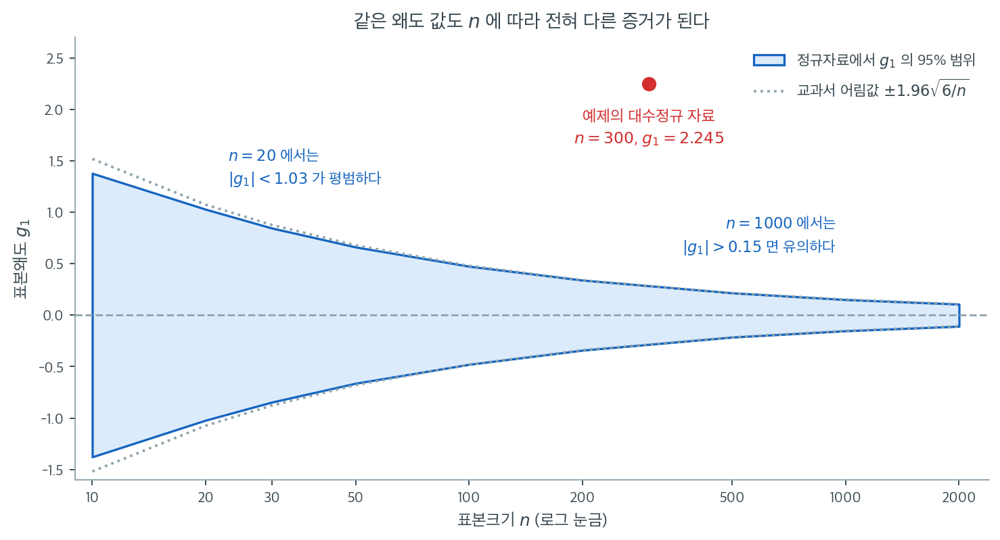

# 왜도 검정

## 개요

D'Agostino 왜도 검정은 자료의 왜도가 정규분포에서 기대되는 값인 0과 유의하게 다른지 평가한다. 표본왜도를 귀무가설 아래에서 근사적으로 표준정규를 따르는 $Z$ 통계량으로 변환하므로, 비대칭을 겨냥한 표적 검정이 된다. 이 페이지는 핵심 공식을 유도하고, Python에서 검정을 시연하며, 실무적 사용을 논의한다.

---

## 1. 표본왜도

표본 $X_1, \ldots, X_n$에 대한 Fisher-Pearson 왜도 계수(편향 보정판)는

$$
g_1 = \frac{n}{(n-1)(n-2)} \sum_{i=1}^{n} \left(\frac{X_i - \bar{X}}{S}\right)^3,
$$

여기서 $\bar{X}$는 표본평균, $S$는 (Bessel 보정을 한) 표본표준편차이다. 정규성 아래에서 $\mathbb{E}[g_1] = 0$이고

$$
\text{Var}(g_1) \approx \frac{6(n-2)}{(n+1)(n+3)}.
$$

---

## 2. D'Agostino 변환

$H_0$ 아래에서도 $g_1$의 분포가 정확히 정규가 아니므로, D'Agostino와 Pearson(1973)은 $g_1$을 $\mathcal{N}(0,1)$에 훨씬 가까운 통계량 $Z_1$으로 보내는 비선형 변환을 제안했다. 변환은 먼저

$$
Y = g_1 \sqrt{\frac{(n+1)(n+3)}{6(n-2)}},
$$

를 계산한 뒤 고차 누적률에 대한 추가 조정을 거친다. 최종 $Z_1$은 $H_0: \text{왜도} = 0$ 아래에서 근사적으로 표준정규이다.

---

## 3. 가설

$$
H_0: \gamma_1 = 0 \quad (\text{모집단 왜도가 0이다}), \qquad H_1: \gamma_1 \neq 0.
$$

양측 $p$값은 $p = 2\,\Phi(-|Z_1|)$이며 $\Phi$는 표준정규 CDF이다.

<div class="exbox" markdown>

**보기 1.** <span class="diff easy" title="쉬움"></span> 로그정규 자료의 왜도 검정. $\text{Lognormal}(0, 0.6^2)$에서 $n = 300$개를 뽑으면 $Z_1 = 10.4038$이 나온다.

**(1)** 위 변환 $Y = g_1\sqrt{(n+1)(n+3)/\{6(n-2)\}}$가 사실 **단순 표준화** $g_1/\mathrm{SD}(g_1)$임을 확인하시오. 그 값은 얼마이며, 다고스티노 변환은 그것을 어느 쪽으로 얼마나 옮기는가.

**(2)** `scipy.stats.skewtest`가 쓰는 왜도는 **어느 판본**인가. 코드가 찍어 주는 $2.2452$를 변환에 넣으면 $Z_1$이 얼마가 되는가.

</div>

??? success "풀이"

    **(1) $Y$는 정확히 단순 표준화이고, 그 값은 $15.9548$이다.** 정규성 아래 비보정 왜도의 분산이

    $$
    \mathrm{Var}(g_1) = \frac{6(n-2)}{(n+1)(n+3)}
    $$

    이므로 그 역수의 제곱근을 곱하는 것이 곧 표준화다.

    $$
    Y = g_1\sqrt{\frac{(n+1)(n+3)}{6(n-2)}} = \frac{g_1}{\mathrm{SD}(g_1)}
    $$

    $n = 300$에서 $\mathrm{SD}(g_1) = \sqrt{6\cdot298/(301\cdot303)} = 0.14002$이고 $g_1 = 2.233937$이니 $Y = 15.9548$이다.

    **변환은 이 값을 $10.4038$로 끌어내린다.** $15.95$에서 $10.40$으로, 곧 **35%를 깎는다.** 다고스티노와 피어슨의 변환은 $Y$의 4차 누적률을 보정한 뒤 역쌍곡사인을 씌우는 것이다.

    $$
    \beta_2 = \frac{3(n^2 + 27n - 70)(n+1)(n+3)}{(n-2)(n+5)(n+7)(n+9)}, \quad
    W^2 = -1 + \sqrt{2(\beta_2 - 1)}
    $$

    $$
    \delta = \frac{1}{\sqrt{\tfrac12\ln W^2}}, \quad
    \alpha = \sqrt{\frac{2}{W^2 - 1}}, \quad
    Z_1 = \delta\,\operatorname{arcsinh}\!\left(\frac{Y}{\alpha}\right)
    $$

    여기서 $\operatorname{arcsinh} u = \ln\bigl(u + \sqrt{u^2+1}\bigr)$다. $n = 300$에서 $\beta_2 = 3.110831$, $W^2 = 1.054668$, $\delta = 6.129875$, $\alpha = 6.048490$이고

    $$
    Z_1 = 6.129875 \cdot \operatorname{arcsinh}\!\left(\frac{15.954814}{6.048490}\right) = 10.403829
    $$

    가 나온다. **깎는 방향이 중요하다.** $\operatorname{arcsinh}$는 큰 인수에서 로그처럼 자라므로 꼬리를 눌러 준다. 유한표본에서 $g_1$의 분포가 오른쪽으로 치우쳐 있어 단순 표준화는 큰 값을 과대평가하는데, 변환이 그것을 바로잡는다. 만약 $Y = 15.95$를 그대로 표준정규 분위수로 읽으면 $p = 2.64\times10^{-57}$이 되는데, 실제 $p$는 $2.38\times10^{-25}$다. **자릿수가 서른 둘 벌어진다.**

    **(2) `skewtest`가 쓰는 것은 비보정판 $g_1 = \sqrt{b_1} = m_3/m_2^{3/2}$다.** 이 표본에서 $g_1 = 2.233937$인데, 코드는 `bias=False`로 구한 **보정판** $G_1 = 2.245179$를 찍는다. 둘은

    $$
    G_1 = \frac{\sqrt{n(n-1)}}{n-2}\,g_1 = \frac{\sqrt{300\cdot299}}{298}\cdot 2.233937 = 2.245179
    $$

    로 묶여 있고 $n = 300$에서 비는 $1.00503$이다. $G_1$을 변환에 넣으면 $Z_1 = 10.4326$이 되어 `scipy`가 돌려준 $10.4038$과 **다르다.** 차이가 $0.3\%$로 작아 이 보기에서는 결론이 바뀌지 않지만, 출력에 나란히 찍힌 두 수가 서로 맞물리지 않는다는 사실은 알아 두어야 한다. 손으로 재현하려면 `bias` 인자를 떼야 한다.

    같은 이유로 위 본문의 분산식 $\mathrm{Var}(g_1) \approx 6(n-2)/\{(n+1)(n+3)\}$은 **비보정판**의 것이다. 보정판의 분산은

    $$
    \mathrm{Var}(G_1) = \frac{n(n-1)}{(n-2)^2}\,\mathrm{Var}(g_1) = \frac{6n(n-1)}{(n-2)(n+1)(n+3)}
    $$

    이고, $n = 300$에서 표준편차가 $0.14002$ 대 $0.14072$로 갈린다.

    ```python
    import numpy as np
    from scipy import stats

    # 로그정규는 오른쪽으로 길게 늘어진 대표적인 분포다.
    rng = np.random.default_rng(0)
    x = rng.lognormal(mean=0.0, sigma=0.6, size=300)

    # 표본왜도를 그대로 쓰지 않고 Z 로 바꾼다. 왜도의 표집분포가 정규에서
    # 멀어, 값 자체로는 얼마나 큰 것인지 판단할 수 없기 때문이다.
    # 이 변환은 n>=8 부터 쓸 수 있다.
    g1 = stats.skew(x, bias=False)
    z, p = stats.skewtest(x)

    print(f"Sample size n = {x.size}")
    print(f"Sample skewness (Fisher's g1) = {g1:.4f}")
    print(f"D'Agostino skewness test: Z = {z:.4f}, p-value = {p:.4g}")
    if p < 0.05:
        print("=> Evidence of non-zero skewness (departing from normality).")
    else:
        print("=> No strong evidence of non-zero skewness.")
    ```

    출력:

    ```text
    Sample size n = 300
    Sample skewness (Fisher's g1) = 2.2452
    D'Agostino skewness test: Z = 10.4038, p-value = 2.382e-25
    => Evidence of non-zero skewness (departing from normality).
    ```

    변환을 한 단계씩 손으로 짚어 보면 다음과 같다.

    ```python
    import numpy as np
    from scipy import stats

    rng = np.random.default_rng(0)
    x = rng.lognormal(mean=0.0, sigma=0.6, size=300)
    n = x.size

    g1 = stats.skew(x)              # 비보정 sqrt(b1) — skewtest 가 쓰는 판본
    G1 = stats.skew(x, bias=False)  # 보정판
    print(f"g1 (비보정) = {g1:.6f}")
    print(f"G1 (보정)   = {G1:.6f}")
    print(f"G1 = g1*sqrt(n(n-1))/(n-2) = {g1 * np.sqrt(n * (n - 1)) / (n - 2):.6f}")

    # 1단계: 단순 표준화. 이것이 본문의 Y 다.
    sd_g1 = np.sqrt(6 * (n - 2) / ((n + 1) * (n + 3)))
    Y = g1 / sd_g1
    print(f"\nSD(g1) = {sd_g1:.5f},  단순 표준화 Y = g1/SD = {Y:.6f}")

    # 2단계: 고차 누적률 보정 후 역쌍곡사인 변환.
    beta2 = (3.0 * (n**2 + 27 * n - 70) * (n + 1) * (n + 3)
             / ((n - 2.0) * (n + 5) * (n + 7) * (n + 9)))
    W2 = -1 + np.sqrt(2 * (beta2 - 1))
    delta = 1 / np.sqrt(0.5 * np.log(W2))
    alpha = np.sqrt(2.0 / (W2 - 1))
    Z = delta * np.arcsinh(Y / alpha)
    print(f"beta2 = {beta2:.6f}, W^2 = {W2:.6f}, delta = {delta:.6f}, alpha = {alpha:.6f}")
    print(f"손계산 Z1 = {Z:.6f},  p = {2 * stats.norm.sf(abs(Z)):.4g}")

    z_scipy, p_scipy = stats.skewtest(x)
    print(f"scipy  Z1 = {z_scipy:.6f},  p = {p_scipy:.4g}")

    # 보정판을 넣으면 답이 달라진다.
    Z_wrong = delta * np.arcsinh((G1 / sd_g1) / alpha)
    print(f"\nG1 을 넣었을 때의 Z1 = {Z_wrong:.6f}  (scipy 와 다르다)")
    ```

    출력:

    ```text
    g1 (비보정) = 2.233937
    G1 (보정)   = 2.245179
    G1 = g1*sqrt(n(n-1))/(n-2) = 2.245179

    SD(g1) = 0.14002,  단순 표준화 Y = g1/SD = 15.954814
    beta2 = 3.110831, W^2 = 1.054668, delta = 6.129875, alpha = 6.048490
    손계산 Z1 = 10.403829,  p = 2.382e-25
    scipy  Z1 = 10.403829,  p = 2.382e-25

    G1 을 넣었을 때의 Z1 = 10.432609  (scipy 와 다르다)
    ```

    손으로 밟은 $Z_1 = 10.403829$가 `scipy.stats.skewtest`의 값과 **소수점 여섯째 자리까지** 같다. 변환이 투명한 공식 몇 줄로 끝난다는 뜻이며, $p$값도 $2.382\times10^{-25}$로 일치한다. $\square$

---

## 4. 해석

보기의 대수정규 자료에서 $g_1 = 2.245$로 크게 양수이고(오른쪽 치우침), $p$값이 $2.4 \times 10^{-25}$로 왜도가 0이라는 가설을 압도적으로 기각한다. 이론적 왜도는 $2.261$(연습문제 3 참조)이므로 표본값이 잘 맞는다.

왜도 검정은 비대칭이 의심되지만 다른 이탈은 꼭 의심되지 않을 때 특히 유용하다. 왜도 검정과 첨도 검정을 결합한 D'Agostino $K^2$ 옴니버스 검정의 한 구성요소이기도 하다.

### 얼마나 큰 왜도가 "큰" 왜도인가

"왜도가 $0.5$면 치우친 것인가"라는 물음에는 $n$을 모르면 답할 수 없다. 이 절의 변환이 필요한 이유도 결국 그것이다. 아래 그림은 진짜 정규자료에서 표본왜도 $g_1$이 어디까지 흔들리는지를 표본크기별로 40000번씩 재어 띠로 그린 것이다. 띠 안쪽이 "정규자료에서 흔히 나오는" 범위, 곧 양측 5% 수준에서 기각하지 못하는 영역이다.



$n = 20$에서 띠는 $[-1.02, +1.03]$으로 대단히 넓다. 왜도 $0.9$짜리 표본을 손에 쥐고도 "정규일 수 있다"는 말밖에 할 수 없다는 뜻이다. $n = 50$에서 $\pm 0.66$, $n = 100$에서 $\pm 0.48$로 줄고, $n = 1000$이면 $\pm 0.15$까지 좁아진다. 같은 $g_1 = 0.5$가 $n = 20$에서는 아무 증거도 아니고 $n = 1000$에서는 압도적 증거가 된다. **왜도 값 하나만 보고 판단하는 습관은 $n$을 빠뜨리는 순간 무의미해진다.**

회색 점선은 흔히 쓰는 어림값 $\pm 1.96\sqrt{6/n}$이다. $n$이 50을 넘으면 모의실험으로 얻은 실제 경계와 거의 겹치지만, $n$이 작을수록 실제 경계보다 바깥쪽에 놓인다. $n = 10$에서 어림값은 $\pm 1.52$인데 실제 범위는 $\pm 1.38$이다. 작은 표본에서 $g_1$의 분포가 정규가 아니기 때문이며, `skewtest`가 단순 표준화 대신 비선형 변환을 쓰는 이유이기도 하다.

빨간 점은 이 쪽 보기의 대수정규 자료다. $n = 300$에서 $g_1 = 2.245$이므로 띠에서 아득히 벗어나 있다. $Z_1 = 10.4$, $p = 2.4 \times 10^{-25}$라는 숫자가 어디서 나왔는지를 그림 한 장으로 확인할 수 있다.

**최소 표본크기.** SciPy의 `skewtest`는 $n \geq 8$을 요구한다. 근사는 $n$이 클수록 좋아지며, $n < 20$이면 $p$값을 조심스럽게 해석해야 한다.

---

## 연습문제

<div class="drillbox" markdown>

**연습문제 1.** <span class="diff easy" title="쉬움"></span> 표준정규분포에서 관측값 $n = 300$개를 생성하라. $g_1$과 왜도 검정 $p$값을 계산하라. $\alpha = 0.05$에서 기각할 것으로 기대하는가?

</div>

??? success "풀이"

    ```python
    import numpy as np
    from scipy import stats

    rng = np.random.default_rng(42)
    x = rng.normal(0, 1, size=300)

    g1 = stats.skew(x, bias=False)
    z, p = stats.skewtest(x)

    print(f"g1 = {g1:.4f}")
    print(f"Z = {z:.4f}, p = {p:.4g}")
    ```

    출력:

    ```text
    g1 = 0.2933
    Z = 2.0725, p = 0.03822
    ```

    !!! warning "이 표본은 제1종 오류를 보여준다"
        자료를 정확히 표준정규에서 생성했는데도 $p = 0.038 < 0.05$이므로 **검정이 기각한다**. 이것이 바로 제1종 오류이다.

    기대와 실제를 구분해야 한다. 자료가 참으로 정규이므로 우리는 기각하지 *않기를* 기대하고, 실제로 표본의 95%에서는 기각하지 않는다. 그러나 나머지 5%에서는 기각한다. 이 표본이 그 5%에 들어갔을 뿐이다.

    $g_1 = 0.2933$은 절댓값으로는 작아 보이지만, $n = 300$에서 $g_1$의 표준오차가

    $$
    \sqrt{\frac{6(n-2)}{(n+1)(n+3)}} = \sqrt{\frac{6 \times 298}{301 \times 303}} = 0.1400
    $$

    에 불과하므로 $0.2933$은 2 표준오차가 넘는다. 표본이 커지면 작은 왜도도 통계적으로 유의해진다는 점을 잘 보여준다.

    실무적 교훈: **$p$값 하나로 판정하지 말라.** 여기서 실질적으로 중요한 것은 $g_1 = 0.29$가 어떤 응용에서든 무시할 만한 크기라는 사실이다. 효과 크기를 함께 보고해야 하는 이유이다. $\square$

<div class="drillbox" markdown>

**연습문제 2.** <span class="diff easy" title="쉬움"></span> $\text{Uniform}(0, 1)$ 분포에서 뽑은 관측값 $n = 200$개에 대해 표본왜도를 계산하고 왜도 검정을 수행하라. 균등분포는 대칭이지만 정규가 아니다. 검정이 기각하는가?

</div>

??? success "풀이"

    ```python
    import numpy as np
    from scipy import stats

    rng = np.random.default_rng(0)
    x = rng.uniform(0, 1, size=200)

    g1 = stats.skew(x, bias=False)
    z, p = stats.skewtest(x)
    print(f"g1 = {g1:.4f}, Z = {z:.4f}, p = {p:.4g}")
    ```

    출력:

    ```text
    g1 = -0.1735, Z = -1.0217, p = 0.3069
    ```

    균등분포의 모집단 왜도는 $\gamma_1 = 0$이므로 왜도 검정은 기각하지 *않는다*($p = 0.307$).

    이는 한계를 보여준다. 왜도 검정은 우연히 대칭인 비정규 분포를 놓칠 수 있다. $\text{Uniform}(0,1)$은 대칭이지만 초과첨도가 $-1.2$인 저첨분포이다. 첨도 검정이나 옴니버스 검정이었다면 이 이탈을 탐지했을 것이다.

    확인해 보면 같은 자료에서 `stats.kurtosistest(x)`는 $Z = -9.78$, $p = 1.4 \times 10^{-22}$로 압도적으로 기각한다. 이탈의 유형에 맞는 검정을 골라야 한다는 교훈이다. $\square$

<div class="drillbox" markdown>

**연습문제 3.** <span class="diff med" title="중간"></span> $\text{Lognormal}(\mu, \sigma^2)$ 분포의 모집단 왜도가 $(e^{\sigma^2} + 2)\sqrt{e^{\sigma^2} - 1}$임을 보여라. $\sigma = 0.6$에 대한 값을 계산하라.

</div>

??? success "풀이"

    대수정규의 적률 성질에서 $\mathbb{E}[X^k] = e^{k\mu + k^2\sigma^2/2}$이다. 처음 세 중심적률을 계산하면 왜도가 다음으로 정리된다.

    $$
    \gamma_1 = (e^{\sigma^2} + 2)\sqrt{e^{\sigma^2} - 1}.
    $$

    왜도는 척도불변이므로 $\mu$에 의존하지 않고 $\sigma$에만 의존한다는 점에 주목하라.

    $\sigma = 0.6$이면 $e^{0.36} = 1.4333$이므로 $e^{\sigma^2} - 1 = 0.4333$이고 $\sqrt{0.4333} = 0.6583$이다. 따라서

    $$
    \gamma_1 = (1.4333 + 2)(0.6583) = 3.4333 \times 0.6583 \approx 2.261.
    $$

    이 큰 양의 왜도 때문에 대수정규 표본에서 왜도 검정이 단호하게 기각한다. 실제로 본문의 시연에서 표본값 $g_1 = 2.245$가 이 이론값에 가깝게 나왔다. $\square$

<div class="drillbox" markdown>

**연습문제 4.** <span class="diff med" title="중간"></span> $\text{Lognormal}(0, 0.4)$에서 뽑은 관측값 $n = 100$개에 대해 $\alpha = 0.05$에서 왜도 검정의 검정력을 추정하는 모의실험을 5,000회 반복으로 수행하라.

</div>

??? success "풀이"

    ```python
    import numpy as np
    from scipy import stats

    rng = np.random.default_rng(0)
    n, reps, alpha = 100, 5000, 0.05
    rejections = 0

    for _ in range(reps):
        x = rng.lognormal(0, 0.4, size=n)
        _, p = stats.skewtest(x)
        if p < alpha:
            rejections += 1

    power = rejections / reps
    print(f"Empirical power: {power:.4f}")
    ```

    출력:

    ```text
    Empirical power: 0.9770
    ```

    검정력이 $0.977$로 매우 높다. $\sigma = 0.4$인 대수정규의 왜도는

    $$
    \gamma_1 = (e^{0.16} + 2)\sqrt{e^{0.16} - 1} = 3.1735 \times \sqrt{0.1735} = 1.322
    $$

    로 중간 정도인데, $n = 100$에서 $g_1$의 표준오차가 약 $\sqrt{6/100} = 0.245$이므로 신호 대 잡음비가 $1.322/0.245 \approx 5.4$에 이른다. 이만한 비율이면 사실상 언제나 탐지된다.

    (몬테카를로 오차는 $\sqrt{0.977 \times 0.023 / 5000} = 0.0021$이다.) $\square$

<div class="drillbox" markdown>

**연습문제 5.** <span class="diff hard" title="어려움"></span> 정확한 공식 $\text{Var}(g_1) = 6(n-2)/[(n+1)(n+3)]$에서 출발하여 큰 $n$에 대해 $\text{Var}(g_1) \approx 6/n$임을 증명하라.

</div>

??? success "풀이"

    다음에서 출발한다.

    $$
    \text{Var}(g_1) = \frac{6(n-2)}{(n+1)(n+3)}.
    $$

    분자와 분모를 각각 $n$과 $n^2$으로 나누면

    $$
    \text{Var}(g_1) = \frac{6\,(1 - 2/n)}{n\,(1 + 1/n)(1 + 3/n)}.
    $$

    $n \to \infty$일 때 $(1 - 2/n) \to 1$, $(1 + 1/n) \to 1$, $(1 + 3/n) \to 1$이므로

    $$
    \text{Var}(g_1) \to \frac{6}{n}.
    $$

    따라서 $g_1$의 표준오차는 $\sqrt{6/n}$ 정도, 곧 $1/\sqrt{n}$ 차수이며, 표본이 클수록 0이 아닌 왜도를 탐지하기 쉬워진다.

    수렴 속도를 보자. $n = 100$에서 정확한 값은 $\sqrt{6 \times 98/(101 \times 103)} = 0.2377$이고 근사값은 $\sqrt{6/100} = 0.2449$로 3% 차이이다. $n = 1000$에서는 각각 $0.07723$과 $0.07746$으로 0.3% 차이이다. $\square$

<div class="drillbox" markdown>

**연습문제 6.** <span class="diff hard" title="어려움"></span> 보기 1 은 단순 표준화 $Y = 15.9548$ 이 $Z_1 = 10.4038$ 로 **35% 깎인다**고 했다. 깎인 양이 아니라 깎는 **방식**을 보자. $n = 300$ 에서 $\delta = 6.129875$, $\alpha = 6.048490$ 이다.

**(1)** $\mathrm{SD}(g_1)$ 이 $n$ 만의 함수라는 점을 써서

$$
\frac{dZ_1}{d(\ln g_1)} = \frac{\delta}{\sqrt{1 + \alpha^2/Y^2}} < \delta
$$

임을 보이고, 따라서 $g_1$ 을 $c > 1$ 배로 늘려도 $Z_1$ 은 $\delta \ln c$ 보다 더는 커지지 못함을 말하라. 보기 1 의 자료에서 $g_1$ 을 두 배로 늘리면 $Z_1$ 과 $p$ 는 얼마가 되는가. 거꾸로 $Z_1$ 을 $1$ 만큼 올리려면 $g_1$ 을 몇 배로 늘려야 하는가.

**(2)** 보기 1 (2) 에서 비보정판 $g_1 = 2.233937$ 을 넣은 $Z_1 = 10.403829$ 와 보정판 $G_1 = 2.245179$ 를 넣은 $Z_1 = 10.432609$ 의 차이가 $0.028781$ 이었다. 이 차이를 (1) 의 도함수로 소수 다섯째 자리까지 설명하라. 또 큰 $n$ 에서 $\delta \approx \alpha \approx \sqrt{n}/3$ 임을 보이고, 판본을 잘못 고르는 실수가 $Z_1$ 에서 대략 $1/(2\sqrt{n})$ 임을 유도하라.

</div>

??? success "풀이"

    **(1)** $Y = g_1/\mathrm{SD}(g_1)$ 에서 $\mathrm{SD}(g_1)$ 은 $n$ 만의 상수이므로 $\ln Y = \ln g_1 - \ln \mathrm{SD}(g_1)$, 곧 $d(\ln Y) = d(\ln g_1)$ 이다. 그리고

    $$
    \frac{d}{dY}\operatorname{arcsinh}\frac{Y}{\alpha} = \frac{1/\alpha}{\sqrt{1 + Y^2/\alpha^2}} = \frac{1}{\sqrt{\alpha^2 + Y^2}}
    $$

    이므로

    $$
    \frac{dZ_1}{d(\ln g_1)} = Y\,\frac{dZ_1}{dY} = \frac{\delta Y}{\sqrt{\alpha^2 + Y^2}} = \frac{\delta}{\sqrt{1 + \alpha^2/Y^2}}.
    $$

    분모가 $1$ 보다 크므로 기울기는 언제나 $\delta$ 미만이고 $Y \to \infty$ 에서 $\delta$ 로 올라간다. 로그 눈금에서 적분하면

    $$
    Z_1(c\,g_1) - Z_1(g_1) = \int_{\ln g_1}^{\ln g_1 + \ln c} \frac{\delta\,dt}{\sqrt{1 + \alpha^2/Y(t)^2}} < \delta \ln c
    $$

    가 된다. **$Z_1$ 은 $g_1$ 의 로그 눈금 위에 산다.**

    $g_1$ 을 두 배로 하면 $Y = 31.909627$, $\operatorname{arcsinh}(31.909627/6.048490) = 2.365110$ 이므로

    $$
    Z_1 = 6.129875 \times 2.365110 = 14.497827, \qquad p = 2\,\Phi(-14.497827) = 1.2505\times10^{-47}.
    $$

    늘어난 양 $14.497827 - 10.403829 = 4.093999$ 는 상한 $\delta \ln 2 = 4.248905$ 보다 작다.

    거꾸로 $Z_1$ 을 $10.403829$ 에서 $11.403829$ 로 올리는 $Y$ 는 $\alpha \sinh(11.403829/\delta) = 6.048490 \sinh(1.860205) = 18.963505$, 곧 지금의 $1.188576$ 배다. $g_1$ 을 $2.233937$ 에서 $2.655203$ 으로 **$18.9\%$ 늘려야 $Z_1$ 이 겨우 1 오른다.** 하한은 $e^{1/\delta} = 1.177198$ 이고, 기울기가 $\delta$ 미만이라 실제로는 그보다 조금 더 든다.

    해석. $\ln p \approx -Z_1^2/2$ 이고 $Z_1$ 은 $\ln g_1$ 에 선형이니, **$p$ 값의 로그는 $\ln g_1$ 의 제곱으로 떨어진다.** $p = 10^{-25}$ 와 $p = 10^{-47}$ 사이의 간격이 왜도로는 겨우 두 배라는 사실이 그것이다. 천문학적으로 작은 $p$ 값을 효과 크기처럼 읽으면 안 되는 까닭이 여기 있다.

    **(2)** $Y = 15.954813$ 에서 $\alpha^2/Y^2 = (6.048490/15.954813)^2 = 0.143718$ 이므로 기울기는

    $$
    \frac{\delta}{\sqrt{1.143718}} = \frac{6.129875}{1.069447} = 5.731815
    $$

    이고, 두 판본의 비는 $G_1/g_1 = \sqrt{n(n-1)}/(n-2) = 1.005032$ 이니 $\ln(G_1/g_1) = 0.005020$ 이다. 곱하면

    $$
    5.731815 \times 0.005020 = 0.028771
    $$

    로 실제 차이 $0.028781$ 과 소수 다섯째 자리에서 갈린다. 로그 눈금의 기울기 하나로 $Z_1$ 의 틀어짐이 설명된다.

    큰 $n$ 의 어림을 보자. 본문의 $\beta_2$ 를 전개하면 분자는 $3(n^4 + 31n^3 + \cdots)$, 분모는 $n^4 + 19n^3 + \cdots$ 이므로

    $$
    \beta_2 = 3\left(1 + \frac{12}{n} + O(n^{-2})\right), \qquad \varepsilon := \beta_2 - 3 \approx \frac{36}{n}.
    $$

    $W^2 = -1 + \sqrt{2(2+\varepsilon)} = 1 + \varepsilon/2 + O(\varepsilon^2)$ 이므로 $W^2 - 1 \approx \varepsilon/2$ 이고 $\ln W^2 \approx \varepsilon/2$ 이다. 따라서

    $$
    \delta = \frac{1}{\sqrt{\tfrac12 \ln W^2}} \approx \frac{2}{\sqrt{\varepsilon}} \approx \frac{\sqrt{n}}{3}, \qquad
    \alpha = \sqrt{\frac{2}{W^2-1}} \approx \frac{2}{\sqrt{\varepsilon}} \approx \frac{\sqrt{n}}{3}
    $$

    로 둘이 같은 속도로 함께 커진다. $\delta/\alpha \to 1$ 이므로 $Y \ll \alpha$ 인 영역에서 $Z_1 = \delta \operatorname{arcsinh}(Y/\alpha) \approx (\delta/\alpha) Y \to Y$, 곧 **변환은 큰 $n$ 에서 단순 표준화로 되돌아간다.** 곡선이 휘는 눈금은 $g_1$ 단위로 $\alpha\,\mathrm{SD}(g_1) \to \sqrt{6}/3 = 0.8165$ 이며 $n$ 과 함께 줄지 않는다. 보기 1 에서 $35\%$ 나 깎인 것은 $n = 300$ 이 작아서가 아니라 $g_1 = 2.23$ 이 그 눈금보다 훨씬 컸기 때문이다.

    이제 $\ln(G_1/g_1)$ 을 전개하면

    $$
    \ln \frac{\sqrt{n(n-1)}}{n-2} = \tfrac12 \ln\left(1 - \tfrac1n\right) - \ln\left(1 - \tfrac2n\right) = -\frac{1}{2n} + \frac{2}{n} + O(n^{-2}) = \frac{3}{2n} + O(n^{-2})
    $$

    이고, $Y \gg \alpha$ 일 때 기울기가 $\delta \approx \sqrt{n}/3$ 이므로

    $$
    \Delta Z_1 \approx \frac{\sqrt{n}}{3} \cdot \frac{3}{2n} = \frac{1}{2\sqrt{n}}.
    $$

    $n = 300$ 이면 $1/(2\sqrt{300}) = 0.028868$ 로 실제 $0.028781$ 과 소수 셋째 자리까지 맞는다. 판본을 잘못 고르는 실수의 값은 $Z_1$ 에서 $1/(2\sqrt{n})$ 쯤이다. 큰 $n$ 에서는 무해하지만 작은 $n$ 에서는 어림이 거칠어지는데, $n = 20$, $g_1 = 1$ 에서 직접 재면 $\Delta Z_1 = 0.1449$ 로 어림값 $1/(2\sqrt{20}) = 0.1118$ 보다 $30\%$ 크다($n = 20$ 에서는 $\beta_2 - 3 = 0.5778$ 이 어림값 $1.8$ 과 멀어 $\delta \approx \sqrt{n}/3$ 가 성립하지 않는다). $\square$

<div class="drillbox" markdown>

**연습문제 7.** <span class="diff hard" title="어려움"></span> 본문 "얼마나 큰 왜도가 큰 왜도인가" 의 그림은 정규자료에서 표본왜도의 $95\%$ 범위를 $n = 10$ 에서 $\pm 1.38$, $n = 20$ 에서 $[-1.02, +1.03]$, $n = 50$ 에서 $\pm 0.66$, $n = 100$ 에서 $\pm 0.48$, $n = 1000$ 에서 $\pm 0.15$ 로 재어 놓았고, 회색 점선은 어림값 $\pm 1.96\sqrt{6/n}$ 이다.

**(1)** $Z_1 = \delta \operatorname{arcsinh}(Y/\alpha)$ 를 거꾸로 풀어 양측 $5\%$ 기각역의 경계가

$$
g_1^{\text{crit}} = \mathrm{SD}(g_1)\,\alpha \sinh\!\left(\frac{z_{0.025}}{\delta}\right), \qquad z_{0.025} = 1.959964
$$

임을 보여라.

**(2)** 이 값을 $n = 10, 20, 50, 100, 1000$ 에서 계산하고, 보기 1 (2) 의 환산 $G_1 = \sqrt{n(n-1)}\,g_1/(n-2)$ 로 보정판 눈금으로 옮겨 그림의 띠와 맞춰 보라. 그림의 띠는 $g_1$ 의 띠인가 $G_1$ 의 띠인가.

**(3)** $n = 10$ 에서 어림값 $1.5182$ 와 참값의 차이를 **세 조각**으로 나누어라: (i) $6/n$ 대신 정확한 $\mathrm{Var}(g_1)$ 을 쓰는 것, (ii) $\operatorname{arcsinh}$ 의 휘어짐, (iii) 편향 보정 $\sqrt{n(n-1)}/(n-2)$. 본문은 어림값이 작은 $n$ 에서 어긋나는 까닭을 "$g_1$ 의 분포가 정규가 아니기 때문" 이라 적었다. 세 조각 가운데 그 설명에 해당하는 것은 어느 것이며 크기는 얼마인가.

</div>

??? success "풀이"

    **(1)** $\operatorname{arcsinh}$ 는 단조증가이므로 $Z_1$ 은 $g_1$ 의 단조증가 함수다. 따라서 $|Z_1| > z_{0.025}$ 는 $|g_1| > g_1^{\text{crit}}$ 와 같은 사건이고, $Z_1 = z$ 를 풀면

    $$
    \operatorname{arcsinh}\frac{Y}{\alpha} = \frac{z}{\delta} \iff Y = \alpha \sinh\frac{z}{\delta} \iff g_1 = \mathrm{SD}(g_1)\,\alpha \sinh\frac{z}{\delta}
    $$

    이다. $\sinh$ 는 $\operatorname{arcsinh}$ 의 역함수이므로 변환을 통째로 되돌린 것이다.

    **(2)**(3) 한꺼번에 계산한다.

    ```python
    import numpy as np
    from scipy import stats


    def transform_params(n):
        """다고스티노 변환의 상수: SD(g1), delta, alpha."""
        n = float(n)
        sd = np.sqrt(6 * (n - 2) / ((n + 1) * (n + 3)))
        b2 = (3.0 * (n**2 + 27 * n - 70) * (n + 1) * (n + 3)
              / ((n - 2) * (n + 5) * (n + 7) * (n + 9)))
        W2 = -1 + np.sqrt(2 * (b2 - 1))
        return sd, 1 / np.sqrt(0.5 * np.log(W2)), np.sqrt(2.0 / (W2 - 1))


    zc = stats.norm.isf(0.025)
    rng = np.random.default_rng(0)
    print("    n   naive  exactSD  g1crit  G1crit   band(G1)")
    for n in [10, 20, 50, 100, 1000]:
        sd, delta, alpha = transform_params(n)
        # Z1 = delta*arcsinh(Y/alpha) = 1.96 을 g1 에 대해 거꾸로 푼다.
        g_crit = sd * alpha * np.sinh(zc / delta)
        corr = np.sqrt(n * (n - 1)) / (n - 2)        # g1 -> G1 환산
        # 그림과 같은 방식으로 정규자료에서 G1 의 95% 범위를 40000 번 재어 본다.
        G = np.concatenate([stats.skew(rng.standard_normal((10000, n)),
                                       axis=1, bias=False) for _ in range(4)])
        lo, hi = np.quantile(G, [0.025, 0.975])
        print(f"{n:5d}  {zc*np.sqrt(6/n):.4f}   {zc*sd:.4f}  {g_crit:.4f}  "
              f"{g_crit*corr:.4f}   [{lo:+.4f}, {hi:+.4f}]")
    ```

    출력:

    ```text
        n   naive  exactSD  g1crit  G1crit   band(G1)
       10  1.5182   1.1355  1.1460  1.3590   [-1.3671, +1.3570]
       20  1.0735   0.9268  0.9403  1.0183   [-1.0071, +1.0223]
       50  0.6790   0.6398  0.6476  0.6678   [-0.6654, +0.6676]
      100  0.4801   0.4660  0.4699  0.4771   [-0.4779, +0.4818]
     1000  0.1518   0.1514  0.1515  0.1518   [-0.1516, +0.1519]
    ```

    **그림의 띠는 보정판 $G_1$ 의 띠다.** `G1crit` 열이 모의로 잰 띠와 소수 둘째 자리까지 맞는다($n = 10$ 에서 $1.3590$ 대 $[-1.3671, +1.3570]$, $n = 20$ 에서 $1.0183$ 대 $[-1.0071, +1.0223]$, $n = 50$ 에서 $0.6678$ 대 $[-0.6654, +0.6676]$. 본문이 적은 $n = 10$ 의 $\pm1.38$ 과는 둘째 자리에서 $0.02$ 쯤 갈리는데, 분위수를 $40000$ 번으로 재는 몬테카를로 오차 범위다). 반면 `g1crit` 열은 $n = 10$ 에서 $1.1460$ 으로 그림의 $\pm 1.38$ 과 전혀 맞지 않는다. 본문이 띠를 "$g_1$" 이라 적었지만 수치는 $G_1$ 쪽이다. 그림의 빨간 점이 $g_1 = 2.245$, 곧 보기 1 의 **보정판** 값인 것과 아귀가 맞는다. 둘을 섞어 쓰면 작은 $n$ 에서 $20\%$ 가까이 틀어지므로 어느 판본의 눈금인지 밝혀 두어야 한다.

    **(3)** $n = 10$ 의 네 수를 왼쪽에서 오른쪽으로 읽으면 그대로 분해가 된다.

    | 조각 | 값 | 변화 |
    | --- | --- | --- |
    | 어림값 $1.96\sqrt{6/n}$ | $1.5182$ | — |
    | (i) 정확한 $\mathrm{SD}(g_1) = 0.579365$ 로 바꿈 | $1.1355$ | $-0.3827$ |
    | (ii) $\operatorname{arcsinh}$ 의 휘어짐 | $1.1460$ | $+0.0105$ |
    | (iii) 편향 보정 $\times 1.185854$ | $1.3590$ | $+0.2130$ |

    세 조각 가운데 본문이 말한 "$g_1$ 의 분포가 정규가 아니기 때문" 에 해당하는 것은 **(ii) 뿐이고 그 크기는 $+0.0105$, 전체 간격 $1.5182 - 1.3590 = 0.1592$ 의 $6.6\%$ 에 지나지 않는다.** 실제로 어림값을 어긋나게 하는 것은 (i) 분산식을 $6/n$ 으로 거칠게 쓴 것($-0.38$)과 (iii) 편향 보정을 빼먹은 것($+0.21$)이며, 둘이 반대 방향이라 크게 상쇄되어 겉으로는 $0.16$ 밖에 벌어지지 않는다. $n = 1000$ 에서 어림값 $0.1518$ 과 $G_1$ 임계값 $0.1518$ 이 소수 넷째 자리까지 같아지는 것도 같은 상쇄 때문이다. $\mathrm{SD}(G_1)^2 = 6n(n-1)/\{(n-2)(n+1)(n+3)\} = (6/n)\{1 - 3/n + O(n^{-2})\}$ 이므로 $\sqrt{6/n}$ 은 $\mathrm{SD}(g_1)$ 보다 $\mathrm{SD}(G_1)$ 에 훨씬 가깝다. **어림값이 맞는 것은 두 실수가 맞물려서다.** $\square$

<div class="drillbox" markdown>

**연습문제 8.** <span class="diff hard" title="어려움"></span> 표본왜도에는 자료와 무관하게 $n$ 만으로 정해지는 상한이 있다. 비보정판에 대해

$$
\lvert g_1 \rvert \le \frac{n-2}{\sqrt{n-1}}
$$

이고, 등호는 관측값 $n-1$ 개가 한 점에 모이고 하나만 떨어져 있을 때 성립한다.

**(1)** 자료 $x_1 = \cdots = x_{n-1} = 0$, $x_n = 1$ 에서 $m_2 = (n-1)/n^2$, $m_3 = (n-1)(n-2)/n^3$ 을 계산하여 이 배치가 상한을 달성함을 확인하라.

**(2)** 본문이 요건으로 적은 최소 표본크기 $n = 8$ 에서 `skewtest` 가 돌려줄 수 있는 **가장 작은 $p$ 값**을 구하라. $n = 8$ 에서 $\mathrm{SD}(g_1) = 0.603023$, $\delta = 5.563065$, $\alpha = 5.473432$ 이다.

**(3)** 같은 계산을 하면 바닥이 $n = 10$ 에서 $6.98\times10^{-5}$, $n = 20$ 에서 $5.24\times10^{-8}$, $n = 50$ 에서 $3.60\times10^{-17}$ 이다. 변수 $142$ 개를 각각 검정하며 본페로니 보정을 한다면 $n = 8$ 자료에서는 무엇이 일어나는가. 본문이 "$n < 20$ 이면 $p$ 값을 조심스럽게 해석해야 한다" 고 한 것과 이어서 해석하라.

</div>

??? success "풀이"

    **(1)** 표본평균은 $\bar{x} = 1/n$ 이다. 편차는 $n-1$ 개가 $-1/n$, 하나가 $(n-1)/n$ 이므로

    $$
    m_2 = \frac1n\left\{(n-1)\frac{1}{n^2} + \frac{(n-1)^2}{n^2}\right\} = \frac{(n-1)\{1 + (n-1)\}}{n^3} = \frac{n-1}{n^2},
    $$

    $$
    m_3 = \frac1n\left\{-(n-1)\frac{1}{n^3} + \frac{(n-1)^3}{n^3}\right\} = \frac{(n-1)\{(n-1)^2 - 1\}}{n^4} = \frac{(n-1)n(n-2)}{n^4} = \frac{(n-1)(n-2)}{n^3}
    $$

    이다. $m_2^{3/2} = (n-1)^{3/2}/n^3$ 이므로

    $$
    g_1 = \frac{m_3}{m_2^{3/2}} = \frac{(n-1)(n-2)}{n^3} \cdot \frac{n^3}{(n-1)^{3/2}} = \frac{n-2}{\sqrt{n-1}}
    $$

    로 상한이 정확히 달성된다. 자리를 좌우로 뒤집으면 $-(n-2)/\sqrt{n-1}$ 이 된다.

    **(2)** $n = 8$ 에서 상한은 $6/\sqrt{7} = 2.267787$ 이다. 단순 표준화는

    $$
    Y = \frac{2.267787}{0.603023} = 3.760699
    $$

    이고, 변환을 거치면

    $$
    Z_1 = 5.563065 \cdot \operatorname{arcsinh}\!\left(\frac{3.760699}{5.473432}\right) = 5.563065 \times 0.642052 = 3.571777,
    $$

    $$
    p_{\min} = 2\,\Phi(-3.571777) = 3.5457\times10^{-4} = \frac{1}{2820}.
    $$

    $Z_1$ 이 $g_1$ 의 단조증가 함수이므로(연습문제 7(1)) 이 값이 바닥이다. **$n = 8$ 에서는 자료가 아무리 심하게 치우쳐 있어도 $p$ 가 $0.000355$ 아래로 내려갈 수 없다.**

    **(3)** 본페로니 보정 수준은 $0.05/142 = 3.5211\times10^{-4}$ 로 바닥 $3.5457\times10^{-4}$ 보다 작다. 따라서 $n = 8$ 짜리 자료 $142$ 벌에서는 **어떤 변수도 유의할 수 없다.** 자료를 보기도 전에 검정의 결론이 정해져 있는 셈이다($n = 141$ 개까지면 극단적으로 치우친 표본 하나가 간신히 통과한다).

    바닥이 있다는 사실은 두 가지를 말해 준다. 첫째, 작은 $n$ 에서 $p$ 값은 증거의 양을 재는 자유로운 눈금이 아니다. $n$ 이 커지면 바닥은 $n = 300$ 에서 $2.7\times10^{-114}$($Z_1 \le 22.72$)까지 내려가 사실상 사라지지만, $n < 20$ 에서는 바닥이 $10^{-8}$ 보다 높아 다중검정과 만나는 순간 검정이 무력해진다. 본문의 경고 "$n < 20$ 이면 조심" 이 근사의 질에 관한 말인 동시에 눈금 자체의 한계에 관한 말인 이유다.

    둘째, $g_1$ 이 **유계**이므로 $Y$ 의 표집분포도 유계다. 반면 표준정규는 유계가 아니다. 따라서 단순 표준화 $Y$ 를 표준정규로 읽는 것은 꼬리에서 반드시 틀리며, 다고스티노가 $\operatorname{arcsinh}$ 로 꼬리를 눌러야 했던 까닭이 바로 이 구조적 불일치다. 보기 1 에서 $Y = 15.95$ 를 그대로 읽은 $p = 2.64\times10^{-57}$ 이 터무니없는 수인 것도 같은 이야기다. $\square$

<div class="drillbox" markdown>

**연습문제 9.** <span class="diff hard" title="어려움"></span> 연습문제 4 는 $\text{Lognormal}(0, 0.4^2)$, $n = 100$ 에서 검정력 $0.9770$ 을 얻고, 그 까닭을 "신호 대 잡음비 $\gamma_1/\mathrm{SD}_0(g_1) = 1.322/0.245 \approx 5.4$" 로 설명했다. 이 어림을 정식 공식으로 쓰면

$$
\text{검정력} \approx \Phi\!\left(\frac{\gamma_1}{\mathrm{SD}_0(g_1)} - z_{0.025}\right) = \Phi(5.5602 - 1.9600) = 0.9998
$$

인데, 모의 결과 $0.977$ 과 소수 둘째 자리에서 어긋난다. 이 공식은 $g_1 \sim \mathcal{N}(\gamma_1,\ \mathrm{Var}_0(g_1))$ 이라는 가정을 셋 겹쳐 쓴 것이다.

**(1)** 세 가정 — (i) $\mathbb{E}[g_1] = \gamma_1$, (ii) 대립가설 아래에서도 $\mathrm{SD}(g_1) = \mathrm{SD}_0(g_1) = 0.2377$, (iii) $g_1$ 의 표집분포가 정규 — 가 각각 성립하는지 모의실험으로 확인하라.

**(2)** (i)(ii) 에서 **실제로 잰 값**으로 정규근사 검정력을 다시 계산하면 얼마인가. 그 값이 모의 검정력보다도 작게 나오는 까닭은 무엇인가. 연습문제 4 의 "신호 대 잡음비 $5.4$" 는 정직한 값으로 고치면 얼마인가.

</div>

??? success "풀이"

    기각 여부는 연습문제 7(1) 의 임계값으로 $|g_1| > g_1^{\text{crit}}$ 와 같으므로, $g_1$ 의 표집분포만 재면 검정력을 모두 설명할 수 있다.

    ```python
    import numpy as np
    from scipy import stats

    rng = np.random.default_rng(0)
    n, reps, alpha = 100, 20000, 0.05

    # 대립가설 아래에서 g1 (skewtest 가 쓰는 비보정판) 을 한꺼번에 뽑는다.
    x = rng.lognormal(0, 0.4, size=(reps, n))
    g1 = stats.skew(x, axis=1)
    _, p = stats.skewtest(x, axis=1)
    power = (p < alpha).mean()

    # 귀무가설 아래의 표준오차와 실제 표집 표준편차를 비교한다.
    sd0 = np.sqrt(6 * (n - 2) / ((n + 1) * (n + 3)))
    gamma1 = (np.exp(0.16) + 2) * np.sqrt(np.exp(0.16) - 1)

    # 변환을 거꾸로 풀어 Z1 = 1.96 에 해당하는 g1 임계값을 얻는다.
    b2 = 3.0*(n**2+27*n-70)*(n+1)*(n+3)/((n-2.0)*(n+5)*(n+7)*(n+9))
    W2 = -1 + np.sqrt(2*(b2-1)); delta = 1/np.sqrt(0.5*np.log(W2)); a = np.sqrt(2.0/(W2-1))
    zc = stats.norm.isf(alpha/2)
    g_crit = sd0 * a * np.sinh(zc/delta)

    naive = stats.norm.sf(zc - gamma1/sd0)
    print(f"gamma1 = {gamma1:.4f},  SD_0(g1) = {sd0:.4f},  g1 임계값 = {g_crit:.4f}")
    print(f"귀무 표준오차로 계산한 검정력 = {naive:.4f}")
    print(f"모의 검정력 ({reps}회)        = {power:.4f}")
    print(f"E[g1] = {g1.mean():.4f},  SD(g1) = {g1.std(ddof=1):.4f}  (귀무값의 {g1.std(ddof=1)/sd0:.2f}배)")
    print(f"정규근사로 되읽은 검정력 = {stats.norm.sf((g_crit-g1.mean())/g1.std(ddof=1)):.4f}")
    ```

    출력:

    ```text
    gamma1 = 1.3219,  SD_0(g1) = 0.2377,  g1 임계값 = 0.4699
    귀무 표준오차로 계산한 검정력 = 0.9998
    모의 검정력 (20000회)        = 0.9791
    E[g1] = 1.1734,  SD(g1) = 0.4788  (귀무값의 2.01배)
    정규근사로 되읽은 검정력 = 0.9291
    ```

    모의 검정력 $0.9791$ 은 연습문제 4 의 $0.9770$ 과 몬테카를로 오차($0.0010$ 과 $0.0021$) 안에서 같은 값이다.

    **(1)** 세 가정이 모두 깨진다.

    - **(i) 편향.** $\mathbb{E}[g_1] = 1.1734$ 로 $\gamma_1 = 1.3219$ 보다 $11\%$ 낮다. 오른쪽 꼬리가 긴 모집단에서 $n = 100$ 은 꼬리를 충분히 뽑아 오지 못하므로 표본왜도가 아래로 치우친다. 검정력을 **낮추는** 쪽이다.
    - **(ii) 분산.** $\mathrm{SD}(g_1) = 0.4788$ 로 귀무값 $0.2377$ 의 $2.01$ 배다. $\mathrm{Var}(g_1) \approx 6/n$ 은 **정규성 아래에서만** 성립하는 값이다. 일반 분포에서 $\mathrm{Var}(m_3)$ 는 $\mu_6$ 까지 쓰는데, $\text{Lognormal}(0, 0.4^2)$ 의 표준화 6차 적률은 $\mu_6/\mu_2^3 = 145.8$ 로 정규의 $15$ 보다 열 배 크다. 역시 검정력을 **낮추는** 쪽이다.
    - **(iii) 정규성.** $g_1$ 의 표집분포 자체가 오른쪽으로 치우쳐 있다. 평균 $1.1734$, 표준편차 $0.4788$ 인 정규라면 $g_1$ 이 임계값 $0.4699$ 아래로 내려갈 확률이 $\Phi(-1.4693) = 0.0709$ 지만, 실제로 내려간 비율은 $1 - 0.9791 = 0.0209$ 다. **왼쪽 꼬리가 정규보다 세 배 넘게 얇다.** 검정력을 **높이는** 쪽이다.

    **(2)** (i)(ii) 의 값만 갈아 끼우면

    $$
    \text{검정력} \approx 1 - \Phi\!\left(\frac{0.4699 - 1.1734}{0.4788}\right) = 1 - \Phi(-1.4693) = 0.9291
    $$

    로, 모의값 $0.9791$ 보다 $0.05$ 나 **작다.** 어림이 거꾸로 틀리는 것은 (iii) 때문이다. 정규라고 보면 왼쪽 꼬리를 실제보다 두껍게 잡아 기각하지 못할 확률을 과대평가한다.

    정리하면 세 오차가 서로 다른 방향으로 밀어 $0.9998 \to 0.9791$ 이라는 작은 차이로 보이게 만든 것이다. 편향과 분산만 고치면 $0.9291$ 로 과소, 분포 모양까지 고쳐야 $0.9791$ 에 닿는다. 연습문제 4 의 신호 대 잡음비는 귀무가설의 잡음으로 잰 값이므로, 정직하게 고치면

    $$
    \frac{\mathbb{E}[g_1]}{\mathrm{SD}(g_1)} = \frac{1.1734}{0.4788} = 2.45
    $$

    로 $5.4$ 의 절반에도 못 미친다. **그런데도 검정력이 $0.98$ 인 것은 비가 커서가 아니라 $g_1$ 의 분포가 치우쳐 아래쪽 꼬리가 얇기 때문이다.** 검정력을 귀무 표준오차로 계산하는 습관은 이렇게 두 번 틀리고, 운이 나쁘면 상쇄되지 않는다. $\square$

<div class="drillbox" markdown>

**연습문제 10.** <span class="diff hard" title="어려움"></span> 세 값만 갖는 확률변수 $X$ 를

$$
\mathbb{P}(X = -1) = \mathbb{P}(X = 1) = \tfrac16, \qquad \mathbb{P}(X = 0) = \tfrac23
$$

로 두자.

**(1)** 모든 짝수 중심적률이 $\mu_{2k} = 1/3$ 이고 홀수 중심적률은 $0$ 임을 보여, 왜도 $\gamma_1 = 0$ 과 초과첨도 $\gamma_2 = 0$ 을 확인하라. 2 장의 부등식 $\beta_2 \ge 1 + \gamma_1^2$ 는 어떻게 만족되는가.

**(2)** $\mu_3 = 0$ 인 일반 분포에서

$$
\sqrt{n}\,g_1 \xrightarrow{d} \mathcal{N}\!\left(0,\ \frac{\mu_6}{\mu_2^3} - \frac{6\mu_4}{\mu_2^2} + 9\right)
$$

임이 알려져 있다(정규분포에서는 $15 - 18 + 9 = 6$ 이 되어 본문의 $\mathrm{Var}(g_1) \approx 6/n$ 과 맞는다). 이 분포에서 그 분산을 계산하라. $n \to \infty$ 에서 `skewtest` 의 기각률은 $0.05$ 로 가는가.

**(3)** 같은 계산을 표본첨도에 하면 $\mathrm{avar}(\sqrt{n}\,g_2) = 18$ 이 나온다(정규는 $24$). 자크–베라 통계량 $JB = n(g_1^2/6 + g_2^2/24)$ 의 극한분포를 구하고, 유의수준 $5\%$ 검정의 실제 크기가 어디로 가는지 말하라. 이 분포를 섀피로–윌크는 왜 즉시 기각하는가.

</div>

??? success "풀이"

    **(1)** $\mathbb{E}[X] = -\tfrac16 + \tfrac16 = 0$ 이므로 중심적률은 그냥 적률이다. 분포가 $0$ 에 대해 대칭이니 홀수 적률은 모두 $0$ 이고, 짝수 적률은 $k \ge 1$ 에서

    $$
    \mu_{2k} = \mathbb{E}[X^{2k}] = \tfrac16 (-1)^{2k} + \tfrac16 (1)^{2k} = \tfrac13
    $$

    로 **$k$ 와 무관하게 $1/3$** 이다. 따라서 $\mu_2 = \mu_4 = \mu_6 = \mu_8 = 1/3$ 이고

    $$
    \gamma_1 = \frac{\mu_3}{\mu_2^{3/2}} = 0, \qquad \beta_2 = \frac{\mu_4}{\mu_2^2} = \frac{1/3}{1/9} = 3, \qquad \gamma_2 = \beta_2 - 3 = 0.
    $$

    **정규분포와 4 차 적률까지 완전히 같은 이산분포다.** 2 장의 부등식은 $\beta_2 = 3 \ge 1 + 0 = 1$ 로 여유 있게 만족한다(등호는 두 점 분포에서만 성립하므로 이 분포는 경계가 아니다).

    **(2)** 주어진 공식에 넣으면

    $$
    \frac{\mu_6}{\mu_2^3} = \frac{1/3}{1/27} = 9, \qquad \frac{6\mu_4}{\mu_2^2} = 6 \times 3 = 18,
    $$

    $$
    \mathrm{avar}(\sqrt{n}\,g_1) = 9 - 18 + 9 = 0.
    $$

    분산이 $0$ 이라는 것은 $\sqrt{n}\,g_1 \to 0$, 곧 $g_1$ 이 $1/\sqrt{n}$ 보다 **빠르게** 줄어든다는 뜻이다(실제로 $O(1/n)$ 이다. 모의로 재면 $n\,\mathrm{SD}(g_1)$ 이 $n = 100, 500, 2000$ 에서 $4.82, 4.46, 4.28$ 로 거의 일정하다). 따라서

    $$
    Z_1 \approx \frac{g_1}{\sqrt{6/n}} = \sqrt{\frac{n}{6}}\,g_1 = O\!\left(\frac{1}{\sqrt{n}}\right) \to 0
    $$

    이고 $p \to 1$ 이다. **기각률은 $0.05$ 가 아니라 $0$ 으로 간다.** 검정이 눈먼 데서 그치지 않고 과도하게 보수적이 된다. 모의로 $n = 2000$ 에서 $4000$ 번 재면 기각률 $0.0000$, $p$ 값의 중앙값 $0.988$ 이다.

    **(3)** $n g_1^2/6 = (\sqrt{n}g_1)^2/6 \to 0$ 이고 $\sqrt{n}\,g_2 \to \mathcal{N}(0, 18)$ 이므로

    $$
    JB = \frac{n g_1^2}{6} + \frac{n g_2^2}{24} \xrightarrow{d} \frac{18}{24}\chi^2_1 = 0.75\,\chi^2_1
    $$

    이다. 자유도 2 의 카이제곱이 아니다. 자크–베라는 임계값으로 $\chi^2_{2,0.95} = 5.9915$ 를 쓰므로 실제 크기는

    $$
    \mathbb{P}(0.75\,\chi^2_1 > 5.9915) = \mathbb{P}(\chi^2_1 > 7.9886) = 0.0047
    $$

    로 명목 $0.05$ 의 $1/10$ 이다(모의로 $n = 2000$ 에서 $JB$ 기각률 $0.0035$, 다고스티노 $K^2$ 기각률 $0.0037$). 반면 섀피로–윌크는 같은 자료를 $n = 100$ 에서도 모의 $300$ 번 가운데 $300$ 번 기각한다. 섀피로–윌크는 순서통계량과 정규 기대분위수의 상관을 재는데, 이 자료의 경험분포는 계단이 셋뿐이어서 $Q$-$Q$ 그림이 세 덩어리로 갈리기 때문이다.

    **교훈.** 적률 몇 개를 맞추는 것으로 정규성이 정해지지 않는다. 왜도 검정은 3 차, 첨도 검정은 4 차만 보므로 3·4 차를 정규와 맞춰 둔 반례 앞에서는 눈이 멀고, 심지어 크기까지 명목수준 아래로 내려가 "기각하지 못함" 이 더욱 무의미해진다. 이 쪽 연습문제 2 의 균등분포는 첨도 검정이 잡아 주었지만, 여기서는 왜도·첨도·자크–베라·$K^2$ 가 모두 통과시킨다. 적률 기반 검정과 분포함수 기반 검정(섀피로–윌크, 콜모고로프–스미르노프 계열)을 함께 써야 하는 이유다. $\square$

---

## 정리하며

왜도 검정의 **구성과 구현**을 살폈다.

- **피셔–피어슨 편향 보정 왜도**를 쓴다. 표본 왜도는 편향되어 있으므로 $\sqrt{n(n-1)}/(n-2)$ 를 곱해 보정한다.
- **$Z$ 로 변환하는 과정이 정교하다.** 표본 왜도의 분포가 정규와 거리가 멀어, 존슨 변환류의 보정을 거쳐야 근사적으로 표준정규가 된다. **단순히 표준오차로 나누는 것이 아니다.**
- **$n\ge8$ 이 요건이다.** 그보다 작으면 `scipy` 가 오류를 낸다.
- **치우침만 겨냥한다.** 대칭이면서 꼬리가 두꺼운 분포($t$ 분포 등)는 이 검정으로 잡히지 않는다.
- **방향을 알 수 있다는 것이 장점이다.** $Z$ 의 부호가 어느 쪽으로 치우쳤는지 말해 주며, 변환의 방향을 정하는 데 쓴다.

다음 절 **첨도 검정**으로 넘어간다.
