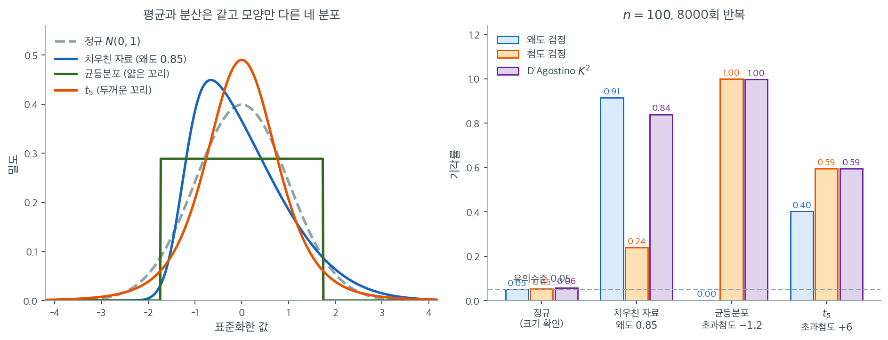

# 왜도 검정과 첨도 검정

## 1. 왜도 검정

`scipy.stats.skewtest()`가 제공하는 **왜도 검정**은 자료의 왜도가 0에서 유의하게 벗어나는지, 곧 자료가 대칭인지 아닌지를 평가하는 형식적 통계검정이다.

### 가설

- **귀무가설** ($H_0$): 자료의 왜도가 0이다(대칭분포이다).
- **대립가설** ($H_1$): 자료의 왜도가 0이 아니다(비대칭이다).

왜도 검정은 검정통계량과 $p$값을 제공한다. $p$값이 작으면(보통 0.05 미만) 귀무가설을 기각하고 자료가 대칭분포가 아니라고 결론짓는다.

### 단계별 설명

1. **표본왜도 계산**: 먼저 다음 공식으로 표본왜도를 계산한다.

    $$
    \text{Skewness} = \frac{1}{n} \sum_{i=1}^{n} \left( \frac{x_i - \bar{x}}{\sigma} \right)^3
    $$

    여기서 $n$은 자료점의 개수, $x_i$는 개별 자료점, $\bar{x}$는 평균, $\sigma$는 표준편차이다.

2. **z 점수 계산**: 검정통계량인 **z 점수**는 관측된 왜도를 그 표준오차로 나누어 계산한다. z 점수는 왜도가 기댓값(정규분포에서는 0)에서 얼마나 떨어져 있는지를 알려준다.

3. **z 점수를 p값으로 변환**: 표준정규분포의 누적분포함수로 p값을 계산한다. 앞 단계에서 얻은 z 점수를 표준정규분포와 비교하여 **양측 p값**을 얻는다. 이 p값은 왜도가 0(대칭분포)이라는 귀무가설 아래에서 관측된 값만큼 극단적인 왜도를 볼 가능성을 수량화한다.

### 응용

왜도 검정은 대칭성을 가정하는 모수적 통계 방법(특정 형태의 $t$ 검정이나 분산분석 등)으로 자료를 분석할 수 있는지 평가할 때 실용적이다. 자료가 치우쳤다고 결론지으면 자료를 변환하거나(예: 로그나 Box-Cox 변환) 대칭성을 가정하지 않는 비모수 방법을 써야 할 수 있다.

<div class="exbox" markdown>

**보기 1.** <span class="diff easy" title="쉬움"></span> 왜도 검정. $\mathcal{N}(2, 2^2)$에서 $n = 1000$개를 뽑으면 $Z_1 = 0.4402$, $p = 0.6598$로 기각하지 못한다.

**(1)** 이 검정이 $n = 1000$에서 **잡아낼 수 있는 가장 작은 왜도**는 얼마인가. $\lvert Z_1\rvert = 1.96$이 되는 $g_1$을 구하고, 흔히 쓰는 어림 $1.96\sqrt{6/n}$과 비교하시오.

**(2)** 코드의 주석을 풀어 $\text{Gamma}(k = 2,\ \theta = 2)$로 돌리면 어떻게 되는가. 감마분포의 **이론** 왜도를 구해 표본값과 견주시오.

</div>

??? success "풀이"

    **(1) 경계는 $g_1 = 0.1515$다.** `skewtest`의 변환 $Z_1 = \delta\operatorname{arcsinh}(Y/\alpha)$는 $g_1$의 단조증가함수이므로, $Z_1 = 1.959964$가 되는 $g_1$을 수치적으로 찾으면 유일한 답이 나온다. $n = 1000$에서

    $$
    g_1^{\ast} = 0.1515
    $$

    이고, 어림 $1.96\sqrt{6/n} = 1.959964\times0.0774597 = 0.1518$이 그것을 거의 그대로 맞힌다(차이 $0.2\%$). $n$이 1000쯤 되면 $g_1$의 귀무분포가 충분히 정규에 가까워져 단순 어림이 통한다는 뜻이다. 앞 쪽에서 본 대로 $n$이 작을 때는 그렇지 않다.

    관측값 $g_1 = 0.0339$는 이 경계의 $22\%$에 지나지 않는다. 그래서 $p = 0.66$이다.

    **거꾸로 읽는 것이 중요하다.** "기각하지 못했다"는 **"왜도가 $0.15$보다 작다"는 말일 뿐 "0이다"라는 말이 아니다.** 모집단 왜도가 $0.1$인 자료를 $n = 1000$으로 조사하면 이 검정은 대개 통과시킨다. $\lvert g_1\rvert < 0.15$가 실무상 무해한지는 검정이 답해 줄 수 없는 질문이고, 쓰려는 방법이 무엇인지에 달려 있다.

    **(2) 이론 왜도는 $2/\sqrt{k} = 1.4142$이고 표본값은 $1.3583$이다.** 형상모수 $k$, 척도모수 $\theta$인 감마분포의 중심적률은

    $$
    \mu_2 = k\theta^2, \qquad \mu_3 = 2k\theta^3
    $$

    이므로

    $$
    \gamma_1 = \frac{\mu_3}{\mu_2^{3/2}} = \frac{2k\theta^3}{(k\theta^2)^{3/2}} = \frac{2}{\sqrt{k}}
    $$

    다. **척도 $\theta$가 약분되어 사라진다**는 점에 주의하라. $\theta = 2$를 $\theta = 100$으로 바꿔도 왜도는 그대로다. $k = 2$이므로 $\gamma_1 = 2/\sqrt2 = 1.41421$이다.

    표본값 $g_1 = 1.3583$은 이론값보다 $0.056$ 작다. 유한표본에서 $g_1$이 치우침을 아래로 깎는 쪽으로 편향되어 있고 또 표집변동도 있으니 예상 범위다. 중요한 것은 이 값이 경계 $0.1515$의 **아홉 배**라는 사실이다. 검정은 $Z_1 = 13.6656$, $p = 1.63\times10^{-42}$로 압도적으로 기각한다.

    ```python
    import numpy as np
    from scipy import stats

    np.random.seed(0)

    # 지금은 정규자료다. 위 주석을 바꿔 감마분포로 돌리면 검정이 기각되는 것을
    # 볼 수 있다. 두 경우를 견주는 것이 이 코드의 쓰임이다.
    # data = np.random.gamma(2, 2, 1000)
    data = np.random.normal(2, 2, 1000)

    skewness_value = stats.skew(data)
    print(f"Skewness: {skewness_value:.4f}")

    # 귀무가설은 "모집단의 왜도가 0" 이다. 이 검정은 치우침만 보므로,
    # 대칭이면서 꼬리만 두꺼운 분포는 잡아내지 못한다.
    stat, p_value = stats.skewtest(data)
    print(f"Skewness Test: Statistic={stat:.4f}, p-value={p_value:.4f}")

    # 결과 해석
    alpha = 0.05
    if p_value <= alpha:
        print("Reject H_0: The data is not symmetrically distributed (significant skewness).")
    else:
        print("Fail to reject H_0: The data is symmetrically distributed (no significant skewness).")
    ```

    출력:

    ```text
    Skewness: 0.0339
    Skewness Test: Statistic=0.4402, p-value=0.6598
    Fail to reject H_0: The data is symmetrically distributed (no significant skewness).
    ```

    경계와 감마 쪽 값을 함께 확인한다.

    ```python
    import numpy as np
    from scipy import stats
    from scipy.optimize import brentq

    n = 1000

    # skewtest 의 변환을 g1 의 함수로 쓴다 (단조증가이므로 역이 하나다).
    def z1_of(g1, n):
        Y = g1 * np.sqrt((n + 1) * (n + 3) / (6.0 * (n - 2)))
        beta2 = (3.0 * (n**2 + 27 * n - 70) * (n + 1) * (n + 3)
                 / ((n - 2.0) * (n + 5) * (n + 7) * (n + 9)))
        W2 = -1 + np.sqrt(2 * (beta2 - 1))
        delta = 1 / np.sqrt(0.5 * np.log(W2))
        alpha = np.sqrt(2.0 / (W2 - 1))
        return delta * np.arcsinh(Y / alpha)

    g1_cut = brentq(lambda g: z1_of(g, n) - 1.959964, 0.0, 1.0)
    print(f"|Z1| = 1.96 이 되는 g1 = {g1_cut:.4f}")
    print(f"어림 1.96*sqrt(6/n)   = {1.959964 * np.sqrt(6 / n):.4f}")

    print(f"\nGamma(k=2) 이론 왜도 = 2/sqrt(k) = {2 / np.sqrt(2.0):.4f}")
    np.random.seed(0)
    gam = np.random.gamma(2, 2, 1000)
    zg, pg = stats.skewtest(gam)
    print(f"감마 표본 g1 = {stats.skew(gam):.4f},  Z1 = {zg:.4f},  p = {pg:.4g}")

    # 정규 자료에서의 실제 기각률이 명목을 지키는지도 본다.
    rng = np.random.default_rng(42)
    R = 4000
    rej = np.mean([stats.skewtest(s)[1] < 0.05 for s in rng.standard_normal((R, n))])
    print(f"\n정규 자료 기각률 = {rej:.4f}  (명목 0.05, MC SE {np.sqrt(0.05 * 0.95 / R):.4f})")
    ```

    출력:

    ```text
    |Z1| = 1.96 이 되는 g1 = 0.1515
    어림 1.96*sqrt(6/n)   = 0.1518

    Gamma(k=2) 이론 왜도 = 2/sqrt(k) = 1.4142
    감마 표본 g1 = 1.3583,  Z1 = 13.6656,  p = 1.629e-42

    정규 자료 기각률 = 0.0530  (명목 0.05, MC SE 0.0034)
    ```

    세 가지가 맞아떨어진다. 수치적으로 구한 경계 $0.1515$가 어림 $0.1518$과 맞고, 유도한 이론 왜도 $1.4142$가 표본 $1.3583$과 표집변동 범위에서 맞으며, 정규 자료에서의 실제 기각률 $0.0530$이 명목 $0.05$에서 몬테카를로 표준오차의 $0.9$배 안에 들어온다. **검정이 약속한 크기를 지킨다**는 확인이다. $\square$

---

## 2. 첨도 검정

`scipy.stats.kurtosistest()`가 제공하는 **첨도 검정**은 자료의 초과첨도가 정규분포의 첨도에서 유의하게 벗어나는지 평가하는 형식적 통계검정이다.

### 가설

- **귀무가설** ($H_0$): 자료의 첨도가 정규분포의 것과 같다.
- **대립가설** ($H_1$): 자료의 첨도가 정규분포의 것과 다르다.

첨도 검정은 검정통계량과 $p$값을 제공한다. $p$값이 작으면(보통 0.05 미만) 귀무가설을 기각하고 자료의 첨도가 정규가 아니라고 결론짓는다.

### 단계별 설명

1. **표본 초과첨도 계산**: 먼저 다음 공식으로 표본 초과첨도를 계산한다.

    $$
    \text{Excess Kurtosis} = \frac{1}{n} \sum_{i=1}^{n} \left( \frac{x_i - \bar{x}}{\sigma} \right)^4 - 3
    $$

    여기서 $n$은 자료점의 개수, $x_i$는 개별 자료점, $\bar{x}$는 평균, $\sigma$는 표준편차이다.

2. **z 점수 계산**: 검정통계량인 **z 점수**는 관측된 초과첨도를 그 표준오차로 나누어 계산한다. z 점수는 초과첨도가 기댓값(정규분포에서는 0)에서 얼마나 떨어져 있는지를 알려준다.

3. **z 점수를 p값으로 변환**: 표준정규분포의 누적분포함수로 **양측 p값**을 계산한다. 이 p값은 귀무가설 아래에서 관측된 값만큼 극단적인 초과첨도를 볼 가능성을 수량화한다.

### 응용

정규 첨도를 가정하는 모수적 방법($t$ 검정, 분산분석 등)이 적절한지 평가할 때 첨도 검정을 쓴다. 첨도 검정이 자료의 꼬리가 유의하게 두껍거나 얇다고 나타내면 변환(로그나 Box-Cox 변환)이나 비모수 방법이 필요할 수 있다.

<div class="exbox" markdown>

**보기 2.** <span class="diff easy" title="쉬움"></span> 첨도 검정. 보기 1과 **같은** $\mathcal{N}(2, 2^2)$ 표본에 첨도 검정을 걸면 $g_2 = -0.0468$, $Z_2 = -0.1980$, $p = 0.8431$이다.

**(1)** $\lvert Z_2\rvert = 1.96$이 되는 $g_2$의 두 경계를 구하시오. 왜도 검정의 경계와 달리 **0을 중심으로 대칭이 아닐 것이다.** 어느 쪽이 넓으며 왜 그런가.

**(2)** $\text{Gamma}(k = 2,\ \theta = 2)$의 이론 초과첨도를 유도해 표본값과 견주시오. 감마 자료에서 왜도 검정과 첨도 검정 중 어느 쪽이 더 강하게 기각하는가.

</div>

??? success "풀이"

    **(1) 경계는 $[-0.2744,\ +0.3272]$이고 위쪽이 $19\%$ 넓다.** 앞 쪽의 변환을 $b_2$의 함수로 보면 단조증가이므로 $Z_2 = \pm1.959964$를 주는 $b_2$를 수치적으로 찾을 수 있다. $n = 1000$에서 $g_2 = b_2 - 3$으로 옮겨 적으면

    $$
    -0.2744 \;\le\; g_2 \;\le\; +0.3272
    $$

    가 기각하지 못하는 구간이다. 비가 $0.3272/0.2744 = 1.192$다. 대칭 어림 $1.96\sqrt{24/n} = \pm0.3036$은 위쪽 경계를 $7\%$ 작게, 아래쪽 경계를 $11\%$ 크게 잡는다.

    **비대칭의 까닭은 $b_2$의 귀무분포가 치우쳐 있다는 것이다.** 초과첨도는 아래로 막혀 있고($g_2 \ge -2$) 위로는 열려 있다. 게다가 $g_2$는 꼬리의 몇 안 되는 관측값이 좌우하므로 큰 값 하나가 들어오면 위로만 크게 튄다. 한쪽으로만 튈 수 있는 통계량의 분포는 대칭일 수 없고, 그러므로 **같은 크기의 이탈이라도 양수 쪽이 더 흔하다.** 검정이 그 사실을 반영해 위쪽 경계를 더 멀리 둔다.

    관측값 $-0.0468$은 아래쪽 경계의 $17\%$ 자리다. 그래서 $p = 0.84$다. **$Z_2$의 부호가 음수라는 사실에는 아무 정보가 없다.** 정규 자료에서 $g_2$가 음수로 나올 확률은 절반을 넘는데(비보정 $b_2$의 기댓값이 $3(n-1)/(n+1) < 3$이므로 중앙값도 3 아래다), "꼬리가 얇다는 증거"로 읽으면 안 된다.

    **(2) 이론 초과첨도는 $6/k = 3$이고 표본값은 $2.4079$다.** 형상 $k$, 척도 $\theta$인 감마분포의 중심적률은 $\mu_2 = k\theta^2$, $\mu_4 = 3k(k+2)\theta^4$이므로

    $$
    \gamma_2 = \frac{\mu_4}{\mu_2^2} - 3 = \frac{3k(k+2)\theta^4}{k^2\theta^4} - 3 = \frac{3(k+2)}{k} - 3 = \frac{6}{k}
    $$

    다. 왜도와 마찬가지로 **척도가 약분된다.** $k = 2$이므로 $\gamma_2 = 3$이다. 표본값 $2.4079$는 이론값보다 $0.59$ 작은데, 앞 쪽에서 본 $g_2$의 아래쪽 편향과 큰 표집변동을 생각하면 놀랄 일이 아니다.

    **기각은 왜도 쪽이 훨씬 강하다.** 같은 감마 표본에서

    | 검정 | 통계량 | $p$값 |
    |---|---|---|
    | 왜도 검정 | $Z_1 = 13.6656$ | $1.63\times10^{-42}$ |
    | 첨도 검정 | $Z_2 = 7.7918$ | $6.61\times10^{-15}$ |

    이다. 이론값으로 보면 감마 $k=2$는 왜도 $1.414$와 초과첨도 $3$을 **둘 다** 가지므로 두 검정이 모두 기각하는 것이 당연하다. 그런데 $Z_1$이 $Z_2$의 $1.75$배다. 치우친 분포에서는 왜도 쪽 신호가 먼저, 더 크게 잡힌다. 거꾸로 꼬리만 두꺼운 $t$나 꼬리만 얇은 균등분포에서는 첨도 검정만 반응한다. **두 검정을 함께 돌리고 어느 $Z$가 컸는지 보는 것이 "어떻게 정규가 아닌가"에 대한 답이 된다.**

    ```python
    import numpy as np
    from scipy import stats

    np.random.seed(0)

    # data = np.random.gamma(2, 2, 1000)
    data = np.random.normal(2, 2, 1000)

    kurtosis_value = stats.kurtosis(data)
    print(f"Kurtosis: {kurtosis_value:.4f}")

    # 귀무가설은 "모집단의 초과첨도가 0" 이다. 앞의 왜도 검정과 짝을 이루며,
    # 둘을 합친 것이 D'Agostino 의 K^2 이다.
    stat, p_value = stats.kurtosistest(data)
    print(f"Kurtosis Test: Statistic={stat:.4f}, p-value={p_value:.4f}")

    # 결과 해석
    alpha = 0.05
    if p_value <= alpha:
        print("Reject H_0: The data does not have normal kurtosis.")
    else:
        print("Fail to reject H_0: The data has normal kurtosis.")
    ```

    출력:

    ```text
    Kurtosis: -0.0468
    Kurtosis Test: Statistic=-0.1980, p-value=0.8431
    Fail to reject H_0: The data has normal kurtosis.
    ```

    비대칭 경계와 감마 쪽 값을 함께 확인한다.

    ```python
    import numpy as np
    from scipy import stats
    from scipy.optimize import brentq

    n = 1000

    # kurtosistest 의 변환을 b2 의 함수로 쓴다 (단조증가이므로 역이 하나다).
    def z2_of(b2, n):
        E = 3.0 * (n - 1) / (n + 1)
        varb2 = 24.0 * n * (n - 2) * (n - 3) / ((n + 1) ** 2 * (n + 3) * (n + 5))
        u = (b2 - E) / np.sqrt(varb2)
        sqrtbeta1 = (6.0 * (n * n - 5 * n + 2) / ((n + 7) * (n + 9))
                     * np.sqrt(6.0 * (n + 3) * (n + 5) / (n * (n - 2) * (n - 3))))
        A = 6.0 + 8.0 / sqrtbeta1 * (2.0 / sqrtbeta1 + np.sqrt(1 + 4.0 / sqrtbeta1**2))
        term1 = 1 - 2 / (9.0 * A)
        term2 = ((1 - 2.0 / A) / (1 + u * np.sqrt(2 / (A - 4.0)))) ** (1 / 3)
        return (term1 - term2) / np.sqrt(2 / (9.0 * A))

    lo = brentq(lambda g: z2_of(g + 3.0, n) + 1.959964, -0.5, 0.0)
    hi = brentq(lambda g: z2_of(g + 3.0, n) - 1.959964, 0.0, 2.0)
    print(f"기각하지 않는 g2 구간 = [{lo:.4f}, {hi:.4f}]")
    print(f"폭의 비 (위/아래) = {hi / abs(lo):.3f}")
    print(f"대칭 어림 1.96*sqrt(24/n) = +-{1.959964 * np.sqrt(24 / n):.4f}")

    print(f"\nGamma(k=2) 이론 초과첨도 = 3(k+2)/k - 3 = 6/k = {6 / 2.0:.4f}")
    np.random.seed(0)
    gam = np.random.gamma(2, 2, 1000)
    z1, p1 = stats.skewtest(gam)
    z2, p2 = stats.kurtosistest(gam)
    print(f"감마 표본 g2 = {stats.kurtosis(gam):.4f},  Z2 = {z2:.4f},  p = {p2:.4g}")
    print(f"감마 표본 Z1 = {z1:.4f} (왜도)  대  Z2 = {z2:.4f} (첨도)")

    # 정규 자료에서의 실제 기각률
    rng = np.random.default_rng(43)
    R = 4000
    rej = np.mean([stats.kurtosistest(s)[1] < 0.05 for s in rng.standard_normal((R, n))])
    print(f"\n정규 자료 기각률 = {rej:.4f}  (명목 0.05, MC SE {np.sqrt(0.05 * 0.95 / R):.4f})")
    ```

    출력:

    ```text
    기각하지 않는 g2 구간 = [-0.2744, 0.3272]
    폭의 비 (위/아래) = 1.192
    대칭 어림 1.96*sqrt(24/n) = +-0.3036

    Gamma(k=2) 이론 초과첨도 = 3(k+2)/k - 3 = 6/k = 3.0000
    감마 표본 g2 = 2.4079,  Z2 = 7.7918,  p = 6.607e-15
    감마 표본 Z1 = 13.6656 (왜도)  대  Z2 = 7.7918 (첨도)

    정규 자료 기각률 = 0.0470  (명목 0.05, MC SE 0.0034)
    ```

    구한 구간 $[-0.2744,\ 0.3272]$가 앞 쪽 [첨도 검정](./kurtosistest.md)에서 모의실험으로 얻은 $n = 1000$의 95% 범위 $[-0.27,\ +0.33]$과 일치한다. 한쪽은 변환식을 역으로 푼 것이고 다른 쪽은 자료를 6만 번 뽑아 센 것인데 같은 수가 나왔다. 유도한 이론 초과첨도 $3$도 표본 $2.4079$와 표집변동 범위에서 맞고, 정규 자료에서의 실제 기각률 $0.0470$이 명목 $0.05$에서 몬테카를로 표준오차의 $0.9$배 안에 든다. $\square$

---

## 3. 두 검정은 서로의 맹점을 덮는다

두 검정을 따로 배웠으니 이제 나란히 세워 보자. 아래 그림의 왼쪽 칸에는 평균 0, 분산 1로 맞춘 네 분포가 있다. 모두 중심과 퍼짐이 같고 **모양만** 다르다. 오른쪽 칸은 각 모집단에서 $n = 100$인 표본을 8000번 뽑아 두 검정과 D'Agostino $K^2$의 기각률을 잰 것이다.



정규 모집단에서는 세 막대가 모두 $0.05$ 근처에 머문다($0.05$, $0.05$, $0.06$). 약속이 지켜진다는 확인이다.

치우친 자료(왜도 $0.85$)에서는 왜도 검정이 $0.91$로 압도적이고 첨도 검정은 $0.24$에 그친다. 예상대로다. 정작 눈여겨볼 곳은 세 번째 칸이다. 균등분포는 완벽하게 대칭이고 꼬리만 얇다(초과첨도 $-1.2$). 첨도 검정은 $0.999$로 거의 언제나 잡아내는 반면, 왜도 검정의 기각률은 $0.001$이다. 8000번 중 열 번 남짓. 이것이 맹점이라는 말의 뜻이다. **왜도 검정은 균등분포와 정규분포를 구별할 능력이 전혀 없다.** 오히려 명목 $0.05$보다도 한참 낮은데, 꼬리가 얇으면 $g_1$의 실제 변동이 정규성 아래에서 가정한 것보다 작아져 검정이 지나치게 보수적이 되기 때문이다.

네 번째 칸은 좀 더 미묘하다. $t_5$는 역시 완벽하게 대칭인데 왜도 검정의 기각률이 $0.40$이나 된다. 이것을 "왜도 검정이 두꺼운 꼬리도 잡아낸다"고 읽으면 안 된다. 모집단의 왜도는 정확히 0이므로 이 기각은 전부 **잘못된 기각**이다. 원인은 왜도 검정이 $g_1$의 분산을 $6/n$ 근처로 가정하는 데 있다. 꼬리가 두꺼우면 $g_1$이 그보다 훨씬 크게 흔들리므로 정규성 아래의 잣대로 재면 자꾸 "유의하게 치우쳤다"는 결론이 나온다. 앞 쪽에서 본 대로 $g_1$은 사실상 꼬리의 요약이기 때문이다.

정리하면 이렇다. 두 검정은 서로 다른 방향을 보며, 각자 보지 못하는 방향이 있고, 자기 방향이 아닌 곳에서 나온 기각은 해석을 조심해야 한다. 그래서 실무에서는 둘을 함께 돌리고 — 더 낫게는 둘을 하나로 묶은 D'Agostino $K^2$을 쓰고 — 기각되었을 때 $Z_1$과 $Z_2$ 중 어느 쪽이 컸는지를 확인한다. 위 그림에서 보라색 $K^2$ 막대가 네 칸 모두에서 두 검정 중 높은 쪽에 거의 붙어 있는 것이 그 이유다.

---

## 연습문제

<div class="drillbox" markdown>

**연습문제 1.** <span class="diff med" title="중간"></span>
`scipy.stats.skewtest`로 어떤 연구자가 z 점수 3.2와 p값 0.001을 얻었다. 이 결과를 해석하라.

</div>

??? success "풀이"
    왜도 검정은 $H_0$: 모집단 왜도가 0(정규성과 일관됨)을 검정한다. z 점수 3.2는 0에서 멀고 $p = 0.001$은 어떤 관행적 유의수준보다도 훨씬 작다.

    해석: 자료가 치우친(비대칭) 분포에서 왔다는 강한 증거가 있다. z 점수가 양수이므로 오른쪽 치우침(오른쪽 꼬리가 왼쪽보다 무겁다)을 나타낸다. 이는 비정규성의 한 요소이며, 자료에 변환이나 비모수 방법이 필요할 수 있다.

<div class="drillbox" markdown>

**연습문제 2.** <span class="diff med" title="중간"></span>
`skewtest`와 단순히 표본왜도를 계산하는 것의 차이를 설명하라. 형식적 검정이 왜 필요한가?

</div>

??? success "풀이"
    표본왜도 $g_1 = \frac{m_3}{m_2^{3/2}}$는 점추정값이며, 자료가 진짜 정규여도 표집변동 때문에 언제나 0이 아니다. 검정이 없으면 관측된 왜도가 통계적으로 유의한지 단순한 표집 잡음인지 판단할 길이 없다.

    `skewtest`는 D'Agostino 변환으로 $g_1$을 z 통계량으로 바꾼다. 이 변환은 정규성 아래에서 왜도의 표집분포를 반영한다. 그러면 p값이 관측된 왜도가 귀무가설 아래에서 얼마나 있을 법하지 않은지를 수량화한다. 예를 들어 $g_1 = 0.3$은 $n = 500$에서는 유의하지만 $n = 20$에서는 유의하지 않을 수 있다.

<div class="drillbox" markdown>

**연습문제 3.** <span class="diff med" title="중간"></span>
`kurtosistest`에는 최소 표본크기 요건이 있다. 작은 표본이 첨도 추정에 문제가 되는 이유를 설명하라.

</div>

??? success "풀이"
    표본첨도는 편차의 4제곱 $(x_i - \bar{x})^4$을 쓰므로 개별 관측값에 극도로 민감하다. 작은 표본에서는

    1. **큰 분산:** 첨도 추정량의 표집분포가 매우 넓어 추정을 믿을 수 없다.
    2. **편향:** 작은 표본에서 표본첨도가 편향되어 있고 편향 보정 공식도 불확실성이 크다.
    3. **추정량의 비정규성:** `kurtosistest`가 쓰는 z 변환은 $n$이 근사적으로 표준정규가 될 만큼 커야 한다는 것을 가정한다. $n \approx 20$ 아래에서는 이 근사가 무너진다.

    scipy에서 `kurtosistest`는 $n < 20$이면 경고를 내고 $n < 5$이면 아예 오류를 낸다. 참고로 `skewtest`는 $n < 8$이면 오류를 낸다.

    작은 표본에서는 적률 기반 검정보다 시각적 방법(Q-Q 그림)과 Shapiro-Wilk 검정이 더 믿을 만하다.

<div class="drillbox" markdown>

**연습문제 4.** <span class="diff med" title="중간"></span>
`skewtest`가 $p = 0.15$를, `kurtosistest`가 $p = 0.03$을 준다면 비정규성의 성격에 대해 무엇을 결론지을 수 있는가?

</div>

??? success "풀이"
    왜도 검정은 기각하지 않으므로($p = 0.15$) 자료가 근사적으로 대칭임을 시사한다. 첨도 검정은 기각하므로($p = 0.03$) 자료의 꼬리 거동이 비정상임을(꼬리가 두껍거나 얇음을) 나타낸다.

    이 패턴은 분포가 **대칭이지만 고첨**(두꺼운 꼬리)이거나 **대칭이지만 저첨**(얇은 꼬리)임을 시사한다. 예로는 자유도가 작은 $t$ 분포(대칭, 두꺼운 꼬리)나 균등분포(대칭, 얇은 꼬리)가 있다.

    실질적 함의는 방향에 달려 있다. 두꺼운 꼬리(양의 초과첨도)는 기대보다 이상점이 많다는 뜻으로 평균 기반 추론에 영향을 준다. 얇은 꼬리(음의 초과첨도)는 표준적인 방법에 대체로 덜 문제가 된다.

<div class="drillbox" markdown>

**연습문제 5.** <span class="diff med" title="중간"></span>
보기 1에서 $n = 1000$일 때 왜도 검정이 잡아내는 경계가 $g_1^{\ast} = 0.1515$였고 어림 $1.96\sqrt{6/n}$이 그것을 거의 맞혔다. 이 어림을 **거꾸로** 써서 표본크기를 구하자.

**(1)** 모집단 왜도가 $\gamma_1 = 0.1$인 자료를 경계 위로 올리려면 $n$이 얼마나 되어야 하는가. 경계를 겨우 넘는다는 것이 검정력으로는 얼마에 해당하며, 검정력 $0.8$까지 요구하면 $n$은 얼마가 되는가.

**(2)** 보기 1의 $\text{Gamma}(k = 2,\ \theta = 2)$는 $\gamma_1 = 1.4142$다. 어림대로라면 $n$이 얼마부터 경계를 넘는가. 그런데 $n$이 작으면 어림이 맞지 않는다. 변환식을 직접 풀면 $n = 8$에서 참 경계가 $1.1871$인데 어림은 $1.96\sqrt{6/8} = 1.6974$다. 어긋나는 **방향**을 읽고 왜 그쪽인지 설명하시오.

</div>

??? success "풀이"
    **(1) $n \ge 2305$이고, 검정력 $0.8$까지 바라면 $n \ge 4710$이다.** 경계를 넘는 조건은 $1.959964\sqrt{6/n} \le 0.1$이므로

    $$
    n \ge 6\left(\frac{1.959964}{0.1}\right)^2 = 2304.88
    $$

    에서 $n \ge 2305$다. 실제로 변환식을 $n = 2305$에서 풀면 참 경계가 $0.0999$로 나와 어림이 맞는다.

    그런데 **모집단 왜도가 경계와 정확히 같다는 것은 검정력이 $0.5$라는 뜻이다.** $g_1$이 $\gamma_1$ 언저리에서 흔들리므로 절반은 경계 위로, 절반은 아래로 떨어진다. 동전 던지기를 "잡아낸다"고 부를 수는 없다. 검정력 $0.8$을 요구하면 신호 대 표준오차 비가 $z_{0.975} + z_{0.8} = 1.959964 + 0.841621 = 2.801585$여야 하므로

    $$
    n \ge 6\left(\frac{2.801585}{0.1}\right)^2 = 4709.33
    $$

    에서 $n \ge 4710$이다. **경계를 넘기려던 $2305$의 두 배가 넘는다.** 검정력은 $n$의 제곱근으로만 자라므로 늘 이런 식이다.

    **(2) 어림으로는 $n \ge 12$이지만 실제로는 `skewtest`가 허용하는 가장 작은 $n = 8$에서 이미 넘는다.** 어림을 풀면

    $$
    n \ge 6\left(\frac{1.959964}{1.414214}\right)^2 = 11.52
    $$

    이니 $n \ge 12$다. 그러나 $n = 8$의 참 경계 $1.1871$이 이미 $1.4142$보다 작다. **어림이 경계를 $43\%$나 크게 잡은 것이다**($1.6974 / 1.1871 = 1.43$).

    방향의 까닭은 $g_1$의 귀무분포가 **작은 $n$에서 유계**라는 데 있다. 표본왜도는 $n$개의 점으로 만드는 양이므로 아무리 극단적인 자료를 넣어도 $\lvert g_1\rvert$이 $n$에 따라 정해지는 한계를 넘지 못한다($n = 8$에서 대략 $2.3$). 위아래가 막힌 분포는 정규분포보다 꼬리가 **얇을** 수밖에 없고, 그러면 $97.5\%$ 분위수가 표준편차의 $1.96$배가 아니라 그보다 가까운 곳에 놓인다. 실제로 $1.1871 / \sqrt{6/8} = 1.371$배다. 어림 $1.96\,\mathrm{SD}$는 **실제 분포가 닿지도 못하는 곳**을 가리키고 있는 셈이다.

    **그렇다고 $n = 8$에서 감마분포를 잡아낸다는 말은 아니다.** "경계를 넘으면 검정력 $0.5$"라는 계산은 $g_1$이 $\gamma_1$ 근처에 모여 있을 때 이야기인데, $n = 8$에서는 $g_1$의 상한 자체가 $2.3$이라 평균이 $1.4142$ 근처에 있을 수가 없다. 감마 자료를 $40000$번 뽑아 재면 $\mathbb{E}[g_1]$이 $n = 8$에서 $0.61$, $n = 12$에서 $0.79$, $n = 30$에서 $1.09$로 **이론값 $1.41$에 한참 못 미친다.** 기각률도 각각 $0.178$, $0.279$, $0.672$이고 $0.5$에 이르는 것은 $n \approx 21$이다. 작은 표본에서는 경계 쪽 어림과 편향 쪽 효과가 **반대 방향으로** 작동하며, 둘째가 더 크다.

<div class="drillbox" markdown>

**연습문제 6.** <span class="diff med" title="중간"></span>
보기 2에서 $n = 1000$의 참 경계가 $[-0.2744,\ +0.3272]$이고 대칭 어림이 $\pm0.3036$이었다. 어떤 분석자가 변환을 쓰기 귀찮아서 "$\lvert g_2\rvert > 1.96\sqrt{24/n}$이면 기각"이라는 대칭 규칙만 쓴다고 하자. 변환에 넣어 보면 $g_2 = +0.3036$은 $Z_2 = 1.8434$로, $g_2 = -0.3036$은 $Z_2 = -2.2215$로 간다.

**(1)** 이 규칙의 실제 오류율을 **양쪽 따로** 구하고 합하시오. 명목 $0.025 + 0.025$와 견주면 어떤가.

**(2)** 합만 확인하고 "그럭저럭 쓸 만하다"고 결론짓는 사람이 놓치는 것은 무엇인가.

</div>

??? success "풀이"
    **(1) 위쪽 $0.0326$, 아래쪽 $0.0132$, 합 $0.0458$이다.** 변환된 값을 표준정규로 읽으면

    $$
    P(Z_2 > 1.8434) = \Phi(-1.8434) = 0.03264, \qquad P(Z_2 < -2.2215) = \Phi(-2.2215) = 0.01316
    $$

    이고 합이 $0.04580$이다. 명목과 견주면 위쪽은 $0.03264/0.025 = 1.31$배로 **부풀었고**, 아래쪽은 $0.01316/0.025 = 0.53$배로 **쪼그라들었다.** 한쪽은 $31\%$ 더 자주 헛울리고 다른 쪽은 거의 절반만 울린다.

    경계를 직접 견주어도 같은 이야기가 나온다. $g_2 = 0.31$은 대칭 규칙이 기각하지만 `kurtosistest`는 통과시키고($0.31 < 0.3272$), $g_2 = -0.29$는 `kurtosistest`가 기각하지만 대칭 규칙은 통과시킨다($0.29 < 0.3036$). **두 방향 모두에서 결론이 뒤집히는 자리가 있다.**

    **(2) 두 오류가 합에서 서로를 지운다는 것이 함정이다.** 합 $0.0458$은 명목 $0.05$보다 오히려 작으니, 전체 기각률만 모의로 재 보는 사람은 "조금 보수적이지만 괜찮다"고 결론짓게 된다. 그러나 그 $0.0458$은 **위쪽의 과잉과 아래쪽의 부족이 상쇄된 수**이지 어느 쪽도 맞다는 뜻이 아니다.

    실무에서 중요한 쪽은 대개 위쪽이다. 금융 수익률이든 측정 오차든 사람들이 걱정하는 것은 "꼬리가 두꺼운가"이고, 그 질문에 대해 이 규칙은 명목보다 $31\%$ 많이 기각한다. 비대칭의 뿌리는 보기 2에서 본 그대로다. $b_2$의 귀무분포가 오른쪽으로 치우쳐 있어 **큰 양수 쪽은 정규 자료에서도 흔히 나오므로** 경계를 더 멀리 두어야 하는데, 대칭 어림은 그것을 모른다.

<div class="drillbox" markdown>

**연습문제 7.** <span class="diff hard" title="어려움"></span>
보기 2의 풀이는 "초과첨도는 아래로 막혀 있다($g_2 \ge -2$)"고만 했다. 이것을 왜도까지 끌어들여 날카롭게 만들자. 표준화 $Z = (X - \mu)/\sigma$에 대해 $\gamma_1 = \mathbb{E}[Z^3]$, $\beta_2 = \mathbb{E}[Z^4]$, $\gamma_2 = \beta_2 - 3$이라 하자.

**(1)** $\beta_2 \ge 1 + \gamma_1^2$를 보이고 등호가 성립하는 분포를 밝히시오. 여기에서 $\gamma_2 \ge -2$가 어떻게 따라 나오는가.

**(2)** 보기 1·2의 $\text{Gamma}(k,\ \theta)$는 이 부등식을 얼마나 여유 있게 지키는가.

**(3)** 어떤 보고서가 한 자료의 요약으로 $g_1 = 2.5$, $g_2 = 2.0$을 적었다. 믿을 수 있는가.

**(4)** $n = 1000$에서 첨도 검정을 **통과한** 표본($g_2 \le 0.3272$)의 왜도는 얼마까지 커질 수 있는가. 왜도 검정 자신의 경계 $0.1515$와 견주시오.

</div>

??? success "풀이"
    **(1) 코시–슈바르츠를 $Z$와 $Z^2$에 쓰면 된다.** 표준화했으므로 $\mathbb{E}[Z] = 0$, $\mathbb{E}[Z^2] = 1$이다. 따라서

    $$
    \operatorname{Cov}(Z, Z^2) = \mathbb{E}[Z^3] - \mathbb{E}[Z]\,\mathbb{E}[Z^2] = \gamma_1, \qquad \operatorname{Var}(Z) = 1, \qquad \operatorname{Var}(Z^2) = \beta_2 - 1
    $$

    이다. 공분산의 코시–슈바르츠 부등식 $\operatorname{Cov}(U,V)^2 \le \operatorname{Var}(U)\operatorname{Var}(V)$에 넣으면

    $$
    \gamma_1^2 \le 1 \cdot (\beta_2 - 1) \quad \Longleftrightarrow \quad \beta_2 \ge 1 + \gamma_1^2
    $$

    이다. 등호는 $Z^2 = a + bZ$가 확률 1로 성립할 때, 곧 $Z$가 어떤 이차방정식의 근만 값으로 가질 때다. 이차방정식의 근은 많아야 둘이므로 **등호를 주는 것은 두 점 분포뿐이다.**

    $\gamma_2 = \beta_2 - 3 \ge \gamma_1^2 - 2 \ge -2$이고, 바닥 $-2$는 $\gamma_1 = 0$인 두 점 분포, 곧 $\pm1$을 반반씩 갖는 분포에서만 닿는다. 보기 2가 말한 "아래로 막혀 있다"가 이렇게 증명되고, 동시에 **치우친 분포는 그 바닥에 닿을 수조차 없다**는 사실이 덤으로 나온다. $\square$

    **(2) 감마분포의 여유는 $2 + 2/k$다.** 보기 1·2에서 유도한 $\gamma_1 = 2/\sqrt{k}$, $\gamma_2 = 6/k$를 쓰면 $\beta_2 = 3 + 6/k$이고 하한은 $1 + \gamma_1^2 = 1 + 4/k$이므로

    $$
    \beta_2 - (1 + \gamma_1^2) = \left(3 + \frac{6}{k}\right) - \left(1 + \frac{4}{k}\right) = 2 + \frac{2}{k} > 0
    $$

    이다. $k = 2$에서는 $\beta_2 = 6$, 하한 $3$으로 여유가 $3$이다. 어떤 $k$에서도 여유가 $2$ 아래로 내려가지 않으니 **감마분포는 하한 근처에 얼씬도 하지 않는다.** 하한은 두 점 분포처럼 적률이 극단적으로 뭉친 경우를 위한 것이다.

    **(3) 불가능한 쌍이다.** $\beta_2 = g_2 + 3 = 5.0$인데 하한은 $1 + 2.5^2 = 7.25$다. $5.0 < 7.25$이므로 어떤 분포도 이 두 값을 함께 가질 수 없다.

    표본이라서 괜찮은 것 아니냐고 할 수 없다. (1)의 증명은 **어떤 분포에나** 적용되고, 자료 $x_1, \ldots, x_n$에 같은 질량을 얹은 경험분포도 분포이기 때문이다. 비보정 표본적률 $g_1 = m_3/m_2^{3/2}$, $b_2 = m_4/m_2^2$는 그러므로 언제나 $b_2 \ge 1 + g_1^2$를 만족한다. 편향보정판을 쓰면 상수가 $O(1/n)$만큼 흔들리지만, $5.0$과 $7.25$의 차이는 그런 보정으로 메울 수 있는 크기가 전혀 아니다. **표집변동이 아니라 계산 실수다.** 왜도를 보정판으로, 첨도를 비보정판으로 섞어 쓰거나 분모의 표준편차 판본을 틀리게 쓴 경우가 흔하다.

    **(4) $\lvert g_1\rvert \le 1.5255$까지인데, 이는 왜도 검정 경계의 $10.1$배다.** $b_2 \ge 1 + g_1^2$에서

    $$
    g_1^2 \le b_2 - 1 = (g_2 + 3) - 1 = g_2 + 2 \le 0.3272 + 2 = 2.3272
    $$

    이므로 $\lvert g_1\rvert \le \sqrt{2.3272} = 1.5255$다. 곧 **첨도 검정은 그 안에 아주 거친 왜도 검사를 품고 있다.** 첨도 검정을 통과한 표본이 왜도 $2$를 가질 수는 없다.

    그러나 거칠다는 말이 핵심이다. 왜도 검정 자신의 경계는 $0.1515$인데 첨도 검정이 보장해 주는 것은 $1.5255$로, **열 배 느슨하다.** 본문 3절의 둘째 칸에서 왜도 $0.85$인 자료를 첨도 검정이 $0.24$밖에 잡아내지 못한 것이 이 계산의 다른 얼굴이다. $0.85$는 $1.5255$ 안에 넉넉히 들어가므로 부등식이 아무런 제약을 걸지 않는다. **왜도를 보려면 왜도 검정을 따로 돌려야 한다.**

<div class="drillbox" markdown>

**연습문제 8.** <span class="diff hard" title="어려움"></span>
본문 3절은 두 검정이 서로의 맹점을 덮는다고 했다. 그런데 **둘을 합쳐도 보지 못하는** 방향이 있다. $X$가 $+c$와 $-c$를 각각 확률 $q/2$로, $0$을 확률 $1 - q$로 갖는 세 점 분포라 하자.

**(1)** $\gamma_1$과 $\beta_2$를 $q$로 나타내고, $\gamma_2 = 0$이 되는 $q$를 구하시오. 그 분포를 평균 0, 분산 1로 맞추면 무엇이 되는가.

**(2)** 그 분포에서 표본을 뽑으면 왜도 검정·첨도 검정·$K^2$·자크–베라의 기각률이 $n$이 커질 때 어떻게 되겠는가. 모의로 재면 $n = 100$에서 차례로 $0.0003$, $0.0432$, $0.0163$, $0.0196$이고 $n = 1000$에서 $0.0000$, $0.0261$, $0.0050$, $0.0080$이다($20000$회). 같은 자료에서 섀피로–윌크는 두 $n$ 모두 $1.0000$이다. 무엇을 말할 수 있는가.

**(3)** 이것이 "이산분포라서 생긴 꼼수"라는 반론에 어떻게 답하겠는가.

</div>

??? success "풀이"
    **(1) $q = 1/3$이고, 표준화하면 $\pm\sqrt3$을 각각 확률 $1/6$로, $0$을 확률 $2/3$로 갖는 분포다.** 분포가 0을 중심으로 대칭이므로 홀수 차 중심적률이 모두 0이고 따라서 $\gamma_1 = 0$이다. 짝수 차는

    $$
    \mu_2 = qc^2, \qquad \mu_4 = qc^4
    $$

    이므로

    $$
    \beta_2 = \frac{\mu_4}{\mu_2^2} = \frac{qc^4}{q^2c^4} = \frac{1}{q}
    $$

    다. **$c$가 약분되어 사라진다는 점에 주의하라.** 보기 1·2에서 감마분포의 척도 $\theta$가 사라진 것과 같은 이치다. $\gamma_2 = 1/q - 3 = 0$은 $q = 1/3$에서 성립한다.

    분산을 1로 맞추려면 $\mu_2 = c^2/3 = 1$에서 $c = \sqrt3$이다. 이 분포는

    $$
    \mathbb{E}[X] = 0, \qquad \operatorname{Var}(X) = 1, \qquad \gamma_1 = 0, \qquad \gamma_2 = 0
    $$

    으로 **정규분포와 처음 네 적률이 모두 같다.** 그러면서 질량의 삼분의 이가 정확히 한 점에 뭉쳐 있다. 연습문제 7의 부등식도 확인해 두자. $\beta_2 = 3 \ge 1 + 0^2 = 1$로 여유 $2$를 두고 지킨다.

    **(2) 기각률이 1로 가기는커녕 $n$이 커지면 오히려 내려간다.** 왜도 검정과 첨도 검정이 재는 것은 $g_1$과 $g_2$뿐인데 이 분포에서 둘의 모집단 값이 모두 0이므로 $Z_1$과 $Z_2$가 **어느 $n$에서도 0 근처에 머문다.** 이동할 신호가 없으니 기각률이 $n$과 함께 자랄 수가 없다. 수치가 그대로 보여 준다. 네 검정 모두 명목 $0.05$ 아래이고, $n$을 열 배로 키우면 $K^2$는 $0.0163 \to 0.0050$, 자크–베라는 $0.0196 \to 0.0080$으로 **더 떨어진다.**

    내려가는 까닭은 본문 3절의 균등분포 칸($0.001$)과 똑같다. 이 분포는 유계라 꼬리가 얇고, 그러면 $g_1$과 $g_2$의 실제 변동이 정규성 아래에서 가정한 $6/n$과 $24/n$보다 작아진다. 정규성의 잣대로 재면 통계량이 늘 경계 안쪽에 들어오므로 **검정이 지나치게 보수적이 된다.**

    반면 섀피로–윌크는 두 $n$ 모두 $1.0000$이다. 순서통계량 전체가 정규 분위수와 이루는 상관을 보기 때문에, 자료의 삼분의 이가 한 점에 겹쳐 있다는 사실을 놓칠 수가 없다. **결론은 이렇다. 적률 기반 검정은 3차와 4차 적률을 움직이는 이탈에 대해서만 일치추정적이다.** $K^2$와 자크–베라가 통과시켰다는 것은 "정규다"가 아니라 "왜도와 초과첨도가 0에 가깝다"는 말일 뿐이다. 본문이 "두 검정이 서로의 맹점을 덮는다"고 한 것은 **두 방향 사이**의 이야기이지 모든 방향에 대한 이야기가 아니다.

    **(3) 연속분포로도 같은 것을 만들 수 있다.** $U(-3, 3)$을 확률 $p$로, $U(-1, 1)$을 확률 $1 - p$로 뽑는 혼합을 보자. 대칭이므로 $\gamma_1 = 0$이고

    $$
    \mu_2 = \frac{9p + (1-p)}{3}, \qquad \mu_4 = \frac{81p + (1-p)}{5}
    $$

    이다. $u = 8p$로 두면 $\mu_2 = (1 + u)/3$, $\mu_4 = (1 + 10u)/5$이므로 $\beta_2 = 3$은

    $$
    \frac{9(1 + 10u)}{5(1 + u)^2} = 3 \quad \Longleftrightarrow \quad 3 + 30u = 5 + 10u + 5u^2 \quad \Longleftrightarrow \quad 5u^2 - 20u + 2 = 0
    $$

    이 된다. $0 < u < 8$인 근은 $u = 2 - 0.6\sqrt{10} = 0.102633$이고

    $$
    p = \frac{u}{8} = \frac14 - \frac{3\sqrt{10}}{40} = 0.012829
    $$

    다. 넣어 보면 $\beta_2 = 3.000000$이다. 바탕이 되는 분포가 연속이고 밀도가 유한하며 꼬리도 멀쩡한데도 왜도와 초과첨도가 정확히 정규의 값이다. **적률 두 개로 분포를 가두려는 시도 자체가 느슨한 것이지 이산성이 문제가 아니다.** 실무의 교훈은 단순하다. $K^2$나 자크–베라가 통과했을 때는 반드시 Q-Q 그림이나 경험분포 기반 검정을 함께 보아야 한다.

<div class="drillbox" markdown>

**연습문제 9.** <span class="diff hard" title="어려움"></span>
본문 3절의 그림에서 둘째 칸(왜도 $0.85$, $n = 100$)의 기각률은 왜도 검정 $0.91$, 첨도 검정 $0.24$, $K^2$ $0.84$다. 본문은 $K^2$ 막대가 "두 검정 중 높은 쪽에 거의 붙어 있다"고 했는데, 이 칸에서는 높은 쪽보다 $0.07$ 낮다. 손실이 어디에서 오는지 밝히자. $K^2 = Z_1^2 + Z_2^2$이고 귀무가설 아래에서 $\chi^2_2$를 따른다.

**(1)** 왜도 검정과 $K^2$의 기각역을 둘 다 $Z_1^2$의 임계값 형태로 적어 견주시오.

**(2)** 대립가설 아래에서 $Z_1 \sim \mathcal{N}(\mu, 1)$, $Z_2 \sim \mathcal{N}(0, 1)$이고 둘이 독립이라는 이상화된 모형을 쓰자. 기각률 $0.91$에서 $\mu$를 구하시오.

**(3)** 그 $\mu$에서 $K^2$의 검정력은 자유도 2, 비중심모수 $\lambda = \mu^2$인 비중심 카이제곱이 $5.991$을 넘을 확률이며 그 값은 $0.849$다. 그림의 $0.84$와 견주고, 균등분포 칸에서는 왜 같은 손실이 보이지 않는지 설명하시오.

</div>

??? success "풀이"
    **(1) 임계값이 $3.841$에서 $5.991$로 올라간다.** 왜도 검정은 $\lvert Z_1\rvert > 1.959964$일 때 기각하므로

    $$
    Z_1^2 > 1.959964^2 = 3.8415 = \chi^2_{1,\,0.95}
    $$

    가 기각역이다. $K^2$는 $Z_1^2 + Z_2^2 > \chi^2_{2,\,0.95} = 5.9915$일 때 기각하므로, $Z_2$가 아무것도 담고 있지 않아 $Z_2^2 \approx 0$이라 해도 **$Z_1^2$이 $5.9915$를 넘어야** 한다. 넘어야 할 문턱이 $56\%$ 높아진 셈이다. 이것이 **자유도 한 칸을 더 사는 값**이다.

    **(2) $\mu = 3.3007$이다.** $Z_1 \sim \mathcal{N}(\mu, 1)$일 때 기각률은 $\Phi(-1.959964 - \mu) + \{1 - \Phi(1.959964 - \mu)\}$인데 $\mu$가 양수로 크면 첫 항은 $10^{-11}$ 수준이라 버려도 된다. 그러면

    $$
    1 - \Phi(1.959964 - \mu) = 0.91 \quad \Longrightarrow \quad 1.959964 - \mu = \Phi^{-1}(0.09) = -1.340755
    $$

    에서 $\mu = 3.300719$이고 $\lambda = \mu^2 = 10.8947$이다.

    **(3) 이상화 모형이 $0.849$를 주고 그림은 $0.84$다.** 손실 $0.91 - 0.849 = 0.061$이 그림의 손실 $0.91 - 0.84 = 0.07$과 거의 같다. **임계값을 $3.841$에서 $5.991$로 올린 것만으로 손실이 거의 다 설명된다.** 남는 작은 차이는 $n = 100$에서 $Z_2$가 정확히 $\mathcal{N}(0,1)$도 아니고 $Z_1$과 독립도 아니기 때문인데(치우친 모집단은 연습문제 7에서 본 대로 초과첨도도 양수라 $Z_2$가 약간의 신호를 담는다), 방향이 반대라 손실을 조금 줄여 준다.

    **균등분포 칸에서 손실이 보이지 않는 까닭은 검정력이 이미 포화되었기 때문이다.** 그 칸의 첨도 검정 기각률이 $1.00$인데, 이는 $\lambda$가 엄청나게 커서 통계량이 $3.841$이든 $5.991$이든 한참 위에 있다는 뜻이다. 임계값을 조금 올린 대가는 **검정력 곡선이 가파른 중간 구간에서만** 눈에 띈다. $t_5$ 칸($0.40$, $0.59$, $K^2$ $0.59$)에서 손실이 없는 것은 또 다른 이유다. 거기에서는 $Z_1$이 잡음이 아니다. 본문이 설명한 대로 두꺼운 꼬리가 $Z_1$을 부풀리므로 $Z_1^2$이 $K^2$에 실제로 보태진다. 명목을 어기는 기각이 공교롭게도 자유도 값을 치러 준 꼴이다.

    한 줄로 하면 이렇다. **$K^2$는 이탈의 방향을 모를 때 드는 보험이고, 보험료가 자유도 한 칸이다.** 방향을 이미 알고 있다면 표적 검정이 낫고, 모른다면 한 칸 값은 싼 편이다.

<div class="drillbox" markdown>

**연습문제 10.** <span class="diff hard" title="어려움"></span>
이 쪽의 "응용"은 왜도 검정을 $t$ 검정이나 분산분석을 써도 되는지 가늠하는 데 쓴다고 했다. 그 쓰임이 실제로 맞물리는지 재 보자. 한 표본 $t$ 통계량 $T$의 에지워스 전개에서 단측 $\alpha = 0.05$ 검정의 실제 크기는

$$
P(T > z) \approx 0.05 - \frac{\gamma_1}{6\sqrt{n}}(2z^2 + 1)\varphi(z), \qquad z = z_{0.95} = 1.6449
$$

이고, 괄호 부분을 계산하면 $(2z^2+1)\varphi(z)/6 = 0.1102$다.

**(1)** 왜도 검정이 **겨우 잡아내는** 왜도 $\gamma_1 = 1.96\sqrt{6/n}$을 위 식에 넣으면 왜곡이 $n$에 어떻게 의존하는가. $n = 100$과 $n = 1000$에서 실제 크기를 구하시오.

**(2)** 왜곡이 $0.01$(명목의 $20\%$)에 이르는 왜도를 "해로운" 것이라 부르자. **해롭지만 보이지 않는** $n$의 범위를 구하시오.

**(3)** 같은 전개로 **양측** $t$ 검정을 보면 $\gamma_1$ 항이 어떻게 되는가.

</div>

??? success "풀이"
    **(1) 왜곡이 $1/\sqrt n$이 아니라 $1/n$으로 줄어든다.** 경계의 왜도 $\gamma_1 = 1.959964\sqrt{6/n} = 4.8009/\sqrt n$을 넣으면

    $$
    \text{왜곡} = 0.1102 \times \frac{4.8009/\sqrt n}{\sqrt n} = \frac{0.5291}{n}
    $$

    이다. **$\sqrt n$이 두 번 들어와 $n$이 된다.** 한 번은 $t$ 검정 쪽 전개에서, 또 한 번은 경계 자체가 $n^{-1/2}$로 줄어드는 데에서 온다. 수치를 넣으면

    | $n$ | 경계 $\gamma_1$ | 왜곡 | 실제 크기 |
    |---|---|---|---|
    | $100$ | $0.4801$ | $0.00529$ | $0.04471$ |
    | $1000$ | $0.1518$ | $0.00053$ | $0.04947$ |

    이다. $n = 1000$에서 왜도 검정이 **간신히 잡아낼 수 있는 가장 작은 치우침**조차 $t$ 검정의 크기를 $0.0500$에서 $0.0495$로 옮길 뿐이다. 보기 1의 풀이가 "$\lvert g_1\rvert < 0.15$가 실무상 무해한지는 검정이 답해 줄 수 없다"고 한 질문에, 적어도 단측 $t$ 검정에 대해서는 **무해하다**는 답이 나온 셈이다.

    **(2) $n \le 52$에서 해로운 왜도가 보이지 않는다.** 왜곡 $0.1102\,\gamma_1/\sqrt n = 0.01$을 푸는 왜도는

    $$
    \gamma_1^{\text{해로움}} = \frac{0.01\sqrt n}{0.1102} = 0.09074\sqrt n
    $$

    이고 잡아내는 경계는 $\gamma_1^{\text{보임}} = 4.8009/\sqrt n$이다. 전자가 후자보다 작을 조건은

    $$
    0.09074\sqrt n < \frac{4.8009}{\sqrt n} \quad \Longleftrightarrow \quad n < \frac{4.8009}{0.09074} = 52.91
    $$

    이다. 예를 들어 $n = 30$에서 해로운 왜도는 $0.497$인데 검정의 경계는 $0.877$이다. **크기를 $0.05$에서 $0.04$로 끌어내리는 치우침을 왜도 검정이 대개 통과시킨다.** 반대로 $n = 100$에서는 해로운 왜도 $0.907$이 경계 $0.480$보다 크므로 검정이 잡는다.

    두 결과를 나란히 놓으면 이 장의 역설이 정확한 모양을 드러낸다. **$n$이 작으면 해로운 것이 보이지 않고, $n$이 크면 보이는 것이 해롭지 않다.** 더 고약한 것은 $n \le 52$가 `skewtest`를 쓸 수 있는 구간($n \ge 8$)의 상당 부분이라는 사실이다. 검정이 가장 필요한 자리에서 가장 쓸모가 없다.

    **(3) 양측에서는 $\gamma_1$ 항이 정확히 상쇄되어 사라진다.** 같은 전개를 아래쪽 꼬리에 쓰면

    $$
    P(T < -z) \approx 0.05 + \frac{\gamma_1}{6\sqrt{n}}(2z^2+1)\varphi(z)
    $$

    인데, $\varphi$와 $2z^2+1$이 모두 짝함수라 보정항의 **크기가 같고 부호만 반대**다. 두 꼬리를 더하면

    $$
    P(\lvert T\rvert > z) \approx 0.10 + O(n^{-1})
    $$

    으로 $n^{-1/2}$ 항이 남지 않는다. 치우침이 한쪽 꼬리를 좁히는 만큼 다른 쪽 꼬리를 넓히기 때문이다. 곧 **왜도는 단측 $t$ 검정을 $n^{-1/2}$의 속도로 망가뜨리지만 양측 $t$ 검정은 $n^{-1}$로만 건드린다.** 왜도 검정의 결과를 보고 $t$ 검정을 포기할지 말지 정하려면 **단측인지 양측인지부터 물어야 한다.** 같은 $p = 0.001$짜리 왜도가 단측 검정에서는 걱정거리이고 양측 검정에서는 거의 무시해도 되는 일이 흔히 생긴다.

---

## 정리하며

왜도와 첨도를 **각각 형식적으로 검정**할 수 있다.

- **$H_0$ 이 각각 $\gamma_1=0$, $\gamma_2=0$ 이다.** 표본 통계량을 표준화해 근사적으로 $N(0,1)$ 이 되도록 변환한다.
- **표적 검정이라는 것이 장점이다.** 어느 방향으로 이탈했는지 알려 주므로, 옴니버스 검정이 기각했을 때 **원인을 짚는 데 쓴다.**
- **최소 표본크기 요건이 있다.** `scipy` 의 `skewtest` 는 $n\ge8$, `kurtosistest` 는 $n\ge20$ 을 요구하며, 그보다 작으면 근사가 성립하지 않는다.
- **두 검정을 따로 하면 다중검정 문제가 생긴다.** 그래서 둘을 합친 다고스티노 $K^2$ 나 자크–베라를 쓴다.
- **표본이 크면 사소한 이탈도 기각한다.** 다른 모든 정규성 검정과 같은 문제이며, 통계량의 **크기**를 함께 보아야 한다.

다음 절 **D'Agostino $K^2$ 검정**으로 넘어간다.
