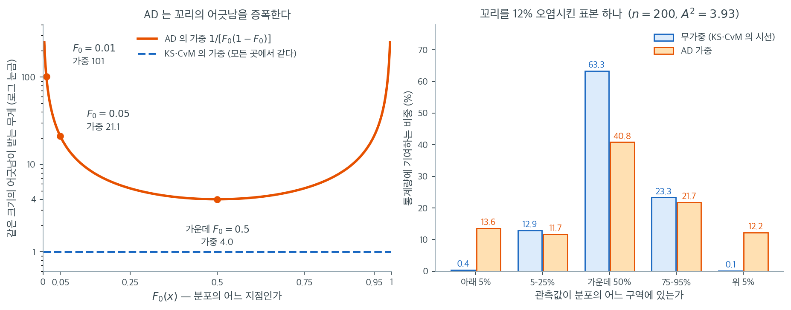

# Anderson-Darling 검정

## 개요

**Anderson-Darling 검정**은 Kolmogorov-Smirnov 검정을 개선한 것으로, 표본이 정규분포 같은 특정 분포에서 왔는지 평가하도록 설계되었다. 꼬리에서의 이탈에 특히 민감하여 작은 표본에서 정규성 이탈을 탐지하는 데 특히 유용하다.

### 가설

- **귀무가설** ($H_0$): 자료가 정규분포를 따른다.
- **대립가설** ($H_1$): 자료가 정규분포를 따르지 않는다.

---

## 1. Anderson-Darling 검정통계량의 계산

Anderson-Darling 검정통계량 $A^2$은 다음 단계로 계산한다.

1. **자료 정렬**: 표본자료 $X_1, X_2, \dots, X_n$을 오름차순으로 정렬하여 $X_{(1)} \leq X_{(2)} \leq \dots \leq X_{(n)}$을 얻는다.

2. **자료 표준화**: 각 자료점을 평균 0, 분산 1이 되도록 표준화한다. 이 변환이 자료에 정규성을 강제하는 것은 아니라는 점에 유의하라. 각 자료점 $X_i$에 대해 표준화 값 $Z_i$를 계산한다.

    $$
    Z_i = \frac{X_i - \mu}{\sigma}
    $$

    여기서 $\mu$는 표본평균, $\sigma$는 표본표준편차이다.

3. **경험분포함수 계산**: 정렬된 각 표준화 값 $Z_{(i)}$에 대해 정규분포의 누적분포함수 $F(Z_{(i)})$를 계산한다.

4. **검정통계량 $A^2$ 계산**:

    $$
    A^2 = -n - \frac{1}{n} \sum_{i=1}^{n} \left[ (2i-1) \left( \ln(F(Z_{(i)})) + \ln(1 - F(Z_{(n+1-i)})) \right) \right]
    $$

    여기서 $n$은 표본크기이고 $F(Z_{(i)})$는 정렬된 각 표준화 자료점 $Z_{(i)}$에서의 정규분포 누적분포함수이다.

    이 공식은 아래쪽과 위쪽 꼬리를 함께 반영하여 분포 꼬리에서의 이탈에 검정이 더 민감해지게 한다.

---

## 2. 꼬리에 무게를 싣는다는 말의 뜻

위 합 공식은 정체를 감추고 있다. $A^2$은 사실 KS와 같은 재료 — 경험분포함수와 이론분포함수의 차이 — 를 쓰되, 그 차이를 분포의 위치에 따라 다르게 저울질한 적분이다.

$$
A^2 = n \int_{-\infty}^{\infty} \frac{\bigl[F_n(x) - F_0(x)\bigr]^2}{F_0(x)\,\bigl[1 - F_0(x)\bigr]}\, dF_0(x)
$$

분모의 $F_0(1 - F_0)$은 가운데($F_0 = 0.5$)에서 최대 $0.25$이고 꼬리로 갈수록 0에 가까워진다. 따라서 그 역수인 가중치는 가운데에서 가장 작고 꼬리에서 폭발한다. 아래 왼쪽 칸이 그 가중함수이며, 세로축은 로그 눈금이다.



숫자로 보면 차이가 분명하다. 분포의 정중앙에서 생긴 어긋남은 무게 $4.0$을 받는다. 하위 5% 지점의 같은 크기 어긋남은 $21.1$, 하위 1% 지점에서는 $101$을 받는다. 정중앙 대비 **25배**이다. KS와 Cramér-von Mises는 이 곡선 대신 어디서나 $1$인 평평한 직선을 쓴다. 두 검정의 철학적 차이 전부가 이 한 장의 그림에 들어 있다.

오른쪽 칸은 그 가중이 실제 자료에서 어떻게 작동하는지를 보인다. $n = 200$인 표본에서 12%를 표준편차 3배짜리 관측값으로 오염시킨 뒤, 각 관측값이 통계량에 기여하는 몫을 분포의 다섯 구역으로 나누어 모았다. 무가중으로 보면 가운데 50% 구간이 전체의 $63.3\%$를 만들고, 양 끝 5%씩은 합쳐서 $0.5\%$밖에 기여하지 않는다. KS나 CvM이 꼬리를 사실상 보지 않는다는 뜻이다. AD 가중을 걸면 가운데 몫이 $40.8\%$로 내려가고, 양 끝 5%의 몫이 $13.6\%$와 $12.2\%$, 합쳐서 $25.8\%$로 뛴다. 같은 자료, 같은 어긋남인데 저울만 바꿨더니 꼬리의 발언권이 50배 커진 것이다.

이 구조가 AD 검정의 장점이자 한계다. 두꺼운 꼬리나 극단의 이상점처럼 꼬리에서 일어나는 이탈에는 대단히 예민하다. 반대로 꼬리는 멀쩡한데 가운데 모양만 다른 이탈 — 예를 들어 봉우리가 둘인 자료 — 에서는 그만한 이점이 없다. 어떤 저울을 쓸지는 무엇이 문제가 될지에 대한 사전 판단이며, 그 판단이 틀리면 저울도 틀린다.

---

## 3. p값 유도

검정통계량 $A^2$을 계산한 뒤에는 대상 분포 유형과 표본크기에 맞는 Anderson-Darling 분포의 임계값과 비교한다. 임계값은 유의수준 $\alpha$(예: 0.01, 0.05, 0.10)에 따라 선택한다.

- 주어진 $\alpha$의 임계값보다 $A^2$이 크면 $p$값이 $\alpha$ 아래가 되어 귀무가설을 기각한다.
- $A^2$이 임계값보다 작으면 $p$값이 $\alpha$ 위가 되어 귀무가설을 기각할 증거가 부족하다.

### 판정 규칙

- 유의수준 $\alpha$에서 $A^2 > \text{임계값}$이면 $H_0$을 기각한다(자료가 정규분포를 따르지 않는다).
- $A^2 < \text{임계값}$이면 $H_0$을 기각하지 못한다(자료가 정규분포를 따를 수 있다).

---

## 4. `stats.anderson`을 이용한 Python 구현

<div class="exbox" markdown>

**보기 1.** <span class="diff easy" title="쉬움"></span> 기각값 표로 판정하기. $\mathcal{N}(1, 10^2)$에서 $n = 1000$개를 뽑으면 $A^2 = 0.2432$이고 다섯 유의수준 모두에서 기각하지 못한다.

**(1)** 이 쪽의 세 보기는 $\mathcal{N}(1, 10^2)$과 $\mathcal{N}(0, 1)$을 번갈아 쓰는데 $A^2$이 모두 $0.2432$다. 왜 그런지 공식에서 보이시오. 그런데 끝자리까지 완전히 같지는 않다. 그것은 왜인가.

**(2)** 임계값 $[0.574,\ 0.653,\ 0.784,\ 0.914,\ 1.088]$은 어디서 온 수인가. $n$에 어떻게 의존하며 $n = 20$이면 얼마가 되는가.

</div>

??? success "풀이"

    **(1) $A^2$은 위치와 척도에 불변이다.** 통계량이 자료에 의존하는 경로는 표준화 값

    $$
    Z_i = \frac{X_i - \bar X}{S}
    $$

    하나뿐이다. $Y_i = cX_i + d$ ($c > 0$)로 옮기고 늘이면 $\bar Y = c\bar X + d$이고 $S_Y = cS_X$이므로

    $$
    Z_i(Y) = \frac{(cX_i + d) - (c\bar X + d)}{cS_X} = \frac{c(X_i - \bar X)}{cS_X} = Z_i(X)
    $$

    로 **$c$와 $d$가 완전히 약분된다.** 표준화 값이 같으면 $F(Z_{(i)})$도 같고 합 공식의 모든 항이 같으니 $A^2$도 같다. 이것은 근사가 아니라 항등식이다.

    씨앗을 고정하면 `normal(1, 10, 1000)`이 `normal(0, 1, 1000)`의 $10$배에 1을 더한 것과 **정확히** 같으므로($c = 10$, $d = 1$) 두 보기의 $A^2$은 같은 수여야 한다. 실제로

    $$
    A^2(\mathcal{N}(1,10^2)\text{ 자료}) = 0.2432179174631983, \qquad
    A^2(\mathcal{N}(0,1)\text{ 자료}) = 0.2432179174634257
    $$

    로 **소수 열두째 자리까지 같다.** 차이는 $2.3\times10^{-13}$이고 **부동소수점 반올림이 전부다.** 자료를 10배로 늘려 더한 뒤 다시 나누는 과정에서 유효숫자 아래쪽이 조금 어긋나며, 거기에 로그 1000개를 더하면서 그 오차가 쌓인다. 수학적으로는 완전히 같은 수다.

    **"평균과 표준편차를 바꿔도 결론은 같아야 한다"는 코드의 주석은 그래서 결론보다 강한 말이다.** 결론만 같은 것이 아니라 통계량 자체가 같다.

    한 가지 덧붙이면, 표준화에 쓰는 $S$가 $1/(n-1)$짜리인지 $1/n$짜리인지는 불변성과 무관하지만 값에는 영향을 준다. 정의대로 손계산하면 `ddof=1`로 $0.2432179174633120$, `ddof=0`으로 $0.2425011779185979$가 나오고, `scipy`의 값과 맞는 쪽은 **`ddof=1`**이다. 셋째 자리에서 갈린다.

    **(2) 스티븐스의 표본크기 보정이다.** `scipy`는 모수를 추정한 경우($\mu$, $\sigma$를 둘 다 표본에서 재는 경우)의 점근 임계값

    $$
    A^2_{\infty} = [0.576,\ 0.656,\ 0.787,\ 0.918,\ 1.092] \quad (\alpha = 15, 10, 5, 2.5, 1\%)
    $$

    를 표본크기로 나누어 보정한다.

    $$
    A^2_{\text{crit}}(n) = \frac{A^2_{\infty}}{1 + \dfrac{4}{n} - \dfrac{25}{n^2}}
    $$

    $n = 1000$에서 분모가 $1 + 0.004 - 0.000025 = 1.003975$이므로 $0.576/1.003975 = 0.5737$ 등이 되어 반올림하면 **$[0.574, 0.653, 0.784, 0.914, 1.088]$으로 출력과 정확히 맞는다.**

    $n$이 작으면 분모가 커져 임계값이 내려간다.

    | $n$ | 15% | 10% | 5% | 2.5% | 1% |
    |---|---|---|---|---|---|
    | 20 | $0.506$ | $0.577$ | $0.692$ | $0.807$ | $0.960$ |
    | 50 | $0.538$ | $0.613$ | $0.736$ | $0.858$ | $1.021$ |
    | 100 | $0.555$ | $0.632$ | $0.759$ | $0.885$ | $1.053$ |
    | 1000 | $0.574$ | $0.653$ | $0.784$ | $0.914$ | $1.088$ |

    $n = 20$의 5% 임계값 $0.692$는 $n = 1000$의 $0.784$보다 $12\%$ 작다. **보정의 방향을 눈여겨볼 것.** 작은 표본에서 임계값이 **낮아지는** 것은 $\mu$와 $\sigma$를 표본에서 추정했기 때문이다. 추정한 모수로 표준화하면 경험분포가 이론분포에 억지로 끌어당겨져 $A^2$이 작게 나오는데, 그 효과가 작은 표본에서 크다. 보정을 생략하고 점근값 $0.787$을 $n = 20$에 그대로 쓰면 검정이 지나치게 보수적이 되어 명목보다 작은 크기로 굴러간다. 같은 함정의 더 극적인 사례가 [KS 와 릴리에포르](./ks_lilliefors.md) 쪽에 있다.

    ```python
    import numpy as np
    from scipy import stats

    np.random.seed(0)

    # 평균과 표준편차를 바꿔도 결론은 같아야 한다. 정규성 검정은 위치와
    # 척도가 아니라 모양을 묻기 때문이다.
    # data = np.random.normal(0, 1, 1000)
    data = np.random.normal(1, 10, 1000)

    # scipy 의 anderson 은 p-값 대신 유의수준별 기각값을 돌려준다.
    # 통계량이 기각값보다 크면 기각이다.
    result = stats.anderson(data)
    statistic = result.statistic
    print(f"Anderson-Darling Test: Statistic={statistic}")

    # 기각값은 유의수준이 낮아질수록 커진다. 통계량 하나로 여러 수준의
    # 판정을 한꺼번에 읽을 수 있다.
    for significance_level, critical_value in zip(result.significance_level, result.critical_values):
        if statistic >= critical_value:
            print(f"At {significance_level}% significance level: Reject H_0. The data is not normally distributed.")
        else:
            print(f"At {significance_level}% significance level: Fail to reject H_0. The data is normally distributed.")
    ```

    출력:

    ```text
    Anderson-Darling Test: Statistic=0.24321791746319832
    At 15.0% significance level: Fail to reject H_0. The data is normally distributed.
    At 10.0% significance level: Fail to reject H_0. The data is normally distributed.
    At 5.0% significance level: Fail to reject H_0. The data is normally distributed.
    At 2.5% significance level: Fail to reject H_0. The data is normally distributed.
    At 1.0% significance level: Fail to reject H_0. The data is normally distributed.
    ```

    불변성과 임계값의 출처를 함께 확인한다.

    ```python
    import numpy as np
    from scipy import stats

    np.random.seed(0)
    a = np.random.normal(1, 10, 1000)   # 보기 1·3 의 자료
    np.random.seed(0)
    b = np.random.normal(0, 1, 1000)    # 보기 2 의 자료
    print(f"a 가 10b + 1 인가: {np.array_equal(a, 10 * b + 1)}")

    ra, rb = stats.anderson(a), stats.anderson(b)
    print(f"A2(a) = {ra.statistic:.16f}")
    print(f"A2(b) = {rb.statistic:.16f}")
    print(f"두 값의 차 = {abs(ra.statistic - rb.statistic):.3e}")

    # 정의대로 손계산. 표준화에 쓰는 표준편차가 ddof=1 인지 0 인지가 갈린다.
    def A2(x, ddof):
        z = np.sort((x - x.mean()) / x.std(ddof=ddof))
        n = len(z)
        F = stats.norm.cdf(z)
        i = np.arange(1, n + 1)
        return -n - np.sum((2 * i - 1) * (np.log(F) + np.log(1 - F[::-1]))) / n

    print(f"\n손계산 (ddof=1) = {A2(b, 1):.16f}")
    print(f"손계산 (ddof=0) = {A2(b, 0):.16f}")

    # 임계값의 출처: Stephens 의 표본크기 보정
    base = np.array([0.576, 0.656, 0.787, 0.918, 1.092])
    for nn in (20, 50, 100, 1000):
        print(f"n = {nn:>4}: {np.round(base / (1 + 4.0 / nn - 25.0 / nn**2), 3)}")
    print(f"scipy 가 준 임계값 (n = 1000): {ra.critical_values}")
    ```

    출력:

    ```text
    a 가 10b + 1 인가: True
    A2(a) = 0.2432179174631983
    A2(b) = 0.2432179174634257
    두 값의 차 = 2.274e-13

    손계산 (ddof=1) = 0.2432179174633120
    손계산 (ddof=0) = 0.2425011779185979
    n =   20: [0.506 0.577 0.692 0.807 0.96 ]
    n =   50: [0.538 0.613 0.736 0.858 1.021]
    n =  100: [0.555 0.632 0.759 0.885 1.053]
    n = 1000: [0.574 0.653 0.784 0.914 1.088]
    scipy 가 준 임계값 (n = 1000): [0.574 0.653 0.784 0.914 1.088]
    ```

    세 가지가 맞아떨어진다. 불변성이 $10^{-13}$ 수준에서 성립하고, 정의대로 손계산한 $A^2$이 `scipy`의 값과 열두 자리까지 같으며(`ddof=1`일 때), 스티븐스 보정식이 출력된 임계값을 그대로 재현한다. $\square$

---

## 5. `stats.anderson`에서 p값을 얻을 수 있는가

SciPy의 `stats.anderson()` 함수는 $p$값을 직접 제공하지 **않는다**. 검정통계량과 특정 유의수준에서의 임계값만 돌려준다.

### 왜 직접적인 p값이 없는가

Anderson-Darling 검정은 각 유의수준(정규분포의 경우 15%, 10%, 5%, 2.5%, 1%)에 대해 모의실험이나 이론적 분포표에서 얻은 미리 정해진 임계값을 쓴다. Anderson-Darling 통계량의 분포는 표본크기와 검정 대상 분포에 따라 달라지므로 정확한 $p$값을 계산하는 일이 복잡하다.

### 근사 p값 (정규성 검정의 경우)

정규성 검정에서 근사 $p$값이 필요하다면 두 가지 선택지가 있다.

**선택지 1: `statsmodels` 사용**

`statsmodels` 라이브러리가 근사 $p$값을 함께 제공하는 구현을 제공한다.

<div class="exbox" markdown>

**보기 2.** <span class="diff easy" title="쉬움"></span> p-값으로 판정하기. 같은 자료에 `statsmodels`의 `normal_ad`를 걸면 통계량에 $p$값이 붙어 나온다.

**(1)** `normal_ad`의 통계량이 `scipy.stats.anderson`의 것과 같은가. 몇째 자리까지 같은지 확인하고, 표준화에 쓰는 표준편차가 어느 판본인지 정의대로 손계산해 가리시오.

**(2)** `scipy`가 주지 않는 $p$값을 `statsmodels`는 어떻게 만드는가. 그 과정을 손으로 밟아 $0.7659878263029309$를 재현하시오.

</div>

??? success "풀이"

    **(1) 같은 부동소수점 수이고, 표준화는 `ddof=1`이다.** 두 함수가 돌려주는 통계량은 모두

    $$
    A^2 = 0.2432179174634257
    $$

    로 **마지막 비트까지** 같다. 정의대로 손계산하면 $0.2432179174633120$이 나와 열두째 자리에서 갈리는데, 이는 합을 더하는 순서가 달라 생기는 반올림 차이다. 중요한 것은 `ddof=0`으로 표준화했을 때의 $0.2425011779185979$와는 **셋째 자리에서** 갈린다는 점이다. 두 라이브러리 모두 $1/(n-1)$짜리 표본표준편차로 표준화한다.

    **(2) 표본크기 보정 한 번과 구간별 근사식 한 줄이다.** `normal_ad`는 먼저 통계량을 보정한다.

    $$
    A^{2\ast} = A^2\left(1 + \frac{0.75}{n} + \frac{2.25}{n^2}\right)
    $$

    $n = 1000$이면 괄호가 $1.00075$이므로 $A^{2\ast} = 0.2434008781$이다. 그다음 $A^{2\ast}$가 떨어지는 구간에 따라 네 개의 근사식 가운데 하나를 쓴다.

    | $A^{2\ast}$ 구간 | $p$값 공식 |
    |---|---|
    | $[0,\ 0.200)$ | $1 - \exp(-13.436 + 101.14\,A^{2\ast} - 223.73\,A^{2\ast 2})$ |
    | $[0.200,\ 0.340)$ | $1 - \exp(-8.318 + 42.796\,A^{2\ast} - 59.938\,A^{2\ast 2})$ |
    | $[0.340,\ 0.600)$ | $\exp(0.9177 - 4.279\,A^{2\ast} - 1.380\,A^{2\ast 2})$ |
    | $[0.600,\ 13]$ | $\exp(1.2937 - 5.709\,A^{2\ast} + 0.0186\,A^{2\ast 2})$ |

    $A^{2\ast} = 0.2434$는 두 번째 구간이므로

    $$
    p = 1 - \exp\bigl(-8.318 + 42.796(0.2434008781) - 59.938(0.2434008781)^2\bigr) = 0.7659878263029309
    $$

    이고 `normal_ad`가 돌려준 값과 **열여섯 자리까지** 같다.

    **여기서 두 가지를 눈여겨볼 것.** 첫째, 이 $p$값은 분석적으로 유도된 것이 아니라 모의실험 표에 **곡선을 맞춘 근사식**이다. 구간 경계에서 공식이 바뀌므로 $A^{2\ast}$가 $0.200$이나 $0.340$을 가로지르는 자리에서는 $p$값이 매끄럽지 않다. 둘째, 네 번째 구간의 상한 $13$을 넘으면 `statsmodels`는 $p = 0$을 돌려준다. 자릿수가 필요한 자리에서 $p$를 $0$으로 보고하면 안 되므로, 그런 경우에는 $A^2$ 자체를 적는 편이 정직하다.

    `scipy`가 $p$값 대신 임계값 표를 주는 이유도 여기서 보인다. **근사식은 쓸 만하지만 정확하지는 않다.** 임계값 표는 "5% 수준에서 기각/기각 못 함"이라는 이항 판정만 주되 그 판정은 믿을 만하고, 근사 $p$값은 연속적인 수를 주지만 그 수의 끝자리는 곡선 맞춤의 산물이다.

    ```python
    import numpy as np
    from statsmodels.stats.diagnostic import normal_ad

    np.random.seed(0)
    data = np.random.normal(0, 1, 1000)

    # statsmodels 의 normal_ad 는 같은 통계량에 p-값까지 붙여 준다.
    # 기각값 표를 읽는 대신 p-값으로 바로 판단하고 싶을 때 쓴다.
    statistic, p_value = normal_ad(data)
    print(f"Anderson-Darling Test: Statistic={statistic}, p-value={p_value}")
    ```

    출력:

    ```
    Anderson-Darling Test: Statistic=0.2432179174634257, p-value=0.7659878263029309
    ```

    통계량의 일치와 $p$값의 출처를 함께 확인한다.

    ```python
    import numpy as np
    from scipy import stats
    from statsmodels.stats.diagnostic import normal_ad

    np.random.seed(0)
    data = np.random.normal(0, 1, 1000)
    n = data.size
    ad2, p = normal_ad(data)
    print(f"normal_ad:        A2 = {ad2:.16f},  p = {p:.16f}")
    print(f"scipy.anderson:   A2 = {stats.anderson(data).statistic:.16f}")

    # 정의대로 손계산 — 표준화에 ddof=1 을 쓴다.
    z = np.sort((data - data.mean()) / data.std(ddof=1))
    F = stats.norm.cdf(z)
    i = np.arange(1, n + 1)
    A2_hand = -n - np.sum((2 * i - 1) * (np.log(F) + np.log(1 - F[::-1]))) / n
    print(f"손계산 (ddof=1):  A2 = {A2_hand:.16f}")

    # statsmodels 의 p 값: 표본크기 보정 뒤 구간별 근사식
    ad2a = ad2 * (1 + 0.75 / n + 2.25 / n**2)
    print(f"\n보정된 A2* = {ad2a:.10f}  ->  구간 [0.200, 0.340)")
    p_hand = 1 - np.exp(-8.318 + 42.796 * ad2a - 59.938 * ad2a**2)
    print(f"손계산 p = 1 - exp(-8.318 + 42.796 A2* - 59.938 A2*^2) = {p_hand:.16f}")
    print(f"normal_ad p                                            = {p:.16f}")
    ```

    출력:

    ```text
    normal_ad:        A2 = 0.2432179174634257,  p = 0.7659878263029309
    scipy.anderson:   A2 = 0.2432179174634257
    손계산 (ddof=1):  A2 = 0.2432179174633120

    보정된 A2* = 0.2434008781  ->  구간 [0.200, 0.340)
    손계산 p = 1 - exp(-8.318 + 42.796 A2* - 59.938 A2*^2) = 0.7659878263029309
    normal_ad p                                            = 0.7659878263029309
    ```

    두 라이브러리의 통계량이 완전히 같고, 손으로 밟은 $p$값이 `normal_ad`의 값과 끝까지 같다. $p = 0.766$은 앞의 임계값 비교에서 1% 수준까지 모두 기각하지 못한 결과와 일치한다. $\square$

**선택지 2: 임계값으로 해석하기**

추가 라이브러리 없이 대략적인 근사를 원한다면 검정통계량과 제공된 임계값의 비교로 $p$값의 범위를 해석할 수 있다.

- 어떤 유의수준의 임계값보다 검정통계량이 **작으면** $p$값이 그 유의수준보다 **크다**.
- 임계값보다 검정통계량이 **크면** $p$값이 그 유의수준보다 **작다**.

### `normal_ad`를 이용한 Python 구현

<div class="exbox" markdown>

**보기 3.** <span class="diff easy" title="쉬움"></span> 치우친 자료에 적용 — 그 전에, 이 자료는 정말 치우쳐 있는가

**(1)** 이 보기가 실제로 넣는 자료는 $\mathcal{N}(1, 10^2)$이다. 왜도를 재어 치우쳤는지 판정하고, $A^2$이 보기 2의 값과 같은 까닭을 말하시오.

**(2)** 정말로 치우친 자료를 넣으면 어떻게 되는가. $\text{Lognormal}(0, 0.6^2)$으로 바꾸어 $A^2$과 $p$값을 구하고, 보기 2에서 본 근사식의 **어느 구간**으로 떨어지는지 확인하시오.

</div>

??? success "풀이"

    **(1) 치우쳐 있지 않다. 이 자료는 완전한 정규자료다.** 왜도를 재면

    $$
    g_1 = +0.0339, \qquad G_1 = +0.0339, \qquad g_2 = -0.0468
    $$

    이고 왜도 검정의 $p$값이 $0.6598$이다. 앞 절에서 본 대로 $n = 1000$에서 유의한 왜도의 경계가 $0.1515$인데 관측값은 그 $22\%$에 지나지 않는다. **제목이 "치우친 자료"라고 하지만 코드가 뽑는 것은 평균 1, 표준편차 10인 정규자료다.** 활성화된 줄과 주석 처리된 줄 모두 `np.random.normal`이니, 이 보기만으로는 치우침에 대해 아무것도 확인할 수 없다.

    $A^2$이 보기 2와 같은 것은 보기 1에서 본 **위치·척도 불변성** 때문이다. 씨앗이 같으므로 이 자료는 보기 2의 자료를 10배 하고 1을 더한 것이고, 표준화 단계에서 그 변환이 완전히 약분된다. 따라서

    $$
    A^2 = 0.2432179175, \qquad p = 0.7659878263
    $$

    으로 보기 2와 같은 수가 나온다. 정보가 새로 더해지지 않는다.

    **(2) 대수정규를 넣으면 $A^2 = 38.07$이 되고 `normal_ad`는 $p = 0$을 돌려준다.** $\sigma = 0.6$인 대수정규의 이론 왜도는

    $$
    \gamma_1 = (e^{\sigma^2} + 2)\sqrt{e^{\sigma^2} - 1} = (e^{0.36} + 2)\sqrt{e^{0.36} - 1} = 2.2601
    $$

    이고 표본값은 $g_1 = 1.8107$이다(유한표본에서 치우침이 아래로 깎인다). 통계량은

    | 자료 | $A^2$ | 5% 임계값 | $p$ |
    |---|---|---|---|
    | $\mathcal{N}(1, 10^2)$ | $0.2432$ | $0.784$ | $0.7660$ |
    | $\text{Lognormal}(0, 0.6^2)$ | $38.0734$ | $0.784$ | `0.0` |

    으로, 치우친 자료의 $A^2$이 5% 임계값의 **48.6배**다. 압도적인 기각이다.

    그런데 $p$값이 정확히 `0.0`으로 찍히는 것이 눈여겨볼 대목이다. 보정된 통계량이 $A^{2\ast} = 38.1020$인데, 보기 2에서 본 근사식의 마지막 구간이 $[0.600,\ 13]$까지만 정의되어 있다. `statsmodels`는 상한을 넘으면 계산을 포기하고 $0$을 돌려준다. 네 번째 구간의 공식을 상한 밖으로 억지로 늘려 쓰면

    $$
    p = \exp(1.2937 - 5.709\times38.1020 + 0.0186\times38.1020^2) = 6.6\times10^{-83}
    $$

    이 나오는데, 이 수에는 아무 근거가 없다. 곡선 맞춤이 $A^{2\ast} \le 13$ 범위에서만 보증되기 때문이다. **그러므로 이런 경우에는 $p$값을 보고하지 말고 $A^2 = 38.07$과 임계값 $0.784$를 나란히 적는 것이 정직하다.** "$p < 10^{-10}$" 정도로 쓰는 것도 가능하지만, `0.0`을 액면 그대로 옮겨 적는 것은 잘못이다.

    ```python
    import numpy as np
    from statsmodels.stats.diagnostic import normal_ad

    np.random.seed(0)

    # data = np.random.normal(0, 1, 1000)
    data = np.random.normal(1, 10, 1000)

    # Anderson-Darling 은 꼬리 쪽 이탈에 특히 민감하다. 꼬리가 문제가 되는
    # 금융 자료에서 이 검정을 즐겨 쓰는 까닭이다.
    statistic, p_value = normal_ad(data)
    print(f"Anderson-Darling Test: Statistic={statistic}, p-value={p_value}")

    # 결과 해석
    alpha = 0.05
    if p_value <= alpha:
        print("Reject H_0: The data is not normally distributed.")
    else:
        print("Fail to reject H_0: The data is normally distributed.")
    ```

    출력:

    ```text
    Anderson-Darling Test: Statistic=0.243217917463312, p-value=0.7659878263032931
    Fail to reject H_0: The data is normally distributed.
    ```

    자료가 치우쳤는지 재고, 정말 치우친 자료를 넣어 본다.

    ```python
    import numpy as np
    from scipy import stats
    from statsmodels.stats.diagnostic import normal_ad

    np.random.seed(0)
    data = np.random.normal(1, 10, 1000)   # 이 보기가 실제로 쓰는 자료
    n = data.size
    print("이 보기의 자료 — 치우쳐 있는가?")
    print(f"  g1 = {stats.skew(data):+.4f},  G1 = {stats.skew(data, bias=False):+.4f}")
    print(f"  g2 = {stats.kurtosis(data):+.4f}")
    print(f"  skewtest p = {stats.skewtest(data)[1]:.4f}")
    ad2, p = normal_ad(data)
    print(f"  A2 = {ad2:.10f},  p = {p:.10f}")

    # 정말로 치우친 자료를 넣으면
    np.random.seed(0)
    sk = np.random.lognormal(0, 0.6, 1000)
    ad2s, ps = normal_ad(sk)
    ad2a = ad2s * (1 + 0.75 / n + 2.25 / n**2)
    print(f"\n대수정규 자료 (sigma = 0.6)")
    print(f"  g1 = {stats.skew(sk):+.4f}   (이론 {(np.exp(0.36) + 2) * np.sqrt(np.exp(0.36) - 1):+.4f})")
    print(f"  A2 = {ad2s:.4f},  보정된 A2* = {ad2a:.4f}  ->  네 번째 구간 [0.600, 13]")
    print(f"  근사식 p = {np.exp(1.2937 - 5.709 * ad2a + 0.0186 * ad2a**2):.6g}")
    print(f"  normal_ad p = {ps:.6g}")
    print(f"  scipy 임계값 5% = {stats.anderson(sk).critical_values[2]:.3f}"
          f"  (A2 가 {ad2s / stats.anderson(sk).critical_values[2]:.1f} 배)")
    ```

    출력:

    ```text
    이 보기의 자료 — 치우쳐 있는가?
      g1 = +0.0339,  G1 = +0.0339
      g2 = -0.0468
      skewtest p = 0.6598
      A2 = 0.2432179175,  p = 0.7659878263

    대수정규 자료 (sigma = 0.6)
      g1 = +1.8107   (이론 +2.2601)
      A2 = 38.0734,  보정된 A2* = 38.1020  ->  네 번째 구간 [0.600, 13]
      근사식 p = 6.59708e-83
      normal_ad p = 0
      scipy 임계값 5% = 0.784  (A2 가 48.6 배)
    ```

    유도한 이론 왜도 $2.2601$이 표본 $1.8107$과 같은 방향에 있고, $A^{2\ast} = 38.10$이 근사식의 정의 구간 $[0.600,\ 13]$을 벗어나 `normal_ad`가 $p = 0$을 내놓는 것까지 확인된다. **이 보기의 제목은 자료와 맞지 않으며, 치우침을 보려면 자료를 바꿔야 한다.** $\square$

---

## 6. `stats.anderson`과 `normal_ad` 중 무엇을 쓸 것인가

1. **정규성에 국한되지 않는 일반적인 분포 검정**이 필요하고 $p$값이 필요 없다면 **`stats.anderson`**이 낫다. 정규, 지수, Weibull, 로지스틱, 극값 분포를 검정할 수 있고 각각의 임계값을 제공한다.

2. **정규성 검정이 목표이고 $p$값이 필요하다면** **`statsmodels`의 `normal_ad`**가 이상적이다. 정규성 검정을 위해 특별히 설계되었고 근사 $p$값을 포함하므로 전통적인 가설검정 틀에서 결과를 해석하기 쉽다.

### 권장 사항

**명확한 $p$값 해석**이 필요한 **정규성 검정**이 초점이면 `normal_ad`를 쓴다. 여러 분포에 대해 유연하게 검정하려면 `stats.anderson`을 쓰고 제공된 임계값으로 결과를 해석한다.

---

## 연습문제

<div class="drillbox" markdown>

**연습문제 1.** <span class="diff easy" title="쉬움"></span>
관측값 50개에 대한 Anderson-Darling 검정에서 $A^2 = 0.85$를 얻었다. 임계값이 $0.631$(10%), $0.752$(5%), $1.035$(1%)일 때 $\alpha = 0.05$에서의 결론을 정하라.

</div>

??? success "풀이"
    $A^2 = 0.85 > 0.752$(5% 임계값)이므로 유의수준 5%에서 $H_0$(정규성)을 기각한다. 다만 $A^2 = 0.85 < 1.035$(1% 임계값)이므로 1% 수준에서는 기각하지 않는다.

    결론: 5% 수준에서 비정규성의 증거가 있다($0.01 < p < 0.05$). 이탈의 성격을 파악하려면 시각적 점검(Q-Q 그림)을 함께 해야 한다.

---

<div class="drillbox" markdown>

**연습문제 2.** <span class="diff med" title="중간"></span>
Anderson-Darling 검정은 Kolmogorov-Smirnov 검정보다 분포의 꼬리에 더 큰 가중치를 준다. 가중함수가 어떻게 이를 달성하는지 설명하라.

</div>

??? success "풀이"
    Anderson-Darling 통계량은

    $$
    A^2 = -n - \frac{1}{n}\sum_{i=1}^n (2i-1)[\ln F(x_{(i)}) + \ln(1 - F(x_{(n+1-i)}))]
    $$

    이는 경험적 CDF와 이론적 CDF의 제곱차를 가중 적분한 것으로 표현할 수 있다: $A^2 = n\int_{-\infty}^{\infty} \frac{[F_n(x) - F(x)]^2}{F(x)(1-F(x))}dF(x)$.

    가중함수 $w(x) = 1/[F(x)(1-F(x))]$는 ($F(x)$가 0이나 1에 가까운) 꼬리에서 크고 중앙에서 작다. 그래서 Anderson-Darling 검정이 (분포의 모든 부분에 같은 가중치를 주는) KS 검정보다 꼬리 이탈에 더 민감해지고, 꼬리가 두껍거나 얇은 대립가설을 더 잘 탐지한다.

---

<div class="drillbox" markdown>

**연습문제 3.** <span class="diff med" title="중간"></span>
정규성 이탈 탐지에서 Anderson-Darling, Shapiro-Wilk, Kolmogorov-Smirnov 검정의 검정력을 비교하라.

</div>

??? success "풀이"
    모의실험 연구는 대체로 다음을 보여준다.

    1. **Shapiro-Wilk**가 전반적으로 검정력이 가장 높다. 특히 작거나 중간 크기의 $n$에서, 그리고 폭넓은 대립가설(치우침, 두꺼운 꼬리, 얇은 꼬리)에 대해 그렇다.
    2. **Anderson-Darling**은 Shapiro-Wilk에 거의 견줄 만하고 KS보다 우수하다. 꼬리 가중 덕분에 두꺼운 꼬리 대립가설을 특히 잘 탐지한다.
    3. **Kolmogorov-Smirnov(Lilliefors)**는 검정력이 가장 낮다. 가중 없이 최대 편차만 쓰므로 (이탈이 작은) 중앙과 (가장 중요한) 꼬리에 같은 관심을 주기 때문이다.

    권장: Shapiro-Wilk를 주 검정으로 쓰고, (특히 $n$이 클 때) Anderson-Darling을 대안으로 쓰며, KS는 완전히 지정된 분포와 비교할 때에만 쓴다(복합 정규성 검정에는 쓰지 않는다).

---

<div class="drillbox" markdown>

**연습문제 4.** <span class="diff med" title="중간"></span>
Anderson-Darling 검정은 정규분포가 아닌 분포(지수, 와이불 등)에도 적용할 수 있다. 일반 원리를 설명하라.

</div>

??? success "풀이"
    Anderson-Darling 검정은 일반적인 적합도 검정이다. 경험적 CDF를 임의로 지정한 이론적 CDF $F_0(x)$와 비교한다. 정규성 검정에서는 추정된 모수로 $F_0 = \Phi((x-\hat{\mu})/\hat{\sigma})$를 쓴다.

    자료가 지수분포를 따르는지 검정하려면 $F_0(x) = 1 - e^{-x/\hat{\lambda}}$를 쓴다. 와이불이라면 추정된 모양·척도 모수를 가진 Weibull CDF를 쓴다.

    검정통계량 공식은 모든 경우에 같고 $F_0$만 바뀐다. 임계값은 분포족마다 다른데, $A^2$의 귀무분포가 추정한 모수의 개수와 기준분포의 모양에 의존하기 때문이다. 각 분포족에 대해 전용 임계값 표나 모의실험 기반 p값을 쓴다.

---

<div class="drillbox" markdown>

**연습문제 5.** <span class="diff med" title="중간"></span>
2절의 가중함수를 $u = F_0(x)$에 대한 함수 $w(u) = 1/[u(1-u)]$로 보자.

**(1)** 쪽에 적힌 세 수 $4.0$(정중앙), $21.1$(하위 5% 지점), $101$(하위 1% 지점)을 확인하고, 하위 5% 지점의 가중이 정중앙의 몇 배인지 적으시오.

**(2)** 가중이 정중앙의 두 배가 되는 $u$를 모두 구하고, 열 배가 되는 $u$도 모두 구하시오.

**(3)** (2)의 결과에 비추어, 하위 5% 지점의 가중이 정중앙의 몇 배밖에 되지 않는데도 2절의 기여도 표에서 양 끝 5% 구간의 몫이 $0.5\%$에서 $25.8\%$로 뛸 수 있는 까닭을 말하시오.

</div>

??? success "풀이"
    **(1)** 그대로 맞는다.

    $$
    w(0.5) = \frac{1}{0.5 \times 0.5} = 4.0, \qquad
    w(0.05) = \frac{1}{0.05 \times 0.95} = \frac{1}{0.0475} = 21.0526,
    $$

    $$
    w(0.01) = \frac{1}{0.01 \times 0.99} = \frac{1}{0.0099} = 101.0101
    $$

    이고 반올림하면 $21.1$과 $101$이다. 정중앙 대비 배수는 $21.0526/4 = 5.26$배(5% 지점)와 $101.0101/4 = 25.25$배(1% 지점)이며, 뒤쪽이 쪽에 적힌 "정중앙 대비 **25배**"다. **하위 5% 지점의 가중은 정중앙의 겨우 $5.26$배다.**

    **(2)** $w(u) = 8$은 $u(1-u) = 1/8$, 곧 $u^2 - u + 1/8 = 0$이므로

    $$
    u = \frac{1 \pm \sqrt{1 - 1/2}}{2} = \frac{1 \pm 0.70711}{2} = 0.14645 \ \text{또는}\ 0.85355
    $$

    이다. $w(u) = 40$은 $u(1-u) = 1/40$, 곧 $u^2 - u + 1/40 = 0$이므로

    $$
    u = \frac{1 \pm \sqrt{1 - 1/10}}{2} = \frac{1 \pm 0.94868}{2} = 0.02566 \ \text{또는}\ 0.97434
    $$

    이다. 정리하면 **가운데 $70.7\%$ 구간($u \in [0.146,\ 0.854]$) 전체에서 가중은 정중앙의 두 배를 넘지 못하고**, 가중이 정중앙의 열 배를 넘는 구역은 **양 끝 $2.57\%$씩, 전체의 $5.13\%$에 지나지 않는다.**

    **(3)** 가중이 구간 안에서 균일하지 않고 끝으로 갈수록 발산하기 때문이다. "하위 5% 구간"의 발언권은 그 구간의 **경계값** $w(0.05) = 21.1$이 아니라 구간 전체에 걸친 가중의 적분이 정하는데,

    $$
    \int_0^{0.05} \frac{du}{u(1-u)} = \Bigl[\ln \frac{u}{1-u}\Bigr]_0^{0.05} = \infty
    $$

    으로 **그 적분은 발산한다.** 가중은 $u \to 0$에서 $1/u$처럼 커지고 $\int du/u$가 로그로 발산하므로, 구간 안쪽으로 조금만 더 들어가도 가중이 수백·수천 배가 된다. 따라서 양 끝 5% 구간의 몫은 경계의 $5.26$배가 아니라 그 구간의 **가장 바깥에 놓인 몇 개의 관측값**이 결정한다. 실제로 쪽의 예에서 양 끝 5%의 몫은 $0.5\%$에서 $25.8\%$로 약 $50$배가 되었는데, 이는 경계 배수 $5.26$의 거의 열 배다.

    적분이 발산하는데도 $A^2$이 유한한 것은 분자 $[F_n(x) - F_0(x)]^2$ 역시 꼬리에서 $0$으로 가기 때문이다. 합 공식으로 보면 더 분명하다. 꼬리에서 터질 수 있는 항은 $\ln F(Z_{(1)})$과 $\ln(1 - F(Z_{(n)}))$뿐이고, 둘 다 계수 $(2 \cdot 1 - 1)/n = 1/n$을 받으므로 모든 $F(Z_{(i)})$가 열린구간 $(0, 1)$ 안에 있는 한 $A^2$은 항상 유한하다.

    **요약하면, AD 가 KS 와 다르게 행동하는 구역은 생각보다 좁고 그 안에서는 생각보다 거칠다.** 가중이 실질적으로 큰 곳은 양 끝 몇 %뿐인데, 바로 그곳에서 가중이 발산하므로 소수의 극단 관측값에 통계량이 끌려간다. 꼬리 민감도와 이상점 취약성은 같은 성질의 두 이름이다.

---

<div class="drillbox" markdown>

**연습문제 6.** <span class="diff med" title="중간"></span>
보기 1 풀이는 표준화에 쓰는 표본표준편차가 `ddof=1`인지 `ddof=0`인지에 따라 같은 자료의 $A^2$이 $0.2432179174633120$과 $0.2425011779185979$로 셋째 자리에서 갈린다고 했다.

**(1)** 두 판본의 표준화 값 $Z_i$ 사이의 관계를 적고, $n = 1000$에서 척도가 몇 퍼센트 어긋나는지 구하시오.

**(2)** 두 $A^2$의 상대차를 구해 (1)의 척도 어긋남과 견주시오.

**(3)** $n = 20$이면 척도가 몇 퍼센트 어긋나는가. 보기 1 풀이의 임계값 표에서 5% 임계값이 $n = 20$일 때 $0.692$, $n = 50$일 때 $0.736$인 것과 견주어, 임계값 표를 쓸 때 표준편차의 판본을 고정해야 하는 까닭을 말하시오.

</div>

??? success "풀이"
    **(1)** 두 표준편차는 $S_0 = S_1 \sqrt{(n-1)/n}$의 관계이므로

    $$
    Z_i^{(0)} = \frac{X_i - \bar X}{S_0} = \frac{X_i - \bar X}{S_1} \cdot \frac{S_1}{S_0} = Z_i^{(1)} \sqrt{\frac{n}{n-1}}
    $$

    이다. 즉 `ddof=0`으로 표준화한 값은 `ddof=1`판을 $\sqrt{n/(n-1)}$배로 늘인 것이다. $n = 1000$에서

    $$
    \sqrt{\frac{1000}{999}} = 1.00050038
    $$

    이므로 척도가 **$0.0500\%$** 어긋난다.

    **(2)** 상대차는

    $$
    \frac{0.2432179174633120 - 0.2425011779185979}{0.2432179174633120} = \frac{0.0007167395447141}{0.2432179174633120} = 0.2947\%
    $$

    이다. 척도 어긋남 $0.0500\%$의 약 **$5.9$배**다. $A^2$은 $\ln F(Z)$와 $\ln(1 - F(Z))$를 통해 자료를 보고 이 로그들의 기울기가 꼬리에서 가파르므로, 척도를 조금 건드리면 꼬리에 놓인 항들이 그보다 크게 반응한다. 배수 $5.9$ 자체는 이 표본에 딸린 수이고 보편적인 상수가 아니지만, **어긋남이 $O(1/n)$이라는 점은 보편적이다.**

    **(3)** $n = 20$에서

    $$
    \sqrt{\frac{20}{19}} = 1.0259784
    $$

    이므로 척도가 **$2.598\%$** 어긋난다. $n = 1000$의 $0.05\%$보다 **$52$배** 크다. (2)의 증폭률 $5.9$를 거친 어림으로 그대로 가져오면 $A^2$이 $15\%$ 가까이 달라진다는 뜻이 된다. 한편 임계값 표에서 $n = 20$과 $n = 50$의 5% 임계값 차이는

    $$
    \frac{0.736 - 0.692}{0.692} = 6.36\%
    $$

    에 지나지 않는다. **즉 소표본에서는 표준편차의 판본을 잘못 고르는 것만으로 두 단계 떨어진 $n$의 표를 읽는 것보다 큰 오차가 생긴다.** 스티븐스 보정식 $A^2_\infty/(1 + 4/n - 25/n^2)$은 특정 판본(여기서는 $1/(n-1)$짜리)으로 계산한 $A^2$의 귀무분포에 맞추어 세운 것이므로, 통계량을 다른 판본으로 계산해 같은 표에 대면 영점이 어긋난 자를 쓰는 셈이다. $n$이 클 때 이 문제가 눈에 띄지 않는 것은 어긋남이 $O(1/n)$으로 사라지기 때문이고, 소표본은 바로 AD 를 쓰는 주된 상황이므로 방심할 수 없다.

---

<div class="drillbox" markdown>

**연습문제 7.** <span class="diff hard" title="어려움"></span>
보기 1 풀이의 스티븐스 보정식

$$
A^2_{\text{crit}}(n) = \frac{A^2_{\infty}}{1 + \dfrac{4}{n} - \dfrac{25}{n^2}}, \qquad A^2_{\infty} = 0.787 \ (\alpha = 5\%)
$$

을 끝까지 따라가 보자. 분모를 $D(n)$으로 쓴다.

**(1)** 보정한 임계값이 점근값의 $1\%$ 안에 들어오는 가장 작은 정수 $n$을 구하시오.

**(2)** $A^2_{\text{crit}}(n)$이 가장 작아지는 $n$과 그때의 값을 구하고, $D(n) = 1$이 되는 $n$도 구하시오.

**(3)** 보기 1 풀이는 "작은 표본에서 임계값이 **낮아진다**"고 했다. 그 방향이 뒤집히는 자리가 어디인가. $n = 5$와 $n = 4$에서 임계값을 계산하고, 이 식을 아주 작은 $n$에 쓸 수 있는지 말하시오.

</div>

??? success "풀이"
    **(1) $n = 390$이다.** $n > 6.25$이면 (2)에서 보듯 $D(n) > 1$이므로 $A^2_{\text{crit}} < A^2_{\infty}$이고, 따라서 "$1\%$ 안"은 한쪽 조건

    $$
    \frac{A^2_{\infty}}{D(n)} \ge 0.99\,A^2_{\infty} \iff D(n) \le \frac{1}{0.99} \iff \frac{4}{n} - \frac{25}{n^2} \le \frac{1}{99}
    $$

    으로 줄어든다. 양변에 $99n^2 > 0$을 곱하면

    $$
    396n - 2475 \le n^2 \iff n^2 - 396n + 2475 \ge 0
    $$

    이고 근은

    $$
    n = \frac{396 \pm \sqrt{396^2 - 4 \times 2475}}{2} = \frac{396 \pm \sqrt{146916}}{2} = \frac{396 \pm 383.2962}{2} = 6.3519 \ \text{또는}\ 389.648
    $$

    이다. 큰 근 위쪽에서 조건이 성립하므로 가장 작은 정수는 $n = 390$이다. 확인하면

    $$
    D(390) = 1 + 0.0102564 - 0.0001644 = 1.0100921, \qquad \frac{0.787}{1.0100921} = 0.779137
    $$

    이고 문턱은 $0.99 \times 0.787 = 0.779130$이므로 간신히 넘는다. $n = 389$에서는 $0.787/1.0101176 = 0.779117$로 문턱에 미치지 못한다. **$n$이 400 가까이 되어야 보정을 생략할 수 있다는 뜻이고, 실무에서 만나는 표본은 거의 모두 보정이 필요한 쪽이다.**

    작은 근 $6.3519$ 쪽은 $D$가 아래쪽에서 $1/0.99$를 지나는 자리다. 양쪽 조건 $\lvert A^2_{\text{crit}} - A^2_{\infty}\rvert \le 0.01\,A^2_{\infty}$를 그대로 풀면 창이 $6.156 < n < 6.352$로 좁게 열리는데 **그 안에 정수가 없다.** 실제로 $n = 6$이면 임계값이 점근값보다 $2.86\%$ **높고** $n = 7$이면 $5.77\%$ **낮아** 둘 다 $1\%$ 밖이다. 게다가 그 구역은 (3)에서 보듯 전개 자체가 무너진 곳이다.

    **(2) 임계값이 가장 작아지는 자리는 $n = 12.5$이고 그 값은 $0.678$이다.** 임계값은 $D$의 역수에 비례하므로 $D$가 최대일 때 최소가 된다.

    $$
    D'(n) = -\frac{4}{n^2} + \frac{50}{n^3} = \frac{50 - 4n}{n^3}
    $$

    이므로 $n < 12.5$에서 $D' > 0$, $n > 12.5$에서 $D' < 0$이고 $n = 50/4 = 12.5$가 유일한 최대점이다. 그때

    $$
    D(12.5) = 1 + 0.32 - 0.16 = 1.16, \qquad A^2_{\text{crit}} = \frac{0.787}{1.16} = 0.6784
    $$

    다. 한편 $D(n) = 1$은 $4/n = 25/n^2$, 곧 $n = 25/4 = 6.25$이고 그 자리에서 보정이 아무 일도 하지 않아 $A^2_{\text{crit}} = 0.787$로 점근값으로 되돌아온다. 표로 모으면

    | $n$ | $D(n)$ | $A^2_{\text{crit}}$ |
    |---|---|---|
    | $4$ | $1 + 1 - 1.5625 = 0.4375$ | $1.799$ |
    | $5$ | $1 + 0.8 - 1 = 0.8$ | $0.984$ |
    | $6$ | $1 + 0.6667 - 0.6944 = 0.9722$ | $0.809$ |
    | $6.25$ | $1$ | $0.787$ |
    | $7$ | $1 + 0.5714 - 0.5102 = 1.0612$ | $0.742$ |
    | $10$ | $1 + 0.4 - 0.25 = 1.15$ | $0.684$ |
    | $12.5$ | $1.16$ | $0.678$ |
    | $20$ | $1 + 0.2 - 0.0625 = 1.1375$ | $0.692$ |
    | $1000$ | $1.003975$ | $0.784$ |

    가 된다.

    **(3) 뒤집히는 자리는 $n = 12.5$이고, 아주 작은 $n$에는 쓸 수 없다.** 쪽의 표는 $n = 20,\ 50,\ 100,\ 1000$만 담고 있어 "$n$이 작을수록 임계값이 낮다"로 읽히지만, 그것은 모두 $n \ge 12.5$인 **증가 구간**의 수다. $n$을 $12.5$ 아래로 내리면 임계값이 다시 올라가 $n = 10$에서 $0.684$, $n = 7$에서 $0.742$, $n = 6.25$에서 점근값 $0.787$을 지나고,

    $$
    n = 5: \ A^2_{\text{crit}} = \frac{0.787}{0.8} = 0.984, \qquad n = 4: \ A^2_{\text{crit}} = \frac{0.787}{0.4375} = 1.799
    $$

    로 점근값의 $2.29$배까지 치솟는다. 더 밀어붙이면

    $$
    D(n) = 0 \iff n^2 + 4n - 25 = 0 \iff n = -2 + \sqrt{29} = 3.385
    $$

    에서 임계값이 발산하고, 그 아래에서는 $D(n) < 0$이 되어 **임계값이 음수**가 된다. $A^2 \ge 0$이므로 음수 임계값은 "무조건 기각"을 뜻하고, 이는 식이 무의미해졌다는 신호다.

    까닭은 분명하다. 이 식은 $1/n$의 멱급수에서 두 항만 남긴 **점근 전개**이고, 전개가 쓸 만한 범위는 둘째 항이 첫째 항보다 훨씬 작은 $25/n^2 \ll 4/n$, 곧 $n \gg 6.25$다. 두 항이 맞먹기 시작하는 $n \approx 12.5$에서 벌써 보정의 방향이 뒤집히고, 두 항이 같아지는 $n = 6.25$에서 보정이 사라지며, $n = 3.385$에서 식이 폭발한다. 이 가짜 구조는 전개를 범위 밖으로 끌고 간 대가일 뿐 통계적 의미가 없다. **그만큼 작은 표본에서 정규성을 검정하려면 보정식이 아니라 모의실험으로 얻은 전용 임계값을 써야 하고, $n$이 한 자리 수인 자료에 정규성 검정을 거는 일 자체를 다시 생각해야 한다.**

---

<div class="drillbox" markdown>

**연습문제 8.** <span class="diff hard" title="어려움"></span>
보기 2 풀이는 `normal_ad`의 $p$값이 네 구간에서 각각 다른 근사식으로 계산되므로 "구간 경계에서 $p$값이 매끄럽지 않다"고 했다. 그 거친 정도를 재어 보자.

**(1)** 세 경계 $A^{2\ast} = 0.200,\ 0.340,\ 0.600$에서 왼쪽 식과 오른쪽 식이 주는 $p$값을 각각 계산하여 불연속의 크기를 구하시오.

**(2)** 세 경계 가운데 한 곳에서는 $p$값이 통계량에 대해 **감소하지 않는다.** 어느 경계인가. 그곳에서 "통계량이 더 큰데 $p$값도 더 큰" $A^{2\ast}$ 구간의 폭을 구하시오.

**(3)** (1)과 (2)가 $\alpha = 0.05$ 판정이나 $\alpha = 0.10$ 판정을 뒤집을 수 있는가.

</div>

??? success "풀이"
    네 식을 차례로 $f_1, f_2, f_3, f_4$라 쓴다.

    **(1)** 경계마다 지수부를 그대로 계산한다.

    $A^{2\ast} = 0.200$에서

    $$
    f_1: -13.436 + 101.14(0.2) - 223.73(0.04) = -2.15720, \quad p = 1 - e^{-2.15720} = 0.884352
    $$

    $$
    f_2: -8.318 + 42.796(0.2) - 59.938(0.04) = -2.15632, \quad p = 1 - e^{-2.15632} = 0.884250
    $$

    $A^{2\ast} = 0.340$에서

    $$
    f_2: -8.318 + 42.796(0.34) - 59.938(0.1156) = -0.69619, \quad p = 1 - e^{-0.69619} = 0.501520
    $$

    $$
    f_3: 0.9177 - 4.279(0.34) - 1.380(0.1156) = -0.69669, \quad p = e^{-0.69669} = 0.498233
    $$

    $A^{2\ast} = 0.600$에서

    $$
    f_3: 0.9177 - 4.279(0.6) - 1.380(0.36) = -2.14650, \quad p = e^{-2.14650} = 0.116893
    $$

    $$
    f_4: 1.2937 - 5.709(0.6) + 0.0186(0.36) = -2.12500, \quad p = e^{-2.12500} = 0.119432
    $$

    불연속의 크기를 모으면

    | 경계 | 왼쪽 식의 극한 | 오른쪽 식의 값 | 뜀 |
    |---|---|---|---|
    | $0.200$ | $0.884352$ | $0.884250$ | $-1.02 \times 10^{-4}$ |
    | $0.340$ | $0.501520$ | $0.498233$ | $-3.29 \times 10^{-3}$ |
    | $0.600$ | $0.116893$ | $0.119432$ | $+2.54 \times 10^{-3}$ |

    가 된다. 모두 $0.0033$ 이하이고, 첫 경계는 $10^{-4}$ 수준으로 사실상 이어져 있다. **곡선 맞춤치고는 잘 꿰어져 있다.**

    **(2) $A^{2\ast} = 0.600$이다.** 표의 마지막 줄에서 뜀의 **부호가 양**이다. 통계량이 $0.5999$에서 $0.600$으로 커지는데 $p$값은 $0.116893$에서 $0.119432$로 **올라간다.** $f_4$는 이 근방에서 감소하므로 $p$값이 다시 $0.116893$으로 내려오는 지점까지가 문제의 구간이다. $f_4(a) = e^{-2.14650}$, 곧

    $$
    0.0186a^2 - 5.709a + 1.2937 = -2.14650 \iff 0.0186a^2 - 5.709a + 3.44020 = 0
    $$

    의 근은

    $$
    a = \frac{5.709 \pm \sqrt{5.709^2 - 4(0.0186)(3.44020)}}{2(0.0186)} = \frac{5.709 \pm \sqrt{32.33675}}{0.0372} = 0.60378 \ \text{또는}\ 306.332
    $$

    이고 우리에게 필요한 작은 근이 $0.60378$이다. 따라서 문제의 구간은

    $$
    A^{2\ast} \in [0.600,\ 0.60378), \qquad \text{폭} \approx 0.0038
    $$

    이다. 이 구간의 통계량은 $0.5999$보다 분명히 크지만 $p$값은 그보다 크게 보고된다. **곡선 맞춤으로 만든 $p$값은 통계량의 단조함수라는 보장을 주지 않는다**는 사실의 아주 구체적인 증거다.

    **(3) 뒤집을 수 없다.** 두 유의수준이 걸리는 자리를 찾아 보면 된다. $f_4(a) = 0.05$는

    $$
    0.0186a^2 - 5.709a + 1.2937 = \ln 0.05 = -2.99573
    $$

    에서 $a = 0.75319$, $f_4(a) = 0.10$은 $\ln 0.10 = -2.30259$에서 $a = 0.63123$이다. 둘 다 **네 번째 구간의 안쪽**이고 어느 경계와도 떨어져 있다. 특히

    - $\alpha = 0.05$의 문턱 $0.75319$는 가장 가까운 경계 $0.600$에서 $0.153$ 떨어져 있고,
    - $\alpha = 0.10$의 문턱 $0.63123$은 (2)의 비단조 구간 상한 $0.60378$에서 $0.027$ 떨어져 있다.

    경계의 뜀은 최대 $0.0033$인데 그 자리의 $p$값은 $0.884$, $0.50$, $0.117$로 모두 $0.10$보다 크므로, 뜀이 판정을 가로지를 수 없다. **다만 둘째 여유 $0.027$은 생각만큼 넉넉하지 않다.** $p$값을 $0.10$ 근처에서 끝자리까지 믿거나, 두 표본의 $p$값을 $0.11$과 $0.12$처럼 미세하게 견주는 일은 하지 말아야 한다. 보기 2 풀이가 "근사식은 쓸 만하지만 정확하지는 않다"고 한 말의 수치적 내용이 이것이다.

---

<div class="drillbox" markdown>

**연습문제 9.** <span class="diff hard" title="어려움"></span>
보기 3 풀이는 $A^{2\ast} = 38.1020$에 네 번째 구간의 식

$$
p = \exp\bigl(1.2937 - 5.709\,A^{2\ast} + 0.0186\,A^{2\ast 2}\bigr)
$$

을 정의 구간 $[0.600,\ 13]$ 밖으로 억지로 늘려 써서 $p = 6.6 \times 10^{-83}$을 얻은 뒤 "이 수에는 아무 근거가 없다"고 했다. 식 자체를 끝까지 따라가 그 말을 확증하라. 지수부를 $g(a)$로 쓴다.

**(1)** $g(a)$가 최소가 되는 $a$와 그때의 $p$를 구하시오.

**(2)** 이 식이 $p = 1$을 주는 $a$를 모두 구하시오.

**(3)** 정의 구간의 상한 $a = 13$에서 식이 주는 $p$를 구하고, 모의실험 표로 그 수를 보증할 수 있겠는지 말하시오.

</div>

??? success "풀이"
    **(1)** $g'(a) = -5.709 + 2(0.0186)a = 0$에서

    $$
    a^{\ast} = \frac{5.709}{0.0372} = 153.4677
    $$

    이고 $g$는 위로 열린 포물선이므로 이 자리가 최소다. 값은

    $$
    g(a^{\ast}) = 1.2937 - 5.709(153.4677) + 0.0186(153.4677)^2 = 1.2937 - 876.144 + 438.073 = -436.780
    $$

    이므로

    $$
    p_{\min} = e^{-436.780} = 2.0 \times 10^{-190}
    $$

    이다. **그리고 $a > 153.47$에서는 통계량이 커질수록 $p$값이 커진다.** 정규성에서 더 멀어질수록 정규라는 증거가 강해진다는 말이니, 식이 이미 무의미해진 것이다.

    **(2)** $g(a) = 0$은 $0.0186a^2 - 5.709a + 1.2937 = 0$이고

    $$
    a = \frac{5.709 \pm \sqrt{32.59268 - 4(0.0186)(1.2937)}}{0.0372} = \frac{5.709 \pm \sqrt{32.49643}}{0.0372} = \frac{5.709 \pm 5.70056}{0.0372}
    $$

    에서

    $$
    a = 0.22677 \quad \text{또는} \quad a = 306.71
    $$

    이다. 작은 근 $0.22677$은 둘째 구간 $[0.200,\ 0.340)$에 떨어지므로 이 식이 쓰이지 않는 자리이고, 중요한 것은 큰 근이다. **$a > 306.71$에서 이 식은 $p > 1$을 준다.** 확률이 아닌 수를 확률로 내놓는 식에 외삽을 맡길 수 없다.

    **(3)** $a = 13$에서

    $$
    g(13) = 1.2937 - 5.709(13) + 0.0186(169) = 1.2937 - 74.2170 + 3.1434 = -69.7799
    $$

    이므로

    $$
    p = e^{-69.7799} = 4.95 \times 10^{-31}
    $$

    이다. **보증할 수 없다.** $p$값 표는 귀무가설 아래에서 $A^{2\ast}$를 되풀이해 뽑아 그 꼬리확률을 읽어 만든 것인데, $10^7$번을 돌려도 분해할 수 있는 가장 작은 꼬리확률은 $10^{-7}$ 수준이다. $10^{-31}$은 그보다 **24 자리** 아래이므로, 정의 구간의 끝에서조차 이 식은 이미 외삽이다. 상한 $13$은 모의실험이 닿은 경계가 아니라 "여기까지만 쓰겠다"는 관례적인 선에 가깝다.

    세 결과를 모으면 그림이 분명해진다. 이 식은 $a = 13$에서 벌써 근거가 얇고, $a = 153$을 넘으면 단조성조차 잃고, $a = 307$을 넘으면 확률의 정의를 위반한다. 보기 3의 $a = 38.10$은 첫 선 밖이다. 따라서 $6.6 \times 10^{-83}$은 **자릿수조차 믿을 수 없는 수**이며, 그 자리에서 할 일은 보기 3 풀이가 말한 대로 $A^2 = 38.07$과 5% 임계값 $0.784$를 나란히 적는 것이다. `statsmodels`가 상한 밖에서 계산을 포기하고 $0$을 돌려주는 것도, 틀린 수를 주지 않으려는 선택으로 읽으면 이해할 수 있다. 다만 그 $0$을 보고서에 그대로 옮겨 적으면 안 된다는 점은 그대로다.

---

<div class="drillbox" markdown>

**연습문제 10.** <span class="diff hard" title="어려움"></span>
2절의 적분형

$$
A^2 = n \int_{-\infty}^{\infty} \frac{\bigl[F_n(x) - F_0(x)\bigr]^2}{F_0(x)\bigl[1 - F_0(x)\bigr]}\,dF_0(x)
$$

에서 $F_0$가 추정 없이 **완전히 지정**되었다고 하자. 즉 귀무가설 아래에서 $X_1, \dots, X_n$이 독립이고 각각 분포함수 $F_0$를 가진다.

**(1)** 고정된 $x$에서 $nF_n(x)$가 이항분포를 따름을 이용하여 $E[A^2] = 1$임을 보이시오.

**(2)** 같은 계산을 가중 없는 통계량 $W^2 = n\int [F_n - F_0]^2\,dF_0$(크라메르–폰 미제스)에 적용하여 $E[W^2] = 1/6$을 보이고, 기댓값을 기준으로 가운데 $50\%$ 구간($F_0 \in [0.25, 0.75]$)과 한쪽 끝 $5\%$ 구간이 각각 몇 퍼센트를 기여하는지 구하시오. AD 에서는 그 몫이 얼마인가.

**(3)** (1)과 (2)로 "꼬리에 무게를 싣는다"는 말을 다시 표현하시오. 또 쪽에 적힌 5% 임계값 $0.787$이 (1)의 기댓값 $1$보다 작다는 사실은 무엇을 말하는가.

</div>

??? success "풀이"
    **(1)** 고정된 $x$에서 $nF_n(x)$는 "$X_i \le x$"인 개수이므로 $\text{Bin}(n, F_0(x))$를 따른다. 따라서

    $$
    E[F_n(x)] = F_0(x), \qquad \operatorname{Var}[F_n(x)] = \frac{F_0(x)\bigl[1 - F_0(x)\bigr]}{n}
    $$

    이고 편향이 없으므로

    $$
    E\bigl[(F_n(x) - F_0(x))^2\bigr] = \operatorname{Var}[F_n(x)] = \frac{F_0(x)\bigl[1 - F_0(x)\bigr]}{n}
    $$

    이다. 피적분함수가 음이 아니므로 기댓값과 적분을 바꿀 수 있고, $u = F_0(x)$로 치환하면

    $$
    E[A^2] = n \int_0^1 \frac{u(1-u)/n}{u(1-u)}\,du = \int_0^1 1\,du = 1
    $$

    이다. **가중의 정체가 여기서 드러난다.** 분모 $F_0(1 - F_0)$은 다른 무엇이 아니라 경험분포함수의 **분산**($n$배)이고, 가중은 그 분산을 나누어 없앤다. 그래서 피적분함수의 기댓값이 $u$에 상관없이 $1$로 **평평**해진다. $\square$

    **(2)** 가중이 없으면

    $$
    E[W^2] = n \int_0^1 \frac{u(1-u)}{n}\,du = \int_0^1 (u - u^2)\,du = \frac{1}{2} - \frac{1}{3} = \frac{1}{6}
    $$

    이다. 구역별 몫은 $u(1-u)$의 적분을 $1/6$으로 나누면 된다. $\int (u - u^2)du = u^2/2 - u^3/3$이므로

    $$
    \int_{0.25}^{0.75} (u - u^2)\,du = (0.281250 - 0.140625) - (0.031250 - 0.005208) = 0.114583
    $$

    $$
    \int_0^{0.05} (u - u^2)\,du = 0.001250 - 0.000042 = 0.001208
    $$

    이고 몫은 각각

    $$
    \frac{0.114583}{1/6} = 68.75\%, \qquad \frac{0.001208}{1/6} = 0.725\%
    $$

    다. 양 끝을 합치면 $1.45\%$다. AD 에서는 (1)에서 본 대로 피적분함수의 기댓값이 평평하므로 **몫이 구간의 길이 그대로**가 되어 가운데 $50\%$가 $50\%$, 한쪽 끝 $5\%$가 각각 $5\%$, 양 끝 합쳐 $10\%$다. 표로 모으면

    | 구역 | 무가중($W^2$) | AD($A^2$) |
    |---|---|---|
    | 가운데 $50\%$ | $68.75\%$ | $50\%$ |
    | 한쪽 끝 $5\%$ | $0.725\%$ | $5\%$ |
    | 양 끝 $5\%$ 합 | $1.45\%$ | $10\%$ |

    가 되고, 꼬리의 발언권이 $1.45\% \to 10\%$로 약 $6.9$배 커진다. 2절의 그림에서 읽은 수와 견주면 무가중 가운데 몫 $63.3\%$가 이 $68.75\%$ 근방이고, AD 가운데 몫 $40.8\%$는 $50\%$보다 작으며 양 끝 몫 $13.6\%$와 $12.2\%$는 $5\%$보다 크다. **그 초과분이 바로 그 표본에 심어 둔 꼬리 오염의 신호다.** 오염이 없다면 몫은 $50/5/5$로 돌아간다. (모수를 추정하면 기댓값이 정확히 평평하지는 않지만 구조는 그대로다.)

    **(3) "꼬리에 무게를 싣는다"는 말은 사실 "분산으로 표준화한다"는 말이다.** 경험분포함수의 흔들림은 꼬리에서 작다. $\operatorname{Var}[F_n] = u(1-u)/n$이 $u \to 0$에서 $0$으로 가기 때문이다. 그러므로 같은 크기의 어긋남이라도 꼬리에서 일어나면 훨씬 희귀한 사건이고, 그만큼 비정규성의 증거로서 값이 높다. AD 가중은 어긋남을 그 자리의 표준편차 단위로 재어 모든 분위에 같은 발언권을 준다. 반대로 무가중 통계량은 흔들림이 큰 가운데에만 귀를 기울여 $68.75\%$의 몫을 거기에 몰아 준다. **꼬리를 특별대우하는 것이 아니라, 무가중이야말로 가운데를 특별대우하고 있었던 것이다.**

    마지막 물음. 쪽의 5% 임계값 $0.787$은 오른쪽 꼬리의 분위점이므로 평균보다 **커야** 한다. 그런데 $0.787 < 1 = E[A^2]$이다. 모순이 아니다. $0.787$은 $\mu$와 $\sigma$를 **표본에서 추정한** 경우의 임계값이고 $1$은 $F_0$가 완전히 지정된 경우의 기댓값이므로, 둘은 서로 다른 귀무분포의 수다. 두 수의 관계가 말하는 바는 분명하다. **모수를 추정하면 $A^2$의 귀무분포 전체가 크게 왼쪽으로 옮겨 가 5% 분위점이 완전지정 경우의 평균 아래로까지 내려간다.** 보기 1 풀이의 "추정한 모수로 표준화하면 경험분포가 이론분포에 억지로 끌어당겨져 $A^2$이 작게 나온다"는 말의 정량적 표현이고, 완전지정 분포용 임계값을 복합 정규성 검정에 그대로 쓰면 검정이 심하게 보수적이 되는 까닭이다. 같은 함정이 [KS 와 릴리에포르](./ks_lilliefors.md) 쪽의 주제다.

---

## 정리하며

앤더슨–달링은 **꼬리에 가중**을 둔 EDF 검정이다.

- **KS 를 개선한 것이다.** 적분 안에 $1/[F_0(x)(1-F_0(x))]$ 가중을 넣어 **꼬리에서의 차이를 크게 센다.**
- **꼬리 이탈 탐지에 강하다.** 금융 자료처럼 꼬리가 문제인 상황에서 KS 보다 훨씬 예민하다.
- **$p$ 값 대신 임계값 표를 준다.** `scipy.stats.anderson` 은 $A^2$ 통계량과 여러 유의수준의 임계값을 돌려주며, **$p$ 값을 직접 주지 않는다.**
- **분포마다 임계값이 다르다.** 정규·지수·로지스틱 등 지정한 분포에 따라 표가 달라지며, 모수를 추정했다는 사실이 이미 반영되어 있다.
- **소표본에서도 쓸 만하다.** 샤피로–윌크와 함께 실무의 주력이다.

다음 절 **Shapiro-Wilk 검정**으로 넘어간다.
