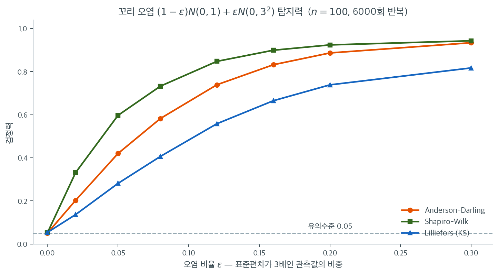

# Anderson-Darling 검정

## 개요

Anderson-Darling(AD) 검정은 EDF에 기반한 정규성 검정으로, Kolmogorov-Smirnov 검정에 비해 분포의 꼬리에 추가 가중을 준다. 이 꼬리 민감성 덕분에 두꺼운 꼬리, 극단부의 치우침, 이상점이 잘 생기는 분포로 나타나는 정규성 이탈을 탐지하는 데 특히 효과적이다. SciPy는 정확한 $p$값 대신 $A^2$ 통계량과 표로 정리된 임계값을 보고한다.

---

## 1. 검정통계량

순서통계량 $X_{(1)} \leq \cdots \leq X_{(n)}$과 가설 CDF $F_0$이 주어졌을 때 Anderson-Darling 통계량은

$$
A^2 = -n - \sum_{i=1}^{n} \frac{2i - 1}{n} \Bigl[\ln F_0(X_{(i)}) + \ln\bigl(1 - F_0(X_{(n+1-i)})\bigr)\Bigr].
$$

$U_i = F_0(X_{(i)})$(확률적분변환값)로 쓰면 동등하게

$$
A^2 = -n - \frac{1}{n}\sum_{i=1}^{n} (2i - 1)\bigl[\ln U_i + \ln(1 - U_{n+1-i})\bigr].
$$

가중치 $(2i-1)/n$은 꼬리에 있는 관측값($U_i$가 0이나 1에 가까운 곳)에 더 큰 비중을 둔다. $U_i \to 0$ 또는 $U_i \to 1$일 때 $\ln U_i$와 $\ln(1 - U_i)$가 발산하기 때문이다.

---

## 2. 꼬리 민감성이 중요한 이유

KS 통계량 $D_n = \sup_x |F_n(x) - F_0(x)|$은 분포의 모든 부분을 동등하게 취급한다. 반면 $A^2$은 제곱차 $(F_n - F_0)^2$을 $[F_0(1 - F_0)]^{-1}$로 가중한 적분이다.

$$
A^2 = n \int_{-\infty}^{\infty} \frac{[F_n(x) - F_0(x)]^2}{F_0(x)\,[1 - F_0(x)]}\, dF_0(x).
$$

분모 $F_0(1-F_0)$이 꼬리에서 가장 작으므로 그곳의 불일치가 증폭된다.

---

## 3. 가설과 임계값

$$
H_0: \text{자료가 정규분포를 따른다}, \qquad H_1: \text{자료가 정규분포를 따르지 않는다}.
$$

SciPy의 `stats.anderson`은 통계량 $A^2$과 함께 유의수준 15%, 10%, 5%, 2.5%, 1%에서의 임계값을 반환한다. $A^2$이 해당 임계값을 넘으면 수준 $\alpha$에서 $H_0$을 기각한다.

<div class="exbox" markdown>

**보기 1.** <span class="diff easy" title="쉬움"></span> 섞인 자료에 Anderson-Darling 검정. $\mathcal{N}(0,1)$ 230개에 $\text{Lognormal}(0, 0.6^2)$ 70개를 섞은 $n = 300$ 표본에서 $A^2 = 1.0034$가 나와 2.5% 수준까지 기각하고 1%에서는 기각하지 못한다.

**(1)** 같은 자료에 샤피로–윌크·자크–베라·다고스티노 $K^2$·릴리에포르를 걸면 각각 어떤 $p$값을 주는가. 앤더슨–달링이 가장 보수적인가.

**(2)** "AD가 꼬리 가중 덕분에 KS보다 낫다"는 주장을 **검정력**으로 확인하시오. 이 혼합 대립에서 네 검정의 순위는 어떻게 되며, AD가 1등인가.

</div>

??? success "풀이"

    **(1) 가장 보수적인 것은 릴리에포르이고, 앤더슨–달링은 그다음이다.** 같은 표본에서

    | 검정 | 통계량 | $p$값 | 5% 판정 |
    |---|---|---|---|
    | 자크–베라 | $JB = 58.5069$ | $1.97\times10^{-13}$ | 기각 |
    | 다고스티노 $K^2$ | $K^2 = 26.6879$ | $1.60\times10^{-6}$ | 기각 |
    | 샤피로–윌크 | $W = 0.9723$ | $1.52\times10^{-5}$ | 기각 |
    | 앤더슨–달링 | $A^2 = 1.0034$ | — (2.5% 임계값 $0.9060$ 초과, 1% 임계값 $1.0780$ 미달) | 기각 |
    | 릴리에포르 | $D = 0.0470$ | $0.1617$ | **기각 못 함** |

    이다. $A^2 = 1.0034$는 1% 임계값 $1.0780$에서 $0.0746$ 모자란다. 다른 세 검정이 $p$를 $10^{-5}$ 아래로 밀어 내리는 것과 견주면 앤더슨–달링이 상당히 조심스러운 편이다. 그러나 **진짜로 못 잡는 것은 릴리에포르**다. $p = 0.162$로 5% 수준에서 기각하지 못한다.

    까닭은 쪽 위의 가중함수 그림이 말해 준다. 이 자료의 이탈은 대수정규 성분이 오른쪽 꼬리에 들여놓은 큰 값들에 몰려 있다. 릴리에포르(=KS)는 분포의 모든 지점을 똑같이 저울질하므로 꼬리에서 벌어진 틈이 가운데의 잡음에 묻힌다. $A^2$은 꼬리에 무게를 실으므로 같은 틈을 크게 본다. **$A^2$이 기각하고 $D$가 기각하지 못하는 이 한 줄이 "꼬리 가중"의 실물이다.**

    **(2) 아니다. 샤피로–윌크가 1등이다.** 같은 혼합 모집단에서 $n = 300$짜리 표본을 1500번 뽑아 $\alpha = 0.05$의 기각률을 재면

    | 검정 | 혼합 대립에서의 검정력 | 정규 자료에서의 크기 |
    |---|---|---|
    | 샤피로–윌크 | $\mathbf{0.4987}$ | $0.0493$ |
    | 앤더슨–달링 | $0.4313$ | $0.0420$ |
    | 자크–베라 | $0.4033$ | $0.0520$ |
    | 릴리에포르 | $0.3260$ | $0.0373$ |

    이다(몬테카를로 표준오차는 검정력 쪽에서 최대 $0.0129$, 크기 쪽에서 $0.0056$).

    **AD가 릴리에포르를 이기는 것은 사실이다**($0.431$ 대 $0.326$, 차이가 몬테카를로 오차의 여덟 배). 꼬리 가중이 값을 한다. 그러나 **AD는 샤피로–윌크에게 진다**($0.431$ 대 $0.499$). 순서통계량 전체의 직선성을 보는 샤피로–윌크가 이 대립에서 더 효율적이다.

    여기에 (1)과의 **어긋남**이 있다. 이 한 표본에서는 자크–베라가 $p = 2\times10^{-13}$으로 가장 극적인 수를 내놓았는데, 검정력으로는 $0.403$으로 AD보다도 낮다. **$p$값 하나로 검정의 성능을 순위 짓는 것은 틀렸다.** $p$값의 크기는 그 검정의 귀무분포가 얼마나 빠르게 꺼지는지를 반영할 뿐이고, 성능은 같은 대립을 되풀이 뽑았을 때의 기각률로만 재진다. 앞 쪽에서 본 대로 자크–베라는 유한표본에서 $g_2$를 날것으로 제곱해 통계량을 부풀리므로 극적인 $p$값을 잘 내놓는다.

    한 가지 단서. AD와 릴리에포르는 크기가 각각 $0.0420$, $0.0373$으로 명목 $0.05$보다 작다(릴리에포르는 몬테카를로 오차의 $2.3$배 아래). 크기가 작으면 검정력도 그만큼 깎이므로 이 비교가 두 검정에 조금 불리하다. 다만 샤피로–윌크의 크기는 $0.0493$으로 명목에 맞고 검정력이 가장 높으니 **1등 판정은 그대로 성립한다.**

    ```python
    import numpy as np
    from scipy import stats

    # 정규 230개에 로그정규 70개를 섞은 자료다.
    rng = np.random.default_rng(0)
    x = np.concatenate([rng.normal(0, 1, size=230),
                        rng.lognormal(0, 0.6, size=70)])

    # A^2 은 경험분포와 이론분포의 차이를 제곱해 적분한 값인데, 꼬리 쪽에
    # 더 큰 무게를 싣는다. 그래서 KS 보다 꼬리 이탈을 잘 잡는다.
    res = stats.anderson(x, dist="norm")
    print(f"Sample size n = {x.size}")
    print(f"Anderson-Darling A^2 = {res.statistic:.4f}")
    print("Critical values vs significance levels:")
    for cv, sl in zip(res.critical_values, res.significance_level):
        flag = " REJECT" if res.statistic > cv else ""
        print(f"  {sl:.1f}% -> {cv:.4f}{flag}")

    reject_5 = res.statistic > res.critical_values[
        list(res.significance_level).index(5.0)]
    print(f"Decision at 5%: {'Reject' if reject_5 else 'Fail to reject'} normality")
    ```

    출력:

    ```text
    Sample size n = 300
    Anderson-Darling A^2 = 1.0034
    Critical values vs significance levels:
      15.0% -> 0.5690 REJECT
      10.0% -> 0.6480 REJECT
      5.0% -> 0.7770 REJECT
      2.5% -> 0.9060 REJECT
      1.0% -> 1.0780
    Decision at 5%: Reject normality
    ```

    네 검정의 판정과 검정력을 함께 구한다.

    ```python
    import numpy as np
    from scipy import stats
    from statsmodels.stats.diagnostic import lilliefors

    rng = np.random.default_rng(0)
    x = np.concatenate([rng.normal(0, 1, size=230),
                        rng.lognormal(0, 0.6, size=70)])
    res = stats.anderson(x, dist="norm")
    print(f"A^2 = {res.statistic:.4f},  1% 임계값 = {res.critical_values[4]:.4f}"
          f"  (차 {res.critical_values[4] - res.statistic:.4f})")
    print(f"Shapiro-Wilk  W = {stats.shapiro(x)[0]:.4f}, p = {stats.shapiro(x)[1]:.4g}")
    print(f"Jarque-Bera  JB = {stats.jarque_bera(x)[0]:.4f}, p = {stats.jarque_bera(x)[1]:.4g}")
    print(f"DAgostino K^2  = {stats.normaltest(x)[0]:.4f}, p = {stats.normaltest(x)[1]:.4g}")
    print(f"Lilliefors    D = {lilliefors(x)[0]:.4f}, p = {lilliefors(x)[1]:.4g}")

    # 이 혼합 대립에서 네 검정의 검정력 (n = 300, alpha = 0.05)
    rg = np.random.default_rng(13)
    R, n_norm, n_ln = 1500, 230, 70
    cnt = dict(AD=0, SW=0, JB=0, LF=0)
    for _ in range(R):
        y = np.concatenate([rg.normal(0, 1, n_norm), rg.lognormal(0, 0.6, n_ln)])
        r = stats.anderson(y, dist="norm")
        cnt["AD"] += r.statistic > r.critical_values[2]
        cnt["SW"] += stats.shapiro(y)[1] < 0.05
        cnt["JB"] += stats.jarque_bera(y)[1] < 0.05
        cnt["LF"] += lilliefors(y)[1] < 0.05
    print(f"\n혼합 대립에서의 검정력 (n = 300, R = {R}, MC SE 최대 {0.5 / np.sqrt(R):.4f})")
    for k in ("AD", "SW", "JB", "LF"):
        print(f"  {k}: {cnt[k] / R:.4f}")

    # 정규 자료에서의 크기도 확인
    cnt0 = dict(AD=0, SW=0, JB=0, LF=0)
    for _ in range(R):
        y = rg.standard_normal(300)
        r = stats.anderson(y, dist="norm")
        cnt0["AD"] += r.statistic > r.critical_values[2]
        cnt0["SW"] += stats.shapiro(y)[1] < 0.05
        cnt0["JB"] += stats.jarque_bera(y)[1] < 0.05
        cnt0["LF"] += lilliefors(y)[1] < 0.05
    print(f"정규 자료에서의 크기 (명목 0.05, MC SE {np.sqrt(0.05 * 0.95 / R):.4f})")
    for k in ("AD", "SW", "JB", "LF"):
        print(f"  {k}: {cnt0[k] / R:.4f}")
    ```

    출력:

    ```text
    A^2 = 1.0034,  1% 임계값 = 1.0780  (차 0.0746)
    Shapiro-Wilk  W = 0.9723, p = 1.519e-05
    Jarque-Bera  JB = 58.5069, p = 1.974e-13
    DAgostino K^2  = 26.6879, p = 1.602e-06
    Lilliefors    D = 0.0470, p = 0.1617

    혼합 대립에서의 검정력 (n = 300, R = 1500, MC SE 최대 0.0129)
      AD: 0.4313
      SW: 0.4987
      JB: 0.4033
      LF: 0.3260
    정규 자료에서의 크기 (명목 0.05, MC SE 0.0056)
      AD: 0.0420
      SW: 0.0493
      JB: 0.0520
      LF: 0.0373
    ```

    이 결과가 쪽 아래 "꼬리 가중이 실제로 사 오는 것" 절의 $n = 100$ 그림과 같은 방향을 가리킨다. 그 그림에서도 $\varepsilon = 0.05$에서 샤피로–윌크 $0.597$이 앤더슨–달링 $0.420$을 앞섰다. **표본크기와 대립을 바꾸어도 "AD는 KS보다 낫지만 샤피로–윌크에는 못 미친다"는 순서가 유지된다.** $\square$

---

## 4. 해석

혼합 자료(정규 + 대수정규)에서 $A^2 = 1.0034$는 15%, 10%, 5%, 2.5% 임계값을 넘어 정규성에 반하는 강한 증거를 준다. 대수정규 성분이 오른쪽 꼬리를 부풀리므로 AD 검정이 특히 적합한 상황이다.

다만 $A^2 = 1.0034$가 **1% 임계값 $1.078$은 넘지 못한다**는 점에 주의하라. 곧 "모든 표로 정리된 수준에서 기각"하는 것이 아니라 2.5%까지만 기각한다. 오염된 관측값이 70개(전체의 23%)나 되는데도 그렇다. AD 검정이 강력하기는 하지만 무한히 강력하지는 않다.

AD 검정이 기각하는데 KS 검정이 기각하지 않는 경우는 흔히 이탈이 꼬리에서 일어나기 때문이다. 바로 AD 검정이 탐지하도록 설계된 영역이다. 연습문제 2에서 이를 극적으로 확인한다.

---

## 5. 꼬리 가중이 실제로 사 오는 것

꼬리에 무게를 싣는다는 설계가 검정력으로 얼마나 돌아오는지 재 보자. 아래 그림은 순수한 꼬리 이탈만 담은 대립가설을 쓴다. 관측값의 비율 $\varepsilon$만큼을 표준편차가 3배인 정규분포에서 뽑은 것이다.

$$
(1 - \varepsilon)\,N(0, 1) + \varepsilon\,N(0, 3^2)
$$

이 분포는 평균이 0이고 완벽하게 대칭이라 왜도가 0이다. 가운데 모양도 정규와 크게 다르지 않다. 오직 꼬리만 두껍다. $n = 100$에서 6000번씩 반복해 세 검정의 기각률을 재면 다음과 같다.



$\varepsilon = 0$에서 세 곡선이 모두 $0.05$에서 출발한다($0.050$, $0.051$, $0.053$). 크기가 제대로 지켜졌다는 확인이다. 오염을 넣기 시작하면 곧바로 AD와 KS가 갈라진다. $\varepsilon = 0.05$ — 100개 중 다섯 개만 꼬리에서 왔을 때 — AD의 검정력은 $0.420$인데 KS는 $0.281$에 그친다. $\varepsilon = 0.12$에서는 $0.739$ 대 $0.558$이다. 오염 구간 전체에서 AD가 KS를 $1.3$–$1.5$배 앞선다. 앞 절에서 본 가중함수가 사 오는 것이 바로 이 차이다.

그런데 초록색 Shapiro-Wilk가 두 곡선 위에 있다는 점도 놓치지 말아야 한다. $\varepsilon = 0.05$에서 $0.597$로 AD보다 $0.18$이나 높다. "AD는 꼬리에 강하다"는 말이 "꼬리 문제에서는 AD가 최고다"를 뜻하지는 않는다는 뜻이다. Shapiro-Wilk는 순서통계량 전체의 최적 가중을 쓰므로 이런 대칭적 두꺼운 꼬리에도 여전히 강하다. AD의 진짜 자리는 "KS보다 훨씬 낫고, 임계값 표가 잘 정비되어 있으며, 정규 아닌 분포에도 같은 틀을 쓸 수 있다"는 쪽이다.

마지막으로 위 보기의 결과와 이어 보자. 대수정규 오염 70개(23%)에도 $A^2 = 1.0034$가 1% 임계값을 넘지 못했다. 이 그림의 척도로 보면 놀랄 일이 아니다. $\varepsilon = 0.20$에서도 AD의 검정력은 $0.887$, 곧 아홉 번에 한 번은 놓친다. 정규성 검정은 기각하지 못했다는 사실을 "정규다"로 번역하지 않는 습관이 여기서도 필요하다.

---

## 연습문제

<div class="drillbox" markdown>

**연습문제 1.** <span class="diff easy" title="쉬움"></span> 표준정규 관측값 $n = 300$개를 생성하라. Anderson-Darling 검정을 수행하고 $A^2$이 15% 임계값보다 작음을 확인하라.

</div>

??? success "풀이"

    ```python
    import numpy as np
    from scipy import stats

    rng = np.random.default_rng(0)
    x = rng.normal(0, 1, size=300)

    res = stats.anderson(x, dist="norm")
    print(f"A^2 = {res.statistic:.4f}")
    print(f"15% critical value: {res.critical_values[0]:.4f}")
    print("Below 15% critical value:", res.statistic < res.critical_values[0])
    ```

    출력:

    ```text
    A^2 = 0.3329
    15% critical value: 0.5690
    Below 15% critical value: True
    ```

    $A^2 = 0.333$은 가장 느슨한 임계값 $0.569$보다도 훨씬 작다. 정규성 아래에서 기대되는 결과이다.

    참고로 $A^2$의 귀무분포는 표본크기에 거의 의존하지 않는다. 위의 임계값들은 $n$이 커져도 거의 그대로이다(SciPy는 $n$에 따른 작은 보정만 적용한다). $D_n$이 $1/\sqrt{n}$으로 줄어드는 KS 통계량과 다른 점이다. $\square$

---

<div class="drillbox" markdown>

**연습문제 2.** <span class="diff med" title="중간"></span> $t_4$ 분포에서 관측값 $n = 300$개를 생성하라. AD 검정과 ($\mathcal{N}(0,1)$에 대한) KS 검정을 수행하라. 어느 검정이 더 강하게 기각하는가?

</div>

??? success "풀이"

    ```python
    import numpy as np
    from scipy import stats

    rng = np.random.default_rng(0)
    x = rng.standard_t(df=4, size=300)

    # Anderson-Darling 검정 — 꼬리에 민감하다
    ad = stats.anderson(x, dist="norm")
    print(f"A^2 = {ad.statistic:.4f}")
    for cv, sl in zip(ad.critical_values, ad.significance_level):
        flag = " *" if ad.statistic > cv else ""
        print(f"  {sl:.1f}%: {cv:.4f}{flag}")

    # KS 검정
    D, p_ks = stats.kstest(x, 'norm', args=(0, 1))
    print(f"\nKS: D = {D:.4f}, p = {p_ks:.4f}")
    print(f"Sample variance = {x.var(ddof=1):.4f}")
    ```

    출력:

    ```text
    A^2 = 2.0862
      15.0%: 0.5690 *
      10.0%: 0.6480 *
      5.0%: 0.7770 *
      2.5%: 0.9060 *
      1.0%: 1.0780 *

    KS: D = 0.0496, p = 0.4386
    Sample variance = 1.6985
    ```

    결과가 극명하게 갈린다.

    | 검정 | 결과 | 판정 |
    |---|---|---|
    | Anderson-Darling | $A^2 = 2.086$ vs 1% 임계값 $1.078$ | 모든 수준에서 기각 |
    | Kolmogorov-Smirnov | $D = 0.0496$, $p = 0.4386$ | **기각 못 함** |

    AD 검정은 1% 수준에서도 단호하게 기각하는 반면 **KS 검정은 아예 기각하지 못한다**($p = 0.44$).

    $t_4$의 이론적 분산은 $\nu/(\nu-2) = 4/2 = 2$로 1과 크게 다른데도 왜 KS가 실패할까? 표본분산이 $1.699$로 이미 2보다 작게 나왔다는 점도 있지만, 근본적인 이유는 CDF 사이의 최대 수직 거리가 작다는 것이다. $t_4$와 $\mathcal{N}(0,1)$의 CDF는 여러 번 교차하며(중앙에서는 $t_4$가 더 뾰족하고 꼬리에서는 더 두껍다), 어느 한 점에서의 차이가 크지 않다.

    AD는 꼬리의 불일치를 $[F_0(1-F_0)]^{-1}$로 증폭하므로 같은 이탈을 훨씬 크게 본다. **꼬리 이탈을 다룰 때 AD가 KS보다 결정적으로 낫다는 것을 보여주는 교과서적 예이다.** $\square$

---

<div class="drillbox" markdown>

**연습문제 3.** <span class="diff med" title="중간"></span> SciPy의 AD 검정은 지수분포와 로지스틱분포에 대해서도 검정할 수 있다. 같은 자료를 세 분포 모두에 대해 검정하고 결과를 비교하는 코드를 작성하라.

</div>

??? success "풀이"

    ```python
    import numpy as np
    from scipy import stats

    rng = np.random.default_rng(0)
    x = rng.exponential(2.0, size=200)

    for dist in ["norm", "expon", "logistic"]:
        res = stats.anderson(x, dist=dist)
        print(f"\n{dist}: A^2 = {res.statistic:.4f}")
        for cv, sl in zip(res.critical_values, res.significance_level):
            flag = " REJECT" if res.statistic > cv else ""
            print(f"  {sl}%: {cv:.4f}{flag}")
    ```

    출력(요약):

    ```text
    norm: A^2 = 7.8017
      15.0%: 0.5650 REJECT
      10.0%: 0.6440 REJECT
      5.0%: 0.7720 REJECT
      2.5%: 0.9010 REJECT
      1.0%: 1.0710 REJECT

    expon: A^2 = 0.5851
      15.0%: 0.9190
      10.0%: 1.0750
      5.0%: 1.3370
      2.5%: 1.6010
      1.0%: 1.9510

    logistic: A^2 = 16.1719
      25.0%: 0.4250 REJECT
      10.0%: 0.5620 REJECT
      5.0%: 0.6590 REJECT
      2.5%: 0.7680 REJECT
      1.0%: 0.9050 REJECT
      0.5%: 1.0090 REJECT
    ```

    지수 자료에 대해 `"expon"` 검정은 기각하지 않고(올바른 귀무가설) `"norm"`과 `"logistic"` 검정은 기각한다(틀린 분포). AD 검정이 여러 분포족에 걸쳐 쓸 수 있음을 보여준다.

    !!! warning "두 가지 실무적 주의사항"
        **(1) 유의수준 배열이 분포마다 다르다.** `norm`과 `expon`은 `[15, 10, 5, 2.5, 1]`의 다섯 수준을 반환하지만 `logistic`은 `[25, 10, 5, 2.5, 1, 0.5]`의 **여섯** 수준을 반환하며 첫 항목이 15%가 아니라 **25%**이다. 따라서 `res.critical_values[2]`가 5% 임계값이라고 가정하는 코드는 세 분포에서 우연히 맞지만, `critical_values[0]`을 15% 임계값으로 해석하면 로지스틱에서 틀린다. 항상 `significance_level`과 함께 짝지어 읽어야 한다.

        **(2) `dist="logistic"`은 경고를 낼 수 있다.** SciPy는 로지스틱 모수를 `fsolve`로 추정하는데, 지수 자료처럼 로지스틱과 크게 다른 자료에서는 `RuntimeWarning: overflow encountered in exp`와 수렴 실패 경고가 나온다. 이 예에서 $A^2 = 16.17$이라는 결론 자체는 타당하지만(모든 수준에서 압도적 기각), 경계선상의 사례에서는 이런 경고를 무시해서는 안 된다.

        $\square$

---

<div class="drillbox" markdown>

**연습문제 4.** <span class="diff med" title="중간"></span> SciPy가 Anderson-Darling 검정에 정확한 $p$값을 제공하지 않는 이유를 설명하고, 모의실험으로 $p$값을 얻는 방법을 기술하라.

</div>

??? success "풀이"

    $A^2$의 귀무분포는 비표준적이다. 가설 분포족에 의존하고, 모수를 추정하는지 여부에도 의존한다. 닫힌 형태의 표현은 특정 경우에만 존재하며, SciPy는 정확한 $p$값을 계산하는 대신 표로 정리된 임계값으로 검정을 구현한다.

    모의실험 기반 $p$값을 얻으려면

    1. 자료에서 $A^2_{\text{obs}}$를 계산한다.
    2. $b = 1, \ldots, B$에 대해 같은 크기의 $x^{*(b)} \sim \mathcal{N}(\hat{\mu}, \hat{\sigma}^2)$를 모의생성하고 $A^{2*}_{(b)}$를 계산한다(각 붓스트랩 표본에서 모수를 **다시 추정**해야 한다).
    3. $p$값은 $\hat{p} = \frac{1}{B}\sum_b \mathbf{1}(A^{2*}_{(b)} \geq A^2_{\text{obs}})$이다.

    Lilliefors 붓스트랩과 같은 원리이며 모수 추정을 올바르게 반영한다. $B = 5000$이면 5% 경계 근처에서 $p$값의 표준오차는 $\sqrt{0.05 \times 0.95/5000} \approx 0.003$이다.

    한 가지 유용한 사실을 덧붙인다. 정규성 검정의 경우 $A^2$의 귀무분포가 위치-척도 불변이므로 $\hat{\mu}, \hat{\sigma}$에 의존하지 않는다. 따라서 $\mathcal{N}(0,1)$에서 한 번만 큰 모의실험을 돌려 임계값 표를 만들어 두면 모든 자료에 재사용할 수 있다. SciPy가 하는 일이 바로 그것이다. $\square$

---

<div class="drillbox" markdown>

**연습문제 5.** <span class="diff hard" title="어려움"></span> AD 통계량이 제곱 EDF 차의 가중적분으로 쓰일 수 있음을 보여라. 정의에서 출발하여 적분 형태를 유도하라.

</div>

??? success "풀이"

    가중 Cramér-von Mises 범함수를 정의한다.

    $$
    A^2 = n \int_{-\infty}^{\infty} \frac{[F_n(x) - F_0(x)]^2}{F_0(x)(1 - F_0(x))}\, dF_0(x).
    $$

    $u = F_0(x)$로 치환하면($du = f_0(x)\,dx = dF_0(x)$)

    $$
    A^2 = n \int_0^1 \frac{[F_n(F_0^{-1}(u)) - u]^2}{u(1-u)}\, du.
    $$

    가중치 $1/[u(1-u)]$는 $u \to 0$ 또는 $u \to 1$일 때 발산하여 극단 꼬리의 편차에 무한한 가중을 준다.

    이 가중치가 임의로 선택된 것이 아니라는 점이 중요하다. $H_0$ 아래에서 $\sqrt{n}[F_n(x) - F_0(x)]$는 분산이 $u(1-u)$인 Brown 브리지로 수렴한다. 곧 $1/[u(1-u)]$는 **분산의 역수 가중**이며, 각 위치의 편차를 그 표준편차로 나누어 표준화하는 셈이다. 이 관점에서 AD는 자연스러운 표준화된 적분 검정이고, 가중치가 없는 Cramér-von Mises 통계량이 오히려 특수한 선택이다.

    실제 계산에서는 $F_n$의 계단함수 형태를 이용해 적분을 전개하면 이산합 형태

    $$
    A^2 = -n - \frac{1}{n}\sum_{i=1}^n (2i-1)[\ln U_i + \ln(1 - U_{n+1-i})]
    $$

    를 얻는다. $\square$

---

<div class="drillbox" markdown>

**연습문제 6.** <span class="diff hard" title="어려움"></span> 2절의 적분 표현에서 가중치의 지수만 바꾼 통계량

$$
A_\alpha^2 = n \int_{-\infty}^{\infty} \frac{[F_n(x) - F_0(x)]^2}{\bigl[F_0(x)\,(1 - F_0(x))\bigr]^{\alpha}}\, dF_0(x)
$$

를 생각하자. $\alpha = 1$ 이 앤더슨–달링이고 $\alpha = 0$ 은 가중치 없는 크라메르–폰 미제스 통계량 $W^2$ 이다. $F_0$ 는 완전히 지정되었다고 하자(모수를 추정하지 않는다).

**(1)** $H_0$ 아래에서 $E[A_\alpha^2]$ 를 $\alpha$ 만의 함수로 구하라. 베타함수로 쓸 수 있다.

**(2)** 이 기댓값이 유한한 $\alpha$ 의 범위를 말하고 $\alpha = 0, 1, \tfrac{3}{2}$ 에서의 값을 적어라.

**(3)** 이 계산으로 연습문제 1 의 마지막 주석 — "$A^2$ 의 귀무분포는 표본크기에 거의 의존하지 않는다" — 을 설명하라. $D_n$ 은 왜 사정이 다른가.

</div>

??? success "풀이"

    **(1)** $u = F_0(x)$ 로 두면 $n F_n(x) \sim \text{Bin}(n, u)$ 이므로

    $$
    E\bigl[(F_n(x) - F_0(x))^2\bigr] = \operatorname{Var}(F_n(x)) = \frac{u(1-u)}{n}
    $$

    이다($H_0$ 아래에서는 편향이 0 이다). 적분 안에 넣고 $u = F_0(x)$ 로 치환하면

    $$
    E[A_\alpha^2] = n \int_0^1 \frac{u(1-u)/n}{[u(1-u)]^{\alpha}}\, du = \int_0^1 [u(1-u)]^{1-\alpha}\, du = B(2-\alpha,\, 2-\alpha) = \frac{\Gamma(2-\alpha)^2}{\Gamma(4-2\alpha)}.
    $$

    $n$ 이 **정확히** 약분되었다는 것이 핵심이다.

    **(2)** 베타적분이 수렴할 조건은 양 끝에서 지수가 $-1$ 보다 커야 한다는 것, 곧 $1 - \alpha > -1$ 이므로 $\alpha < 2$ 이다.

    | $\alpha$ | $E[A_\alpha^2]$ | 이름 |
    |---|---|---|
    | $0$ | $B(2,2) = \Gamma(2)^2/\Gamma(4) = 1/6 \approx 0.1667$ | 크라메르–폰 미제스 $W^2$ |
    | $1$ | $B(1,1) = 1$ | 앤더슨–달링 $A^2$ |
    | $3/2$ | $B(1/2,1/2) = \pi \approx 3.1416$ | — |
    | $\to 2^-$ | $\to \infty$ | — |

    $\alpha \geq 2$ 에서는 귀무가설 아래에서조차 기댓값이 무한하므로 검정통계량으로 쓸 수 없다.

    **(3)** (1) 의 결론은 $E[A^2] = 1$ 이 **모든 $n$ 에 대해 정확히 성립**한다는 것이다. 완전지정 $A^2$ 을 직접 모의생성해 보면 평균이 $n = 50$ 에서 $0.998$, $n = 200$ 에서 $0.998$, $n = 2000$ 에서 $1.002$ 로 나온다. 평균뿐 아니라 분포 전체가 빠르게 극한법칙에 안착하므로 임계값 표 하나가 모든 $n$ 에 쓰인다. 보기 1 의 $n = 300$ 에서 5% 임계값이 $0.7770$, 연습문제 3 의 $n = 200$ 에서 $0.7720$ 인 것처럼 차이가 셋째 소수점에 머무는 까닭이고, 그 작은 차이마저도 극한법칙의 $n$ 의존이 아니라 **모수 추정에 대한 보정**($1 + 4/n - 25/n^2$) 에서 온다.

    $D_n$ 은 다르다. $\sqrt{n}\, D_n$ 이 콜모고로프 분포로 수렴하므로 $E[D_n] \asymp n^{-1/2}$ 이고, 임계값이 $1.3581/\sqrt{n}$ 처럼 줄어들어야 한다. 차이의 뿌리는 가중치다. $\alpha = 1$ 은 브라운 다리의 분산 $u(1-u)$ 로 나누는 것이어서 적분 안의 기댓값이 정확히 $du$ 가 된다. 곧 **모든 $u$ 가 $n$ 과 무관하게 똑같은 몫을 내놓는다.** 반면 KS 의 상한은 표준화를 전혀 하지 않아 $F_n$ 자체의 축척($n^{-1/2}$) 을 그대로 물려받는다.

    한 줄 해석. $\alpha = 1$ 은 "귀무가설의 무게를 $u$ 전체에 고르게 펴는" 유일한 지수이고, $\alpha = 2$ 는 그 무게가 극단 꼬리로 다 쏠려 터지는 지점이다. 꼬리를 더 세게 보고 싶어 $1 < \alpha < 2$ 로 가면 통계량은 유한하지만 귀무분포의 평균조차 가장 바깥 관측값 몇 개에 좌우되어 쓸모가 없어진다. 앤더슨–달링은 이 허용 구간에서 가장 자연스러운 자리를 잡은 것이다. $\square$

---

<div class="drillbox" markdown>

**연습문제 7.** <span class="diff hard" title="어려움"></span> `stats.anderson(x, dist="norm")` 이 계산하는 $A^2$ 은 표본마다 $\bar{x}, s$ 를 추정해 $U_i = \Phi\bigl((x_{(i)} - \bar{x})/s\bigr)$ 로 쓰는 판이다.

**(1)** $b > 0$ 일 때 $A^2(a + bx) = A^2(x)$ 임을 보여라. 이것이 연습문제 4 의 마지막 주장("귀무분포가 $\hat\mu, \hat\sigma$ 에 의존하지 않으므로 표 하나로 충분하다")을 어떻게 뒷받침하는가.

**(2)** $b = -1$ 일 때도, 곧 자료를 좌우로 뒤집어도 $A^2$ 이 변하지 않음을 보여라. 힌트: $U_i \mapsto 1 - U_{n+1-i}$ 가 되고 정의식의 합이 그 교환에 대해 대칭이다.

**(3)** 보기 1 의 자료 $x$ 와 그 거울상 $-x$ 는 $A^2 = 1.0034$, $W = 0.9723$, $JB = 58.5069$ 를 똑같이 주고 $g_1 = \pm 0.4467$ 만 부호가 바뀐다($g_2 = 1.9703$ 은 그대로다). $W$ 와 $JB$ 도 같은 값인 까닭을 각각 한 줄로 밝히고, 이 세 검정이 끝내 보지 못하는 것이 무엇인지, 치우침의 방향을 알려면 무엇을 보아야 하는지 말하라.

</div>

??? success "풀이"

    **(1)** $y = a + bx$, $b > 0$ 이라 하자. $b > 0$ 이면 순서가 보존되므로 $y_{(i)} = a + b\,x_{(i)}$ 이고 $\bar{y} = a + b\bar{x}$, $s_y = b\,s_x$ 이다. 따라서

    $$
    \frac{y_{(i)} - \bar{y}}{s_y} = \frac{b\,(x_{(i)} - \bar{x})}{b\,s_x} = \frac{x_{(i)} - \bar{x}}{s_x}
    $$

    로 표준화 잔차가 하나하나 같고, $U_i$ 도 같고, $A^2$ 도 같다.

    이것이 연습문제 4 의 주장을 증명한다. 자료가 $\mathcal{N}(\mu, \sigma^2)$ 에서 왔다면 $x = \mu + \sigma z$ 로 쓸 수 있고 위 식에 따라 $A^2(x) = A^2(z)$ 이다. 곧 $A^2$ 의 귀무분포는 $\mathcal{N}(0,1)$ 에서의 분포와 **완전히 같다.** 그래서 $\mathcal{N}(0,1)$ 에서 한 번 만든 임계값 표를 모든 자료에 재사용할 수 있다.

    **(2)** $y = -x$ 이면 순서가 거꾸로 되어 $y_{(i)} = -x_{(n+1-i)}$ 이고 $\bar{y} = -\bar{x}$, $s_y = s_x$ 이므로

    $$
    U_i^{y} = \Phi\!\left(\frac{-x_{(n+1-i)} + \bar{x}}{s_x}\right) = 1 - U_{n+1-i}^{x}
    $$

    이다. 이것을 정의식의 합에 넣으면 두 항이 서로 자리를 바꾼다.

    $$
    \ln U_i^{y} = \ln\bigl(1 - U_{n+1-i}^{x}\bigr), \qquad \ln\bigl(1 - U_{n+1-i}^{y}\bigr) = \ln\bigl(1 - (1 - U_i^{x})\bigr) = \ln U_i^{x}
    $$

    이므로 각 $i$ 에서 대괄호 안의 두 항의 **합이 그대로**다. 따라서

    $$
    A^2(-x) = -n - \frac{1}{n}\sum_{i=1}^n (2i-1)\bigl[\ln U_i^{x} + \ln(1 - U_{n+1-i}^{x})\bigr] = A^2(x).
    $$

    (1) 과 합치면 모든 $a$ 와 $b \neq 0$ 에 대해 $A^2(a+bx) = A^2(x)$ 다. $\square$

    **(3)** $W = \bigl(\sum_i a_i x_{(i)}\bigr)^2 / \sum_i (x_i - \bar{x})^2$ 에서 계수가 반대칭($a_i = -a_{n+1-i}$)이므로 $x \to -x$ 에서 분자의 선형결합은 부호만 바뀌고 제곱하면 같아진다. 분모는 당연히 같다. 자크–베라는 $JB = \frac{n}{6}\bigl(g_1^2 + g_2^2/4\bigr)$ 로 왜도를 **제곱해서** 쓰므로 $g_1 \to -g_1$ 이 아무 영향을 주지 않는다.

    세 검정이 보지 못하는 것은 **이탈의 방향**이다. 모두 "정규가 아니다"의 강도만 재고, 오른쪽 꼬리가 두꺼운 자료와 왼쪽 꼬리가 두꺼운 자료를 글자 하나도 구별하지 못한다. 보기 1 의 대수정규 오염(오른쪽으로 끌린 자료)과 그 거울상(왼쪽으로 끌린 자료)은 $A^2 = 1.0034$ 로 **같은 수**를 준다.

    방향을 알려면 부호가 살아 있는 양을 보아야 한다. $g_1 = +0.4467$ 이라는 왜도 자체, 또는 Q-Q 그림의 휘어지는 쪽(오른쪽 끝이 위로 들리면 오른쪽 꼬리가 두껍다)이다.

    실무에서 이 구별이 중요한 자리가 있다. 손실이 왼쪽 꼬리에 쌓이는 자료와 이익이 오른쪽 꼬리에 쌓이는 자료는 위험이 전혀 다른데, 정규성 검정의 통계량만으로는 둘을 가를 수 없다. **검정은 진단의 시작이고, 방향은 따로 보아야 한다.** $\square$

---

<div class="drillbox" markdown>

**연습문제 8.** <span class="diff hard" title="어려움"></span> 연습문제 2 는 $t_4$ 자료 $n = 300$ 에서 AD 가 1% 수준까지 기각하는데 KS 는 $p = 0.4386$ 으로 기각조차 못 하는 것을 보였다. 이 차이를 **필요한 표본크기**로 환산해 보자. 두 검정 모두 완전히 지정된 $F_0 = \Phi$ 를 쓴다고 하자.

**(1)** $f_{t_4}(x) = \phi(x)$ 의 해가 $x_c = 1.6466$ 이다. $\Delta_{\text{KS}} = \sup_x \lvert F_{t_4}(x) - \Phi(x) \rvert$ 가 왜 하필 이 $x_c$ 에서 달성되는지 설명하고 그 값을 적어라. $u = \Phi(x_c)$ 로 보면 그 지점은 꼬리인가.

**(2)** KS 의 5% 임계값은 $1.3581/\sqrt{n}$ 이다. 체계적 차이 $\Delta_{\text{KS}}$ 만으로 임계값에 닿으려면 $n$ 이 얼마나 되어야 하는가.

**(3)** 연습문제 6(1) 을 대립가설로 확장하여 $E[A^2] = c + n\,\Delta_{\text{AD}}$ 임을 보여라. 여기서 $F(u) = F_{t_4}(\Phi^{-1}(u))$ 이고

$$
c = \int_0^1 \frac{F(u)\,(1 - F(u))}{u(1-u)}\, du, \qquad \Delta_{\text{AD}} = \int_0^1 \frac{[F(u) - u]^2}{u(1-u)}\, du
$$

이다. 수치적분값 $c = 1.5406$, $\Delta_{\text{AD}} = 0.01202$ 와 완전지정 $A^2$ 의 5% 점 $2.492$ 를 써서 필요한 $n$ 을 구하고 (2) 와 견주어라.

**(4)** $\Delta_{\text{AD}}$ 가운데 양 끝 1%($u < 0.01$ 또는 $u > 0.99$)에서 오는 몫이 $33\%$, 양 끝 0.1% 에서 오는 몫이 $12\%$ 다. 이 수들과 (1) 의 답을 함께 놓고 꼬리 가중이 하는 일을 한 문장으로 말하라.

</div>

??? success "풀이"

    **(1) $x_c$ 는 두 밀도가 만나는 점이므로 CDF 차의 극점이다.** $g(x) = F_{t_4}(x) - \Phi(x)$ 라 하면 $g'(x) = f_{t_4}(x) - \phi(x)$ 이고, 이것이 0 이 되는 양수 지점이 바로 $x_c = 1.6466$ 이다. 부호를 보면 $f_{t_4}(0) = 0.3750 < \phi(0) = 0.3989$ 이므로 $(0, x_c)$ 에서 $g$ 가 감소하고, $x > x_c$ 에서는 $t_4$ 의 두꺼운 꼬리 때문에 $f_{t_4} > \phi$ 가 되어 $g$ 가 다시 0 을 향해 올라간다. 따라서 $x_c$ 가 유일한 최솟점이고

    $$
    g(x_c) = F_{t_4}(x_c) - \Phi(x_c) = 0.91250 - 0.95018 = -0.03767, \qquad \Delta_{\text{KS}} = 0.03767
    $$

    이다(음수 쪽은 대칭이라 크기가 같다). 그 지점은 $u = \Phi(1.6466) = 0.9502$, 곧 **꼬리가 아니라 어깨**다.

    덧붙여 둘 것이 있다. 연습문제 2 의 풀이가 "CDF 가 여러 번 교차한다"고 적었지만, 실제로 여러 번 만나는 것은 **밀도**($\pm x_c$ 에서 두 번)이고 CDF 는 $x = 0$ 에서만 만난다. $x > 0$ 전체에서 $F_{t_4} < \Phi$ 다. KS 가 실패하는 까닭은 교차가 많아서가 아니라 **최대 수직거리 자체가 $0.0377$ 밖에 안 되기 때문**이다.

    **(2)** $\Delta_{\text{KS}} \geq 1.3581/\sqrt{n}$ 을 풀면

    $$
    n \geq \left(\frac{1.3581}{0.0376727}\right)^2 = 1299.6
    $$

    이므로 $n \geq 1300$ 이다. 실제로 $1.3581/\sqrt{1300} = 0.03767$ 로 딱 맞는다. $n = 300$ 에서 임계값은 $1.3581/\sqrt{300} = 0.0784$ 인데 체계적 차이는 그 절반도 안 되는 $0.0377$ 이니, 연습문제 2 의 $D = 0.0496$ 은 놀랄 일이 아니었다.

    **(3)** $u = F_0(x)$ 에서 $nF_n(x) \sim \text{Bin}(n, F)$ 이므로 분산과 편향제곱으로 쪼개면

    $$
    E\bigl[(F_n - F_0)^2\bigr] = \frac{F(1-F)}{n} + (F - F_0)^2
    $$

    이다. 여기에 $n$ 을 곱하고 가중치 $[u(1-u)]^{-1}$ 로 적분하면 첫 항에서 $n$ 이 약분되어 $c$ 가, 둘째 항에서 $n\,\Delta_{\text{AD}}$ 가 나온다.

    $$
    E[A^2] = \int_0^1 \frac{F(1-F)}{u(1-u)}\,du + n \int_0^1 \frac{(F-u)^2}{u(1-u)}\,du = c + n\,\Delta_{\text{AD}}.
    $$

    $H_0$ 이면 $F = u$ 라 $c = 1$, $\Delta_{\text{AD}} = 0$ 이 되어 연습문제 6 의 결과로 돌아간다. 수치를 넣으면

    $$
    1.5406 + 0.01202\,n \geq 2.492 \quad \Longleftrightarrow \quad n \geq \frac{2.492 - 1.5406}{0.01202} = 79.2
    $$

    이므로 $n \geq 80$ 이다. **KS 는 $1300$, AD 는 $80$ — 같은 기준에서 열여섯 배 차이다.**

    다만 두 기준 모두 통계량의 흔들림을 무시한 것이라 보수적이다. 특히 KS 의 상한은 양의 잡음을 주워 담으므로 실제 검정력은 더 빨리 올라간다. 모의실험으로 재면 $t_4$ 자료에서 KS 의 기각률이 $n = 300$ 에 $0.177$, $n = 700$ 에 $0.547$, $n = 1300$ 에 $0.955$ 다. 그래도 자릿수의 격차는 그대로다. (연습문제 2 의 AD 는 모수를 추정하는 판이라 분산 불일치를 $s$ 가 흡수해 신호가 줄지만 임계값도 $1.078$ 로 함께 내려간다. 그 조건에서도 $A^2 = 2.086$ 으로 모든 수준에서 기각했다.)

    **(4)** KS 의 증거는 전부 $u = 0.95$ 라는 **한 점**에서 나오는데 그 자리의 AD 가중치는 $1/(0.9502 \times 0.0498) = 21.1$ 에 지나지 않는다. 반면 AD 의 신호는 가중치가 $10^2$ 에서 $10^4$ 로 커지는 양 끝 1% 에서만 $33\%$, 끝 0.1% 에서만 $12\%$ 를 긁어 온다. **꼬리 가중은 "가장 큰 틈 하나"에 걸지 않고 꼬리 전역에 흩어진 작은 틈들을 전부 더해 주는 장치다.** $\square$

---

<div class="drillbox" markdown>

**연습문제 9.** <span class="diff hard" title="어려움"></span> 보기 1(2) 의 표에서 앤더슨–달링의 크기가 명목 $0.05$ 에 대해 $0.0420$ 으로 나왔다(모의실험 표준오차 $0.0056$). 풀이는 "크기가 작으면 검정력도 깎인다"는 단서만 남겨 두었다. 이것을 끝까지 따라가 보자.

**(1)** 반복을 충분히 늘려 $n = 20, 100, 300, 1000$ 에서 SciPy 표의 5% 임계값이 정규 자료를 실제로 몇 % 기각하는지 재라. $0.0420$ 은 몬테카를로 잡음인가.

**(2)** 같은 모의실험으로 $A^2$ 의 **참 95% 분위수**를 구하라. 참 분위수가 $n$ 에 따라 어떻게 움직이는지, SciPy 의 표값은 어떻게 움직이는지 나란히 놓고 보라. SciPy 는 표의 기준값 $0.787$ 을 $1 + 4/n - 25/n^2$ 으로 나누어 쓴다. 표값과 참값이 일치하는 $n$ 은 얼마쯤인가.

**(3)** 참 분위수를 임계값으로 써서 보기 1 의 혼합 대립($\mathcal{N}(0,1)$ 230 개 + $\text{Lognormal}(0, 0.6^2)$ 70 개)에서 AD 의 검정력을 다시 재고, "샤피로–윌크 1 등" 판정이 그대로인지 확인하라.

</div>

??? success "풀이"

    ```python
    import numpy as np
    from scipy import stats


    def A2v(X):
        """행마다 모수를 추정해 A^2 을 한꺼번에 구한다 (stats.anderson 과 같은 값)."""
        R, n = X.shape
        Y = np.sort(X, axis=1)
        z = (Y - Y.mean(1, keepdims=True)) / Y.std(1, ddof=1, keepdims=True)
        i = np.arange(1, n + 1)
        return -n - ((2 * i - 1) * (stats.norm.logcdf(z)
                                    + stats.norm.logsf(z)[:, ::-1])).sum(1) / n


    rng = np.random.default_rng(314)

    # (1) 표의 5% 임계값이 정규 자료를 실제로 몇 % 기각하는가.
    print("    n   5% 임계값    참 크기              참 95% 분위수")
    q95 = {}
    for n, R in [(20, 100000), (100, 100000), (300, 100000), (1000, 40000)]:
        cv = stats.anderson(np.linspace(0.0, 1.0, n)).critical_values[2]
        a = np.concatenate([A2v(rng.standard_normal((min(5000, R - s), n)))
                            for s in range(0, R, 5000)])
        size = (a > cv).mean()
        q95[n] = np.quantile(a, 0.95)
        print(f"{n:5d}   {cv:.4f}    {size:.4f} (SE {np.sqrt(size*(1-size)/R):.4f})"
              f"      {q95[n]:.4f}")

    # (2) 크기를 바로잡은 뒤의 검정력 — 보기 1 의 혼합 대립 그대로.
    R = 20000
    ad_tab = ad_fix = sw = 0
    for s in range(0, R, 2000):
        m = min(2000, R - s)
        X = np.concatenate([rng.normal(0, 1, (m, 230)),
                            rng.lognormal(0, 0.6, (m, 70))], axis=1)
        a = A2v(X)
        ad_tab += int((a > 0.777).sum())
        ad_fix += int((a > q95[300]).sum())
        for row in X:
            sw += stats.shapiro(row)[1] < 0.05
    print(f"\n혼합 대립 (n = 300, R = {R}, MC SE 최대 {0.5/np.sqrt(R):.4f})")
    print(f"  AD, 표의 임계값 0.7770       : {ad_tab/R:.4f}")
    print(f"  AD, 크기 보정 임계값 {q95[300]:.4f}  : {ad_fix/R:.4f}")
    print(f"  샤피로-윌크 (명목 5%)        : {sw/R:.4f}")
    ```

    출력:

    ```text
        n   5% 임계값    참 크기              참 95% 분위수
       20   0.6920    0.0608 (SE 0.0008)      0.7243
      100   0.7590    0.0459 (SE 0.0007)      0.7447
      300   0.7770    0.0435 (SE 0.0006)      0.7507
     1000   0.7840    0.0403 (SE 0.0010)      0.7472

    혼합 대립 (n = 300, R = 20000, MC SE 최대 0.0035)
      AD, 표의 임계값 0.7770       : 0.4272
      AD, 크기 보정 임계값 0.7507  : 0.4561
      샤피로-윌크 (명목 5%)        : 0.5105
    ```

    (여기서 `A2v` 는 SciPy 와 똑같은 $A^2$ 을 행 단위로 벡터화한 것이고, `stats.anderson` 은 임계값이 $n$ 에 따라 달라지므로 길이 $n$ 의 아무 자료를 넣어 표값만 꺼내는 데 썼다.)

    **(1) 잡음이 아니다.** $n = 300$ 에서 참 크기는 $0.0435$ 이고 표준오차가 $0.0006$ 이니 명목 $0.05$ 와의 차이 $0.0065$ 는 표준오차의 열 배가 넘는다. 보기 1 이 $R = 1500$ 으로 얻은 $0.0420$ 은 이 참값을 제대로 가리킨 셈이다. $n$ 에 따른 그림은 이렇다.

    | $n$ | SciPy 표값 | 참 크기 | 판정 |
    |---|---|---|---|
    | $20$ | $0.6920$ | $0.0608$ | 느슨하다(과대 기각) |
    | $100$ | $0.7590$ | $0.0459$ | 거의 맞다 |
    | $300$ | $0.7770$ | $0.0435$ | 보수적 |
    | $1000$ | $0.7840$ | $0.0403$ | 더 보수적 |

    **(2) 참 분위수는 거의 평평한데 표값은 올라간다.** 참 95% 분위수는 $0.7243 \to 0.7447 \to 0.7507 \to 0.7472$ 로 $n = 100$ 부터 $0.745$ 근처에서 멈춘다. 연습문제 6(3) 이 말한 "$A^2$ 의 귀무분포는 $n$ 에 거의 의존하지 않는다"가 숫자로 확인된 것이다. 그런데 SciPy 의 표값은 $0.6920 \to 0.7590 \to 0.7770 \to 0.7840$ 으로 계속 올라가 기준값 $0.787$ 로 수렴한다. 둘이 만나는 곳은

    $$
    \frac{0.787}{1 + 4/n - 25/n^2} = 0.747 \quad \Longrightarrow \quad 0.0535\,n^2 - 4n + 25 = 0 \quad \Longrightarrow \quad n \approx 67.9
    $$

    곧 $n \approx 68$ 이다. $n < 68$ 에서는 표값이 참값보다 작아 검정이 느슨해지고($n = 20$ 에서 크기 $0.061$), $n > 68$ 에서는 표값이 참값보다 커져 보수적이 된다. 보정항 $1 + 4/n - 25/n^2$ 은 $n \to \infty$ 에서 1 로 가므로 큰 $n$ 의 임계값은 기준값 $0.787$ 그 자체인데, 참 95% 점은 $0.747$ 이다. **기준값이 약 $5\%$ 높게 잡혀 있어 큰 표본에서 명목 5% 검정이 실제로는 4% 검정이 된다.**

    **(3) 크기를 바로잡아도 샤피로–윌크가 1 등이다.** 임계값을 $0.7770$ 에서 참값 $0.7507$ 로 내리면 AD 의 검정력이 $0.4272 \to 0.4561$ 로 $0.029$ 올라간다. 보기 1 의 풀이가 남긴 단서가 정량화된 것이다. 그러나 샤피로–윌크는 $0.5105$ 이고(그 크기는 명목에 맞는 $0.049$ 였다) 차이 $0.054$ 는 두 추정값의 표준오차($0.0035$ 씩)의 열 배가 넘는다.

    한 줄 해석. **보기 1 의 "AD 는 KS 보다 낫지만 샤피로–윌크에는 못 미친다"는 결론은 크기 차이가 만든 허상이 아니었다.** 동시에, 표로 정리된 임계값을 쓸 때는 그 표가 어느 $n$ 에서 맞춰진 것인지 알아야 한다는 교훈도 남는다. 경계선상의 판정이 중요하면 연습문제 4 의 모의실험 $p$ 값으로 돌아가는 편이 낫다. $\square$

---

<div class="drillbox" markdown>

**연습문제 10.** <span class="diff hard" title="어려움"></span> 자크–베라는 3차·4차 적률만 본다. 그렇다면 **왜도와 초과첨도가 정확히 0 인데도 정규가 아닌** 분포를 지어 자크–베라를 통과시킬 수 있어야 한다. 다음 혼합을 쓰자.

$$
X \sim 0.9\,\mathcal{N}(0, \sigma^2) + 0.05\,\mathcal{N}(-\mu,\, 0.3^2) + 0.05\,\mathcal{N}(\mu,\, 0.3^2)
$$

**(1)** 대칭이라 $EX = 0$, $\gamma_1 = 0$ 은 공짜다. 여기에 $\operatorname{Var}(X) = 1$ 과 $EX^4 = 3$(곧 $\beta_2 = 3$, 초과첨도 0)을 걸면 $a = \sigma^2$ 에 대한 이차식 $10.8\,a^2 - 18.324\,a + 7.35838 = 0$ 이 나옴을 보이고 두 해를 모두 구하라. 평균이 $m$, 표준편차가 $\tau$ 인 정규분포의 4차적률이 $m^4 + 6m^2\tau^2 + 3\tau^4$ 임을 쓰면 된다.

**(2)** 두 해가 그리는 모양은 전혀 다르다. 각각을 말로 묘사하고 어느 쪽이 정규와 더 비슷할지 미리 짚어라.

**(3)** $n = 500$, $\alpha = 0.05$ 에서 자크–베라·앤더슨–달링·샤피로–윌크의 기각률을 모의실험으로 재라. 한쪽 해에서는 자크–베라의 기각률이 **자기 크기보다도 작게** 나온다. 왜 그런가. $g_1, g_2$ 의 표본 표준편차와 $EX^6$ 을 함께 재어 설명하라.

</div>

??? success "풀이"

    **(1)** 2차적률 조건은

    $$
    EX^2 = 0.9\,a + 0.1\,(\mu^2 + 0.09) = 1 \quad \Longrightarrow \quad \mu^2 = 9.91 - 9a
    $$

    이다. 4차적률은 중심성분이 $3a^2$, 혹 성분이 $\mu^4 + 6\mu^2(0.09) + 3(0.09)^2$ 이므로

    $$
    EX^4 = 2.7\,a^2 + 0.1\,\mu^4 + 0.054\,\mu^2 + 0.00243 = 3
    $$

    이고 $\mu^2 = 9.91 - 9a$ 를 넣으면

    $$
    2.7a^2 + 0.1(98.2081 - 178.38a + 81a^2) + 0.054(9.91 - 9a) + 0.00243 = 3
    $$

    $$
    10.8\,a^2 - 18.324\,a + 7.35838 = 0.
    $$

    판별식은 $18.324^2 - 4(10.8)(7.35838) = 335.7690 - 317.8820 = 17.8870$ 이고 $\sqrt{17.8870} = 4.2293$ 이므로

    $$
    a = \frac{18.324 \pm 4.2293}{21.6} = 0.652533 \ \text{ 또는 } \ 1.044134
    $$

    $$
    (\sigma, \mu) = (0.807795,\ 2.009280) \quad \text{또는} \quad (1.021829,\ 0.716095).
    $$

    **(2)** 첫 해는 중심이 표준편차 $0.808$ 로 좁아지고 전체의 10% 가 $\pm 2.01$ 에 작은 혹 두 개로 떨어져 나간 **봉우리 셋인 분포**다(이하 "먼 혹"). 둘째 해는 중심이 $1.022$ 로 거의 표준정규이고 혹이 $\pm 0.716$ 에, 곧 몸통 **안쪽**에 묻혀 있다("가까운 혹"). 눈으로도 먼 혹이 훨씬 비정규로 보이니 EDF 기반 검정이 잡기 쉬울 것이고, 가까운 혹은 네 적률이 같은 데다 모양까지 비슷해 어느 검정도 어려울 것이다.

    ```python
    import numpy as np
    from scipy import stats

    p, tau = 0.1, 0.3

    # 2차·4차 적률 조건을 a = sigma^2 에 대한 이차식으로 풀어 둔 것이다.
    roots = np.roots([10.8, -18.324, 7.35838])
    print("sigma^2 의 두 해:", np.round(np.sort(roots), 6))
    pars = []
    for a in np.sort(roots):
        sig, mu = np.sqrt(a), np.sqrt(9.91 - 9 * a)
        pars.append((sig, mu))
        print(f"  sigma = {sig:.6f},  mu = {mu:.6f}")


    def mix(rng, R, n, sig, mu):
        """0.9 로 N(0, sig^2), 0.05 씩 N(+-mu, 0.3^2) 인 혼합에서 뽑는다."""
        z = rng.standard_normal((R, n))
        core = rng.random((R, n)) < 1 - p
        bump = np.where(rng.random((R, n)) < 0.5, -mu, mu) + tau * z
        return np.where(core, sig * z, bump)


    def A2v(X):
        R, n = X.shape
        Y = np.sort(X, axis=1)
        w = (Y - Y.mean(1, keepdims=True)) / Y.std(1, ddof=1, keepdims=True)
        i = np.arange(1, n + 1)
        return -n - ((2 * i - 1) * (stats.norm.logcdf(w)
                                    + stats.norm.logsf(w)[:, ::-1])).sum(1) / n


    # 적률이 정말로 맞는지 큰 표본으로 확인한다.
    rng = np.random.default_rng(5)
    for (sig, mu), name in zip(pars, ["먼 혹", "가까운 혹"]):
        y = mix(rng, 1, 2_000_000, sig, mu)[0]
        print(f"{name}: 분산 {y.var():.4f}, g1 {stats.skew(y):+.4f}, "
              f"g2 {stats.kurtosis(y):+.4f}, E X^6 {np.mean(y**6):.3f} (정규는 15)")

    # n = 500, alpha = 0.05 에서 세 검정의 기각률
    n, R = 500, 10000
    cv = stats.anderson(np.linspace(0.0, 1.0, n)).critical_values[2]
    print(f"\nn = {n}, R = {R}, AD 5% 임계값 {cv:.4f}, MC SE 최대 {0.5/np.sqrt(R):.4f}")
    rng = np.random.default_rng(99)
    for name, pair in [("정규 (크기)", None), ("먼 혹", pars[0]), ("가까운 혹", pars[1])]:
        ad = sw = jb = 0
        g1s, g2s = [], []
        for s in range(0, R, 1000):
            m = min(1000, R - s)
            X = (rng.standard_normal((m, n)) if pair is None
                 else mix(rng, m, n, *pair))
            ad += int((A2v(X) > cv).sum())
            g1s.append(stats.skew(X, axis=1))
            g2s.append(stats.kurtosis(X, axis=1))
            for row in X:
                sw += stats.shapiro(row)[1] < 0.05
                jb += stats.jarque_bera(row)[1] < 0.05
        g1s, g2s = np.concatenate(g1s), np.concatenate(g2s)
        print(f"{name:11s} AD {ad/R:.4f}  SW {sw/R:.4f}  JB {jb/R:.4f}   "
              f"sd(g1) {g1s.std():.4f}  sd(g2) {g2s.std():.4f}")
    ```

    출력:

    ```text
    sigma^2 의 두 해: [0.652533 1.044134]
      sigma = 0.807795,  mu = 2.009280
      sigma = 1.021829,  mu = 0.716095
    먼 혹: 분산 0.9999, g1 -0.0020, g2 -0.0030, E X^6 12.647 (정규는 15)
    가까운 혹: 분산 1.0005, g1 -0.0014, g2 +0.0009, E X^6 15.474 (정규는 15)

    n = 500, R = 10000, AD 5% 임계값 0.7810, MC SE 최대 0.0050
    정규 (크기)     AD 0.0429  SW 0.0492  JB 0.0439   sd(g1) 0.1076  sd(g2) 0.2142
    먼 혹         AD 0.6151  SW 0.7373  JB 0.0051   sd(g1) 0.0861  sd(g2) 0.1450
    가까운 혹       AD 0.1159  SW 0.0876  JB 0.0574   sd(g1) 0.1131  sd(g2) 0.2244
    ```

    **(3)** 먼저 적률이 설계대로 맞았음을 확인한다. 200 만 개 표본에서 분산 $0.9999$, $g_1 = -0.0020$, $g_2 = -0.0030$ 이다. 그러므로 **두 분포 모두 자크–베라가 재는 두 양의 참값이 0 이다.** (2장의 부등식 $\beta_2 \geq 1 + \gamma_1^2$ 은 $\gamma_1 = 0$ 일 때 $\beta_2 \geq 1$ 만 요구하므로 $\beta_2 = 3$ 은 하한에서 한참 떨어진 자리다. 적률 두 개를 정규에 맞추는 것은 전혀 제약이 아니다.)

    | 분포 | AD | SW | JB |
    |---|---|---|---|
    | 정규(크기) | $0.0429$ | $0.0492$ | $0.0439$ |
    | 먼 혹 | $\mathbf{0.6151}$ | $\mathbf{0.7373}$ | $0.0051$ |
    | 가까운 혹 | $0.1159$ | $0.0876$ | $0.0574$ |

    먼 혹에서 AD 는 $0.615$, 샤피로–윌크는 $0.737$ 로 또렷하게 잡아내는데 자크–베라는 $0.0051$ 에 머문다. **자기 크기 $0.0439$ 의 9 분의 1** 이다. 검정력이 유의수준보다 낮은 검정을 편향되었다(biased)고 한다.

    까닭은 $JB = \frac{n}{6}(g_1^2 + g_2^2/4)$ 의 분모에 쓰인 분산이 **정규분포의 것**이라는 데 있다. 참값이 0 이니 $JB$ 를 키우는 것은 순전히 $g_1, g_2$ 의 흔들림인데, 그 흔들림이 정규일 때보다 작다. 출력의 마지막 두 열이 그것이다.

    | 분포 | $\mathrm{sd}(g_1)$ | $\mathrm{sd}(g_2)$ | $EX^6$ |
    |---|---|---|---|
    | 정규 | $0.1076$ | $0.2142$ | $15$ |
    | 먼 혹 | $0.0861$ | $0.1450$ | $12.647$ |
    | 가까운 혹 | $0.1131$ | $0.2244$ | $15.474$ |

    $g_1, g_2$ 의 표집분산은 모집단의 6차·8차적률에 달려 있고, 먼 혹 분포는 혹이 $\pm 2.01$ 에 **갇혀 있어** 고차적률이 정규보다 가볍다($EX^6 = 12.65 < 15$). 그래서 $g_1, g_2$ 가 0 주변에 더 바싹 모이고 자크–베라는 명목 수준보다도 덜 기각한다. 가까운 혹은 $EX^6 = 15.47 > 15$ 로 조금 무거워 반대로 $0.0574$ 가 되지만 이것도 검정력이라 할 수 없다.

    한 줄 해석. **적률 네 개를 정규에 맞춘다는 것과 정규라는 것은 전혀 다른 조건이고, 그 틈은 EDF 기반 검정이 본다.** 자크–베라가 기각하지 못한 자료를 "정규"로 읽으면, 여기서는 봉우리가 셋인 분포를 정규라고 부르는 셈이 된다. 반대 방향의 교훈도 같이 있다. 가까운 혹에서는 AD 조차 $0.116$ 에 그친다. 적률도 같고 모양까지 비슷하면 $n = 500$ 으로는 어느 검정도 소용이 없다. 쪽 끝에서 말한 대로, 기각하지 못했다는 사실은 끝까지 "정규다"로 번역되지 않는다. $\square$

---

## 정리하며

앤더슨–달링의 **출력 형식**이 다른 검정과 다르다.

- **$A^2$ 통계량과 임계값 배열을 돌려준다.** $p$ 값이 없으므로 **통계량을 임계값과 직접 비교**해 판정한다. `result.statistic > result.critical_values[2]` 가 $\alpha=0.05$ 판정이다.
- **유의수준 목록도 함께 온다.** `significance_level` 속성이 $[15,10,5,2.5,1]$ 을 준다.
- **꼬리 가중이 코드에서 확인된다.** 직접 구현해 보면 $\log F_0$ 과 $\log(1-F_0)$ 항이 극단에서 커지는 것을 볼 수 있다.
- **모수 추정이 이미 반영되어 있다.** `dist='norm'` 이면 자료에서 $\mu,\sigma$ 를 추정하는 상황의 임계값을 주므로, KS 처럼 따로 보정할 필요가 없다.
- **꼬리가 관심이면 이 검정을 고른다.** 금융 자료 진단에 특히 맞다.

다음 절 **Shapiro-Wilk 검정 (코드)** 로 넘어간다.
