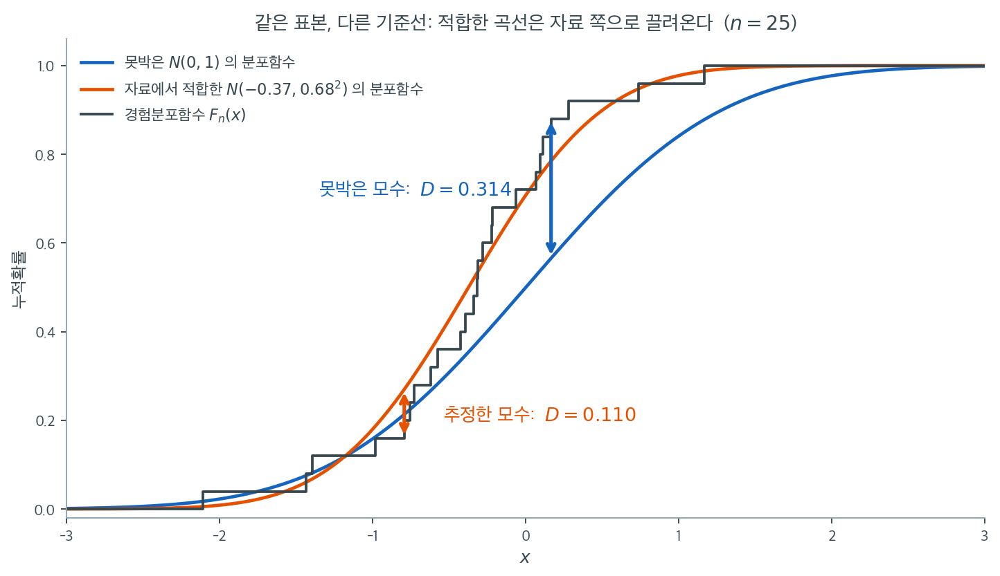

# Kolmogorov-Smirnov 검정과 Lilliefors 검정

시각적 방법과 기술통계가 자료 분포에 대한 통찰을 주는 반면, 형식적 통계검정은 정규성을 평가하는 더 엄밀한 방법을 제공한다. 이 검정들은 관측된 자료가 기대되는 정규분포에서 유의하게 벗어나는지 평가하여 판단의 통계적 근거를 제공한다.

---

## 1. Kolmogorov-Smirnov 검정

**Kolmogorov-Smirnov(K-S) 검정**은 표본자료의 경험적 누적분포함수(ECDF)를 기준분포(여기서는 정규분포)의 누적분포함수(CDF)와 비교하는 비모수 검정이다. 두 분포의 중심위치와 전반적 모양(분산) 양쪽의 차이에 민감하다.

### 가설

- **귀무가설** ($H_0$): 자료가 지정한 분포(정규분포)를 따른다.
- **대립가설** ($H_1$): 자료가 지정한 분포를 따르지 않는다.

### K-S 검정통계량의 계산

Kolmogorov-Smirnov 검정통계량 $D$는 표본의 경험적 CDF와 기준분포의 CDF 사이의 최대 절대차로 계산한다. 절차는 다음과 같다.

1. **자료 정렬**: $X_1, X_2, \dots, X_n$을 오름차순으로 정렬하여 $X_{(1)} \leq X_{(2)} \leq \dots \leq X_{(n)}$을 얻는다.

2. **경험적 CDF 계산**: 정렬된 각 자료점 $X_{(i)}$에 대해 ECDF를 그 이하인 자료점의 비율로 정의한다.

    $$
    F_{\text{emp}}(X_{(i)}) = \frac{i}{n}
    $$

    여기서 $n$은 전체 표본크기이고 $i$는 자료점의 순위이다.

3. **이론적 CDF 계산**: $X_{(i)}$에서 평가한 정규분포의 이론적 CDF $F_{\text{norm}}(X_{(i)})$는

    $$
    F_{\text{norm}}(X_{(i)}) = \Phi\left( \frac{X_{(i)} - \mu}{\sigma} \right)
    $$

    여기서 $\Phi$는 표준정규 누적분포함수이고 $\mu$와 $\sigma$는 각각 표본평균과 표본표준편차이다.

4. **검정통계량 $D$**: K-S 검정통계량 $D$는 임의의 표본점에서 경험적 CDF와 이론적 CDF의 최대 절대차이다.

    $$
    D = \max_i \left| F_{\text{emp}}(X_{(i)}) - F_{\text{norm}}(X_{(i)}) \right|
    $$

    곧 $D$는 자료 범위에 걸쳐 두 CDF 사이의 가장 큰 수직 거리를 잰다.

!!! note "실제 구현은 양쪽 계단을 모두 본다"
    경험적 CDF는 각 자료점에서 뛰어오르는 계단함수이므로, 엄밀한 통계량은 각 점의 왼쪽 극한 $(i-1)/n$과 오른쪽 값 $i/n$ 모두에 대한 차이의 최댓값을 취한다. `scipy.stats.kstest`가 이 방식으로 계산한다.

### 판정 규칙

- $D$가 선택한 유의수준 $\alpha$의 임계값을 넘으면 $H_0$을 기각한다(자료가 정규분포를 따르지 않는다).
- $D$가 임계값보다 작으면 $H_0$을 기각하지 못한다(자료가 정규분포를 따를 수 있다).

K-S 검정은 분포의 중심위치와 모양의 차이를 탐지하는 데 효과적이다. 다만 Anderson-Darling 검정 같은 방법에 비해 꼬리에서의 이탈에는 덜 민감하다.

<div class="exbox" markdown>

**보기 1.** <span class="diff easy" title="쉬움"></span> KS 검정의 함정. 자료에서 추정한 평균과 표준편차로 표준화한 뒤 표준 KS 임계값을 쓰면 $D = 0.019034$, $p = 0.8548$이 나온다.

**(1)** $D$를 정의대로 손계산해 `kstest`의 값을 재현하시오. 계단의 위쪽 틈 $D^+$와 아래쪽 틈 $D^-$ 중 어느 쪽이 통계량이 되었는가. 표준화에 쓰인 `data.std()`는 어느 판본인가.

**(2)** 이 "검정"의 **실제 크기**를 모의실험으로 재시오. 명목 $0.05$가 얼마가 되는가. 정규 자료에서 $p$값이 균등분포를 따라야 하는데 실제로 어떤가.

</div>

??? success "풀이"

    **(1) $D^+$가 이겼고, 표준화는 `ddof=0`이다.** 정렬된 자료를 표준화한 $z_{(i)}$에 대해 경험분포함수는 $z_{(i)}$에서 $(i-1)/n$에서 $i/n$으로 뛰는 계단이므로, 두 방향의 틈을 따로 재야 한다.

    $$
    D^+ = \max_i\left(\frac{i}{n} - \Phi(z_{(i)})\right), \qquad
    D^- = \max_i\left(\Phi(z_{(i)}) - \frac{i-1}{n}\right), \qquad
    D = \max(D^+, D^-)
    $$

    이 표본에서 재면

    | 표준화 | $D^+$ | $D^-$ | $D = \max$ |
    |---|---|---|---|
    | `ddof=0` ($1/n$) | $0.0190341127$ | $0.0098858448$ | $\mathbf{0.0190341127}$ |
    | `ddof=1` ($1/(n-1)$) | $0.0191252945$ | $0.0098072163$ | $0.0191252945$ |

    이다. **위쪽 줄의 $D = 0.0190341127$이 `kstest`의 값과 열 자리까지 같다.** 코드가 쓴 `data.std()`의 기본값이 `ddof=0`이기 때문이다. 아래쪽 줄의 $0.0191252945$는 보기 2에서 릴리포스가 돌려주는 통계량과 정확히 같은 수인데, `statsmodels`의 `lilliefors`가 $1/(n-1)$짜리 표준편차로 표준화하기 때문이다. **두 검정의 통계량이 "거의 같다"고 하는 차이의 정체가 이것이고, 통계량의 차이는 자료가 아니라 `ddof` 하나다.**

    $D^+$가 $D^-$의 거의 두 배인 것은 이 표본에서 경험분포함수가 적합 정규분포함수보다 위로 더 멀리 벗어나는 자리가 있다는 뜻이다. 어느 쪽이 이기느냐 자체에는 특별한 의미가 없다.

    **(2) 명목 $0.05$가 실제로 $0.0005$다. 백 분의 일이다.** 진짜 표준정규 자료에 같은 절차를 4000번 적용하면

    | 명목 수준 | 실제 기각률 |
    |---|---|
    | $0.05$ | $0.00050$ (4000번 중 2번) |
    | $0.10$ | $0.00150$ (6번) |
    | $0.20$ | $0.00725$ (29번) |

    이다. 어느 수준에서도 **두 자릿수**로 작다. $p$값의 평균은 $0.7869$로, 귀무가설이 참일 때 $p$가 $[0,1]$에 균등해야 한다는 것(평균 $0.5$)과 전혀 다르다. 더 결정적인 것은 4000번 가운데 **가장 작은 $p$값이 $0.0408$**이라는 사실이다. 곧 이 절차는 명목 $0.01$에서 아무리 뽑아도 **단 한 번도** 기각하지 못한다.

    까닭은 쪽 위에서 본 대로다. 표준화가 경험분포함수를 기준 곡선 쪽으로 끌어당기므로 $D$가 체계적으로 작아지는데, `kstest`는 그 사실을 모르고 **모수를 알고 있을 때의** 귀무분포로 $p$값을 계산한다. 작아진 통계량을 작아지지 않은 잣대로 재니 $p$값이 1 쪽으로 몰린다.

    **그러므로 $p = 0.855$는 자료에 대해 아무것도 말해 주지 않는다.** 자료가 어떻든 이 절차는 큰 $p$값을 내놓는다. 고쳐야 할 것은 통계량이 아니라 그것을 비교할 귀무분포이고, 보기 2에서 그 교정을 본다.

    ```python
    import numpy as np
    from scipy import stats

    np.random.seed(0)

    # 예시 자료를 만든다
    # data = np.random.normal(0, 1, 1000)
    data = np.random.normal(1, 10, 1000)

    # kstest 는 모수를 미리 알고 있다고 전제한다. 그래서 표준화해 N(0,1) 과
    # 견주는데, 그 평균과 표준편차를 자료에서 뽑아 썼다는 것이 함정이다.
    # 이러면 검정이 지나치게 너그러워져 p-값이 실제보다 크게 나온다.
    # 아래 Lilliefors 가 바로 이 문제를 고친 검정이다.
    data_ks = (data - data.mean()) / data.std()

    stat, p_value = stats.kstest(data_ks, 'norm')
    print(f"Kolmogorov-Smirnov Test: Statistic={stat}, p-value={p_value}")

    alpha = 0.05
    if p_value <= alpha:
        print("Reject H_0: The data is not normally distributed.")
    else:
        print("Fail to reject H_0: The data is normally distributed.")
    ```

    출력:

    ```text
    Kolmogorov-Smirnov Test: Statistic=0.01903411267034605, p-value=0.8547733408587939
    Fail to reject H_0: The data is normally distributed.
    ```

    손계산과 실제 크기를 함께 확인한다.

    ```python
    import numpy as np
    from scipy import stats

    np.random.seed(0)
    data = np.random.normal(1, 10, 1000)
    n = data.size

    # 정의대로 D 를 손계산한다. 계단의 양쪽을 모두 본다.
    def D_of(x, ddof):
        z = np.sort((x - x.mean()) / x.std(ddof=ddof))
        F = stats.norm.cdf(z)
        i = np.arange(1, len(z) + 1)
        d_plus = np.max(i / len(z) - F)
        d_minus = np.max(F - (i - 1) / len(z))
        return max(d_plus, d_minus), d_plus, d_minus

    D0, dp0, dm0 = D_of(data, 0)
    D1, dp1, dm1 = D_of(data, 1)
    print(f"ddof=0:  D+ = {dp0:.10f},  D- = {dm0:.10f},  D = {D0:.10f}")
    print(f"ddof=1:  D+ = {dp1:.10f},  D- = {dm1:.10f},  D = {D1:.10f}")

    data_ks = (data - data.mean()) / data.std()
    print(f"\nkstest   D = {stats.kstest(data_ks, 'norm')[0]:.10f}")

    # 이 "검정" 의 실제 크기를 재 본다.
    rng = np.random.default_rng(7)
    R = 4000
    ps = np.array([stats.kstest((lambda x: (x - x.mean()) / x.std())(
        rng.standard_normal(n)), 'norm')[1] for _ in range(R)])
    for a in (0.05, 0.10, 0.20):
        print(f"명목 {a:.2f}: 실제 기각률 = {np.mean(ps < a):.5f}"
              f"  ({np.sum(ps < a)}/{R})")
    print(f"\np 값의 평균 = {ps.mean():.4f}  (균등이면 0.5),  최솟값 = {ps.min():.4f}")
    ```

    출력:

    ```text
    ddof=0:  D+ = 0.0190341127,  D- = 0.0098858448,  D = 0.0190341127
    ddof=1:  D+ = 0.0191252945,  D- = 0.0098072163,  D = 0.0191252945

    kstest   D = 0.0190341127
    명목 0.05: 실제 기각률 = 0.00050  (2/4000)
    명목 0.10: 실제 기각률 = 0.00150  (6/4000)
    명목 0.20: 실제 기각률 = 0.00725  (29/4000)

    p 값의 평균 = 0.7869  (균등이면 0.5),  최솟값 = 0.0408
    ```

    손계산한 $D$가 `kstest`의 값과 열 자리까지 같고, 모의실험이 쪽 위의 "보수적이 된다"는 서술을 **백 배**라는 수로 바꾸어 준다. $\square$

!!! warning "이 코드는 사실 타당한 K-S 검정이 아니다"
    위 코드는 **자료에서 추정한** 평균과 표준편차로 자료를 표준화한 뒤 표준 K-S 임계값을 쓴다. 표준화가 경험적 CDF를 이론적 CDF 쪽으로 인위적으로 끌어당기므로 $D$가 작아지고 $p$값이 지나치게 커진다. 곧 검정이 보수적이 되어 검정력을 잃는다. 이것이 바로 다음 절의 Lilliefors 검정이 필요한 이유이다.

### 끌어당긴다는 말의 뜻

"인위적으로 끌어당긴다"는 표현은 비유가 아니라 그림으로 그릴 수 있는 사실이다. 아래는 $N(0,1)$에서 뽑은 $n = 25$짜리 표본 하나다. 검은 계단이 경험분포함수이고, 파란 곡선은 모수를 $N(0,1)$로 못박았을 때의 기준선, 주황 곡선은 같은 자료에서 추정한 $\hat\mu = -0.37$, $\hat\sigma = 0.68$을 꽂아 넣은 기준선이다.



이 표본은 우연히 평균이 $-0.37$로 왼쪽에 치우치고 표준편차도 $0.68$로 좁게 나왔다. 그러니 못박은 $N(0,1)$과는 잘 맞지 않아 최대 틈이 $D = 0.314$나 된다. 그런데 모수를 자료에서 다시 추정하면 주황 곡선이 계단을 따라 왼쪽으로 이동하고 동시에 가팔라져서, 같은 자료인데도 최대 틈이 $D = 0.110$으로 3분의 1토막이 난다. 자료에 맞춰 기준선을 움직였으니 당연한 결과다.

이것은 이 표본만의 운이 아니다. $N(0,1)$에서 $n = 25$짜리 표본을 40000번 뽑아 두 $D$의 평균을 재면 못박았을 때 $0.167$, 추정했을 때 $0.120$이다. 평균적으로 **28% 줄어든다**. 그런데 `stats.kstest`가 돌려주는 $p$값은 못박은 경우의 분포를 기준으로 계산된다. 줄어든 $D$를 줄어들지 않은 잣대로 재니 $p$값이 부풀 수밖에 없다.

그래서 위 코드의 $p = 0.855$는 "자료가 정규와 잘 맞는다"는 증거로 읽어서는 안 된다. 자료가 어떻든 저 코드는 큰 $p$값을 잘 내놓는다. 고쳐야 할 것은 통계량이 아니라 그것을 비교할 **기준분포**이며, 바로 그 일을 하는 것이 다음 절의 Lilliefors 검정이다.

---

## 2. Kolmogorov-Smirnov 검정과 Lilliefors 검정

SciPy의 `stats.kstest` 함수는 **Kolmogorov-Smirnov(K-S) 검정**을 수행하며 **Lilliefors 검정**이 아니다. 두 검정의 차이는 다음과 같다.

### Kolmogorov-Smirnov 검정 (`stats.kstest`)

- **목적**: 일반적인 **적합도 검정**으로, 표본을 **모수가 고정된** 알려진 분포와 비교한다.
- **모수 가정**: 분포의 모수(예: 평균, 표준편차)를 **사전에 안다**고 가정한다.
- **용도**: 미리 정해진 모수를 가진 특정 분포에 자료가 맞는지 보고 싶을 때 적절하다.

### Lilliefors 검정 (`statsmodels.stats.diagnostic.lilliefors`)

- **목적**: 모집단 모수(평균과 표준편차)가 **미지이고 표본에서 추정될 때**의 **정규성 검정**을 위해 K-S를 수정한 것이다.
- **모수 가정**: 모수를 표본에서 추정한다는 사실을 조정하여 이 상황에 맞춘 다른 임계값을 제공한다.
- **제공처**: SciPy에는 없고 `statsmodels`가 제공한다.

### 비교

| 항목 | `stats.kstest` (K-S 검정) | Lilliefors 검정 |
|---------------------------|--------------------------------------------------|-------------------------------------------------|
| **목적** | 일반적 적합도(임의의 분포) | 모수가 미지일 때의 정규성 검정 |
| **모수 지식** | 모수를 안다고 가정 | 모수를 모른다고 가정 |
| **모수 추정** | 추정된 모수를 위해 설계되지 않음 | 추정된 모수에 맞게 조정됨 |
| **SciPy 구현** | 있음 (`stats.kstest`) | SciPy에는 직접 구현 없음 |

<div class="exbox" markdown>

**보기 2.** <span class="diff easy" title="쉬움"></span> KS와 Lilliefors 견주기. 같은 자료에 두 검정을 나란히 돌리면 통계량은 $0.01903$ 대 $0.01913$으로 거의 같은데 $p$값은 $0.855$ 대 $0.582$로 갈린다.

**(1)** 통계량의 차이 $0.0001$은 어디서 오는가. **릴리포스의 통계량을 `kstest`의 귀무분포로 읽으면** $p$값이 얼마가 되는가. 그 수를 보면 $p$값의 차이가 통계량에서 오는 것인지 귀무분포에서 오는 것인지 가려진다.

**(2)** 릴리포스는 보기 1에서 본 왜곡을 얼마나 바로잡는가. $n = 50,\ 200,\ 1000$에서 두 절차의 실제 크기를 재어 명목값과 나란히 적으시오.

</div>

??? success "풀이"

    **(1) 통계량의 차이는 `ddof` 하나이고, $p$값의 차이는 전부 귀무분포에서 온다.** 보기 1에서 이미 확인했듯이

    $$
    \text{`kstest` 쪽}: \ \texttt{data.std(ddof=0)}, \qquad
    \text{`lilliefors` 쪽}: \ \texttt{data.std(ddof=1)}
    $$

    이고, 자료를 `ddof=1`로 표준화해 `kstest`에 넣으면 통계량이 $0.019125294462$가 되어 **릴리포스의 값과 소수 열두째 자리까지 같다.** 두 검정은 같은 통계량을 쓴다. 차이는 그것을 표준화할 때 분모에 $n$을 쓰느냐 $n-1$을 쓰느냐뿐이고, 그 차이는 $0.5\%$다.

    결정적인 수는 세 번째 줄이다. **같은 통계량 $0.019125$**를

    | 읽는 방식 | $p$값 |
    |---|---|
    | 릴리포스의 귀무분포 | $0.5818$ |
    | `kstest`의 귀무분포(모수를 안다고 가정) | $0.8508$ |

    로 읽으면 $0.582$와 $0.851$이 나온다. 본문의 $0.855$와 $0.582$ 차이 가운데 통계량의 몫은 $0.855 - 0.851 = 0.004$에 지나지 않고, **나머지 $0.269$가 전부 귀무분포의 몫이다.** 곧 "통계량은 거의 같은데 $p$값이 갈린다"는 서술은 정확하며, 갈리는 까닭은 **같은 수를 다른 잣대로 재기 때문**이다. 모수를 추정했다면 추정했을 때의 잣대를 써야 한다.

    **(2) KS는 끝까지 무너지고 릴리포스는 대체로 명목을 지킨다.** 진짜 표준정규 자료에서 2000번씩 재면

    | $n$ | 명목 $0.05$ — 릴리포스 | 명목 $0.05$ — KS | 명목 $0.10$ — 릴리포스 | 명목 $0.10$ — KS |
    |---|---|---|---|---|
    | 50 | $0.0540$ | $0.0000$ | $0.1080$ | $0.0005$ |
    | 200 | $0.0470$ | $0.0000$ | $0.0970$ | $0.0010$ |
    | 1000 | $0.0365$ | $0.0000$ | $0.0745$ | $0.0020$ |

    몬테카를로 표준오차는 $0.05$에서 $0.0049$, $0.10$에서 $0.0067$이다.

    **KS 쪽은 세 표본크기 모두에서 사실상 0이다.** 2000번 뽑아 명목 $0.05$에서 한 번도 기각하지 못한다. 표본을 키워도 나아지지 않는다는 점이 중요하다. 이것은 수렴이 느린 문제가 아니라 **잘못된 귀무분포를 쓰는 문제**라서 $n$으로 고쳐지지 않는다.

    **릴리포스 쪽은 $n = 50$에서 $0.0540$, $n = 200$에서 $0.0470$으로 명목 $0.05$를 몬테카를로 오차 안에서 지킨다.** 교정이 제 일을 한다. 다만 $n = 1000$에서는 $0.0365$로 명목보다 $27\%$ 작고, 이는 몬테카를로 표준오차의 $2.8$배이므로 잡음이 아니다. 명목 $0.10$에서도 $0.0745$로 같은 방향이다. `statsmodels`의 `lilliefors`가 기본으로 쓰는 $p$값 근사표가 큰 $n$에서 다소 보수적이라는 뜻이다. **"교정했으니 완벽하다"가 아니라 "교정하면 두 자릿수 왜곡이 수십 퍼센트 왜곡으로 줄어든다"가 정직한 요약이다.**

    ```python
    import numpy as np
    from scipy import stats
    from statsmodels.stats.diagnostic import lilliefors

    np.random.seed(0)

    # 예시 자료를 만든다
    # data = np.random.normal(0, 1, 1000)
    data = np.random.normal(1, 10, 1000)

    data_ks = (data - data.mean()) / data.std()

    # 같은 자료에 두 검정을 나란히 돌린다. 통계량은 거의 같은데 p-값이 갈린다.
    stat, p_value = stats.kstest(data_ks, 'norm')
    print(f"Kolmogorov-Smirnov Test: Statistic={stat}, p-value={p_value}")

    # Lilliefors 는 모수를 자료에서 추정했다는 사실을 셈에 넣은 기각값을 쓴다.
    # 그래서 같은 통계량에도 더 작은 p-값을 준다. 모수를 추정했다면 이쪽이 맞다.
    stat, p_value = lilliefors(data)
    print(f"Lilliefors Test: Statistic={stat}, p-value={p_value}")

    # 결과 해석
    alpha = 0.05
    if p_value <= alpha:
        print("Reject H_0: The data is not normally distributed.")
    else:
        print("Fail to reject H_0: The data is normally distributed.")
    ```

    출력:

    ```text
    Kolmogorov-Smirnov Test: Statistic=0.01903411267034605, p-value=0.8547733408587939
    Lilliefors Test: Statistic=0.019125294462402076, p-value=0.5818164701330186
    Fail to reject H_0: The data is normally distributed.
    ```

    통계량의 출처와 두 절차의 실제 크기를 함께 확인한다.

    ```python
    import numpy as np
    from scipy import stats
    from statsmodels.stats.diagnostic import lilliefors

    np.random.seed(0)
    data = np.random.normal(1, 10, 1000)

    z0 = (data - data.mean()) / data.std(ddof=0)
    z1 = (data - data.mean()) / data.std(ddof=1)
    print(f"ddof=0 으로 표준화한 KS 통계량 = {stats.kstest(z0, 'norm')[0]:.12f}")
    print(f"ddof=1 으로 표준화한 KS 통계량 = {stats.kstest(z1, 'norm')[0]:.12f}")
    print(f"lilliefors 의 통계량           = {lilliefors(data)[0]:.12f}")
    print(f"\n같은 통계량에 붙는 두 p 값")
    print(f"  kstest     p = {stats.kstest(z0, 'norm')[1]:.6f}")
    print(f"  lilliefors p = {lilliefors(data)[1]:.6f}")
    print(f"  ddof=1 통계량을 kstest 의 귀무분포로 읽으면 p = {stats.kstest(z1, 'norm')[1]:.6f}")

    # 릴리포스가 실제 크기를 얼마나 바로잡는가
    rng = np.random.default_rng(1234)
    R = 2000
    print(f"\n정규 자료에서의 실제 기각률 (R = {R})")
    for n in (50, 200, 1000):
        pl = np.array([lilliefors(rng.standard_normal(n))[1] for _ in range(R)])
        pk = np.array([stats.kstest((lambda x: (x - x.mean()) / x.std())(
            rng.standard_normal(n)), 'norm')[1] for _ in range(R)])
        print(f"{n:>6}  릴리포스 {np.mean(pl < 0.05):.4f}  KS {np.mean(pk < 0.05):.4f}"
              f"   |  릴리포스 {np.mean(pl < 0.10):.4f}  KS {np.mean(pk < 0.10):.4f}")
    print(f"\n몬테카를로 표준오차: 0.05 에서 {np.sqrt(0.05 * 0.95 / R):.4f},"
          f"  0.10 에서 {np.sqrt(0.10 * 0.90 / R):.4f}")
    ```

    출력:

    ```text
    ddof=0 으로 표준화한 KS 통계량 = 0.019034112670
    ddof=1 으로 표준화한 KS 통계량 = 0.019125294462
    lilliefors 의 통계량           = 0.019125294462

    같은 통계량에 붙는 두 p 값
      kstest     p = 0.854773
      lilliefors p = 0.581816
      ddof=1 통계량을 kstest 의 귀무분포로 읽으면 p = 0.850822

    정규 자료에서의 실제 기각률 (R = 2000)
        50  릴리포스 0.0540  KS 0.0000   |  릴리포스 0.1080  KS 0.0005
       200  릴리포스 0.0470  KS 0.0000   |  릴리포스 0.0970  KS 0.0010
      1000  릴리포스 0.0365  KS 0.0000   |  릴리포스 0.0745  KS 0.0020

    몬테카를로 표준오차: 0.05 에서 0.0049,  0.10 에서 0.0067
    ```

    릴리포스의 통계량이 `ddof=1`짜리 KS 통계량과 열두 자리까지 같음이 확인되고, 같은 통계량이 두 귀무분포에서 $0.582$와 $0.851$이라는 서로 다른 $p$값을 받는다. 본문이 "자료가 정규가 아니라면 릴리포스 쪽이 훨씬 먼저 잡아낸다"고 적은 것의 근거가 아래 표다. **KS 쪽은 애초에 기각하는 일이 거의 없으므로, 먼저 잡아내는 것이 아니라 KS가 끝내 잡아내지 못하는 것이다.** $\square$

---

## 3. 어느 검정을 고를 것인가

### `stats.kstest`(Kolmogorov-Smirnov 검정)를 고를 때

- **용도**: **모수가 고정된** 알려진 이론적 분포와 표본을 비교하는 일반적 적합도 검정.
- **유연성**: 분포의 모수를 미리 지정하기만 하면 어떤 분포(정규, 지수 등)에 대해서도 검정할 수 있다.
- **장점**: 정규성을 넘어 다양한 이론적 분포와 경험적 자료를 비교하는 데 폭넓게 적용된다.
- **한계**: 추정된 모수로 정규성 검정에 쓰면 부정확하다. 모수 추정을 조정하지 않기 때문이다.

### `statsmodels.stats.diagnostic.lilliefors`(Lilliefors 검정)를 고를 때

- **용도**: 분포의 모수가 **미지이고 표본에서 추정될 때**의 **정규성 검정**을 위해 특별히 설계되었다.
- **유연성**: 정규성 검정에 한정되지만 그 맥락에서는 매우 정확하다.
- **장점**: 모수를 추정하는 상황에서 정규성 검정을 더 정확하게 수행한다.
- **한계**: 정규성 검정에 한정되며 다른 분포의 검정에는 쓸 수 없다.

### 권장 사항

- **일반적인 분포 검정**(예: 모수가 고정된 지수분포나 와이불분포에 자료가 맞는지 확인)에는 **`stats.kstest`**가 낫다.
- **모수가 미지인 정규성 검정**에는 모수 추정 과정을 반영하여 더 정확하게 평가하는 **`statsmodels`의 `lilliefors`**가 선호된다.

---

## 연습문제

<div class="drillbox" markdown>

**연습문제 1.** <span class="diff easy" title="쉬움"></span>
관측값 $n = 30$개에 대한 Lilliefors 검정에서 $D_n = 0.14$를 얻었다. $\alpha = 0.05$의 임계값은 $0.161$이다. 결론은 무엇인가?

</div>

??? success "풀이"
    $D_n = 0.14 < 0.161$이므로 $\alpha = 0.05$에서 $H_0$을 기각하지 못한다. Lilliefors 검정에 따르면 자료가 정규성과 일관된다.

    (참고로 이 임계값은 잘 알려진 근사식 $0.886/\sqrt{n} = 0.886/\sqrt{30} = 0.1618$과 일치한다.)

    다만 $n = 30$이면 검정력이 제한적이다. 특히 가벼운 두꺼운 꼬리 같은 미묘한 대립가설에 대해 그렇다. 기각하지 못했다는 것이 정규성을 증명하지는 않으며, 표본크기가 부족했음을 반영할 뿐일 수 있다. Q-Q 그림을 함께 보면 이탈의 성격과 정도에 대한 추가적인 시각적 증거를 얻을 수 있다.

---

<div class="drillbox" markdown>

**연습문제 2.** <span class="diff med" title="중간"></span>
Kolmogorov-Smirnov 검정과 Lilliefors 검정의 차이를 설명하라. KS 대신 Lilliefors를 반드시 써야 하는 경우는 언제인가?

</div>

??? success "풀이"
    **Kolmogorov-Smirnov 검정**은 경험적 CDF를 완전히 지정된 이론적 CDF(모든 모수를 앎)와 비교한다. 예를 들어 자료가 정확히 $N(0, 1)$에서 왔는지 검정하는 경우이다.

    **Lilliefors 검정**은 모수를 자료에서 추정하는 복합가설을 위한 수정이다. 정규성 검정에서는 보통 자료에서 $\mu$와 $\sigma$를 추정한 뒤 $N(\hat{\mu}, \hat{\sigma}^2)$과 비교한다.

    검정 대상과 같은 자료에서 모수를 추정하는 경우에는 반드시 KS가 아니라 Lilliefors를 써야 한다. 추정된 모수로 KS 임계값을 쓰는 것은 타당하지 않다. 모수를 추정하면 경험적 CDF가 이론적 CDF에 더 가까워지므로(적합이 최적화되므로) KS의 $p$값이 지나치게 커지고(보수적이 되고) 검정력을 잃는다.

---

<div class="drillbox" markdown>

**연습문제 3.** <span class="diff med" title="중간"></span>
KS 검정통계량은 $D_n = \sup_x |F_n(x) - F_0(x)|$이다. 이것이 기하학적으로 무엇을 재는지 설명하라.

</div>

??? success "풀이"
    $D_n$은 모든 $x$에 걸쳐 경험적 CDF(계단함수)와 이론적 CDF(매끄러운 곡선)의 최대 수직 거리이다. 기하학적으로는 두 곡선 사이의 가장 큰 틈이다.

    자료가 $F_0$에서 왔다면 Glivenko-Cantelli 정리에 의해 경험적 CDF가 이론적 CDF를 가깝게 따라가므로 $D_n$이 작아야 한다. $D_n$이 크다는 것은 분포의 어느 지점에서 관측 자료가 이론적 분포의 예측에서 크게 벗어난다는 뜻이다. 어떤 구역에 관측값이 너무 많거나 너무 적다는 것이다.

---

<div class="drillbox" markdown>

**연습문제 4.** <span class="diff med" title="중간"></span>
비정규성 탐지에서 KS/Lilliefors 검정이 Shapiro-Wilk나 Anderson-Darling 검정보다 대체로 검정력이 낮은 이유는 무엇인가?

</div>

??? success "풀이"
    KS 검정은 최대 편차 $D_n$만 쓴다. 이는 최악의 불일치를 하나의 수치로 요약한 것이며 두 가지 단점이 있다.

    1. **꼬리 가중이 없다:** KS 검정은 (자료가 빽빽한) 분포 중앙의 이탈과 (정규성에 더 중요한) 꼬리의 이탈을 똑같이 다룬다. Anderson-Darling 검정은 꼬리의 이탈에 더 큰 가중치를 준다.

    2. **한 점에만 초점:** 상한만 쓰므로 KS는 이탈의 패턴을 무시한다. Shapiro-Wilk 검정은 상관 기반 계산에 모든 순서통계량을 써서 자료에서 더 많은 정보를 뽑아낸다.

    KS 검정은 (임의의 분포에 대한) 일반적 적합도 검정으로 설계되었지 정규성 전용이 아니다. Shapiro-Wilk 같은 특화된 검정은 정규분포의 구조를 활용한다.

---

<div class="drillbox" markdown>

**연습문제 5.** <span class="diff med" title="중간"></span>
연습문제 1 의 상황($n = 30$, $D_n = 0.14$)을 다시 본다. $\alpha = 0.05$ 의 큰 표본 임계값은 릴리포스가 $0.886/\sqrt{n}$ 이고, 모수를 미리 안다고 전제하는 표준 KS 가 $1.36/\sqrt{n}$ 이다.

**(1)** $n = 30$ 에서 두 임계값을 구하고, 같은 $D_n$ 을 놓고 두 절차의 결론이 갈리는 $D_n$ 의 구간을 적으시오.

**(2)** $D_n = 0.14$ 는 그 구간의 어디에 놓이는가. 두 임계값에 각각 닿으려면 $D_n$ 이 몇 퍼센트 커져야 하는가.

**(3)** 두 임계값의 비는 $n$ 에 어떻게 의존하는가. 그 답이 "표본을 키우면 추정한 모수로 KS 를 쓰는 잘못이 저절로 씻긴다"는 기대에 대해 무엇을 말하는가. 보기 2 의 표와 견주시오.

</div>

??? success "풀이"
    **(1) 갈리는 구간은 $0.1618 \le D_n < 0.2483$ 이다.**

    $$
    \frac{0.886}{\sqrt{30}} = \frac{0.886}{5.4772} = 0.16176, \qquad
    \frac{1.36}{\sqrt{30}} = \frac{1.36}{5.4772} = 0.24830
    $$

    이므로 $D_n$ 이 $0.16176$ 이상이고 $0.24830$ 미만이면 **릴리포스는 기각하고 KS 는 기각하지 못한다.** 폭이 $0.0865$ 로, 릴리포스 임계값의 절반이 넘는 넓은 구간이다. $D_n < 0.16176$ 이면 둘 다 기각하지 못하고, $D_n \ge 0.24830$ 이면 둘 다 기각한다. 두 절차가 어긋나는 방향은 언제나 한쪽뿐이다. KS 가 기각하는데 릴리포스가 못 하는 일은 임계값의 크기 관계 때문에 결코 일어나지 않는다.

    **(2) $0.14$ 는 갈리는 구간의 **아래쪽**에 있어 두 절차 모두 기각하지 못한다.** 닿기까지 필요한 증가량은

    $$
    \frac{0.16176 - 0.14}{0.14} = 15.5\%, \qquad
    \frac{0.24830 - 0.14}{0.14} = 77.4\%
    $$

    이다. 곧 연습문제 1 의 결론("기각하지 못한다")은 두 잣대 어느 쪽을 써도 같지만, $D_n$ 이 $15.5\%$만 커지면 두 절차의 결론이 갈리기 시작한다. 이 자료는 판정이 뒤집히는 경계에서 그리 멀지 않다.

    **(3) 비는 $n$ 과 무관하게 언제나 $1.36/0.886 = 1.535$ 다.** 두 임계값이 모두 $n^{-1/2}$ 로 줄어들기 때문에 비는 상수로 남는다. 따라서 **잘못된 잣대는 표본크기와 무관하게 늘 $53.5\%$ 만큼 너무 크다.** 게다가 본문에서 본 대로 모수를 추정하면 통계량 자체가 작아지므로($n = 25$ 에서 평균 $0.167 \to 0.120$, 곧 $28\%$ 감소) 두 효과가 같은 방향으로 겹친다.

    이것이 보기 2 의 표에서 KS 쪽 기각률이 $n = 50,\ 200,\ 1000$ 에서 모두 $0.0000$ 인 까닭이다. 수렴이 느린 문제라면 $n$ 을 키울 때 나아져야 하지만, 비가 상수인 문제는 $n$ 으로 고쳐지지 않는다.

---

<div class="drillbox" markdown>

**연습문제 6.** <span class="diff med" title="중간"></span>
보기 1 **(2)** 의 모의실험은 $n = 1000$ 짜리 진짜 정규 자료 4000 개에 표준화 후 `kstest` 절차를 적용해 $p$ 값의 평균 $0.7869$, 최솟값 $0.0408$, 그리고 명목 $0.05,\ 0.10,\ 0.20$ 에서 실제 기각률 $0.00050,\ 0.00150,\ 0.00725$ 를 얻었다.

**(1)** 타당한 검정이라면 $H_0$ 아래에서 $p$ 값이 $[0,1]$ 에 균등하다. 이 사실과 위 세 수만 써서, 이 절차의 $p$ 값 분포의 $5\%$ 분위수에 대해 말할 수 있는 것을 구하시오. 곧 실제 크기를 $0.05$ 로 맞추려면 "$p < 0.05$ 일 때 기각" 을 어떤 문턱으로 바꿔야 하는가.

**(2)** 그런 문턱 바꾸기(곧 $p$ 값의 단조 재조정)만으로 이 절차를 타당하게 만들 수 있는가. 만들 수 있다면 그 재조정은 무엇에 의존하는가.

**(3)** 재조정해 얻은 검정은 모수를 **알고 있을 때**의 KS 보다 검정력이 높은가 낮은가. 왜 그런가.

</div>

??? success "풀이"
    **(1) 그 분위수는 $0.20$ 보다 크다. 곧 문턱을 $0.20$ 보다 큰 값으로 올려야 한다.** 이 절차가 내놓는 $p$ 값의 분포함수를 $G$ 라 하면 모의실험이 준 세 수는 바로 $G$ 의 값이다.

    $$
    G(0.05) = 0.00050, \qquad G(0.10) = 0.00150, \qquad G(0.20) = 0.00725
    $$

    타당한 검정이라면 $G(a) = a$ 여야 하는데 세 자리 모두 $a$ 보다 두 자릿수 작다. 우리가 찾는 문턱 $c$ 는 $G(c) = 0.05$ 를 만족하는 수이고, $G$ 가 비감소이며 $G(0.20) = 0.00725 < 0.05$ 이므로 $c > 0.20$ 이다. 모의실험이 그보다 큰 명목값을 기록하지 않았으니 세 수만으로는 이 하한이 말할 수 있는 전부다. $p$ 값의 평균이 $0.7869$(균등이면 $0.5$)라는 것도 분포가 $1$ 쪽으로 몰려 있다는 같은 사실의 다른 표현이다.

    **(2) 할 수 있다. 다만 재조정은 $n$ 과 추정 방식에 의존하므로 단 하나의 보정표로 끝나지 않는다.** $G$ 가 연속이면 확률적분변환에 의해

    $$
    p^{*} = G(p) \sim \text{Uniform}(0,1)
    $$

    이므로 $p^{*}$ 를 쓰는 검정은 정확히 명목 크기를 지킨다. 그런데 $G$ 는 통계량 $D$ 의 귀무분포에서 나오고, 그 귀무분포는 표본크기 $n$ 에 따라 다르며(임계값이 $0.886/\sqrt{n}$ 꼴인 것이 그 흔적이다) 어떤 모수를 몇 개 추정했는지, 심지어 표준편차를 `ddof=0` 으로 쓰는지 `ddof=1` 로 쓰는지에도 걸린다. $n$ 마다 보정표를 따로 갖추어야 한다는 뜻이고, **그 표를 갖춘 것이 바로 릴리포스 검정이다.** 보기 2 에서 두 검정의 통계량이 소수 열두째 자리까지 같았던 것이 이 사실의 증거다. 고칠 것은 통계량이 아니라 잣대뿐이었다.

    **(3) 낮다.** 재조정은 크기를 바로잡아 주지만 잃어버린 신호를 돌려주지는 못한다. 모수를 추정하면 기준 곡선이 자료를 따라 움직이므로 $D$ 의 분포 전체가 왼쪽으로 밀린다($n = 25$ 에서 평균 $0.167 \to 0.120$). 귀무분포와 대립분포가 **함께** 왼쪽으로 밀리므로 둘을 가르는 여유가 줄어든다. 이것은 절차의 흠이 아니라 치른 값이다. $\mu$ 와 $\sigma$ 를 자료에서 뽑아 쓰는 데 자유도 두 개를 썼으므로 그만큼 남는 정보가 줄어든다.

    같은 말을 가설의 언어로 하면 이렇다. 모수를 알 때의 귀무가설은 "자료가 $N(0,1)$ 이다" 라는 **단순가설**이고, 릴리포스의 귀무가설은 "자료가 어떤 정규분포를 따른다" 라는 **복합가설**이다. 뒤쪽이 더 약한 주장이므로 기각하기가 더 어렵다.

---

<div class="drillbox" markdown>

**연습문제 7.** <span class="diff hard" title="어려움"></span>
보기 1 의 풀이에 나온 정의

$$
D^{+} = \max_i\left(\frac{i}{n} - \Phi(z_{(i)})\right), \qquad
D^{-} = \max_i\left(\Phi(z_{(i)}) - \frac{i-1}{n}\right), \qquad
D = \max(D^{+}, D^{-})
$$

를 쓴다. 자료에 같은 값이 없다고 하자.

**(1)** 어떤 표본에서도 $D \ge 1/(2n)$ 임을 보이시오.

**(2)** $n = 1000$ 에서 이 바닥값은 얼마인가. 보기 1 의 `ddof=0` 줄에 적힌 $D^{+} = 0.0190341127$, $D^{-} = 0.0098858448$ 이 (1) 의 증명에 쓰인 부등식을 어떤 여유로 만족하는지 수로 확인하시오.

**(3)** 등호 $D = 1/(2n)$ 는 어떤 표본에서 일어나는가. 그리고 이 바닥값 때문에 $n$ 이 작을 때 검정이 저절로 기각하게 되는 일이 있는가. 릴리포스 임계값 $0.886/\sqrt{n}$ 과 견주어 답하시오.

</div>

??? success "풀이"
    **(1)** 아무 $i$ 하나를 잡고 $F_i = \Phi(z_{(i)})$ 라 쓰자. 두 틈을 더하면 $F_i$ 가 지워진다.

    $$
    \left(\frac{i}{n} - F_i\right) + \left(F_i - \frac{i-1}{n}\right) = \frac{i}{n} - \frac{i-1}{n} = \frac{1}{n}
    $$

    두 수의 합이 $1/n$ 이면 둘 가운데 큰 쪽은 적어도 $1/(2n)$ 이다(둘 다 $1/(2n)$ 미만이면 합이 $1/n$ 미만이 되어 모순). 한편 $D^{+}$ 와 $D^{-}$ 는 각각 최댓값이므로

    $$
    D = \max(D^{+}, D^{-}) \ge \max\left(\frac{i}{n} - F_i,\ F_i - \frac{i-1}{n}\right) \ge \frac{1}{2n}
    $$

    이다. $\square$

    기하로 읽으면 이렇다. 경험분포함수는 각 자료점에서 $1/n$ 만큼 수직으로 뛰는데 기준 곡선은 연속이므로, 그 점에서 곡선은 계단의 아래쪽 값과 위쪽 값 사이 어딘가를 지난다. 뛰어오르는 높이 $1/n$ 을 양쪽으로 가장 공평하게 나누어도 한쪽 틈은 반인 $1/(2n)$ 이 된다. **$D$ 는 자료가 아무리 정규와 잘 맞아도 $0$ 이 될 수 없다.**

    **(2) 바닥값은 $1/2000 = 0.0005$ 이고, 실제 표본은 그보다 한참 위에 있다.** 두 틈의 합을 보면

    $$
    D^{+} + D^{-} = 0.0190341127 + 0.0098858448 = 0.0289199575
    $$

    인데 (1) 에서 쓴 부등식은 각 $i$ 에서의 합이 정확히 $1/n = 0.001$ 임을 말했다. 실제 합이 그보다 $28.9$ 배 큰 것은 $D^{+}$ 를 주는 $i$ 와 $D^{-}$ 를 주는 $i$ 가 서로 다른 자리이기 때문이다. 각 $i$ 에서의 합은 $1/n$ 으로 묶여 있지만 서로 다른 자리의 최댓값끼리 더한 것은 그 제약을 받지 않는다. 통계량 자체로 보면 $D = 0.0190341127$ 은 바닥값 $0.0005$ 의 $38.07$ 배다.

    **(3) 등호는 완벽하게 "정규처럼 생긴" 표본에서만 일어나고, 바닥값이 기각을 강요하는 일은 어떤 $n$ 에서도 없다.** 등호가 되려면 모든 $i$ 에서 양쪽 틈이 똑같이 $1/(2n)$ 이어야 하므로

    $$
    \Phi(z_{(i)}) = \frac{2i-1}{2n}, \qquad \text{곧} \qquad z_{(i)} = \Phi^{-1}\!\left(\frac{2i-1}{2n}\right) \quad (i = 1, \dots, n)
    $$

    이다. 표준화한 자료가 정규분위수에 정확히 놓인 배치, 곧 Q-Q 그림이 자 하나로 그린 직선이 되는 경우다. 실제 표본에는 뽑기의 요동이 있으니 $D$ 는 늘 이보다 크다.

    바닥값이 임계값을 넘는 일은 없다. $1/(2n) > 0.886/\sqrt{n}$ 을 풀면

    $$
    \sqrt{n} < \frac{1}{2 \times 0.886} = 0.5643, \qquad \text{곧} \qquad n < 0.3185
    $$

    이므로 $n \ge 1$ 인 어떤 표본크기에서도 성립하지 않는다. 더 중요한 것은 두 양이 줄어드는 속도다. **바닥값은 $1/n$ 으로, 임계값은 $1/\sqrt{n}$ 으로 줄어들므로 $n$ 이 커질수록 여유가 벌어진다.** 곧 경험분포함수의 이산성은 KS 계열 검정을 망치지 않는다.

---

<div class="drillbox" markdown>

**연습문제 8.** <span class="diff hard" title="어려움"></span>
"끌어당긴다는 말의 뜻" 절의 그림은 $N(0,1)$ 에서 뽑은 $n = 25$ 짜리 표본 하나로, 모수를 $N(0,1)$ 로 못박았을 때 $D = 0.314$, 같은 자료에서 $\hat\mu = -0.37$, $\hat\sigma = 0.68$ 을 추정해 꽂았을 때 $D = 0.110$ 이었다. $\alpha = 0.05$ 의 큰 표본 임계값은 못박은 KS 가 $1.36/\sqrt{n}$, 릴리포스가 $0.886/\sqrt{n}$ 이다.

**(1)** 통계량 두 가지와 귀무분포 두 가지를 짝지은 네 경우의 결론을 모두 적고, 넷 가운데 **타당한 둘**을 가리시오.

**(2)** 타당한 두 검정이 같은 자료에서 서로 다른 결론을 낸다. 이것이 모순이 아닌 까닭을 밝히고, 자료가 실제로 $N(0,1)$ 에서 나왔다는 사실까지 써서 두 결론을 각각 1종 오류와 옳은 판단으로 분류하시오.

**(3)** 못박은 검정은 $\alpha = 0.01$ 의 임계값 $1.63/\sqrt{n}$ 에서도 기각하는가. 그 답이 (2) 의 분류에 무엇을 더해 주는가.

</div>

??? success "풀이"
    **(1) 임계값은 $1.36/5 = 0.272$ 와 $0.886/5 = 0.1772$ 다.** 네 짝의 결론은 다음과 같다.

    | 통계량 | KS 귀무분포 (임계값 $0.272$) | 릴리포스 귀무분포 (임계값 $0.1772$) |
    |---|---|---|
    | 못박은 $D = 0.314$ | 기각 — **타당** | 기각 — 무효(잣대가 너무 느슨) |
    | 추정한 $D = 0.110$ | 기각 못함 — 무효(보기 1 의 오류) | 기각 못함 — **타당** |

    타당한 것은 **대각선의 두 칸**뿐이다. 통계량을 계산할 때 쓴 전제와 그것을 재는 귀무분포가 같아야 하기 때문이다. 모수를 못박고 잰 $D$ 는 못박은 귀무분포로, 추정해 잰 $D$ 는 추정을 셈에 넣은 귀무분포로 읽어야 한다.

    나머지 두 칸은 틀리는 방향이 서로 반대다. 오른쪽 위는 작아지지 않은 통계량을 작아진 자료용 잣대로 재니 **지나치게 쉽게 기각**하고, 왼쪽 아래는 작아진 통계량을 작아지지 않은 잣대로 재니 **거의 기각하지 못한다.** 보기 1 의 코드가 범한 잘못이 바로 왼쪽 아래 칸이고, 그래서 실제 크기가 $0.05$ 가 아니라 $0.0005$ 였다.

    **(2) 두 검정이 서로 다른 가설을 묻기 때문에 모순이 아니다.** 못박은 검정의 귀무가설은

    $$
    H_0: F = N(0,1)
    $$

    이라는 단순가설이고, 릴리포스의 귀무가설은

    $$
    H_0: F = N(\mu, \sigma^2) \ \text{인} \ (\mu, \sigma) \ \text{가 존재한다}
    $$

    라는 복합가설이다. 이 표본은 우연히 평균이 $-0.37$, 표준편차가 $0.68$ 로 나와 $(0, 1)$ 에서 꽤 떨어졌으므로 **위치와 척도까지 못박은 주장**은 깨진다. 그러나 모양 자체는 정규답기 때문에 **어떤 정규분포를 따른다**는 약한 주장은 깨지지 않는다. "$N(0,1)$ 을 기각한다" 는 "정규성을 기각한다" 가 아니다.

    자료가 실제로 $N(0,1)$ 에서 나왔다는 것을 알고 있으므로 분류는 이렇다.

    - 못박은 검정의 기각 — **1종 오류**. 귀무가설이 참인데 기각했다. 명목 $0.05$ 짜리 검정이니 스무 번에 한 번은 이런 표본이 나온다.
    - 릴리포스의 비기각 — **옳은 판단**. 귀무가설이 참이고 기각하지 않았다.

    **(3) $\alpha = 0.01$ 에서는 기각하지 못한다.** 임계값이 $1.63/5 = 0.326$ 이고 $D = 0.314 < 0.326$ 이다. 그러니 이 표본은 "$5\%$ 수준에서는 유의하지만 $1\%$ 수준에서는 아니다" 라는 흔한 경계 사례이고, $p$ 값은 $0.01$ 과 $0.05$ 사이에 있다.

    이 사실이 (2) 의 분류에 보태 주는 것은 **1종 오류의 성격**이다. 자료가 정규성에서 벗어나서 기각된 것이 아니라 그저 조금 운이 없는 표본이어서 기각된 것이며, 그 정도는 수준을 $1\%$ 로 조이면 사라질 만큼이다. 같은 자료에 같은 $D$ 라는 자를 쓰더라도 무엇을 못박느냐가 통계량과 잣대를 **동시에** 바꾼다. 둘 중 하나만 바꿔 섞으면 검정은 크기뿐 아니라 결론의 방향까지 틀어진다.

---

<div class="drillbox" markdown>

**연습문제 9.** <span class="diff hard" title="어려움"></span>
참 분포함수 $G$ 가 $0.01 \le \Phi(x) \le 0.99$ 인 모든 $x$ 에서 $G(x) = \Phi(x)$ 와 같고, 바깥쪽 두 꼬리 영역 안에서만 정규와 다르다고 하자. 꼬리 영역 안의 질량을 옮겨 만드는데, 각 영역의 질량 $0.01$ 과 거기서의 1 차·2 차 적률은 그대로 두어 전체 평균 $0$ 과 분산 $1$ 이 유지되도록 한다. 모양은 꼬리에서 정규와 얼마든지 다를 수 있다.

**(1)** $\sup_x \lvert G(x) - \Phi(x) \rvert \le 0.01$ 임을 보이시오.

**(2)** 릴리포스 임계값 $0.886/\sqrt{n}$ 을 써서, 이 이탈을 $\alpha = 0.05$ 에서 잡아낼 가망이 **생기기라도 하려면** $n$ 이 적어도 얼마여야 하는지 구하시오.

**(3)** 앤더슨–달링 통계량은 적분에 가중 $1/\bigl(F(x)(1-F(x))\bigr)$ 을 준다. $F = 0.995$ 와 $F = 0.5$ 에서 이 가중을 견주고, 연습문제 4 의 "꼬리 가중이 없다" 는 말이 (2) 의 수와 어떻게 이어지는지 쓰시오.

</div>

??? success "풀이"
    **(1)** 영역을 셋으로 나눈다. $x_{0.01}$ 과 $x_{0.99}$ 를 $\Phi(x_{0.01}) = 0.01$, $\Phi(x_{0.99}) = 0.99$ 인 점이라 하자.

    - **가운데** $x_{0.01} \le x \le x_{0.99}$ 에서는 가정에 의해 $G(x) = \Phi(x)$ 이므로 차가 $0$ 이다.
    - **위쪽 꼬리** $x > x_{0.99}$ 에서는, 꼬리 영역의 질량을 보존했으므로 $G(x_{0.99}) = \Phi(x_{0.99}) = 0.99$ 이고 $G$ 는 비감소이므로 $G(x) \in [0.99, 1]$ 이다. 또 $\Phi(x) \in (0.99, 1]$ 이다. 길이 $0.01$ 짜리 구간 $[0.99, 1]$ 안의 두 수의 차는 $0.01$ 을 넘을 수 없다.
    - **아래쪽 꼬리** $x < x_{0.01}$ 에서는 같은 이유로 $G(x), \Phi(x) \in [0, 0.01]$ 이므로 차가 $0.01$ 을 넘지 않는다.

    세 영역을 합쳐 $\sup_x \lvert G(x) - \Phi(x) \rvert \le 0.01$ 이다. $\square$

    핵심은 **수직 거리의 상한이 꼬리 확률 자체로 묶인다**는 점이다. 꼬리에서 분포가 아무리 심하게 달라도 누적확률은 $0.99$ 와 $1$ 사이에 갇혀 있으니, 그 영역에서 두 분포함수가 벌어질 수 있는 최대폭이 $0.01$ 이다.

    **(2) $n \ge 7850$ 이어야 비로소 가망이 생긴다.** 평균이 $0$, 분산이 $1$ 로 보존되었으므로 $\hat\mu \to 0$, $\hat\sigma \to 1$ 이고, 적합한 정규 곡선은 $\Phi$ 로 수렴한다. 따라서 글리벤코–칸텔리(연습문제 3)에 의해

    $$
    D_n \longrightarrow \sup_x \lvert G(x) - \Phi(x) \rvert \le 0.01
    $$

    이다. 검정은 $D_n > 0.886/\sqrt{n}$ 일 때만 기각하므로, 임계값이 이 상한보다 작아야 한다는 것이 최소 조건이다.

    $$
    \frac{0.886}{\sqrt{n}} < 0.01
    \quad\Longleftrightarrow\quad
    \sqrt{n} > 88.6
    \quad\Longleftrightarrow\quad
    n > 88.6^2 = 7849.96
    $$

    곧 $n \ge 7850$ 이다. 그런데 이것은 **기각이 원리적으로 가능해지는 문턱**일 뿐이다. $n = 7850$ 에서는 임계값이 신호의 전부와 같으므로 검정력은 $\alpha$ 근처에 머문다. 쓸 만한 검정력을 얻으려면 $n$ 이 이보다 훨씬 커야 하고, 게다가 신호의 상한 $0.01$ 은 가장 좋은 경우의 값이어서 실제 $G$ 의 $\sup$ 는 그보다 작을 수 있다.

    **(3) 가중의 비는 약 $50$ 배다.**

    $$
    \frac{1}{0.995 \times 0.005} = 201.0, \qquad
    \frac{1}{0.5 \times 0.5} = 4, \qquad
    \frac{201.0}{4} = 50.3
    $$

    KS 의 $\sup$ 는 꼬리에 아무 가중도 주지 않으므로 $0.01$ 어치의 수직 거리는 끝까지 $0.01$ 어치로 남는다. 앤더슨–달링은 같은 어긋남을 꼬리에서 $50$ 배로 키워 놓고 적분한다. 연습문제 4 가 "꼬리 가중이 없다" 고 적은 말의 수량적 내용이 바로 (2) 의 $7850$ 이다. **꼬리만 다른 분포는 수직 거리라는 자로는 거의 재지지 않는데, 그 자의 눈금 폭 자체가 꼬리 확률로 묶여 있기 때문이다.**

    덧붙이면, 이 $G$ 는 평균과 분산만 정규와 같게 맞추었으므로 4 차 적률은 얼마든지 달라질 수 있다. $x^4$ 라는 가중은 꼬리를 매우 크게 보기 때문에 **자크–베라나 앤더슨–달링은 이런 이탈에 KS 계열보다 훨씬 유리하다.** 검정을 고르는 일은 "어디를 들여다볼 것인가" 를 고르는 일이다.

---

<div class="drillbox" markdown>

**연습문제 10.** <span class="diff hard" title="어려움"></span>
보기 1 의 코드는 `data = np.random.normal(1, 10, 1000)` 로 만든 자료를 표준화한 뒤 `kstest(·, 'norm')` 에 넣었다. 표준화를 빼고 원자료를 그대로 넣으면 어떻게 되는지 본다.

**(1)** $n \to \infty$ 에서 이 통계량이 가까워지는 값

$$
D_\infty = \sup_x \left\lvert \Phi\!\left(\frac{x-1}{10}\right) - \Phi(x) \right\rvert
$$

을 구하시오. 최댓값이 잡히는 $x$ 를 먼저 찾을 것. 필요한 값: $\ln 10 = 2.302585$, $\Phi(2.14904) = 0.984184$, $\Phi(0.114904) = 0.545739$, $\Phi(-2.16924) = 0.015033$, $\Phi(-0.316924) = 0.375651$.

**(2)** 근사식 $p \approx 2e^{-2nD^2}$ 로 $n = 1000$ 에서의 $p$ 값의 크기를 어림하시오.

**(3)** 같은 자료에 대한 세 가지 $p$ 값 — 표준화 없이 거의 $0$, 표준화하고 KS 잣대로 $0.855$, 릴리포스로 $0.582$ — 이 각각 실제로 검정한 가설이 무엇인지 적으시오. 자료가 정규인데 첫째가 기각하는 것은 왜 오류가 아닌가.

</div>

??? success "풀이"
    **(1) $D_\infty = 0.43844$ 이고 $x = 2.14904$ 에서 잡힌다.** $g(x) = \Phi(x) - \Phi\bigl((x-1)/10\bigr)$ 라 두고 미분하면

    $$
    g'(x) = \phi(x) - \frac{1}{10}\phi\!\left(\frac{x-1}{10}\right) = 0
    \quad\Longleftrightarrow\quad
    e^{-x^2/2} = \frac{1}{10} e^{-(x-1)^2/200}
    $$

    이다. 양변에 로그를 취하면 $-x^2/2 = -\ln 10 - (x-1)^2/200$ 이고, 양변에 $-200$ 을 곱해 정리하면

    $$
    100x^2 = 200\ln 10 + (x-1)^2
    \quad\Longrightarrow\quad
    99x^2 + 2x - (1 + 200\ln 10) = 0
    \quad\Longrightarrow\quad
    99x^2 + 2x - 461.51702 = 0
    $$

    이다. 근은

    $$
    x = \frac{-1 \pm \sqrt{1 + 99 \times 461.51702}}{99}
    = \frac{-1 \pm \sqrt{45691.2}}{99}
    = \frac{-1 \pm 213.75496}{99}
    $$

    곧 $x = 2.14904$ 와 $x = -2.16924$ 다. **두 근을 모두 확인해야 한다.** 절댓값을 씌우기 전의 $g$ 는 한쪽에서 양수 봉우리, 다른 쪽에서 음수 골짜기를 갖는다.

    | $x$ | $\Phi(x)$ | $\Phi\bigl((x-1)/10\bigr)$ | $g(x)$ |
    |---|---|---|---|
    | $2.14904$ | $0.984184$ | $0.545739$ | $+0.438445$ |
    | $-2.16924$ | $0.015033$ | $0.375651$ | $-0.360618$ |

    $\lvert -0.360618 \rvert < 0.438445$ 이고 $x \to \pm\infty$ 에서 $g \to 0$ 이므로

    $$
    D_\infty = 0.43844
    $$

    이다. 척도가 $10$ 배나 벌어져 있으니 두 분포함수가 수직으로 $0.44$ 만큼 갈라진다. 연습문제 9 의 상한 $0.01$ 과 견주면 네 자릿수 가까이 다른 크기의 신호다.

    **(2) $p \approx 2 \times 10^{-167}$ 이다.**

    $$
    2nD_\infty^2 = 2 \times 1000 \times 0.43844^2 = 2000 \times 0.192230 = 384.459
    $$

    이므로

    $$
    p \approx 2e^{-384.459} \approx 2.1 \times 10^{-167}
    $$

    이다. 실제로 보기 1 의 그 자료를 `kstest(data, 'norm')` 에 넣으면 $D = 0.41723$, $p = 3.4 \times 10^{-158}$ 이 나온다. 유한표본의 $D$ 가 $0.438$ 보다 조금 작은 것은 이 표본의 $\hat\mu = 0.547$, $\hat\sigma = 9.870$ 이 참값 $(1, 10)$ 에서 약간 벗어났기 때문이다. 그 값을 넣고 다시 $\sup$ 를 계산하면 $0.4197$ 로, 관측된 $0.4172$ 와 잘 맞는다.

    **(3) 세 $p$ 값은 서로 다른 세 가지 질문에 대한 답이다.**

    | 절차 | $p$ | 실제로 검정한 귀무가설 | 평가 |
    |---|---|---|---|
    | 표준화 없이 `kstest` | $\approx 10^{-158}$ | $F = N(0,1)$ | 타당하고, 귀무가설이 참으로 거짓 |
    | 표준화 후 KS 잣대 | $0.855$ | (짝이 맞지 않음) | 무효 |
    | 릴리포스 | $0.582$ | $F$ 가 어떤 정규분포 | 타당하고, 귀무가설이 참 |

    첫째 줄은 **오류가 아니다.** 자료는 $N(1, 10^2)$ 에서 왔으므로 "$N(0,1)$ 이다" 라는 귀무가설은 실제로 거짓이고, 그것을 $10^{-158}$ 짜리 $p$ 값으로 기각한 것은 정확한 판단이다. 기각된 것은 정규성이 아니라 **표준**정규성이다. 위치와 척도를 못박은 주장이 깨진 것이지 모양에 대한 주장이 깨진 것이 아니다.

    둘째 줄은 통계량은 "정규인가" 를 묻는 방식으로 계산하고 잣대는 "$N(0,1)$ 인가" 를 묻는 분포에서 가져온 섞어 쓰기여서, 어느 가설에도 대응하지 않는다. $0.855$ 는 자료의 성질이 아니라 절차의 보수성을 재는 수다.

    셋째 줄만이 "이 자료의 모양이 정규인가" 에 답하며, 자료가 실제로 정규이므로 기각하지 않은 것이 옳다.

    **같은 $D$ 라는 자를 들고도 무엇을 못박느냐에 따라 $p$ 값은 $10^{-158}$ 과 $0.855$ 사이를 오간다.** KS 는 "분포가 무엇인가" 를 묻는 검정이지 "모양이 정규인가" 를 묻는 검정이 아니며, 뒤쪽 질문에 답하려면 모수 추정을 셈에 넣은 릴리포스로 가야 한다.

---

## 정리하며

KS 계열 검정은 **경험분포함수와 이론 CDF 의 거리**를 본다.

- **KS 통계량은 최대 수직 거리다.** $D=\sup_x|F_n(x)-F_0(x)|$ 이며, 3장의 글리벤코–칸텔리가 그 근거다.
- **결정적 단서 조항이 있다.** 표준 KS 는 **$\mu$ 와 $\sigma$ 를 미리 지정**해야 한다. 자료에서 추정하면 $p$ 값이 무효가 되며 지나치게 보수적이 된다.
- **릴리포스가 그 문제를 고친다.** 모수를 추정한 상황에 맞게 귀무분포를 보정한 판본이며, **실무의 정규성 검정에서는 거의 언제나 이쪽이 맞다.**
- **꼬리에 둔감하다.** 최대 거리는 분포의 중앙 부근에서 잡히기 마련이라, 꼬리의 이탈을 잘 못 본다. 앤더슨–달링이 그 약점을 보완한다.
- **검정력이 상대적으로 낮다.** 정규성 검정으로서는 샤피로–윌크나 앤더슨–달링보다 떨어진다.

다음 절 **Anderson-Darling 검정**으로 넘어간다.
