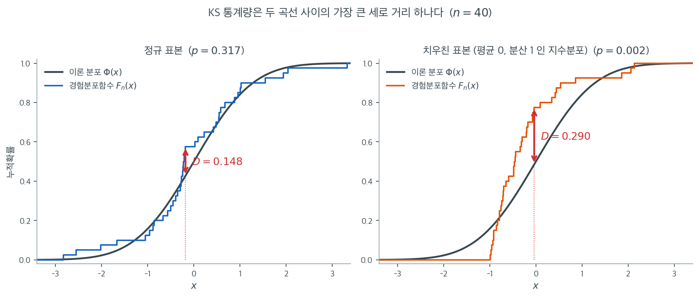
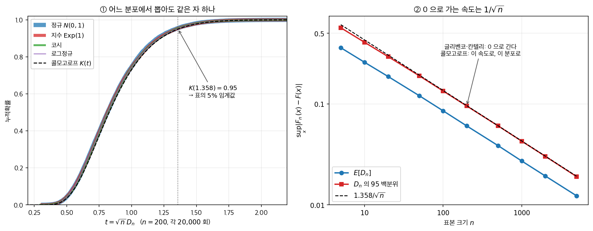

# Kolmogorov-Smirnov 검정

## 개요

Kolmogorov-Smirnov(KS) 검정은 표본의 경험분포함수를 지정된 이론적 분포와 비교하는 비모수 검정이다. 정규성 검정에서는 경험적 CDF와 정규 CDF 사이의 최대 수직 거리를 잰다. 결정적인 단서 조항은 표준 KS 검정이 귀무가설의 모수를 미리 완전히 지정하도록 요구한다는 것이다. 모수를 자료에서 추정하면 $p$값이 무효가 된다.

---

## 1. 경험분포함수

i.i.d. 표본 $X_1, \ldots, X_n$이 주어졌을 때 경험분포함수(EDF)는

$$
F_n(x) = \frac{1}{n} \sum_{i=1}^{n} \mathbf{1}(X_i \leq x),
$$

여기서 $\mathbf{1}(\cdot)$은 지시함수이다. Glivenko-Cantelli 정리에 의해 $n \to \infty$일 때 $F_n(x) \to F(x)$가 거의 확실하게 균등수렴한다.

---

## 2. KS 통계량

일표본 KS 통계량은 $F_n$과 가설 CDF $F_0$ 사이의 상한 거리를 잰다.

$$
D_n = \sup_x |F_n(x) - F_0(x)|.
$$

실제로는 다음과 같이 계산한다.

$$
D_n = \max_{1 \leq i \leq n} \max\!\left(\left|\frac{i}{n} - F_0(X_{(i)})\right|,\; \left|F_0(X_{(i)}) - \frac{i-1}{n}\right|\right),
$$

여기서 $X_{(1)} \leq \cdots \leq X_{(n)}$은 순서통계량이다.

### 그림으로 본 D

$D_n$을 정의하는 상한(sup) 기호가 거창해 보이지만, 실제로 계산되는 것은 **두 곡선 사이의 가장 긴 세로 막대 하나**이다. 아래 그림은 $n = 40$인 두 표본에 대해 계단 모양의 경험분포함수 $F_n$과 매끄러운 $\Phi$를 겹쳐 그리고, 그 둘이 가장 멀어지는 자리에 빨간 화살표를 세운 것이다. 두 표본 모두 평균 0, 분산 1인 모집단에서 왔으므로 귀무가설 $N(0,1)$의 모수는 못박혀 있고, 다른 것은 모양뿐이다.



왼쪽 정규 표본에서 최대 틈은 $x = -0.18$ 부근에서 $D = 0.148$이다. $n = 40$에서 이 정도 틈은 흔한 일이라 $p = 0.317$이고 기각할 이유가 없다. 오른쪽은 평균 0, 분산 1로 맞춘 지수분포 표본이다. 모수는 왼쪽과 똑같지만 모양이 다르다. 계단이 $x = -1$에서 갑자기 솟아오르는데, 지수분포는 $-1$ 아래로 값을 낼 수 없기 때문이다. 정규분포는 그 아래에 이미 확률 $\Phi(-1) = 0.159$를 배정해 두었으므로 두 곡선이 그 근방에서 크게 벌어진다. 최대 틈은 $x = -0.04$ 부근에서 $D = 0.290$이고 $p = 0.002$가 된다.

이 그림에서 두 가지를 읽어 두자. 첫째, $D$는 **하나의 지점**에서만 결정된다. 나머지 39개 점에서 두 곡선이 아무리 잘 맞아도 $D$에는 반영되지 않는다. KS 검정이 다른 검정보다 검정력이 낮은 근본 이유가 여기에 있다. 둘째, 최대 틈이 잡히는 자리는 대체로 분포의 가운데다. $F_0(1 - F_0)$이 최대가 되는 곳에서 $F_n - F_0$의 변동도 가장 크기 때문이다. 그래서 KS 검정은 꼬리의 이상을 잘 보지 못하며, 바로 그 약점을 메우려는 것이 이 절의 Anderson-Darling 검정이다.

---

## 3. 가설

$$
H_0: F = F_0 \quad (\text{자료가 지정된 분포를 따른다}), \qquad H_1: F \neq F_0.
$$

$F_0$이 완전히 지정된 $H_0$ 아래에서 $\sqrt{n}\, D_n$의 분포는 Kolmogorov 분포로 수렴하며 그 CDF는

$$
P(\sqrt{n}\, D_n \leq t) \to 1 - 2\sum_{k=1}^{\infty} (-1)^{k-1} e^{-2k^2 t^2}.
$$

<div class="storybox" markdown>

**그림으로 보는 통계학 1.** 어느 보험 학술지의 1933년 네 번째 권

위 급수에는 $F_0$ 이 들어 있지 않다. 정규든 지수든 코시든 로그정규든, 저 식 하나로
$p$ 값을 낸다. 교과서 뒤에 붙은 KS 표가 **한 장뿐인** 까닭이고, 이 절이 다루는 검정이
살아남은 까닭이기도 하다.

그 식이 나온 자리가 뜻밖이다. 이탈리아 보험계리학회가 $1930$ 년에 창간한 학술지
『**Giornale dell'Istituto Italiano degli Attuari**』, 편집인은 **프란체스코 파올로
칸텔리** — 보렐·칸텔리 보조정리의 그 칸텔리다. 보험회사가 쓰는 사망표가 관측된 자료와
맞는지를 묻는 일은 계리사의 밥벌이였고, 칸텔리는 그 물음을 다루는 확률론 논문을 적극적으로
실었다.

$1933$ 년에 나온 **제$4$권**에 거의 같은 제목의 논문 셋이 나란히 실린다. 모두 이탈리아어다.

| 쪽 | 지은이 | 말한 것 |
|---|---|---|
| $83$–$91$ | **콜모고로프** | $\sqrt n\,D_n$ 의 극한분포가 위 급수다 |
| $92$–$99$ | **글리벤코** | $D_n \to 0$ 이 거의 확실하게 성립한다 |
| $421$–$424$ | **칸텔리** | 글리벤코의 증명을 더 일반적으로 |

뒤의 둘을 묶어 **글리벤코–칸텔리 정리**라 부른다. 같은 해 콜모고로프는 독일어로
『확률론의 기초 개념』을 내어 확률의 공리를 세웠으니, 한 해에 확률론의 토대와 통계학의
검정 하나를 서로 다른 두 언어로 내놓은 셈이다.

<figure markdown>
{ width="900" }
  <figcaption markdown>왼쪽의 네 곡선은 굵기만 다르게 겹쳐 그린 것이다. 오른쪽에서 글리벤코·칸텔리의 「$0$ 으로 간다」에 콜모고로프가 속도와 분포를 붙인다.</figcaption>
</figure>

왼쪽 칸이 그 한 장짜리 표의 근거다. 꼬리의 무게가 전혀 다른 네 분포에서 $n = 200$ 씩
$20{,}000$ 번 뽑아 재었는데 분위수가 소수 셋째 자리까지 겹친다.

| | 중앙값 | $95\%$ | $99\%$ |
|---|---:|---:|---:|
| 정규 | $0.814$ | $1.339$ | $1.604$ |
| 지수 | $0.813$ | $1.345$ | $1.604$ |
| 코시 | $0.815$ | $1.341$ | $1.610$ |
| 로그정규 | $0.814$ | $1.347$ | $1.601$ |
| **콜모고로프의 극한** | $0.828$ | $1.358$ | $1.628$ |

까닭은 한 줄이다. $F_0$ 이 연속이면 $F_0(X) \sim U(0,1)$ 이므로 — 확률적분변환 —
$D_n$ 은 균등난수 $n$ 개만의 함수가 된다. **원래 분포가 무엇이었는지는 변환하는 순간
지워진다.** 넷이 극한값보다 조금씩 작은 것은 $n = 200$ 이 아직 무한이 아니기 때문이고,
그 차이가 보기 $1$ 에서 점근값과 `scipy` 의 정확값을 가르는 바로 그 양이다.

급수도 순하다. $t = 1.358$ 에서 첫 항만 쓰면 $0.949972$, 둘째 항까지가 $0.9499732$ 이고
셋째 항은 소수 아홉째 자리를 바꾸지 못한다. 컴퓨터가 없던 시절에 **표를 손으로 만들 수
있었던** 이유다.

오른쪽 칸은 같은 호의 다른 논문이다. 글리벤코·칸텔리는 틈이 $0$ 으로 간다는 것까지 말하고
멈추는데, 그것만으로는 $n = 40$ 에서 잰 $D = 0.148$ 이 큰지 작은지 판단할 수 없다.
로그–로그에서 잰 기울기가 $-0.49$ — 틈은 $1/\sqrt n$ 으로 줄고, $95$ 백분위는
$1.358/\sqrt n$ 에 거의 포개진다. **「간다」에 「이만큼씩」을 붙인 것이 검정이 된다.**

여섯 해 뒤 $1939$ 년에 **스미르노프**가 두 표본으로 넓혔고, 그래서 이름이 둘이 되었다.
정작 두 사람이 함께 쓴 논문은 없다.

_확인한 곳 — 세 논문의 권·쪽수와 학술지의 창간 연도·편집인_

</div>

<div class="exbox" markdown>

**보기 1.** <span class="diff easy" title="쉬움"></span> 모수를 못박은 KS 검정. $\mathcal{N}(0,1)$에서 $n = 250$개를 뽑고 귀무가설의 모수를 `args=(0.0, 1.0)`으로 직접 넘겨 주면 $D = 0.0354$, $p = 0.9013$이다.

**(1)** $D$를 정의대로 손계산해 재현하시오. 모수를 못박았으므로 $p$값에 닫힌 꼴이 있다. **점근** 콜모고로프 분포로 계산한 값과 `scipy`가 주는 값이 얼마나 다른가.

**(2)** 모수를 못박은 이 검정은 명목 크기를 지키는가. 모의실험으로 실제 기각률과 $p$값의 평균을 재어, 모수를 추정했을 때(아래 보기 $2$)의 $0.0005$와 견주시오.

</div>

??? success "풀이"

    **(1) 손계산이 끝자리까지 맞고, 점근식은 $1.2\%$ 어긋난다.** 경험분포함수는 각 관측값에서 뛰는 계단이므로 두 방향의 틈을 따로 잰다. 모수를 못박았으니 표준화 없이 $F_0 = \Phi$를 바로 쓴다.

    $$
    D^+ = \max_i\left(\frac{i}{n} - \Phi(x_{(i)})\right) = 0.0354148220, \qquad
    D^- = \max_i\left(\Phi(x_{(i)}) - \frac{i-1}{n}\right) = 0.0302637669
    $$

    이고 $D = \max = 0.0354148220$으로 `scipy`의 값과 열 자리까지 같다.

    $p$값은 콜모고로프 분포에서 온다. $t = \sqrt{n}\,D = \sqrt{250}\times0.0354148 = 0.559958$에 대해 **점근** 공식은

    $$
    P(\sqrt{n}\,D_n > t) \longrightarrow 2\sum_{k=1}^{\infty}(-1)^{k-1}e^{-2k^2t^2}
    $$

    이고, 이 급수는 매우 빨리 수렴하므로 100항만 더해도 충분하다. 값은 $0.912469$다. 그런데 `scipy`가 돌려주는 것은

    $$
    p = 0.901284
    $$

    로 **$1.2\%$ 작다.** 까닭은 `scipy`가 점근식 대신 $n$에 대한 **정확 분포**(`scipy.stats.kstwo`)를 쓰기 때문이다. $n = 250$은 점근식이 쓸 만한 크기이지만 아직 완전히 같지는 않다. 급수식으로 직접 계산한 값을 그대로 보고하면 셋째 자리가 틀린다.

    **(2) 정확히 지킨다.** 진짜 표준정규 자료에 같은 절차를 4000번 적용하면

    | 재는 것 | 명목값 | 실제값 | 몬테카를로 오차 |
    |---|---|---|---|
    | 기각률 | $0.05$ | $0.0500$ | $\pm0.0034$ |
    | 기각률 | $0.10$ | $0.1010$ | $\pm0.0047$ |
    | $p$값의 평균 | $0.5$ | $0.5014$ | — |

    이다. **$p$값이 $[0,1]$에 균등하다.** 귀무가설이 참일 때 $p$값이 균등해야 한다는 교과서의 약속이 그대로 지켜진다.

    이 표를 아래 보기 $2$ 의 표와 나란히 놓는 것이 이 보기의 요점이다. 같은 `stats.kstest` 함수인데

    | 쓰는 방식 | 명목 $0.05$의 실제 기각률 | $p$값의 평균 |
    |---|---|---|
    | 모수를 `args`로 못박음 (이 보기) | $0.0500$ | $0.5014$ |
    | 모수를 자료에서 추정해 표준화 | $0.0005$ | $0.7869$ |

    로 **백 배** 갈린다. 함수가 틀린 것이 아니다. **함수가 전제하는 바를 지켰는가 아닌가의 차이**이고, 그 전제는 "$F_0$가 자료를 보기 전에 완전히 정해져 있다"는 것이다.

    실무에서 이 전제가 성립하는 경우는 생각보다 드물다. 정규성을 검정하겠다고 할 때 $\mu$와 $\sigma$를 미리 알고 있는 일은 거의 없다. 그러므로 **`kstest`로 정규성을 검정하는 코드를 보면 거의 언제나 틀렸다고 보아야 하고**, 맞는 경우는 균등성 검정처럼 귀무분포가 모수 없이 정해지는 때다.

    ```python
    import numpy as np
    from scipy import stats

    rng = np.random.default_rng(0)
    x = rng.normal(0.0, 1.0, size=250)

    # 귀무가설이 N(0,1) 로 완전히 못박혀 있는 경우다. args 로 모수를 직접
    # 넘겨 주었고 자료에서 추정하지 않았으므로, 이 p-값은 그대로 믿을 수 있다.
    # 모수를 자료에서 뽑아 쓰면 Lilliefors 로 가야 한다.
    # D 는 경험분포함수와 기준분포함수의 최대 세로 거리다.
    D, p = stats.kstest(x, 'norm', args=(0.0, 1.0))

    print(f"n = {x.size}")
    print(f"KS one-sample vs N(0,1): D = {D:.4f}, p = {p:.4f}")
    if p < 0.05:
        print("=> Reject H0: data may not follow N(0,1).")
    else:
        print("=> Fail to reject H0 at alpha = 0.05.")
    ```

    출력:

    ```text
    n = 250
    KS one-sample vs N(0,1): D = 0.0354, p = 0.9013
    => Fail to reject H0 at alpha = 0.05.
    ```

    손계산과 실제 크기를 함께 확인한다.

    ```python
    import numpy as np
    from scipy import stats

    rng = np.random.default_rng(0)
    x = rng.normal(0.0, 1.0, size=250)
    n = x.size

    # D 를 정의대로 손계산한다.
    z = np.sort(x)
    F = stats.norm.cdf(z)
    i = np.arange(1, n + 1)
    d_plus = np.max(i / n - F)
    d_minus = np.max(F - (i - 1) / n)
    print(f"D+ = {d_plus:.10f},  D- = {d_minus:.10f},  D = {max(d_plus, d_minus):.10f}")
    print(f"scipy D = {stats.kstest(x, 'norm', args=(0.0, 1.0))[0]:.10f}")

    # p 값: 모수를 못박았으므로 콜모고로프 분포를 쓸 수 있다.
    D = max(d_plus, d_minus)
    t = np.sqrt(n) * D
    p_asym = 2 * sum((-1)**(k - 1) * np.exp(-2 * k**2 * t**2) for k in range(1, 101))
    print(f"\nsqrt(n) D = {t:.6f}")
    print(f"점근 p = 2 sum (-1)^(k-1) exp(-2k^2 t^2) = {p_asym:.6f}")
    print(f"scipy 의 점근 분포 kstwobign.sf(t)        = {stats.kstwobign.sf(t):.6f}")
    print(f"정확 분포 kstwo.sf(D, n)                 = {stats.kstwo.sf(D, n):.6f}")
    print(f"kstest p                                 = {stats.kstest(x, 'norm', args=(0.0, 1.0))[1]:.6f}")

    # 모수를 못박은 KS 는 명목 크기를 지키는가
    rng2 = np.random.default_rng(11)
    R = 4000
    ps = np.array([stats.kstest(rng2.standard_normal(n), 'norm', args=(0.0, 1.0))[1]
                   for _ in range(R)])
    print(f"\n모수를 못박았을 때의 실제 기각률 (R = {R})")
    for a in (0.05, 0.10):
        print(f"  명목 {a:.2f}: {np.mean(ps < a):.4f}  (MC SE {np.sqrt(a * (1 - a) / R):.4f})")
    print(f"  p 값의 평균 = {ps.mean():.4f}  (균등이면 0.5)")
    ```

    출력:

    ```text
    D+ = 0.0354148220,  D- = 0.0302637669,  D = 0.0354148220
    scipy D = 0.0354148220

    sqrt(n) D = 0.559958
    점근 p = 2 sum (-1)^(k-1) exp(-2k^2 t^2) = 0.912469
    scipy 의 점근 분포 kstwobign.sf(t)        = 0.912469
    정확 분포 kstwo.sf(D, n)                 = 0.901284
    kstest p                                 = 0.901284

    모수를 못박았을 때의 실제 기각률 (R = 4000)
      명목 0.05: 0.0500  (MC SE 0.0034)
      명목 0.10: 0.1010  (MC SE 0.0047)
      p 값의 평균 = 0.5014  (균등이면 0.5)
    ```

    세 가지가 맞아떨어진다. 손계산한 $D$가 `scipy`와 열 자리까지 같고, 손으로 더한 급수가 `scipy`의 점근 분포 함수와 여섯 자리까지 같으며(둘 다 $0.912469$), 그 점근값이 정확값 $0.901284$에서 $1.2\%$ 떨어져 있다. 그리고 모수를 못박은 검정은 명목 크기를 몬테카를로 오차 안에서 지킨다. $\square$

### 추정한 모수로 표준 임계값을 쓰면

<div class="exbox" markdown>

**보기 2.** <span class="diff easy" title="쉬움"></span> KS 검정의 함정. 자료에서 추정한 평균과 표준편차로 표준화한 뒤 표준 KS 임계값을 쓰면 $D = 0.019034$, $p = 0.8548$이 나온다.

**(1)** $D$를 정의대로 손계산해 `kstest`의 값을 재현하시오. 계단의 위쪽 틈 $D^+$와 아래쪽 틈 $D^-$ 중 어느 쪽이 통계량이 되었는가. 표준화에 쓰인 `data.std()`는 어느 판본인가.

**(2)** 이 "검정"의 **실제 크기**를 모의실험으로 재시오. 명목 $0.05$가 얼마가 되는가. 정규 자료에서 $p$값이 균등분포를 따라야 하는데 실제로 어떤가.

</div>

??? success "풀이"

    **(1) $D^+$가 이겼고, 표준화는 `ddof=0`이다.** 정렬된 자료를 표준화한 $z_{(i)}$에 대해 경험분포함수는 $z_{(i)}$에서 $(i-1)/n$에서 $i/n$으로 뛰는 계단이므로, 두 방향의 틈을 따로 재야 한다.

    $$
    D^+ = \max_i\left(\frac{i}{n} - \Phi(z_{(i)})\right), \qquad
    D^- = \max_i\left(\Phi(z_{(i)}) - \frac{i-1}{n}\right), \qquad
    D = \max(D^+, D^-)
    $$

    이 표본에서 재면

    | 표준화 | $D^+$ | $D^-$ | $D = \max$ |
    |---|---|---|---|
    | `ddof=0` ($1/n$) | $0.0190341127$ | $0.0098858448$ | $\mathbf{0.0190341127}$ |
    | `ddof=1` ($1/(n-1)$) | $0.0191252945$ | $0.0098072163$ | $0.0191252945$ |

    이다. **위쪽 줄의 $D = 0.0190341127$이 `kstest`의 값과 열 자리까지 같다.** 코드가 쓴 `data.std()`의 기본값이 `ddof=0`이기 때문이다. 아래쪽 줄의 $0.0191252945$는 보기 2에서 릴리포스가 돌려주는 통계량과 정확히 같은 수인데, `statsmodels`의 `lilliefors`가 $1/(n-1)$짜리 표준편차로 표준화하기 때문이다. **두 검정의 통계량이 "거의 같다"고 하는 차이의 정체가 이것이고, 통계량의 차이는 자료가 아니라 `ddof` 하나다.**

    $D^+$가 $D^-$의 거의 두 배인 것은 이 표본에서 경험분포함수가 적합 정규분포함수보다 위로 더 멀리 벗어나는 자리가 있다는 뜻이다. 어느 쪽이 이기느냐 자체에는 특별한 의미가 없다.

    **(2) 명목 $0.05$가 실제로 $0.0005$다. 백 분의 일이다.** 진짜 표준정규 자료에 같은 절차를 4000번 적용하면

    | 명목 수준 | 실제 기각률 |
    |---|---|
    | $0.05$ | $0.00050$ (4000번 중 2번) |
    | $0.10$ | $0.00150$ (6번) |
    | $0.20$ | $0.00725$ (29번) |

    이다. 어느 수준에서도 **두 자릿수**로 작다. $p$값의 평균은 $0.7869$로, 귀무가설이 참일 때 $p$가 $[0,1]$에 균등해야 한다는 것(평균 $0.5$)과 전혀 다르다. 더 결정적인 것은 4000번 가운데 **가장 작은 $p$값이 $0.0408$**이라는 사실이다. 곧 이 절차는 명목 $0.01$에서 아무리 뽑아도 **단 한 번도** 기각하지 못한다.

    까닭은 쪽 위에서 본 대로다. 표준화가 경험분포함수를 기준 곡선 쪽으로 끌어당기므로 $D$가 체계적으로 작아지는데, `kstest`는 그 사실을 모르고 **모수를 알고 있을 때의** 귀무분포로 $p$값을 계산한다. 작아진 통계량을 작아지지 않은 잣대로 재니 $p$값이 1 쪽으로 몰린다.

    **그러므로 $p = 0.855$는 자료에 대해 아무것도 말해 주지 않는다.** 자료가 어떻든 이 절차는 큰 $p$값을 내놓는다. 고쳐야 할 것은 통계량이 아니라 그것을 비교할 귀무분포이고, 보기 2에서 그 교정을 본다.

    ```python
    import numpy as np
    from scipy import stats

    np.random.seed(0)

    # 예시 자료를 만든다
    # data = np.random.normal(0, 1, 1000)
    data = np.random.normal(1, 10, 1000)

    # kstest 는 모수를 미리 알고 있다고 전제한다. 그래서 표준화해 N(0,1) 과
    # 견주는데, 그 평균과 표준편차를 자료에서 뽑아 썼다는 것이 함정이다.
    # 이러면 검정이 지나치게 너그러워져 p-값이 실제보다 크게 나온다.
    # 아래 Lilliefors 가 바로 이 문제를 고친 검정이다.
    data_ks = (data - data.mean()) / data.std()

    stat, p_value = stats.kstest(data_ks, 'norm')
    print(f"Kolmogorov-Smirnov Test: Statistic={stat}, p-value={p_value}")

    alpha = 0.05
    if p_value <= alpha:
        print("Reject H_0: The data is not normally distributed.")
    else:
        print("Fail to reject H_0: The data is normally distributed.")
    ```

    출력:

    ```text
    Kolmogorov-Smirnov Test: Statistic=0.01903411267034605, p-value=0.8547733408587939
    Fail to reject H_0: The data is normally distributed.
    ```

    손계산과 실제 크기를 함께 확인한다.

    ```python
    import numpy as np
    from scipy import stats

    np.random.seed(0)
    data = np.random.normal(1, 10, 1000)
    n = data.size

    # 정의대로 D 를 손계산한다. 계단의 양쪽을 모두 본다.
    def D_of(x, ddof):
        z = np.sort((x - x.mean()) / x.std(ddof=ddof))
        F = stats.norm.cdf(z)
        i = np.arange(1, len(z) + 1)
        d_plus = np.max(i / len(z) - F)
        d_minus = np.max(F - (i - 1) / len(z))
        return max(d_plus, d_minus), d_plus, d_minus

    D0, dp0, dm0 = D_of(data, 0)
    D1, dp1, dm1 = D_of(data, 1)
    print(f"ddof=0:  D+ = {dp0:.10f},  D- = {dm0:.10f},  D = {D0:.10f}")
    print(f"ddof=1:  D+ = {dp1:.10f},  D- = {dm1:.10f},  D = {D1:.10f}")

    data_ks = (data - data.mean()) / data.std()
    print(f"\nkstest   D = {stats.kstest(data_ks, 'norm')[0]:.10f}")

    # 이 "검정" 의 실제 크기를 재 본다.
    rng = np.random.default_rng(7)
    R = 4000
    ps = np.array([stats.kstest((lambda x: (x - x.mean()) / x.std())(
        rng.standard_normal(n)), 'norm')[1] for _ in range(R)])
    for a in (0.05, 0.10, 0.20):
        print(f"명목 {a:.2f}: 실제 기각률 = {np.mean(ps < a):.5f}"
              f"  ({np.sum(ps < a)}/{R})")
    print(f"\np 값의 평균 = {ps.mean():.4f}  (균등이면 0.5),  최솟값 = {ps.min():.4f}")
    ```

    출력:

    ```text
    ddof=0:  D+ = 0.0190341127,  D- = 0.0098858448,  D = 0.0190341127
    ddof=1:  D+ = 0.0191252945,  D- = 0.0098072163,  D = 0.0191252945

    kstest   D = 0.0190341127
    명목 0.05: 실제 기각률 = 0.00050  (2/4000)
    명목 0.10: 실제 기각률 = 0.00150  (6/4000)
    명목 0.20: 실제 기각률 = 0.00725  (29/4000)

    p 값의 평균 = 0.7869  (균등이면 0.5),  최솟값 = 0.0408
    ```

    손계산한 $D$가 `kstest`의 값과 열 자리까지 같고, 모의실험이 쪽 위의 "보수적이 된다"는 서술을 **백 배**라는 수로 바꾸어 준다. $\square$

!!! warning "이 코드는 사실 타당한 K-S 검정이 아니다"
    위 코드는 **자료에서 추정한** 평균과 표준편차로 자료를 표준화한 뒤 표준 K-S 임계값을 쓴다. 표준화가 경험적 CDF를 이론적 CDF 쪽으로 인위적으로 끌어당기므로 $D$가 작아지고 $p$값이 지나치게 커진다. 곧 검정이 보수적이 되어 검정력을 잃는다. 이것이 바로 다음 절의 Lilliefors 검정이 필요한 이유이다.

---

### 끌어당긴다는 말의 뜻

"인위적으로 끌어당긴다"는 표현은 비유가 아니라 그림으로 그릴 수 있는 사실이다. 아래는 $N(0,1)$에서 뽑은 $n = 25$짜리 표본 하나다. 검은 계단이 경험분포함수이고, 파란 곡선은 모수를 $N(0,1)$로 못박았을 때의 기준선, 주황 곡선은 같은 자료에서 추정한 $\hat\mu = -0.37$, $\hat\sigma = 0.68$을 꽂아 넣은 기준선이다.


이 표본은 우연히 평균이 $-0.37$로 왼쪽에 치우치고 표준편차도 $0.68$로 좁게 나왔다. 그러니 못박은 $N(0,1)$과는 잘 맞지 않아 최대 틈이 $D = 0.314$나 된다. 그런데 모수를 자료에서 다시 추정하면 주황 곡선이 계단을 따라 왼쪽으로 이동하고 동시에 가팔라져서, 같은 자료인데도 최대 틈이 $D = 0.110$으로 3분의 1토막이 난다. 자료에 맞춰 기준선을 움직였으니 당연한 결과다.

이것은 이 표본만의 운이 아니다. $N(0,1)$에서 $n = 25$짜리 표본을 40000번 뽑아 두 $D$의 평균을 재면 못박았을 때 $0.167$, 추정했을 때 $0.120$이다. 평균적으로 **28% 줄어든다**. 그런데 `stats.kstest`가 돌려주는 $p$값은 못박은 경우의 분포를 기준으로 계산된다. 줄어든 $D$를 줄어들지 않은 잣대로 재니 $p$값이 부풀 수밖에 없다.

그래서 위 코드의 $p = 0.855$는 "자료가 정규와 잘 맞는다"는 증거로 읽어서는 안 된다. 자료가 어떻든 저 코드는 큰 $p$값을 잘 내놓는다. 고쳐야 할 것은 통계량이 아니라 그것을 비교할 **귀무분포**이며, 바로 그 일을 하는 것이 다음 절의 Lilliefors 검정이다.

---

---

## 4. Lilliefors 문제

$\mu$와 $\sigma$를 자료에서 추정해 $F_0$에 꽂아 넣으면, 적합된 CDF가 $F_n$에 가깝도록 최적화되므로 KS 통계량이 체계적으로 작아진다. 그러면 표준 KS 임계값과 $p$값이 무효가 된다(지나치게 보수적이어서 과소기각한다). Lilliefors 검정은 모수 추정을 반영하는 모의실험 기반 임계값이나 표로 정리된 임계값을 써서 이 문제를 해결한다.

---

## 5. 해석

KS 검정은 *일치성*(consistent)을 갖는 검정이다. $n \to \infty$이면 결국 $F_0$에서의 어떤 이탈이든 탐지한다. 그러나 정규분포의 특정 구조를 활용하는 검정(Shapiro-Wilk, Anderson-Darling 등)에 비해 검정력이 상당히 낮다. KS 검정은 분포의 모든 부분을 동등하게 취급하는 반면, Anderson-Darling 검정은 꼬리에 추가 가중을 주므로 꼬리 이탈에 더 민감하다.

이 검정력 차이가 얼마나 극적일 수 있는지는 연습문제 3에서 확인한다.

---

## 연습문제

<div class="drillbox" markdown>

**연습문제 1.** <span class="diff easy" title="쉬움"></span> $\mathcal{N}(0,1)$에서 관측값 $n = 300$개를 생성하라. $\mathcal{N}(0,1)$과 $\mathcal{N}(0.5, 1)$에 대해 각각 KS 검정을 수행하라. $p$값을 비교하라.

</div>

??? success "풀이"

    ```python
    import numpy as np
    from scipy import stats

    rng = np.random.default_rng(0)
    x = rng.normal(0, 1, size=300)

    D1, p1 = stats.kstest(x, 'norm', args=(0.0, 1.0))
    D2, p2 = stats.kstest(x, 'norm', args=(0.5, 1.0))

    print(f"vs N(0,1):   D = {D1:.4f}, p = {p1:.4g}")
    print(f"vs N(0.5,1): D = {D2:.4f}, p = {p2:.4g}")
    ```

    출력:

    ```text
    vs N(0,1):   D = 0.0507, p = 0.4089
    vs N(0.5,1): D = 0.2264, p = 5.45e-14
    ```

    참 분포인 $\mathcal{N}(0,1)$에 대해서는 $D = 0.051$, $p = 0.409$로 기각하지 않는다. 평균이 틀린 $\mathcal{N}(0.5,1)$에 대해서는 EDF가 체계적으로 이동해 있어 $D = 0.226$으로 네 배 넘게 커지고 $p = 5.5 \times 10^{-14}$로 강하게 기각한다.

    $D$의 크기를 직관적으로 이해해 보자. $\Phi(x)$와 $\Phi(x - 0.5)$ 사이의 최대 수직 거리는 $x = 0.25$에서 $\Phi(0.25) - \Phi(-0.25) = 0.1974$이다. 표본 $D = 0.226$이 이 이론값 근처에 있다.

    **위치 이동은 KS 검정이 잘 잡는다.** 다음 연습문제들에서 볼 꼬리 이탈과 대조된다. $\square$

---

<div class="drillbox" markdown>

**연습문제 2.** <span class="diff med" title="중간"></span> Lilliefors 문제를 시연하라. $\mathcal{N}(0,1)$에서 관측값 $n = 200$개를 생성하고 $\hat{\mu}$, $\hat{\sigma}$를 추정한 뒤 $\mathcal{N}(\hat{\mu}, \hat{\sigma}^2)$에 대해 KS 검정을 수행하라. $p$값을 믿을 수 있는가?

</div>

??? success "풀이"

    ```python
    import numpy as np
    from scipy import stats

    rng = np.random.default_rng(0)
    x = rng.normal(0, 1, size=200)

    mu_hat, sigma_hat = x.mean(), x.std(ddof=1)
    D, p = stats.kstest(x, 'norm', args=(mu_hat, sigma_hat))

    print(f"Estimated mu = {mu_hat:.4f}, sigma = {sigma_hat:.4f}")
    print(f"KS vs N(mu_hat, sigma_hat): D = {D:.4f}, p = {p:.4f}")
    ```

    출력:

    ```text
    Estimated mu = 0.0153, sigma = 0.9636
    KS vs N(mu_hat, sigma_hat): D = 0.0306, p = 0.9892
    ```

    $p = 0.989$는 **믿을 수 없다.** 적합된 정규분포가 미리 지정된 정규분포보다 EDF에 더 가까우므로 $D$가 작아지고 $p$값이 부풀려진다.

    얼마나 심각한지 모의실험으로 확인해 보자. $\mathcal{N}(0,1)$에서 $n = 200$인 표본 5,000개를 뽑아 매번 모수를 추정하고 이 순진한 KS 검정을 적용하면 $\alpha = 0.05$에서의 경험적 기각률은

    ```text
    Plug-in KS empirical size: 0.0002
    ```

    **0.0002이다.** 명목값 0.05의 250분의 1에 불과하다. 5,000회 중 단 한 번만 기각했다는 뜻이다.

    이 정도로 극단적인 과소기각은 검정을 사실상 무용하게 만든다. 크기가 0.0002인 검정은 참된 이탈이 있어도 거의 탐지하지 못한다. 타당한 추론을 하려면 반드시 Lilliefors 보정이 필요하다. $\square$

---

<div class="drillbox" markdown>

**연습문제 3.** <span class="diff med" title="중간"></span> $n = 200$이고 대립가설이 $t_5$일 때($\mathcal{N}(0,1)$에 대해 검정) $\alpha = 0.05$에서 KS 검정의 검정력을 추정하는 몬테카를로 모의실험을 수행하라.

</div>

??? success "풀이"

    ```python
    import numpy as np
    from scipy import stats

    rng = np.random.default_rng(0)
    n, reps, alpha = 200, 5000, 0.05
    rejections = 0

    for _ in range(reps):
        x = rng.standard_t(df=5, size=n)
        _, p = stats.kstest(x, 'norm', args=(0.0, 1.0))
        if p < alpha:
            rejections += 1

    print(f"KS power vs t(5): {rejections / reps:.4f}")
    ```

    출력:

    ```text
    KS power vs t(5): 0.0910
    ```

    **검정력이 0.091에 불과하다.** 크기 0.05보다 겨우 조금 클 뿐이며, 사실상 쓸모가 없다.

    왜 이렇게 낮은지는 모집단 KS 거리를 계산하면 명확해진다.

    $$
    \sup_x |F_{t_5}(x) - \Phi(x)| = 0.0305 \quad (x = -1.63 \text{ 부근에서 달성}).
    $$

    한편 $n = 200$에서 5% 임계값은 근사적으로

    $$
    D_{\text{crit}} \approx \frac{1.358}{\sqrt{200}} = 0.096.
    $$

    곧 **모집단 거리 $0.0305$가 임계값 $0.096$의 3분의 1에도 못 미친다.** 표집잡음이 없더라도 $D_n$이 임계값에 도달하지 못한다. 50% 검정력을 얻으려면 $n \approx (1.358/0.0305)^2 \approx 1980$이 필요하다.

    $t_5$의 분산이 $5/3 \approx 1.67$로 1과 크게 다른데도 CDF 거리가 작은 이유는, 두 CDF가 여러 번 교차하면서 차이가 상쇄되기 때문이다. 중앙 근처에서는 $t_5$가 더 뾰족해서 $F_{t_5} > \Phi$이고, 꼬리에서는 $t_5$가 더 두꺼워서 부호가 뒤집힌다. 어느 한 지점의 수직 거리는 작게 유지된다.

    같은 자료에 정규성 검정을 적용하면 대비가 뚜렷하다($n = 200$, $\alpha = 0.05$).

    | 검정 | 검정력 |
    |---|---|
    | KS (vs $\mathcal{N}(0,1)$ 완전 지정) | 0.091 |
    | Anderson-Darling | 0.724 |
    | Shapiro-Wilk | 0.819 |

    (공정한 비교는 아니다. AD와 SW는 모수를 추정하는 위치–척도 자유 검정인 반면 KS는 완전 지정 대립을 다룬다. 그럼에도 KS가 꼬리 이탈에 얼마나 둔감한지는 분명하다.)

    꼬리에 가중을 주는 Anderson-Darling과 순서통계량의 상관구조를 활용하는 Shapiro-Wilk가 이런 상황에서 압도적으로 낫다. $\square$

---

<div class="drillbox" markdown>

**연습문제 4.** <span class="diff hard" title="어려움"></span> 순서통계량으로부터 $D_n$을 계산하는 공식을 유도하라. $n$개의 값 $X_{(1)}, \ldots, X_{(n)}$만 확인하면 충분함을 보여라.

</div>

??? success "풀이"

    EDF $F_n(x)$는 각 $X_{(i)}$에서 $1/n$만큼 뛰는 계단함수이다. 연속된 두 순서통계량 사이에서 $F_n$은 상수인 반면 $F_0$은 단조증가한다. 따라서 차이 $F_n(x) - F_0(x)$는 그 구간에서 단조감소하고, 상한 $|F_n(x) - F_0(x)|$는 도약 직전이나 직후에 달성된다.

    - $i$번째 도약 직후: $F_n(X_{(i)}) = i/n$이므로 $|i/n - F_0(X_{(i)})|$.
    - $i$번째 도약 직전: $F_n(X_{(i)}^-) = (i-1)/n$이므로 $|(i-1)/n - F_0(X_{(i)})|$.

    따라서

    $$
    D_n = \max_{1 \leq i \leq n} \max\!\left(\left|\frac{i}{n} - F_0(X_{(i)})\right|,\; \left|F_0(X_{(i)}) - \frac{i-1}{n}\right|\right).
    $$

    $n$개의 순서통계량만 평가하면 충분하다. 무한한 실직선 위의 상한을 유한한 최댓값 계산으로 바꿔주는 결과이며, KS 검정을 실용적으로 만드는 핵심이다. $\square$

---

<div class="drillbox" markdown>

**연습문제 5.** <span class="diff hard" title="어려움"></span> 일차원의 경우에 대해 Glivenko-Cantelli 정리를 서술하고 증명하라(증명의 개요면 충분하다).

</div>

??? success "풀이"

    **정리 (Glivenko-Cantelli).** $X_1, X_2, \ldots$가 CDF $F$를 갖는 i.i.d.라 하자. 그러면

    $$
    \sup_x |F_n(x) - F(x)| \xrightarrow{\text{a.s.}} 0 \quad (n \to \infty).
    $$

    **증명 개요.** 임의의 $x \in \mathbb{R}$을 고정한다. 강대수의 법칙에 의해 $F_n(x) = \frac{1}{n}\sum_{i=1}^n \mathbf{1}(X_i \leq x) \to F(x)$가 거의 확실하게 성립한다. 이는 점별 수렴이다.

    균등수렴으로 끌어올리려면, $\epsilon > 0$을 고정하고 모든 $j$에 대해 $F(t_j) - F(t_{j-1}) < \epsilon$이 되도록 점 $-\infty = t_0 < t_1 < \cdots < t_K = \infty$를 잡는다. 임의의 $x \in [t_{j-1}, t_j]$에 대해 $F_n$과 $F$의 단조성에서

    $$
    F_n(x) - F(x) \leq F_n(t_j) - F(t_{j-1}) = [F_n(t_j) - F(t_j)] + [F(t_j) - F(t_{j-1})] < [F_n(t_j) - F(t_j)] + \epsilon.
    $$

    비슷하게 $F(x) - F_n(x) < [F(t_j) - F_n(t_{j-1})] + \epsilon$이다.

    $t_j$가 유한개이므로 각 $t_j$에서의 점별 수렴(강대수의 법칙)이 결국 $\sup_x |F_n(x) - F(x)| < 2\epsilon$을 거의 확실하게 보장한다. $\epsilon$이 임의였으므로 결과가 따라 나온다. $\square$

---

<div class="drillbox" markdown>

**연습문제 6.** <span class="diff hard" title="어려움"></span> 「그림으로 본 D」절은 최대 틈이 "대체로 분포의 가운데"에서 잡히는 까닭을 $F_0(1 - F_0)$으로 설명했다. 그 설명을 수로 만들라.

**(1)** $H_0$ 아래에서 $x$를 고정하고 $\sqrt{n}\,(F_n(x) - F_0(x))$의 평균과 분산을 구하라. 분산이 $F_0(x) = 1/2$에서 최대임을 보이라.

**(2)** 그림의 왼쪽 표본은 $n = 40$, $D = 0.148$이었다. $F_0(x) = 0.5$인 자리와 $F_0(x) = 0.01$인 꼬리에서 $F_n(x) - F_0(x)$의 표준편차를 각각 구하고, $0.148$이 각각 몇 표준편차인지 적으라. 그 꼬리에서는 $0.148$만큼의 **아래쪽** 틈이 $n$을 아무리 키워도 불가능한데 왜인가.

**(3)** Anderson-Darling이 쓰는 가중치 $1/[F_0(1 - F_0)]$가 (1)의 분산을 정확히 $1$로 만드는 저울임을 보이고, 그것으로부터 $H_0$ 아래에서 $E[A^2] = 1$임을 끌어내라.

</div>

??? success "풀이"

    **(1) 평균 $0$, 분산 $F_0(x)[1 - F_0(x)]$.** $x$를 고정하면 $\mathbf{1}(X_i \leq x)$는 성공확률 $p = F_0(x)$인 i.i.d. 베르누이이므로 $H_0$ 아래에서

    $$
    n F_n(x) \sim \mathrm{Bin}(n, p), \qquad E[F_n(x)] = p, \qquad \mathrm{Var}[F_n(x)] = \frac{p(1-p)}{n}.
    $$

    따라서 $E[\sqrt{n}(F_n(x) - F_0(x))] = 0$이고 $\mathrm{Var}[\sqrt{n}(F_n(x) - F_0(x))] = p(1-p)$이다. $p(1-p)$는 $p = 1/2$에서 최대 $1/4$이므로 표준편차는 $1/2$를 넘지 못하고, $p \to 0$이나 $p \to 1$에서는 $0$으로 간다.

    **(2) 가운데서는 $1.87$ 표준편차, 꼬리에서는 $9.41$ 표준편차.** $n = 40$에서

    | 자리 | $\sqrt{p(1-p)/n}$ | $0.148$ 은 몇 $\sigma$ |
    |---|---|---|
    | $p = 0.5$ (가운데) | $0.5/\sqrt{40} = 0.079057$ | $1.87$ |
    | $p = 0.01$ (꼬리) | $\sqrt{0.0099}/\sqrt{40} = 0.015732$ | $9.41$ |

    가운데서 $0.148$은 흔한 흔들림($1.87\sigma$)이지만 꼬리에서는 $9.41\sigma$, 곧 사실상 일어나지 않는 일이다.

    아래쪽 틈은 그보다 더 단호하게 막혀 있다. $F_n(x) \geq 0$이므로 언제나

    $$
    F_n(x) - F_0(x) \geq -F_0(x) = -0.01
    $$

    이고, 표본 전체가 $x$보다 커도 아래쪽 틈은 $0.01$을 넘을 수 없다. 이것은 확률이 작다는 말이 아니라 **$n$과 무관한 부등식**이다. 같은 이유로 $F_0 = 0.99$인 위쪽 꼬리에서는 위쪽 틈이 $0.01$을 넘지 못한다($F_n \leq 1$). 분산이 꼬리에서 $\sqrt{p(1-p)}$로 줄어드는 것에 더해 틈 자체가 $\min(F_0, 1 - F_0)$ 한쪽으로 깔려 있으니, 최댓값 경쟁에서 꼬리는 처음부터 이길 수 없다.

    **(3) 가중치는 분산의 역수이고, 그래서 $E[A^2] = 1$이다.** (1)에서

    $$
    \frac{\mathrm{Var}\bigl[\sqrt{n}\,(F_n(x) - F_0(x))\bigr]}{F_0(x)[1 - F_0(x)]} = \frac{F_0(x)[1-F_0(x)]}{F_0(x)[1-F_0(x)]} = 1 \qquad (0 < F_0(x) < 1)
    $$

    이므로 $1/[F_0(1-F_0)]$는 모든 $x$에서 편차를 **표준화된 양**으로 만드는 유일한 저울이다. AD 통계량의 적분형

    $$
    A^2 = n \int_{-\infty}^{\infty} \frac{[F_n(x) - F_0(x)]^2}{F_0(x)[1 - F_0(x)]}\, dF_0(x)
    $$

    에 기대값을 넣고 $u = F_0(x)$로 치환하면

    $$
    E[A^2] = \int_{-\infty}^{\infty} \frac{E\bigl[n(F_n(x) - F_0(x))^2\bigr]}{F_0(x)[1-F_0(x)]}\, dF_0(x) = \int_0^1 1 \, du = 1.
    $$

    $n$에도 $F_0$에도 의존하지 않는 상수 $1$이 나온다. 적분 안의 피적분함수가 자리마다 평균 $1$이니, **AD는 모든 자리에 같은 발언권을 준 뒤 평균을 내는 것**이다. 반면 KS는 표준화하지 않은 틈의 최댓값을 취하므로, (2)에서 본 대로 분산이 작고 틈의 상한마저 작은 꼬리는 최댓값을 가져갈 기회를 거의 갖지 못한다. 「해석」절의 "KS는 분포의 모든 부분을 동등하게 취급한다"는 말은 **저울을 동등하게 놓는다**는 뜻이고, 그 결과는 **발언권이 가운데로 쏠린다**는 것이다. 동등한 저울이 동등한 발언권이 아니다. $\square$

---

<div class="drillbox" markdown>

**연습문제 7.** <span class="diff hard" title="어려움"></span> 연습문제 3은 모집단 거리 $\delta = \sup_x\lvert F_{t_5}(x) - \Phi(x)\rvert = 0.0305$와 임계값 어림 $1.358/\sqrt{n}$을 맞추어 "50% 검정력을 얻으려면 $n \approx 1980$"이라고 했다. 그 어림을 검증하라.

**(1)** $n = 1980$인 $t_5$ 자료에 모수를 못박은 KS 검정($\alpha = 0.05$)을 걸어 실제 검정력을 모의실험으로 재라. $0.5$인가. 임계값 어림 $1.358/\sqrt{n}$과 정확 임계값 `stats.kstwo.isf(0.05, n)`도 함께 적어, 어긋남이 임계값 쪽에서 온 것이 아님을 확인하라.

**(2)** $H_0$ 아래 $D_n$의 평균도 재라($n = 1980$). 그 값과 $\delta$, 그리고 $t_5$ 아래 $D_n$의 평균 세 수를 나란히 놓고, 어림식이 $D_n$에 대해 무엇을 잘못 가정했는지 말하라.

**(3)** 검정력이 실제로 $0.5$가 되는 $n$을 훑어 찾아라. 어림값 $1980$과 몇 배 어긋나는가.

</div>

??? success "풀이"

    ```python
    import numpy as np
    from scipy import stats

    delta = 0.030464      # sup |F_t5 - Phi|, 연습문제 3 에서 구한 모집단 거리

    def ks_stats(n, R, seed, heavy=True):
        """t(5) 또는 N(0,1) 자료에서 D_n 을 R 번 모은다."""
        rng = np.random.default_rng(seed)
        draw = (lambda: rng.standard_t(5, n)) if heavy else (lambda: rng.standard_normal(n))
        return np.array([stats.kstest(draw(), 'norm', args=(0.0, 1.0))[0] for _ in range(R)])

    n, R = 1980, 4000
    D = ks_stats(n, R, 0)
    D0 = ks_stats(n, 2000, 1, heavy=False)
    crit = stats.kstwo.isf(0.05, n)

    print(f"n = {n}, R = {R}")
    print(f"모집단 거리         delta = {delta:.6f}")
    print(f"임계값 어림   1.358/sqrt(n) = {1.358 / np.sqrt(n):.6f}")
    print(f"임계값 정확   kstwo.isf     = {crit:.6f}")
    print(f"t(5)   자료의 D_n 평균 = {D.mean():.6f}")
    print(f"N(0,1) 자료의 D_n 평균 = {D0.mean():.6f}   (0.8687/sqrt(n) = {0.8687 / np.sqrt(n):.6f})")
    print(f"검정력 = {np.mean(D > crit):.4f}")

    print("\n검정력이 0.5 가 되는 자리를 훑는다")
    for m in (600, 800, 1000, 1200):
        Dm = ks_stats(m, 2000, 2)
        cm = stats.kstwo.isf(0.05, m)
        print(f"  n = {m:5d}: 임계값 = {cm:.6f}, 검정력 = {np.mean(Dm > cm):.4f}")
    ```

    출력:

    ```text
    n = 1980, R = 4000
    모집단 거리         delta = 0.030464
    임계값 어림   1.358/sqrt(n) = 0.030519
    임계값 정확   kstwo.isf     = 0.030435
    t(5)   자료의 D_n 평균 = 0.038486
    N(0,1) 자료의 D_n 평균 = 0.019408   (0.8687/sqrt(n) = 0.019523)
    검정력 = 0.9563

    검정력이 0.5 가 되는 자리를 훑는다
      n =   600: 임계값 = 0.055158, 검정력 = 0.2215
      n =   800: 임계값 = 0.047803, 검정력 = 0.3405
      n =  1000: 임계값 = 0.042777, 검정력 = 0.5015
      n =  1200: 임계값 = 0.039063, 검정력 = 0.6030
    ```

    **(1) 검정력은 $0.5$가 아니라 $0.9563$이다.** 어림이 가리킨 $0.5$보다 훨씬 높다. 임계값은 범인이 아니다. 어림값 $1.358/\sqrt{1980} = 0.030519$와 정확값 $0.030435$가 $0.3\%$밖에 다르지 않으므로, 어느 쪽을 쓰든 검정력은 같은 수가 나온다.

    **(2) 어림식은 $D_n \approx \delta$라고 가정했지만, $D_n$은 $\delta$를 중심으로 흔들리지 않는다.** 세 수를 나란히 놓으면

    | 양 | 값 |
    |---|---|
    | 모집단 거리 $\delta$ | $0.030464$ |
    | $H_0$ 아래 $E[D_n]$ (잡음만) | $0.019408$ |
    | $t_5$ 아래 $E[D_n]$ | $0.038486$ |

    이다. $H_0$ 아래 평균 $0.019408$은 점근식 $0.8687/\sqrt{n} = 0.019523$과 맞고, 이것이 **순수한 표집잡음의 크기**다. 그런데 대립가설 아래 평균은 $\delta$가 아니라 $\delta$보다 $26\%$ 큰 $0.038486$이다.

    까닭은 $D_n$이 **최댓값**이기 때문이다. $\delta(x) := F_{t_5}(x) - \Phi(x)$라 두고 $F_n - \Phi = \delta + (F_n - F_{t_5})$로 쪼개면

    $$
    D_n = \sup_x \bigl\lvert \delta(x) + [F_n(x) - F(x)] \bigr\rvert \geq \bigl\lvert \delta(x^\ast) + [F_n(x^\ast) - F(x^\ast)] \bigr\rvert, \qquad x^\ast := \arg\max_x \lvert \delta(x) \rvert
    $$

    가 된다. 오른쪽 변의 평균은 대략 $\delta$이고($F_n(x^\ast) - F(x^\ast)$의 평균이 $0$이므로), 절댓값과 $\sup$ 때문에 $D_n$은 그보다도 더 커진다. 신호와 잡음이 상쇄되는 자리를 쓰지 않고 **가장 크게 어긋난 자리를 골라 쓰기** 때문에 $D_n$은 거의 언제나 $\delta$보다 크다. 그러므로 "$D_n = \delta$일 때 $50\%$"라는 어림은 체계적으로 $n$을 과대평가한다. 거꾸로 이 효과는 연습문제 3에서 $n = 200$, $\delta = 0.0305 \ll D_{\text{crit}} = 0.096$인데도 검정력이 $0$이 아니라 $0.091$이었던 것도 설명해 준다.

    **(3) 실제 $50\%$ 자리는 $n \approx 1000$으로, 어림값의 절반이다.** 훑어 본 표에서 $n = 1000$의 검정력이 $0.5015$다. 어림식 $n = (1.358/\delta)^2 = 1987$은 거의 정확히 두 배를 불러 준다.

    교훈은 두 갈래다. 첫째, $\sup$ 통계량의 검정력을 "모집단 거리 대 임계값" 한 줄로 어림하면 **보수적인 쪽으로** 틀린다. 둘째, 그렇게 고쳐 잡아도 결론은 바뀌지 않는다. $t_5$를 절반의 확률로라도 잡으려면 $n \approx 1000$이 필요하고, Shapiro-Wilk는 $n = 200$에서 이미 $0.819$를 낸다. 어림의 오차가 두 배인데 검정 사이의 격차는 다섯 배다. $\square$

---

<div class="drillbox" markdown>

**연습문제 8.** <span class="diff hard" title="어려움"></span> 보기 1에서는 모수를 못박은 KS의 $p$값이 균등했고($0.5014$), 연습문제 2에서는 모수를 추정하자 크기가 $0.0002$로 주저앉았다. 그 둘을 가르는 성질이 **분포무관성**이다.

**(1)** $F_0$이 연속이고 강증가일 때 $U_i = F_0(X_i)$로 바꾸어, $H_0$ 아래 $D_n$의 분포가 $F_0$에 전혀 의존하지 않고 $n$에만 의존함을 보이라. 이것이 임계값 어림 $1.358/\sqrt{n}$ 하나가 모든 연속분포에 통하는 까닭이다.

**(2)** 이번에는 $z_i = (X_i - \bar{X})/s$를 꽂은 통계량 $\tilde{D}_n$을 보자. 자료를 $X_i \mapsto a + bX_i$ ($b > 0$)로 바꾸어도 $\tilde{D}_n$이 변하지 않음을 보이라. 그래서 Lilliefors도 임계값 표를 한 번만 만들면 된다.

**(3)** 그런데 (1)의 논법은 $\tilde{D}_n$에 쓸 수 없다. $\Phi(z_1), \ldots, \Phi(z_n)$이 i.i.d. 균등이 아님을, 이 $n$개 값이 반드시 지키는 **정확한 두 등식**을 들어 보이라.

**(4)** 극단으로 보내 보라. $n = 2$에서 $\tilde{D}_2$를 손으로 계산하라($s$는 `ddof=1`). 자료가 무엇이든 값이 같은가. 순진한 $p$값은 얼마이고, 이 검정의 크기는 얼마인가.

</div>

??? success "풀이"

    **(1) $D_n$은 균등표본의 통계량으로 똑같이 다시 쓰인다.** $F_0$이 연속이고 강증가이면 $F_0: \mathbb{R} \to (0,1)$은 전단사이고, $u = F_0(x)$에 대해 $X_i \leq x \iff U_i \leq u$이다. 따라서 $U_i$들의 경험분포함수를 $G_n$이라 할 때 $F_n(x) = G_n(F_0(x))$이고

    $$
    D_n = \sup_{x \in \mathbb{R}} \lvert F_n(x) - F_0(x) \rvert = \sup_{0 < u < 1} \lvert G_n(u) - u \rvert.
    $$

    $H_0$ 아래에서 확률적분변환에 의해 $U_i$는 i.i.d. $\mathrm{Unif}(0,1)$이므로, 오른쪽 식의 분포는 $F_0$을 전혀 모른 채 $n$만으로 정해진다. 그래서 `scipy`가 `kstwo(n)` 하나로 모든 경우의 $p$값을 주고, $1.358/\sqrt{n}$ 한 줄이 정규·지수·균등 어느 가설분포에도 통한다. 보기 1에서 $p$값이 깔끔하게 균등했던 것이 바로 이 성질의 겉모습이다.

    **(2) $\tilde{D}_n$은 위치·척도 변환에 불변이다.** $Y_i = a + bX_i$라 하면 $\bar{Y} = a + b\bar{X}$, $s_Y = b\,s_X$ ($b > 0$)이므로

    $$
    z_i^Y = \frac{Y_i - \bar{Y}}{s_Y} = \frac{b(X_i - \bar{X})}{b\,s_X} = z_i^X
    $$

    로 $a$와 $b$가 완전히 약분된다. $\tilde{D}_n$은 정렬된 $z_i$들만의 함수이므로 값이 같다. 그러므로 참 모수가 $\mathcal{N}(\mu, \sigma^2)$ 무엇이든 $\tilde{D}_n$의 귀무분포는 $n$만으로 정해지고, $\mathcal{N}(0,1)$에서 한 번 모의실험해 만든 표를 모든 자료에 쓸 수 있다. **분포무관성이 사라진 것이 아니라 "모든 연속분포"에서 "정규 위치·척도족"으로 좁아진 것**이다.

    **(3) 두 등식이 독립성을 깨뜨린다.** 정의에서 바로

    $$
    \sum_{i=1}^n z_i = 0, \qquad \sum_{i=1}^n z_i^2 = n - 1
    $$

    이 항등식으로 성립한다($s$에 `ddof=1`을 썼을 때). $U_i = \Phi(z_i)$로 옮겨 적으면

    $$
    \sum_{i=1}^n \Phi^{-1}(U_i) = 0, \qquad \sum_{i=1}^n \bigl[\Phi^{-1}(U_i)\bigr]^2 = n - 1
    $$

    이다. i.i.d. 균등표본이라면 이 두 합은 확률변수이고 위 값을 정확히 맞출 확률이 $0$이다. 곧 $U_1, \ldots, U_n$은 $n$차원 정육면체 안을 자유롭게 돌아다니는 것이 아니라 $(n-2)$차원 면 위에 묶여 있다. 자유도 둘이 "기준분포를 자료에 맞추는 데" 쓰였으니 적합된 CDF가 $F_n$ 쪽으로 끌려오고, $\tilde{D}_n$은 $D_n$보다 확률적으로 작아진다. 그런데 비교 대상인 임계값은 여전히 묶이지 않은 $D_n$의 것이므로, 검정은 보수적인 쪽으로 틀린다. 연습문제 2의 $0.0002$가 그 크기다.

    **(4) $n = 2$에서는 자료를 보지 않고도 답이 정해진다.** $n = 2$이면 (3)의 두 등식이 $z_1 + z_2 = 0$, $z_1^2 + z_2^2 = 1$이 되어 해가 $\{-1/\sqrt{2},\, +1/\sqrt{2}\}$뿐이다. 자유도 둘을 모수 둘에 다 써 버렸으므로 남는 정보가 없다. 따라서 $x_1 \neq x_2$인 어떤 자료에서도

    $$
    \Phi(z_{(1)}) = \Phi(-0.707107) = 0.239750, \qquad \Phi(z_{(2)}) = \Phi(0.707107) = 0.760250
    $$

    이고, 두 방향의 틈은

    $$
    \tilde{D}^+ = \max\Bigl(\tfrac{1}{2} - 0.239750,\ 1 - 0.760250\Bigr) = 0.260250, \qquad
    \tilde{D}^- = \max\Bigl(0.239750 - 0,\ 0.760250 - \tfrac{1}{2}\Bigr) = 0.260250
    $$

    로 $\tilde{D}_2 = 0.260250$이다. 순진한 $p$값은 `stats.kstwo.sf(0.260250, 2)` $= 0.999160$이고, 이것 역시 상수다. 어떤 자료를 넣어도 $p = 0.999160$이 나오므로 **이 검정의 크기는 정확히 $0$이고 검정력도 정확히 $0$이다.** 자료에서 아무 정보도 쓰지 않는 검정인 것이다. (`ddof=0`으로 표준화하면 $z = (-1, 1)$이 되어 $\tilde{D}_2 = 0.341345$, $p = 0.933249$가 되는데, 역시 상수이고 결론은 같다.)

    $n = 2$는 희화적인 극단이지만 방향은 $n = 200$에서도 그대로다. 모수를 추정하면 자유도 둘이 사라지고, 그만큼 $\tilde{D}_n$이 작아지는데, 임계값은 그 사실을 모른다. $n$이 커지면 잃은 자유도 둘의 몫이 $O(1/n)$로 묻히지만 $0.0002$를 보면 $n = 200$은 아직 거기까지 가지 못했다. $\square$

---

<div class="drillbox" markdown>

**연습문제 9.** <span class="diff hard" title="어려움"></span> 자료를 소수 첫째 자리까지만 기록했다고 하자. 참 분포는 $\mathcal{N}(0,1)$이지만 기록된 값은 간격 $h = 0.1$인 격자에 반올림된 것이다. 모수는 못박혀 있으므로 보기 1의 조건($F_0$이 자료를 보기 전에 완전히 정해져 있다)은 그대로 성립하고, Lilliefors 문제는 끼어들지 않는다.

**(1)** 반올림된 변수의 분포함수와 $\Phi$ 사이의 모집단 거리 $\delta$를 손으로 구하라. 어느 $x$에서 달성되는가. $\delta \approx \varphi(0)\,h/2$임을 보이고, $1.358/\sqrt{n} = \delta$가 되는 $n$을 구하라.

**(2)** $n = 100,\ 1000,\ 2000,\ 5000$에서 이 자료에 모수를 못박은 KS 검정과 Jarque-Bera 검정을 함께 걸어 $\alpha = 0.05$ 기각률을 재라. 두 검정이 왜 이렇게 다른가. 그리고 $n = 5000$에서 KS가 기각한 것은 **옳은 기각인가**, 그 기각이 실무에서 무엇을 뜻하는가.

</div>

??? success "풀이"

    ```python
    import numpy as np
    from scipy import stats

    # (1) 0.1 로 반올림한 정규변수의 참 분포와 Phi 사이의 모집단 거리
    h = 0.1
    xg = np.linspace(-6, 6, 1200001)
    k = np.floor(xg / h + 1e-12)                       # x 이하의 가장 큰 격자점
    F_round = stats.norm.cdf((k + 0.5) * h)            # P(round(X,1) <= x)
    delta = np.abs(F_round - stats.norm.cdf(xg)).max()
    print(f"모집단 거리 delta          = {delta:.6f}")
    print(f"어림값 phi(0) h / 2        = {stats.norm.pdf(0) * h / 2:.6f}")
    print(f"delta = 1.358/sqrt(n) 인 n = {(1.358 / delta)**2:.0f}")

    # (2) 같은 자료에 KS(모수 못박음)와 자크-베라를 함께 걸어 본다
    print("\n     n        R    KS 기각률    JB 기각률")
    for n, R in ((100, 4000), (1000, 3000), (2000, 2000), (5000, 1000)):
        rng = np.random.default_rng(7)
        pk = np.empty(R)
        pj = np.empty(R)
        for r in range(R):
            x = np.round(rng.standard_normal(n), 1)    # 소수 첫째 자리까지만 기록
            pk[r] = stats.kstest(x, 'norm', args=(0.0, 1.0))[1]
            pj[r] = stats.jarque_bera(x)[1]
        print(f"{n:6d} {R:8d} {np.mean(pk < 0.05):11.4f} {np.mean(pj < 0.05):12.4f}")
    ```

    출력:

    ```text
    모집단 거리 delta          = 0.019939
    어림값 phi(0) h / 2        = 0.019947
    delta = 1.358/sqrt(n) 인 n = 4639

         n        R    KS 기각률    JB 기각률
       100     4000      0.0805       0.0428
      1000     3000      0.3900       0.0457
      2000     2000      0.7460       0.0435
      5000     1000      1.0000       0.0510
    ```

    **(1) $\delta = 0.019939$이고 $x = 0^-$에서 달성된다.** 반올림된 값 $R = \mathrm{round}(X, 1)$은 격자점 $kh$에만 값을 가지며, $R \leq kh \iff X < (k + \tfrac{1}{2})h$이다. 따라서 분포함수는 격자점에서 뛰는 계단

    $$
    F_R(x) = \Phi\!\left(\Bigl(\Bigl\lfloor \tfrac{x}{h} \Bigr\rfloor + \tfrac{1}{2}\Bigr)h\right)
    $$

    이고, 계단이 뛰기 직전에 $\Phi$와 가장 멀어진다. $\Phi$의 기울기가 가장 큰 곳이 $x = 0$이므로 최대 틈은 $x \to 0^-$에서 나며

    $$
    \delta = \Phi(0) - \Phi(-h/2) = 0.5 - 0.480061 = 0.019939.
    $$

    테일러 전개하면 $\Phi(0) - \Phi(-h/2) \approx \varphi(0)\,h/2 = 0.398942 \times 0.05 = 0.019947$로 넷째 자리까지 맞는다. $1.358/\sqrt{n} = \delta$를 풀면 $n = (1.358/0.019939)^2 = 4639$다.

    **(2) KS는 $n$과 함께 확실한 기각으로 가고, Jarque-Bera는 끝까지 명목 크기 그대로다.**

    | $n$ | KS 기각률 | JB 기각률 |
    |---|---|---|
    | $100$ | $0.0805$ | $0.0428$ |
    | $1000$ | $0.3900$ | $0.0457$ |
    | $2000$ | $0.7460$ | $0.0435$ |
    | $5000$ | $1.0000$ | $0.0510$ |

    KS 쪽은 $n = 100$에서 이미 명목 $0.05$의 $1.6$배인 $0.0805$이고, $n = 5000$에서는 1000번 모두 기각한다. $50\%$를 지나는 자리는 $n = 1000$과 $2000$ 사이로, (1)의 어림값 $4639$보다 훨씬 작다. 연습문제 7에서 본 것과 같은 방향의 어긋남이다.

    두 검정이 갈리는 까닭은 **보는 것이 다르기** 때문이다. 반올림은 분포함수에 진폭 $\varphi(0)h/2 = 0.02$인 톱니를 영구히 새겨 넣고, $D_n$은 그 톱니를 직접 본다. 반면 Jarque-Bera는 3차·4차 표준화적률만 본다. 반올림오차를 폭 $h$인 독립 균등잡음으로 근사하면 분산은 $1 \to 1 + h^2/12 = 1.000833$으로 바뀌지만 대칭이므로 왜도는 그대로 $0$이고, 초과첨도의 변화는 $O(h^4)$ 수준인 $10^{-6}$ 이하다. 곧 **적률로 보면 이 자료는 완벽하게 정규**다. 자크–베라가 보지 못하는 것이 아니라 볼 것이 없다.

    $n = 5000$의 기각은 **옳은 기각이다.** 기록된 자료의 참 분포는 격자 위의 이산분포이고 이산분포는 정규분포가 아니다. $H_0$이 글자 그대로 거짓이므로 일치성을 갖는 검정은 결국 반드시 기각해야 한다. 틀린 것은 검정이 아니라 **질문**이다.

    실무에서 이 기각이 뜻하는 바는 "자료를 더 정밀하게 기록하라" 정도이고, 보통은 그조차 필요 없다. $t$ 검정이나 분산분석이 위태로워지는 것은 두꺼운 꼬리나 치우침 때문인데 반올림은 그 어느 쪽도 만들지 않는다. 이것이 14장의 중심 역설이다. **$n$이 커지면 쓸모없이 작은 이탈도 확실한 유의로 바뀐다.** $n = 100$에서 $0.0805$라는 수도 같은 이야기의 다른 얼굴이다. 검정이 명목 수준을 지키지 못한 것이 아니라, 귀무가설이 이미 거짓이어서 "크기"라는 말 자체가 성립하지 않는다. 그러므로 큰 $n$에서는 정규성 검정의 $p$값보다 **이탈의 크기**($\delta = 0.02$)와 그것이 뒤따르는 추론에 미치는 영향을 보아야 한다. $\square$

---

<div class="drillbox" markdown>

**연습문제 10.** <span class="diff hard" title="어려움"></span> 연습문제 2의 순진한 검정 — 모수를 추정해 꽂고 표준 KS 임계값 $1.358/\sqrt{n}$으로 판정하는 검정 — 은 $n = 200$에서 크기가 $0.0002$였다. 「해석」절은 KS 검정이 일치성을 갖는다고 했는데, 이렇게 망가진 검정도 일치성을 갖는가.

**(1)** $F$가 분산이 유한한 분포라 하고 $\mu = E[X]$, $\sigma = \mathrm{sd}(X)$라 하자. $\tilde{D}_n \to \delta_F := \sup_x \lvert F(x) - \Phi((x - \mu)/\sigma) \rvert$가 거의 확실하게 성립함을 보이라(Glivenko-Cantelli와 Pólya 정리를 쓰라). 이로부터 $F$가 정규가 아니면 순진한 검정도 일치성을 가짐을 끌어내라.

**(2)** $F = t_5$에 대해 $\delta_F$를 구하라. 연습문제 3의 $\sup_x \lvert F_{t_5} - \Phi \rvert = 0.030464$보다 큰가 작은가. 왜 그런가. 최대 틈이 잡히는 자리가 $x = \pm 1.629$에서 어디로 옮겨 가는가.

**(3)** 그렇다면 모수 추정을 무시한 대가는 정확히 무엇인가. 올바른 Lilliefors 임계값 $0.886/\sqrt{n}$과 순진한 $1.358/\sqrt{n}$을 비교해 **필요한 $n$의 배수**로 답하라.

</div>

??? success "풀이"

    **(1) $\tilde{D}_n \to \delta_F$이고, $\delta_F > 0$이면 검정력이 $1$로 간다.** 표기를 줄여 $\Phi_0(x) = \Phi((x-\mu)/\sigma)$, $\hat{\Phi}(x) = \Phi((x - \hat{\mu})/\hat{\sigma})$라 하고 상한노름을 $\lVert \cdot \rVert_\infty$로 쓴다. 분산이 유한하므로 강대수의 법칙에서 $\hat{\mu} \to \mu$, $\hat{\sigma} \to \sigma > 0$이 거의 확실하게 성립한다. 그러면 각 $x$에서 $\hat{\Phi}(x) \to \Phi_0(x)$이고 극한 $\Phi_0$이 연속이므로 **Pólya 정리**에 의해 수렴이 균등하다.

    $$
    \lVert \hat{\Phi} - \Phi_0 \rVert_\infty \to 0 \quad \text{a.s.}
    $$

    한편 Glivenko-Cantelli에서 $\lVert F_n - F \rVert_\infty \to 0$ a.s.이다. 상한노름의 삼각부등식에서

    $$
    \bigl\lvert \tilde{D}_n - \delta_F \bigr\rvert = \bigl\lvert \lVert F_n - \hat{\Phi} \rVert_\infty - \lVert F - \Phi_0 \rVert_\infty \bigr\rvert \leq \lVert F_n - F \rVert_\infty + \lVert \hat{\Phi} - \Phi_0 \rVert_\infty \to 0
    $$

    이므로 $\tilde{D}_n \to \delta_F$ a.s.이다.

    이제 $\delta_F = 0$은 $F(x) = \Phi((x-\mu)/\sigma)$가 모든 $x$에서 성립한다는 뜻, 곧 $F$가 정규라는 뜻이다. 따라서 $F$가 정규가 아니면 $\delta_F > 0$인 **고정된 상수**이고, 임계값 $1.358/\sqrt{n} \to 0$이므로

    $$
    P\bigl(\tilde{D}_n > 1.358/\sqrt{n}\bigr) \to 1.
    $$

    **순진한 검정도 일치성을 갖는다.** 크기가 $0.0002$인 것은 유한 $n$의 병이고 일치성은 깨지지 않는다. 임계값이 $1/\sqrt{n}$ 속도로 $0$으로 가는데 신호는 상수이므로, 상수배로 틀린 임계값은 결국 압도된다.

    **(2) $\delta_{t_5} = 0.038174$로 오히려 더 크다.** $t_5$는 $\mu = 0$, $\sigma = \sqrt{5/3} = 1.290994$이므로 겨루는 상대가 $\Phi(x)$가 아니라 $\Phi(x/1.290994)$로 바뀐다. 수치로 최대화하면

    $$
    \delta_{t_5} = \sup_x \bigl\lvert F_{t_5}(x) - \Phi(x/1.290994) \bigr\rvert = 0.038174 \quad (x = \pm 0.895641 \text{ 에서}),
    $$

    실제로 $x = -0.895641$에서 $F_{t_5} = 0.205742$, $\Phi(x/\sigma) = 0.243916$이다. 연습문제 3의 $0.030464$보다 $25\%$ 크다.

    까닭은 **표본표준편차가 꼬리에 끌려가기** 때문이다. $t_5$의 두꺼운 꼬리가 분산을 $5/3$으로 부풀리므로 $\hat{\sigma} \to 1.291$이 되고, 적합된 정규는 참 분포보다 눌리고 퍼진 모양이 된다. 그러면 가운데가 뾰족한 $t_5$와 어깨 부근에서 크게 어긋난다. 그래서 최대 틈이 잡히는 자리가 꼬리 쪽 $x = \pm 1.629$에서 어깨 쪽 $x = \pm 0.896$으로 옮겨 온다. **모수를 추정하는 것이 신호를 줄이는 것이 아니다.** 신호는 오히려 커진다. 줄어드는 것은 $\tilde{D}_n$의 유한표본 값이고, 그것은 연습문제 8 (3)의 두 등식이 하는 일이다.

    **(3) 대가는 $n$의 $2.35$배다.** 두 검정이 쓰는 문턱은 모두 $c/\sqrt{n}$ 꼴이고 통계량의 극한은 같은 $\delta_F$이므로, 기각에 필요한 조건은 $\delta_F > c/\sqrt{n}$, 곧 $n > (c/\delta_F)^2$이다. 따라서

    $$
    \frac{n_{\text{순진}}}{n_{\text{Lilliefors}}} = \left(\frac{1.358}{0.886}\right)^2 = 2.349.
    $$

    $t_5$에 넣으면 $(1.358/0.038174)^2 = 1266$ 대 $(0.886/0.038174)^2 = 539$가 된다(연습문제 7에서 본 대로 이런 어림은 $n$을 두 배쯤 크게 부른다. 비는 그대로다).

    요점은 두 수의 **성격**이다. 순진한 검정은 일치성을 잃지 않고 표본을 $2.35$배 더 요구하는 데 그친다. 그런데 연습문제 2에서 본 $n = 200$의 크기 $0.0002$는 명목값의 $1/250$이었다. 점근적으로는 상수배의 손해가 유한표본에서는 검정을 사실상 무력화한 것이다. **"$n \to \infty$이면 괜찮다"는 말과 "내 자료에서 괜찮다"는 말은 다르다.** 그리고 정규성 검정을 거는 자리는 거의 늘 $n$이 작아서 정규성이 걱정되는 자리다. $\square$

<div class="drillbox" markdown>

**연습문제 11.** <span class="diff med" title="중간"></span>
보기 2 **(2)** 의 모의실험은 $n = 1000$ 짜리 진짜 정규 자료 4000 개에 표준화 후 `kstest` 절차를 적용해 $p$ 값의 평균 $0.7869$, 최솟값 $0.0408$, 그리고 명목 $0.05,\ 0.10,\ 0.20$ 에서 실제 기각률 $0.00050,\ 0.00150,\ 0.00725$ 를 얻었다.

**(1)** 타당한 검정이라면 $H_0$ 아래에서 $p$ 값이 $[0,1]$ 에 균등하다. 이 사실과 위 세 수만 써서, 이 절차의 $p$ 값 분포의 $5\%$ 분위수에 대해 말할 수 있는 것을 구하시오. 곧 실제 크기를 $0.05$ 로 맞추려면 "$p < 0.05$ 일 때 기각" 을 어떤 문턱으로 바꿔야 하는가.

**(2)** 그런 문턱 바꾸기(곧 $p$ 값의 단조 재조정)만으로 이 절차를 타당하게 만들 수 있는가. 만들 수 있다면 그 재조정은 무엇에 의존하는가.

**(3)** 재조정해 얻은 검정은 모수를 **알고 있을 때**의 KS 보다 검정력이 높은가 낮은가. 왜 그런가.

</div>

??? success "풀이"
    **(1) 그 분위수는 $0.20$ 보다 크다. 곧 문턱을 $0.20$ 보다 큰 값으로 올려야 한다.** 이 절차가 내놓는 $p$ 값의 분포함수를 $G$ 라 하면 모의실험이 준 세 수는 바로 $G$ 의 값이다.

    $$
    G(0.05) = 0.00050, \qquad G(0.10) = 0.00150, \qquad G(0.20) = 0.00725
    $$

    타당한 검정이라면 $G(a) = a$ 여야 하는데 세 자리 모두 $a$ 보다 두 자릿수 작다. 우리가 찾는 문턱 $c$ 는 $G(c) = 0.05$ 를 만족하는 수이고, $G$ 가 비감소이며 $G(0.20) = 0.00725 < 0.05$ 이므로 $c > 0.20$ 이다. 모의실험이 그보다 큰 명목값을 기록하지 않았으니 세 수만으로는 이 하한이 말할 수 있는 전부다. $p$ 값의 평균이 $0.7869$(균등이면 $0.5$)라는 것도 분포가 $1$ 쪽으로 몰려 있다는 같은 사실의 다른 표현이다.

    **(2) 할 수 있다. 다만 재조정은 $n$ 과 추정 방식에 의존하므로 단 하나의 보정표로 끝나지 않는다.** $G$ 가 연속이면 확률적분변환에 의해

    $$
    p^{*} = G(p) \sim \text{Uniform}(0,1)
    $$

    이므로 $p^{*}$ 를 쓰는 검정은 정확히 명목 크기를 지킨다. 그런데 $G$ 는 통계량 $D$ 의 귀무분포에서 나오고, 그 귀무분포는 표본크기 $n$ 에 따라 다르며(임계값이 $0.886/\sqrt{n}$ 꼴인 것이 그 흔적이다) 어떤 모수를 몇 개 추정했는지, 심지어 표준편차를 `ddof=0` 으로 쓰는지 `ddof=1` 로 쓰는지에도 걸린다. $n$ 마다 보정표를 따로 갖추어야 한다는 뜻이고, **그 표를 갖춘 것이 바로 릴리포스 검정이다.** 보기 2 에서 두 검정의 통계량이 소수 열두째 자리까지 같았던 것이 이 사실의 증거다. 고칠 것은 통계량이 아니라 잣대뿐이었다.

    **(3) 낮다.** 재조정은 크기를 바로잡아 주지만 잃어버린 신호를 돌려주지는 못한다. 모수를 추정하면 기준 곡선이 자료를 따라 움직이므로 $D$ 의 분포 전체가 왼쪽으로 밀린다($n = 25$ 에서 평균 $0.167 \to 0.120$). 귀무분포와 대립분포가 **함께** 왼쪽으로 밀리므로 둘을 가르는 여유가 줄어든다. 이것은 절차의 흠이 아니라 치른 값이다. $\mu$ 와 $\sigma$ 를 자료에서 뽑아 쓰는 데 자유도 두 개를 썼으므로 그만큼 남는 정보가 줄어든다.

    같은 말을 가설의 언어로 하면 이렇다. 모수를 알 때의 귀무가설은 "자료가 $N(0,1)$ 이다" 라는 **단순가설**이고, 릴리포스의 귀무가설은 "자료가 어떤 정규분포를 따른다" 라는 **복합가설**이다. 뒤쪽이 더 약한 주장이므로 기각하기가 더 어렵다.

---


<div class="drillbox" markdown>

**연습문제 12.** <span class="diff hard" title="어려움"></span>
보기 2 의 풀이에 나온 정의

$$
D^{+} = \max_i\left(\frac{i}{n} - \Phi(z_{(i)})\right), \qquad
D^{-} = \max_i\left(\Phi(z_{(i)}) - \frac{i-1}{n}\right), \qquad
D = \max(D^{+}, D^{-})
$$

를 쓴다. 자료에 같은 값이 없다고 하자.

**(1)** 어떤 표본에서도 $D \ge 1/(2n)$ 임을 보이시오.

**(2)** $n = 1000$ 에서 이 바닥값은 얼마인가. 보기 2 의 `ddof=0` 줄에 적힌 $D^{+} = 0.0190341127$, $D^{-} = 0.0098858448$ 이 (1) 의 증명에 쓰인 부등식을 어떤 여유로 만족하는지 수로 확인하시오.

**(3)** 등호 $D = 1/(2n)$ 는 어떤 표본에서 일어나는가. 그리고 이 바닥값 때문에 $n$ 이 작을 때 검정이 저절로 기각하게 되는 일이 있는가. 릴리포스 임계값 $0.886/\sqrt{n}$ 과 견주어 답하시오.

</div>

??? success "풀이"
    **(1)** 아무 $i$ 하나를 잡고 $F_i = \Phi(z_{(i)})$ 라 쓰자. 두 틈을 더하면 $F_i$ 가 지워진다.

    $$
    \left(\frac{i}{n} - F_i\right) + \left(F_i - \frac{i-1}{n}\right) = \frac{i}{n} - \frac{i-1}{n} = \frac{1}{n}
    $$

    두 수의 합이 $1/n$ 이면 둘 가운데 큰 쪽은 적어도 $1/(2n)$ 이다(둘 다 $1/(2n)$ 미만이면 합이 $1/n$ 미만이 되어 모순). 한편 $D^{+}$ 와 $D^{-}$ 는 각각 최댓값이므로

    $$
    D = \max(D^{+}, D^{-}) \ge \max\left(\frac{i}{n} - F_i,\ F_i - \frac{i-1}{n}\right) \ge \frac{1}{2n}
    $$

    이다. $\square$

    기하로 읽으면 이렇다. 경험분포함수는 각 자료점에서 $1/n$ 만큼 수직으로 뛰는데 기준 곡선은 연속이므로, 그 점에서 곡선은 계단의 아래쪽 값과 위쪽 값 사이 어딘가를 지난다. 뛰어오르는 높이 $1/n$ 을 양쪽으로 가장 공평하게 나누어도 한쪽 틈은 반인 $1/(2n)$ 이 된다. **$D$ 는 자료가 아무리 정규와 잘 맞아도 $0$ 이 될 수 없다.**

    **(2) 바닥값은 $1/2000 = 0.0005$ 이고, 실제 표본은 그보다 한참 위에 있다.** 두 틈의 합을 보면

    $$
    D^{+} + D^{-} = 0.0190341127 + 0.0098858448 = 0.0289199575
    $$

    인데 (1) 에서 쓴 부등식은 각 $i$ 에서의 합이 정확히 $1/n = 0.001$ 임을 말했다. 실제 합이 그보다 $28.9$ 배 큰 것은 $D^{+}$ 를 주는 $i$ 와 $D^{-}$ 를 주는 $i$ 가 서로 다른 자리이기 때문이다. 각 $i$ 에서의 합은 $1/n$ 으로 묶여 있지만 서로 다른 자리의 최댓값끼리 더한 것은 그 제약을 받지 않는다. 통계량 자체로 보면 $D = 0.0190341127$ 은 바닥값 $0.0005$ 의 $38.07$ 배다.

    **(3) 등호는 완벽하게 "정규처럼 생긴" 표본에서만 일어나고, 바닥값이 기각을 강요하는 일은 어떤 $n$ 에서도 없다.** 등호가 되려면 모든 $i$ 에서 양쪽 틈이 똑같이 $1/(2n)$ 이어야 하므로

    $$
    \Phi(z_{(i)}) = \frac{2i-1}{2n}, \qquad \text{곧} \qquad z_{(i)} = \Phi^{-1}\!\left(\frac{2i-1}{2n}\right) \quad (i = 1, \dots, n)
    $$

    이다. 표준화한 자료가 정규분위수에 정확히 놓인 배치, 곧 Q-Q 그림이 자 하나로 그린 직선이 되는 경우다. 실제 표본에는 뽑기의 요동이 있으니 $D$ 는 늘 이보다 크다.

    바닥값이 임계값을 넘는 일은 없다. $1/(2n) > 0.886/\sqrt{n}$ 을 풀면

    $$
    \sqrt{n} < \frac{1}{2 \times 0.886} = 0.5643, \qquad \text{곧} \qquad n < 0.3185
    $$

    이므로 $n \ge 1$ 인 어떤 표본크기에서도 성립하지 않는다. 더 중요한 것은 두 양이 줄어드는 속도다. **바닥값은 $1/n$ 으로, 임계값은 $1/\sqrt{n}$ 으로 줄어들므로 $n$ 이 커질수록 여유가 벌어진다.** 곧 경험분포함수의 이산성은 KS 계열 검정을 망치지 않는다.

---


<div class="drillbox" markdown>

**연습문제 13.** <span class="diff hard" title="어려움"></span>
"끌어당긴다는 말의 뜻" 절의 그림은 $N(0,1)$ 에서 뽑은 $n = 25$ 짜리 표본 하나로, 모수를 $N(0,1)$ 로 못박았을 때 $D = 0.314$, 같은 자료에서 $\hat\mu = -0.37$, $\hat\sigma = 0.68$ 을 추정해 꽂았을 때 $D = 0.110$ 이었다. $\alpha = 0.05$ 의 큰 표본 임계값은 못박은 KS 가 $1.36/\sqrt{n}$, 릴리포스가 $0.886/\sqrt{n}$ 이다.

**(1)** 통계량 두 가지와 귀무분포 두 가지를 짝지은 네 경우의 결론을 모두 적고, 넷 가운데 **타당한 둘**을 가리시오.

**(2)** 타당한 두 검정이 같은 자료에서 서로 다른 결론을 낸다. 이것이 모순이 아닌 까닭을 밝히고, 자료가 실제로 $N(0,1)$ 에서 나왔다는 사실까지 써서 두 결론을 각각 1종 오류와 옳은 판단으로 분류하시오.

**(3)** 못박은 검정은 $\alpha = 0.01$ 의 임계값 $1.63/\sqrt{n}$ 에서도 기각하는가. 그 답이 (2) 의 분류에 무엇을 더해 주는가.

</div>

??? success "풀이"
    **(1) 임계값은 $1.36/5 = 0.272$ 와 $0.886/5 = 0.1772$ 다.** 네 짝의 결론은 다음과 같다.

    | 통계량 | KS 귀무분포 (임계값 $0.272$) | 릴리포스 귀무분포 (임계값 $0.1772$) |
    |---|---|---|
    | 못박은 $D = 0.314$ | 기각 — **타당** | 기각 — 무효(잣대가 너무 느슨) |
    | 추정한 $D = 0.110$ | 기각 못함 — 무효(보기 2 의 오류) | 기각 못함 — **타당** |

    타당한 것은 **대각선의 두 칸**뿐이다. 통계량을 계산할 때 쓴 전제와 그것을 재는 귀무분포가 같아야 하기 때문이다. 모수를 못박고 잰 $D$ 는 못박은 귀무분포로, 추정해 잰 $D$ 는 추정을 셈에 넣은 귀무분포로 읽어야 한다.

    나머지 두 칸은 틀리는 방향이 서로 반대다. 오른쪽 위는 작아지지 않은 통계량을 작아진 자료용 잣대로 재니 **지나치게 쉽게 기각**하고, 왼쪽 아래는 작아진 통계량을 작아지지 않은 잣대로 재니 **거의 기각하지 못한다.** 보기 2 의 코드가 범한 잘못이 바로 왼쪽 아래 칸이고, 그래서 실제 크기가 $0.05$ 가 아니라 $0.0005$ 였다.

    **(2) 두 검정이 서로 다른 가설을 묻기 때문에 모순이 아니다.** 못박은 검정의 귀무가설은

    $$
    H_0: F = N(0,1)
    $$

    이라는 단순가설이고, 릴리포스의 귀무가설은

    $$
    H_0: F = N(\mu, \sigma^2) \ \text{인} \ (\mu, \sigma) \ \text{가 존재한다}
    $$

    라는 복합가설이다. 이 표본은 우연히 평균이 $-0.37$, 표준편차가 $0.68$ 로 나와 $(0, 1)$ 에서 꽤 떨어졌으므로 **위치와 척도까지 못박은 주장**은 깨진다. 그러나 모양 자체는 정규답기 때문에 **어떤 정규분포를 따른다**는 약한 주장은 깨지지 않는다. "$N(0,1)$ 을 기각한다" 는 "정규성을 기각한다" 가 아니다.

    자료가 실제로 $N(0,1)$ 에서 나왔다는 것을 알고 있으므로 분류는 이렇다.

    - 못박은 검정의 기각 — **1종 오류**. 귀무가설이 참인데 기각했다. 명목 $0.05$ 짜리 검정이니 스무 번에 한 번은 이런 표본이 나온다.
    - 릴리포스의 비기각 — **옳은 판단**. 귀무가설이 참이고 기각하지 않았다.

    **(3) $\alpha = 0.01$ 에서는 기각하지 못한다.** 임계값이 $1.63/5 = 0.326$ 이고 $D = 0.314 < 0.326$ 이다. 그러니 이 표본은 "$5\%$ 수준에서는 유의하지만 $1\%$ 수준에서는 아니다" 라는 흔한 경계 사례이고, $p$ 값은 $0.01$ 과 $0.05$ 사이에 있다.

    이 사실이 (2) 의 분류에 보태 주는 것은 **1종 오류의 성격**이다. 자료가 정규성에서 벗어나서 기각된 것이 아니라 그저 조금 운이 없는 표본이어서 기각된 것이며, 그 정도는 수준을 $1\%$ 로 조이면 사라질 만큼이다. 같은 자료에 같은 $D$ 라는 자를 쓰더라도 무엇을 못박느냐가 통계량과 잣대를 **동시에** 바꾼다. 둘 중 하나만 바꿔 섞으면 검정은 크기뿐 아니라 결론의 방향까지 틀어진다.

---


<div class="drillbox" markdown>

**연습문제 14.** <span class="diff hard" title="어려움"></span>
보기 2 의 코드는 `data = np.random.normal(1, 10, 1000)` 로 만든 자료를 표준화한 뒤 `kstest(·, 'norm')` 에 넣었다. 표준화를 빼고 원자료를 그대로 넣으면 어떻게 되는지 본다.

**(1)** $n \to \infty$ 에서 이 통계량이 가까워지는 값

$$
D_\infty = \sup_x \left\lvert \Phi\!\left(\frac{x-1}{10}\right) - \Phi(x) \right\rvert
$$

을 구하시오. 최댓값이 잡히는 $x$ 를 먼저 찾을 것. 필요한 값: $\ln 10 = 2.302585$, $\Phi(2.14904) = 0.984184$, $\Phi(0.114904) = 0.545739$, $\Phi(-2.16924) = 0.015033$, $\Phi(-0.316924) = 0.375651$.

**(2)** 근사식 $p \approx 2e^{-2nD^2}$ 로 $n = 1000$ 에서의 $p$ 값의 크기를 어림하시오.

**(3)** 같은 자료에 대한 세 가지 $p$ 값 — 표준화 없이 거의 $0$, 표준화하고 KS 잣대로 $0.855$, 릴리포스로 $0.582$ — 이 각각 실제로 검정한 가설이 무엇인지 적으시오. 자료가 정규인데 첫째가 기각하는 것은 왜 오류가 아닌가.

</div>

??? success "풀이"
    **(1) $D_\infty = 0.43844$ 이고 $x = 2.14904$ 에서 잡힌다.** $g(x) = \Phi(x) - \Phi\bigl((x-1)/10\bigr)$ 라 두고 미분하면

    $$
    g'(x) = \phi(x) - \frac{1}{10}\phi\!\left(\frac{x-1}{10}\right) = 0
    \quad\Longleftrightarrow\quad
    e^{-x^2/2} = \frac{1}{10} e^{-(x-1)^2/200}
    $$

    이다. 양변에 로그를 취하면 $-x^2/2 = -\ln 10 - (x-1)^2/200$ 이고, 양변에 $-200$ 을 곱해 정리하면

    $$
    100x^2 = 200\ln 10 + (x-1)^2
    \quad\Longrightarrow\quad
    99x^2 + 2x - (1 + 200\ln 10) = 0
    \quad\Longrightarrow\quad
    99x^2 + 2x - 461.51702 = 0
    $$

    이다. 근은

    $$
    x = \frac{-1 \pm \sqrt{1 + 99 \times 461.51702}}{99}
    = \frac{-1 \pm \sqrt{45691.2}}{99}
    = \frac{-1 \pm 213.75496}{99}
    $$

    곧 $x = 2.14904$ 와 $x = -2.16924$ 다. **두 근을 모두 확인해야 한다.** 절댓값을 씌우기 전의 $g$ 는 한쪽에서 양수 봉우리, 다른 쪽에서 음수 골짜기를 갖는다.

    | $x$ | $\Phi(x)$ | $\Phi\bigl((x-1)/10\bigr)$ | $g(x)$ |
    |---|---|---|---|
    | $2.14904$ | $0.984184$ | $0.545739$ | $+0.438445$ |
    | $-2.16924$ | $0.015033$ | $0.375651$ | $-0.360618$ |

    $\lvert -0.360618 \rvert < 0.438445$ 이고 $x \to \pm\infty$ 에서 $g \to 0$ 이므로

    $$
    D_\infty = 0.43844
    $$

    이다. 척도가 $10$ 배나 벌어져 있으니 두 분포함수가 수직으로 $0.44$ 만큼 갈라진다. 연습문제 9 의 상한 $0.01$ 과 견주면 네 자릿수 가까이 다른 크기의 신호다.

    **(2) $p \approx 2 \times 10^{-167}$ 이다.**

    $$
    2nD_\infty^2 = 2 \times 1000 \times 0.43844^2 = 2000 \times 0.192230 = 384.459
    $$

    이므로

    $$
    p \approx 2e^{-384.459} \approx 2.1 \times 10^{-167}
    $$

    이다. 실제로 보기 2 의 그 자료를 `kstest(data, 'norm')` 에 넣으면 $D = 0.41723$, $p = 3.4 \times 10^{-158}$ 이 나온다. 유한표본의 $D$ 가 $0.438$ 보다 조금 작은 것은 이 표본의 $\hat\mu = 0.547$, $\hat\sigma = 9.870$ 이 참값 $(1, 10)$ 에서 약간 벗어났기 때문이다. 그 값을 넣고 다시 $\sup$ 를 계산하면 $0.4197$ 로, 관측된 $0.4172$ 와 잘 맞는다.

    **(3) 세 $p$ 값은 서로 다른 세 가지 질문에 대한 답이다.**

    | 절차 | $p$ | 실제로 검정한 귀무가설 | 평가 |
    |---|---|---|---|
    | 표준화 없이 `kstest` | $\approx 10^{-158}$ | $F = N(0,1)$ | 타당하고, 귀무가설이 참으로 거짓 |
    | 표준화 후 KS 잣대 | $0.855$ | (짝이 맞지 않음) | 무효 |
    | 릴리포스 | $0.582$ | $F$ 가 어떤 정규분포 | 타당하고, 귀무가설이 참 |

    첫째 줄은 **오류가 아니다.** 자료는 $N(1, 10^2)$ 에서 왔으므로 "$N(0,1)$ 이다" 라는 귀무가설은 실제로 거짓이고, 그것을 $10^{-158}$ 짜리 $p$ 값으로 기각한 것은 정확한 판단이다. 기각된 것은 정규성이 아니라 **표준**정규성이다. 위치와 척도를 못박은 주장이 깨진 것이지 모양에 대한 주장이 깨진 것이 아니다.

    둘째 줄은 통계량은 "정규인가" 를 묻는 방식으로 계산하고 잣대는 "$N(0,1)$ 인가" 를 묻는 분포에서 가져온 섞어 쓰기여서, 어느 가설에도 대응하지 않는다. $0.855$ 는 자료의 성질이 아니라 절차의 보수성을 재는 수다.

    셋째 줄만이 "이 자료의 모양이 정규인가" 에 답하며, 자료가 실제로 정규이므로 기각하지 않은 것이 옳다.

    **같은 $D$ 라는 자를 들고도 무엇을 못박느냐에 따라 $p$ 값은 $10^{-158}$ 과 $0.855$ 사이를 오간다.** KS 는 "분포가 무엇인가" 를 묻는 검정이지 "모양이 정규인가" 를 묻는 검정이 아니며, 뒤쪽 질문에 답하려면 모수 추정을 셈에 넣은 릴리포스로 가야 한다.


---

## 정리하며

KS 검정의 **정확한 사용 조건**을 확인했다.

- **경험분포함수 $F_n$ 이 출발점이다.** 3장에서 본 대로 $F_n\to F$ 가 균등하게 성립하며, 그 최대 거리가 통계량이다.
- **모수를 미리 지정해야 한다.** `kstest(x, 'norm')` 은 **표준정규**와 비교하는 것이며, 자료의 평균·표준편차를 넣어 `kstest(x, 'norm', args=(xbar, s))` 로 쓰면 **$p$ 값이 타당하지 않다.** 가장 흔한 오용이다.
- **그 경우 지나치게 보수적이다.** 적합된 분포가 자료에 맞춰져 있어 거리가 작아지므로 기각을 덜 하게 된다.
- **올바른 대안은 릴리포스다.** 다음 절의 주제다.
- **정규성이 아닌 일반 적합도 검정으로는 여전히 유용하다.** 분포와 모수가 이론적으로 정해진 경우가 그렇다.

다음 절 **[Lilliefors 검정](lilliefors_test.md)**으로 넘어간다.
