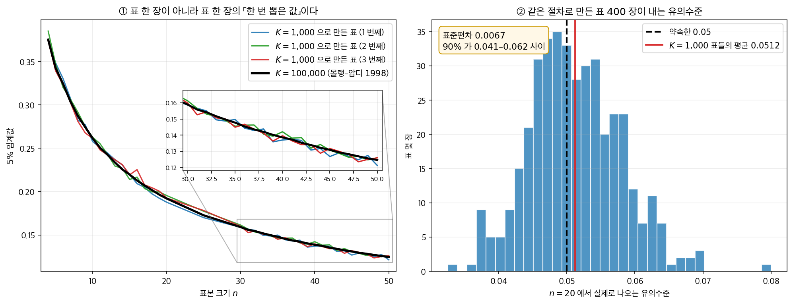
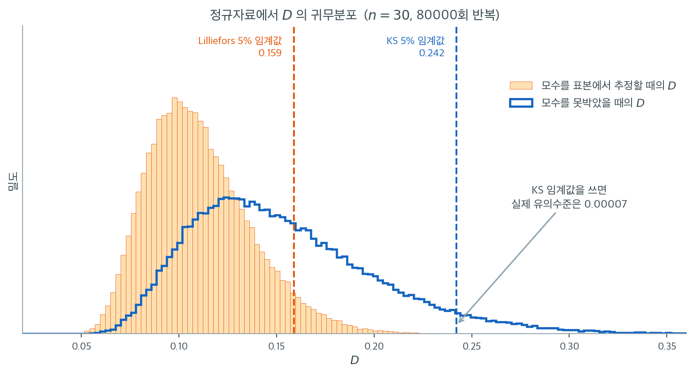

# Lilliefors 검정

## 개요

Lilliefors 검정은 귀무가설의 모수(평균과 분산)를 미리 지정하지 않고 자료에서 추정하는 흔한 상황을 위해 고안된 Kolmogorov-Smirnov 검정의 변형이다. 모수적 붓스트랩으로 KS 통계량의 귀무분포를 보정함으로써, 복합(composite) 정규성을 검정할 때 타당한 $p$값을 제공한다.

---

## 1. 표준 KS 검정의 문제

일표본 KS 통계량은

$$
D_n = \sup_x |F_n(x) - F_0(x)|.
$$

$F_0 = \mathcal{N}(\cdot\,; \mu, \sigma)$이고 $\mu$, $\sigma$를 $\hat{\mu} = \bar{X}$, $\hat{\sigma} = S$로 추정하면, 적합된 CDF $\hat{F}_0$이 미리 지정된 $F_0$보다 $F_n$에 체계적으로 더 가까워진다. 이는 $D_n$을 줄이고 $p$값을 부풀려 표준 KS 검정을 보수적으로(과소기각하게) 만든다.

---

## 2. 모수적 붓스트랩 알고리즘

Lilliefors 검정은 모수 추정을 포함한 상태에서 $D_n$의 귀무분포를 모의생성하여 이를 바로잡는다.

1. **관측 통계량을 계산한다.** 자료에서 $\hat{\mu}, \hat{\sigma}$를 적합하고

    $$
    D_{\text{obs}} = \sup_x |F_n(x) - \mathcal{N}(x;\, \hat{\mu}, \hat{\sigma})|
    $$

    를 계산한다.

2. **붓스트랩 반복.** $b = 1, \ldots, B$에 대해
    - $X_1^*, \ldots, X_n^* \overset{\text{iid}}{\sim} \mathcal{N}(\hat{\mu}, \hat{\sigma}^2)$를 모의생성한다.
    - $\hat{\mu}^* = \bar{X}^*$, $\hat{\sigma}^* = S^*$를 **다시 추정한다**.
    - $D_b^* = \sup_x |F_n^*(x) - \mathcal{N}(x;\, \hat{\mu}^*, \hat{\sigma}^*)|$를 계산한다.

3. **$p$값을 계산한다.**

    $$
    p \approx \frac{1}{B} \sum_{b=1}^{B} \mathbf{1}(D_b^* \geq D_{\text{obs}}).
    $$

<div class="storybox" markdown>

**그림으로 보는 통계학 1.** 논문 네 쪽의 알맹이가 표 한 장이었다

위 알고리즘의 $2$ 번 — 「$B$ 번 되풀이해 귀무분포를 만든다」 — 는 오늘 우리가 자료마다
돌리는 일이다. $1967$ 년에는 그 일을 **한 번만 해서 종이에 적었다.** 그 종이가 이 검정이다.

**휴버트 휘트먼 릴리포스**($1928$–$2008$)는 조지워싱턴 대학에서 통계학을 **$39$ 년**
가르쳤다. $1967$ 년에 그가 『**Journal of the American Statistical Association**』
$62$ 권 $318$ 호에 실은 「평균과 분산을 모를 때의 정규성에 대한 콜모고로프–스미르노프
검정」은 $399$ 쪽에서 시작해 $402$ 쪽에서 끝난다. **네 쪽**이다. $1$ 절에서 본
「모수를 추정하면 $D_n$ 이 줄어든다」는 사실은 그때 이미 알려져 있었다. 모르던 것은
**줄어든 뒤의 분포**였고, 그것은 해석적으로 구해지지 않는다. 그래서 그는 표본 크기마다
표준정규에서 **$1{,}000$ 개**를 뽑아 $D$ 를 계산하고, $95$ 백분위를 표에 적었다.

같은 해 네덜란드에서 **판수스트**가 같은 일을 따로 했다(「정규성 검정에 관한 몇 가지
실험 결과」, 『Statistica Neerlandica』 $21$ 권 $91$–$97$ 쪽). 그도 $n$ 마다 $1{,}000$ 개를
썼고, 두 사람의 임계값은 **상대오차 $10^{-2}$ 쯤**에서 서로 맞았다. 두 표가 서로
맞았다는 말은, 바꿔 말하면 **둘 다 같은 크기로 흔들렸다**는 말이기도 하다.

$1{,}000$ 회라는 숫자가 표에 어떤 자국을 남기는지는 그 절차를 그대로 되풀이해 보면 보인다.

<figure markdown>
{ width="960" }
  <figcaption markdown>검은 곡선은 몰랭–압디($1998$)가 $K = 100{,}000$ 으로 다시 구한 표다. 색 곡선 셋은 $K = 1{,}000$ 으로 — 곧 $1967$ 년의 방식 그대로 — 만든 표 세 장이다.</figcaption>
</figure>

왼쪽 칸의 확대한 부분을 보라. 색 곡선들이 검은 곡선 둘레에서 **톱니처럼 오르내린다.**
임계값은 $n$ 이 커질수록 매끄럽게 줄어야 하는 양인데, $K = 1{,}000$ 짜리 표에서는
$n = 41$ 의 값이 $n = 40$ 의 값보다 크게 나오는 일이 예사로 일어난다. 세 표가
몰랭–압디 표에서 벗어난 최대 상대오차는 각각 $3.2\%$, $2.7\%$, $5.9\%$ 였다.
**판수스트와 릴리포스가 $10^{-2}$ 쯤에서 맞았다는 것은 이 폭이다.**

오른쪽 칸은 그 톱니의 값을 매긴 것이다. $n = 20$ 에서 $K = 1{,}000$ 짜리 표를 $400$ 번
새로 만들어 각각으로 검정해 보면, 「$5\%$ 검정」의 실제 유의수준이 평균 $0.0512$,
표준편차 $0.0067$ 로 흩어진다. 열에 아홉은 $0.041$ 과 $0.062$ 사이다. 몰랭–압디의
$0.1920$ 을 쓰면 $0.0501$ 이 나온다.

뒤이은 역사는 이 흔들림을 지우는 역사다. $1968$ 년 **다녤리**(Dagnelie)는 그 표가 한 줄로 근사된다는
것을 보였다 — $C(N, \alpha) \approx a(\alpha)/\sqrt{N + 1.5}$, $a(0.05) = 0.886$,
$a(0.01) = 1.031$. 아래 **보기 1 (1)** 이 견주어 보라고 하는 $0.886/\sqrt{n}$ 이 그 식이다.
$1998$ 년 **몰랭과 압디**는 $K = 100{,}000$ 으로 표를 다시 만들면서, 릴리포스의 표를
그림으로 그려 놓고 「곡선의 울퉁불퉁한 모양이 임계값에 무작위 요동이 섞여 있음을
시사한다」고 적었다. 위 왼쪽 칸이 그 문장을 다시 그린 것이다.

그러니 이 쪽 $2$ 절의 $B$ 는 역사적 유물이 아니라 **지금 우리가 고르는 $K$** 다.
$1967$ 년의 $1{,}000$ 이 표에 남긴 자국은, $B = 1{,}000$ 으로 돌린 오늘의 붓스트랩에도
똑같이 남는다.

_확인한 곳 — 릴리포스의 생몰년과 조지워싱턴 대학 재직 $39$ 년, 그의 논문과 판수스트 논문의 학술지·권·쪽수·연도, 두 사람이 $n$ 마다 $1{,}000$ 개를 썼다는 것과 둘의 임계값이 상대오차 $10^{-2}$ 쯤에서 맞았다는 것, 다녤리($1968$)의 근사식과 두 상수, 몰랭–압디($1998$)가 $K = 100{,}000$ 을 쓴 것과 「울퉁불퉁한 모양」에 관한 그들의 문장, 그리고 인용한 몰랭–압디 표의 $5\%$ 열. 그림과 본문의 나머지 수는 모두 직접 모의실험한 값이다 (같은 코드로 $K = 100{,}000$ 을 돌리면 몰랭–압디 표를 $\pm 0.0004$ 안에서 재현한다)_

</div>

<div class="exbox" markdown>

**보기 1.** <span class="diff easy" title="쉬움"></span> Lilliefors 검정 직접 구현. $\text{Lognormal}(0, 0.6^2)$에서 $n = 300$개를 뽑아 붓스트랩으로 귀무분포를 만들면 $D = 0.1391$, $p = 0.0000$이 나온다.

**(1)** 붓스트랩으로 얻은 귀무분포의 95백분위를 구하고, 릴리포스 검정의 어림 임계값 $0.886/\sqrt{n}$과 견주시오. 둘이 맞는가.

**(2)** 붓스트랩 $p = 0.0000$으로 **정확히 말할 수 있는 것**은 무엇인가. 같은 자료에 `statsmodels`의 `lilliefors`와 샤피로–윌크를 걸면 각각 어떤 $p$값을 주며, 세 수를 어떻게 읽어야 하는가.

</div>

??? success "풀이"

    **(1) $0.0509$와 $0.0512$로 $0.6\%$ 안에서 맞는다.** 적합 정규분포 $\mathcal{N}(1.1025,\ 0.7348^2)$에서 $n = 300$짜리 표본을 1500번 뽑아 그때마다 같은 방식으로 $D$를 구하면

    | 백분위 | 90% | 95% | 99% | 최댓값 |
    |---|---|---|---|---|
    | $D^\ast$ | $0.0471$ | $0.0509$ | $0.0590$ | $0.0769$ |

    이다. 릴리포스의 점근 어림은

    $$
    D_{\text{crit}}(0.05) \approx \frac{0.886}{\sqrt{n}} = \frac{0.886}{\sqrt{300}} = 0.0512
    $$

    이고 붓스트랩이 준 $0.0509$와 차이가 $0.6\%$에 지나지 않는다. **모수를 추정했을 때의 귀무분포를 표에서 찾는 것과 모의실험으로 직접 만드는 것이 같은 답을 준다**는 확인이다. 붓스트랩 쪽이 더 번거롭지만, 표가 없는 상황(예: 정규가 아닌 다른 분포족, 또는 결측·절단이 섞인 자료)에서도 쓸 수 있다는 것이 장점이다.

    비교를 위해 적어 두면, 모수를 **못박았을 때**의 KS 임계값은 $1.36/\sqrt{n} = 0.0785$다. 추정했을 때의 $0.0512$보다 $53\%$ 크다. 이 두 수의 차이가 곧 이 장에서 되풀이해 나온 "표준 KS 임계값을 추정된 모수에 쓰면 지나치게 보수적이 된다"는 말의 크기다.

    **(2) 정확히 말할 수 있는 것은 $p < 1/1500 = 0.000667$뿐이다.** 관측값 $D = 0.1391$은 붓스트랩 귀무분포의 최댓값 $0.0769$보다도 **$1.81$배** 크고, 95백분위 $0.0509$의 $2.73$배다. 1500번 가운데 $D^\ast \ge D_{\text{obs}}$인 경우가 **하나도 없으므로** 경험적 비율이 $0/1500 = 0$이 되는데, 이것은 "확률이 0"이라는 뜻이 아니라 **붓스트랩의 분해능이 거기까지**라는 뜻이다. $B = 1500$으로는 $1/1500$보다 작은 $p$값을 구별할 수 없다.

    같은 자료에 다른 방법을 걸면

    | 방법 | $p$값 | 그 수의 정체 |
    |---|---|---|
    | 붓스트랩 ($B = 1500$) | $0.0000$ | 분해능 바닥. 뜻은 $p < 6.7\times10^{-4}$ |
    | `statsmodels` `lilliefors` | $0.001$ | 내장 근사표의 바닥값 |
    | 샤피로–윌크 | $4.65\times10^{-21}$ | 실제 근사 $p$값 |

    이다. **앞의 두 수는 $p$값이 아니라 바닥이다.** `lilliefors`가 돌려주는 $0.001$을 "천 번에 한 번"으로 읽으면 안 된다. 그 함수의 표가 거기서 끝나기 때문에 나온 수이고, 실제 증거는 훨씬 강하다. 샤피로–윌크의 $4.65\times10^{-21}$이 그것을 보여 준다.

    보고할 때는 **$p$값 대신 통계량과 임계값을 적는 것**이 정직하다. "$D = 0.1391$, 5% 임계값 $0.0512$, 곧 임계값의 $2.7$배"가 "$p = 0.001$"보다 정확한 진술이다. 분해능 바닥에 닿았을 때는 $B$를 늘리거나(계산이 $B$에 선형이므로 $10^6$까지는 어렵지 않다) 애초에 $p$값에 매달리지 않는 편이 낫다.

    ```python
    import numpy as np
    from scipy import stats

    def ks_stat_fitted_normal(x):
        """자료에서 추정한 정규분포와의 KS 통계량을 구한다."""
        x = np.asarray(x, dtype=float)
        mu, sd = x.mean(), x.std(ddof=1)
        D, _ = stats.kstest(x, 'norm', args=(mu, sd))
        return float(D), float(mu), float(sd)

    def lilliefors_normal_bootstrap(x, B=2000, seed=0):
        """Lilliefors 검정을 모의실험으로 직접 구현한다.

        모수를 자료에서 추정하면 KS 통계량의 귀무분포가 달라진다. 표를 찾는
        대신, 추정된 모수의 정규분포에서 같은 크기의 표본을 B 번 뽑아
        그때마다 같은 방식으로 D 를 구하면 그 귀무분포를 직접 얻을 수 있다.
        관측된 D 가 그중 몇 번째로 큰지가 곧 p-값이다.
        """
        x = np.asarray(x, dtype=float)
        n = x.size
        D_obs, mu, sd = ks_stat_fitted_normal(x)

        rng = np.random.default_rng(seed)
        D_star = np.empty(B)
        for b in range(B):
            xb = rng.normal(mu, sd, size=n)
            D_star[b], _, _ = ks_stat_fitted_normal(xb)

        p_boot = float(np.mean(D_star >= D_obs))
        return D_obs, p_boot, mu, sd

    # 로그정규 자료이므로 기각되어야 한다.
    rng = np.random.default_rng(1)
    x = rng.lognormal(0.0, 0.6, size=300)

    D, p, mu, sd = lilliefors_normal_bootstrap(x, B=1500, seed=7)
    print(f"Fitted Normal: mu = {mu:.4f}, sd = {sd:.4f}")
    print(f"Lilliefors KS D = {D:.4f}, bootstrap p = {p:.4f}")
    if p < 0.05:
        print("=> Reject normality at alpha = 0.05.")
    else:
        print("=> Fail to reject normality at alpha = 0.05.")
    ```

    출력:

    ```text
    Fitted Normal: mu = 1.1025, sd = 0.7348
    Lilliefors KS D = 0.1391, bootstrap p = 0.0000
    => Reject normality at alpha = 0.05.
    ```

    붓스트랩 $p$값이 정확히 0이라는 것은 1,500번의 붓스트랩 표본 중 $D_{\text{obs}} = 0.1391$ 이상을 낸 것이 하나도 없었다는 뜻이다. 붓스트랩 귀무분포의 95백분위수는 $0.0509$로, 관측값이 그 세 배에 가깝다. 정확한 $p$값을 알 수는 없고 $p < 1/1500$이라고만 말할 수 있다.

    귀무분포의 분위수와 세 방법의 $p$값을 함께 구한다.

    ```python
    import numpy as np
    from scipy import stats
    from statsmodels.stats.diagnostic import lilliefors


    def ks_stat_fitted_normal(x):
        x = np.asarray(x, dtype=float)
        mu, sd = x.mean(), x.std(ddof=1)
        D, _ = stats.kstest(x, 'norm', args=(mu, sd))
        return float(D)


    rng = np.random.default_rng(1)
    x = rng.lognormal(0.0, 0.6, size=300)
    n = x.size
    D_obs = ks_stat_fitted_normal(x)
    mu, sd = x.mean(), x.std(ddof=1)
    print(f"Fitted Normal: mu = {mu:.4f}, sd = {sd:.4f}")
    print(f"D_obs = {D_obs:.4f}")

    # 붓스트랩 귀무분포 (위 코드와 같은 씨앗·반복수)
    rg = np.random.default_rng(7)
    B = 1500
    Ds = np.array([ks_stat_fitted_normal(rg.normal(mu, sd, size=n)) for _ in range(B)])
    q = np.percentile(Ds, [90, 95, 99])
    print(f"\n붓스트랩 귀무분포 (B = {B})")
    print(f"  90 백분위 {q[0]:.4f},  95 백분위 {q[1]:.4f},  99 백분위 {q[2]:.4f}")
    print(f"  최댓값 {Ds.max():.4f}   (D_obs 의 {D_obs / Ds.max():.2f} 배)")
    print(f"  D* >= D_obs 인 횟수 = {np.sum(Ds >= D_obs)} / {B}")
    print(f"  릴리포스 어림 임계값 0.886/sqrt(n) = {0.886 / np.sqrt(n):.4f}")
    print(f"  D_obs / 95 백분위 = {D_obs / q[1]:.2f}")

    print(f"\nstatsmodels lilliefors: D = {lilliefors(x)[0]:.4f}, p = {lilliefors(x)[1]:.4g}")
    print(f"샤피로-윌크:            W = {stats.shapiro(x)[0]:.4f}, p = {stats.shapiro(x)[1]:.4g}")
    print(f"\n붓스트랩이 말할 수 있는 상한: p < 1/B = {1 / B:.6f}")
    ```

    출력:

    ```text
    Fitted Normal: mu = 1.1025, sd = 0.7348
    D_obs = 0.1391

    붓스트랩 귀무분포 (B = 1500)
      90 백분위 0.0471,  95 백분위 0.0509,  99 백분위 0.0590
      최댓값 0.0769   (D_obs 의 1.81 배)
      D* >= D_obs 인 횟수 = 0 / 1500
      릴리포스 어림 임계값 0.886/sqrt(n) = 0.0512
      D_obs / 95 백분위 = 2.73

    statsmodels lilliefors: D = 0.1391, p = 0.001
    샤피로-윌크:            W = 0.7487, p = 4.651e-21

    붓스트랩이 말할 수 있는 상한: p < 1/B = 0.000667
    ```

    붓스트랩이 만든 임계값 $0.0509$와 점근 어림 $0.886/\sqrt{n} = 0.0512$가 맞아떨어지므로 **구현이 옳다**고 믿을 수 있다. 그리고 세 $p$값 가운데 둘($0.0000$과 $0.001$)이 서로 다른 바닥값이라는 사실이 (2)의 요점이다. $\square$

---

## 3. 붓스트랩이 작동하는 이유

붓스트랩은 원자료에 적용한 것과 *같은* 절차로 표본을 생성한다. 정규분포에서 뽑고, 모수를 다시 추정하고, KS 통계량을 계산한다. 이렇게 하면 편향의 원천(모수 추정이 $D$를 줄이는 것)이 기준분포에도 그대로 복제되어 올바르게 보정된 임계값이 만들어진다.

핵심은 2단계에서 모수를 **다시 추정**하는 것이다. 이 단계를 빠뜨리고 원래의 $\hat{\mu}, \hat{\sigma}$를 고정한 채 쓰면 표준 KS 검정으로 되돌아가 버린다.

---

## 4. 두 귀무분포는 얼마나 다른가

보정이 필요한 이유는 $D$의 귀무분포가 **모수를 추정하는 순간 다른 분포로 바뀌기** 때문이다. 아래 그림은 $N(0,1)$에서 $n = 30$짜리 표본을 80000번 뽑아 두 가지 방식으로 $D$를 계산한 결과다. 파란 윤곽선은 모수를 $N(0,1)$로 못박았을 때(Kolmogorov 분포에 해당), 주황 히스토그램은 같은 표본에서 $\bar{X}$와 $S$를 추정해 꽂아 넣었을 때이다.



두 분포는 위치도 모양도 다르다. 주황 분포는 왼쪽으로 뚜렷이 이동해 있고 폭도 훨씬 좁다. 그 결과 5% 임계값이 $0.242$에서 $0.159$로 내려간다. Lilliefors 검정이 표로 제공하는 임계값, 또는 앞의 붓스트랩이 만들어 내는 임계값이 바로 이 $0.159$이다.

만약 추정된 모수로 계산한 $D$를 못박은 경우의 임계값 $0.242$와 비교하면 어떻게 될까. 그림의 화살표가 가리키는 자리다. 주황 분포에서 $0.242$를 넘는 표본은 80000개 중 여섯 개, 곧 실제 유의수준이 $0.00007$이다. **5%라고 약속한 검정이 실제로는 0.01%에도 못 미치는 수준으로 굴러간다.** 제1종 오류를 이렇게까지 아끼는 대가는 검정력이고, 「형식적 정규성 검정 모음」 쪽의 표에서 Lilliefors가 이미 가장 약한 검정이었다는 점을 떠올리면 여기서 더 잃을 여유가 없다.

이 그림은 또 하나를 알려준다. 보정의 방향이 항상 같다는 것이다. 추정은 $D$를 줄이고, 줄어든 $D$에는 더 낮은 임계값을 써야 한다. 그러니 실수로 순진한 KS를 쓴 사람은 **결코 과잉기각하지 않는다.** 오히려 정규가 아닌 자료를 정규라고 통과시킨다. 조용히 틀리는 쪽이라 더 위험한 실수다.

---

## 5. 해석

대수정규 예에서 Lilliefors 검정은 정규성을 기각하여($p \approx 0$) 오른쪽 치우침을 올바르게 식별한다.

다만 이 예에서는 이탈이 워낙 커서 모수를 추정한 순진한 KS 검정도 $p = 1.6 \times 10^{-5}$로 기각한다. 곧 **Lilliefors 보정이 결론을 바꾸는 것은 경계선 근처에서다.** 신호가 압도적이면 어느 쪽을 쓰든 기각한다. 보정이 결정적으로 중요한 이유는 결론이 뒤집히는 사례가 있어서라기보다, 순진한 검정의 제1종 오류율이 명목값과 전혀 다르기 때문이다(연습문제 2 참조).

---

## 연습문제

<div class="drillbox" markdown>

**연습문제 1.** <span class="diff med" title="중간"></span> 표준정규 관측값 $n = 200$개를 생성하라. 순진한 KS 검정($\hat{\mu}, \hat{\sigma}$ 추정)과 Lilliefors 붓스트랩 검정을 모두 수행하라. 두 $p$값을 비교하라.

</div>

??? success "풀이"

    ```python
    import numpy as np
    from scipy import stats

    rng = np.random.default_rng(0)
    x = rng.normal(0, 1, size=200)

    mu_hat, sd_hat = x.mean(), x.std(ddof=1)
    D_naive, p_naive = stats.kstest(x, 'norm', args=(mu_hat, sd_hat))

    # 붓스트랩으로 구한 Lilliefors 기각값
    B = 2000
    D_obs = D_naive
    D_star = np.empty(B)
    for b in range(B):
        xb = rng.normal(mu_hat, sd_hat, size=200)
        mu_b, sd_b = xb.mean(), xb.std(ddof=1)
        D_star[b], _ = stats.kstest(xb, 'norm', args=(mu_b, sd_b))
    p_boot = np.mean(D_star >= D_obs)

    print(f"D = {D_obs:.4f}")
    print(f"Naive KS p-value:       {p_naive:.4f}")
    print(f"Lilliefors bootstrap p: {p_boot:.4f}")
    ```

    출력:

    ```text
    D = 0.0306
    Naive KS p-value:       0.9892
    Lilliefors bootstrap p: 0.9345
    ```

    같은 $D = 0.0306$에 대해 순진한 $p$값이 $0.989$로 붓스트랩 $p$값 $0.935$보다 크다. 표준 KS 임계값이 모수 추정을 고려하지 않기 때문이다.

    이 표본에서는 둘 다 0.05를 크게 넘어 결론이 같다. 편향의 방향을 보여줄 뿐 실질적 차이는 없다. 편향의 실제 규모는 $p$값이 아니라 검정의 크기를 보아야 드러난다(연습문제 2). $\square$

<div class="drillbox" markdown>

**연습문제 2.** <span class="diff med" title="중간"></span> $n = 100$에 대해 $\alpha = 0.05$에서 Lilliefors 붓스트랩 검정($B = 500$)의 경험적 크기를 추정하는 몬테카를로 실험을 5,000회 반복으로 수행하라. 순진한 KS 검정과 비교하라.

</div>

??? success "풀이"

    ```python
    import numpy as np
    from scipy import stats

    rng = np.random.default_rng(0)
    n, reps, alpha, B = 100, 5000, 0.05, 500
    i_idx = np.arange(1, n + 1)          # D 를 손으로 계산할 때 쓰는 순위

    rej_naive, rej_boot = 0, 0
    for _ in range(reps):
        x = rng.normal(0, 1, size=n)
        mu, sd = x.mean(), x.std(ddof=1)
        D, p_naive = stats.kstest(x, 'norm', args=(mu, sd))
        if p_naive < alpha:
            rej_naive += 1

        # 붓스트랩 표본 B 개를 한꺼번에 뽑아 D 를 벡터로 계산한다. kstest 를
        # B 번 부르는 것과 **같은 수**를 주면서 80 배 빠르다. 루프로 쓰면
        # 250 만 번의 KS 호출에 30 분이 걸려 검증 도구의 제한을 넘는다.
        xb = rng.normal(mu, sd, size=(B, n))
        z = (xb - xb.mean(1, keepdims=True)) / xb.std(1, ddof=1, keepdims=True)
        z.sort(axis=1)
        F = stats.norm.cdf(z)
        D_star = np.maximum((i_idx / n - F).max(1), (F - (i_idx - 1) / n).max(1))
        if np.mean(D_star >= D) < alpha:
            rej_boot += 1

    print(f"Naive KS size:   {rej_naive / reps:.4f}")
    print(f"Lilliefors size: {rej_boot / reps:.4f}")
    ```

    출력:

    ```text
    Naive KS size:   0.0002
    Lilliefors size: 0.0460
    ```

    (5,000 × 500 = 250만 번의 KS 계산이지만 벡터화하면 30 초면 끝난다.)

    결과가 놀랍다. 순진한 KS 검정이 5,000번 가운데 **단 한 번** 기각했다. 명목값 $0.05$라면 약 $250$번을 기각했어야 한다.

    **이 자리의 수는 반복 횟수로 묶어 읽어야 한다.** 기각이 한 번뿐이면 비율 $0.0002$를 소수점 네 자리까지 믿을 수 없다. 크기가 이렇게 작을 때 $5{,}000$번으로는 점추정이 아니라 **상한**만 얻는다. 기각 $1$회에 대한 $95\%$ 클로퍼–피어슨 상한은 약 $0.0009$이므로, 정직한 진술은 "크기가 $0.001$ 아래다" 이지 "정확히 $0$이다" 가 아니다. 씨앗을 바꾸면 $0$회나 $2$회가 나오며 그때마다 $0.0000$, $0.0004$로 적히게 된다. **결론을 바꾸지 않는 흔들림이지만, 적는 방식은 바꾸어야 한다.**

    이는 "0.01~0.02 정도로 보수적"인 수준을 훨씬 넘어선다. 모수를 추정한 KS 검정은 사실상 **절대 기각하지 않는다**. 이유는 임계값의 차이가 크기 때문이다. $n = 100$에서 표준 KS의 5% 임계값은 $1.358/\sqrt{100} = 0.136$인 반면, 모수를 추정했을 때 $D$의 참 95백분위수는 $0.0892$에 불과하다. 임계값이 참값의 1.5배이니 기각이 일어날 리 없다.

    Lilliefors 붓스트랩의 크기 $0.0460$은 명목값 $0.05$와 잘 맞는다(몬테카를로 표준오차 $0.0031$이므로 $0.05$에서 $1.3$ 표준오차 안이다). 보정이 올바르게 작동함을 확인해 준다.

    실무적 결론: **모수를 추정한 뒤 표준 KS 검정을 쓰는 것은 검정을 하지 않는 것과 거의 같다.** 반드시 Lilliefors 보정을 쓰거나 Shapiro-Wilk / Anderson-Darling 같은 다른 검정을 쓰라. $\square$

<div class="drillbox" markdown>

**연습문제 3.** <span class="diff med" title="중간"></span> Lilliefors $p$값의 해상도가 $1/B$인 이유를 설명하라. $p = 0.04$와 $p = 0.06$을 안정적으로 구별하려면 $B$가 얼마나 커야 하는가?

</div>

??? success "풀이"

    붓스트랩 $p$값은 $\hat{p} = \frac{1}{B}\sum_{b=1}^B \mathbf{1}(D_b^* \geq D_{\text{obs}})$이므로 $\{0, 1/B, 2/B, \ldots, 1\}$의 값만 가질 수 있다. 지시함수의 합이 정수이기 때문이다.

    귀무가설 아래에서 표준오차는 $\sqrt{\hat{p}(1-\hat{p})/B}$이다. $p = 0.04$와 $p = 0.06$을 구별하려면 표준오차가 $0.01$보다 훨씬 작아야 한다. $p \approx 0.05$에서 $\text{SE} = \sqrt{0.05 \times 0.95/B}$이므로 $\text{SE} < 0.005$를 요구하면

    $$
    \frac{0.0475}{B} < 0.000025 \quad \Longrightarrow \quad B > 1900.
    $$

    실무에서는 5% 문턱 근처의 신뢰할 만한 추론을 위해 $B \geq 2000$이 합리적인 최솟값이다. 문턱에서 더 멀리 떨어진 결정만 필요하다면 $B = 500$으로도 충분하다(연습문제 2에서 그렇게 썼다). $\square$

<div class="drillbox" markdown>

**연습문제 4.** <span class="diff med" title="중간"></span> 정규성 대신 지수성을 검정하도록 Lilliefors 붓스트랩을 수정하라. 알고리즘에 필요한 변경을 개략적으로 서술하라.

</div>

??? success "풀이"

    변경 사항은 다음과 같다.

    1. **모수 추정:** $\hat{\mu}, \hat{\sigma}$를 지수 비율의 최대가능도추정량 $\hat{\lambda} = 1/\bar{X}$로 바꾼다.
    2. **관측 통계량:** $D_{\text{obs}} = \sup_x |F_n(x) - (1 - e^{-\hat{\lambda} x})|$를 계산한다.
    3. **붓스트랩 반복:** $X_b^* \sim \text{Exp}(\hat{\lambda})$를 모의생성하고 $\hat{\lambda}_b^* = 1/\bar{X}_b^*$로 다시 추정한 뒤, 다시 적합된 지수 CDF에 대해 $D_b^*$를 계산한다.
    4. **$p$값:** 이전과 같이 $\hat{p} = \frac{1}{B}\sum \mathbf{1}(D_b^* \geq D_{\text{obs}})$.

    핵심 원리는 동일하다. 붓스트랩이 모수 추정 단계를 복제하므로 $D$의 기준분포가 올바르게 보정된다.

    한 가지 편리한 점이 있다. 정규의 경우와 마찬가지로 지수의 경우에도 $D$의 귀무분포가 **모수에 의존하지 않는다**. 지수족이 척도족이고 $\hat{\lambda}$가 척도동변 추정량이기 때문이다. 따라서 $\hat{\lambda} = 1$로 두고 임계값 표를 한 번만 만들어 두면 모든 자료에 재사용할 수 있다. $\square$

<div class="drillbox" markdown>

**연습문제 5.** <span class="diff hard" title="어려움"></span> 고정된 자료에 대해 $B \to \infty$일 때 붓스트랩 $p$값 $\hat{p}_B$가 참 $p$값으로 수렴함을 증명하라.

</div>

??? success "풀이"

    자료가 고정되어 있으면 $D_{\text{obs}}$는 상수이다. 각 붓스트랩 추출은 $D_b^*$를 만들어 내고, $\mathbf{1}(D_b^* \geq D_{\text{obs}})$는 성공확률

    $$
    p^* = P^*(D^* \geq D_{\text{obs}})
    $$

    를 갖는 베르누이 확률변수이다. 여기서 $P^*$는 붓스트랩 분포($\mathcal{N}(\hat{\mu}, \hat{\sigma}^2)$에서의 표집)를 나타낸다. 붓스트랩 $p$값은

    $$
    \hat{p}_B = \frac{1}{B}\sum_{b=1}^{B} \mathbf{1}(D_b^* \geq D_{\text{obs}}).
    $$

    자료에 조건부로 $D_b^*$들이 i.i.d.이므로 강대수의 법칙에 의해 $B \to \infty$일 때 $\hat{p}_B \xrightarrow{\text{a.s.}} p^*$이다. 여기서 $p^*$는 적합된 귀무분포 아래의 정확한 Lilliefors $p$값이다.

    중심극한정리에 의해 수렴속도는 $O(1/\sqrt{B})$이고 $\hat{p}_B$의 표준오차는 $\sqrt{p^*(1-p^*)/B}$이다.

    한 가지 주의할 점을 덧붙인다. 이 수렴은 **자료를 고정한 조건부 수렴**이다. $B \to \infty$로 보내도 $\hat{\mu}, \hat{\sigma}$가 참값이 아니라는 데서 오는 오차는 사라지지 않는다. 그러나 정규 위치-척도족에서 $D$의 귀무분포가 $\mu, \sigma$에 의존하지 않으므로(척도동변성), 이 오차는 실제로 0이다. 그래서 Lilliefors 검정이 유한표본에서도 정확한 크기를 갖는다. $\square$

<div class="drillbox" markdown>

**연습문제 6.** <span class="diff hard" title="어려움"></span> 연습문제 5의 마지막 단락은 "정규 위치-척도족에서 $D$의 귀무분포가 $\mu, \sigma$에 의존하지 않는다"는 사실에 기대고 있다. 그 사실을 증명한다.

**(1)** 순서통계량을 $x_{(1)} \le \cdots \le x_{(n)}$, $u_i = \Phi\!\left((x_{(i)} - \bar{x})/s\right)$라 두면

$$
D = \max(D^+, D^-), \qquad D^+ = \max_{1 \le i \le n}\left(\frac{i}{n} - u_i\right), \qquad D^- = \max_{1 \le i \le n}\left(u_i - \frac{i-1}{n}\right)
$$

임을 보이시오. 곧 연속인 $\hat{F}_0$와 계단함수 $F_n$ 사이의 상한이 점프점에서만 잡힌다는 것을 확인하시오.

**(2)** $b > 0$에 대해 $y_i = a + b x_i$로 바꾸어도 $D$가 변하지 않음을 보이고, 이로부터 귀무분포가 $(\mu, \sigma)$와 무관함을 결론하시오.

**(3)** $b < 0$이면 어떻게 되는가. $D^+$와 $D^-$ 각각에 무슨 일이 일어나는가.

**(4)** 이 사실 덕분에 2절 알고리즘의 어느 단계를 느슨하게 해도 되고, 어느 단계는 절대 건드릴 수 없는가.

</div>

??? success "풀이"

    **(1)** $F_n$은 각 $x_{(i)}$에서 $1/n$씩 뛰는 계단함수이고 $\hat{F}_0(x) = \Phi((x - \bar{x})/s)$는 연속이며 증가한다. 구간 $[x_{(i)},\, x_{(i+1)})$에서 $F_n \equiv i/n$으로 상수이고 $\hat{F}_0$만 증가하므로

    - $F_n - \hat{F}_0$는 그 구간의 **왼쪽 끝**에서 가장 크고 값은 $i/n - u_i$,
    - $\hat{F}_0 - F_n$는 그 구간의 **오른쪽 끝 극한**에서 가장 크고 값은 $u_{i+1} - i/n$

    이다. 첫째 식을 $i = 1, \ldots, n$에 대해 모으면 $D^+$가 되고, 둘째 식에서 $j = i+1$로 바꾸면 $u_j - (j-1)/n$이 되어 $j = 1, \ldots, n$에 대해 모으면 $D^-$가 된다($i = 0$ 구간에서는 $u_1 - 0$). 상한이 양쪽 부호 가운데 큰 쪽이므로 $D = \max(D^+, D^-)$다. **$D$는 $n$개의 수 $u_1, \ldots, u_n$만으로 결정된다**는 것이 요점이다.

    **(2)** $b > 0$이면 순서가 보존되어 $y_{(i)} = a + b x_{(i)}$이고, $\bar{y} = a + b\bar{x}$, $s_y = b\, s_x$이므로

    $$
    \frac{y_{(i)} - \bar{y}}{s_y} = \frac{b\left(x_{(i)} - \bar{x}\right)}{b\, s_x} = \frac{x_{(i)} - \bar{x}}{s_x}
    $$

    이다. 표준화된 순서통계량이 하나도 변하지 않으니 $u_i$가 같고, (1)에 의해 $D(y) = D(x)$다. 이제 $X_i \sim \mathcal{N}(\mu, \sigma^2)$를 $X_i = \mu + \sigma Z_i$, $Z_i \sim \mathcal{N}(0,1)$로 쓰면 $a = \mu$, $b = \sigma > 0$인 경우이므로 $D(X) = D(Z)$다. 곧 $D$의 분포는 $(\mu, \sigma)$가 무엇이든 표준정규에서 계산한 분포와 **같다**. $D$는 $(\mu, \sigma)$에 대한 보조통계량(ancillary)이다.

    **(3)** $b < 0$이면 순서가 뒤집혀 $y_{(i)} = a + b\, x_{(n+1-i)}$이고 $s_y = \lvert b \rvert s_x$이므로

    $$
    v_i = \Phi\!\left(-\frac{x_{(n+1-i)} - \bar{x}}{s_x}\right) = 1 - u_{n+1-i}
    $$

    이다. 그러면 $j = n+1-i$로 바꾸어

    $$
    D^+(y) = \max_i\left(\frac{i}{n} - 1 + u_{n+1-i}\right) = \max_j\left(u_j - \frac{j-1}{n}\right) = D^-(x)
    $$

    이고 같은 계산으로 $D^-(y) = D^+(x)$다. **두 한쪽 통계량이 서로 자리를 바꾸고 최댓값은 그대로다.** 따라서 $D$는 $b \ne 0$인 모든 아핀변환에서 불변이다. 정규족이 대칭이어서 반사도 족 안에 머무는 덕이다.

    **(4)** 느슨하게 해도 되는 것은 **2단계의 생성 분포**다. 보기 1은 적합값 $\mathcal{N}(1.1025,\ 0.7348^2)$에서 뽑았지만 (2)에 의해 $\mathcal{N}(0,1)$에서 뽑아도 귀무분포가 똑같다. 그래서 임계값 $0.0509$가 자료가 아니라 $n$만의 함수이고, 릴리포스가 **표 하나로** 끝낼 수 있는 것이다($0.886/\sqrt{n}$이 그 표의 점근 요약이다).

    절대 건드릴 수 없는 것은 **재추정**이다. 붓스트랩 표본에서 $\hat{\mu}^*, \hat{\sigma}^*$를 다시 구하지 않고 원래의 $\hat{\mu}, \hat{\sigma}$를 꽂으면 $u_i^* = \Phi((x^*_{(i)} - \hat{\mu})/\hat{\sigma})$가 되는데, 이때 $x^*_i \sim \mathcal{N}(\hat{\mu}, \hat{\sigma}^2)$이므로 모수가 **참값**인 상황이 되어 귀무분포가 콜모고로프 분포로 되돌아간다. 3절이 말한 그대로다. 요약하면 **무엇에서 뽑는지는 중요하지 않고, 뽑은 뒤 무엇을 다시 추정하는지가 전부다.** $\square$

<div class="drillbox" markdown>

**연습문제 7.** <span class="diff hard" title="어려움"></span> 연습문제 6(1)의 공식을 $n = 2$에 손으로 적용한다.

**(1)** $x_1 \ne x_2$인 **어떤** 두 수에 대해서도 $D$가 같은 상수임을 보이고 그 값을 소수 넷째 자리까지 구하시오.

**(2)** 그 결과 $n = 2$에서 릴리포스 붓스트랩 $p$값은 얼마가 되는가. 이 검정의 크기와 검정력은 각각 얼마인가.

**(3)** 어림 임계값 $0.886/\sqrt{n}$을 $n = 2$에 쓰면 무엇이 어긋나는가. $n = 3$에서 $D$가 가질 수 있는 값의 범위가 $[0.1747,\ 0.3848]$임을 받아들이고, 작은 $n$에 대해 같은 질문에 답하시오.

</div>

??? success "풀이"

    **(1) $D \equiv 0.2602$다.** $x_{(1)} < x_{(2)}$라 하면

    $$
    \bar{x} = \frac{x_{(1)} + x_{(2)}}{2}, \qquad s = \sqrt{\frac{(x_{(1)} - \bar{x})^2 + (x_{(2)} - \bar{x})^2}{2-1}} = \frac{x_{(2)} - x_{(1)}}{\sqrt{2}}
    $$

    이고, $x_{(1)} - \bar{x} = -(x_{(2)} - x_{(1)})/2$이므로

    $$
    \frac{x_{(1)} - \bar{x}}{s} = -\frac{(x_{(2)} - x_{(1)})/2}{(x_{(2)} - x_{(1)})/\sqrt{2}} = -\frac{1}{\sqrt{2}}, \qquad \frac{x_{(2)} - \bar{x}}{s} = +\frac{1}{\sqrt{2}}
    $$

    다. **자료가 사라졌다.** 따라서 $u_1 = \Phi(-0.70711) = 0.23975$, $u_2 = 0.76025$로 고정이고

    $$
    D^+ = \max\left(\tfrac{1}{2} - 0.23975,\ 1 - 0.76025\right) = 0.26025, \qquad D^- = \max\left(0.23975,\ 0.76025 - \tfrac{1}{2}\right) = 0.26025
    $$

    이므로 $D = \Phi(1/\sqrt{2}) - 1/2 = 0.260250$이다.

    **(2) $p$값이 정확히 $1$이다.** 붓스트랩 표본 $X_1^*, X_2^*$도 $n = 2$짜리이므로 (1)에 의해 $D_b^* = 0.260250 = D_{\text{obs}}$가 모든 $b$에서 성립한다. 그러면

    $$
    \hat{p} = \frac{1}{B}\sum_{b=1}^{B} \mathbf{1}\left(D_b^* \ge D_{\text{obs}}\right) = \frac{1}{B} \cdot B = 1
    $$

    이다. 크기는 $0$, **모든 대안에 대한 검정력도 $0$**이다. 어떤 자료가 와도 기각하지 않는다. 연습문제 6의 불변성을 끝까지 밀어붙인 결과다. 두 점의 표준화된 모양은 언제나 $\mp 1/\sqrt{2}$ 하나뿐이어서, 위치와 척도를 빼고 나면 검정할 **정보가 남지 않는다**. 자유도로 세면 $n = 2$에서 모수 둘을 추정해 남는 것이 $0$이다.

    **(3)** $0.886/\sqrt{2} = 0.6265$인데 $D$는 영원히 $0.2602$다. 결론("기각하지 않음")은 같지만 근거가 거짓이다. 어림식은 통계량이 결코 갈 수 없는 자리에 $5\%$짜리 기각역이 있는 척한다. $n = 3$에서도 $D$는 더 이상 상수가 아니지만 $[0.1747,\ 0.3848]$을 벗어나지 못하고($0.1747$은 표준화값이 $(-1, 0, 1)$인 등간격 표본에서 나온다) 어림 임계값 $0.886/\sqrt{3} = 0.5115$는 여전히 닿을 수 없다. 곧 $n \le 3$에서 릴리포스 검정은 **크기가 $0$인 검정**이며, 어림식은 그 사실을 감춘다. `statsmodels`의 `lilliefors`가 정규성 검정에서 $n \ge 4$를 요구하고 그보다 작으면 예외를 던지는 이유다.

    $0.886/\sqrt{n}$의 오차는 $n$이 커져도 천천히 줄어든다. 연습문제 9에서 보듯 $n = 20$에서도 어림값 $0.1981$이 참값 $0.1921$보다 $3.1\%$ 크고(그만큼 보수적이 된다), $n = 100$에서야 $0.0886$ 대 $0.0890$으로 $0.4\%$ 안에 들어온다. **"$n$이 작으면 심한 이탈도 못 잡는다"는 이 장의 긴장은 $n = 2$에서 극한값 $0$에 닿는다.** $\square$

<div class="drillbox" markdown>

**연습문제 8.** <span class="diff hard" title="어려움"></span> 4절은 "추정은 $D$를 줄이고, 줄어든 $D$에는 더 낮은 임계값을 써야 한다"고 적었다. 이것이 **표본마다** 성립하는 부등식인지 따진다.

**(1)** $n = 2$ 자료 $x = (-0.6745,\ 0.6745)$에 대해 모수를 $\mathcal{N}(0,1)$로 못박은 $D_{\text{fix}}$를 구하고, 연습문제 7의 $D_{\text{fit}}$와 견주시오. 어느 쪽이 큰가.

**(2)** 참분포가 $\mathcal{N}(0,1)$이고 $n = 2$일 때 $D_{\text{fit}} > D_{\text{fix}}$가 되는 표본의 확률을 **정확히** 구하시오.

**(3)** 그런데도 4절의 결론("순진한 KS를 쓴 사람은 결코 과잉기각하지 않는다")이 무너지지 않는 까닭을 말하시오.

</div>

??? success "풀이"

    **(1) 못박은 쪽이 더 작다.** $0.6745 = z_{0.75}$이므로 $u_1 = \Phi(-0.6745) = 0.25$, $u_2 = \Phi(0.6745) = 0.75$이고

    $$
    D^+ = \max\left(\tfrac{1}{2} - 0.25,\ 1 - 0.75\right) = 0.25, \qquad D^- = \max\left(0.25,\ 0.75 - \tfrac{1}{2}\right) = 0.25
    $$

    이므로 $D_{\text{fix}} = 0.2500$이다. 한편 연습문제 7에 의해 $D_{\text{fit}} = 0.2602$다. 곧

    $$
    D_{\text{fit}} = 0.2602 > 0.2500 = D_{\text{fix}}
    $$

    이고 **표본별 부등식은 거짓이다.** 이유는 분명하다. $(\bar{x}, s)$는 KS 거리를 최소화하는 추정량이 아니라 적률(가능도) 추정량이므로, 적합된 CDF가 $F_n$에 반드시 더 가까워질 이유가 없다. 이 표본은 $\mathcal{N}(0,1)$의 사분위수에 정확히 놓여 있어 못박은 적합이 이미 최선인데, 추정은 그것을 $\mathcal{N}(0,\ 0.9539^2)$로 바꾸어 놓는다. (표준편차를 $n$으로 나눈 최대가능도추정량 $\hat{\sigma} = 0.6745$로 쓰면 표준화값이 $\mp 1$이 되어 $D_{\text{fit}} = 0.5 - \Phi(-1) = 0.3413$, 어긋남이 더 커진다.)

    **(2) $8.405 \times 10^{-4}$다.** $u_i = \Phi(x_{(i)})$로 두면 못박은 경우

    $$
    D_{\text{fix}} = \max\left(u_1,\ \tfrac{1}{2} - u_1,\ u_2 - \tfrac{1}{2},\ 1 - u_2\right)
    $$

    이다. 여기서 $\max(u_1,\ 1/2 - u_1) \ge 1/4$이고 등호는 $u_1 = 1/4$에서만, $\max(u_2 - 1/2,\ 1 - u_2) \ge 1/4$이고 등호는 $u_2 = 3/4$에서만 성립한다. 그러므로 $D_{\text{fix}} \ge 1/4$이 언제나 참이고, $d = 0.260250$에 대해

    $$
    D_{\text{fix}} < d \iff u_1 \in (0.5 - d,\ d) = (0.23975,\ 0.26025) \ \text{ 그리고 } \ u_2 \in (1 - d,\ d + 0.5) = (0.73975,\ 0.76025)
    $$

    다. 두 구간의 길이는 각각 $w = 2(d - 1/4) = 0.020500$이고 서로 겹치지 않으며 앞의 것이 뒤의 것보다 작다. $X_i \sim \mathcal{N}(0,1)$이면 $U_1 = \Phi(X_{(1)})$, $U_2 = \Phi(X_{(2)})$는 독립 균등확률변수 둘의 순서통계량이므로

    $$
    P\left(U_1 \in A,\ U_2 \in B\right) = 2\,\lvert A \rvert \cdot \lvert B \rvert = 2 w^2 = 2(0.020500)^2 = 8.405 \times 10^{-4}
    $$

    이다(두 변수 가운데 어느 것이 $A$에 들어갈지 두 가지이므로 계수 $2$). 곧 $n = 2$ 표본 $1$만 개 가운데 **여덟 개쯤**에서만 추정이 $D$를 키운다.

    **(3) 4절의 주장은 표본별 부등식이 아니라 두 분포 사이의 부등식이기 때문이다.** 검정의 크기는 $P(D \ge c)$라는 **확률 하나**로 결정되고, 4절의 그림이 보여준 것은 추정 모수 쪽 귀무분포가 왼쪽으로 쏠려 있다는 분포 수준의 사실이다. 꼬리에서 차이가 압도적이면($n = 100$에서 참 $95$백분위 $0.0892$ 대 임계값 $0.1358$, 연습문제 2) 반대 방향으로 가는 표본이 $(2)$처럼 조금 있어도 크기는 여전히 $10^{-4}$ 자리에 머문다.

    교훈은 이 장 전체에 걸린다. **"적합하면 더 가까워진다"는 말은 평균적으로만 참이고, 임계값을 정당화하려면 통계량의 분포를 증명해야 한다.** 표본 하나를 보고 하는 말과 분포를 보고 하는 말을 섞으면, 반례가 나왔을 때 결론까지 함께 버리게 된다. $\square$

<div class="drillbox" markdown>

**연습문제 9.** <span class="diff hard" title="어려움"></span> 연습문제 6에 의해 릴리포스 임계값은 자료와 무관하므로 $\mathcal{N}(0,1)$에서 **한 번만** 모의생성해 두면 된다. 이 사실을 쓰면 안쪽 붓스트랩 없이(연습문제 2의 $250$만 번 계산 없이) 검정들을 견줄 수 있다.

**(1)** $n = 20, 50, 100$에 대해 $D$의 귀무분포를 $50$만 번 모의생성해 $95$백분위를 구하고, 어림값 $0.886/\sqrt{n}$ 및 연습문제 2에 나온 $n = 100$의 참값 $0.0892$와 견주시오. 같은 모의실험에서 순진한 KS 임계값 $1.358/\sqrt{n}$을 넘는 비율을 세어 순진한 검정의 실제 크기를 $n$별로 적으시오.

**(2)** 대안 $\text{Lognormal}(0,\ 0.3^2)$(왜도 $\gamma_1 = 0.95$)에 대해 세 검정(순진한 KS, 릴리포스, 샤피로–윌크)의 $\alpha = 0.05$ 기각률을 구하시오. 5절의 "보정이 결론을 바꾸는 것은 경계선 근처"라는 말과 "릴리포스가 가장 약한 검정"이라는 말이 각각 수치에서 어떻게 확인되는가.

</div>

??? success "풀이"

    ```python
    import numpy as np
    from scipy import stats
    from scipy.special import ndtr


    def ks_fitted(X):
        """행마다 한 표본. 추정한 정규분포에 대한 KS 통계량을 한꺼번에 구한다.

        D = max(D+, D-) 를 순서통계량으로 적은 것이다. 모수를 자료에서 추정하므로
        표본평균·표본표준편차로 표준화한 뒤 Phi 를 씌운다.
        """
        n = X.shape[1]
        Z = (X - X.mean(axis=1, keepdims=True)) / X.std(axis=1, ddof=1, keepdims=True)
        U = ndtr(np.sort(Z, axis=1))
        i = np.arange(1, n + 1)
        return np.maximum((i / n - U).max(axis=1), (U - (i - 1) / n).max(axis=1))


    def null_D(n, reps, rng, chunk=50_000):
        """귀무분포는 (mu, sigma) 에 의존하지 않으므로 N(0,1) 에서 뽑으면 된다."""
        out, done = [], 0
        while done < reps:
            m = min(chunk, reps - done)
            out.append(ks_fitted(rng.standard_normal((m, n))))
            done += m
        return np.concatenate(out)


    NULL, POW, ALPHA = 500_000, 40_000, 0.05

    print(f"[1] null N(0,1), reps = {NULL}")
    print(f"{'n':>5} {'lillie_95':>10} {'0.886/sqrt n':>13} {'naive_crit':>11} {'naive_size':>11} {'rejects':>8}")
    crit = {}
    for n in (20, 50, 100):
        D0 = null_D(n, NULL, np.random.default_rng(100 + n))
        crit[n] = np.quantile(D0, 0.95)
        c_naive = 1.358 / np.sqrt(n)
        k = int((D0 > c_naive).sum())
        print(f"{n:>5} {crit[n]:>10.4f} {0.886 / np.sqrt(n):>13.4f} {c_naive:>11.4f} {k / NULL:>11.5f} {k:>8}")

    print(f"\n[2] alternative Lognormal(0, 0.3^2), reps = {POW}, alpha = {ALPHA}")
    print(f"{'n':>5} {'naive_KS':>10} {'lilliefors':>11} {'shapiro':>9}")
    for n in (20, 50, 100):
        rng = np.random.default_rng(7000 + n)
        X = rng.lognormal(0.0, 0.3, size=(POW, n))
        D = ks_fitted(X)
        print(f"{n:>5} {np.mean(D > 1.358 / np.sqrt(n)):>10.4f} {np.mean(D > crit[n]):>11.4f}"
              f" {np.mean([stats.shapiro(x).pvalue < ALPHA for x in X]):>9.4f}")
    ```

    출력:

    ```text
    [1] null N(0,1), reps = 500000
        n  lillie_95  0.886/sqrt n  naive_crit  naive_size  rejects
       20     0.1921        0.1981      0.3037     0.00004       22
       50     0.1245        0.1253      0.1921     0.00009       45
      100     0.0890        0.0886      0.1358     0.00009       46

    [2] alternative Lognormal(0, 0.3^2), reps = 40000, alpha = 0.05
        n   naive_KS  lilliefors   shapiro
       20     0.0011      0.1580    0.2440
       50     0.0092      0.3361    0.5712
      100     0.0481      0.5980    0.8764
    ```

    **(1)** 모의생성한 $95$백분위는 $n = 20, 50, 100$에서 각각 $0.1921,\ 0.1245,\ 0.0890$이다. 어림값과의 차이는 $+3.1\%,\ +0.6\%,\ -0.4\%$로, $0.886/\sqrt{n}$은 $n \gtrsim 50$에서나 쓸 만하다(연습문제 7(3)). $n = 100$의 $0.0890$은 연습문제 2가 적은 참값 $0.0892$와 $0.2\%$ 안에서 맞고, 보기 1의 $n = 300$ 붓스트랩값 $0.0509$ 대 어림값 $0.0512$도 같은 그림이다. **독립된 두 모의실험이 같은 수를 주었으므로 구현을 믿을 수 있다.**

    순진한 KS의 실제 크기는 $0.00004,\ 0.00009,\ 0.00009$다($50$만 번 가운데 기각 $22, 45, 46$회, 몬테카를로 표준오차 $\sqrt{k}/N \approx 0.9,\ 1.3,\ 1.4 \times 10^{-5}$). 4절의 $n = 30$에서 $6/80000 = 7.5 \times 10^{-5}$, 연습문제 2의 $n = 100$에서 "$0.001$ 아래"와 모두 같은 자리다. **$n$을 다섯 배로 키워도 크기가 명목값으로 돌아오지 않는다**는 것이 연습문제 10의 출발점이다.

    **(2)** 기각률은 다음과 같다.

    | $n$ | 순진한 KS | 릴리포스 | 샤피로–윌크 | 릴리포스 / 순진한 KS | 샤피로–윌크 / 릴리포스 |
    |---|---|---|---|---|---|
    | $20$ | $0.0011$ | $0.1580$ | $0.2440$ | $144$ 배 | $1.54$ 배 |
    | $50$ | $0.0092$ | $0.3361$ | $0.5712$ | $37$ 배 | $1.70$ 배 |
    | $100$ | $0.0481$ | $0.5980$ | $0.8764$ | $12$ 배 | $1.47$ 배 |

    **보정이 바꾸는 것은 "경계선 근처"가 아니다.** 5절은 보기 1처럼 이탈이 압도적인 자료를 보고 그렇게 적었지만, $\gamma_1 = 0.95$짜리 **알아볼 만한** 치우침에 대해서는 보정이 검정력을 $n = 50$에서 $0.0092 \to 0.3361$로 $37$배 올린다. 5절의 문장은 "$D$가 임계값의 세 배인 자료에서는" 이라는 조건 아래에서만 참이다. 눈여겨볼 수는 $n = 100$의 $0.0481$이다. **순진한 KS는 뚜렷한 비정규 자료에 대해서도 자기가 약속한 유의수준 $0.05$만큼도 기각하지 못한다.** 검정이 아니라 거의 상수함수다.

    "릴리포스가 가장 약하다"는 말은 샤피로–윌크와 견줄 때만 참이고, 그 차이는 $1.5$배 남짓이다($0.1580$ 대 $0.2440$, $0.3361$ 대 $0.5712$, $0.5980$ 대 $0.8764$). 같은 검정력을 얻는 데 필요한 표본크기로 읽으면 릴리포스는 샤피로–윌크의 두 배쯤을 요구한다($n = 100$의 릴리포스 $0.5980$이 샤피로–윌크의 $n = 50$ 값 $0.5712$와 비슷하다). **타당성(크기 $0.05$)은 보정으로 공짜로 얻지만 검정력은 그렇지 않다.** 그리고 $n = 20$에서는 셋 중 무엇을 써도 치우침을 $4$번에 1번도 못 잡으니, 작은 표본에서 "정규성 검정을 통과했다"는 말은 거의 아무 정보도 아니다. $\square$

<div class="drillbox" markdown>

**연습문제 10.** <span class="diff hard" title="어려움"></span> 연습문제 9에서 순진한 KS의 실제 크기가 $n = 20, 50, 100$에서 $4 \times 10^{-5},\ 9 \times 10^{-5},\ 9 \times 10^{-5}$로 거의 움직이지 않았다. 4절은 $n = 30$에서 $7.5 \times 10^{-5}$를, 연습문제 2는 $n = 100$에서 "$0.001$ 아래"를 보고했다. 이 수들이 $n$에 따라 줄어들지 않는 까닭을 밝힌다.

**(1)** 두 임계값 $1.358/\sqrt{n}$과 $0.886/\sqrt{n}$의 비가 $n$에 의존하지 않음을 확인하고, 순진한 KS의 기각규칙을 $\sqrt{n}\,D$에 대한 규칙으로 다시 쓰시오. 4절($n = 30$)과 연습문제 2·9의 유한표본 임계값들로 그 비를 확인해 보시오.

**(2)** $\sqrt{n}\,D \Rightarrow L$(릴리포스 극한법칙, $P(L > 0.886) = 0.05$)을 받아들이고, $n \to \infty$에서 순진한 KS의 크기가 $0$으로 가는지 답하시오.

**(3)** 그렇다면 5절에서 $n = 300$ 로그정규 자료에 순진한 KS가 $p = 1.6 \times 10^{-5}$로 기각한 것은 (2)와 모순인가. 고정된 비정규 분포 $F$에 대해 $n \to \infty$일 때 순진한 KS의 검정력이 $1$로 감을 보이고, 보기 1의 수로 확인하시오.

**(4)** "표본을 더 모으면 순진한 KS를 써도 괜찮아진다"는 말의 어디가 맞고 어디가 틀린지 한 문장으로 적으시오.

</div>

??? success "풀이"

    **(1)** 두 임계값이 모두 $n^{-1/2}$에 비례하므로 비는

    $$
    \frac{1.358/\sqrt{n}}{0.886/\sqrt{n}} = \frac{1.358}{0.886} = 1.533
    $$

    으로 $n$이 사라진다. 유한표본 값으로 확인하면 4절의 $n = 30$에서 $0.242/0.159 = 1.522$, 연습문제 2의 $n = 100$에서 $0.136/0.0892 = 1.525$, 연습문제 9에서 $0.3037/0.1921 = 1.581$($n = 20$), $0.1358/0.0890 = 1.526$($n = 100$)이다. 모두 $1.52 \sim 1.58$로 $n$에 따른 추세가 없다.

    그러므로 순진한 KS의 기각규칙은

    $$
    D > \frac{1.358}{\sqrt{n}} \iff \sqrt{n}\,D > 1.358
    $$

    이고, **오른쪽 식에는 $n$이 없다.** 순진한 검정은 $n$이 얼마든 늘 같은 질문, 곧 "$\sqrt{n}\,D$가 $1.358$을 넘는가"를 묻는다. 반면 올바른 질문은 "$0.886$을 넘는가"다.

    **(2) $0$으로 가지 않는다.** 크기는

    $$
    \alpha_{\text{naive}}(n) = P\left(\sqrt{n}\,D > 1.358\right) \longrightarrow P(L > 1.358)
    $$

    이고, $L$이 $(0, \infty)$에서 밀도를 가지므로 이 극한은 **$0$보다 큰 상수**다. $P(L > 0.886) = 0.05$라는 눈금에 비추면 $1.358$은 상위 $0.05$ 분위점의 $1.533$배 자리이고, 연습문제 9의 $9 \times 10^{-5}$와 4절의 $7.5 \times 10^{-5}$가 바로 이 상수의 추정값들이다(곧 $P(L > 1.358) \approx 10^{-4}$). $n = 20$에서 $4 \times 10^{-5}$로 조금 작은 것은 유한표본에서 $\sqrt{n}\,D$의 꼬리가 극한보다 얇은 탓이며, 표준오차 $0.9 \times 10^{-5}$를 감안하면 $n = 50, 100$의 두 값은 서로 구별되지 않는다.

    결론은 날카롭다. **순진한 KS는 점근적으로도 틀린 검정이다.** 명목 $0.05$와 실제 $10^{-4}$ 사이의 약 $500$배 간격은 $n$을 아무리 키워도 그대로 남는다. 이것이 연습문제 2의 "$5{,}000$번에 한 번 기각"이 작은 표본의 탈이 아니었던 이유다.

    **(3) 모순이 아니다.** (2)는 **귀무가설 아래**의 확률(크기)이고 5절은 **대안 아래**의 확률(검정력)이다. 고정된 $F$가 정규 위치-척도족에 속하지 않으면 큰수의 법칙으로 $\hat{\mu} \to \mu_F$, $\hat{\sigma} \to \sigma_F$ (a.s.)이고 글리벤코–칸텔리 정리로 $\sup_x \lvert F_n - F \rvert \to 0$ (a.s.)이므로, 삼각부등식으로

    $$
    D \;\longrightarrow\; \Delta(F) := \sup_x \left\lvert F(x) - \Phi\!\left(\frac{x - \mu_F}{\sigma_F}\right) \right\rvert > 0 \quad \text{(a.s.)}
    $$

    이다. 여기서 $\Delta(F) > 0$인 것은 $F$가 그 정규분포와 다르기 때문이다. 한편 임계값 $1.358/\sqrt{n} \to 0$이므로 충분히 큰 $n$부터 $D > 1.358/\sqrt{n}$이 거의 확실히 성립하고, 검정력은 $1$로 간다. **순진한 KS도 일치검정(consistent)이다.**

    보기 1의 $\text{Lognormal}(0,\ 0.6^2)$로 확인하면 $\mu_F = e^{0.18} = 1.1972$, $\sigma_F = \mu_F\sqrt{e^{0.36}-1} = 0.7881$이고 수치적으로 $\Delta(F) = 0.1184$($x = 1.236$ 근처에서 달성)다. 표본값 $D_{\text{obs}} = 0.1391$이 그 추정값이다. $n = 300$에서 임계값은 $1.358/\sqrt{300} = 0.0784$로 이미 $\Delta$ 아래로 내려와 있으므로 기각이 당연하다. 역으로 임계값이 $\Delta$를 넘는 구간, 곧

    $$
    \frac{1.358}{\sqrt{n}} > 0.1184 \iff n < 132
    $$

    에서는 순진한 KS가 이 뚜렷한 로그정규 자료조차 놓칠 수 있다. 같은 계산을 올바른 임계값으로 하면 $0.886/\sqrt{n} > 0.1184 \iff n < 56$이다. **$56 \le n < 132$가 보정이 결론을 뒤집는 구간이고, 그 폭은 $n$을 키운다고 사라지지 않는다**(대안이 더 미세해지면 두 경계가 함께 커진다).

    **(4)** 표본을 더 모으면 **큰 이탈을 놓치는 문제**는 고쳐지지만(검정력 $\to 1$), **약속한 유의수준을 쓰지 못하는 문제**는 끝까지 고쳐지지 않는다(크기 $\to P(L > 1.358) \approx 10^{-4}$, 명목값의 약 $1/500$).

    그래서 4절의 마지막 문단이 옳다. 순진한 KS는 **조용히** 틀린다. 과잉기각이라면 재현에 실패해 들통나지만, 과소기각은 "정규성을 기각할 증거가 없다"는 무해해 보이는 문장으로 보고서에 남는다. 그 뒤에 $t$ 검정이나 분산분석이 정규성을 전제로 따라붙는다면, 틀린 전제가 검정을 통과했다는 도장을 받은 셈이 된다. $\square$

---

## 정리하며

릴리포스는 **모수를 추정한 상황의 KS 검정**이다.

- **통계량은 KS 와 같다.** 다른 것은 **귀무분포**뿐이며, 모수적 부트스트랩으로 보정한다.
- **절차가 명료하다.** 적합된 정규분포에서 같은 크기의 표본을 반복 생성하고, 매번 모수를 다시 추정해 KS 통계량을 계산해 귀무분포를 만든다.
- **"모수를 추정했다"는 사실이 분포를 바꾼다는 것**이 핵심 통찰이며, 이 아이디어는 다른 복합가설 검정에도 그대로 쓰인다.
- **`statsmodels.stats.diagnostic.lilliefors` 가 구현이다.** `scipy` 의 `kstest` 를 잘못 쓰는 대신 이쪽을 써야 한다.
- **검정력은 여전히 샤피로–윌크보다 낮다.** 타당성은 확보되지만 최강은 아니다.

다음 절 **표본크기가 검정력에 미치는 영향**으로 넘어간다. $n$ 이 작아 정규성이 가장 중요할 때는 검정이 위배를 잡지 못하고, $n$ 이 커서 중심극한정리가 받쳐 줄 때는 사소한 이탈에도 기각한다.
