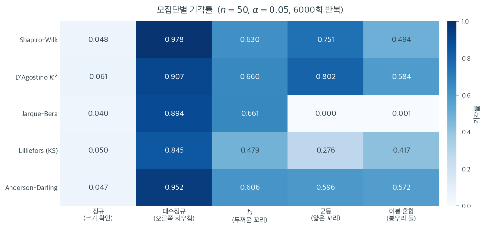

# 형식적 정규성 검정 모음

## 개요

형식적 정규성 검정은 자료가 정규분포에서 왔다는 가설에 찬성하거나 반대하는 객관적이고 정량적인 증거를 제공한다. 시각적 확인과 달리 검정통계량과 $p$값을 내놓아 선택한 유의수준에서 원칙 있는 판정을 가능하게 한다. 이 페이지는 가장 널리 쓰이는 검정들의 귀무가설, 강점, 표본크기 고려사항을 살펴본다.

---

## 1. 가설검정의 틀

모든 정규성 검정은 공통 구조를 갖는다. 귀무가설과 대립가설은

$$
H_0: X_1, \ldots, X_n \sim \mathcal{N}(\mu, \sigma^2) \quad (\text{어떤 } \mu, \sigma^2 \text{에 대해}), \qquad H_1: \text{자료가 정규분포를 따르지 않는다}.
$$

표본에서 검정통계량 $T$를 계산한다. $H_0$ 아래에서 $T$는 알려진(또는 표로 정리된) 분포를 갖는다. $p$값은

$$
p = P(T \geq T_{\text{obs}} \mid H_0),
$$

부등호의 방향은 검정마다 다르다. $p < \alpha$이면 $H_0$을 기각한다.

---

## 2. 흔한 검정 개관

| 검정 | 민감한 대상 | 표본크기 지침 | SciPy 함수 |
|---|---|---|---|
| Shapiro-Wilk | 일반적 이탈 | $n \leq 5000$에서 최선 | `stats.shapiro` |
| D'Agostino $K^2$ | 왜도와 첨도 | $n \geq 20$ | `stats.normaltest` |
| Jarque-Bera | 왜도와 첨도 | 큰 $n$(점근적) | `stats.jarque_bera` |
| Kolmogorov-Smirnov | 분포의 모양 | 모든 $n$. 모수를 알아야 함 | `stats.kstest` |
| Anderson-Darling | 꼬리 | 표로 정리된 임계값 | `stats.anderson` |
| Lilliefors | 모양(추정된 모수) | 모수 추정 시 KS를 보정 | 붓스트랩 또는 `lilliefors` |

<div class="exbox" markdown>

**보기 1.** <span class="diff easy" title="쉬움"></span> 다섯 검정을 한자리에서. $\mathcal{N}(0,1)$에서 $n = 100$개를 뽑아 다섯 검정을 모두 돌리면 전부 기각하지 않는다.

**(1)** 다섯 검정 가운데 **하나만 귀무가설이 다르다.** 어느 것인가. 자료를 $0.5$만큼 옮겨 다섯 결과가 어떻게 달라지는지 보고 가리시오.

**(2)** 모두 기각하지 않았다는 것이 "다섯 검정의 성능이 비슷하다"는 뜻인가. $t_5$(두꺼운 꼬리)와 표준화한 대수정규(치우침)를 대립으로 두고 각 검정의 검정력을 재어 비교하시오.

</div>

??? success "풀이"

    **(1) KS만 다르다. 자료를 옮기면 KS만 무너진다.** 같은 자료에 $+0.5$를 더해 다시 돌리면

    | 검정 | 원자료 | $+0.5$ |
    |---|---|---|
    | 샤피로–윌크 | $p = 0.1873$ | $p = 0.1873$ |
    | 다고스티노 $K^2$ | $p = 0.3738$ | $p = 0.3738$ |
    | 자크–베라 | $p = 0.4908$ | $p = 0.4908$ |
    | **KS (vs $\mathcal{N}(0,1)$)** | $p = 0.6465$ | $p = \mathbf{1.56\times10^{-5}}$ |
    | 앤더슨–달링 | $A^2 = 0.4494$ | $A^2 = 0.4494$ |

    이다. 네 검정은 소수 넷째 자리까지 **꼼짝도 하지 않고** KS만 $0.65$에서 $0.0000156$으로 떨어진다.

    까닭은 귀무가설의 모양이다. 네 검정은

    $$
    H_0: \text{자료가 } \mathcal{N}(\mu, \sigma^2)\text{에서 왔다 (어떤 } \mu, \sigma\text{에 대해서든)}
    $$

    를 묻고, 그래서 위치·척도 불변이다. 그런데 `args=(0, 1)`을 넘긴 KS는

    $$
    H_0: \text{자료가 } \mathcal{N}(0, 1)\text{에서 왔다}
    $$

    를 묻는다. 평균이 $0.5$인 정규자료는 **정규이지만 $\mathcal{N}(0,1)$은 아니므로** KS가 올바르게 기각한다. KS가 틀린 것이 아니라 **다른 질문에 답하는 것**이다.

    그러므로 이 표를 "다섯 정규성 검정의 비교"로 읽으면 안 된다. 네 개는 정규성 검정이고 KS 한 줄은 적합도 검정이다. 정규성을 묻는 KS를 이 자리에 넣으려면 모수를 추정하고 릴리포스 임계값을 써야 한다.

    **(2) 아니다. $t_5$에서 검정력이 $0.063$부터 $0.612$까지 열 배 벌어진다.** $n = 100$, $\alpha = 0.05$에서 4000번씩 재면

    | 대립 | 샤피로–윌크 | $K^2$ | 자크–베라 | KS | 앤더슨–달링 |
    |---|---|---|---|---|---|
    | $\mathcal{N}(0,1)$ — 크기 | $0.0558$ | $0.0580$ | $0.0440$ | $0.0475$ | $0.0475$ |
    | $t_5$ — 두꺼운 꼬리 | $0.5503$ | $0.5880$ | $\mathbf{0.6122}$ | $0.0630$ | $0.4710$ |
    | 표준화 대수정규 — 치우침 | $\mathbf{0.9990}$ | $0.9925$ | $0.9905$ | $0.4095$ | $0.9932$ |

    이다(몬테카를로 표준오차는 $0.05$ 근처에서 $0.0034$, $0.5$ 근처에서 $0.0079$).

    첫 줄은 **다섯 검정 모두 약속한 크기를 지킨다**는 확인이다. 다섯 수가 모두 $0.05$에서 몬테카를로 오차의 $2.4$배 안에 있다.

    아래 두 줄이 차이를 드러낸다. **두꺼운 꼬리에서는 자크–베라가 가장 강하다**($0.612$). 꼬리를 네제곱 적률로 직접 겨냥하기 때문이다. $K^2$이 $0.588$, 샤피로–윌크가 $0.550$, 앤더슨–달링이 $0.471$로 따른다. **치우침에서는 샤피로–윌크가 가장 강하다**($0.999$). 순서통계량 전체의 직선성을 보기 때문이다.

    KS는 두 경우 모두 꼴찌이고, $t_5$에서는 $0.063$으로 **크기 $0.0475$와 거의 구별되지 않는다.** 이유를 수로 짚을 수 있다. $t_5$와 $\mathcal{N}(0,1)$의 분포함수 최대 거리는

    $$
    \sup_x \lvert F_{t_5}(x) - \Phi(x)\rvert = 0.0305
    $$

    인데 $n = 100$에서 5% 기각에 필요한 $D$는 $1.36/\sqrt{100} = 0.1360$이다. **필요한 양의 $22\%$밖에 안 된다.** 표준화 대수정규는 같은 거리가 $0.0990$으로 $0.136$에 훨씬 가까워, 검정력이 $0.41$까지 올라간다. KS가 "둔감하다"는 말의 정체가 이 비교다.

    **실무적 결론.** 꼬리가 걱정이면 자크–베라나 $K^2$, 치우침이 걱정이면 샤피로–윌크, 무엇이 걱정인지 모르면 샤피로–윌크(두 대립에서 모두 상위권이다). **정규성 검정에 KS를 쓰는 것은 어느 경우에도 좋은 선택이 아니다.**

    ```python
    import numpy as np
    from scipy import stats

    # 참으로 정규인 자료에 다섯 검정을 모두 돌려 견준다. 모두 기각하지
    # 않아야 정상이다. 검정마다 무엇에 민감한지가 달라, 정규에서 벗어난
    # 자료로 바꿔 돌려 보면 차이가 드러난다.
    rng = np.random.default_rng(0)
    data = rng.normal(0, 1, size=100)

    # Shapiro-Wilk — 작은 표본에서 검정력이 가장 좋다. 두루 쓰기 좋은 기본값이다.
    W, p_sw = stats.shapiro(data)
    print(f"Shapiro-Wilk:     W = {W:.4f}, p = {p_sw:.4g}")

    # D'Agostino K^2 — 왜도와 첨도만 본다. 왜 기각되었는지 알기 쉽다.
    K2, p_k2 = stats.normaltest(data)
    print(f"D'Agostino K^2:   K2 = {K2:.4f}, p = {p_k2:.4g}")

    # Jarque-Bera — K^2 과 비슷하지만 표본이 아주 클 때라야 근사가 맞는다.
    JB, p_jb = stats.jarque_bera(data)
    print(f"Jarque-Bera:      JB = {JB:.4f}, p = {p_jb:.4g}")

    # KS — 모수를 못박은 경우에만 이 p-값이 맞다. 자료에서 추정했다면
    # Lilliefors 로 가야 한다.
    D, p_ks = stats.kstest(data, 'norm', args=(0, 1))
    print(f"KS (vs N(0,1)):   D = {D:.4f}, p = {p_ks:.4g}")

    # Anderson-Darling — 꼬리 쪽 이탈에 민감하다. p-값 대신 기각값 표를 준다.
    ad = stats.anderson(data, dist="norm")
    print(f"Anderson-Darling: A^2 = {ad.statistic:.4f}")
    for cv, sl in zip(ad.critical_values, ad.significance_level):
        print(f"  {sl:.0f}% critical value: {cv:.4f}")
    ```

    출력:

    ```text
    Shapiro-Wilk:     W = 0.9819, p = 0.1873
    D'Agostino K^2:   K2 = 1.9679, p = 0.3738
    Jarque-Bera:      JB = 1.4236, p = 0.4908
    KS (vs N(0,1)):   D = 0.0723, p = 0.6465
    Anderson-Darling: A^2 = 0.4494
      15% critical value: 0.5550
      10% critical value: 0.6320
      5% critical value: 0.7590
      2% critical value: 0.8850
      1% critical value: 1.0530
    ```

    자료를 실제로 $N(0,1)$에서 생성했으므로 다섯 검정 모두 정규성을 기각하지 않는다. Anderson-Darling 통계량 $0.449$도 가장 느슨한 15% 임계값 $0.555$보다 작다.

    자료를 옮겨 보고, 두 대립에 대한 검정력을 재어 본다.

    ```python
    import numpy as np
    from scipy import stats

    rng = np.random.default_rng(0)
    data = rng.normal(0, 1, size=100)
    n = data.size

    # (1) 다섯 검정 가운데 KS 만 귀무가설이 다르다. 자료를 0.5 만큼 옮겨 본다.
    shift = data + 0.5
    print("원자료와 0.5 옮긴 자료의 p 값")
    print(f"{'검정':<18}{'원자료':>12}{'+0.5':>12}")
    print(f"{'Shapiro-Wilk':<18}{stats.shapiro(data)[1]:>12.4g}{stats.shapiro(shift)[1]:>12.4g}")
    print(f"{'DAgostino K^2':<18}{stats.normaltest(data)[1]:>12.4g}{stats.normaltest(shift)[1]:>12.4g}")
    print(f"{'Jarque-Bera':<18}{stats.jarque_bera(data)[1]:>12.4g}{stats.jarque_bera(shift)[1]:>12.4g}")
    print(f"{'KS vs N(0,1)':<18}{stats.kstest(data, 'norm', args=(0, 1))[1]:>12.4g}"
          f"{stats.kstest(shift, 'norm', args=(0, 1))[1]:>12.4g}")
    print(f"{'Anderson A^2':<18}{stats.anderson(data).statistic:>12.4f}"
          f"{stats.anderson(shift).statistic:>12.4f}")

    # (2) 같은 n 에서 두 대립에 대한 검정력
    def power(draw, R, alpha=0.05):
        out = {k: 0 for k in ("SW", "K2", "JB", "KS", "AD")}
        for _ in range(R):
            x = draw()
            out["SW"] += stats.shapiro(x)[1] < alpha
            out["K2"] += stats.normaltest(x)[1] < alpha
            out["JB"] += stats.jarque_bera(x)[1] < alpha
            out["KS"] += stats.kstest(x, 'norm', args=(0, 1))[1] < alpha
            r = stats.anderson(x)
            out["AD"] += r.statistic > r.critical_values[2]
        return {k: v / R for k, v in out.items()}

    rg = np.random.default_rng(3)
    R = 4000
    print(f"\nn = {n}, alpha = 0.05, R = {R}  (MC SE 는 0.05 에서 0.0034)")
    rows = [("정규 N(0,1) — 크기", lambda: rg.standard_normal(n)),
            ("t_5 — 두꺼운 꼬리", lambda: rg.standard_t(5, n)),
            ("Lognormal(0,0.5) 표준화 — 치우침",
             lambda: (lambda z: (z - z.mean()) / z.std(ddof=1))(rg.lognormal(0, 0.5, n)))]
    print(f"{'대립':<34}{'SW':>8}{'K2':>8}{'JB':>8}{'KS':>8}{'AD':>8}")
    for name, d in rows:
        pw = power(d, R)
        print(f"{name:<34}{pw['SW']:>8.4f}{pw['K2']:>8.4f}{pw['JB']:>8.4f}"
              f"{pw['KS']:>8.4f}{pw['AD']:>8.4f}")
    ```

    출력:

    ```text
    원자료와 0.5 옮긴 자료의 p 값
    검정                         원자료        +0.5
    Shapiro-Wilk            0.1873      0.1873
    DAgostino K^2           0.3738      0.3738
    Jarque-Bera             0.4908      0.4908
    KS vs N(0,1)            0.6465   1.562e-05
    Anderson A^2            0.4494      0.4494

    n = 100, alpha = 0.05, R = 4000  (MC SE 는 0.05 에서 0.0034)
    대립                                      SW      K2      JB      KS      AD
    정규 N(0,1) — 크기                      0.0558  0.0580  0.0440  0.0475  0.0475
    t_5 — 두꺼운 꼬리                        0.5503  0.5880  0.6122  0.0630  0.4710
    Lognormal(0,0.5) 표준화 — 치우침          0.9990  0.9925  0.9905  0.4095  0.9932
    ```

    네 검정의 $p$값이 자료를 옮겨도 소수 넷째 자리까지 변하지 않고 KS만 네 자릿수 떨어지므로 (1)의 판정이 확인된다. 그리고 검정력 표의 첫 줄이 다섯 검정의 크기를 보증하므로 아래 두 줄의 비교가 공정하다. $\square$

---

## 3. 검정마다 잘 잡는 이탈이 다르다

위 보기는 자료가 정말 정규일 때 다섯 검정이 모두 기각하지 않는다는 것을 보였다. 서로 다른 검정이 왜 필요한지는 정규가 **아닌** 자료를 줘 봐야 드러난다. 아래 표는 $n = 50$인 표본을 네 가지 비정규 모집단에서 6000번씩 뽑아 다섯 검정의 기각률을 재어 색으로 칠한 것이다. 맨 왼쪽 열은 정규 모집단이므로 기각률이 $0.05$ 근처여야 한다(검정의 크기 확인). 나머지 네 열은 검정력이다.



왼쪽 열부터 읽자. 크기는 다섯 검정 모두 대체로 지켜진다($0.040$–$0.061$). 오른쪽으로 치우친 대수정규에서는 Shapiro-Wilk가 $0.978$로 가장 강하고 Anderson-Darling이 $0.952$로 뒤를 잇는다. 여기까지는 어느 검정을 쓰든 결론이 같다.

흥미로운 곳은 나머지 세 열이다. 두꺼운 꼬리($t_3$)에서는 Jarque-Bera $0.661$과 D'Agostino $K^2$ $0.660$이 Shapiro-Wilk $0.630$을 앞선다. 왜도·첨도만 보는 검정이 꼬리 문제에서는 오히려 유리한 것이다. 그런데 꼬리가 **얇은** 균등분포로 가면 Jarque-Bera가 $0.000$으로 무너진다. 6000번 중 한 번도 기각하지 못했다. $n = 50$에서 균등분포의 표본 초과첨도는 $-1.2$ 근처에 좁게 몰리는데, 이를 $JB = \frac{n}{6}\bigl(g_1^2 + g_2^2/4\bigr)$에 넣으면 $3.0$ 언저리가 되어 $\chi^2_2$의 95% 값 $5.99$에 닿지 못한다. 점근적 기준값이 이 표본크기에서 너무 크다는 뜻이다. 같은 자료를 D'Agostino $K^2$는 $0.802$로 잡아낸다. 유한표본 보정을 거친 변환을 쓰기 때문이다.

Kolmogorov-Smirnov(Lilliefors 보정)는 네 열 모두에서 꼴찌이거나 꼴찌에 가깝다($0.845$, $0.479$, $0.276$, $0.417$). 분포의 모든 지점을 똑같이 취급하느라 정규분포의 특정 구조를 전혀 쓰지 않기 때문이다. 정규성 검정으로 KS를 첫 번째 선택지로 삼을 이유는 거의 없다.

이 표가 주는 교훈은 분명하다. **"가장 좋은 정규성 검정"을 묻는 것은 "가장 좋은 렌즈"를 묻는 것과 같다.** 무엇을 보려는지에 달려 있다. 실무에서는 Shapiro-Wilk를 기본으로 두되, 기각되었을 때 왜 기각되었는지는 왜도·첨도와 Q-Q 그림으로 따로 읽는 것이 안전하다.

---

## 4. 검정 고르기

일률적으로 최선인 검정은 없다. 일반적인 지침은 다음과 같다.

- **작은 표본($n < 50$)**: Shapiro-Wilk가 폭넓은 대립가설에 대해 검정력이 가장 좋다.
- **중간 표본($50 \leq n \leq 5000$)**: Shapiro-Wilk나 Anderson-Darling이 선호된다. 치우침이나 첨도 문제가 의심되면 D'Agostino $K^2$가 좋은 전방위 선택이다.
- **큰 표본($n > 5000$)**: 어떤 검정이든 아주 작은 이탈에도 기각한다. 검정을 효과 크기 측도(표본왜도, 초과첨도)와 시각적 확인으로 보완하라.

---

## 5. 해석

유의한 결과(작은 $p$값)는 자료가 정규분포에서 왔을 가능성이 낮다는 뜻이지만, *어떻게* 벗어나는지는 알려주지 않는다. 형식적 검정은 언제나 시각적 진단과 함께 쓰라. 반대로 유의하지 않은 결과가 정규성을 증명하지도 않는다. 검정이 참된 대립가설에 대해 검정력이 부족했을 뿐일 수 있다.

---

## 연습문제

<div class="drillbox" markdown>

**연습문제 1.** <span class="diff easy" title="쉬움"></span> 표준정규 관측값 $n = 200$개를 생성하고 Shapiro-Wilk, D'Agostino $K^2$, Jarque-Bera 검정을 수행하라. $p$값을 보고하라. $\alpha = 0.05$에서 기각하는 검정이 있는가?

</div>

??? success "풀이"

    ```python
    import numpy as np
    from scipy import stats

    rng = np.random.default_rng(42)
    data = rng.normal(0, 1, size=200)

    W, p_sw = stats.shapiro(data)
    K2, p_k2 = stats.normaltest(data)
    JB, p_jb = stats.jarque_bera(data)

    print(f"Shapiro-Wilk:   p = {p_sw:.4g}")
    print(f"D'Agostino K^2: p = {p_k2:.4g}")
    print(f"Jarque-Bera:    p = {p_jb:.4g}")
    ```

    출력:

    ```text
    Shapiro-Wilk:   p = 0.4893
    D'Agostino K^2: p = 0.301
    Jarque-Bera:    p = 0.3226
    ```

    자료가 실제로 정규분포에서 왔으므로 세 $p$값이 모두 0.05를 훨씬 넘는다. 어느 검정도 기각하지 않는다. 정의상 각 검정은 $H_0$ 아래에서 5%의 확률로만 잘못 기각한다. $\square$

<div class="drillbox" markdown>

**연습문제 2.** <span class="diff med" title="중간"></span> 연습문제 1을 $\text{Lognormal}(0, 0.5)$ 분포에서 뽑아 반복하라. $p$값을 비교하고 오른쪽 치우침에 가장 민감한 검정이 무엇인지 설명하라.

</div>

??? success "풀이"

    ```python
    import numpy as np
    from scipy import stats

    rng = np.random.default_rng(42)
    data = rng.lognormal(0, 0.5, size=200)

    W, p_sw = stats.shapiro(data)
    K2, p_k2 = stats.normaltest(data)
    JB, p_jb = stats.jarque_bera(data)

    print(f"Shapiro-Wilk:   p = {p_sw:.4g}")
    print(f"D'Agostino K^2: p = {p_k2:.4g}")
    print(f"Jarque-Bera:    p = {p_jb:.4g}")
    ```

    출력:

    ```text
    Shapiro-Wilk:   p = 1.153e-12
    D'Agostino K^2: p = 1.664e-22
    Jarque-Bera:    p = 3.108e-107
    ```

    세 검정 모두 압도적으로 기각한다($p \ll 0.05$). 다만 여기서 **가장 작은 $p$값을 내는 것은 Shapiro-Wilk가 아니라 Jarque-Bera**($3.1 \times 10^{-107}$)이며, D'Agostino $K^2$가 그다음이다.

    이유는 대수정규분포의 이탈이 정확히 왜도와 첨도라는 두 적률에 집중되어 있고, 적률 기반 검정이 그것을 직접 겨냥하기 때문이다. $n = 200$이면 적률 추정이 충분히 안정적이므로 이 두 검정의 검정력이 매우 커진다.

    "Shapiro-Wilk가 언제나 가장 강력하다"는 통념은 **작은 표본**과 **이탈의 유형을 모를 때**에 해당한다. 이 예처럼 이탈이 왜도와 첨도로 뚜렷하고 표본이 충분하면 적률 기반 검정이 더 큰 증거를 낸다. $\square$

<div class="drillbox" markdown>

**연습문제 3.** <span class="diff med" title="중간"></span> Kolmogorov-Smirnov 검정이 귀무가설의 모수를 완전히 지정하도록 요구하는 이유를 설명하라. $\mu$와 $\sigma$를 자료에서 추정해 꽂아 넣으면 $p$값에 무슨 일이 일어나는가?

</div>

??? success "풀이"

    KS 검정은 경험적 CDF $F_n(x)$를 완전히 지정된 이론적 CDF $F_0(x)$와 비교한다. 그 임계값과 $p$값은 $F_0$이 자료를 보기 *전에* 고정되어 있다는 가정 아래에서 유도되었다. $\mu$와 $\sigma$를 같은 자료에서 추정하면 적합된 CDF $\hat{F}(x)$가 일반적인 $F_0$보다 구성상 $F_n$에 더 가까워진다. 그래서 KS 거리 $D_n$이 체계적으로 작아지고 $p$값이 부풀려지며 검정력이 떨어진다. 올바른 절차는 모수 추정을 반영하기 위해 모의실험이나 전용 표를 쓰는 Lilliefors 검정이다. $\square$

<div class="drillbox" markdown>

**연습문제 4.** <span class="diff med" title="중간"></span> 어떤 동료가 Shapiro-Wilk 검정이 기각하지 못했으니 자료가 "정규임이 증명되었다"고 주장한다. 제2종 오류와 검정력의 개념을 써서 짧게 반박하라.

</div>

??? success "풀이"

    $H_0$을 기각하지 못한 것은 $H_0$의 증명이 아니다. 유의하지 않은 $p$값은 자료가 정규성과 *양립 가능*하다는 뜻이지만, 검정이 구별할 검정력을 갖지 못한 여러 비정규 분포와도 양립 가능하다. 제2종 오류의 확률 $\beta$는 표본크기 $n$, 유의수준 $\alpha$, 참 대립분포에 의존한다. $n$이 작으면 검정력 $1 - \beta$가 상당히 낮을 수 있으므로 기각하지 못한 것에 담긴 정보가 거의 없다. 올바른 추론에는 검정력 분석이나 보조 증거(시각적 확인, 분야 지식)가 필요하다. $\square$

<div class="drillbox" markdown>

**연습문제 5.** <span class="diff med" title="중간"></span> $\alpha = 0.05$에서 Shapiro-Wilk 검정의 경험적 크기를 추정하는 몬테카를로 실험을 설계하라. $\mathcal{N}(0,1)$에서 크기 $n = 50$인 표본 10,000개를 뽑아 검정을 적용하고 기각률을 보고하라. 0.05에 얼마나 가까운가?

</div>

??? success "풀이"

    ```python
    import numpy as np
    from scipy import stats

    rng = np.random.default_rng(0)
    n, reps, alpha = 50, 10000, 0.05
    rejections = 0

    for _ in range(reps):
        x = rng.normal(0, 1, size=n)
        _, p = stats.shapiro(x)
        if p < alpha:
            rejections += 1

    empirical_size = rejections / reps
    print(f"Empirical size: {empirical_size:.4f}")
    ```

    출력:

    ```text
    Empirical size: 0.0487
    ```

    경험적 기각률 $0.0487$이 $0.05$에 매우 가깝다. Shapiro-Wilk 검정의 크기가 올바르게 조정되어 있음을 확인해 준다. $H_0$ 아래에서 약 $\alpha \times 100\%$의 비율로 기각한다는 뜻이다. 0.05에서 벗어난 부분은 몬테카를로 표집오차 때문이며, 그 크기는 $\sqrt{\alpha(1-\alpha)/\text{reps}} = \sqrt{0.05 \times 0.95/10000} \approx 0.0022$이다. 관측된 편차 $0.0013$은 이 오차 범위 안에 있다. $\square$

<div class="drillbox" markdown>

**연습문제 6.** <span class="diff med" title="중간"></span> 3절은 $n = 50$인 균등분포 표본에서 Jarque-Bera의 기각률이 $0.000$(6000번 중 0번)이라고 보고한다. 균등분포의 왜도는 $0$이고 초과첨도는 정확히 $-6/5$이다. $JB = \frac{n}{6}\bigl(g_1^2 + g_2^2/4\bigr)$와 $\chi^2_2$의 95% 값 $5.9915$를 써서 다음에 답하라.

**(1)** $g_1 = 0$일 때 Jarque-Bera가 5%에서 기각하려면 표본초과첨도 $g_2$가 얼마나 커야 하는가. $n = 50$에서 그 값을 구하라.

**(2)** 균등분포의 $g_2$가 모집단 값 $-6/5$ 근처에 몰린다고 보면, Jarque-Bera가 균등분포를 기각할 수 있게 되는 가장 작은 표본크기는 얼마인가.

**(3)** 6000번 중 한 번도 기각하지 못한 것은 모의실험의 우연인가, $n = 50$에서는 구조적으로 불가능한 일인가. $n = 50$인 균등표본에서 $g_2$의 표준편차가 $0.18$ 정도임을 써서 답하라.

</div>

??? success "풀이"

    **(1) $\lvert g_2 \rvert > 1.6959$ 가 필요하다.** $g_1 = 0$을 넣으면

    $$
    JB = \frac{n}{6}\cdot\frac{g_2^2}{4} = \frac{n\,g_2^2}{24} > 5.9915
    \iff g_2^2 > \frac{24 \times 5.9915}{n} = \frac{143.797}{n}
    $$

    이다. $n = 50$이면 $g_2^2 > 2.87594$, 즉 $\lvert g_2 \rvert > 1.6959$이다.

    이 값을 균등분포가 실제로 내놓는 $g_2 \approx -1.2$와 견주면 3절의 수가 그대로 나온다.

    $$
    JB \approx \frac{50}{24}\times(-1.2)^2 = \frac{50 \times 1.44}{24} = 3.00
    $$

    3절이 "$3.0$ 언저리가 되어 $\chi^2_2$의 95% 값 $5.99$에 닿지 못한다"고 쓴 것이 이것이다.

    **(2) $n = 100$.** 모집단 값 $\lvert \gamma_2 \rvert = 6/5$를 그대로 쓸 수 있다고 보면 필요조건은

    $$
    \frac{6}{5} > \sqrt{\frac{143.797}{n}} \iff n > \frac{143.797}{1.44} = 99.86,
    $$

    따라서 $n = 100$이다. 달리 보면 $JB \approx \frac{n}{24}(1.2)^2 = 0.06\,n$이므로 통계량이 $n$에 **정비례**해서 자라고, $5.9915/0.06 = 99.86$에서 선을 넘는다. $n = 50$은 필요한 표본크기의 정확히 절반이다.

    **(3) 구조적으로 불가능하다.** 기각에 필요한 $\lvert g_2 \rvert = 1.6959$는 균등표본의 $g_2$가 몰려 있는 자리($-1.2$ 근처, 표준편차 $0.18$)에서

    $$
    \frac{1.6959 - 1.2}{0.18} \approx 2.8
    $$

    표준편차만큼 떨어져 있다. 게다가 $g_2$에는 $g_2 \ge -2$라는 하한이 있어 그 방향의 꼬리가 정규보다 얇으므로, 실제 초과확률은 정규근사로 읽은 $0.003$보다도 훨씬 작다(2만 번 모의에서 한 번, $10^{-4}$ 아래). 6000번에 한 번도 나오지 않는 것이 당연하다.

    **왜 이렇게 되는가.** Jarque-Bera는 $g_2$를 **점근적** 표준편차 $\sqrt{24/n} = 0.693$으로 재는데, 균등분포가 줄 수 있는 신호는 $\lvert \gamma_2 \rvert = 1.2$가 전부여서 신호 대 잡음비가 $1.2/0.693 = 1.73$에 머문다. 양쪽검정에 필요한 $1.96$에 못 미친다. 같은 자료를 D'Agostino $K^2$가 $0.802$로 잡아내는 것은 유한표본에서 실제로 훨씬 작은 $g_2$의 산포를 쓰기 때문이다. 균등분포에서 Jarque-Bera에게 모자랐던 것은 자료가 아니라 $n$이다. $\square$

<div class="drillbox" markdown>

**연습문제 7.** <span class="diff med" title="중간"></span> 보기 1의 (2)는 $\sup_x \lvert F_{t_5}(x) - \Phi(x) \rvert = 0.0305$, 표준화 대수정규에서 같은 거리가 $0.0990$이고, $n = 100$에서 5% 기각에 필요한 $D$가 $1.36/\sqrt{100} = 0.1360$이라고 했다.

**(1)** 두 대립 각각에 대해, 극한거리가 임계값에 닿는 가장 작은 표본크기를 구하라.

**(2)** 그 값을 보기 1 (2) 표의 $n = 100$ 검정력 $0.0630$($t_5$)과 $0.4095$(표준화 대수정규)와 견주어 설명하라.

**(3)** 보기 1 (2)의 코드는 대수정규 줄에서 **표본평균과 표본표준편차로 표준화한** 자료를 $\mathcal{N}(0,1)$에 견준다. 연습문제 3에 따르면 이 $p$값은 어느 쪽으로 틀리는가. 그래서 $0.4095$는 참 검정력의 과소평가인가 과대평가인가. 3절의 KS 열과 견주어 확인하라.

</div>

??? success "풀이"

    **(1) $t_5$는 $n = 1989$, 표준화 대수정규는 $n = 189$.** 필요조건은 $1.36/\sqrt{n} \le \Delta$, 즉 $n \ge (1.36/\Delta)^2$이다.

    $$
    t_5: \ n \ge \left(\frac{1.36}{0.0305}\right)^2 = 1988.3, \qquad
    \text{대수정규}: \ n \ge \left(\frac{1.36}{0.0990}\right)^2 = 188.7
    $$

    이므로 각각 $n = 1989$, $n = 189$이다. 두 대립에 필요한 표본크기가 **열 배** 넘게 차이 난다. 거리가 세 배 남짓 차이 나는 것이 제곱되어 들어오기 때문이다.

    **(2) $n = 100$은 $t_5$에 필요한 양의 $5\%$, 대수정규에 필요한 양의 $53\%$다.** $t_5$에서 $D_n$이 모아 올 수 있는 결정적인 양은 $0.0305$뿐이고 임계값은 $0.1360$이다. 그 간격 $0.1055$를 경험분포의 요동이 메워야 하는데 요동의 크기는 $O(n^{-1/2}) \approx 0.1$ 수준이라 거의 일어나지 않는다. 그래서 기각률이 $0.0630$으로 크기 $0.0475$와 사실상 구별되지 않는다.

    대수정규는 사정이 다르다. 결정적인 양 $0.0990$이 임계값 $0.1360$의 $73\%$를 이미 채우므로 남은 $0.0370$만 요동이 보태면 되고, 표본의 절반쯤에서 그 일이 일어나 기각률이 $0.4095$가 된다. 거꾸로 $n = n^{*}$ 근처에서는 $D_n$이 극한거리에 **양의 요동을 더한** 값이 되므로 검정력이 이미 상당히 높다(모의로 재면 $t_5$, $n = 1989$에서 $0.95$다).

    **(3) $p$값이 부풀려지므로 $0.4095$는 과소평가다.** 모수를 자료에서 추정해 꽂으면 적합된 분포함수가 경험분포함수에 끌려가 $D_n$이 체계적으로 작아지고, 그런데도 모수를 아는 경우의 임계값 $1.36/\sqrt{n}$을 쓰므로 검정이 **보수적**이 된다. 즉 참 검정력은 $0.4095$보다 크다.

    3절의 표가 이것을 수로 확인해 준다. 거기서는 같은 대수정규 대립에 **릴리포스 보정을 한** KS가 $n = 50$에서 $0.845$를 낸다. 표본크기가 절반인데 검정력이 두 배다. 보정을 생략한 대가가 검정력의 절반이라는 뜻이고, 연습문제 3이 말한 "검정력이 떨어진다"의 크기가 바로 이것이다. $\square$

<div class="drillbox" markdown>

**연습문제 8.** <span class="diff hard" title="어려움"></span> Jarque-Bera는 3차·4차 적률만 본다. 그렇다면 왜도와 초과첨도가 **둘 다 정확히 0**인데 정규가 아닌 모집단을 만들면 어떻게 될지 보자. 섞음분포

$$
X \sim \tfrac{1}{2}\,\mathcal{N}(0, 1) + \tfrac{1}{2}\,\text{Unif}(-c,\, c), \qquad c > 0
$$

을 생각한다(절반의 확률로 표준정규에서, 절반의 확률로 균등분포에서 뽑는다).

**(1)** 이 분포의 왜도가 $0$임을 말하고, 초과첨도가 $0$이 되는 $c$를 구하라. $u = c^2$으로 두면 $u$의 이차방정식이 된다. 두 근 가운데 큰 것을 쓰라.

**(2)** 그 $c$로 $n = 200$인 표본을 10000개 뽑아 Jarque-Bera, D'Agostino $K^2$, Anderson-Darling, Shapiro-Wilk의 $\alpha = 0.05$ 기각률을 재어라. Jarque-Bera의 기각률을 검정의 크기 $0.05$와 견주어 해석하라.

</div>

??? success "풀이"

    **(1) $c = \sqrt{15 + 6\sqrt{5}} = 5.33070$.** 두 성분이 모두 $0$을 중심으로 대칭이므로 섞음분포도 대칭이고 평균이 $0$이다. 따라서 홀수차 중심적률이 모두 $0$이고 $\gamma_1 = 0$이다.

    적률은 성분 적률의 가중평균이다. $\mathcal{N}(0,1)$은 $m_2 = 1$, $m_4 = 3$이고 $\text{Unif}(-c,c)$는 $m_2 = c^2/3$, $m_4 = c^4/5$이므로

    $$
    m_2 = \frac{1}{2} + \frac{c^2}{6}, \qquad m_4 = \frac{3}{2} + \frac{c^4}{10}.
    $$

    초과첨도가 $0$이라는 것은 $m_4 = 3m_2^2$이라는 뜻이다. $u = c^2$으로 두면

    $$
    \frac{3}{2} + \frac{u^2}{10} = 3\left(\frac{1}{2} + \frac{u}{6}\right)^2 = \frac{3}{4} + \frac{u}{2} + \frac{u^2}{12}
    $$

    이고, $u^2$ 항을 모으면 $\left(\frac{1}{10} - \frac{1}{12}\right)u^2 = \frac{u^2}{60}$이므로

    $$
    \frac{u^2}{60} = \frac{u}{2} - \frac{3}{4} \iff u^2 - 30u + 45 = 0 \iff u = 15 \pm \sqrt{225 - 45} = 15 \pm 6\sqrt{5}.
    $$

    큰 근 $u = 15 + 6\sqrt{5} = 28.4164$를 쓰면 $c = 5.33070$이다. 확인하면

    $$
    m_2 = \frac{1}{2} + \frac{28.4164}{6} = 5.236068, \qquad
    m_4 = \frac{3}{2} + \frac{28.4164^2}{10} = 82.24922 = 3 \times 5.236068^2
    $$

    로 정확히 맞는다. (작은 근 $u = 15 - 6\sqrt{5} = 1.5836$, 즉 $c = 1.25841$도 같은 성질을 갖는다. 다만 이쪽은 정규에 가까운 모양이어서 Shapiro-Wilk도 잡기 어렵다.)

    **(2) Jarque-Bera는 $0.0038$, Shapiro-Wilk는 $0.9633$으로 갈라진다.**

    ```python
    import numpy as np
    from scipy import stats

    # 3차·4차 적률이 정규와 똑같은 비정규 모집단:
    #   0.5 * N(0,1) + 0.5 * Unif(-c, c),  c = sqrt(15 + 6 sqrt 5)
    # 대칭이므로 gamma_1 = 0 이고, c 를 위와 같이 잡으면 초과첨도도 0 이다.
    c = np.sqrt(15 + 6 * np.sqrt(5))
    m2 = 0.5 * 1 + 0.5 * c**2 / 3
    m4 = 0.5 * 3 + 0.5 * c**4 / 5
    print(f"c = {c:.6f},  분산 = {m2:.6f},  4차적률 = {m4:.6f}")
    print(f"초과첨도 = m4/m2^2 - 3 = {m4 / m2**2 - 3:.2e}")

    def draw(rng, n):
        pick = rng.random(n) < 0.5
        return np.where(pick, rng.standard_normal(n), rng.uniform(-c, c, n))

    rng = np.random.default_rng(0)
    n, R, alpha = 200, 10000, 0.05
    cnt = {k: 0 for k in ("SW", "JB", "K2", "AD")}
    g1 = np.empty(R)
    g2 = np.empty(R)
    for r in range(R):
        x = draw(rng, n)
        cnt["SW"] += stats.shapiro(x)[1] < alpha
        cnt["JB"] += stats.jarque_bera(x)[1] < alpha
        cnt["K2"] += stats.normaltest(x)[1] < alpha
        res = stats.anderson(x)
        cnt["AD"] += res.statistic > res.critical_values[2]
        g1[r] = stats.skew(x)
        g2[r] = stats.kurtosis(x)

    print(f"\nn = {n}, alpha = 0.05, R = {R}")
    print(f"표본왜도 평균   g1 = {g1.mean():+.4f}")
    print(f"표본초과첨도 평균 g2 = {g2.mean():+.4f}")
    print(f"{'검정':<16}{'기각률':>10}")
    for k in ("JB", "K2", "AD", "SW"):
        print(f"{k:<16}{cnt[k] / R:>10.4f}")
    ```

    출력:

    ```text
    c = 5.330704,  분산 = 5.236068,  4차적률 = 82.249224
    초과첨도 = m4/m2^2 - 3 = -4.44e-16

    n = 200, alpha = 0.05, R = 10000
    표본왜도 평균   g1 = +0.0003
    표본초과첨도 평균 g2 = +0.0096
    검정                     기각률
    JB                  0.0038
    K2                  0.0030
    AD                  0.9428
    SW                  0.9633
    ```

    표본왜도와 표본초과첨도의 평균이 $+0.0003$과 $+0.0096$으로 $0$에 붙어 있다. 설계한 대로다. 그래서 적률만 보는 두 검정은 볼 것이 없고, 기각률이 약속한 크기 $0.05$보다도 낮은 $0.0038$과 $0.0030$으로 내려간다(유한표본 영분포가 보수적인 쪽이라 그렇다). **적률 기반 검정에게 이 모집단은 정규와 구별되지 않는다.**

    그런데 이 분포는 정규와 전혀 다르다. 가운데 좁은 봉우리에 $\pm 5.33$까지 평평한 판이 깔려 있고, 밀도의 모양 자체가 정규와 닮은 데가 없다. 순서통계량 전체의 직선성을 보는 Shapiro-Wilk는 $0.9633$, 꼬리를 저울질하는 Anderson-Darling은 $0.9428$로 거의 언제나 잡아낸다.

    **교훈.** 적률 두 개는 분포를 결정하지 못한다. "Jarque-Bera가 기각하지 못했다"는 말은 "3차·4차 적률이 정규와 어울린다"는 말일 뿐이며, 그것으로 정규성을 말할 수 없다. 5절의 "유의하지 않은 결과가 정규성을 증명하지 않는다"의 가장 극적인 형태이고, 여기서는 표본크기를 아무리 키워도 고쳐지지 않는다. $\square$

<div class="drillbox" markdown>

**연습문제 9.** <span class="diff hard" title="어려움"></span> 모집단의 왜도 $\gamma_1$과 초과첨도 $\gamma_2$가 고정되어 있고 $g_1 \to \gamma_1$, $g_2 \to \gamma_2$(확률수렴)라 하자. $\Delta = \gamma_1^2 + \gamma_2^2/4$로 쓴다.

**(1)** Jarque-Bera 통계량의 극한값이 $\chi^2_{2,\,0.95} = 5.9915$를 넘는 가장 작은 표본크기 $n^{*}$를 $\Delta$로 적어라.

**(2)** $\text{Lognormal}(0, \sigma)$의 왜도와 초과첨도는 $\omega = e^{\sigma^2}$으로 쓸 때

$$
\gamma_1 = (\omega + 2)\sqrt{\omega - 1}, \qquad \gamma_2 = \omega^4 + 2\omega^3 + 3\omega^2 - 6
$$

이다. $\sigma = 0.1$에 대해 $n^{*}$를 구하라.

**(3)** 연습문제 8의 섞음분포에서는 $n^{*}$가 얼마인가.

**(4)** 왜도가 한 표본 $t$ 절차의 포함률을 틀어지게 하는 크기는 $O(\gamma_1/\sqrt{n})$이다. (2)의 $n = n^{*}$에서 그 값을 구하고, 4절의 "큰 표본에서는 어떤 검정이든 아주 작은 이탈에도 기각한다"는 경고와 어떻게 이어지는지 쓰라.

</div>

??? success "풀이"

    **(1)** $g_1 \to \gamma_1$, $g_2 \to \gamma_2$이므로

    $$
    JB = \frac{n}{6}\left(g_1^2 + \frac{g_2^2}{4}\right) \approx \frac{n\,\Delta}{6}
    $$

    이고, 이 값이 $5.9915$를 넘는 조건은 $n > 6 \times 5.9915/\Delta = 35.9488/\Delta$이다. 따라서

    $$
    n^{*} = \left\lceil \frac{35.9488}{\Delta} \right\rceil \qquad (\Delta > 0).
    $$

    통계량이 $n$에 **정비례**하는 것이 핵심이다. 이탈의 크기 $\Delta$가 아무리 작아도 $n$을 키우면 언제든 선을 넘는다.

    **(2) $n^{*} = 369$.** $\sigma = 0.1$이면 $\omega = e^{0.01} = 1.0100502$이고

    $$
    \gamma_1 = 3.0100502 \times \sqrt{0.0100502} = 3.0100502 \times 0.1002506 = 0.301759,
    $$

    $$
    \gamma_2 = 1.0408108 + 2.0609091 + 3.0606040 - 6 = 0.162324
    $$

    이다. 그러면

    $$
    \Delta = 0.301759^2 + \frac{0.162324^2}{4} = 0.0910585 + 0.0065873 = 0.0976458,
    $$

    $$
    n^{*} = \left\lceil \frac{35.9488}{0.0976458} \right\rceil = \lceil 368.16 \rceil = 369.
    $$

    $n = n^{*}$에서는 극한값이 임계값과 같으므로 기각률이 $1/2$ 근처여야 하는데, 실제로 모의로 재면 $0.49$가 나온다. 왜도 $0.30$은 Q-Q 그림에서 눈으로 알아보기도 어려운 이탈인데 표본 369개면 절반의 확률로 유의해진다.

    **(3) $n^{*} = \infty$.** 연습문제 8의 섞음분포는 $\gamma_1 = 0$, $\gamma_2 = 0$이므로 $\Delta = 0$이다. 그러면 $JB$의 극한값이 $0$이고, 실제로는 영가설 아래의 극한분포 $\chi^2_2$를 그대로 따른다. 기각률이 $n$과 함께 커지지 않고 영원히 $0.05$ 근처(연습문제 8에서 본 $0.0038$)에 머문다. **Jarque-Bera는 이 대립에 대해 일치검정이 아니다.**

    **(4) $0.301759/\sqrt{369} = 0.0157$.** $n = 369$에서 Jarque-Bera는 절반의 확률로 "정규가 아니다"라고 외치는데, 같은 자리에서 $t$ 구간의 포함률이 틀어지는 크기는 $1.6$퍼센트포인트 정도다. $n$을 더 키우면 두 양이 **반대 방향으로** 움직인다. $n = 10^4$에서

    $$
    JB \approx \frac{10^4 \times 0.0976458}{6} = 162.7, \qquad p = P(\chi^2_2 > 162.7) = 4.6 \times 10^{-36}
    $$

    으로 증거는 자릿수로 커지는데, 포함률 오차는 $0.301759/100 = 0.003$으로 줄어든다. 즉 $n \to \infty$에서 검정은 점점 확실하게 기각하고 절차는 점점 멀쩡해진다.

    이것이 4절 경고의 정체다. 검정의 물음은 "정확히 정규인가"이고 그 답은 $n$이 커질수록 또렷해진다. 실무의 물음은 "이 절차가 견딜 만큼 정규에 가까운가"이고 그 답은 $n$이 커질수록 좋아진다. 두 물음을 섞으면 큰 표본에서 쓸모없이 작은 이탈 때문에 멀쩡한 절차를 버리게 된다. $\square$

<div class="drillbox" markdown>

**연습문제 10.** <span class="diff hard" title="어려움"></span> 연습문제 9의 결론을 수로 확인한다. $\text{Lognormal}(0, 0.1)$($\gamma_1 = 0.3018$)에서 $n = 20, 100, 1000, 5000$으로 표본을 20000개씩 뽑아 다음 두 가지를 **함께** 재어라.

- Shapiro-Wilk의 $\alpha = 0.05$ 기각률
- 모평균 $e^{\sigma^2/2}$에 대한 95% $t$ 구간 $\bar{X} \pm t_{n-1,\,0.975}\, S/\sqrt{n}$의 포함률

두 열이 각각 어디로 가는지 보고, 4절의 "큰 표본" 지침과 5절의 마지막 문장을 이 표로 다시 쓰라.

</div>

??? success "풀이"

    ```python
    import numpy as np
    from scipy import stats

    # Lognormal(0, 0.1): 왜도 0.3018, 초과첨도 0.1623 — 눈으로는 정규와 구별되지
    # 않을 만큼 작은 이탈이다. n 을 키우며 (1) 샤피로-윌크 기각률과
    # (2) 평균에 대한 95% t 구간의 포함률을 함께 잰다.
    sig = 0.1
    mu_true = np.exp(sig**2 / 2)          # 모평균 E X = exp(sigma^2/2)
    gamma1 = (np.exp(sig**2) + 2) * np.sqrt(np.exp(sig**2) - 1)
    print(f"모집단 왜도 gamma_1 = {gamma1:.4f},  모평균 = {mu_true:.6f}")

    rng = np.random.default_rng(0)
    R, alpha = 20000, 0.05
    print(f"\nR = {R}  (MC SE: 기각률 0.5 에서 0.0035, 포함률 0.95 에서 0.0015)")
    print(f"{'n':>6}{'SW 기각률':>12}{'t 구간 포함률':>16}")
    for n in (20, 100, 1000, 5000):
        tcrit = stats.t.ppf(0.975, n - 1)
        rej = cov = 0
        for _ in range(R):
            x = rng.lognormal(0, sig, n)
            rej += stats.shapiro(x)[1] < alpha
            half = tcrit * x.std(ddof=1) / np.sqrt(n)
            cov += abs(x.mean() - mu_true) < half
        print(f"{n:>6}{rej / R:>12.4f}{cov / R:>16.4f}")
    ```

    출력:

    ```text
    모집단 왜도 gamma_1 = 0.3018,  모평균 = 1.005013

    R = 20000  (MC SE: 기각률 0.5 에서 0.0035, 포함률 0.95 에서 0.0015)
         n      SW 기각률        t 구간 포함률
        20      0.0710          0.9510
       100      0.1797          0.9487
      1000      0.9322          0.9494
      5000      1.0000          0.9520
    ```

    **왼쪽 열은 $0.05$에서 $1$까지 간다.** $n = 20$에서는 기각률이 $0.0710$으로 크기 $0.05$보다 조금 큰 정도이고, 왜도 $0.30$을 사실상 보지 못한다. $n = 1000$에서 $0.9322$, $n = 5000$에서는 20000번 가운데 **한 번도 통과하지 못한다**($1.0000$). 모집단도 이탈도 그대로인데 판정이 완전히 뒤집혔다. 바뀐 것은 $n$ 하나다. 연습문제 9가 Jarque-Bera로 계산한 $n^{*} = 369$가 가리킨 자리를 Shapiro-Wilk도 비슷하게 지난다($n = 100$에서 $0.18$, $n = 1000$에서 $0.93$).

    **오른쪽 열은 움직이지 않는다.** 네 포함률 $0.9510$, $0.9487$, $0.9494$, $0.9520$이 모두 명목값 $0.95$에서 몬테카를로 오차 $0.0015$의 두 배 안에 있다. $n = 5000$에서 정규성 검정이 20000번 내내 기각하는 동안, 그 자료로 만든 $t$ 구간은 약속한 $95\%$를 지킨다. **"정규성 검정이 기각한다"는 사실이 "$t$ 절차가 망가진다"를 뜻하지 않는다.**

    그래서 4절의 지침("큰 표본에서는 검정을 효과 크기 측도와 시각적 확인으로 보완하라")은 취향이 아니라 필수다. 여기서 효과 크기는 $\gamma_1 = 0.3018$이라는 한 수이고, 그것이 실무에 주는 피해는 포함률 $0.95 \to 0.949$로 측정된다. $n$이 무엇이든 이 두 수는 변하지 않는데 $p$값만 변한다.

    5절의 마지막 문장에는 한 줄을 더해야 한다. 유의한 결과는 *어떻게* 벗어나는지를 알려주지 않을 뿐 아니라 **얼마나** 벗어나는지도 알려주지 않는다. $p$값은 이탈의 크기와 표본크기를 한 수에 섞어 놓아서 둘을 되돌릴 수 없다. 이탈의 크기를 알고 싶으면 $\gamma_1$, $\gamma_2$, Q-Q 그림처럼 $n$에 따라 변하지 않는 양을 따로 보고해야 한다. $\square$

---

## 정리하며

형식적 정규성 검정을 **한 표로** 비교한다.

| 검정 | 강점 | 주의 |
|---|---|---|
| 샤피로–윌크 | 소·중 표본에서 최강 | $n\le5000$ |
| 앤더슨–달링 | 꼬리에 민감 | $p$ 값 대신 임계값 |
| 릴리포스 | 모수 추정 상황에 맞음 | 검정력 낮음 |
| 다고스티노 $K^2$ | 이탈 방향을 알려 줌 | $n\ge20$ |
| 자크–베라 | 계산 단순, 계량경제 표준 | 대표본 전용 |

- **$H_0$ 이 "정규다"라는 점이 공통이다.** 따라서 **기각하지 못한 것이 정규임을 증명하지 않는다.** 표본이 작아서일 수 있다.
- **여러 검정을 돌려 유의한 것만 고르는 것은 $p$-해킹이다.** 사전에 하나를 정해 두는 것이 옳다.
- **검정의 답과 실무의 물음이 다르다.** 검정은 "정확히 정규인가"를 묻지만 실무는 "이 절차가 견딜 만큼 정규에 가까운가"를 묻는다.
- **그림과 함께 보고한다.** 검정 결과만으로는 이탈의 성격을 알 수 없다.

다음 절부터 각 검정의 **구현**으로 넘어간다.
