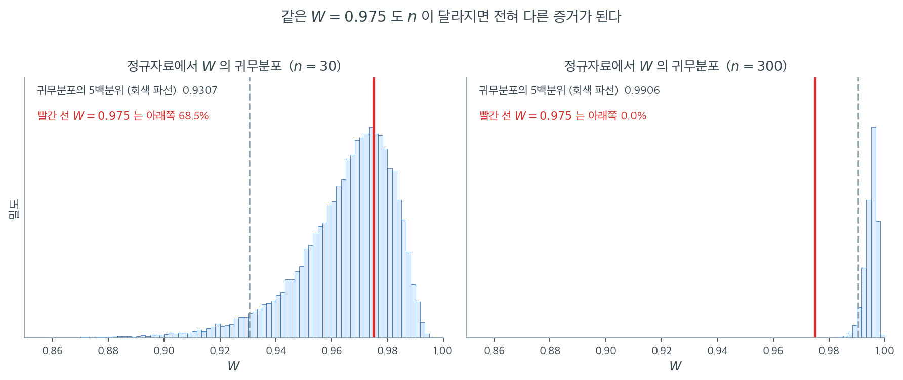

# Shapiro-Wilk 검정

## 개요

Shapiro-Wilk 검정은 자료의 정규성을 평가하는 널리 쓰이는 방법이다. 검정통계량과 그에 대응하는 $p$값을 계산하여 표본자료가 정규분포를 따르는 모집단에서 왔는지 판정한다.

### 가설

- **귀무가설** ($H_0$): 자료가 정규분포를 따른다.
- **대립가설** ($H_1$): 자료가 정규분포를 따르지 않는다.

---

## 1. 검정통계량 W의 계산

Shapiro-Wilk 검정통계량 $W$는 다음 단계로 계산한다.

1. **자료 정렬**: $X_1, X_2, \dots, X_n$을 오름차순으로 정렬하여 $X_{(1)} \leq X_{(2)} \leq \dots \leq X_{(n)}$을 얻는다.

2. **기댓값**: 표준정규분포에서 크기 $n$인 표본의 순서통계량의 기댓값 $m_i$를 계산한다. 이 값들의 벡터를 $\mathbf{m}^\top = [m_1, m_2, \dots, m_n]$이라 하자.

3. **공분산행렬**: 정규분포 순서통계량의 공분산행렬 $\Sigma$를 이용해 가중치 $a_i$를 만든다. 이 가중치들은 정규성 이탈에 대한 검정의 민감도를 최적화하도록 계산된다. 가중치 벡터를 $\mathbf{a}^\top = [a_1, a_2, \dots, a_n]$이라 하면

    $$
    [a_1, a_2, \dots, a_n] = \frac{[m_1, m_2, \dots, m_n]\Sigma^{-1}}{\sqrt{[m_1, m_2, \dots, m_n]\Sigma^{-1}\Sigma^{-1}[m_1, m_2, \dots, m_n]^\top}}
    $$

4. **검정통계량 $W$**: 검정통계량 $W$를 다음과 같이 계산한다.

    $$
    W = \frac{\left( \sum_{i=1}^{n} a_i X_{(i)} \right)^2}{\sum_{i=1}^{n} (X_i - \bar{X})^2}
    $$

    여기서

    - $X_{(i)}$는 $i$번째로 정렬된 자료점,
    - $a_i$는 벡터 $\mathbf{a}$의 대응하는 가중치,
    - $\bar{X}$는 표본평균이다.

    분자는 정렬된 표본의 선형결합을 제곱한 것이고 분모는 표본자료의 전체 변동이다.

---

이 정규화에 의해 $\sum_i a_i^2 = 1$이다. 또한 $m$이 반대칭이므로($m_i = -m_{n+1-i}$) $a$도 반대칭이고 따라서 $\sum_i a_i = 0$이다. 두 성질 모두 뒤에서 쓰인다.

## 2. W를 Q-Q 그림으로 읽기

위 공식만 보면 $W$가 무엇을 재는지 감이 잘 오지 않는다. 그러나 정체는 단순하다. 정규 점수 $m_i$를 가로축에, 정렬한 자료 $X_{(i)}$를 세로축에 놓은 산점도 — 곧 Q-Q 그림 — 의 **직선성**이다. 분자의 $\sum a_i X_{(i)}$는 자료를 정규 점수 방향으로 사영한 길이이고, 분모는 자료 전체의 길이이다. 둘의 비는 두 벡터가 이루는 각의 코사인 제곱, 곧 상관계수의 제곱에 다름 아니다.

아래 그림은 같은 $n = 60$으로 세 가지 모집단에서 뽑은 표본의 Q-Q 그림에 $W$와 상관계수 제곱 $r^2$을 나란히 적은 것이다.


정규 표본에서는 점들이 파선 주위에 붙어 있고 $W = 0.9835$, $r^2 = 0.9849$로 두 값이 거의 같다. 대수정규 표본은 오른쪽 위가 위로 휘어 올라가는 전형적인 치우침 패턴을 보이고 $W = 0.8544$, $r^2 = 0.8516$으로 함께 떨어진다. $t_3$ 표본은 가운데가 직선에 잘 붙어 있는데도 양끝이 각각 아래와 위로 벌어지는 S자를 그리며 $W = 0.9172$, $r^2 = 0.9032$가 된다.

세 경우 모두 $W$와 $r^2$이 소수 둘째 자리까지 일치한다. 정확히 같지는 않다. $r^2$은 정규 점수 $m_i$를 그대로 가중치로 쓰는 반면 $W$는 순서통계량의 공분산 $\Sigma$까지 반영한 $a_i$를 쓰기 때문이다. 그 보정이 $W$를 약간 더 예민하게 만들지만, 실무적 직관으로는 **"$W$는 Q-Q 그림이 직선에서 얼마나 벗어났는지를 0과 1 사이 숫자 하나로 요약한 것"**으로 읽어도 충분하다.

이 관점은 $W$의 두 가지 성질도 설명해 준다. 첫째, 자료에 상수를 더하거나 곱해도 $W$는 변하지 않는다. 산점도의 직선성이 위치와 척도에 영향받지 않기 때문이다. 둘째, $W$는 어떤 방식으로 벗어났는지를 알려주지 못한다. 치우침이든 두꺼운 꼬리든 결국 "직선에서 벗어남" 하나로 뭉뚱그려지기 때문이다. 위 그림에서 $0.8544$와 $0.9172$가 전혀 다른 모양에서 나왔다는 사실이 그 한계를 그대로 보여준다.

---

## 3. p값 유도

검정통계량 $W$를 계산한 뒤, 정규성이라는 귀무가설 아래에서의 $W$ 분포와 비교하여 $p$값을 얻는다. $p$값은 귀무가설이 참이라는 가정 아래에서 $W$만큼 극단적인 검정통계량을 관측할 확률이다.

- $p$값이 작으면(예: $\alpha = 0.05$ 미만) 귀무가설을 기각한다. 자료가 정규분포를 따르지 않음을 시사한다.
- $p$값이 크면($\alpha$ 이상이면) 귀무가설을 기각하지 못한다.

### 판정 규칙

- $p$값 $\leq \alpha$이면 $H_0$을 기각한다(자료가 정규분포를 따르지 않는다).
- $p$값 $> \alpha$이면 $H_0$을 기각하지 못한다(자료가 정규분포를 따를 수 있다).

<div class="storybox" markdown>

**그림으로 보는 통계학 1.** $n \le 50$ 이라는 벽과 그 벽이 무너진 방식

이 절의 서술은 "$W$ 의 귀무분포와 견준다"로 한 줄이지만, 그 한 줄이 이 검정을 $17$ 년 동안
붙들어 두었다.

$1965$ 년 『**Biometrika**』 $52$ 권 $591$–$611$ 쪽. **사뮤엘 샤피로**와 **마틴 윌크**가
「정규성에 대한 분산분석 검정」을 내놓는다. 이름의 뒷사람은 뜻밖의 이력을 지녔다. 윌크는
$1945$ 년부터 캐나다 국립연구소의 **원자력 과제에서 화학공학자**로 일하다 통계학으로
옮겨 $1956$ 년 벨 연구소에 들어갔고, $1970$ 년에는 AT&T 로 가서 $1976$–$80$ 년 **기업전략
담당 부사장**을 지냈으며, 그 뒤 $1980$–$85$ 년에는 **캐나다 통계청장**이 되었다.

그 사이 $1968$ 년에 그는 **라마나탄 그나나데시칸**과 함께 『Biometrika』 $55$ 권에
확률 그림의 방법을 정리한다. **Q-Q 그림이 거기서 나왔다.** 그러니 $2$ 절에서 본
「$W$ 는 Q-Q 그림의 직선성이다」라는 문장은 우연이 아니다. Q-Q 그림을 세운 사람이 그
직선성을 숫자 하나로 접는 검정도 함께 만든 것이다.

문제는 $p$ 값이었다. 바로 앞 절의 콜모고로프 검정은 표가 **한 장**이면 됐다. $W$ 는
그렇지 않다.

<figure markdown>
{ width="960" }
  <figcaption markdown>왼쪽에서 봉우리가 **자리만 옮기고 폭은 거의 그대로**인 것이 오른쪽 포개짐의 까닭이다.</figcaption>
</figure>

왼쪽 칸이 벽의 정체다. $5\%$ 임계값이 $n$ 마다 통째로 다르다.

| $n$ | $5\%$ 임계값 | $W$ 의 중앙값 |
|---:|---:|---:|
| $10$ | $0.847$ | $0.934$ |
| $20$ | $0.902$ | $0.958$ |
| $50$ | $0.954$ | $0.979$ |
| $200$ | $0.987$ | $0.993$ |
| $1000$ | $0.997$ | $0.998$ |

$n = 1000$ 에서는 $W = 0.996$ 이 기각이고 $n = 20$ 에서는 $W = 0.91$ 이 기각이다.
**$n$ 마다 임계값을 따로 실어야 한다.** 게다가 $W$ 자신은 왜도가 $-1.3$ 에서 $-1.7$ 사이로
심하게 치우쳐 있어 정규근사도 듣지 않는다. 샤피로와 윌크는 순서통계량의 공분산행렬
$\Sigma$ 를 손으로 다룰 수 있는 데까지 계산해 표를 실었고, 그 끝이 **$n = 50$** 이었다.
$1965$ 년의 계산 자원으로는 거기가 벽이었다.

$1982$ 년에 **패트릭 로이스턴**이 벽을 넘는다. 가운데 칸이 그가 본 것이다.
$W$ 대신 $\ln(1-W)$ 를 보면 — 왼쪽 칸의 가로축이 이미 그 눈금이다 — 평균은
$\ln n$ 의 직선이고($\mu(n) \approx -0.82\ln n - 0.72$) 표준편차는 $0.59$ 에서 $0.38$ 로
느리게 줄 뿐이다. **표 대신 두 함수를 적으면 된다.**

오른쪽 칸이 마무리다. 그 평균과 표준편차로 표준화하면 다섯 $n$ 이 모두 하나의 대각선
위로 포개진다. 표준화 전 $W$ 의 왜도가 $-1.5$ 쯤이던 것이 표준화 뒤에는 $-0.42$($n=10$)
에서 $+0.13$($n=1000$) 으로 줄어든다. 그러니

$$
p = 1 - \Phi\!\left(\frac{\ln(1-W) - \mu(n)}{\sigma(n)}\right)
$$

한 줄로 끝난다. 로이스턴은 이렇게 해서 $n \le 2000$ 까지 넓혔고($1982$, 『Applied
Statistics』 $31$ 권 $115$–$124$ 쪽), $1992$ 년에 다시 다듬어 **$n \le 5000$** 으로
넓혔다. `scipy.stats.shapiro` 의 상한 $5000$ 이 바로 그 수다. 「정리하며」의 마지막
항목에 적힌 제한은 통계학의 한계가 아니라 **$1992$ 년에 멈춘 근사식의 유효 범위**다.

_확인한 곳 — 두 논문의 권·쪽수와 연도, 원래 표가 $n = 50$ 에서 멈춘 것, 윌크의 이력 연도. 그림의 수는 모두 직접 모의실험한 값이다_

</div>

<div class="exbox" markdown>

**보기 1.** <span class="diff easy" title="쉬움"></span> Shapiro-Wilk 검정. $\mathcal{N}(1, 10^2)$에서 $n = 1000$개를 뽑으면 $W = 0.9986$, $p = 0.5912$다.

**(1)** $W$가 위치와 척도에 불변임을 정의에서 보이시오. 가중치 $a_i$의 어떤 성질이 필요한가.

**(2)** "$W = 0.9986$이 1에 매우 가깝다"는 말에 정보가 있는가. $n = 1000$에서 $W$의 귀무분포를 모의실험으로 구해 **기각 경계가 되는 $W$**를 찾고, 관측값이 그 분포의 어디에 있는지 적으시오.

</div>

??? success "풀이"

    **(1) 분자와 분모가 모두 2차 동차이고, 상수항은 $\sum a_i = 0$으로 지워진다.** 통계량은

    $$
    W = \frac{\left(\sum_{i=1}^{n} a_i X_{(i)}\right)^2}{\sum_{i=1}^{n}(X_i - \bar X)^2}
    $$

    이다. $Y_i = cX_i + d$ ($c > 0$)로 옮기면 순서가 보존되므로 $Y_{(i)} = cX_{(i)} + d$이고

    $$
    \sum_i a_i Y_{(i)} = c\sum_i a_i X_{(i)} + d\sum_i a_i
    $$

    이다. **가중치 벡터 $a$는 반대칭이어서 $a_{n+1-i} = -a_i$이고 따라서 $\sum_i a_i = 0$이다.** 정규분포의 기대 순서통계량이 중앙에 대해 대칭이므로 거기서 유도되는 가중치도 그렇다. 그러므로 둘째 항이 사라지고 분자는 $c^2(\sum a_i X_{(i)})^2$이 된다. 분모도 $\sum(Y_i - \bar Y)^2 = c^2\sum(X_i - \bar X)^2$이니

    $$
    W(Y) = \frac{c^2(\sum a_i X_{(i)})^2}{c^2\sum(X_i - \bar X)^2} = W(X)
    $$

    로 $c$와 $d$가 완전히 약분된다. 씨앗을 고정하면 `normal(1, 10, 1000)`이 `normal(0, 1, 1000)`의 $10$배에 1을 더한 것이므로 두 $W$는 같아야 하는데, 실제로

    $$
    W = 0.9985554728235057
    $$

    가 양쪽에서 **같은 부동소수점 수**로 나오고 $p$값도 $0.5912267898687746$으로 같다. 앤더슨–달링에서는 $10^{-13}$의 반올림 차이가 남았는데 여기서는 그조차 없다. $W$의 계산 경로가 짧아서다.

    **(2) 정보가 없다. $W$는 정규 자료에서도 늘 1에 가깝다.** $n = 1000$인 표준정규 표본을 2만 번 뽑아 $W$의 귀무분포를 재면

    | 백분위 | 1% | 5% | 50% | 95% | 최솟값 | 최댓값 |
    |---|---|---|---|---|---|---|
    | $W$ | $0.99598$ | $0.99689$ | $0.99840$ | $0.99915$ | $0.98960$ | $0.99961$ |

    이다. **귀무분포 전체가 $[0.9896,\ 0.9996]$ 안에 들어 있다.** 5% 기각 경계가 $0.99689$이니 1에서 고작 $0.0031$ 떨어져 있을 뿐이다. 곧 $n = 1000$에서는 $W = 0.996$도 "1에 매우 가까운" 값이지만 기각된다. **소수점 셋째 자리까지 보고하면 판정에 필요한 정보가 통째로 사라진다.**

    관측값 $W = 0.99856$은 이 분포의 **60.6 백분위**다. 중앙값 $0.99840$보다 오히려 조금 크다. 그래서 $p = 0.591$이 나온다. 바꾸어 말하면 이 표본은 정규 자료 가운데서도 평균보다 약간 더 정규답게 나온 표본이다.

    실무적 결론은 **$W$ 값 자체를 읽지 말고 $p$값을 읽으라**는 것이다. $W$의 귀무분포는 $n$에 따라 크게 움직인다. 작은 표본에서는 $W = 0.95$도 흔하지만 $n = 1000$에서는 그런 값이 2만 번 중 한 번도 나오지 않는다. "$W$가 1에 가까우면 정규"라는 어림은 $n$을 모르면 쓸 수 없다.

    ```python
    import numpy as np
    from scipy import stats

    np.random.seed(0)

    # 위치와 척도를 바꿔도 결론은 같다. 검정이 묻는 것은 모양이다.
    # data = np.random.normal(0, 1, 1000)
    data = np.random.normal(1, 10, 1000)

    # W 는 1 에 가까울수록 정규에 가깝다. 순서통계량과 정규분포의 기대
    # 순서통계량이 얼마나 잘 맞는지를 재므로, Q-Q 그림을 숫자로 옮긴 셈이다.
    stat, p_value = stats.shapiro(data)
    print(f"Shapiro-Wilk Test: Statistic={stat:.4f}, p-value={p_value:.4f}")

    # 결과 해석
    alpha = 0.05
    if p_value <= alpha:
        print("Reject H_0: The data is not normally distributed.")
    else:
        print("Fail to reject H_0: The data is normally distributed.")
    ```

    출력:

    ```text
    Shapiro-Wilk Test: Statistic=0.9986, p-value=0.5912
    Fail to reject H_0: The data is normally distributed.
    ```

    불변성과 귀무분포를 함께 확인한다.

    ```python
    import numpy as np
    from scipy import stats

    np.random.seed(0)
    a = np.random.normal(1, 10, 1000)
    np.random.seed(0)
    b = np.random.normal(0, 1, 1000)
    print(f"a = 10b + 1 인가: {np.array_equal(a, 10 * b + 1)}")
    print(f"W(a) = {stats.shapiro(a)[0]:.16f},  p = {stats.shapiro(a)[1]:.16f}")
    print(f"W(b) = {stats.shapiro(b)[0]:.16f},  p = {stats.shapiro(b)[1]:.16f}")

    # n = 1000 에서 W 의 귀무분포. 기각 경계는 아래쪽 꼬리에 있다.
    rng = np.random.default_rng(5)
    R, n = 20_000, 1000
    W = np.array([stats.shapiro(rng.standard_normal(n))[0] for _ in range(R)])
    q = np.percentile(W, [1, 5, 50, 95])
    print(f"\nn = {n} 에서 W 의 귀무분포 (R = {R})")
    print(f"  1 백분위 {q[0]:.5f},  5 백분위 {q[1]:.5f},  중앙값 {q[2]:.5f},  95 백분위 {q[3]:.5f}")
    print(f"  관측 W = 0.99862 의 백분위 = {100 * np.mean(W < stats.shapiro(a)[0]):.1f}")
    print(f"  가장 작은 W = {W.min():.5f},  가장 큰 W = {W.max():.5f}")
    ```

    출력:

    ```text
    a = 10b + 1 인가: True
    W(a) = 0.9985554728235057,  p = 0.5912267898687746
    W(b) = 0.9985554728235057,  p = 0.5912267898687746

    n = 1000 에서 W 의 귀무분포 (R = 20000)
      1 백분위 0.99598,  5 백분위 0.99689,  중앙값 0.99840,  95 백분위 0.99915
      관측 W = 0.99862 의 백분위 = 60.6
      가장 작은 W = 0.98960,  가장 큰 W = 0.99961
    ```

    불변성이 마지막 비트까지 성립하고, 모의실험이 $W$ 값만으로는 판정할 수 없음을 수로 보여 준다. 자료를 실제로 정규분포에서 생성했으므로 기각하지 못하는 것이 기대한 결과이고, $W$가 중앙값보다 조금 큰 쪽에 떨어진 것도 그에 맞는다. $\square$

정리하면, Shapiro-Wilk 검정은 정렬된 표본자료와 미리 계산된 가중치로 검정통계량 $W$를 구해 자료가 정규분포에서 왔을 가능성을 판정한다. 특히 작거나 중간 크기의 표본에서 가장 강력한 정규성 검정 가운데 하나로 평가된다.

---

<div class="exbox" markdown>

**보기 2.** <span class="diff easy" title="쉬움"></span> 검정과 요약통계를 함께 읽기. $\mathcal{N}(0,1)$ 240개에 $\text{Lognormal}(0, 0.6^2)$ 60개를 섞은 $n = 300$ 표본에서 $W = 0.9750$, $p = 4.27\times10^{-5}$다.

**(1)** 검정은 "정규가 아니다"까지만 말한다. 출력의 왜도·첨도를 **검정으로 바꾸어** 둘 중 어느 쪽이 기각을 이끌었는지 판정하시오. 출력의 두 수는 어느 판본인가.

**(2)** 앞 쪽 보기의 $W = 0.9986$에서 여기의 $W = 0.9750$까지는 $0.024$ 차이뿐인데 $p$값은 $0.59$에서 $4.3\times10^{-5}$로 내려앉는다. $n = 300$에서 $W$의 귀무분포를 구해 그 급강하를 설명하시오.

</div>

??? success "풀이"

    **(1) 첨도 쪽이 범인이다.** 두 적률을 각각 검정으로 바꾸면

    | 성분 | 통계량 | $p$값 |
    |---|---|---|
    | 왜도 검정 | $Z_1 = 2.5915$ | $0.00956$ |
    | 첨도 검정 | $Z_2 = 3.9365$ | $8.27\times10^{-5}$ |

    이다. 둘 다 $\alpha = 0.05$에서 기각하지만 첨도 쪽 $p$값이 **백 배** 작다. 대수정규 오염이 치우침과 두꺼운 꼬리를 동시에 들여왔는데, $n = 300$에서 잡히는 신호는 꼬리 쪽이 훨씬 강하다. 샤피로–윌크의 $p = 4.27\times10^{-5}$가 첨도 검정의 $8.27\times10^{-5}$와 같은 자릿수인 것도 그에 맞는다.

    **요약통계만으로는 이 판정을 할 수 없다.** $g_1 = 0.37$과 $g_2 = 1.86$을 나란히 놓고 "첨도가 더 크다"고 말하는 것은 단위가 다른 두 수를 비교하는 것이어서 의미가 없다. 각각을 자기 표준오차로 재어 $Z$로 바꾸어야 비교가 성립한다.

    출력의 두 수는 **보정판** $G_1 = 0.3707$, $G_2 = 1.8565$다(`bias=False`). 비보정판은 $g_1 = 0.3688$, $g_2 = 1.8058$이고, 차이가 왜도에서 $0.5\%$, 첨도에서 $2.8\%$다. 이 쪽에서는 어느 판본을 써도 결론이 같지만, 같은 자료로 자크–베라를 계산할 때는 **반드시 비보정판**이어야 통계량이 맞는다(그 쪽에서 $47.56$ 대 $49.95$로 갈린다).

    **(2) $n = 300$에서 $W$의 귀무분포가 $[0.976,\ 1]$ 안에 갇혀 있다.** 2만 번 뽑아 재면

    | 백분위 | 0.1% | 1% | 5% | 50% | 최솟값 |
    |---|---|---|---|---|---|
    | $W$ | $0.98279$ | $0.98713$ | $0.99052$ | $0.99528$ | $0.97602$ |

    이다. 5% 기각 경계가 $0.99052$로 1에서 $0.0095$ 떨어져 있을 뿐이다. 관측값 $W = 0.97497$은 1에서 $0.0250$ 떨어져 있으니 **그 거리의 $2.64$배**다.

    더 극적인 것은 관측값이 **2만 개 모의값 전부보다 작다**는 사실이다. 귀무분포의 최솟값이 $0.97602$인데 관측값이 $0.97497$이다. 곧 모의실험이 줄 수 있는 답은 $p < 1/20000 = 5\times10^{-5}$이고, `scipy`가 돌려준 $4.27\times10^{-5}$가 그와 맞아떨어진다.

    **급강하의 정체는 이것이다.** $W$가 사는 구간이 $n$과 함께 1 쪽으로 쪼그라들므로, $W$의 눈금 $0.001$이 큰 표본에서는 엄청난 양의 증거가 된다. $0.9986$과 $0.9750$의 차이는 "$0.024$ 차이"가 아니라 **귀무분포의 폭으로 재면 자릿수를 건너뛰는 차이**다. 앞 쪽에서 본 결론이 여기서 되풀이된다. $W$ 값을 눈으로 읽지 말고 $p$값을 읽어야 한다.

    ```python
    import numpy as np
    from scipy import stats

    # 정규 240개에 로그정규 60개를 섞은 자료다.
    rng = np.random.default_rng(0)
    x = np.concatenate([rng.normal(0, 1, size=240),
                        rng.lognormal(0, 0.6, size=60)])

    W, p = stats.shapiro(x)

    # 검정은 "정규가 아니다"까지만 말한다. 무엇이 문제인지는 왜도와 첨도가
    # 알려 준다. 그래서 검정 결과와 늘 함께 본다.
    g1 = stats.skew(x, bias=False)
    g2 = stats.kurtosis(x, fisher=True, bias=False)

    print(f"Sample size n = {x.size}")
    print(f"Shapiro-Wilk: W = {W:.4f}, p-value = {p:.4g}")
    print(f"Skewness g1 = {g1:.4f}, Excess kurtosis g2 = {g2:.4f}")
    if p < 0.05:
        print("=> Reject normality at alpha = 0.05.")
    else:
        print("=> Fail to reject normality at alpha = 0.05.")
    ```

    출력:

    ```text
    Sample size n = 300
    Shapiro-Wilk: W = 0.9750, p-value = 4.27e-05
    Skewness g1 = 0.3707, Excess kurtosis g2 = 1.8565
    => Reject normality at alpha = 0.05.
    ```

    두 성분의 검정과 $W$의 귀무분포를 함께 구한다.

    ```python
    import numpy as np
    from scipy import stats

    rng = np.random.default_rng(0)
    x = np.concatenate([rng.normal(0, 1, size=240),
                        rng.lognormal(0, 0.6, size=60)])
    n = x.size
    W, p = stats.shapiro(x)
    print(f"W = {W:.6f},  p = {p:.4g}")

    # 기각의 범인은 치우침인가 꼬리인가 — 두 성분을 따로 본다.
    z1, p1 = stats.skewtest(x)
    z2, p2 = stats.kurtosistest(x)
    print(f"\n왜도 검정   Z1 = {z1:.4f}, p = {p1:.4g}")
    print(f"첨도 검정   Z2 = {z2:.4f}, p = {p2:.4g}")
    print(f"비보정 g1 = {stats.skew(x):.4f}, g2 = {stats.kurtosis(x):.4f}")
    print(f"보정   G1 = {stats.skew(x, bias=False):.4f}, G2 = {stats.kurtosis(x, bias=False):.4f}")

    # n = 300 에서 W 의 귀무분포
    rng2 = np.random.default_rng(9)
    R = 20_000
    Wn = np.array([stats.shapiro(rng2.standard_normal(n))[0] for _ in range(R)])
    q = np.percentile(Wn, [0.1, 1, 5, 50])
    print(f"\nn = {n} 에서 W 의 귀무분포 (R = {R})")
    print(f"  0.1 백분위 {q[0]:.5f},  1 백분위 {q[1]:.5f},  5 백분위 {q[2]:.5f},  중앙값 {q[3]:.5f}")
    print(f"  관측 W = {W:.5f} 보다 작은 모의값의 비율 = {np.mean(Wn < W):.5f}  ({np.sum(Wn < W)}/{R})")
    print(f"  귀무분포의 최솟값 = {Wn.min():.5f}")
    print(f"  5 백분위와 1 의 거리 = {1 - q[2]:.5f},  관측 W 와 1 의 거리 = {1 - W:.5f}"
          f"  (비 {(1 - W) / (1 - q[2]):.2f})")
    ```

    출력:

    ```text
    W = 0.974974,  p = 4.27e-05

    왜도 검정   Z1 = 2.5915, p = 0.009556
    첨도 검정   Z2 = 3.9365, p = 8.266e-05
    비보정 g1 = 0.3688, g2 = 1.8058
    보정   G1 = 0.3707, G2 = 1.8565

    n = 300 에서 W 의 귀무분포 (R = 20000)
      0.1 백분위 0.98279,  1 백분위 0.98713,  5 백분위 0.99052,  중앙값 0.99528
      관측 W = 0.97497 보다 작은 모의값의 비율 = 0.00000  (0/20000)
      귀무분포의 최솟값 = 0.97602
      5 백분위와 1 의 거리 = 0.00948,  관측 W 와 1 의 거리 = 0.02503  (비 2.64)
    ```

    모의실험이 `scipy`의 $p$값을 위에서 묶어 준다. 2만 번 가운데 관측값보다 작은 $W$가 **하나도 없으므로** 경험적 $p$값은 $5\times10^{-5}$ 미만이고, 보고된 $4.27\times10^{-5}$가 그 안에 들어온다. $\square$

---

## 4. 강점과 한계

**강점:**

- $n \leq 5000$에서 흔히 쓰는 정규성 검정 중 검정력이 가장 높다.
- 폭넓은 대립가설(치우침, 첨도, 다봉성)에 민감하다.
- 임계값과 $p$값 근사가 잘 확립되어 있다.

**한계:**

- SciPy는 $n > 5000$에서 $p$값이 부정확할 수 있다고 경고한다.
- $n$이 아주 크면 사소한 이탈에도 기각한다. 이때는 시각적 방법과 효과 크기가 더 유익하다.
- 이탈의 *유형*을 알려주지 않는다(진단에는 Q-Q 그림과 짝지어 쓰라).

---

## 5. W 가 1 에서 떨어진 만큼이 증거다

혼합 보기에서 대수정규 성분이 치우침과 두꺼운 꼬리를 들여온다. $W = 0.975$로 1보다 뚜렷하게 작고 $p = 4.3 \times 10^{-5}$이다.

$W = 0.975$가 "1에 가깝다"고 느껴질 수 있으나, $W$의 척도는 그렇게 읽으면 안 된다. 정규자료 $n = 300$에서 $W$의 귀무분포는 0.99 근처에 매우 좁게 몰려 있으므로 $0.975$는 상당히 작은 값이다. $W$와 함께 보조 요약값($g_1 = 0.37$, $g_2 = 1.86$)을 보고하면 왜 정규성이 기각되었는지(주로 두꺼운 꼬리) 독자가 이해할 수 있다.

### W에는 고정된 눈금이 없다

"$W$가 얼마면 정규인가"라는 물음에는 답이 없다. $W$의 귀무분포 자체가 $n$에 따라 움직이기 때문이다. 아래 그림은 진짜 정규자료에서 $W$를 30000번 계산한 분포를 $n = 30$과 $n = 300$에 대해 같은 가로축 위에 그린 것이다. 빨간 선은 앞 보기에서 얻은 $W = 0.975$이다.



$n = 30$에서 귀무분포는 중앙값 $0.9684$를 중심으로 $0.88$까지도 흔하게 퍼져 있다. 5백분위 — 곧 5% 수준의 임계값 — 가 $0.9307$이므로 $W = 0.975$는 기각과 거리가 멀다. 정규자료의 $68.5\%$가 이보다 작은 $W$를 낸다. 이 표본크기에서 $0.975$는 "아주 평범한 정규 표본"이라는 뜻이다.

$n = 300$에서는 같은 분포가 $0.99$ 근처로 오그라든다. 중앙값 $0.9953$, 5백분위 $0.9906$이다. 정규자료 30000개 표본 가운데 $W < 0.975$인 것은 **단 하나도 없었다**. 같은 $0.975$가 여기서는 극단값이 되고, 실제로 보기의 $p$값은 $4.3 \times 10^{-5}$이다.

왜 이런 일이 일어나는가. $W$는 Q-Q 그림의 직선성을 재는데, 표본이 커지면 정규자료의 순서통계량이 정규 점수에 점점 정확하게 정렬된다. 그래서 $W$가 $1$로 수렴하고 그 주위의 흔들림도 $n$이 커지는 만큼 줄어든다. 임계값이 $1$ 쪽으로 밀려 올라가는 것이다. 이것이 이 장에서 되풀이해 만나게 될 현상의 첫 모습이다. **표본이 커지면 정규성 검정은 점점 더 작은 이탈에도 반응한다.** $W$ 값을 보고할 때는 반드시 $n$을 함께 적어야 하고, 다른 표본크기에서 얻은 $W$끼리 크기를 비교해서는 안 된다.

---

## 연습문제

<div class="drillbox" markdown>

**연습문제 1.** <span class="diff easy" title="쉬움"></span>
관측값 $n = 25$개에 대한 Shapiro-Wilk 검정에서 $W = 0.94$, $p = 0.15$를 얻었다. 이 결과를 해석하라.

</div>

??? success "풀이"
    $W = 0.94$이고 $p = 0.15 > 0.05$이므로 정규성이라는 귀무가설을 기각하지 못한다. 자료가 정규분포에서 왔다고 보아도 일관된다.

    $W = 0.94$는 1에 어느 정도 가까워 정규성에서의 이탈이 (있더라도) 작음을 시사한다. $n = 25$면 검정력이 중간 정도이므로 큰 이탈이었다면 탐지되었을 것이다. 다만 미묘한 비정규성은 놓칠 수 있다.

    언제나 그렇듯 Q-Q 그림으로 시각적 평가를 보완하라.

---

<div class="drillbox" markdown>

**연습문제 2.** <span class="diff med" title="중간"></span>
Shapiro-Wilk 검정통계량 $W$는 0과 1 사이의 값을 갖는다. 1에 가까운 값과 1에서 먼 값이 각각 무엇을 나타내는지 설명하라.

</div>

??? success "풀이"
    Shapiro-Wilk 통계량 $W$는 순서통계량이 기대되는 정규 순서통계량과 얼마나 잘 맞는지를 잰다. $W$가 1에 가까우면 자료가 정규성과 일관됨을(Q-Q 그림이 대략 선형임을) 나타낸다. $W$가 1보다 뚜렷이 작으면 정규성에서의 이탈을 나타낸다.

    형식적으로 $W = (\sum a_i x_{(i)})^2 / \sum(x_i - \bar{x})^2$이며 $a_i$는 정규분포에 대한 최적 계수이다. 분자는 순서통계량을 기대 정규점수에 회귀시킨 것을 제곱한 것이고 분모는 전체 변동이다. 자료가 정규이면 이 둘이 거의 같아 $W \approx 1$이 된다.

---

<div class="drillbox" markdown>

**연습문제 3.** <span class="diff med" title="중간"></span>
Shapiro-Wilk 검정이 작거나 중간 크기의 표본에서 가장 강력한 정규성 검정으로 평가되는 이유는 무엇인가?

</div>

??? success "풀이"
    Shapiro-Wilk 검정이 높은 검정력을 갖는 이유:

    1. **모든 순서통계량을 쓴다:** (최대 편차만 쓰는) KS 검정과 달리 Shapiro-Wilk는 정렬된 표본 전체를 선형결합으로 써서 정보를 최대한 뽑아낸다.
    2. **최적 가중치:** 계수 $a_i$가 정규 순서통계량의 기댓값과 공분산행렬에서 유도되어 검정통계량이 정규성 이탈에 최적으로 민감해진다.
    3. **상관에 기초:** $W$는 본질적으로 정렬된 자료와 기대 정규분위수 사이의 상관(Q-Q 상관)의 제곱이다. 자료가 "얼마나 정규처럼 보이는지"를 직접 잰다.

    모의실험 연구들은 $n < 50$에서 Shapiro-Wilk가 KS, Lilliefors, Anderson-Darling을 일관되게 앞서며 더 큰 $n$에서도 경쟁력이 있음을 보여준다.

---

<div class="drillbox" markdown>

**연습문제 4.** <span class="diff med" title="중간"></span>
Shapiro-Wilk 검정이 서로 다른 유형의 비정규성(치우침 대 두꺼운 꼬리)을 구별할 수 있는가? 이탈의 성격은 어떻게 판단하는가?

</div>

??? success "풀이"
    Shapiro-Wilk 검정은 **전방위적**이다. 정규성에서의 어떤 이탈이든 탐지하지만 그 유형은 알려주지 않는다. $p$값이 작다는 것은 자료가 정규가 아니라는 뜻이지, 문제가 치우침인지 두꺼운 꼬리인지 이봉성인지 다른 무엇인지는 말해 주지 않는다.

    이탈의 성격을 판단하려면

    1. **Q-Q 그림:** S자 곡선은 두껍거나 얇은 꼬리를, 비대칭 곡률은 치우침을, 계단이나 도약은 이산성이나 반올림을 나타낸다.
    2. **왜도와 첨도:** 표본왜도(비대칭)와 초과첨도(꼬리의 두꺼움)를 계산해 방향을 확인한다.
    3. **개별 검정:** `skewtest`와 `kurtosistest`를 따로 수행해 원인을 분리한다.
    4. **히스토그램:** 적률 기반 진단이 놓치는 다봉성을 눈으로 확인할 수 있다.

---

<div class="drillbox" markdown>

**연습문제 5.** <span class="diff med" title="중간"></span>
$W$ 의 값이 왜 $0$ 과 $1$ 사이인지는 1 절 단계 3 의 정규화와 보기 1 풀이의 $\sum_i a_i = 0$ 두 가지만으로 정확히 말할 수 있다.

**(1)** 단계 3 의 식에서 가중치 벡터가 단위벡터임, 곧 $\sum_{i=1}^n a_i^2 = 1$ 임을 보이시오.

**(2)** (1)과 $\sum_i a_i = 0$ 을 써서 $0 \le W \le 1$ 을 보이고, $W = 1$ 이 되는 자료를 모두 적으시오.

**(3)** 2 절은 "$W = 1$ 은 Q-Q 그림이 직선"이라고 읽었다. (2)의 답과 이 읽기는 어디서 어긋나는가. 정규 점수 $m_i$ 에 대해 **완벽한 직선**인 자료 $x_i = \Phi^{-1}\!\big((i - 0.375)/(n + 0.25)\big)$ 의 $W$ 는 정확히 $1$ 인가. ($n = 60$ 에서 $W = 0.99868$, $n = 1000$ 에서 $W = 0.99990$ 이다.)

</div>

??? success "풀이"
    **(1) 정규화의 분모가 바로 분자 벡터의 길이다.** $\mathbf{m}$ 을 행벡터로 보면 단계 3 은

    $$
    \mathbf{a} = \frac{\mathbf{m}\Sigma^{-1}}{\sqrt{\mathbf{m}\Sigma^{-1}\Sigma^{-1}\mathbf{m}^\top}}
    $$

    이다. $\Sigma$ 가 대칭이므로 $\Sigma^{-1}$ 도 대칭이고, 분자 벡터 $\mathbf{v} = \mathbf{m}\Sigma^{-1}$ 에 대해

    $$
    \mathbf{v}\mathbf{v}^\top = \mathbf{m}\Sigma^{-1}\big(\mathbf{m}\Sigma^{-1}\big)^\top = \mathbf{m}\Sigma^{-1}\Sigma^{-1}\mathbf{m}^\top
    $$

    이다. 곧 분모는 $\lVert \mathbf{v} \rVert$ 그 자체다. 따라서 $\mathbf{a}\mathbf{a}^\top = \lVert \mathbf{v} \rVert^2 / \lVert \mathbf{v} \rVert^2 = 1$ 이고 $\sum_i a_i^2 = 1$ 이다. 단계 3 의 복잡해 보이는 분모는 **가중치를 단위벡터로 만드는 일만 한다.**

    **(2) 코시–슈바르츠 한 줄이다.** $c_i = X_{(i)} - \bar X$ 로 중심화한 벡터를 $\mathbf{c}$ 라 하자. $\sum_i a_i = 0$ 이므로

    $$
    \sum_i a_i X_{(i)} = \sum_i a_i (X_{(i)} - \bar X) = \mathbf{a} \cdot \mathbf{c}
    $$

    이고, 코시–슈바르츠와 (1)에 의해

    $$
    \Big(\sum_i a_i X_{(i)}\Big)^2 = (\mathbf{a}\cdot\mathbf{c})^2 \le \lVert \mathbf{a}\rVert^2 \lVert \mathbf{c}\rVert^2 = \sum_i (X_i - \bar X)^2
    $$

    이다. 분모가 바로 오른쪽 변이므로 $W \le 1$ 이고, $W$ 는 제곱을 제곱합으로 나눈 것이니 $W \ge 0$ 이다.

    등호는 $\mathbf{c} = \lambda \mathbf{a}$ 일 때만 성립한다. $\lambda = 0$ 이면 모든 자료가 같아 분모가 $0$ 이 되어 $W$ 가 정의되지 않으므로 $\lambda \ne 0$ 이고, $X_{(i)}$ 와 $a_i$ 가 모두 증가하므로 $\lambda > 0$ 이다. 곧

    $$
    W = 1 \iff X_{(i)} = \bar X + \lambda a_i \ \ (\lambda > 0)
    $$

    이다. **정렬한 자료가 가중치 벡터 자신을 위치와 척도만 바꾸어 놓은 것일 때**, 그때만 $W = 1$ 이다. 보기 1 (1)의 위치·척도 불변성과 정확히 맞물린다.

    덧붙여 **$W = 0$ 은 일어나지 않는다.** 반대칭성 $a_{n+1-i} = -a_i$ 로 묶으면

    $$
    \sum_i a_i X_{(i)} = \sum_{i > n/2} a_i \big(X_{(i)} - X_{(n+1-i)}\big)
    $$

    인데 $a_i > 0$ 이고 괄호 안은 정렬 때문에 모두 $\ge 0$ 이다. 합이 $0$ 이려면 $X_{(1)} = X_{(n)}$ 까지 포함해 모든 짝이 같아야 하고, 그러면 자료가 상수여서 분모가 $0$ 이다. 그러므로 상수가 아닌 자료에서는 언제나 $W > 0$ 이다. 구간의 아래끝은 닿을 수 없는 끝이다.

    **(3) 직선성을 재는 축이 $m_i$ 가 아니라 $a_i$ 다.** (2)에서 $W = 1$ 을 주는 직선은 $a_i$ 에 대한 직선이다. 그런데 2 절이 적었듯 $\mathbf{a} \ne \mathbf{m}/\lVert\mathbf{m}\rVert$ 이므로, $m_i$ 에 대해 완벽한 직선인 자료의 $W$ 는 $1$ 보다 **약간 작다.** 주어진 수가 그것이다. $n = 60$ 에서 $0.99868$, $n = 1000$ 에서 $0.99990$ 으로, 둘 다 $1$ 이 아니다. 특히 $n = 1000$ 의 값은 보기 1 의 귀무분포 중앙값 $0.99840$ 보다 크다.

    그러므로 2 절의 "$W$ 는 Q-Q 그림의 직선성"이라는 읽기는 **$W$ 와 $r^2$ 의 차이만큼의 오차를 안고 있는 어림**이다. 그 차이의 크기와 방향은 다음 문제에서 수로 본다. $\square$

---

<div class="drillbox" markdown>

**연습문제 6.** <span class="diff med" title="중간"></span>
2 절의 세 표본($n = 60$)은 $(W,\ r^2)$ 이 각각 정규 $(0.9835,\ 0.9849)$, 대수정규 $(0.8544,\ 0.8516)$, $t_3$ $(0.9172,\ 0.9032)$ 였다.

**(1)** 세 경우의 $W - r^2$ 을 적고, 부호와 크기에 어떤 규칙이 있는지 말하시오.

**(2)** $\sum_i m_i = 0$ 임을 이용해 $r^2$ 이 $\tilde{\mathbf{m}} = \mathbf{m}/\lVert\mathbf{m}\rVert$ 를 가중치로 쓴 $W$ 와 같은 꼴, 곧

$$
r^2 = \frac{\big(\sum_i \tilde m_i X_{(i)}\big)^2}{\sum_i (X_i - \bar X)^2}
$$

임을 보이시오. 그러면 $W$ 와 $r^2$ 은 **같은 분모를 가진 두 사영**이다. (1)의 규칙에서 $\mathbf{a}$ 가 $\tilde{\mathbf{m}}$ 과 **어느 자리에서** 다른지 추론하시오.

**(3)** $t_3$ 에서 $W > r^2$ 이라는 사실은 "그 보정이 $W$ 를 약간 더 예민하게 만든다"는 2 절의 말과 모순인가.

</div>

??? success "풀이"
    **(1) 정규 표본만 부호가 반대이고, 꼬리가 두꺼울수록 차이가 커진다.**

    | 표본 | $W$ | $r^2$ | $W - r^2$ |
    |---|---|---|---|
    | 정규 | $0.9835$ | $0.9849$ | $-0.0014$ |
    | 대수정규 | $0.8544$ | $0.8516$ | $+0.0028$ |
    | $t_3$ | $0.9172$ | $0.9032$ | $+0.0140$ |

    정규 표본에서는 $r^2$ 이 크고, 비정규 표본에서는 $W$ 가 크다. 그리고 차이가 가장 큰 것은 **두꺼운 꼬리**인 $t_3$ 로, 치우침인 대수정규의 다섯 배다. 한 표본씩 본 우연이 아니다. $n = 60$ 에서 반복해 보면 $W - r^2$ 의 평균이 정규에서 $-0.0012$, 대수정규에서 $+0.0037$, $t_3$ 에서 $+0.0113$ 이고, $t_3$ 에서는 $94\%$ 의 표본에서 $W > r^2$ 이다.

    **(2) 상관계수를 중심화한 내적으로 풀어 쓰면 된다.** $r$ 은 $m_i$ 와 $X_{(i)}$ 의 피어슨 상관계수이므로

    $$
    r^2 = \frac{\big(\sum_i (m_i - \bar m)(X_{(i)} - \bar X)\big)^2}{\sum_i (m_i - \bar m)^2 \sum_i (X_{(i)} - \bar X)^2}
    $$

    이다. 정규 점수는 중앙에 대해 반대칭이라 $\bar m = 0$ 이고, $\sum_i (m_i)^2 = \lVert\mathbf{m}\rVert^2$ 이므로

    $$
    r^2 = \frac{\big(\sum_i \tilde m_i (X_{(i)} - \bar X)\big)^2}{\sum_i (X_i - \bar X)^2} = \frac{\big(\sum_i \tilde m_i X_{(i)}\big)^2}{\sum_i (X_i - \bar X)^2}
    $$

    이다(마지막 등호는 $\sum_i \tilde m_i = 0$). $\lVert \tilde{\mathbf{m}} \rVert = 1$ 이니 연습문제 5 의 틀이 그대로 쓰인다. 중심화·정규화한 자료 벡터를 $\mathbf{u} = \mathbf{c}/\lVert\mathbf{c}\rVert$ 라 하면

    $$
    W = (\mathbf{a}\cdot\mathbf{u})^2, \qquad r^2 = (\tilde{\mathbf{m}}\cdot\mathbf{u})^2
    $$

    로 **같은 $\mathbf{u}$ 를 두 단위벡터에 사영한 것**이다. 따라서 $W > r^2$ 은 "$\mathbf{a}$ 가 $\tilde{\mathbf{m}}$ 보다 자료 방향 $\mathbf{u}$ 에 더 가깝다"는 말일 뿐이다.

    이제 추론한다. $t_3$ 표본에서는 양끝 순서통계량이 크게 벌어져 $\mathbf{u}$ 의 **양끝 성분이 상대적으로 커진다.** 그런 $\mathbf{u}$ 에 $\mathbf{a}$ 가 더 잘 맞으려면 $\mathbf{a}$ 가 $\tilde{\mathbf{m}}$ 보다 **양끝에 더 큰 무게를 싣고 있어야** 한다. 실제로 $n = 60$ 에서 가장 바깥 가중치는 $a_{60} \approx 0.329$ 인데 $\tilde m_{60} = 0.306$ 이고, 그 안쪽은 $a_{59} \approx 0.2533$ 대 $\tilde m_{59} = 0.2550$, $a_{58} \approx 0.2218$ 대 $\tilde m_{58} = 0.2264$ 로 모두 $\mathbf{a}$ 가 조금 작다. 두 벡터 모두 길이가 $1$ 이니 끝에서 얻은 무게는 가운데서 내놓은 것이다. $\Sigma^{-1}$ 보정이 하는 일이 바로 이 재배분이다.

    정규 표본에서 부호가 뒤집히는 까닭도 같은 그림으로 설명된다. 자료가 정규면 $E[X_{(i)}] \propto m_i$ 이므로 $\mathbf{u}$ 는 평균적으로 $\tilde{\mathbf{m}}$ 방향을 가리킨다. 그 방향에 가장 잘 맞는 단위벡터는 $\tilde{\mathbf{m}}$ 자신이므로 $r^2 \ge W$ 가 되기 쉽다.

    **(3) 모순이 아니다. 두 통계량의 값을 직접 견주는 것 자체가 틀린 비교다.** $W$ 와 $r^2$ 은 **각자의 귀무분포**와 비교해야 의미가 생긴다. (2)의 마지막 단락이 말하듯 정규 자료에서도 $W$ 는 $r^2$ 보다 작은 쪽에 있으니, $W$ 의 귀무분포 자체가 아래로 내려가 있다. 기각 경계도 함께 내려가므로 "$t_3$ 에서 $W$ 가 $r^2$ 보다 크다"는 사실만으로는 검정력에 대해 아무것도 말할 수 없다. 재야 할 것은 날 값이 아니라 **귀무분포의 산포로 나눈 거리**다.

    보기 1 (2)의 교훈이 여기서 한 번 더 쓰인다. $W$ 값 자체는 읽을 수 없다. 덧붙이면 $\mathbf{a}$ 의 최적성은 $\Sigma$ 로 가중한 일반화최소제곱 적합에서 나오는 것이어서 **대칭 긴꼬리 대안**에 대해서는 $\tilde{\mathbf{m}}$ 가중판이 $W$ 에 뒤지지 않는다는 보고가 많고, (1)의 $t_3$ 열이 그 낌새를 보여 주는 숫자다. $\mathbf{a}$ 가 분명히 앞서는 자리는 치우친 대안 쪽이다.

---

<div class="drillbox" markdown>

**연습문제 7.** <span class="diff hard" title="어려움"></span>
2 절은 $W$ 를 두 벡터가 이루는 각의 코사인 제곱이라 했다. 곧 그 각을 $\theta$ 라 하면 $W = \cos^2\theta$, $1 - W = \sin^2\theta$ 이고, $\theta$ 는 "Q-Q 그림이 직선에서 비틀린 정도"를 각도로 읽은 것이다.

**(1)** 연습문제 1 의 $n = 25$, $W = 0.94$ 와 보기 1 의 $n = 1000$ 에서의 $5\%$ 기각 경계 $W = 0.99689$ 에 대해 $\theta$ 를 도 단위로 구하시오.

**(2)** $n = 25$ 의 $5\%$ 기각 경계는 모의실험으로 $W = 0.9189$ 다. 두 표본크기에서 "기각되지 않고 허용되는 비틀림"을 $\sin^2\theta = 1 - W$ 로 재면 그 비는 얼마인가.

**(3)** 보기 1 에서 $n = 1000$ 귀무분포의 최솟값은 $2$ 만 번 중 $0.98960$ 이었다. $n = 1000$ 인 자료의 $W$ 가 $0.94$ 라면 $p$ 값은 어느 정도이겠는가. 이것이 이 장이 거듭 말하는 표본크기와 검정력의 역설과 어떻게 이어지는지 적으시오.

</div>

??? success "풀이"
    **(1) 코사인을 역으로 풀면 된다.**

    $$
    \theta = \arccos\sqrt{W}
    $$

    이므로 $W = 0.94$ 에서는 $\sqrt{0.94} = 0.96954$, $\theta = 14.18^\circ$ 다. $W = 0.99689$ 에서는 $\sqrt{0.99689} = 0.998443$, $\theta = 3.20^\circ$ 다.

    **(2) 약 $26$ 배다.** $n = 25$ 에서는 $1 - W = 1 - 0.9189 = 0.0811$ 까지 허용되고($\theta = 16.55^\circ$), $n = 1000$ 에서는 $1 - W = 1 - 0.99689 = 0.00311$ 까지만 허용된다($\theta = 3.20^\circ$). 비는

    $$
    \frac{0.0811}{0.00311} = 26.1
    $$

    이다. 각도로는 $16.55^\circ$ 에서 $3.20^\circ$ 로 약 $5$ 배 줄었지만, 제곱으로 재는 "직선에서 벗어난 양"으로는 $26$ 배 줄었다. 표본이 $40$ 배가 되는 동안 검정이 참아 주는 비틀림은 이만큼 좁아진다.

    **(3) $p$ 값은 천문학적으로 작다.** $0.94$ 는 $2$ 만 번의 정규 표본에서 나온 최솟값 $0.98960$ 보다도 한참 아래이므로 경험적으로 $p < 1/20000 = 5 \times 10^{-5}$ 이고, 실제로는 그보다 훨씬 작다. 예를 들어 $n = 1000$ 인 $t_4$ 표본에서 $W = 0.9436$ 이 나왔을 때 $p = 4.6 \times 10^{-19}$ 다. $n = 25$ 에서는 같은 $W = 0.94$ 가 $p = 0.15$ 로 기각조차 되지 않았다.

    **같은 $W$ 값, 같은 Q-Q 그림의 모양, 정반대의 판정이다.** $\theta = 14.18^\circ$ 는 눈으로 보면 분명히 휜 그림이지만 $n = 25$ 에서는 우연히 생길 수 있는 휘어짐이고, $n = 1000$ 에서는 $3.20^\circ$ 를 넘는 순간 기각이다. 역설의 두 끝이 모두 보인다. 작은 표본에서는 심한 이탈도 "정규와 일관된다"로 넘어가고, 큰 표본에서는 눈에 보이지도 않는 $3^\circ$ 의 비틀림이 유의해진다. 그래서 $p$ 값은 "이탈이 있는가"에 답하지 "이탈이 문제가 되는가"에 답하지 않는다. 뒤쪽 질문에는 $1 - W$ 같은 **효과 크기**와 Q-Q 그림이 답한다.

---

<div class="drillbox" markdown>

**연습문제 8.** <span class="diff hard" title="어려움"></span>
연습문제 4 의 풀이는 이탈의 성격을 가리려면 표본왜도와 초과첨도를 보라고 했다. 그 두 수가 통째로 눈을 감는 자료를 만들어 보자. 확률변수 $X$ 가 값 $-1,\ 0,\ 1$ 을 각각 확률 $p,\ 1-2p,\ p$ 로 갖는다($0 < p < 1/2$).

**(1)** $\gamma_1$ 과 $\beta_2$ 를 $p$ 로 구하고, $\beta_2 = 3$ 이 되는 $p$ 를 찾으시오. 2 장의 부등식 $\beta_2 \ge 1 + \gamma_1^2$ 는 $p \to 1/2$ 에서 어떻게 되는가.

**(2)** 그 $p$ 에서 뽑은 큰 표본의 Q-Q 그림을 묘사하고, 2 절의 읽기($W$ 는 Q-Q 상관의 제곱)를 써서 $n \to \infty$ 에서 $W$ 가 수렴하는 값을 구하시오. 항등식 $\int_q^1 \Phi^{-1}(u)\,du = \varphi\big(\Phi^{-1}(q)\big)$ 를 쓰시오.

**(3)** 그 값을 보기 1 의 $n = 1000$ 귀무분포와 견주어 결론을 적으시오.

</div>

??? success "풀이"
    **(1) $\gamma_1 = 0$, $\beta_2 = 1/(2p)$ 이고 $\beta_2 = 3$ 은 $p = 1/6$ 이다.** 분포가 $0$ 에 대해 대칭이므로 $E[X] = 0$ 이고 홀수 적률이 모두 $0$ 이라 $\gamma_1 = 0$ 이다. 짝수 적률은

    $$
    \mu_2 = E[X^2] = 2p, \qquad \mu_4 = E[X^4] = 2p
    $$

    이므로

    $$
    \beta_2 = \frac{\mu_4}{\mu_2^2} = \frac{2p}{(2p)^2} = \frac{1}{2p}
    $$

    이다. $\beta_2 = 3$ 은 $p = 1/6$ 을 준다. 곧 $X$ 는 확률 $1/6,\ 2/3,\ 1/6$ 로 $-1,\ 0,\ 1$ 을 갖고, **왜도가 $0$, 초과첨도가 정확히 $0$** 이다.

    한편 $p \to 1/2$ 이면 $\beta_2 \to 1$ 이다. $\gamma_1 = 0$ 이므로 2 장의 하한 $\beta_2 \ge 1 + \gamma_1^2 = 1$ 에 닿는 것이고, 실제로 $p = 1/2$ 는 $\pm 1$ 만 갖는 두 점 분포다. 이 한 가족이 $\gamma_1 = 0$ 을 유지한 채 $\beta_2$ 를 $1$ 부터 $\infty$ 까지 모두 훑는다. **왜도와 첨도 두 수는 분포의 모양을 전혀 묶어 두지 못한다.**

    **(2) Q-Q 그림은 세 줄의 계단이고 $W \to 0.7491$ 이다.** 자료가 세 값만 가지므로 정렬한 표본은 $-1$ 이 약 $n/6$ 개, $0$ 이 약 $2n/3$ 개, $1$ 이 약 $n/6$ 개다. 세로축 값이 세 개뿐이니 점들은 **세 개의 수평선 위에 뭉쳐 있고**, 연습문제 4 풀이의 1 번이 말한 "계단이나 도약"이 그대로 나타난다.

    $n \to \infty$ 에서 Q-Q 그림의 점 $(m_i,\ X_{(i)})$ 은 곡선 $\big(\Phi^{-1}(u),\ Q(u)\big)$ 로 수렴한다. 여기서 $Q$ 는 $X$ 의 분위수함수다. 따라서 $W$ 는 $U \sim \mathrm{Unif}(0,1)$ 에 대해 $Z = \Phi^{-1}(U)$ 와 $X = Q(U)$ 의 상관계수 제곱으로 수렴한다. $p = 1/6$ 이면

    $$
    Q(u) = \begin{cases} -1, & u < 1/6 \\ 0, & 1/6 < u < 5/6 \\ +1, & u > 5/6 \end{cases}
    $$

    이므로 $\mathrm{Var}(Z) = 1$, $\mathrm{Var}(X) = 2p = 1/3$ 이고

    $$
    \mathrm{Cov}(X, Z) = \int_0^1 Q(u)\Phi^{-1}(u)\,du = -\int_0^{1/6}\Phi^{-1}(u)\,du + \int_{5/6}^1 \Phi^{-1}(u)\,du = 2\int_{5/6}^1 \Phi^{-1}(u)\,du
    $$

    이다(마지막 등호는 $\Phi^{-1}$ 의 반대칭성). 주어진 항등식은 $u = \Phi(z)$ 로 치환하면

    $$
    \int_q^1 \Phi^{-1}(u)\,du = \int_{\Phi^{-1}(q)}^{\infty} z\varphi(z)\,dz = \big[-\varphi(z)\big]_{\Phi^{-1}(q)}^{\infty} = \varphi\big(\Phi^{-1}(q)\big)
    $$

    로 나온다. $\Phi^{-1}(5/6) = 0.96742$ 이고 $\varphi(0.96742) = 0.24985$ 이므로

    $$
    \mathrm{Cov}(X,Z) = 2 \times 0.24985 = 0.49970, \qquad \rho = \frac{0.49970}{\sqrt{1/3}\cdot 1} = 0.86551
    $$

    이고

    $$
    W \to \rho^2 = 0.7491
    $$

    이다. 모의실험이 이를 받쳐 준다. $n = 200$ 에서 $W$ 의 평균이 $0.7450$, $2000$ 번 중 최댓값이 $0.7930$ 이고, $n = 20$ 에서도 평균이 $0.7204$, 최댓값이 $0.8159$ 다.

    **(3) 어떤 표본크기에서도 즉시 기각된다.** 보기 1 은 $n = 1000$ 에서 $W$ 의 귀무분포 전체가 $[0.98960,\ 0.99961]$ 안에 들어 있음을 보였다. $0.7491$ 은 그 구간의 아래끝에서 $0.24$ 나 떨어져 있다. 심지어 $n = 20$ 의 작은 표본에서도 $W \approx 0.72$ 가 나오는데, 이는 $n = 25$ 귀무분포의 $1$ 백분위 $0.8884$ 보다 훨씬 작다.

    정리하면 **표본왜도와 초과첨도는 이 자료에서 둘 다 $0$ 근처를 가리키며 아무 경고도 하지 않는데, $W$ 는 $0.75$ 로 떨어진다.** 적률 두 개는 분포에서 두 개의 수만 뽑아낼 뿐이고 $W$ 는 순서통계량 전부를 읽기 때문이다. 연습문제 3 이 꼽은 "모든 순서통계량을 쓴다"는 첫째 이유가 바로 여기서 값을 한다. 거꾸로 연습문제 4 의 진단 목록을 쓸 때는 적률 두 개로 모자라며 Q-Q 그림과 히스토그램을 반드시 함께 보아야 한다는 뜻이기도 하다.

---

<div class="drillbox" markdown>

**연습문제 9.** <span class="diff hard" title="어려움"></span>
정리하며의 세 번째 항목은 `scipy` 가 $n \le 5000$ 으로 제한하므로 그보다 크면 "표본을 나눠 본다"고 적었다. $n = 20000$ 을 $5000$ 씩 네 덩이로 나누는 두 가지 방법을 따져 보자.

**(1)** 정렬한 자료를 앞에서부터 $5000$ 개씩 끊어 네 덩이를 만들고 각 덩이에 샤피로–윌크를 적용하면 무엇이 잘못되는가. 실제로 표준정규 $20000$ 개를 그렇게 끊으면 네 덩이의 $W$ 가 $0.9020,\ 0.9583,\ 0.9565,\ 0.9001$ 이고 $p$ 값이 모두 $10^{-34}$ 보다 작다. 자료가 **완벽히 정규**인데도 그런 까닭을 말하시오.

**(2)** 값과 무관하게 무작위로 나누면 각 덩이는 독립인 정규 표본이고 네 검정은 모두 타당하다. 이때 "네 $p$ 값 중 하나라도 $0.05$ 아래면 정규성을 기각한다"는 규칙의 제1종 오류 확률을 구하시오.

**(3)** 수준 $0.05$ 를 지키는 교정 두 가지를 적고, 그렇게 고쳐도 네 덩이로 쪼갠 검정이 전체 표본을 한 번에 쓰는 검정보다 약한 까닭을 한 줄로 말하시오.

</div>

??? success "풀이"
    **(1) 덩이가 정규 표본이 아니라 절단된 표본이 된다.** 정렬한 뒤 끊으면 첫 덩이는 $20000$ 개 가운데 가장 작은 $5000$ 개, 곧 대략 $25$ 백분위 $z_{0.25} = -0.674$ 보다 작은 값만 모은 것이다. 이는 $\mathcal{N}(0,1)$ 을 위에서 자른 **절단정규** 표본이며, 어떤 $\mu,\sigma$ 로도 정규가 아니다. 가운데 두 덩이는 양쪽이 모두 잘린 가운데 토막이어서 꼬리가 없는 평평한 분포가 되고, 양끝 두 덩이는 한쪽에 긴 꼬리, 반대쪽에 날카로운 절벽을 갖는다. Q-Q 그림으로 보면 잘린 쪽 끝이 벽에 부딪혀 평평해진다.

    숫자가 그 모양을 그대로 비춘다. 양끝 덩이의 $W = 0.9020,\ 0.9001$ 이 가운데 덩이의 $0.9583,\ 0.9565$ 보다 더 작은 것은, 한쪽 절벽과 한쪽 긴 꼬리의 조합이 양쪽이 대칭으로 잘린 모양보다 직선에서 더 많이 벗어나기 때문이다. 게다가 각 덩이의 관측들은 더 이상 독립이 아니고(순서가 선택을 결정했다) 덩이들끼리도 독립이 아니다. $n = 5000$ 의 검정력이 워낙 커서 $p$ 값이 $10^{-34}$ 아래로 내려간다. **귀무가설을 깨뜨린 것은 자료가 아니라 나누는 방법이다.**

    **(2) $0.1855$ 다.** 네 검정이 독립이고 각각의 수준이 $0.05$ 이므로 하나도 기각하지 않을 확률이 $0.95^4$ 이고

    $$
    P(\text{적어도 하나 기각}) = 1 - 0.95^4 = 1 - 0.81451 = 0.18549
    $$

    다. 의도한 $0.05$ 의 거의 네 배다. 완벽히 정규인 자료를 다섯 번 중 한 번은 기각한다.

    **(3) 본페로니와 피셔 결합이다.**

    1. **본페로니:** 각 덩이를 $\alpha/4 = 0.0125$ 로 판정한다. 전체 수준은 $1 - (1 - 0.0125)^4 = 0.0491 \le 0.05$ 로 지켜진다.
    2. **피셔 결합:** 귀무가설 아래에서 $p_i$ 가 독립이고 $\mathrm{Unif}(0,1)$ 이므로 $-2\sum_{i=1}^4 \ln p_i \sim \chi^2_8$ 이다. 이 값이 $\chi^2_8$ 의 $95$ 백분위 $15.507$ 을 넘으면 기각한다. 네 덩이의 증거를 버리지 않고 모으므로 본페로니보다 보통 더 강하다.

    쪼갠 검정이 약한 까닭은 **각 검정이 전체 정보의 $1/4$ 만 쓰고, 덩이마다 위치와 척도를 따로 추정해 버리며, 덩이 사이의 비교에 담긴 정보를 통째로 버리기 때문**이다. 더 나은 선택은 애초에 표본크기 제한이 없는 검정(앤더슨–달링, 릴리포스, 또는 연습문제 6 의 $\tilde{\mathbf{m}}$ 가중판)을 쓰는 것이다. 덧붙여 $n = 20000$ 이면 연습문제 7 의 역설이 극단으로 가서 $1 - W$ 가 $0.0002$ 쯤만 되어도 기각되므로, 어느 방법을 쓰든 $p$ 값보다 Q-Q 그림과 $1 - W$ 의 크기를 보는 편이 낫다.

---

<div class="drillbox" markdown>

**연습문제 10.** <span class="diff hard" title="어려움"></span>
$W$ 의 $p$ 값은 한쪽 꼬리만 본다. 작은 $W$ 만 기각하고 큰 $W$ 는 묻지 않는다. 보기 1 에서 $n = 1000$ 귀무분포의 최댓값은 $2$ 만 번 중 $0.99961$ 이었다.

**(1)** 연습문제 5 (3)의 이상적 격자 자료 $x_i = \Phi^{-1}\!\big((i - 0.375)/(n + 0.25)\big)$, $i = 1,\dots,1000$ 은 $W = 0.99990$, $p = 1.0000$ 이다. 이 $W$ 를 보기 1 의 귀무분포 안에 놓아 보시오. 한쪽 꼬리만 보는 검정은 이 자료에 대해 무엇을 말하고 무엇을 말하지 못하는가.

**(2)** 이 자료는 귀무가설 "자료가 정규분포를 따른다"를 만족하는가. $H_0$ 이 분포의 **모양**에 대한 말만이 아니라면 무엇에 대한 말인지 적으시오.

**(3)** 실무에서 이런 자료가 생기는 경로를 하나 들고, 그 경우 $W$ 의 $p$ 값을 보고하는 것이 왜 무의미한지 말하시오.

</div>

??? success "풀이"
    **(1) 귀무분포의 오른쪽 밖이다.** $0.99990$ 은 $2$ 만 번의 정규 표본에서 나온 최댓값 $0.99961$ 보다 크다. 곧 정규 자료가 이만큼 곧은 Q-Q 그림을 낼 경험적 확률이 $1/20000 = 5\times10^{-5}$ 보다 작다. 위쪽 꼬리로 재면 이 자료는 유의수준 $10^{-4}$ 에서도 **"정규 표본으로 보기에 너무 곧다"**.

    그런데 한쪽 꼬리만 보는 $p$ 값은 $1.0000$ 을 돌려준다. 그것이 말하는 바는 "직선에서 벗어났다는 증거가 없다"뿐이다. 말하지 못하는 바는 **"적합이 너무 좋다"**는 것이다. 보기 1 (2)가 작은 $W$ 쪽에서 얻은 교훈의 거울상이다. 거기서는 $W$ 값만으로 기각을 판단할 수 없었고, 여기서는 $p$ 값이 $1$ 에 붙어 있다는 사실 자체가 보고할 거리인데 검정이 그것을 신호로 주지 않는다.

    **(2) 만족하지 않는다. $H_0$ 은 모양이 아니라 추출 모형 전체에 대한 말이다.** 정규성 검정의 귀무가설은 "$X_1,\dots,X_n$ 이 어떤 $\mathcal{N}(\mu,\sigma^2)$ 에서 **서로 독립으로 뽑힌** 표본이다"이다. 격자 자료는 모양만 정규의 분위수를 그대로 베낀 것이고 추출의 우연이 없다. 독립인 정규 표본이라면 간격 $X_{(i+1)} - X_{(i)}$ 이 확률변수여서 Q-Q 그림이 직선 주위에서 흔들려야 하는데(2 절 정규 표본 그림의 $W = 0.9835$ 가 그 흔들림의 크기다), 격자 자료의 간격은 결정적이다. 흔들림이 사라진 것이 바로 $W$ 가 $0.9999$ 로 올라간 이유다. 따라서 $H_0$ 은 **모양 + 독립 추출**이고, 격자 자료는 앞은 만족하고 뒤는 어긴다.

    **(3) 정규 점수 변환을 거친 자료가 전형이다.** 순위를 정규 점수로 바꾸는 전처리(정규 점수 변환, 분위수 정규화)를 거치면 자료는 정의상 $\Phi^{-1}$ 의 격자에 가까워진다. 유전체 자료의 분위수 정규화, 순위 기반 표준화, 발표된 분위수표에서 값을 읽어 적은 자료, 분위수에 맞춰 뽑은 계통표본이 모두 같은 자리에 온다.

    이때 $W \approx 1$ 과 $p \approx 1$ 은 **전처리의 산물이지 원자료의 성질이 아니다.** 검정은 자료가 아니라 변환 공식을 본 것이고, 원래 변수가 치우쳐 있었는지 두꺼운 꼬리였는지에 대해 아무 정보도 주지 않는다. 그러므로 정규성은 **변환 전** 자료에서 판정해야 하고, 변환 후 보고할 수 있는 것은 "변환이 의도대로 작동했다" 정도다. 거꾸로 $p$ 값이 $1.0000$ 으로 보고된 정규성 검정을 보면, 자료가 정규라서가 아니라 자료가 손질되었기 때문이 아닌지를 먼저 의심하는 편이 좋다.

---

<div class="drillbox" markdown>

**연습문제 11.** <span class="diff easy" title="쉬움"></span> 표준정규 관측값 $n = 100$개를 생성하라. $W$와 $p$값을 계산하라. 20회 반복하여 $W$ 값들의 범위를 보고하라.

</div>

??? success "풀이"

    ```python
    import numpy as np
    from scipy import stats

    rng = np.random.default_rng(0)
    W_values, p_values = [], []
    for trial in range(20):
        x = rng.normal(0, 1, size=100)
        W, p = stats.shapiro(x)
        W_values.append(W)
        p_values.append(p)

    print(f"W range: [{min(W_values):.4f}, {max(W_values):.4f}]")
    print(f"Mean W: {np.mean(W_values):.4f}")
    print(f"Rejections at 0.05: {sum(p < 0.05 for p in p_values)} / 20")
    ```

    출력:

    ```text
    W range: [0.9714, 0.9950]
    Mean W: 0.9847
    Rejections at 0.05: 3 / 20
    ```

    $n = 100$인 정규자료에서 $W$는 $0.971$~$0.995$ 범위에 있고 평균은 $0.985$이다. $W$가 1에 매우 가까운 좁은 구간에 몰린다는 점이 중요하다. $W = 0.97$은 "거의 1"이 아니라 이미 분포의 아래쪽 꼬리에 있다.

    !!! warning "20회 중 3회가 기각되었다"
        자료가 모두 참으로 정규인데도 세 번(시행 2, 3, 4번)이 $\alpha = 0.05$에서 기각했다. 기댓값은 $20 \times 0.05 = 1$회이므로 3회는 많은 편이다. 이항분포로 계산하면 $P(X \geq 3) = 0.075$이니 놀랄 일까지는 아니고 우연의 범위 안이다.

        더 중요한 교훈은 **다중검정**이다. 20번의 독립 검정에서 적어도 한 번 잘못 기각할 확률은

        $$
        1 - 0.95^{20} = 0.64
        $$

        로 64%에 이른다. 여러 변수나 여러 집단에 정규성 검정을 반복 적용할 때는 이 점을 반드시 고려해야 한다. 다중비교 보정 없이 "어느 집단 하나가 정규성 검정에 실패했다"고 결론짓는 것은 위험하다. $\square$

---

<div class="drillbox" markdown>

**연습문제 12.** <span class="diff med" title="중간"></span> (a) $\mathcal{N}(0,1)$, (b) $t_5$, (c) $\text{Lognormal}(0, 0.5)$, (d) $\text{Uniform}(0,1)$에서 뽑은 관측값 $n = 50$개에 대한 Shapiro-Wilk $p$값을 비교하라.

</div>

??? success "풀이"

    ```python
    import numpy as np
    from scipy import stats

    rng = np.random.default_rng(42)
    distributions = {
        "N(0,1)": rng.normal(0, 1, 50),
        "t(5)": rng.standard_t(5, 50),
        "Lognormal(0,0.5)": rng.lognormal(0, 0.5, 50),
        "Uniform(0,1)": rng.uniform(0, 1, 50),
    }

    for name, x in distributions.items():
        W, p = stats.shapiro(x)
        print(f"{name:>20}: W = {W:.4f}, p = {p:.4g}")
    ```

    출력:

    ```text
                  N(0,1): W = 0.9841, p = 0.7301
                    t(5): W = 0.9769, p = 0.4281
        Lognormal(0,0.5): W = 0.7623, p = 1.316e-07
            Uniform(0,1): W = 0.9180, p = 0.001999
    ```

    | 분포 | $W$ | $p$ | 판정 |
    |---|---|---|---|
    | $\mathcal{N}(0,1)$ | 0.9841 | 0.730 | 기각 못 함 (정답) |
    | $t_5$ | 0.9769 | 0.428 | **기각 못 함 (놓침)** |
    | $\text{Lognormal}(0,0.5)$ | 0.7623 | $1.3 \times 10^{-7}$ | 기각 (정답) |
    | $\text{Uniform}(0,1)$ | 0.9180 | 0.0020 | 기각 (정답) |

    치우친 대수정규는 압도적으로 기각되고, 저첨인 균등분포도 기각된다. 서로 다른 유형의 이탈에 모두 민감함을 보여준다.

    그러나 **$t_5$는 놓친다**($p = 0.428$). $t_5$의 초과첨도는 $6$으로 결코 작지 않은데도 $n = 50$에서는 탐지되지 않았다. 이는 우연이 아니라 전형적인 결과이다. 연습문제 4에서 보듯 이 조건의 검정력은 0.36에 불과하다. 곧 $t_5$ 표본의 64%가 놓친다.

    두꺼운 꼬리는 치우침보다 탐지하기 어렵다. 정보가 소수의 극단 관측값에만 담겨 있기 때문이다. $\square$

---

<div class="drillbox" markdown>

**연습문제 13.** <span class="diff med" title="중간"></span> $t_5$ 분포에서 뽑은 관측값 $n = 50$개에 대해 Shapiro-Wilk 검정과 ($\mathcal{N}(0,1)$에 대한) KS 검정의 검정력을 비교하는 몬테카를로 연구를 수행하라.

</div>

??? success "풀이"

    ```python
    import numpy as np
    from scipy import stats

    rng = np.random.default_rng(0)
    n, reps, alpha = 50, 5000, 0.05
    rej_sw, rej_ks = 0, 0

    for _ in range(reps):
        x = rng.standard_t(df=5, size=n)
        _, p_sw = stats.shapiro(x)
        _, p_ks = stats.kstest(x, 'norm', args=(0, 1))
        if p_sw < alpha:
            rej_sw += 1
        if p_ks < alpha:
            rej_ks += 1

    print(f"Shapiro-Wilk power: {rej_sw / reps:.4f}")
    print(f"KS power:           {rej_ks / reps:.4f}")
    ```

    출력:

    ```text
    Shapiro-Wilk power: 0.3616
    KS power:           0.0622
    ```

    Shapiro-Wilk의 검정력 $0.362$가 KS의 $0.062$보다 **약 5.8배** 높다. 두꺼운 꼬리 대립가설에 대해 가장 강력한 범용 정규성 검정이라는 평판을 확인해 준다.

    두 숫자를 해석할 때 주의할 점이 있다.

    - KS의 $0.062$는 명목 크기 $0.05$보다 겨우 조금 클 뿐이다. 사실상 **탐지 능력이 없다**. 완전히 지정된 $\mathcal{N}(0,1)$에 대한 검정임에도 그렇다.
    - Shapiro-Wilk의 $0.362$도 절대 기준으로는 높지 않다. $t_5$ 표본의 **64%를 놓친다**. 초과첨도가 6인 분포인데도 $n = 50$으로는 부족하다는 뜻이다.

    실무적 교훈: 작은 표본에서 정규성 검정이 기각하지 못했다고 해서 안심해서는 안 된다. 검정력이 낮아서일 가능성이 크다. $\square$

---

<div class="drillbox" markdown>

**연습문제 14.** <span class="diff med" title="중간"></span> 큰 표본에서는 자료가 정규성에서 조금만 벗어나도 Shapiro-Wilk 검정이 유의하지 않게 나오기가 거의 불가능하다. 이런 상황에서 $p$값보다 $W$ 통계량 자체를 (효과 크기로) 보고하는 편이 더 유익한 이유를 논하라.

</div>

??? success "풀이"

    $n$이 커지면 Shapiro-Wilk 검정의 검정력이 점점 커진다. $H_0$ 아래에서 $W$의 분산이 줄어들고, 아주 작은 이탈(예: $\gamma_2 = 0.1$)만으로도 $W$가 임계값 아래로 안정적으로 떨어진다. 정규가 아닌 어떤 분포든, 정규에 아무리 가깝든 $p$값이 0으로 간다. 그러면 $p$값이 실용적으로 무의미해진다. "표본이 이탈을 탐지할 만큼 크다"는 말밖에 해주지 않기 때문이다.

    반면 $W$ 통계량 자체는 이탈의 *크기*를 전달한다. $W = 0.998$이면서 $p < 0.001$이라면, 통계적으로 유의하더라도 자료의 모양이 정규에 극도로 가깝다는 뜻이다. 반대로 $W = 0.92$는 훨씬 실질적인 이탈을 뜻한다.

    $W$를 $g_1$, $g_2$와 함께 보고하면 분석자가 그 편차가 자신의 응용에서 실질적으로 의미 있는지 판단할 수 있다(예: $t$ 검정이 여전히 근사적으로 타당할지).

    척도 감각을 위한 참고: 연습문제 1에서 보았듯 정규자료 $n = 100$에서 $W$는 $0.97$~$0.995$ 범위에 있다. 곧 $W$의 "정상 범위"는 매우 좁으므로 $W = 0.95$처럼 얼핏 1에 가까워 보이는 값도 실은 큰 이탈이다. $W$를 효과 크기로 읽을 때는 이 척도를 염두에 두어야 한다. $\square$

---

<div class="drillbox" markdown>

**연습문제 15.** <span class="diff med" title="중간"></span> 1 절은 계수 $a$ 가 $\sum_i a_i = 0$, $\sum_i a_i^2 = 1$ 을 만족하고 반대칭성 $a_i = -a_{n+1-i}$ 까지 가진다고 했다. 연습문제 5 는 앞의 두 성질로 $W \leq 1$ 을 얻었다. 여기서는 세 성질이 함께 $W$ 의 또 다른 쓸모를 낳는 것을 본다.

**(1)** $\beta > 0$ 일 때 $Y_i = \alpha + \beta X_i$ 로 자료를 바꾸어도 $W$ 가 변하지 않음을 보이시오.

**(2)** $\beta < 0$ 이면 정렬 순서가 뒤집혀 $Y_{(i)} = \alpha + \beta X_{(n+1-i)}$ 가 된다. 1 절의 반대칭성 $a_i = -a_{n+1-i}$ 를 써서 이때도 $W$ 가 변하지 않음을 보이시오.

**(3)** 5 절의 귀무분포 모의는 모두 `rng.standard_normal(n)` 으로 돌렸다. (1) 을 근거로, 거기서 얻은 임계값 $0.9307$ ($n = 30$) 과 $0.9906$ ($n = 300$) 을 평균 $\mu$ 와 분산 $\sigma^2$ 가 무엇이든 그대로 쓸 수 있는 까닭을 말하시오. 이 성질이 없었다면 임계값 표를 어떻게 만들어야 했겠는가.

</div>

??? success "풀이"

    **(1)** $\beta > 0$ 이면 정렬 순서가 보존되어 $Y_{(i)} = \alpha + \beta X_{(i)}$ 이고 $\bar{Y} = \alpha + \beta \bar{X}$ 다. 분자의 선형결합은

    $$
    \sum_{i=1}^n a_i Y_{(i)} = \alpha \sum_{i=1}^n a_i + \beta \sum_{i=1}^n a_i X_{(i)} = \beta \sum_{i=1}^n a_i X_{(i)}
    $$

    이다. 평행이동 $\alpha$ 가 통째로 사라진 것은 오직 $\sum_i a_i = 0$ 때문이다. 분모는

    $$
    \sum_{i=1}^n (Y_i - \bar{Y})^2 = \sum_{i=1}^n \bigl(\beta (X_i - \bar{X})\bigr)^2 = \beta^2 \sum_{i=1}^n (X_i - \bar{X})^2
    $$

    이므로 분자의 $\beta^2$ 과 약분되어 $W(Y) = W(X)$ 다.

    **(2)** $\beta < 0$ 이면 분자의 둘째 항에서 $j = n + 1 - i$ 로 치환한다.

    $$
    \sum_{i=1}^n a_i X_{(n+1-i)} = \sum_{j=1}^n a_{n+1-j} X_{(j)} = -\sum_{j=1}^n a_j X_{(j)}.
    $$

    마지막 등호가 반대칭성이다. 따라서 $\sum_i a_i Y_{(i)} = -\beta \sum_j a_j X_{(j)}$ 이고 제곱하면 부호가 사라져 분자는 $\beta^2 \bigl(\sum a_i X_{(i)}\bigr)^2$ 로 (1) 과 같다. 분모도 $\beta^2$ 배이므로 $W$ 는 또 변하지 않는다. 곧 $W$ 는 $\beta \neq 0$ 인 **모든** 아핀변환에 대해 불변이다.

    **(3)** $X_i \sim \mathcal{N}(\mu, \sigma^2)$ 일 때 $\alpha = -\mu/\sigma$, $\beta = 1/\sigma > 0$ 을 (1) 에 넣으면

    $$
    W(X_1, \ldots, X_n) = W\!\left(\frac{X_1 - \mu}{\sigma}, \ldots, \frac{X_n - \mu}{\sigma}\right)
    $$

    이고 오른쪽 자료는 정확히 표준정규다. 곧 $H_0$ 아래에서 $W$ 의 분포는 $(\mu, \sigma^2)$ 에 전혀 의존하지 않고 **$n$ 에만** 의존한다. 그래서 `standard_normal` 로 한 번 만든 $0.9307$, $0.9906$ 이 섭씨로 잰 자료든 달러로 잰 자료든 그대로 통한다.

    불변성이 없었다면 $(\mu, \sigma^2)$ 쌍마다 다른 임계값 표가 필요하고, $\mu$ 와 $\sigma$ 를 모르는 실제 상황에서는 $\bar{X}$ 와 $s$ 를 꽂은 뒤 **그 추정 때문에 달라진** 귀무분포를 새로 구해야 했을 것이다. 샤피로–윌크는 표준화를 통계량 안에 품고 있어서 그 대가를 치르지 않는다. 5 절이 "$W$ 의 귀무분포 자체가 $n$ 에 따라 움직인다"고만 말하고 $\mu, \sigma$ 를 언급하지 않은 근거가 바로 이것이다. $\square$

---

<div class="drillbox" markdown>

**연습문제 16.** <span class="diff med" title="중간"></span> 5 절은 "$W$ 가 사는 구간이 $n$ 과 함께 1 쪽으로 쪼그라든다"고 했고, 보기 2 는 $n = 300$ 에서 5 백분위와 1 의 거리가 $0.00948$ 임을 보였다. 그 쪼그라드는 **속도**를 재자.

**(1)** $n = 25, 50, 100, 200, 400, 800$ 에서 귀무분포의 5 백분위 $q_{0.05}(n)$ 을 모의로 구하고, $1 - q_{0.05}(n)$ 에 $n$ 을 곱한 열과 $\sqrt{n}$ 을 곱한 열을 나란히 만드시오. 둘 중 어느 쪽이 유계로 남는가.

**(2)** (1) 에서 $1 - q_{0.05}(n) \approx c/n$ 을 읽어내고, $n = 800$ 에서 읽은 $c$ 로 $n = 2000$ 의 임계값을 외삽한 뒤 직접 모의한 값과 비교하시오.

**(3)** KS 통계량의 임계값은 $1/\sqrt{n}$ 으로 줄어든다. $1 - W$ 쪽이 한 차수 빠른 $1/n$ 인 까닭을 연습문제 3 의 코시–슈바르츠 등식조건에서 설명하시오.

</div>

??? success "풀이"

    ```python
    import numpy as np
    from scipy import stats

    rng = np.random.default_rng(0)
    R = 8000
    ns = [25, 50, 100, 200, 400, 800]

    print(f"{'n':>5} {'q05(W)':>9} {'1-q05':>9} {'n(1-q05)':>10} {'sqrt(n)(1-q05)':>16}")
    d05 = []
    for n in ns:
        W = np.array([stats.shapiro(rng.standard_normal(n))[0] for _ in range(R)])
        q = np.percentile(W, 5)
        d05.append(1 - q)
        print(f"{n:>5} {q:>9.5f} {1-q:>9.6f} {n*(1-q):>10.3f} {np.sqrt(n)*(1-q):>16.4f}")

    slope = np.polyfit(np.log(ns), np.log(d05), 1)[0]
    print(f"\nlog(1-q05) 대 log n 의 기울기 = {slope:.3f}")

    c800 = 800 * d05[-1]
    pred = 1 - c800 / 2000
    W2 = np.array([stats.shapiro(rng.standard_normal(2000))[0] for _ in range(R)])
    q2 = np.percentile(W2, 5)
    print(f"n = 800 의 상수 c = {c800:.3f} 로 외삽한 n = 2000 의 q05 = {pred:.5f}")
    print(f"n = 2000 을 직접 모의한 q05 = {q2:.5f}   (n(1-q05) = {2000*(1-q2):.3f})")
    ```

    출력:

    ```text
        n    q05(W)     1-q05   n(1-q05)   sqrt(n)(1-q05)
       25   0.91946  0.080539      2.013           0.4027
       50   0.95431  0.045690      2.284           0.3231
      100   0.97439  0.025609      2.561           0.2561
      200   0.98626  0.013743      2.749           0.1944
      400   0.99280  0.007204      2.882           0.1441
      800   0.99630  0.003702      2.962           0.1047

    log(1-q05) 대 log n 의 기울기 = -0.889
    n = 800 의 상수 c = 2.962 로 외삽한 n = 2000 의 q05 = 0.99852
    n = 2000 을 직접 모의한 q05 = 0.99842   (n(1-q05) = 3.163)
    ```

    **(1) $n$ 을 곱한 열이 유계다.** $n$ 이 $25$ 에서 $800$ 으로 **32 배** 커지는 동안 $n(1 - q_{0.05})$ 은 $2.013$ 에서 $2.962$ 로 $1.5$ 배 안에서 천천히 올라갈 뿐이고, 더 밀어 $n = 2000$ 에서도 $3.163$ 이다. 반면 $\sqrt{n}(1 - q_{0.05})$ 은 $0.4027$ 에서 $0.1047$ 로 거의 **4 배 줄어든다** — 곧 $1 - q_{0.05}$ 는 $1/\sqrt{n}$ 보다 훨씬 빠르게 사라진다. $\log$–$\log$ 기울기 $-0.889$ 도 $-1$ 쪽이지 $-0.5$ 쪽이 아니다. 기울기가 $-1$ 에 정확히 닿지 않는 것은 $n(1-q_{0.05})$ 이 극한값(대략 $3.2$ 근처)으로 **아래에서** 느리게 올라오는 중이기 때문이다.

    **(2)** $n = 800$ 에서 $c = 800 \times 0.003702 = 2.962$ 다. 이것으로 외삽하면

    $$
    q_{0.05}(2000) \approx 1 - \frac{2.962}{2000} = 0.99852
    $$

    이고 직접 모의한 값은 $0.99842$ 다. $W$ 자체의 오차가 $0.0001$ 이니 $1/n$ 법칙은 2.5 배의 외삽을 거의 정확히 견딘다. 상수 $c$ 가 아직 커지는 중이라 예측이 약간 **위로** 치우치는데, 이는 (1) 에서 본 느린 상승과 방향이 맞는다.

    **(3)** 연습문제 3 의 코시–슈바르츠를 각도로 적으면 선명하다. $\|a\| = 1$ 이므로 $u = (X_{(i)} - \bar{X})_i$ 와 $a$ 사이의 각 $\theta$ 에 대해

    $$
    W = \frac{\langle a, u\rangle^2}{\|a\|^2 \|u\|^2} = \cos^2\theta, \qquad 1 - W = \sin^2\theta.
    $$

    곧 $1 - W$ 는 Q-Q 직선에서 벗어난 각의 **제곱**이다. 정규자료에서 정렬된 값이 정규점수에 맞춰지는 오차는 다른 모든 적합 문제와 마찬가지로 $\theta = O_p(n^{-1/2})$ 인데, $W$ 는 그것을 제곱해서 재므로 $1 - W = O_p(n^{-1})$ 이 된다. KS 통계량 $\sup_x \lvert \hat F_n(x) - \Phi(x) \rvert$ 는 거리를 **제곱하지 않고** 그대로 재므로 $n^{-1/2}$ 에 머문다. 같은 $n^{-1/2}$ 짜리 흔들림을 한쪽은 1 제곱, 한쪽은 2 제곱으로 읽는 차이가 전부다.

    이것이 5 절의 경고를 정량화한다. $W$ 의 창이 $1/n$ 로 닫히므로 $n$ 을 10 배 늘리면 유의하다고 판정되는 이탈의 크기는 $10$ 배 작아진다. $\square$

---

<div class="drillbox" markdown>

**연습문제 17.** <span class="diff hard" title="어려움"></span> 2 절은 정규성 이탈이 "정렬을 깨뜨려 $W$ 를 줄인다"고 했다. 그렇다면 한 점을 무한히 멀리 보내면 $W$ 가 0 으로 갈 것 같다. 확인해 보자. 자료가 $X_1 = \cdots = X_{n-1} = 0$, $X_n = t > 0$ 이라 하자.

**(1)** 1 절의 $\sum_i a_i = 0$ 을 써서

$$
W = \frac{n}{n-1}\,a_n^2
$$

임을 보이시오. 특히 $W$ 가 $t$ 에 **전혀** 의존하지 않음을 지적하고, 왜 그런지 연습문제 6 으로 설명하시오.

**(2)** `scipy` 에 이 배치를 넣으면 $n = 10$ 에서 $W = 0.365721$, $n = 50$ 에서 $0.125428$, $n = 300$ 에서 $0.031926$ 이고 $t$ 를 $10$ 에서 $10^6$ 으로 키워도 소수 여섯째 자리까지 같다. (1) 에서 $a_n$ 을 거꾸로 읽으시오. 또 $m_n = \mathbb{E}[Z_{(n)}] \sim \sqrt{2\ln n}$ 과 $\sum_i m_i^2 \approx n$ 을 써서 이 하한이 어떤 속도로 0 에 가는지 어림하고, 세 수치로 확인하시오.

**(3)** 연습문제 5 는 $W$ 를 효과 크기로 보고하라고 권했다. (1) 은 그 권고에 어떤 단서를 붙이는가.

</div>

??? success "풀이"

    **(1)** $\bar{X} = t/n$ 이고 정렬된 자료는 $X_{(1)} = \cdots = X_{(n-1)} = 0$, $X_{(n)} = t$ 다. 중심화하면

    $$
    X_{(i)} - \bar{X} = -\frac{t}{n} \ (i \leq n-1), \qquad X_{(n)} - \bar{X} = \frac{(n-1)t}{n}.
    $$

    연습문제 3 의 중심화 형태와 $\sum_{i \leq n-1} a_i = -a_n$ 을 쓰면 분자의 선형결합은

    $$
    \sum_{i=1}^n a_i (X_{(i)} - \bar{X}) = -\frac{t}{n}\sum_{i \leq n-1} a_i + a_n \frac{(n-1)t}{n} = \frac{t a_n}{n} + \frac{(n-1) t a_n}{n} = t\,a_n
    $$

    이다. 분모는

    $$
    \sum_{i=1}^n (X_i - \bar{X})^2 = (n-1)\frac{t^2}{n^2} + \frac{(n-1)^2 t^2}{n^2} = \frac{(n-1)t^2}{n^2}\bigl(1 + (n-1)\bigr) = \frac{(n-1)t^2}{n}
    $$

    이므로

    $$
    W = \frac{t^2 a_n^2}{(n-1)t^2/n} = \frac{n}{n-1}a_n^2.
    $$

    $t$ 가 약분된 것은 분자와 분모가 모두 $t$ 의 2 차 동차식이기 때문이다. 더 근본적으로, 이 배치에서 $t$ 를 바꾸는 일은 자료 전체에 $\beta = t'/t$ 를 곱하는 **순수한 척도변환**이고, 연습문제 6 에 따라 $W$ 는 그런 변환에 불변이다. 곧 $W$ 가 $t$ 에 둔감한 것은 결함이 아니라 불변성의 필연적 대가다.

    **(2)** $a_n = \sqrt{W(n-1)/n}$ 로 거꾸로 읽으면

    | $n$ | $W$ | $a_n$ | 어림 $m_n^2/n$ |
    |---|---|---|---|
    | $10$ | $0.365721$ | $0.573715$ | $0.2365$ |
    | $50$ | $0.125428$ | $0.350599$ | $0.1011$ |
    | $300$ | $0.031926$ | $0.178381$ | $0.0276$ |

    이다. 큰 $n$ 에서 $a \approx m/\lVert m \rVert$ 이고 $\lVert m \rVert^2 = \sum_i m_i^2 \approx n$ 이므로

    $$
    W_{\min} = \frac{n}{n-1}a_n^2 \approx \frac{m_n^2}{n} \approx \frac{2\ln n}{n} \to 0,
    $$

    곧 하한은 0 으로 가지만 $1/n$ 이 아니라 $\ln n / n$ 의 느린 속도다. 수치로 확인하면 $n$ 이 $10$ 에서 $300$ 으로 30 배 커질 때 $W$ 는 $0.365721/0.031926 = 11.46$ 배 줄었는데, $\ln n/n$ 법칙이 예측하는 값은

    $$
    \frac{\ln 10 / 10}{\ln 300 / 300} = \frac{0.230259}{0.019013} = 12.11
    $$

    로 잘 맞는다. ($1/n$ 만이라면 30 배여야 하므로 $\ln n$ 보정이 꼭 필요하다.) 이 값이 실제로 주어진 $n$ 에서 $W$ 가 가질 수 있는 **최솟값**임이 알려져 있다.

    **(3) $W$ 는 이상점의 크기를 재지 못한다.** $10\sigma$ 짜리 이상점 하나를 가진 자료와 $10^6\sigma$ 짜리 이상점 하나를 가진 자료가 **똑같은 $W$, 똑같은 $p$ 값**을 낸다. 따라서 $W$ 를 효과 크기로 읽을 때 그것은 "분포의 몸통 모양이 정규선과 얼마나 어긋났는가"를 재는 것이지 "가장 먼 점이 얼마나 먼가"를 재는 것이 아니다. 더구나 $W$ 는 아무리 험한 자료에서도 $\frac{n}{n-1}a_n^2$ 아래로 내려가지 못하므로, 이상점이 지배하는 자료에서는 금방 포화되어 더 나빠지는 것을 보여 주지 못한다.

    실무적으로는 $W$ 와 $g_1, g_2$ 에 더해 **최대 표준화 잔차** $\max_i \lvert X_i - \bar{X} \rvert / s$ 를 함께 보고해야 한다. $\lvert z \rvert$ 는 척도불변이면서도 이상점의 상대적 크기를 그대로 전달한다. $\square$

---

<div class="drillbox" markdown>

**연습문제 18.** <span class="diff hard" title="어려움"></span> 4 절은 샤피로–윌크가 "폭넓은 대립가설에 민감하다"고 했다. 적률만 보는 검정과 비교하면 이 말의 무게가 드러난다. 다음 대칭 혼합분포 $M$ 을 생각하자.

$$
M: \quad \tfrac{2}{3}\,\mathcal{N}(0, 3^2) + \tfrac{1}{6}\,\mathcal{N}(-2, 1^2) + \tfrac{1}{6}\,\mathcal{N}(+2, 1^2).
$$

**(1)** $M$ 의 2 차·4 차 중심적률을 손으로 계산해 $\gamma_1 = 0$ 이고 $\gamma_2 = 0$ 임을 **정확히** 보이시오. ($\mathcal{N}(\mu, 1)$ 에 대해 $\mathbb{E}[X^4] = \mu^4 + 6\mu^2 + 3$ 을 쓰라.)

**(2)** $n = 200$ 과 $n = 1000$ 에서 같은 표본에 자크–베라와 샤피로–윌크를 함께 걸어 기각률을 재시오. 참 정규자료의 기각률도 함께 재어 비교 기준으로 삼으시오.

**(3)** 표본을 더 키우면 자크–베라가 결국 $M$ 을 잡아내겠는가. 자크–베라 통계량이 자료의 무엇만 보는지를 들어 답하시오.

</div>

??? success "풀이"

    **(1)** $M$ 은 원점에 대해 대칭이므로 모든 홀수 적률이 0 이고 $\gamma_1 = 0$ 이다. 평균이 0 이니 중심적률은 그냥 원점적률이다. 성분별로

    | 성분 | 가중치 | $\mathbb{E}[X^2]$ | $\mathbb{E}[X^4]$ |
    |---|---|---|---|
    | $\mathcal{N}(0, 3^2)$ | $2/3$ | $9$ | $3 \cdot 3^4 = 243$ |
    | $\mathcal{N}(\pm 2, 1^2)$ | $1/6 + 1/6$ | $2^2 + 1 = 5$ | $2^4 + 6 \cdot 2^2 + 3 = 43$ |

    이므로

    $$
    \mu_2 = \frac{2}{3}\cdot 9 + \frac{1}{3}\cdot 5 = 6 + \frac{5}{3} = \frac{23}{3}, \qquad \mu_4 = \frac{2}{3}\cdot 243 + \frac{1}{3}\cdot 43 = 162 + \frac{43}{3} = \frac{529}{3}.
    $$

    한편

    $$
    3\mu_2^2 = 3\left(\frac{23}{3}\right)^2 = \frac{3 \cdot 529}{9} = \frac{529}{3} = \mu_4
    $$

    이므로 $\gamma_2 = \mu_4/\mu_2^2 - 3 = 0$ 이 **정확히** 성립한다 ($529 = 23^2$ 가 맞춰 준다). 그러나 $M$ 은 정규가 아니다. 넓은 성분 하나에 어깨 둘이 얹혀 있어 분산을 맞춘 정규보다 중심이 패고 $\pm 2$ 근처가 솟는다.

    **(2)** 아래 출력의 밀도비 열이 그 패임과 솟음을 수로 보여 준다.

    ```python
    import numpy as np
    from scipy import stats

    # 혼합 M: 2/3 로 N(0, 3^2), 1/6 씩 N(-2, 1) 과 N(+2, 1)
    def draw_M(rng, n):
        u = rng.random(n)
        x = np.empty(n)
        i0, i1, i2 = u < 2/3, (u >= 2/3) & (u < 5/6), u >= 5/6
        x[i0] = rng.normal(0, 3, i0.sum())
        x[i1] = rng.normal(-2, 1, i1.sum())
        x[i2] = rng.normal(+2, 1, i2.sum())
        return x

    rng = np.random.default_rng(0)

    # (1) 적률: 이론값 mu2 = 23/3, mu4 = 529/3 = 3 mu2^2 이므로 g1 = g2 = 0
    big = draw_M(rng, 2_000_000)
    print(f"mu2: theory {23/3:.5f}  sim {np.mean(big**2):.5f}")
    print(f"mu4: theory {529/3:.5f}  sim {np.mean(big**4):.5f}  (3*mu2^2 = {3*(23/3)**2:.5f})")
    print(f"skew {stats.skew(big):+.5f}   excess kurtosis {stats.kurtosis(big):+.5f}")

    # (2) 그래도 밀도는 정규가 아니다 - 분산을 맞춘 정규와 겹쳐 본다
    sd = np.sqrt(23/3)
    print(f"\n{'y':>5} {'f_M(y)':>10} {'phi(y)':>10} {'ratio':>8}")
    for y in [0.0, 1.0, 2.0, 3.0, 5.0, 8.0]:
        f = (2/3)*stats.norm.pdf(y, 0, 3) + (1/6)*stats.norm.pdf(y, -2, 1) + (1/6)*stats.norm.pdf(y, 2, 1)
        g = stats.norm.pdf(y, 0, sd)
        print(f"{y:>5.1f} {f:>10.5f} {g:>10.5f} {f/g:>8.3f}")

    # (3) 같은 자료에 자크-베라와 샤피로-윌크를 함께 건다
    R, alpha = 6000, 0.05
    print(f"\n{'n':>6} {'data':>8} {'JB rej':>8} {'SW rej':>8}")
    for n in [200, 1000]:
        for label, gen in (("normal", lambda m: rng.standard_normal(m)),
                           ("mix M", lambda m: draw_M(rng, m))):
            rj = rs = 0
            for _ in range(R):
                x = gen(n)
                if stats.jarque_bera(x)[1] < alpha: rj += 1
                if stats.shapiro(x)[1] < alpha: rs += 1
            print(f"{n:>6} {label:>8} {rj/R:>8.4f} {rs/R:>8.4f}")
    ```

    출력:

    ```text
    mu2: theory 7.66667  sim 7.66147
    mu4: theory 176.33333  sim 176.24797  (3*mu2^2 = 176.33333)
    skew -0.00072   excess kurtosis +0.00261

        y     f_M(y)     phi(y)    ratio
      0.0    0.10665    0.14408    0.740
      1.0    0.12493    0.13498    0.926
      2.0    0.13750    0.11100    1.239
      3.0    0.09410    0.08011    1.175
      5.0    0.02284    0.02822    0.810
      8.0    0.00253    0.00222    1.142

         n     data   JB rej   SW rej
       200   normal   0.0452   0.0518
       200    mix M   0.0762   0.2155
      1000   normal   0.0518   0.0522
      1000    mix M   0.1002   0.9145
    ```

    밀도비가 $y = 0$ 에서 $0.740$, $y = 2$ 에서 $1.239$ 다. 중심이 26% 패이고 어깨가 24% 솟은 분포인데도 왜도와 초과첨도는 소수 셋째 자리까지 0 이다.

    기각률은 이렇게 갈린다.

    | $n$ | 자료 | 자크–베라 | 샤피로–윌크 |
    |---|---|---|---|
    | $200$ | 정규 | $0.0452$ | $0.0518$ |
    | $200$ | 혼합 $M$ | $0.0762$ | $\mathbf{0.2155}$ |
    | $1000$ | 정규 | $0.0518$ | $0.0522$ |
    | $1000$ | 혼합 $M$ | $0.1002$ | $\mathbf{0.9145}$ |

    $n = 1000$ 에서 샤피로–윌크는 $0.9145$ 로 거의 매번 잡아내는데 자크–베라는 $0.1002$ 에 머문다. 명목 크기 $0.05$ 의 두 배니 아예 눈이 없는 것은 아니지만, 같은 자료에서 상대 검정력이 **9 배** 차이다.

    **(3) 표본을 키워도 자크–베라는 잡지 못한다.** 자크–베라 통계량

    $$
    JB = \frac{n}{6}\left(g_1^2 + \frac{g_2^2}{4}\right)
    $$

    는 자료를 $g_1$ 과 $g_2$ **두 수로만** 요약한다. 그런데 $M$ 아래에서 $g_1 \to \gamma_1 = 0$, $g_2 \to \gamma_2 = 0$ 이므로 $JB$ 가 커질 재료가 없다. 자크–베라에게 $M$ 은 정규와 구별되지 않는다.

    $n$ 을 키워도 기각률이 $\alpha$ 쪽에 머무는 것이 아니라 $0.10$ 근처의 **상수**에 머무는 것은 다른 이유다. $JB$ 는 $\sqrt{n}\,g_1$ 과 $\sqrt{n}\,g_2$ 의 분산을 정규이론값 $6$ 과 $24$ 로 고정해 쓰는데, $M$ 의 6 차·8 차 적률이 정규와 다르므로 그 참 분산이 $6, 24$ 와 어긋난다. 그 비율만큼 기각률이 $\alpha$ 보다 조금 높은 값에 고정되는 것이다. 실제로 $n = 4000$ 에서 $0.1125$, $n = 20000$ 에서 $0.1055$ 로 늘지 않는다. 곧 자크–베라는 $M$ 에 대해 **일치검정이 아니다** — 검정력이 1 로 가지 않는다.

    이것이 "폭넓은 대립가설에 민감하다"의 진짜 뜻이다. $W$ 는 순서통계량 $n$ 개 전부를 정규점수와 맞춰 보므로 3 차·4 차 적률이 완벽히 맞아도 남는 모양의 어긋남을 본다. 적률 두 개로 자료를 압축하는 검정은 그 어긋남이 들어설 자리를 처음부터 버린 것이다. $\square$

---

<div class="drillbox" markdown>

**연습문제 19.** <span class="diff hard" title="어려움"></span> 5 절은 "다른 표본크기에서 얻은 $W$ 끼리 크기를 비교해서는 안 된다"고 했다. 두 연구실이 같은 측정을 보고한다. A 는 $n = 30$ 에 $W = 0.960$, B 는 $n = 400$ 에 $W = 0.990$ 이다.

**(1)** 5 절이 준 $n = 300$ 의 1%·5% 백분위 $0.98713$, $0.99052$ 와 연습문제 7 의 $1 - q_\alpha(n) \approx c_\alpha/n$ 법칙으로 $n = 400$ 의 1%·5% 임계값을 어림하시오.

**(2)** 두 연구실 각각에 대해 $\alpha = 0.05$ 에서 판정하고, 어느 쪽이 정규성을 거스르는 증거를 더 많이 가졌는지 답하시오. 5 절이 준 $n = 30$ 의 중앙값 $0.9684$ 와 5 백분위 $0.9307$ 을 쓰라.

**(3)** "A 의 $W$ 가 더 작으니 A 의 **자료**가 정규에서 더 심하게 벗어난 것이다" 는 말은 왜 성립하지 않는가. 연습문제 7 의 $1 - W = \sin^2\theta$ 를 두 몫으로 나누어 설명하시오.

</div>

??? success "풀이"

    **(1)** 두 꼬리 확률에 대해 각각 상수를 읽는다.

    $$
    c_{0.05} = 300\,(1 - 0.99052) = 2.844, \qquad c_{0.01} = 300\,(1 - 0.98713) = 3.861.
    $$

    $n = 400$ 으로 옮기면

    $$
    q_{0.05}(400) \approx 1 - \frac{2.844}{400} = 0.99289, \qquad q_{0.01}(400) \approx 1 - \frac{3.861}{400} = 0.99035.
    $$

    연습문제 7 의 표가 $n = 400$ 에서 $q_{0.05} = 0.99280$ 을 주었으니 어림이 $0.0001$ 안에서 맞는다. $300 \to 400$ 은 짧은 외삽이어서 $c$ 의 느린 상승이 거의 영향을 주지 않는다.

    **(2) 기각하는 쪽은 B 다.**

    | 연구실 | $n$ | $W$ | 5% 임계값 | 판정 |
    |---|---|---|---|---|
    | A | $30$ | $0.960$ | $0.9307$ | 기각 못 함 |
    | B | $400$ | $0.990$ | $0.99289$ | **기각** |

    A 의 $0.960$ 은 임계값 $0.9307$ 보다 한참 위다. 그뿐 아니라 $n = 30$ 귀무분포의 중앙값 $0.9684$ 보다 겨우 $0.008$ 아래이므로 "아주 평범한 정규 표본" 쪽에 속한다 (모의로 재면 $P(W < 0.960) = 0.31$ 이다). B 의 $0.990$ 은 5% 임계값 $0.99289$ 를 넘어서고 (1) 의 1% 임계값 $0.99035$ 조차 밑돌아 $p < 0.01$ 이다 (모의값은 $p = 0.0078$).

    곧 **$W$ 가 더 큰 쪽이 증거가 더 강하다.** 숫자만 보면 $0.990 > 0.960$ 이니 B 가 더 정규처럼 보이지만, 재는 자가 다르다. A 의 이탈 $1 - W = 0.040$ 은 자기 임계거리 $1 - 0.9307 = 0.0693$ 의 $0.58$ 배뿐이고, B 의 $1 - W = 0.010$ 은 자기 임계거리 $1 - 0.99289 = 0.00711$ 의 $1.41$ 배다. 비교해야 할 것은 $W$ 가 아니라 **$W$ 를 자기 $n$ 의 귀무분포 폭으로 나눈 값**이다.

    **(3)** 연습문제 7 에서 $1 - W = \sin^2\theta$ 였다. 모수적으로 고정된 어떤 비정규 분포에서 뽑으면 $\theta$ 는 두 몫으로 갈린다.

    $$
    \underbrace{\theta_\infty}_{\text{참 분포가 정규선과 이루는 각}} \; + \; \underbrace{O_p(n^{-1/2})}_{\text{표집 잡음}}.
    $$

    따라서 $1 - W \approx \sin^2\theta_\infty + O_p(n^{-1})$ 이고, 앞의 몫만이 "자료가 실제로 얼마나 벗어났는가"다. 뒤의 몫은 $n$ 에만 달린 잡음이다.

    - A: $n = 30$ 에서 잡음 몫 혼자서 중앙값 $1 - 0.9684 = 0.0316$ 이고 5% 지점까지 가면 $0.0693$ 이다. A 가 보고한 $1 - W = 0.040$ 은 전부 잡음으로 설명된다. 참 이탈 $\sin^2\theta_\infty$ 의 추정값은 사실상 0 이고, 자료는 $\sin^2\theta_\infty = 0$ 과도 $0.06$ 과도 똑같이 잘 맞는다.
    - B: $n = 400$ 에서 잡음 몫의 중앙값은 $1 - 0.99635 = 0.00365$ (연습문제 7 의 표) 다. B 의 $1 - W = 0.010$ 에서 그것을 빼면 $\sin^2\theta_\infty \approx 0.0064$ 가 남는다. 잡음의 폭($5\%$ 지점까지 $0.00711$)보다 큰 체계적 성분이다.

    그러므로 결론은 두 겹이다. 첫째, A 의 작은 $W$ 는 A 의 자료가 더 벗어났다는 증거가 아니다. 둘째, 애초에 **A 의 자료에 대해서는 이탈의 크기를 말할 수 없다**. $n = 30$ 에서 잡음이 $\sin^2\theta_\infty$ 를 $0.07$ 규모로 덮어 버리기 때문이다. 이탈의 크기를 효과 크기로 보고하려면 (연습문제 5 의 권고) 그것을 해상할 만큼 $n$ 이 커야 한다. 작은 표본의 $W$ 는 유의성 판정에도 약하고 효과 크기로도 쓸 수 없다. $\square$
---

## 정리하며

샤피로–윌크는 **소·중 표본에서 가장 강력한** 정규성 검정으로 꼽힌다.

- **$W$ 는 0 과 1 사이다.** 정렬된 관측이 기대 정규 순서통계량과 얼마나 잘 맞는지를 재며, **$W$ 가 1 에 가까우면 정규와 일관**된다.
- **Q-Q 그림의 수치판이라 볼 수 있다.** 회귀적으로 보면 Q-Q 그림의 결정계수와 비슷한 양이며, 그래서 그림과 함께 읽기 좋다.
- **`scipy` 는 $n\le5000$ 으로 제한한다.** 그보다 크면 다른 검정을 쓰거나 표본을 나눠 본다.
- **여러 이탈 유형에 고루 강하다.** 치우침과 두꺼운 꼬리 모두 잘 잡아내는 옴니버스 검정이다.
- **대표본에서는 여전히 과민하다.** $n$ 이 수천이면 실질적으로 무시할 만한 이탈에도 기각하며, 이것이 다음 절 한계 논의의 핵심이다.

다음 절부터 **[한계와 함정](../limitations/limitations.md)**으로 넘어간다. 네 검정을 견주는 일도 거기서 한다 — 어느 것이 가장 좋은지가 아니라 무엇을 보려는지가 고를 기준이다.
