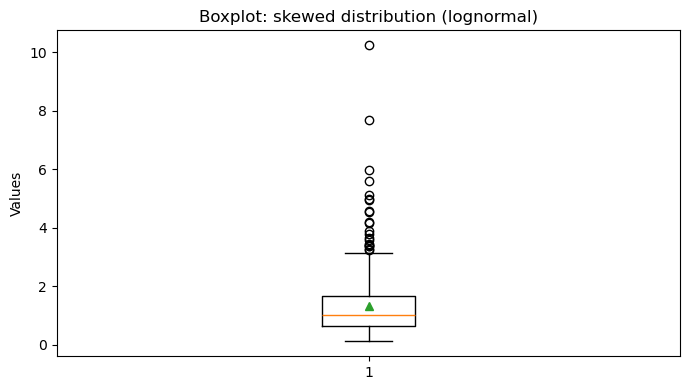
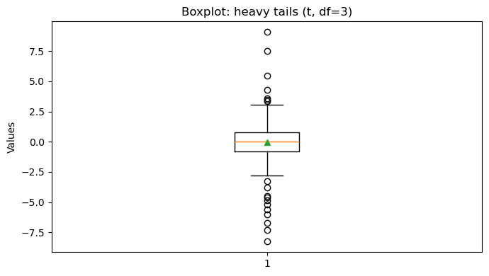
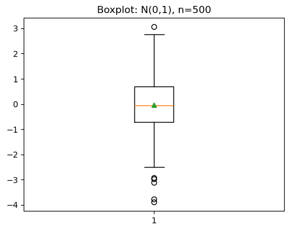
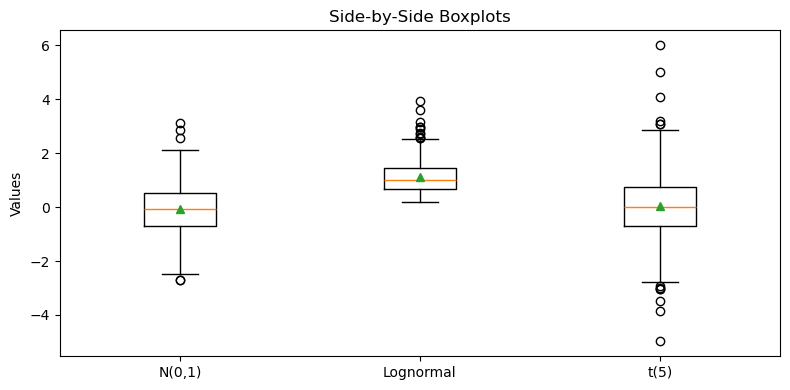
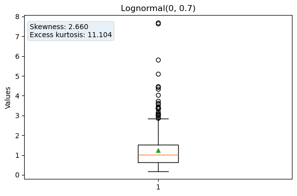

# 상자그림으로 보는 분포의 모양

## 개요

상자그림은 사분위수, 중앙값, 잠재적 이상점으로 분포를 요약하므로 치우침과 두꺼운 꼬리를 한눈에 탐지하는 데 효과적이다. 대칭이고 정규에 가까운 분포는 대략 대칭인 상자그림과 소수의 이상점을 만들어 내는 반면, 치우쳤거나 꼬리가 두꺼운 분포는 특징적인 시각적 흔적을 남긴다. 이 페이지는 대수정규(치우침)와 스튜던트 $t$(두꺼운 꼬리) 예를 써서 상자그림이 정규성 이탈을 어떻게 드러내는지 시연한다.

---

## 1. 상자그림의 구조

표준 상자그림은 다섯 개의 요약통계량을 표시하고 이상점을 표시한다.

| 구성요소 | 정의 |
|---|---|
| 중앙값 선 | $Q_2$ (50백분위수) |
| 상자의 양 끝 | $Q_1$ (25백분위수) ~ $Q_3$ (75백분위수) |
| 사분위범위 | $\text{IQR} = Q_3 - Q_1$ |
| 아래 수염 | $Q_1 - 1.5\,\text{IQR}$ 이상인 관측값 중 최솟값 |
| 위 수염 | $Q_3 + 1.5\,\text{IQR}$ 이하인 관측값 중 최댓값 |
| 이상점 | 수염 바깥의 점들 |

정규분포 $\mathcal{N}(\mu, \sigma^2)$에서 이론적 사분위수는

$$
Q_1 = \mu - 0.6745\,\sigma, \qquad Q_3 = \mu + 0.6745\,\sigma,
$$

이므로 $\text{IQR} = 1.349\,\sigma$이다. 수염의 경계는 대략 $\mu \pm 2.698\,\sigma$까지 뻗는다. 정규성 아래에서 관측값이 수염 바깥에 놓일 확률은 근사적으로

$$
P(|X - \mu| > 2.698\,\sigma) \approx 0.007,
$$

이므로 관측값의 약 0.7%가 이상점으로 나타날 것으로 기대된다.

---

## 2. 치우친 분포: 대수정규

$\text{Lognormal}(0, 0.7)$처럼 오른쪽으로 치우친 분포에서 자료가 오면 상자그림은 다음을 보인다.

- 중앙값이 상자의 아래쪽 끝에 더 가깝고,
- 위 수염이 아래 수염보다 훨씬 길며,
- 위 수염 위쪽에 이상점이 많이 나타난다.

<div class="exbox" markdown>

**보기 1.** <span class="diff easy" title="쉬움"></span> 치우친 자료의 상자그림. $\text{Lognormal}(0, 0.7^2)$에서 $n = 400$개를 뽑아 평균 표시를 켠 상자그림을 그린다.

**(1)** 그려 보고 무엇이 읽히는지 말하시오. 중앙값의 상자 안 위치, 두 수염의 길이, 이상점의 좌우 배분을 **수로** 적으시오. 평균 표시는 중앙값에 대해 어느 쪽에 찍히는가.

**(2)** 대수정규의 분위수는 전부 닫힌 꼴이다. $Q_1$, $Q_3$, 두 울타리, 그리고 **이상점 비율**을 손으로 구하고 표본과 맞춰 보시오. 아래쪽 이상점이 원리상 불가능한 까닭도 말하시오.

</div>

??? success "풀이"

    **(1) 그림.**

    ```python
    import numpy as np
    import matplotlib.pyplot as plt

    # 치우친 자료에서는 중앙값이 상자 가운데가 아니라 한쪽으로 쏠리고,
    # 한쪽 수염만 길어진다. showmeans=True 로 평균을 함께 찍으면, 평균이
    # 중앙값보다 긴 꼬리 쪽으로 끌려간 것도 눈에 보인다.
    rng = np.random.default_rng(3)
    x_skew = rng.lognormal(0.0, 0.7, size=400)

    fig, ax = plt.subplots(figsize=(7, 4))
    ax.boxplot(x_skew, showmeans=True)
    ax.set_title("Boxplot: skewed distribution (lognormal)")
    ax.set_ylabel("Values")
    plt.tight_layout()
    plt.show()
    ```

    

    **(2) 이론값.** $X = e^{0.7 Z}$에서 $Z \sim \mathcal{N}(0,1)$이므로 $X$의 $p$분위수는 지수가 단조증가함수인 덕에 그대로 넘어간다.

    $$
    Q_p = \exp(0.7\, z_p), \qquad
    Q_1 = e^{-0.7 z_{0.75}} = 0.6237, \quad
    Q_2 = e^0 = 1, \quad
    Q_3 = e^{0.7 z_{0.75}} = 1.6034
    $$

    **중앙값이 정확히 1이다.** 따라서 $\mathrm{IQR} = 1.6034 - 0.6237 = 0.9798$이고 울타리는

    $$
    Q_3 + 1.5\,\mathrm{IQR} = 3.0731, \qquad
    Q_1 - 1.5\,\mathrm{IQR} = -0.8460
    $$

    이다. **아래쪽 울타리가 음수다.** 대수정규의 지지집합이 $(0, \infty)$이므로 그보다 작은 값은 존재할 수 없고, 따라서 **아래쪽 이상점은 원리상 하나도 나올 수 없다.** 위쪽 비율은 로그를 취해 정규로 돌리면 바로 읽힌다.

    $$
    P(X > 3.0731) = P\!\left(Z > \frac{\log 3.0731}{0.7}\right) = 1 - \Phi(1.6038) = 0.054376
    $$

    곧 **$5.44\%$** 이고 400개 중 $21.75$개다. 정규 자료의 기준선 $0.70\%$의 **7.8배**다.

    ```python
    import numpy as np
    from scipy import stats

    rng = np.random.default_rng(3)
    x = rng.lognormal(0.0, 0.7, size=400)

    q1, med, q3 = np.percentile(x, [25, 50, 75])
    iqr = q3 - q1
    lo, hi = q1 - 1.5 * iqr, q3 + 1.5 * iqr
    ins = x[(x >= lo) & (x <= hi)]
    n_lo, n_hi = int((x < lo).sum()), int((x > hi).sum())

    print(f"표본: Q1 = {q1:.4f}  중앙값 = {med:.4f}  Q3 = {q3:.4f}  IQR = {iqr:.4f}  평균 = {x.mean():.4f}")
    print(f"표본: 울타리 lo = {lo:.4f}  hi = {hi:.4f}")
    print(f"표본: 상자안비 = {(q3 - med) / (med - q1):.4f}   수염비 = {(ins.max() - q3) / (q1 - ins.min()):.4f}")
    print(f"표본: 이상점 아래 {n_lo}개, 위 {n_hi}개, 합 {n_lo + n_hi}개 = {100 * (n_lo + n_hi) / len(x):.2f}%")
    print(f"표본: G1 = {stats.skew(x, bias=False):.4f}  G2 = {stats.kurtosis(x, bias=False):.4f}")
    print(f"표본: g1 = {stats.skew(x):.4f}  g2 = {stats.kurtosis(x):.4f}")

    # Lognormal(0, s^2) 의 분위수는 exp(s * z_p) 이라 전부 닫힌 꼴이다.
    s = 0.7
    z = stats.norm.ppf(0.75)
    Q1, MED, Q3 = np.exp(-s * z), 1.0, np.exp(s * z)
    IQR = Q3 - Q1
    LO, HI = Q1 - 1.5 * IQR, Q3 + 1.5 * IQR
    p_hi = stats.norm.sf(np.log(HI) / s)
    w = np.exp(s ** 2)
    print(f"이론: Q1 = {Q1:.4f}  중앙값 = {MED:.4f}  Q3 = {Q3:.4f}  IQR = {IQR:.4f}")
    print(f"이론: 울타리 lo = {LO:.4f}  hi = {HI:.4f}   (lo < 0 이므로 아래 이상점은 불가능)")
    print(f"이론: 상자안비 = {(Q3 - MED) / (MED - Q1):.4f}")
    print(f"이론: 위 이상점 비율 = {p_hi:.6f} = {100 * p_hi:.4f}%  ->  400개 중 {400 * p_hi:.2f}개")
    print(f"이론: 왜도 = (w+2)sqrt(w-1) = {(w + 2) * np.sqrt(w - 1):.4f}   (w = exp(0.49) = {w:.4f})")
    print(f"이론: 초과첨도 = w^4+2w^3+3w^2-6 = {w ** 4 + 2 * w ** 3 + 3 * w ** 2 - 6:.4f}")
    ```

    출력:

    ```text
    표본: Q1 = 0.6474  중앙값 = 1.0178  Q3 = 1.6649  IQR = 1.0175  평균 = 1.3148
    표본: 울타리 lo = -0.8789  hi = 3.1911
    표본: 상자안비 = 1.7468   수염비 = 2.7742
    표본: 이상점 아래 0개, 위 21개, 합 21개 = 5.25%
    표본: G1 = 3.0588  G2 = 15.8860
    표본: g1 = 3.0473  g2 = 15.6731
    이론: Q1 = 0.6237  중앙값 = 1.0000  Q3 = 1.6034  IQR = 0.9798
    이론: 울타리 lo = -0.8460  hi = 3.0731   (lo < 0 이므로 아래 이상점은 불가능)
    이론: 상자안비 = 1.6034
    이론: 위 이상점 비율 = 0.054376 = 5.4376%  ->  400개 중 21.75개
    이론: 왜도 = (w+2)sqrt(w-1) = 2.8884   (w = exp(0.49) = 1.6323)
    이론: 초과첨도 = w^4+2w^3+3w^2-6 = 17.7912
    ```

    **두 답이 맞는다.** 표본과 이론을 나란히 놓으면

    | 재는 것 | 표본 | 이론 |
    |---|---|---|
    | $Q_1$ / 중앙값 / $Q_3$ | $0.647$ / $1.018$ / $1.665$ | $0.624$ / $1.000$ / $1.603$ |
    | 위 울타리 | $3.191$ | $3.073$ |
    | 상자안비 $(Q_3 - Q_2)/(Q_2 - Q_1)$ | $1.75$ | $1.60$ |
    | 이상점 (아래 / 위) | $0$ / $21$ | $0$ / $21.75$ |
    | 왜도 | $G_1 = 3.059$ | $2.888$ |

    **이상점 개수가 21개 대 21.75개로 거의 정확히 맞는다.** 아래쪽이 0개인 것도 이론과 정확히 맞는다.

    **읽기.** 치우침을 가리키는 세 수치는 이렇다. 중앙값은 상자 안에서 아래쪽에 붙어 있다($1.75$배). 수염은 위쪽이 아래쪽의 $2.77$배다. 그리고 **이상점 21개가 전부 위쪽에만 있다.** 세 번째가 가장 강한 신호다. 좌우 어느 한쪽이 완전히 비어 있다는 것은 대칭분포에서 거의 일어나지 않는 일이기 때문이다.

    평균 표시는 $1.3148$에 찍히고 중앙값은 $1.0178$이다. **평균이 중앙값보다 긴 꼬리 쪽으로 $0.30$ 끌려가 있고**, 이는 $\mathrm{IQR}$의 $29\%$에 해당한다. 평균과 중앙값이 벌어지는 방향이 치우침의 방향이라는 규칙이 이 그림에서 눈으로 확인된다. 참 평균은 $e^{0.49/2} = 1.2776$, 참 중앙값은 $1$이므로 이 벌어짐도 표본의 우연이 아니다.

    표본왜도는 판본을 밝혀야 수가 맞는다. 보정판 $G_1 = 3.059$이고 보정하지 않은 $g_1 = 3.047$이다. 본문이 적은 $3.06$은 전자다. 둘 다 이론값 $2.888$보다 큰데, 이 방향의 어긋남은 흔하지 않다. 대수정규처럼 꼬리가 두꺼운 분포에서 표본왜도는 보통 아래로 편향되기 때문이다(연습문제 5가 그 경우를 보인다). 이 표본은 반대로 나온 것이고, 표본왜도 자체가 변동이 큰 통계량이라는 것을 보여 준다. 참 초과첨도가 $17.79$나 되므로 네 제곱에 기대는 통계량은 표본마다 크게 흔들린다.

---

## 3. 꼬리가 두꺼운 분포: 스튜던트 t

자유도가 낮은 스튜던트 $t$ 분포(예: $\nu = 3$)는 대칭이지만 정규분포보다 꼬리가 훨씬 두껍다. 상자그림은 다음을 보인다.

- 상자는 대략 대칭이지만(중앙값이 가운데에 있다),
- 이상점이 **양쪽**에 나타나며, 정규성 아래에서 기대되는 $\approx 0.7\%$보다 훨씬 많다.

<div class="exbox" markdown>

**보기 2.** <span class="diff easy" title="쉬움"></span> 꼬리가 두꺼운 자료의 상자그림. 같은 씨앗으로 $t_3$에서 $n = 400$개를 뽑아 보기 1과 같은 그림을 그린다.

**(1)** $t_3$에서 $1.5 \times \mathrm{IQR}$ 규칙에 걸리는 비율의 이론값을 구하고 표본과 맞춰 보시오. 보기 1의 대수정규에서 얻은 값과 나란히 놓으면 무엇이 보이는가.

**(2)** 그렇다면 **상자그림에서 치우침과 두꺼운 꼬리를 무엇으로 구별하는가.** 보기 1과 이 보기의 수치를 나란히 두고 답하시오. 덧붙여, 이 상자그림의 **상자 자체가 가리고 있는 것**을 수로 보이시오.

</div>

??? success "풀이"

    **(1) 그림과 이론값.**

    ```python
    import numpy as np
    import matplotlib.pyplot as plt

    # 꼬리가 두꺼운 자료는 대칭이므로 상자는 반듯하다. 대신 수염 밖의 점이
    # 유난히 많아진다. 정규자료라면 400개 중 서너 개가 보통이다.
    rng = np.random.default_rng(3)
    x_t = rng.standard_t(df=3, size=400)

    fig, ax = plt.subplots(figsize=(7, 4))
    ax.boxplot(x_t, showmeans=True)
    ax.set_title("Boxplot: heavy tails (t, df=3)")
    ax.set_ylabel("Values")
    plt.tight_layout()
    plt.show()
    ```

    

    $t_3$는 0에서 대칭이므로 $Q_3 = -Q_1$이고, 보기 1의 정규에서와 똑같은 꼴로 울타리가 떨어진다.

    $$
    \mathrm{IQR} = 2 Q_3, \qquad
    Q_3 + 1.5\,\mathrm{IQR} = Q_3 + 3 Q_3 = 4 Q_3
    $$

    $t_3$의 $0.75$분위수는 $Q_3 = 0.7649$이므로 울타리가 $\pm 3.0596$이고 이상점 비율은

    $$
    2\,P(T_3 > 3.0596) = 0.055012
    $$

    곧 **$5.50\%$** 다. 400개 중 $22.00$개다.

    ```python
    import numpy as np
    from scipy import stats

    rng = np.random.default_rng(3)
    y = rng.standard_t(df=3, size=400)

    q1, med, q3 = np.percentile(y, [25, 50, 75])
    iqr = q3 - q1
    lo, hi = q1 - 1.5 * iqr, q3 + 1.5 * iqr
    ins = y[(y >= lo) & (y <= hi)]
    n_lo, n_hi = int((y < lo).sum()), int((y > hi).sum())

    print(f"표본: Q1 = {q1:.4f}  중앙값 = {med:.4f}  Q3 = {q3:.4f}  IQR = {iqr:.4f}")
    print(f"표본: 상자안비 = {(q3 - med) / (med - q1):.4f}   수염 아래 {q1 - ins.min():.4f}  위 {ins.max() - q3:.4f}")
    print(f"표본: 이상점 아래 {n_lo}개, 위 {n_hi}개, 합 {n_lo + n_hi}개 = {100 * (n_lo + n_hi) / len(y):.2f}%")
    print(f"표본: 최소 {y.min():.4f}  최대 {y.max():.4f}")
    print(f"표본: g1 = {stats.skew(y):.4f}  g2 = {stats.kurtosis(y):.4f}")

    # t_3 는 0 에서 대칭이라 Q3 = -Q1 이고 울타리가 4*Q3 에 놓인다 (정규와 같은 꼴).
    t3 = stats.t(3)
    Q3 = t3.ppf(0.75)
    IQR = 2 * Q3
    FENCE = 4 * Q3
    p_out = 2 * t3.sf(FENCE)
    print(f"이론: Q3 = {Q3:.4f}  IQR = {IQR:.4f}  울타리 = ±{FENCE:.4f}")
    print(f"이론: 이상점 비율 = {p_out:.6f} = {100 * p_out:.4f}%  ->  400개 중 {400 * p_out:.2f}개")
    print(f"이론: 정규 기준 0.6977% -> 400개 중 {400 * 0.0069770:.2f}개   (비 {p_out / 0.0069770:.2f}배)")
    print(f"이론: t3 의 표준편차 = sqrt(3) = {np.sqrt(3):.4f}")
    print(f"이론: IQR 로 추정한 sigma = IQR/1.34898 = {IQR / 1.34898:.4f}  (참값의 {100 * IQR / 1.34898 / np.sqrt(3):.1f}%)")

    # 대수정규(보기 1)의 이론 이상점 비율과 견준다.
    s = 0.7
    z = stats.norm.ppf(0.75)
    QL1, QL3 = np.exp(-s * z), np.exp(s * z)
    HL = QL3 + 1.5 * (QL3 - QL1)
    print(f"견주기: 대수정규 이론 이상점 {100 * stats.norm.sf(np.log(HL) / s):.4f}%"
          f"  vs  t3 이론 이상점 {100 * p_out:.4f}%")
    ```

    출력:

    ```text
    표본: Q1 = -0.7977  중앙값 = 0.0061  Q3 = 0.7969  IQR = 1.5946
    표본: 상자안비 = 0.9838   수염 아래 1.9700  위 2.2926
    표본: 이상점 아래 11개, 위 7개, 합 18개 = 4.50%
    표본: 최소 -8.2714  최대 9.0930
    표본: g1 = -0.2972  g2 = 7.3025
    이론: Q3 = 0.7649  IQR = 1.5298  울타리 = ±3.0596
    이론: 이상점 비율 = 0.055012 = 5.5012%  ->  400개 중 22.00개
    이론: 정규 기준 0.6977% -> 400개 중 2.79개   (비 7.88배)
    이론: t3 의 표준편차 = sqrt(3) = 1.7321
    이론: IQR 로 추정한 sigma = IQR/1.34898 = 1.1340  (참값의 65.5%)
    견주기: 대수정규 이론 이상점 5.4376%  vs  t3 이론 이상점 5.5012%
    ```

    **(1) 이론값이 맞고, 맞춰 보니 놀라운 것이 나온다.** 표본에서 18개($4.50\%$)가 잡혔고 이론은 $22.00$개($5.50\%$)다. 몬테카를로 표준오차가 $\sqrt{0.055 \times 0.945/400} = 1.14$포인트이니 차이 $1.00$포인트는 $0.9$ 표준오차로 잘 맞는다. 정규 기준 $2.79$개와 견주면 $6.5$배이고 이론끼리 견주면 $7.9$배다.

    놀라운 것은 마지막 줄이다.

    $$
    \text{대수정규}(0, 0.7^2):\ 5.4376\%
    \qquad\text{대}\qquad
    t_3:\ 5.5012\%
    $$

    **두 분포의 이상점 비율이 사실상 같다.** 하나는 심하게 치우쳤고($\text{왜도} = 2.888$) 다른 하나는 완벽하게 대칭인데, $1.5 \times \mathrm{IQR}$ 규칙은 둘을 똑같이 $5.5\%$쯤으로 잡아낸다. 우연이 겹친 수치이지만 교훈은 우연이 아니다. **이상점 개수는 "정규가 아니다"까지만 말하고 "어떻게 아닌가"는 말하지 않는다.**

    **(2) 구별하는 것은 좌우 배분이다.** 두 보기를 한 표에 놓으면 분명하다.

    | 재는 것 | 대수정규(보기 1) | $t_3$(보기 2) |
    |---|---|---|
    | 상자안비 | $1.75$ | $0.98$ |
    | 수염비 (위/아래) | $2.77$ | $1.16$ |
    | 이상점 총수 | $21$ | $18$ |
    | 이상점 (아래 / 위) | $\mathbf{0 / 21}$ | $\mathbf{11 / 7}$ |

    **총수는 $21$ 대 $18$로 구별이 안 되지만 배분은 $0/21$ 대 $11/7$로 전혀 다르다.** 대수정규는 한쪽이 완전히 비었고 $t_3$는 양쪽에 나뉘었다. 상자안비와 수염비도 같은 말을 한다. $t_3$는 $0.98$과 $1.16$으로 둘 다 1에 가까워 상자가 반듯하다. 곧 읽는 순서는 **① 이상점이 한쪽에만 몰렸는가 → ② 상자와 수염이 대칭인가 → ③ 이상점이 몇 개인가**이고, ③만으로는 아무것도 결론 낼 수 없다.

    다만 배분을 읽을 때도 조심해야 한다. $t_3$는 대칭인데 표본의 배분이 $11/7$로 기울었다. 대칭이면 아래쪽 개수가 $\text{Binomial}(18, 0.5)$를 따르므로 표준편차가 $\sqrt{18/4} = 2.12$이고, $11$은 중심 $9$에서 $0.94$ 표준편차 떨어진 값이다. **치우침의 증거가 아니라 잡음이다.** 같은 이유로 표본왜도 $g_1 = -0.297$도 치우침의 증거가 아니다. $t_3$는 세 번째 적률이 존재하긴 하지만 네 번째 적률이 없어 $g_1$의 표본변동이 매우 크다.

    **상자가 가리고 있는 것은 산포의 크기다.** 표본 $\mathrm{IQR} = 1.5946$, 이론 $\mathrm{IQR} = 1.5298$인데 정규분포의 $\mathrm{IQR}$는 $1.349\,\sigma$다. 그래서 상자 폭으로 $\sigma$를 역산하면

    $$
    \hat\sigma = \frac{\mathrm{IQR}}{1.349} = \frac{1.5298}{1.349} = 1.1340
    $$

    이 나오는데, $t_3$의 참 표준편차는 $\sqrt{3} = 1.7321$이다. 곧 **상자는 참 산포의 $65.5\%$만 보고하고 있다.** 상자만 보면 이 자료가 표준정규보다 조금 넓을 뿐인 것처럼 보이지만, 실제 변동은 1.73배다. 자료의 실제 범위가 $[-8.27,\ 9.09]$로 상자 폭의 11배에 걸쳐 있는데, 상자그림에서 그 사실은 점 몇 개로만 표시되므로 눈에 들어오지 않는다.

    이것이 두꺼운 꼬리의 핵심 성질이다. **분포의 가운데 50%는 거의 정규처럼 보이고, 산포의 대부분이 바깥 몇 퍼센트에 들어 있다.** 상자그림은 가운데 50%를 상자로, 바깥을 점으로 그리므로 이 불균형을 구조적으로 작게 보여 준다.

---

## 4. 해석

상자그림은 정규성에 대한 빠른 진단을 제공한다.

- **대칭 상자 + 소수의 이상점:** 정규성과 일관된다.
- **비대칭 상자 또는 길이가 다른 수염:** 치우침을 시사한다.
- **대칭 상자 + 많은 이상점:** 두꺼운 꼬리(고첨)를 시사한다.

핵심은 **이상점의 개수와 좌우 배분을 함께** 보는 것이다. 개수만 보면 치우침과 두꺼운 꼬리를 구별할 수 없다.

상자그림만으로 정규성을 확정할 수는 없지만, 특히 여러 집단을 나란히 비교할 때 가치 있는 1차 선별 도구이다.

---

## 연습문제

<div class="drillbox" markdown>

**연습문제 1.** <span class="diff easy" title="쉬움"></span> 표준정규 관측값 $n = 500$개를 생성하고 상자그림을 만들어라. 이상점의 개수를 세어 이론적 기댓값 $0.007 \times 500 \approx 3.5$와 비교하라.

</div>

??? success "풀이"

    ```python
    import numpy as np
    import matplotlib.pyplot as plt

    rng = np.random.default_rng(0)
    x = rng.normal(0, 1, size=500)

    q1, q3 = np.percentile(x, [25, 75])
    iqr = q3 - q1
    outliers = np.sum((x < q1 - 1.5 * iqr) | (x > q3 + 1.5 * iqr))
    print(f"Outliers: {outliers} (expected ~3.5)")

    fig, ax = plt.subplots(figsize=(5, 4))
    ax.boxplot(x, showmeans=True)
    ax.set_title("Boxplot: N(0,1), n=500")
    plt.tight_layout()
    plt.show()
    ```

    출력:

    ```text
    Outliers: 6 (expected ~3.5)
    ```

    

    관측된 6개는 기댓값 3.5보다 크지만 놀랄 일이 아니다. 이 실험을 정규표본 3000개에 대해 반복하면 이상점 개수는 평균 $3.78$, 중앙값 $3$이고 5~95백분위수 범위가 $[1, 8]$이다.

    평균이 이론값 3.5보다 살짝 큰 이유는 수염 경계를 이론적 사분위수가 아니라 **표본** 사분위수로 계산하기 때문이다. 표본 IQR은 변동하고, 그것이 작게 나온 표본에서는 이상점이 많이 잡힌다. 이 비대칭적 효과가 평균을 조금 위로 밀어 올린다.

    실용적 함의: $n = 500$인 정규자료에서 이상점 6개는 정상 범위이다. 이상점 하나하나를 문제로 취급해서는 안 된다. $\square$

<div class="drillbox" markdown>

**연습문제 2.** <span class="diff med" title="중간"></span> (a) $\mathcal{N}(0,1)$, (b) $\text{Lognormal}(0, 0.5)$, (c) $t_5$에서 뽑은 크기 400인 표본들의 상자그림을 나란히 그려라. 시각적 차이를 기술하라.

</div>

??? success "풀이"

    ```python
    import numpy as np
    import matplotlib.pyplot as plt

    rng = np.random.default_rng(1)
    normal = rng.normal(0, 1, size=400)
    lognorm = rng.lognormal(0, 0.5, size=400)
    t5 = rng.standard_t(df=5, size=400)

    fig, ax = plt.subplots(figsize=(8, 4))
    # 상자 이름을 boxplot에 직접 주는 인자는 matplotlib 버전에 따라 다르다
    # (3.9 미만은 labels=, 3.9 이상은 tick_labels=). 축에 직접 주면 버전과 무관하다.
    ax.boxplot([normal, lognorm, t5], showmeans=True)
    ax.set_xticklabels(["N(0,1)", "Lognormal", "t(5)"])
    ax.set_title("Side-by-Side Boxplots")
    ax.set_ylabel("Values")
    plt.tight_layout()
    plt.show()
    ```

    

    정규 상자그림은 대칭이고 이상점이 매우 적다. 대수정규 상자그림은 위 수염이 길고 위쪽 이상점이 많다(오른쪽 치우침). $t_5$ 상자그림은 대칭이지만 양쪽에 이상점이 있어 더 두꺼운 꼬리를 반영한다.

    (참고: 상자 이름을 `boxplot`에 직접 주는 인자는 `matplotlib` 3.9에서 `labels=`가 `tick_labels=`로 바뀌었다. 위처럼 `ax.set_xticklabels`를 쓰면 버전에 상관없이 작동한다.) $\square$

<div class="drillbox" markdown>

**연습문제 3.** <span class="diff med" title="중간"></span> $\mathcal{N}(0,1)$에서 나온 관측값 하나가 상자그림의 수염 바깥에 놓일(즉 $Q_1 - 1.5\,\text{IQR}$ 아래이거나 $Q_3 + 1.5\,\text{IQR}$ 위일) 이론적 확률을 유도하라.

</div>

??? success "풀이"

    $X \sim \mathcal{N}(0,1)$에 대해 이론적 사분위수는 $Q_1 = \Phi^{-1}(0.25) = -0.6745$, $Q_3 = \Phi^{-1}(0.75) = 0.6745$이다. 따라서 $\text{IQR} = 1.3490$이고 수염 경계는

    $$
    Q_1 - 1.5 \times \text{IQR} = -0.6745 - 2.0235 = -2.6980,
    $$

    $$
    Q_3 + 1.5 \times \text{IQR} = 0.6745 + 2.0235 = 2.6980.
    $$

    바깥에 놓일 확률은

    $$
    P(|X| > 2.6980) = 2\,\Phi(-2.6980) = 2 \times 0.003488 = 0.006977 \approx 0.7\%.
    $$

    이 $0.7\%$가 Tukey의 $1.5 \times \text{IQR}$ 규칙이 관행이 된 이유이다. 정규자료에서 이상점을 드물게 표시하되, 아주 드물지는 않게 하는 절충점이다. $\square$

<div class="drillbox" markdown>

**연습문제 4.** <span class="diff med" title="중간"></span> $t_\nu$ 분포의 첨도는 $\nu > 4$일 때 $3 + 6/(\nu - 4)$이다. 이를 이용해 $t_3$ 상자그림에 정규 상자그림보다 훨씬 많은 이상점이 나타나는 이유를 설명하라.

</div>

??? success "풀이"

    첨도 공식 $\beta_2 = 3 + 6/(\nu - 4)$는 $\nu > 4$를 요구한다. $\nu = 3$에서는 첨도가 실제로 **무한대**이다(네 번째 적률이 존재하지 않는다).

    $t_3$ 밀도의 꼬리는 $|x|^{-(\nu+1)} = |x|^{-4}$로 감쇠한다. 거듭제곱 법칙이며, 정규분포의 지수적 감쇠 $e^{-x^2/2}$보다 훨씬 느리다. 따라서 극단값이 나올 확률이 훨씬 높다.

    결정적인 점은 **상자의 폭은 크게 다르지 않다**는 것이다. $t_3$의 사분위수는 $\pm 0.765$로 정규의 $\pm 0.674$와 비슷하므로, 표본 IQR로 계산한 수염 경계도 정규의 경우와 비슷하다. 그러나 꼬리 감쇠가 느리므로 그 경계를 훌쩍 넘어가는 관측값이 많아진다.

    이것이 상자그림에서 두꺼운 꼬리를 알아보는 방식이다. **상자는 정상인데 이상점만 유난히 많다**. 앞의 시연에서 $t_3$ 표본 400개 중 18개가 이상점으로 잡혔다(정규라면 약 2.8개). $\square$

<div class="drillbox" markdown>

**연습문제 5.** <span class="diff med" title="중간"></span> 자료 배열을 받아 상자그림을 만들고 표본왜도와 초과첨도를 주석으로 표시하는 함수를 작성하라. $\text{Lognormal}(0, 0.7)$ 자료로 시험하라.

</div>

??? success "풀이"

    ```python
    import numpy as np
    from scipy import stats
    import matplotlib.pyplot as plt

    def annotated_boxplot(data, title="Boxplot"):
        g1 = stats.skew(data, bias=False)
        g2 = stats.kurtosis(data, fisher=True, bias=False)

        fig, ax = plt.subplots(figsize=(6, 4))
        ax.boxplot(data, showmeans=True)
        ax.set_title(title)
        ax.set_ylabel("Values")
        ax.text(0.02, 0.95,
                f"Skewness: {g1:.3f}\nExcess kurtosis: {g2:.3f}",
                transform=ax.transAxes, verticalalignment='top',
                fontsize=10, bbox=dict(boxstyle='round', alpha=0.1))
        plt.tight_layout()
        plt.show()
        return g1, g2

    rng = np.random.default_rng(42)
    x = rng.lognormal(0, 0.7, size=400)
    g1, g2 = annotated_boxplot(x, title="Lognormal(0, 0.7)")
    print(f"Skewness = {g1:.3f}, Excess kurtosis = {g2:.3f}")
    ```

    출력:

    ```text
    Skewness = 2.660, Excess kurtosis = 11.104
    ```

    

    주석은 큰 양의 왜도 $2.66$과 큰 양의 초과첨도 $11.10$을 보여준다. 둘 다 비대칭 상자그림 및 위쪽에 몰린 많은 이상점과 일관된다.

    이론값과 비교해 보자. $\text{Lognormal}(0, \sigma^2)$의 왜도는 $(\omega + 2)\sqrt{\omega - 1}$이고 여기서 $\omega = e^{\sigma^2}$이다. $\sigma = 0.7$이면 $\omega = e^{0.49} = 1.632$이므로 왜도 $= 3.632 \times \sqrt{0.632} = 2.888$이다. 표본값 $2.66$이 이보다 작은 것은 예상된 일이다. **표본왜도는 치우친 분포에서 체계적으로 아래로 편향**되며, 특히 꼬리가 두꺼울수록 그렇다. 표본이 꼬리의 가장 극단적인 부분을 거의 담지 못하기 때문이다. $\square$

<div class="drillbox" markdown>

**연습문제 6.** <span class="diff med" title="중간"></span> "정리하며"는 상자그림 읽기를 한 줄의 규칙으로 요약했다. "$1.5\times\text{IQR}$ 밖의 비율이 약 $0.7\%$ 이므로 $n = 100$ 이면 한 점 이하가 보통이다. **다섯 개가 보이면 꼬리를 의심한다.**" 이 규칙을 유의수준이 붙은 검정으로 읽어 보자. 정규성 아래에서 울타리 밖 개수를 $K_n \sim \text{Binomial}(n, p_0)$, $p_0 = 0.006977$(연습문제 3)로 보고 포아송 근사 $K_n \approx \text{Poisson}(n p_0)$ 를 쓴다.

**(a)** $n = 100$ 에서 "한 점 이하가 보통이다"가 맞는지 $P(K \le 1)$ 로 확인하고, "다섯 개 규칙"의 유의수준 $P(K \ge 5)$ 를 구하시오.

**(b)** 같은 규칙을 연습문제 1 의 설정 $n = 500$ 에 그대로 적용하면 유의수준이 얼마가 되는가. 연습문제 1 에서 정규자료 $500$ 개에 이상점이 $6$ 개 나왔던 사실과 이어 말하시오.

**(c)** 유의수준을 $0.05$ 이하로 맞추려면 임계 개수를 얼마로 잡아야 하는가. $n = 100$ 과 $n = 500$ 에 대해 구하고, 왜 $0.05$ 를 정확히 맞출 수 없는지 말하시오.

</div>

??? success "풀이"

    **(a) $n = 100$.** $\lambda = 100 \times 0.006977 = 0.6977$ 이고 $e^{-\lambda} = 0.497729$ 다.

    $$
    P(K \le 1) = e^{-\lambda}(1 + \lambda) = 0.497729 \times 1.6977 = 0.8450
    $$

    **"한 점 이하"가 $84.5\%$ 로 일어나므로 본문의 말이 맞다.** 다섯 개 규칙의 유의수준은 포아송 항 $1,\ 0.697700,\ 0.243393,\ 0.056605,\ 0.009873$ 의 합 $2.007571$ 에서

    $$
    P(K \ge 5) = 1 - e^{-\lambda}\sum_{k=0}^{4}\frac{\lambda^k}{k!} = 1 - 0.497729 \times 2.007571 = 1 - 0.999226 = 0.000774
    $$

    곧 **$0.077\%$** 다(정확한 이항값은 $0.000719$). 이 규칙은 $n = 100$ 에서 유의수준 $0.08\%$ 짜리 검정이다. 유의수준이 $0.05$ 가 아니라 $0.0008$ 이라는 것은, 꼬리가 어지간히 두껍지 않으면 아무것도 기각하지 못한다는 뜻이다.

    **(b) $n = 500$.** 이제 $\lambda = 500 \times 0.006977 = 3.4885$, $e^{-\lambda} = 0.030547$ 이다. 포아송 항은 $1,\ 3.488500,\ 6.084816,\ 7.075627,\ 6.170831$ 이고 합이 $23.819774$ 이므로

    $$
    P(K \ge 5) = 1 - 0.030547 \times 23.819774 = 1 - 0.727614 = 0.272386
    $$

    **$27.2\%$ 다.** 같은 "다섯 개" 규칙이 $n = 100$ 에서는 $0.08\%$, $n = 500$ 에서는 $27\%$ 검정이다. 유의수준이 **350배** 달라진다.

    연습문제 1 에서 나온 $6$ 개도 같은 계산으로 읽힌다. $P(K \ge 6) = 0.1409$ 이므로 정규자료에서 일곱 번에 한 번은 일어나는 일이다. 그 쪽 풀이가 "$n = 500$ 인 정규자료에서 이상점 6개는 정상 범위"라고 한 것이 여기서 수로 확인된다. **그런데 다섯 개 규칙은 그 표본을 기각한다.** 규칙이 틀린 것이 아니라, $n = 100$ 에 맞춰 만든 규칙을 $n = 500$ 에 쓴 것이 틀렸다.

    **(c) 임계 개수.** $P(K \ge c) \le 0.05$ 를 만족하는 가장 작은 $c$ 를 찾는다.

    | $n$ | $\lambda = n p_0$ | $c - 1$ 의 유의수준 | $c$ | $c$ 의 유의수준 |
    |---|---|---|---|---|
    | $100$ | $0.6977$ | $P(K \ge 2) = 0.1550$ | $3$ | $P(K \ge 3) = 0.0339$ |
    | $500$ | $3.4885$ | $P(K \ge 7) = 0.0644$ | $8$ | $P(K \ge 8) = 0.0263$ |

    $n = 100$ 이면 **세 개**, $n = 500$ 이면 **여덟 개**에서 기각해야 한다. $0.05$ 를 정확히 맞출 수 없는 까닭은 $K_n$ 이 **이산**이라 유의수준이 $c$ 를 하나 올릴 때마다 뛰어넘기 때문이다. $n = 100$ 에서는 $0.155 \to 0.034$, $n = 500$ 에서는 $0.064 \to 0.026$ 으로 건너간다. 작은 $n$ 에서 간격이 더 크다. $\lambda$ 가 작을수록 포아송 질량이 몇 개의 점에 몰리기 때문이다.

    **읽기.** 상자그림의 "이상점 개수"는 $n$ 을 함께 적지 않으면 아무 뜻이 없다. 본문이 "개수만 보지 말고 비율로 판단해야 한다"고 한 것은 맞는 말이지만, 비율로 바꾸는 것만으로도 부족하다. **같은 비율이라도 $n$ 에 따라 그것이 유의한지가 달라진다.** $\square$

<div class="drillbox" markdown>

**연습문제 7.** <span class="diff med" title="중간"></span> 보기 2 는 $\text{Lognormal}(0, 0.7^2)$ 의 이상점 비율 $5.4376\%$ 와 $t_3$ 의 $5.5012\%$ 가 "사실상 같다"며 그것을 "우연이 겹친 수치"라 했다. 우연을 지우고 **정확히** 같게 만들어 보자.

**(a)** $\text{Lognormal}(0, \sigma^2)$ 에서 $1.5\times\mathrm{IQR}$ 울타리 밖의 비율 $p_{\mathrm{LN}}(\sigma)$ 를 닫힌 꼴로 쓰시오. 보기 1 은 $\sigma = 0.7$ 에서 아래쪽 울타리가 음수여서 아래쪽 이상점이 불가능하다고 했다. 아래쪽 울타리가 **양수**가 되는 $\sigma$ 의 범위를 구하시오.

**(b)** $p_{\mathrm{LN}}(\sigma) = 0.055012$ 를 푸는 $\sigma^*$ 를 수치로 구하시오.

**(c)** 그 $\sigma^*$ 에서 상자그림의 다른 눈금들(상자안비, 좌우 이상점 배분)을 구하여, 이상점 비율로는 두 분포를 끝내 구별할 수 없고 **무엇으로는** 구별되는지 보이시오.

</div>

??? success "풀이"

    **(a) 닫힌 꼴.** $z = z_{0.75} = 0.6745$ 라 두면 $Q_1 = e^{-\sigma z}$, $Q_3 = e^{\sigma z}$ 이고 두 울타리는 분위수의 아핀결합이다.

    $$
    Q_3 + 1.5\,\mathrm{IQR} = 2.5\,e^{\sigma z} - 1.5\,e^{-\sigma z}, \qquad
    Q_1 - 1.5\,\mathrm{IQR} = 2.5\,e^{-\sigma z} - 1.5\,e^{\sigma z}
    $$

    $\log$ 를 취해 정규로 돌리면

    $$
    p_{\mathrm{LN}}(\sigma) = 1 - \Phi\!\left(\frac{\log\!\left(2.5 e^{\sigma z} - 1.5 e^{-\sigma z}\right)}{\sigma}\right) + \Phi\!\left(\frac{\log\!\left(2.5 e^{-\sigma z} - 1.5 e^{\sigma z}\right)}{\sigma}\right)
    $$

    이고, 둘째 항은 로그의 인자가 $0$ 이하일 때 $0$ 으로 읽는다. 아래쪽 울타리가 양수인 조건은 $2.5 e^{-\sigma z} > 1.5 e^{\sigma z}$, 곧 $e^{2\sigma z} < 5/3$ 이므로

    $$
    \sigma < \frac{\log(5/3)}{2 z_{0.75}} = \frac{0.510826}{1.348980} = 0.378676
    $$

    이다. $\sigma = 0.7$ 은 이 범위 밖이므로 보기 1 의 결론이 나온다. 다만 **범위 안이어도 아래쪽 이상점은 사실상 없다.** $\sigma = 0.37$ 에서 아래쪽 울타리는 $0.0227$ 이지만 그 아래로 갈 확률은 $7 \times 10^{-25}$ 다. 대수정규는 $0$ 근처에서 밀도가 지수적으로 빨리 죽기 때문이다.

    **(b)(c) 수치.**

    ```python
    import numpy as np
    from scipy import stats
    from scipy.optimize import brentq

    z = stats.norm.ppf(0.75)            # 0.6745

    def p_lognormal(s):
        """Lognormal(0, s^2) 에서 1.5 x IQR 울타리 밖의 비율 (닫힌 꼴)."""
        Q1, Q3 = np.exp(-s * z), np.exp(s * z)
        iqr = Q3 - Q1
        lo, hi = Q1 - 1.5 * iqr, Q3 + 1.5 * iqr
        p_hi = stats.norm.sf(np.log(hi) / s)
        p_lo = stats.norm.cdf(np.log(lo) / s) if lo > 0 else 0.0
        return p_lo + p_hi

    t3 = stats.t(3)
    target = 2 * t3.sf(4 * t3.ppf(0.75))         # 보기 2 의 0.055012
    s_star = brentq(lambda s: p_lognormal(s) - target, 0.3, 2.0, xtol=1e-12)

    print(f"t3 의 이상점 비율            = {target:.6f}")
    print(f"sigma = 0.70 (보기 1)       = {p_lognormal(0.70):.6f}")
    print(f"sigma* (정확히 일치)        = {s_star:.6f}  ->  {p_lognormal(s_star):.6f}")

    # 두 분포를 상자그림의 다른 눈금으로 견준다.
    Q1, Q3 = np.exp(-s_star * z), np.exp(s_star * z)
    lo, hi = Q1 - 1.5 * (Q3 - Q1), Q3 + 1.5 * (Q3 - Q1)
    w = np.exp(s_star ** 2)
    print()
    print(f"LN(0, {s_star:.4f}^2): 상자안비 = {(Q3 - 1) / (1 - Q1):.4f}"
          f"   아래울타리 = {lo:.4f}   이상점 아래/위 = 0.0000 / {p_lognormal(s_star):.6f}")
    print(f"           왜도 = {(w + 2) * np.sqrt(w - 1):.4f}"
          f"   초과첨도 = {w ** 4 + 2 * w ** 3 + 3 * w ** 2 - 6:.4f}")
    print(f"t3:        상자안비 = 1.0000   아래울타리 = {-4 * t3.ppf(0.75):.4f}"
          f"   이상점 아래/위 = {target / 2:.6f} / {target / 2:.6f}")
    print(f"           왜도 = 0.0000   초과첨도 = 무한")
    ```

    출력:

    ```text
    t3 의 이상점 비율            = 0.055012
    sigma = 0.70 (보기 1)       = 0.054376
    sigma* (정확히 일치)        = 0.707785  ->  0.055012

    LN(0, 0.7078^2): 상자안비 = 1.6119   아래울타리 = -0.8668   이상점 아래/위 = 0.0000 / 0.055012
               왜도 = 2.9437   초과첨도 = 18.5772
    t3:        상자안비 = 1.0000   아래울타리 = -3.0596   이상점 아래/위 = 0.027506 / 0.027506
               왜도 = 0.0000   초과첨도 = 무한
    ```

    **(b)** $\sigma^* = 0.707785$ 다. 보기 1 이 쓴 $0.7$ 에서 $1.1\%$ 밖에 떨어져 있지 않다. 곧 보기 2 의 "우연"은 아주 작은 우연이었다. $\sigma$ 를 $0.7$ 에서 $0.7078$ 로 **$0.008$ 만** 올리면 두 분포의 이상점 비율이 소수점 여섯째 자리까지 같아진다.

    **(c)** 그 $\sigma^*$ 에서 두 분포를 나란히 놓으면 이렇다.

    | 재는 것 | $\text{LN}(0, 0.7078^2)$ | $t_3$ |
    |---|---|---|
    | 이상점 비율 | $0.055012$ | $0.055012$ |
    | 상자안비 $(Q_3 - Q_2)/(Q_2 - Q_1)$ | $1.6119$ | $1.0000$ |
    | 이상점 (아래 / 위) | $0 / 0.055012$ | $0.027506 / 0.027506$ |
    | 왜도 | $2.9437$ | $0$ |
    | 초과첨도 | $18.5772$ | 무한 |

    **첫 줄은 완전히 같고 나머지는 전부 다르다.** 이상점의 **총 비율**은 두 분포를 구별할 능력이 원리적으로 없다. 구별하는 것은 두 가지다. 첫째 **좌우 배분**이다. 대수정규는 아래쪽이 정확히 $0$ 인데 $t_3$ 는 반반으로 나뉜다. 둘째 **상자안비**다. $1.61$ 대 $1.00$ 으로, 중앙값이 상자 안에서 어디에 있는지가 다르다.

    세 번째 줄과 네 번째 줄이 재미있다. 왜도는 $2.94$ 대 $0$ 으로 완벽히 갈라지지만, 초과첨도는 $18.58$ 대 **무한**이다. 곧 **첨도는 $t_3$ 쪽이 압도적으로 크면서도 울타리 밖 비율은 똑같다.** 울타리는 분위수로만 만들어지므로 꼬리의 **아주 먼 쪽**($t_3$ 의 네 번째 적률을 없애는 바로 그 부분)을 전혀 보지 않기 때문이다. $\square$

<div class="drillbox" markdown>

**연습문제 8.** <span class="diff hard" title="어려움"></span> 보기 1 은 "지수가 단조증가함수인 덕에" 분위수가 그대로 넘어간다는 사실을 썼다. 그런데 $X \sim \text{Lognormal}(0, 0.7^2)$ 의 이상점 비율은 $5.4376\%$ 이고 $\log X \sim \mathcal{N}(0, 0.7^2)$ 의 이상점 비율은 $0.6977\%$ 다. 울타리는 분위수로만 만들어지는데 왜 비율이 여덟 배 차이가 나는가.

**(a)** $\log X$ 의 위 울타리를 구하고, 그것을 $\exp$ 로 보낸 값을 $X$ 의 위 울타리 $3.0731$ 과 견주시오. 두 울타리를 $Z = (\log X)/0.7$ 단위로 환산하면 이 쪽에 이미 나와 있는 두 수가 나온다. 어느 두 수인가.

**(b)** 일반적으로 $g$ 가 미분가능한 증가 **볼록**함수이고 $Y = g(X)$ 일 때, $Y$ 의 위 울타리를 $g^{-1}$ 로 되돌린 값이 $X$ 의 위 울타리보다 **작거나 같음**을 증명하시오. 아래 울타리에 대해서도 같은 논법을 돌려 부등호의 방향을 말하고, 그것이 보기 1 에서 본 "위쪽에만 이상점"과 어떻게 이어지는지 설명하시오.

</div>

??? success "풀이"

    **(a) 두 울타리.** $\log X \sim \mathcal{N}(0, 0.7^2)$ 의 이론 사분위수는 $Q_1 = -0.7 \times 0.6745 = -0.4721$, $Q_3 = 0.4721$ 이므로 $\mathrm{IQR} = 0.9443$ 이고

    $$
    F_{\log X} = 0.4721 + 1.5 \times 0.9443 = 1.8886 = 0.7 \times 2.6980
    $$

    이다. 이것을 $\exp$ 로 보내면 $e^{1.8886} = 6.6099$ 다. 그런데 $X$ 의 위 울타리는 $3.0731$ 로 그 **절반도 되지 않는다.**

    $Z$ 단위로 환산하면 두 수의 정체가 드러난다.

    $$
    \frac{F_{\log X}}{0.7} = 2.6980, \qquad \frac{\log 3.0731}{0.7} = 1.6038
    $$

    앞의 $2.6980$ 은 연습문제 3 에서 유도한 정규의 울타리이고, 뒤의 $1.6038$ 은 보기 1(2)에서 $P(X > 3.0731) = 1 - \Phi(1.6038)$ 을 계산할 때 나온 수다. **곧 $\exp$ 를 취하면 울타리가 $2.698\sigma$ 에서 $1.604\sigma$ 로 안쪽으로 당겨진다.** 비율이 $0.70\%$ 에서 $5.44\%$ 로 뛴 것은 분포의 꼬리가 두꺼워졌기 때문만이 아니라 **울타리가 끌려 들어왔기 때문**이다.

    **(b) 증명.** $g$ 가 증가하므로 $Y = g(X)$ 의 사분위수는 $g(Q_1)$, $g(Q_3)$ 이고 위 울타리는

    $$
    F_Y = g(Q_3) + 1.5\,\bigl(g(Q_3) - g(Q_1)\bigr)
    $$

    이다. 할선 기울기를 $m = \dfrac{g(Q_3) - g(Q_1)}{Q_3 - Q_1}$ 라 두고 $F_X = Q_3 + 1.5(Q_3 - Q_1)$ 라 쓰면 $1.5(Q_3 - Q_1) = F_X - Q_3$ 이므로

    $$
    F_Y = g(Q_3) + m\,(F_X - Q_3).
    $$

    **$F_Y$ 는 점 $(Q_3, g(Q_3))$ 에서 기울기 $m$ 으로 그은 직선을 $x = F_X$ 까지 늘린 값이다.** 평균값정리로 $m = g'(\xi)$ 인 $\xi \in (Q_1, Q_3)$ 가 있고, $g$ 가 볼록이면 $g'$ 가 비감소이므로 $m = g'(\xi) \le g'(Q_3)$ 다. 또 볼록성에서 모든 $t$ 에 대해 접선이 아래에 놓이므로

    $$
    g(F_X) \ge g(Q_3) + g'(Q_3)(F_X - Q_3) \ge g(Q_3) + m\,(F_X - Q_3) = F_Y
    $$

    이다(두 번째 부등호는 $F_X - Q_3 = 1.5\,\mathrm{IQR} > 0$ 이라서 성립한다). $g^{-1}$ 이 증가하므로

    $$
    g^{-1}(F_Y) \le F_X.
    $$

    등호는 $g$ 가 $[Q_1, F_X]$ 에서 아핀일 때만 성립한다. 따라서 위쪽 이상점 비율은

    $$
    P(Y > F_Y) = P\bigl(X > g^{-1}(F_Y)\bigr) \ge P(X > F_X)
    $$

    로 **반드시 늘어난다.** $\square$

    **아래 울타리.** $F_X^- = Q_1 - 1.5\,\mathrm{IQR} < Q_1$ 이라 두면 같은 꼴로 $F_Y^- = g(Q_1) + m\,(F_X^- - Q_1)$ 이다. 이번에는 $F_X^- - Q_1 < 0$ 이고 볼록성에서 $g'(Q_1) \le m$ 이므로 $g'(Q_1)(F_X^- - Q_1) \ge m\,(F_X^- - Q_1)$ 이고

    $$
    g(F_X^-) \ge g(Q_1) + g'(Q_1)(F_X^- - Q_1) \ge F_Y^-
    $$

    곧 $g^{-1}(F_Y^-) \le F_X^-$ 다. 부등호의 꼴은 위쪽과 같은 $\le$ 인데 **아래쪽에서는 그 뜻이 뒤집힌다.** 아래 울타리는 원래 자리보다 더 **바깥으로** 밀려나므로 아래쪽 이상점 비율은 줄어든다. $g = \exp$ 에서는 아예 지지집합 밖($-0.8460$)으로 밀려나 $0$ 이 된다.

    **읽기.** 울타리는 분위수의 **아핀결합**이다. 단조변환은 분위수 하나하나는 보존하지만 아핀결합은 보존하지 않는다. 바로 이 어긋남이 $1.5\times\mathrm{IQR}$ 규칙이 아핀변환에만 불변인 이유이고, 볼록변환이 이상점을 전부 **위쪽으로** 몰아넣는 이유다. 보기 1 의 $0/21$ 이라는 배분은 대수정규라는 특정 분포의 성질이 아니라 **"정규를 볼록변환으로 비틀었다"는 사실의 흔적**이다. $\square$

<div class="drillbox" markdown>

**연습문제 9.** <span class="diff hard" title="어려움"></span> 이 쪽은 "이상점이 몇 개인가"를 정규성의 진단으로 쓴다. 그것을 검정으로 만들어 검정력을 재어 보자. 통계량은 **표본** 울타리 밖의 개수 $K_n$ 이고 $K_n \ge c_n$ 일 때 정규성을 기각한다.

**(a)** 임계값 $c_n$ 을 연습문제 6 의 포아송 계산으로 정하지 말고 **정규표본 모의**로 정하라($n = 20, 100, 500$, 유의수준 $\le 0.05$). 연습문제 6 에서 얻은 값과 다르게 나오는데, $E[K_n]$ 의 모의값과 이론값 $n p_0$ 를 견주어 그 까닭을 설명하시오. 포아송 임계값을 그냥 썼다면 실제 유의수준이 얼마였겠는가.

**(b)** $t_3$, $t_{10}$, $t_{30}$ 에 대한 검정력을 세 $n$ 에서 구하시오.

**(c)** 표를 보고 **표본크기와 검정력의 역설**을 두 문장으로 적으시오.

</div>

??? success "풀이"

    ```python
    import numpy as np
    from scipy import stats

    # 상자그림의 "이상점이 몇 개인가" 를 그대로 검정통계량으로 쓴다.
    # K_n = 표본 울타리 Q1 - 1.5 IQR, Q3 + 1.5 IQR 밖의 관측값 개수.
    def outlier_counts(samples):
        q1 = np.percentile(samples, 25, axis=1, keepdims=True)
        q3 = np.percentile(samples, 75, axis=1, keepdims=True)
        iqr = q3 - q1
        return ((samples < q1 - 1.5 * iqr) | (samples > q3 + 1.5 * iqr)).sum(axis=1)

    def counts(df, n, reps, rng, chunk=5000):
        out, done = [], 0
        while done < reps:
            m = min(chunk, reps - done)
            x = rng.standard_normal((m, n)) if df is None else rng.standard_t(df, size=(m, n))
            out.append(outlier_counts(x))
            done += m
        return np.concatenate(out)

    REPS = 100_000
    P0 = 2 * stats.norm.sf(4 * stats.norm.ppf(0.75))   # 0.006977 (연습문제 3)
    rng = np.random.default_rng(0)

    print("   n   임계 c    크기   (c-1 의 크기)   E[K_0]   이론 n*p0 "
          "    t3      t10     t30")
    for n in (20, 100, 500):
        k0 = counts(None, n, REPS, rng)
        c = 1
        while (k0 >= c).mean() > 0.05:
            c += 1
        power = [(counts(df, n, REPS, rng) >= c).mean() for df in (3, 10, 30)]
        print(f"{n:4d}   {c:4d}   {(k0 >= c).mean():.4f}      {(k0 >= c - 1).mean():.4f}"
              f"      {k0.mean():6.3f}   {n * P0:7.3f}  "
              f"  {power[0]:.4f}  {power[1]:.4f}  {power[2]:.4f}")

    print()
    print(f"초과첨도: t3 = 무한, t10 = {6 / 6:.4f}, t30 = {6 / 26:.4f}")
    ```

    출력:

    ```text
       n   임계 c    크기   (c-1 의 크기)   E[K_0]   이론 n*p0     t3      t10     t30
      20      3   0.0376      0.1071       0.466     0.140    0.1532  0.0586  0.0439
     100      4   0.0489      0.1149       1.013     0.698    0.8065  0.2014  0.0837
     500      9   0.0427      0.0746       3.779     3.488    1.0000  0.6010  0.1500

    초과첨도: t3 = 무한, t10 = 1.0000, t30 = 0.2308
    ```

    **(a) 모의 임계값은 포아송 임계값보다 한 칸 크다.** 모의는 $n = 100$ 에서 $c = 4$, $n = 500$ 에서 $c = 9$ 를 주는데 연습문제 6 의 포아송 계산은 $3$ 과 $8$ 이었다. 까닭은 $E[K_n]$ 에 있다.

    | $n$ | 모의 $E[K_n]$ | 이론 $n p_0$ | 비 |
    |---|---|---|---|
    | $20$ | $0.466$ | $0.140$ | $3.33$ |
    | $100$ | $1.013$ | $0.698$ | $1.45$ |
    | $500$ | $3.779$ | $3.488$ | $1.08$ |

    이론값 $n p_0$ 는 **이론** 사분위수로 울타리를 그었을 때의 값이다(연습문제 3). 실제로는 **표본** 사분위수를 쓰고, 표본 $\mathrm{IQR}$ 가 작게 나온 표본에서 이상점이 많이 잡히는 비대칭 효과가 평균을 위로 민다(연습문제 1 풀이가 말한 바로 그 효과다). $n = 500$ 의 모의값 $3.779$ 는 그 쪽이 보고한 $3.78$ 과 같다. **$n$ 이 작을수록 어긋남이 커서 $n = 20$ 에서는 이론값의 $3.3$ 배다.**

    포아송 임계값을 그냥 썼다면 유의수준이 "$c-1$ 의 크기" 열에 적힌 값이 된다. $n = 100$ 에서 $c = 3$ 은 공칭 $0.034$ 인데 실제로는 **$0.1149$**, $n = 500$ 에서 $c = 8$ 은 공칭 $0.026$ 인데 실제로는 **$0.0746$** 이다. 곧 **이론 임계값을 쓰면 실제 유의수준이 공칭값의 $3.4$ 배($n = 100$), $2.8$ 배($n = 500$) 로 부풀어 오른다.**

    이것이 이 장에서 되풀이되는 구조다. **분포를 모수(여기서는 사분위수)를 추정해서 쓰면 영분포가 바뀐다.** KS 검정에 표본평균·표본표준편차를 꽂으면 임계값이 달라져 릴리포스 표를 따로 써야 하는 것과 같은 일이다. 다만 방향이 반대다. 릴리포스 쪽은 추정 때문에 통계량이 **작아져** 검정이 보수적이 되는데, 여기서는 울타리가 흔들려 이상점이 **더** 잡히므로 반보수적이 된다.

    **(b) 검정력.**

    | $n$ | 크기 | $t_3$ (초과첨도 무한) | $t_{10}$ ($1.00$) | $t_{30}$ ($0.23$) |
    |---|---|---|---|---|
    | $20$ | $0.0376$ | $0.1532$ | $0.0586$ | $0.0439$ |
    | $100$ | $0.0489$ | $0.8065$ | $0.2014$ | $0.0837$ |
    | $500$ | $0.0427$ | $1.0000$ | $0.6010$ | $0.1500$ |

    **(c) 역설.** $n = 20$ 에서는 네 번째 적률이 아예 존재하지 않는 $t_3$ 조차 검정력 $0.153$ 으로, 여섯 번에 다섯 번은 놓친다. $n = 500$ 에서는 초과첨도가 $0.23$ 밖에 안 되어 상자그림으로 정규와 눈으로 구별할 수 없는 $t_{30}$ 을 $0.150$ 으로 기각한다. **곧 작은 $n$ 에서는 심한 이탈을 놓치고 큰 $n$ 에서는 쓸모없이 작은 이탈을 잡아낸다.** 검정이 말해 주는 것은 "이탈이 실무적으로 큰가"가 아니라 "$n$ 이 이탈을 볼 만큼 큰가"다.

    같은 표를 가로로 읽어도 된다. $t_{10}$ 열이 $0.059 \to 0.201 \to 0.601$ 로 오르는 것은 $t_{10}$ 이 "더 비정규가 되었기" 때문이 아니다. 분포는 그대로인데 $n$ 만 바뀌었다. $\square$

<div class="drillbox" markdown>

**연습문제 10.** <span class="diff hard" title="어려움"></span> $1.5$ 라는 상수는 어디서 왔는가. 정규 아래에서 $k \times \mathrm{IQR}$ 규칙의 이상점 비율을 $p(k)$ 라 쓴다.

**(a)** $p(k) = 2\,\Phi\!\bigl(-z_{0.75}(1 + 2k)\bigr)$ 임을 보이고, $k = 1.5$ 에서 연습문제 3 의 $0.006977$ 을 재현하시오.

**(b)** 정규표본 $n$ 개에서 이상점이 **하나도** 나오지 않을 확률이 정확히 $1/2$ 이 되는 $k_n$ 을 $n$ 의 식으로 쓰고 $n = 100, 400, 10^4$ 에 대한 값을 구하시오. $k_{100}$ 을 보고 Tukey 가 $1.5$ 를 고른 뜻을 말하시오.

**(c)** $k$ 를 $1.5$ 로 고정해 두면 $n \to \infty$ 에서 무슨 일이 벌어지는가. 그리고 $k_n$ 이 $n$ 에 대해 **얼마나 느리게** 자라는지 밝히시오.

</div>

??? success "풀이"

    **(a)** $\mathcal{N}(\mu, \sigma^2)$ 에서 본문의 식대로 $Q_1 = \mu - z_{0.75}\sigma$, $Q_3 = \mu + z_{0.75}\sigma$ 이므로 $\mathrm{IQR} = 2 z_{0.75}\sigma$ 이고 울타리는

    $$
    Q_3 + k\,\mathrm{IQR} = \mu + z_{0.75}\sigma + 2k z_{0.75}\sigma = \mu + z_{0.75}(1 + 2k)\,\sigma
    $$

    이다(아래쪽은 대칭). 따라서

    $$
    p(k) = P\bigl(\lvert X - \mu \rvert > z_{0.75}(1+2k)\,\sigma\bigr) = 2\,\Phi\!\bigl(-z_{0.75}(1+2k)\bigr).
    $$

    $k = 1.5$ 를 넣으면 $z_{0.75}(1 + 3) = 4 \times 0.674490 = 2.697959$ 이고 $p = 2\Phi(-2.697959) = 0.006977$ 이다. 본문의 $2.698\sigma$ 와 $0.7\%$ 가 그대로 나온다. **$1.5$ 가 하는 일은 $\mathrm{IQR}$ 를 네 배 해서 울타리를 잡는 것이다.**

    **(b)** 이상점 개수가 $\text{Binomial}(n, p)$ 를 따르므로

    $$
    P(K_n = 0) = (1 - p)^n = \tfrac12 \iff p = 1 - 2^{-1/n} \approx \frac{\log 2}{n}.
    $$

    이 $p$ 를 (a)의 식에 되꽂아 $k$ 에 대해 풀면

    $$
    k_n = \frac{1}{2}\left(\frac{z_{1 - p_n/2}}{z_{0.75}} - 1\right), \qquad p_n = 1 - 2^{-1/n}.
    $$

    | $n$ | $p_n$ | $z_{1 - p_n/2}$ | $k_n$ |
    |---|---|---|---|
    | $100$ | $0.0069075$ | $2.7013$ | $\mathbf{1.5025}$ |
    | $400$ | $0.0017314$ | $3.1328$ | $1.8224$ |
    | $10^4$ | $0.0000693$ | $3.9786$ | $2.4494$ |

    **$k_{100} = 1.5025$ 다.** 곧 **Tukey 의 $1.5$ 는 "정규표본 $100$ 개에서 이상점이 보일 확률이 반반"이 되도록 고른 상수다.** 거꾸로 확인해도 맞는다. $k = 1.5$, $n = 100$ 에서

    $$
    P(K_{100} = 0) = (1 - 0.006977)^{100} = 0.4965.
    $$

    본문 "정리하며"가 "$n = 100$ 이면 한 점 이하가 보통이다"라고 쓴 것은 이 눈금을 말한 것이고, 연습문제 3 이 "드물게 표시하되 아주 드물지는 않게 하는 절충점"이라 한 것의 정확한 뜻이 이것이다. 절충의 기준점이 **$n = 100$** 이다.

    **(c) 고정 $k$ 는 큰 $n$ 에서 무너진다.** $k = 1.5$ 로 두면 $p$ 가 $n$ 과 무관한 $0.006977$ 이므로

    $$
    E[K_n] = 0.006977\,n, \qquad P(K_n = 0) = (1 - 0.006977)^n \to 0.
    $$

    $n = 400$ 에서 이미 $P(K_n = 0) = 0.0608$ 이고, $n = 10^4$ 에서는 $E[K_n] = 69.8$ 개다. **완벽한 정규자료에서도 이상점은 반드시, 그리고 $n$ 에 비례해 나타난다.** 상자그림에 점이 $70$ 개 찍혀 있다는 사실만으로는 아무것도 말할 수 없다.

    그런데 이를 바로잡으려 $k_n$ 을 키우려 해도 **거의 키울 수 없다.** 정규 꼬리의 $\Phi(-t) \approx \phi(t)/t$ 에서 $p_n \approx \log 2 / n$ 을 풀면 $z_{1 - p_n/2} \sim \sqrt{2\log(1/p_n)} \sim \sqrt{2 \log n}$ 이므로

    $$
    k_n \approx \frac{1}{2}\left(\frac{\sqrt{2\log n}}{z_{0.75}} - 1\right) = O\!\left(\sqrt{\log n}\right).
    $$

    $n$ 이 $100$ 에서 $10^4$ 로 **$100$ 배** 커질 때 $k_n$ 은 $1.50$ 에서 $2.45$ 로 $1.6$ 배만 커진다. (근사식은 $n = 10^4$ 에서 $2.68$ 을 주어 참값 $2.45$ 보다 거칠다. $\sqrt{2\log n}$ 근사가 느리게 수렴하기 때문이다.)

    **읽기.** 이것이 이 장의 긴장을 상자그림 쪽에서 본 모습이다. 이상점 개수는 $n$ 에 비례해 자라므로 "이상점이 있다"는 사실 자체는 $n$ 이 크면 정보가 없고, 그것을 유의수준으로 교정하려면 울타리를 $\sqrt{\log n}$ 만큼 넓혀야 한다. 그런데 그렇게 넓히면 이번에는 작은 $n$ 에서 아무것도 잡지 못한다(연습문제 9 의 $n = 20$ 줄). **같은 $1.5$ 가 $n = 100$ 에서는 절묘하고 $n = 10^4$ 에서는 쓸모없다. 상자그림의 이상점 규칙은 특정 표본크기에 맞춰진 눈금이다.** $\square$

---

## 정리하며

분포의 종류마다 **상자그림에 남는 흔적**이 다르다.

- **로그정규(치우침).** 중앙값이 상자 아래쪽에 붙고 위쪽 수염이 길며, 위쪽에만 이상점이 몰린다.
- **스튜던트 $t$(두꺼운 꼬리).** 상자는 대칭인데 **양쪽에 이상점이 많다.** 상자 크기에 비해 이상점의 수가 많다는 것이 신호다.
- **두 흔적을 구별하는 것이 요점이다.** 치우침은 **비대칭**으로, 두꺼운 꼬리는 **이상점의 개수**로 나타난다.
- **정규 자료의 기준을 기억한다.** $1.5\times\text{IQR}$ 밖의 비율이 약 $0.7\%$ 이므로 $n=100$ 이면 한 점 이하가 보통이다. **다섯 개가 보이면 꼬리를 의심한다.**
- **$n$ 이 커지면 이상점 수도 늘어난다.** 비율이 일정하므로, 개수만 보지 말고 비율로 판단해야 한다.

다음 절 **금융 수익률의 Q-Q 그림**으로 넘어간다.
