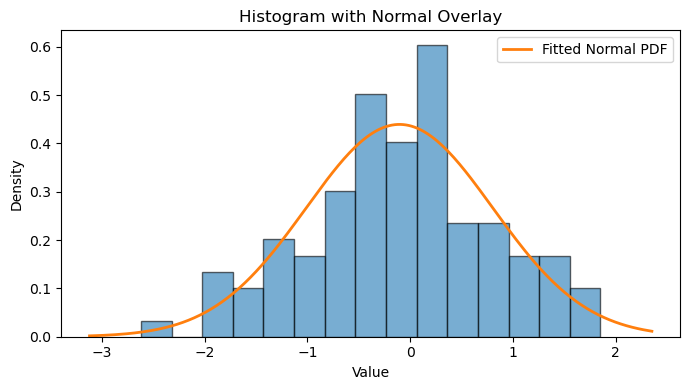
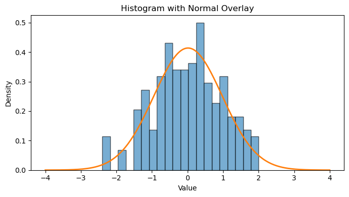
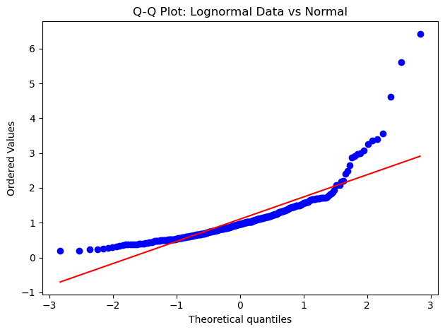
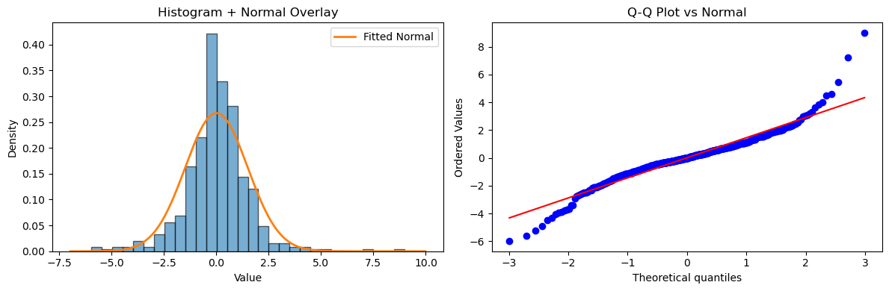

# 시각적 정규성 확인

## 개요

시각적 방법은 자료가 정규분포를 따르는지 평가하는 직관적인 첫 단계를 제공한다. 형식적 가설검정을 수행하기 전에 히스토그램, 밀도 겹쳐 그리기, 분위수-분위수(Q-Q) 그림을 눈으로 살피면 치우침, 두꺼운 꼬리, 다봉성 등 정규성에서의 이탈을 드러낼 수 있다. 이 방법들은 자료가 *이탈하는지*뿐 아니라 *어떻게* 이탈하는지를 보여주어 형식적 검정을 보완한다.

---

## 1. 정규 밀도를 겹친 히스토그램

가장 단순한 시각적 확인은 관측 자료의 히스토그램을 그리고 평균과 분산을 표본 추정값에 맞춘 정규분포의 확률밀도함수를 겹쳐 그리는 것이다.

$X_1, X_2, \ldots, X_n$을 독립인 확률표본이라 하자. 표본평균과 표본표준편차는

$$
\bar{X} = \frac{1}{n}\sum_{i=1}^{n} X_i, \qquad S = \sqrt{\frac{1}{n-1}\sum_{i=1}^{n}(X_i - \bar{X})^2}.
$$

적합된 정규 밀도는

$$
\hat{f}(x) = \frac{1}{S\sqrt{2\pi}} \exp\!\Bigl(-\frac{(x - \bar{X})^2}{2S^2}\Bigr).
$$

히스토그램 막대가 $\hat{f}$와 가깝게 맞으면 자료가 정규성과 일관된다.

<div class="exbox" markdown>

**보기 1.** <span class="diff easy" title="쉬움"></span> 히스토그램에 정규곡선 겹치기. $\mathcal{N}(0,1)$에서 $n = 100$개를 뽑아 구간 15개의 히스토그램에 적합 정규곡선을 겹친다. 자료는 **정말로** 정규다.

**(1)** 그려 보고 무엇이 읽히는지 말하시오. 구간 도수를 나열하여 **봉우리가 몇 개로 보이는지** 세고, 최고 막대가 적합 곡선을 몇 퍼센트 넘어서는지 적으시오.

**(2)** (1)에서 읽은 울퉁불퉁함이 자료의 성질인지 그림의 성질인지 가르시오. 구간 수를 바꾸어 보고, 세 구간 규칙(Sturges·Scott·Freedman–Diaconis)이 권하는 값과 비교하시오. 자료가 정규라는 것은 어떻게 확인하는가.

</div>

??? success "풀이"

    유도할 답이 있는 문제가 아니다. **그림에서 무엇이 읽히고 그중 무엇이 자료의 성질이 아닌가**가 이 보기의 전부다.

    **(1) 그림.**

    ```python
    import numpy as np
    from scipy import stats
    import matplotlib.pyplot as plt

    np.random.seed(42)

    n = 100
    data = np.random.normal(loc=0, scale=1, size=n)

    # 히스토그램에 적합한 정규곡선을 겹친다. 위치와 척도를 자료에서 뽑아 썼으므로
    # 남는 차이는 모양뿐이다. 다만 계급 수에 따라 인상이 달라지므로, 이 그림만으로
    # 판단하지 말고 Q-Q 그림과 함께 본다.
    fig, ax = plt.subplots(figsize=(7, 4))
    ax.hist(data, bins=15, density=True, alpha=0.6, edgecolor="black")
    x_grid = np.linspace(data.min() - 0.5, data.max() + 0.5, 200)
    ax.plot(x_grid, stats.norm.pdf(x_grid, data.mean(), data.std(ddof=1)),
            linewidth=2, label="Fitted Normal PDF")
    ax.set_xlabel("Value")
    ax.set_ylabel("Density")
    ax.set_title("Histogram with Normal Overlay")
    ax.legend()
    plt.tight_layout()
    plt.show()
    ```

    

    **(2) 구간 수를 흔들고 검정으로 확인한다.**

    ```python
    import numpy as np
    from scipy import stats

    np.random.seed(42)
    n = 100
    data = np.random.normal(loc=0, scale=1, size=n)

    mu, s = data.mean(), data.std(ddof=1)
    dens, bins = np.histogram(data, bins=15, density=True)
    cnt, _ = np.histogram(data, bins=15)
    ctr = (bins[:-1] + bins[1:]) / 2


    def n_peaks(counts):
        pad = np.r_[-1.0, counts.astype(float), -1.0]
        return int(np.sum((pad[1:-1] > pad[:-2]) & (pad[1:-1] >= pad[2:])))


    print(f"평균 = {mu:.4f}   S(ddof=1) = {s:.4f}   구간 폭 = {bins[1] - bins[0]:.4f}")
    print(f"구간 도수: {cnt}")
    print(f"구간당 평균 도수 = {cnt.mean():.2f}   봉우리 {n_peaks(cnt)}개   빈 구간 {int((cnt == 0).sum())}개")

    diff = dens - stats.norm.pdf(ctr, mu, s)
    j = int(np.abs(diff).argmax())
    print(f"최고 막대 밀도 = {dens.max():.4f} @ {ctr[int(dens.argmax())]:+.3f}"
          f"   적합 곡선 최대 = {stats.norm.pdf(mu, mu, s):.4f} @ {mu:+.3f}")
    print(f"가장 어긋난 구간: 중심 {ctr[j]:+.3f}  막대 {dens[j]:.4f}  곡선 {stats.norm.pdf(ctr[j], mu, s):.4f}"
          f"  차 {diff[j]:+.4f} ({100 * diff[j] / stats.norm.pdf(ctr[j], mu, s):.0f}%)")

    print("\n같은 자료, 구간 수만 바꾼다:")
    for m in (5, 8, 10, 15, 20, 30):
        c, b = np.histogram(data, bins=m)
        print(f"  구간 {m:2d}개  폭 {b[1] - b[0]:.3f}  봉우리 {n_peaks(c)}개"
              f"  빈 구간 {int((c == 0).sum())}개  최대 도수 {c.max():2d}")

    q1, q3 = np.percentile(data, [25, 75])
    rg = data.max() - data.min()
    print(f"\n권장 구간 수:  Sturges {1 + np.log2(n):.2f}"
          f"   Scott {rg / (3.49 * s * n ** (-1 / 3)):.2f}"
          f"   FD {rg / (2 * (q3 - q1) * n ** (-1 / 3)):.2f}")

    print(f"\n이 표본은 실제로 정규인가:")
    print(f"  Shapiro-Wilk  p = {stats.shapiro(data).pvalue:.4f}")
    print(f"  D'Agostino K2 p = {stats.normaltest(data).pvalue:.4f}")
    print(f"  G1 = {stats.skew(data, bias=False):.4f}   G2 = {stats.kurtosis(data, bias=False):.4f}")
    ```

    출력:

    ```text
    평균 = -0.1038   S(ddof=1) = 0.9082   구간 폭 = 0.2981
    구간 도수: [ 1  0  4  3  6  5  9 15 12 18  7  7  5  5  3]
    구간당 평균 도수 = 6.67   봉우리 5개   빈 구간 1개
    최고 막대 밀도 = 0.6038 @ +0.213   적합 곡선 최대 = 0.4393 @ -0.104
    가장 어긋난 구간: 중심 +0.213  막대 0.6038  곡선 0.4134  차 +0.1903 (46%)

    같은 자료, 구간 수만 바꾼다:
      구간  5개  폭 0.894  봉우리 1개  빈 구간 0개  최대 도수 36
      구간  8개  폭 0.559  봉우리 1개  빈 구간 0개  최대 도수 23
      구간 10개  폭 0.447  봉우리 3개  빈 구간 0개  최대 도수 21
      구간 15개  폭 0.298  봉우리 5개  빈 구간 1개  최대 도수 18
      구간 20개  폭 0.224  봉우리 7개  빈 구간 1개  최대 도수 14
      구간 30개  폭 0.149  봉우리 9개  빈 구간 4개  최대 도수 10

    권장 구간 수:  Sturges 7.64   Scott 6.55   FD 10.31

    이 표본은 실제로 정규인가:
      Shapiro-Wilk  p = 0.6552
      D'Agostino K2 p = 0.7501
      G1 = -0.1779   G2 = -0.1010
    ```

    **(1) 읽기.** 구간 도수가

    $$
    1,\ 0,\ 4,\ 3,\ 6,\ 5,\ 9,\ 15,\ 12,\ 18,\ 7,\ 7,\ 5,\ 5,\ 3
    $$

    이다. 오르내림을 세면 **봉우리가 5개**이고 **빈 구간도 하나** 있다. 가운데에서 $15 \to 12 \to 18$로 한 번 꺼졌다가 다시 솟는 자리가 특히 눈에 띈다. 최고 막대는 밀도 $0.6038$로 그 자리의 적합 곡선 $0.4134$를 **$46\%$ 넘어선다.** 적합 곡선의 최대 $0.4393$과 견주어도 $37\%$ 높다. 봉우리의 자리도 어긋난다. 최고 막대의 중심이 $+0.213$인데 표본평균은 $-0.104$다.

    그림만 보고 적으면 "가운데가 이봉 같고, 봉우리가 곡선보다 많이 높고, 봉우리 자리도 평균에서 밀려 있으니 정규가 아닌 듯하다"가 된다. **그 결론은 전부 틀렸다.**

    **(2) 울퉁불퉁함은 그림의 성질이다.** 두 가지가 그것을 보인다.

    첫째, **자료는 정규를 잘 통과한다.** 샤피로–윌크 $p = 0.655$, 다고스티노 $K^2$ $p = 0.750$이고 $G_1 = -0.178$, $G_2 = -0.101$로 둘 다 0에 붙어 있다(보정판이다. `bias=False`를 주었다). 애초에 $\mathcal{N}(0,1)$에서 뽑은 자료이니 당연한 일이다.

    둘째, **봉우리 개수가 구간 수만 따라 움직인다.** 자료는 한 번도 바뀌지 않았다.

    | 구간 수 | 5 | 8 | 10 | 15 | 20 | 30 |
    |---|---|---|---|---|---|---|
    | 봉우리 | 1 | 1 | 3 | **5** | 7 | 9 |
    | 빈 구간 | 0 | 0 | 0 | 1 | 1 | 4 |

    8개 이하에서는 봉우리가 하나뿐이다. 그리고 **세 구간 규칙이 모두 그 아래쪽을 권한다.** Sturges $7.64$, Scott $6.55$, Freedman–Diaconis $10.31$이다. 쪽에서 쓴 `bins=15`는 세 권고값을 모두 넘어서니 **$n = 100$에 비해 구간이 너무 많다.**

    까닭은 산술로 분명하다. 구간당 평균 도수가 $6.67$개뿐이다. 각 구간의 도수는 대략 평균 $6.67$의 포아송처럼 흔들리므로 표준편차가 $\sqrt{6.67} = 2.58$, 곧 상대변동이 $39\%$다. **인접한 막대의 높이가 $40\%$씩 들쭉날쭉한 것이 정상이고**, 가운데의 $15 \to 12 \to 18$ 같은 골은 그 변동이 만든 것이다. 최고 막대가 곡선을 $46\%$ 넘어선 것도 같은 크기의 잡음이다.

    **따라서 이 그림에서 읽어야 할 것은 "대략 종 모양이다"까지이고, 봉우리의 개수·높이·위치는 읽어서는 안 된다.** 이 쪽의 '정리하며'는 히스토그램의 강점이 다봉성이라고 적어 두었는데, 그 강점은 $n$이 넉넉할 때의 이야기다. $n = 100$에서는 **없는 다봉성을 만들어 내는 쪽이 먼저다.**

    실무에서 할 일은 둘이다. 구간 수를 몇 가지로 바꿔 그려 **어느 선택에서도 남는 특징만 인정하는 것**, 그리고 Q-Q 그림이나 형식적 검정으로 **그림의 인상을 따로 확인하는 것**이다. 여기서는 구간 8개 이하에서 봉우리가 하나로 합쳐지고 두 검정이 모두 통과하므로, 단봉 정규라고 판단하는 것이 옳다.

---

## 2. 커널밀도추정

커널밀도추정(KDE)은 히스토그램을 매끄럽게 만들어 다봉성이나 비대칭을 발견하는 데 유용하다. Gauss 핵과 띠너비 $h$를 쓰면 KDE는

$$
\hat{f}_h(x) = \frac{1}{nh}\sum_{i=1}^{n} \phi\!\Bigl(\frac{x - X_i}{h}\Bigr),
$$

여기서 $\phi$는 표준정규 밀도이다. 이를 적합된 정규 곡선과 겹쳐 그린다. 체계적인 차이가 보이면 정규성에서의 이탈을 나타낸다.

---

## 3. Q-Q 그림

분위수-분위수(Q-Q) 그림은 가장 정보량이 많은 단일 시각적 정규성 확인법이다. 각 순서통계량 $X_{(i)}$에 대해 대응하는 이론적 분위수를 계산하고

$$
q_i = \Phi^{-1}\!\Bigl(\frac{i - 0.5}{n}\Bigr),
$$

쌍 $(q_i,\, X_{(i)})$를 그린다. 정규성 아래에서는 점들이 대략 직선 위에 놓인다. 흔한 이탈에는 알아볼 수 있는 특징이 있다.

| 패턴 | 이탈 |
|---|---|
| S자 곡선 | 두꺼운 꼬리(고첨) |
| 아래로 볼록한 호(양 끝이 선 위로) | 오른쪽 치우침 |
| 위로 볼록한 호(양 끝이 선 아래로) | 왼쪽 치우침 |
| 계단 모양 | 이산성 또는 반올림 |

!!! note "치우침의 곡률 방향"
    오른쪽으로 치우친 자료를 $(q_i, X_{(i)})$로 그리면 곡선이 **아래로 볼록**(convex)해진다. 왼쪽 꼬리에서는 표본분위수가 기대보다 덜 음수라 선 위에 있고, 오른쪽 꼬리에서는 기대보다 더 양수라 역시 선 위에 있기 때문이다. 곧 양 끝이 모두 선 위로 올라간다. 왼쪽 치우침은 그 반대로 위로 볼록(concave)해진다.

---

## 4. 해석

시각적 확인은 주관적이지만 매우 값지다. 뚜렷하게 이봉인 히스토그램, 두드러진 비대칭을 드러내는 KDE, 꼬리에서 급격히 휘는 Q-Q 그림은 모두 형식적 정규성 검정이 기각할 가능성이 높음을 알린다. 반대로 시각적 확인이 깨끗해 보이면 형식적 검정의 애매한 $p$값을 덜 걱정해도 된다. 균형 잡힌 평가를 위해 언제나 시각적 방법과 형식적 방법을 함께 쓰라.

<div class="storybox" markdown>

**그림으로 보는 통계학 1.** 용의자를 한 줄로 세우기

바로 위 문단의 첫 단어가 「주관적이지만」이다. 이 장이 그림과 검정을 **함께** 쓰라고
말하는 까닭도 거기 있다. 그림에는 $p$ 값이 없으니까.

$2009$ 년에 안드레아스 부야와 디안 쿡, 하이케 호프만, 해들리 위컴 등 일곱 사람이
그 전제를 뒤집는 글을 냈다. 제목이 「탐색적 자료분석과 모형진단을 위한 통계적 추론」인데,
초록의 첫 문장이 이렇다.

> 우리는 **그림이 검정통계량의 역할을 맡고, 사람의 인지가 통계적 검정의 역할을 맡는**
> 틀을 제안한다.

방법은 형사절차에서 따왔다. **라인업**이다. 진짜 자료의 그림 하나를 **귀무가설에서
만든 그림 $19$ 개** 사이에 섞어 놓고, 보는 사람에게 「다른 하나」를 고르게 한다. 귀무가
참이면 맞힐 확률이 정확히 $1/20$ 이므로, **고르는 행위 자체가 유의수준 $0.05$ 의
검정**이 된다. 같은 논문은 **로르샤흐** 규약도 함께 내놓았다 — 진짜 자료를 보여 주기
전에 **귀무 그림만** 늘어놓아, 보는 사람이 우연한 변동에 익숙해지게 하는 것이다.


- **①** 위가 라인업 한 벌이다. $n = 50$ 짜리 Q-Q 그림 스물 중 **하나만** 정규가 아니다
  (대수정규). 눈으로 찾아보면 이 장이 말하는 「주관적」의 뜻이 몸으로 와 닿는다. 정규
  자료의 Q-Q 그림도 저렇게 구불거린다.
- **②** 그러면 이 규약이 정식 검정에 얼마나 못 미치는가. 사람 대신 **기계 심사자**를
  세워 재어 보았다 — 스무 그림 가운데 샤피로–윌크 통계량이 가장 작은 것을 고르게 한
  것이다. 귀무 아래 적중률이 **$0.0497$** 로 이론값 $1/20$ 과 맞고, 대립에서는
  $t_5$ · 지수 · 대수정규 어느 쪽에서도 점들이 대각선 바로 아래에 붙는다.
  $n = 50$ 의 대수정규에서 라인업 $0.880$ 대 샤피로–윌크 $0.928$ 이다. **규약으로
  치르는 값이 검정력 $5$ 퍼센트포인트 안팎**이다.
- **③** 라인업 크기 $m$ 이 유의수준을 정한다. $m = 5$ 면 귀무 적중률이 $0.207$ 이고
  $m = 100$ 이면 $0.0115$ 로, $1/m$ 선 위에 정확히 얹힌다. 그 대가로 검정력이 $0.95$ 에서
  $0.76$ 으로 내려간다. **더 엄격하게 하려면 그림을 더 많이 그리면 된다** — 보통의 검정에서
  $\alpha$ 를 조이는 일과 같은 거래다.

②를 읽을 때 조심할 것이 하나 있다. 저 수는 **사람의 성적이 아니라 규약의 천장**이다.
심사자가 샤피로–윌크 통계량을 쓰고 있으니 당연히 샤피로–윌크에 가깝게 나온다. 사람의
눈이 어디까지 가는지는 실제로 사람에게 물어봐야 알 수 있다. 다만 ② 가 보여 주는 것은
**규약 자체가 버리는 정보는 거의 없다**는 것이다 — 「$20$ 개 중 하나 고르기」라는 틀로
바꾸는 일이 검정력을 깎지 않는다.

그래서 이 장의 「시각적 방법과 형식적 방법을 함께 쓰라」에 한 줄을 더할 수 있다.
**둘은 꼭 다른 것일 필요가 없다.** 그림을 보는 일에 $p$ 값이 없었던 것은 그림의 성질이
아니라 **그림을 혼자 보여 주었기 때문**이다. 비교할 것을 같이 놓아 주면 눈도 검정이 된다.

_확인한 곳 — Buja · Cook · Hofmann · Lawrence · Lee · Swayne · Wickham, "Statistical
inference for exploratory data analysis and model diagnostics", 『Philosophical
Transactions of the Royal Society A』 $367$ 권 $4361$–$4383$ 쪽($2009$ 년 $11$ 월,
Crossref)의 초록 — 「그림이 검정통계량의 역할을 맡고 사람의 인지가 통계적 검정의 역할을
맡는」 틀을 제안한다는 것, 추론적 타당성을 주는 간단하고 엄밀한 규약을 「형사절차에서
널리 쓰이는 '라인업'을 본떠」 만들었다는 것, 그리고 「(대중)심리학으로 잘 알려진
'로르샤흐' 잉크반점 검사를 본뜬」 또 하나의 규약이 분석자가 진짜 자료의 그림을 보기 전에
우연한 변동에 익숙해지도록 돕는다는 것. ①–③ 의 수는 모두 직접 계산한 값이며, 심사자는
사람이 아니라 샤피로–윌크 통계량을 쓰는 기계다_

</div>

---

## 연습문제

<div class="drillbox" markdown>

**연습문제 1.** <span class="diff easy" title="쉬움"></span> 표준정규분포에서 관측값 $n = 200$개를 생성하라. 구간 20개의 히스토그램을 그리고 적합된 정규 밀도를 겹쳐라. 적합에 대해 논평하라.

</div>

??? success "풀이"

    ```python
    import numpy as np
    from scipy import stats
    import matplotlib.pyplot as plt

    rng = np.random.default_rng(0)
    data = rng.normal(0, 1, size=200)

    fig, ax = plt.subplots(figsize=(7, 4))
    ax.hist(data, bins=20, density=True, alpha=0.6, edgecolor="black")
    x_grid = np.linspace(-4, 4, 200)
    ax.plot(x_grid, stats.norm.pdf(x_grid, data.mean(), data.std(ddof=1)),
            linewidth=2)
    ax.set_xlabel("Value")
    ax.set_ylabel("Density")
    ax.set_title("Histogram with Normal Overlay")
    plt.tight_layout()
    plt.show()
    ```

    

    표준정규 추출값 $n = 200$개이면 히스토그램 막대가 종 모양의 적합 곡선을 가깝게 따라간다. 표집변동으로 인한 작은 이탈은 예상되는 일이다. $\square$

---

<div class="drillbox" markdown>

**연습문제 2.** <span class="diff easy" title="쉬움"></span> $\text{Lognormal}(0, 0.6)$ 분포에서 관측값 $n = 300$개를 생성하라. 정규분포에 대한 Q-Q 그림을 만들고 관찰되는 모양을 기술하라.

</div>

??? success "풀이"

    ```python
    import numpy as np
    from scipy import stats
    import matplotlib.pyplot as plt

    rng = np.random.default_rng(1)
    data = rng.lognormal(0, 0.6, size=300)

    stats.probplot(data, dist="norm", plot=plt)
    plt.title("Q-Q Plot: Lognormal Data vs Normal")
    plt.tight_layout()
    plt.show()
    ```

    

    Q-Q 그림은 **아래로 볼록한**(convex, 위로 휘는) 곡선을 보인다. 자료의 위쪽 분위수가 이론적 정규분위수를 크게 넘어선다. 오른쪽 치우침의 전형적인 특징이다.

    수치로 확인해 보자. $\text{Lognormal}(0, 0.6)$의 1%, 50%, 99% 분위수는 각각 $e^{0.6 \times (-2.326)} = 0.248$, $1$, $e^{0.6 \times 2.326} = 4.04$이다. 중앙값에서 아래로는 $0.752$, 위로는 $3.04$ 떨어져 있어 위쪽이 네 배 넘게 길다. 왼쪽 아래 구간의 기울기는 작고 오른쪽 위 구간의 기울기는 크므로 곡선이 아래로 볼록해진다. $\square$

---

<div class="drillbox" markdown>

**연습문제 3.** <span class="diff med" title="중간"></span> Q-Q 그림이 정규성 이탈의 *유형*(예: 치우침 대 두꺼운 꼬리)을 드러낼 수 있는 반면 형식적 검정의 $p$값 하나로는 그럴 수 없는 이유를 설명하라.

</div>

??? success "풀이"

    형식적 정규성 검정은 정규성에서의 전반적 이탈을 재는 검정통계량과 $p$값 하나를 내놓는다. $p$값은 분포가 *어떻게* 벗어나는지에 대해 아무것도 말해 주지 않는다. 반면 Q-Q 그림은 모든 순서통계량을 그에 대응하는 이론값과 나란히 보여주므로, 이탈이 꼬리에서 일어나는지(두꺼운 꼬리는 S자를 만든다), 한쪽 꼬리에서만 일어나는지(치우침은 볼록하거나 오목한 호를 만든다), 중앙에서 일어나는지(다봉성은 계단이나 평평한 구역을 만든다) 볼 수 있다. 이 진단의 풍부함 때문에 형식적 검정과 함께 시각적 확인이 권장된다. $\square$

---

<div class="drillbox" markdown>

**연습문제 4.** <span class="diff med" title="중간"></span> 자료 배열을 받아 (a) 정규 밀도를 겹친 히스토그램과 (b) Q-Q 그림을 나란히 배치한 그림을 만드는 Python 함수를 작성하라. 자유도 4인 $t$ 분포 자료로 시험하라.

</div>

??? success "풀이"

    ```python
    import numpy as np
    from scipy import stats
    import matplotlib.pyplot as plt

    def normality_panel(data):
        fig, axes = plt.subplots(1, 2, figsize=(12, 4))

        # 히스토그램에 정규곡선을 겹친다
        ax = axes[0]
        ax.hist(data, bins=30, density=True, alpha=0.6, edgecolor="black")
        x_grid = np.linspace(data.min() - 1, data.max() + 1, 300)
        ax.plot(x_grid,
                stats.norm.pdf(x_grid, data.mean(), data.std(ddof=1)),
                linewidth=2, label="Fitted Normal")
        ax.set_title("Histogram + Normal Overlay")
        ax.set_xlabel("Value")
        ax.set_ylabel("Density")
        ax.legend()

        # Q-Q 그림
        ax = axes[1]
        stats.probplot(data, dist="norm", plot=ax)
        ax.set_title("Q-Q Plot vs Normal")

        plt.tight_layout()
        plt.show()

    rng = np.random.default_rng(42)
    t_data = rng.standard_t(df=4, size=500)
    normality_panel(t_data)
    ```

    

    $t_4$ 자료에서 히스토그램은 정규 곡선보다 두꺼운 꼬리를 보인다($\pm 3$ 바깥에 질량이 더 많다). Q-Q 그림은 특징적인 S자를 보인다. 왼쪽 아래 점들은 선 아래로, 오른쪽 위 점들은 선 위로 휘어 초과첨도를 확인해 준다. $\square$

---

<div class="drillbox" markdown>

**연습문제 5.** <span class="diff hard" title="어려움"></span> 연속분포 $F$에서 크기 $n$인 확률표본을 뽑았을 때, $F = \Phi$라는 귀무가설 아래에서 Q-Q 그림의 $i$번째 순서통계량 플로팅 위치의 기댓값이 근사적으로 $\Phi^{-1}\!\bigl(\frac{i - 0.5}{n}\bigr)$임을 보여라.

</div>

??? success "풀이"

    $F = \Phi$ 아래에서 확률적분변환에 의해 $U_i = \Phi(X_i) \sim \text{Uniform}(0,1)$이다. 균등표본의 $i$번째 순서통계량 $U_{(i)}$는 $\mathbb{E}[U_{(i)}] = \frac{i}{n+1}$을 만족한다. $n$이 크면 Blom 근사가 이를 $p_i = \frac{i - 0.375}{n + 0.25} \approx \frac{i - 0.5}{n}$으로 바꾸며, 이는 경계 근처에서 균등 순서통계량의 편향을 보정한다. 여기에 $\Phi^{-1}$을 적용하면 이론적 분위수 $q_i = \Phi^{-1}(p_i)$를 얻는다. 자료가 정말로 $\Phi$에서 왔다면 정렬된 표본값 $X_{(i)}$가 $\mathbb{E}[X_{(i)}] \approx q_i$를 만족하므로 Q-Q 그림이 항등선 위에 놓일 것으로 기대된다. $\square$

---

<div class="drillbox" markdown>

**연습문제 6.** <span class="diff hard" title="어려움"></span> 보기 1은 $n = 100$을 구간 15개로 자르면 구간당 평균 도수가 $6.67$이고 막대 높이의 상대변동이 $39\%$라고 했다. 이 계산을 일반화한다.

**(1)** 구간 $j$의 도수 $N_j$가 $\text{Bin}(n, p_j)$임을 쓰고, 상대표준편차 $\sqrt{\operatorname{Var}(N_j)}/\mathbb{E}[N_j]$를 $p_j$로 적으시오. 구간들이 질량을 고르게 나누어 $p_j \approx 1/m$($m$은 구간 수)일 때 이것이 $\sqrt{m/n}$으로 줄어드는 까닭을 말하고, 보기 1의 $39\%$와 맞추어 보시오.

**(2)** 구간 수를 Sturges 규칙 $m = 1 + \log_2 n$으로 정하면 (1)의 상대변동은 $n$만의 함수가 된다. $n = 100$과 $n = 1000$에서 값을 구하고, 상대변동이 $10\%$ 아래로 내려가는 가장 작은 정수 $n$을 구하시오.

**(3)** '정리하며'의 표는 히스토그램이 잘 보는 것으로 다봉성을 적어 두었다. (2)에 비추어, 어떤 골을 참된 이봉성의 증거로 인정할 수 있는지 $n = 100$과 (2)에서 구한 $n$에 대해 수로 말하시오.

</div>

??? success "풀이"

    **(1) 상대표준편차.** 구간 $j$에 떨어지는지 여부가 관측값마다 확률 $p_j$의 베르누이이고 관측값들이 독립이므로 $N_j \sim \text{Bin}(n, p_j)$이다. 따라서

    $$
    \mathbb{E}[N_j] = n p_j, \qquad \operatorname{Var}(N_j) = n p_j (1 - p_j),
    $$

    $$
    \frac{\sqrt{\operatorname{Var}(N_j)}}{\mathbb{E}[N_j]} = \sqrt{\frac{1 - p_j}{n p_j}} = \frac{1}{\sqrt{n p_j}}\sqrt{1 - p_j}.
    $$

    구간이 많으면 $p_j$가 작아 $\sqrt{1 - p_j} \approx 1$이고, 이때 $\text{Bin}(n, p_j)$는 평균 $n p_j$의 포아송으로 근사된다. 포아송의 표준편차가 평균의 제곱근이라는 것이 보기 1에서 쓴 바로 그 사실이다. $p_j \approx 1/m$을 넣으면 $\mathbb{E}[N_j] \approx n/m$이고

    $$
    \frac{\sqrt{\operatorname{Var}(N_j)}}{\mathbb{E}[N_j]} \approx \frac{1}{\sqrt{n/m}} = \sqrt{\frac{m}{n}}.
    $$

    보기 1은 $n = 100$, $m = 15$이므로 $\sqrt{15/100} = 0.3873$, 곧 $38.7\%$다. 보기 1이 $1/\sqrt{6.67} = 0.387$로 적은 $39\%$와 같은 수다. 이항의 보정항까지 넣으면 $0.3873 \times \sqrt{1 - 1/15} = 0.3742$로 조금 작아진다.

    **(2) Sturges 규칙 아래의 상대변동.** $m = 1 + \log_2 n$을 넣으면

    $$
    \text{상대변동}(n) = \sqrt{\frac{1 + \log_2 n}{n}}.
    $$

    $n = 100$이면 $m = 1 + 6.644 = 7.644$이고 $\sqrt{7.644/100} = 0.2765$, 곧 $27.7\%$다. 보기 1이 쓴 구간 15개보다는 낫지만 여전히 크다. $n = 1000$이면 $m = 1 + 9.966 = 10.966$이고 $\sqrt{10.966/1000} = 0.1047$, 곧 $10.5\%$다. 아직 $10\%$를 넘는다.

    $10\%$ 아래로 가려면 $1 + \log_2 n < n/100$을 풀어야 한다. 좌변은 로그로만 자라므로 해가 하나의 문턱으로 주어진다.

    | $n$ | $1 + \log_2 n$ | $n/100$ | 상대변동 |
    |---|---|---|---|
    | $1000$ | $10.966$ | $10.00$ | $0.1047$ |
    | $1100$ | $11.103$ | $11.00$ | $0.1005$ |
    | $1111$ | $11.118$ | $11.11$ | $0.10003$ |
    | $1112$ | $11.119$ | $11.12$ | $0.09999$ |

    따라서 가장 작은 정수는 $n = 1112$다. 상대변동이 $\sqrt{(\log_2 n)/n}$ 꼴이어서 거의 $n^{-1/2}$로만 줄어든다. 잡음을 절반으로 줄이려면 자료를 네 배 모아야 하고, $27.7\%$를 $10\%$로 내리는 데 $n$을 $100$에서 $1112$로 열한 배 늘려야 한다.

    **(3) 이봉성을 인정하는 기준.** 막대 높이가 평균 $n/m$ 주위로 상대표준편차 $\sigma_{\text{rel}} = \sqrt{m/n}$만큼 흔들리므로, 골 하나는 $\pm 1\sigma_{\text{rel}}$ 변동만으로도 생긴다. 보기 1에서 $15 \to 12 \to 18$의 골이 그렇게 생긴 것이다. 골의 깊이가 잡음의 두세 배는 되어야 참된 구조로 볼 수 있으므로, 골 바닥이 이웃 봉우리보다 적어도 $2\sigma_{\text{rel}} \sim 3\sigma_{\text{rel}}$만큼 낮아야 한다는 기준을 쓴다. $n = 100$에서는 $2 \times 27.7\% = 55\%$, $n = 1112$에서는 $2 \times 10\% = 20\%$다.

    곧 $n = 100$에서 히스토그램으로 이봉성을 주장하려면 골이 봉우리보다 절반 이상 낮아야 하고, 그 정도면 그림을 볼 필요도 없이 자료가 두 덩어리로 갈려 있다. **'정리하며'가 히스토그램의 강점으로 적어 둔 다봉성은 $n$이 수천 개일 때의 이야기다.** $n$이 작으면 히스토그램은 다봉성을 발견하기보다 만들어 낸다. $\square$

---

<div class="drillbox" markdown>

**연습문제 7.** <span class="diff hard" title="어려움"></span> 3절의 표는 Q-Q 그림의 모양과 이탈의 종류를 짝지어 두었다. 그 표 전체가 함수 하나의 볼록성으로 환원된다는 것을 보인다. 자료가 연속이고 강증가인 분포함수 $F$에서 왔다고 하자.

**(1)** 연습문제 5에서 쓴 $U_{(i)} = F(X_{(i)})$와 $U_{(i)} \approx p_i = \frac{i - 0.5}{n}$을 써서, 점 $(q_i, X_{(i)})$들이 곡선

$$
g(q) = F^{-1}(\Phi(q))
$$

를 따라감을 보이시오.

**(2)** $g$가 일차함수인 것과 $F$가 정규인 것이 동치임을 보이시오. 또 자료를 $\alpha + \beta X$($\beta > 0$)로 바꾸면 $g$가 어떻게 바뀌는지 적고, Q-Q 그림을 그리기 전에 표준화할 필요가 없는 까닭을 말하시오.

**(3)** 연습문제 2의 $\text{Lognormal}(0, \sigma)$에서 $g$를 명시적으로 구하고 볼록성을 확인하시오. $\sigma = 0.6$, $q = \pm 2.326$에서의 값이 연습문제 2의 풀이에 적힌 수와 같은지 보시오.

**(4)** 연습문제 4의 $t_\nu$에서 $g$가 기함수임을 보이시오. 그리고 꼬리 근사 $1 - F_\nu(x) \approx c_\nu x^{-\nu}$와 $1 - \Phi(q) \approx \phi(q)/q$에서 출발하여 $q \to \infty$일 때

$$
g(q) \approx C_\nu\, q^{1/\nu} e^{q^2/(2\nu)}
$$

임을 보이고, 이것이 왜 표의 'S자 곡선'으로 보이는지 말하시오.

</div>

??? success "풀이"

    **(1) 점들이 따라가는 곡선.** $F$가 연속이고 강증가이므로 확률적분변환으로 $U_i = F(X_i) \sim \text{Uniform}(0,1)$이고, 순서가 보존되므로 $U_{(i)} = F(X_{(i)})$, 곧 $X_{(i)} = F^{-1}(U_{(i)})$다. 연습문제 5에서 $U_{(i)} \approx p_i$이므로

    $$
    X_{(i)} \approx F^{-1}(p_i).
    $$

    한편 가로축은 $q_i = \Phi^{-1}(p_i)$이므로 $p_i = \Phi(q_i)$다. 이를 위 식에 넣으면

    $$
    X_{(i)} \approx F^{-1}(\Phi(q_i)) = g(q_i),
    $$

    곧 $i$를 훑을 때 점 $(q_i, X_{(i)})$들은 곡선 $y = g(q)$ 위를 움직인다. $g$는 두 증가함수의 합성이므로 증가함수이고, Q-Q 그림의 **모양은 전부 $g$의 모양이다.**

    **(2) 일차함수인 경우.** $F(x) = \Phi\!\bigl(\frac{x - \mu}{\sigma}\bigr)$이면 $F^{-1}(p) = \mu + \sigma \Phi^{-1}(p)$이므로

    $$
    g(q) = \mu + \sigma \Phi^{-1}(\Phi(q)) = \mu + \sigma q
    $$

    로 일차함수다. 거꾸로 $g(q) = a + bq$($b > 0$)라 하자. $p = \Phi(q)$로 바꾸면 $F^{-1}(p) = a + b\Phi^{-1}(p)$이고, 양변에 $F$를 씌워 정리하면 $F(x) = \Phi\!\bigl(\frac{x - a}{b}\bigr)$, 곧 $F$는 $\mathcal{N}(a, b^2)$다. 그러므로

    $$
    g \text{ 가 일차함수} \iff F \text{ 가 정규}
    $$

    이고, Q-Q 그림이 직선인지 보는 것은 정확히 정규성을 보는 것이다.

    자료를 $Y = \alpha + \beta X$로 바꾸면 $F_Y^{-1}(p) = \alpha + \beta F^{-1}(p)$이므로 $g_Y(q) = \alpha + \beta g(q)$다. 세로축이 양의 배율로 늘어나고 평행이동한 것뿐이므로 $g_Y'' = \beta g''$이고 **볼록·오목의 방향과 변곡점의 자리가 그대로다.** 직선은 직선으로, 아래로 볼록한 호는 아래로 볼록한 호로, S자는 S자로 남는다. 그래서 Q-Q 그림은 평균과 척도를 모르는 채로 그려도 되고, 표준화는 눈금만 바꿀 뿐 진단을 바꾸지 않는다.

    **(3) 대수정규.** $X = e^{\sigma Z}$이므로 $F(x) = \Phi\!\bigl(\frac{\ln x}{\sigma}\bigr)$이고 $F^{-1}(p) = e^{\sigma \Phi^{-1}(p)}$다. 따라서

    $$
    g(q) = e^{\sigma q}, \qquad g'(q) = \sigma e^{\sigma q} > 0, \qquad g''(q) = \sigma^2 e^{\sigma q} > 0.
    $$

    모든 $q$에서 $g'' > 0$이니 $g$는 **어디서나 강볼록**하다. 3절의 참고에서 말한 '아래로 볼록한 호'가 바로 이것이고, 변곡점이 없으므로 S자가 될 여지가 아예 없다. $\sigma = 0.6$에서

    $$
    g(2.326) = e^{0.6 \times 2.326} = e^{1.3956} = 4.04, \qquad g(-2.326) = e^{-1.3956} = 0.248
    $$

    이고, 이는 연습문제 2의 풀이가 $99\%$, $1\%$ 분위수로 적은 $4.04$와 $0.248$과 정확히 같다. 즉 그 풀이에서 손으로 계산한 두 분위수는 $g$를 두 점에서 값매김한 것이었다.

    **(4) $t_\nu$.** $t_\nu$는 0에 대해 대칭이므로 $F_\nu(-x) = 1 - F_\nu(x)$, 따라서 $F_\nu^{-1}(1 - p) = -F_\nu^{-1}(p)$다. 또 $\Phi(-q) = 1 - \Phi(q)$이므로

    $$
    g(-q) = F_\nu^{-1}(\Phi(-q)) = F_\nu^{-1}(1 - \Phi(q)) = -F_\nu^{-1}(\Phi(q)) = -g(q),
    $$

    곧 $g$는 기함수다. 기함수는 $g''$가 기함수이므로 **$q > 0$에서 볼록이면 $q < 0$에서 자동으로 오목이다.** S자가 될 수 있는 구조가 여기서 나온다.

    꼬리를 맞춘다. $y = g(q)$는 $1 - F_\nu(y) = 1 - \Phi(q)$를 만족하므로

    $$
    c_\nu y^{-\nu} \approx \frac{\phi(q)}{q} = \frac{1}{q\sqrt{2\pi}} e^{-q^2/2}.
    $$

    $y$에 대해 풀면

    $$
    y^{\nu} \approx c_\nu \sqrt{2\pi}\, q\, e^{q^2/2}, \qquad
    g(q) = y \approx \bigl(c_\nu\sqrt{2\pi}\bigr)^{1/\nu} q^{1/\nu} e^{q^2/(2\nu)}
    $$

    이고 $C_\nu = (c_\nu\sqrt{2\pi})^{1/\nu}$다. $\nu = 4$면 $g(q) \approx C_4\, q^{1/4} e^{q^2/8}$다. 실제 값과 맞추어 보자.

    | $q$ | $g(q) = F_4^{-1}(\Phi(q))$ | $q^{1/4}e^{q^2/8}$ | 비 |
    |---|---|---|---|
    | $2$ | $2.869$ | $1.961$ | $1.463$ |
    | $3$ | $6.620$ | $4.054$ | $1.633$ |
    | $4$ | $17.448$ | $10.450$ | $1.670$ |

    비가 $C_4 \approx 1.67$로 수렴하므로 꼴이 맞다. 기울기를 보면 $g(2) - g(1) = 1.728$, $g(3) - g(2) = 3.751$, $g(4) - g(3) = 10.83$으로 급히 커지니 $q > 0$에서 볼록이고, 기함수이므로 $q < 0$에서 오목이다.

    **해석.** $g$가 $e^{q^2/(2\nu)}$로 자라므로 어떤 직선보다도 빨리 커진다. 가운데 점들에 맞춘 직선을 기준으로 보면 오른쪽 끝이 선 위로 치솟고, 기함수성 때문에 왼쪽 끝은 같은 크기로 선 아래로 떨어진다. 가운데에서는 $g$가 거의 직선이다($\nu = 4$에서 $g'(0) = \phi(0)/f_4(0) = 0.3989/0.375 = 1.064$). 가운데는 직선, 양 끝은 반대 방향으로 휘니 **이것이 표의 'S자 곡선'이다.** 두꺼운 꼬리와 치우침이 다르게 보이는 까닭도 분명해졌다. 치우침은 $g''$의 부호가 한쪽으로 고정된 경우((3)의 $g'' = \sigma^2 e^{\sigma q} > 0$)이고, 두꺼운 꼬리는 $g$가 기함수여서 $g''$가 0에서 부호를 바꾸는 경우다. $\square$

---

<div class="drillbox" markdown>

**연습문제 8.** <span class="diff hard" title="어려움"></span> 보기 1에서 쓴 다고스티노 $K^2$ 검정은 $G_1$과 $G_2$, 곧 3차·4차 표본적률만 본다. 그 검정이 원리상 보지 못하는 분포를 손으로 만든다. 좁은 정규 네 개를 섞은 밀도

$$
f(x) = \frac{q}{2}\varphi_s(x + a) + \frac{1 - q}{2}\varphi_s(x + b) + \frac{1 - q}{2}\varphi_s(x - b) + \frac{q}{2}\varphi_s(x - a)
$$

를 쓴다. 여기서 $\varphi_s$는 $\mathcal{N}(0, s^2)$의 밀도이고 $q = 0.2$, $s = 0.15$, $0 < b < a$다.

**(1)** $f$는 대칭이므로 왜도가 0이다. 분산이 1이고 초과첨도도 0이 되도록 $a$와 $b$를 구하시오. 봉우리 자리를 확률변수 $M \in \{\pm a, \pm b\}$로 두고 $X = M + sZ$($Z$는 표준정규, $M$과 독립)로 적으면 $\mathbb{E}[M^2]$과 $\mathbb{E}[M^4]$에 대한 2차식 하나로 줄어든다.

**(2)** 그 분포에서 $n = 300$인 표본 하나를 뽑아 $G_1$, $G_2$, 다고스티노 $K^2$와 샤피로–윌크의 $p$값, 그리고 보기 1에서 쓴 봉우리 세기로 구간 15개 히스토그램의 봉우리 수를 구하시오. 이어 $n = 30$과 $n = 300$에서 두 검정의 기각률을 모의실험으로 재시오.

**(3)** '정리하며'의 표가 히스토그램과 Q-Q에 각각 적어 둔 '잘 보이는 것'과 견주어 결과를 해석하고, 보기 1의 교훈과 나란히 놓으시오.

</div>

??? success "풀이"

    **(1) 봉우리 자리를 적률에서 푼다.** $X = M + sZ$이고 $M \perp Z$, $M$은 $\pm a$를 각각 확률 $q/2$, $\pm b$를 각각 확률 $(1-q)/2$로 갖는다. $M$이 대칭이므로 홀수 적률이 모두 0이고

    $$
    \operatorname{Var}(X) = \mathbb{E}[M^2] + s^2, \qquad
    \mathbb{E}[X^4] = \mathbb{E}[M^4] + 6 s^2 \mathbb{E}[M^2] + 3 s^4
    $$

    이다($\mathbb{E}[Z^2] = 1$, $\mathbb{E}[Z^4] = 3$을 쓰고 교차항은 $M$ 또는 $Z$의 홀수 적률로 사라진다). 분산 1과 초과첨도 0, 곧 $\mathbb{E}[X^4] = 3\operatorname{Var}(X)^2 = 3$을 요구하면 $M_1 = \mathbb{E}[M^2]$, $M_2 = \mathbb{E}[M^4]$에 대해

    $$
    M_1 = 1 - s^2 = 0.9775, \qquad
    M_2 = 3 - 6 s^2 M_1 - 3 s^4 = 2.866519
    $$

    를 얻는다. 이제 $u = a^2$, $v = b^2$로 두면 $q = 0.2$에서

    $$
    0.2u + 0.8v = M_1, \qquad 0.2u^2 + 0.8v^2 = M_2.
    $$

    첫 식에서 $u = 5M_1 - 4v$를 얻어 둘째 식에 넣으면

    $$
    0.2(5M_1 - 4v)^2 + 0.8v^2 = 5M_1^2 - 8M_1 v + 4v^2 = M_2,
    $$

    곧 $4v^2 - 8M_1 v + (5M_1^2 - M_2) = 0$이고

    $$
    v = M_1 \pm \tfrac{1}{2}\sqrt{M_2 - M_1^2}.
    $$

    $M_2 - M_1^2 = 2.866519 - 0.955506 = 1.911012$이므로 $\tfrac12\sqrt{\cdot} = 0.691197$이다. 더하기 근 $v = 1.6687$은 $u = 5M_1 - 4v = -1.787 < 0$을 주어 버리니 버린다. 따라서

    $$
    v = 0.286303, \quad u = 3.742288, \qquad a = 1.934499, \quad b = 0.535073.
    $$

    이 분포는 $\mathcal{N}(0,1)$과 **1차부터 4차까지 적률이 모두 같다.** 그런데 봉우리가 네 개다.

    **(2) 수치.**

    ```python
    import numpy as np
    from scipy import stats

    q, s = 0.2, 0.15

    # 분산 1, 초과첨도 0 조건에서 봉우리 자리를 푼다.
    M1 = 1 - s ** 2                            # E[M^2],  M 은 봉우리 자리
    M2 = 3 - 6 * s ** 2 * M1 - 3 * s ** 4      # E[M^4]
    v = M1 - 0.5 * np.sqrt(M2 - M1 ** 2)       # = b^2  (다른 근은 a^2 < 0 이 되어 버린다)
    u = 5 * M1 - 4 * v                         # = a^2
    a, b = np.sqrt(u), np.sqrt(v)
    print(f"E[M^2] = {M1:.6f}   E[M^4] = {M2:.6f}")
    print(f"a = {a:.6f}   b = {b:.6f}")

    w = np.array([q / 2, (1 - q) / 2, (1 - q) / 2, q / 2])
    ctr = np.array([-a, -b, b, a])
    m2 = np.sum(w * (ctr ** 2 + s ** 2))
    m4 = np.sum(w * (ctr ** 4 + 6 * ctr ** 2 * s ** 2 + 3 * s ** 4))
    print(f"Var = {m2:.10f}   E[X^4] = {m4:.10f}   초과첨도 = {m4 / m2 ** 2 - 3:.1e}")


    def draw(rng, size):
        k = rng.choice(4, size=size, p=w)
        return ctr[k] + s * rng.standard_normal(size)


    def n_peaks(counts):
        pad = np.r_[-1.0, counts.astype(float), -1.0]
        return int(np.sum((pad[1:-1] > pad[:-2]) & (pad[1:-1] >= pad[2:])))


    rng = np.random.default_rng(0)
    one = draw(rng, 300)
    cnt, _ = np.histogram(one, bins=15)
    print(f"\nn = 300 한 표본:  G1 = {stats.skew(one, bias=False):+.4f}"
          f"   G2 = {stats.kurtosis(one, bias=False):+.4f}")
    print(f"  D'Agostino K2 p = {stats.normaltest(one).pvalue:.4f}")
    print(f"  Shapiro-Wilk  p = {stats.shapiro(one).pvalue:.2e}")
    print(f"  구간 15개 도수: {cnt}   봉우리 {n_peaks(cnt)}개")

    reps = 5000
    print(f"\n{reps}회 기각률 (alpha = 0.05)")
    for n in (30, 300):
        rk = rs = 0
        for _ in range(reps):
            x = draw(rng, n)
            rk += stats.normaltest(x).pvalue < 0.05
            rs += stats.shapiro(x).pvalue < 0.05
        print(f"  n = {n:3d}   K2 = {rk / reps:.4f}   Shapiro-Wilk = {rs / reps:.4f}")
    ```

    출력:

    ```text
    E[M^2] = 0.977500   E[M^4] = 2.866519
    a = 1.934499   b = 0.535073
    Var = 1.0000000000   E[X^4] = 3.0000000000   초과첨도 = 4.4e-16

    n = 300 한 표본:  G1 = -0.0530   G2 = -0.2491
      D'Agostino K2 p = 0.6180
      Shapiro-Wilk  p = 1.18e-09
      구간 15개 도수: [19 13  0  0  6 70 27  3 24 85 11  0  0 14 28]   봉우리 4개

    5000회 기각률 (alpha = 0.05)
      n =  30   K2 = 0.0216   Shapiro-Wilk = 0.6286
      n = 300   K2 = 0.0000   Shapiro-Wilk = 1.0000
    ```

    **(3) 해석.** 적률 조건이 정확히 맞았다. 분산은 $1$, 네 번째 적률은 $3$이고 초과첨도는 $4.4 \times 10^{-16}$으로 반올림 오차뿐이다. 그 결과 다고스티노 $K^2$는 **눈이 멀었다.** $n = 300$에서 기각률이 $0.0000$이다. 유의수준 $0.05$보다도 낮다. $G_1$과 $G_2$가 평균적으로 귀무가설의 값에 앉아 있을 뿐 아니라, 봉우리가 $\pm 1.93$에서 끊기는 유계에 가까운 분포라 $G_2$의 표집변동이 정규이론이 가정하는 것보다 작아서 검정이 보수적으로까지 된 것이다. $n = 30$에서도 $0.0216$으로 명목 수준에 못 미친다. $G_1$과 $G_2$의 모집단 값이 귀무가설과 똑같으므로 **자료를 300개에서 3만 개로 늘려도 이 검정의 기각률은 올라가지 않는다.**

    반면 샤피로–윌크는 $n = 300$에서 기각률 $1.0000$, 한 표본의 $p$값이 $1.18 \times 10^{-9}$다. 순서통계량 전체를 기대값과 견주므로 적률 두 개에 갇히지 않는다. $n = 30$에서도 이미 $0.63$이다.

    그림은 어떤가. 구간 15개 도수가

    $$
    19,\ 13,\ 0,\ 0,\ 6,\ 70,\ 27,\ 3,\ 24,\ 85,\ 11,\ 0,\ 0,\ 14,\ 28
    $$

    으로 **봉우리 4개**와 빈 구간 4개를 그대로 드러낸다. 연습문제 6의 기준으로 보아도 $n = 300$, $m = 15$에서 잡음은 $\sqrt{15/300} = 22\%$인데 $70 \to 3 \to 85$의 골은 $96\%$ 깊이라 잡음의 네 배를 넘는다. 참된 다봉성이다. Q-Q 그림에서는 봉우리마다 평평한 구간이, 봉우리 사이의 빈 곳마다 수직에 가까운 도약이 나타난다. 3절 표의 '계단 모양'은 이산성 또는 반올림이라 적혀 있는데, 이 분포가 바로 그 연속판이다.

    따라서 '정리하며'의 표가 히스토그램의 강점으로 적은 다봉성이 여기서 결정적이다. 그리고 보기 1과 나란히 놓으면 교훈이 완성된다. **보기 1에서는 그림이 거짓말을 하고 검정이 참을 말했다**(정규 자료에서 가짜 봉우리 5개). **여기서는 검정이 거짓말을 하고 그림이 참을 말한다**(적률이 정규와 같은 4봉 분포). 어느 하나만 보아서는 안 되는 까닭이 이 한 쌍이다. $\square$

---

<div class="drillbox" markdown>

**연습문제 9.** <span class="diff hard" title="어려움"></span> 연습문제 5의 풀이는 $\mathbb{E}[U_{(i)}] = \frac{i}{n+1}$에 $\Phi^{-1}$을 씌워 $q_i$를 얻었다. 그런데 $\Phi^{-1}$은 비선형이므로

$$
\Phi^{-1}\bigl(\mathbb{E}[U_{(i)}]\bigr) \neq \mathbb{E}\bigl[\Phi^{-1}(U_{(i)})\bigr] = \mathbb{E}[Z_{(i)}]
$$

이고, Q-Q 그림이 항등선 위에 놓인다는 주장의 기준은 오른쪽이다. 그 차이를 재자.

**(1)** $U_{(i)} \sim \text{Beta}(i, n-i+1)$임을 쓰고 $\mathbb{E}[Z_{(i)}]$를 적분으로 적으시오. 옌센 부등식으로 부등호의 방향을 바로 정할 수 없는 까닭도 적으시오.

**(2)** 3절의 $\frac{i - 0.5}{n}$, 연습문제 5의 $\frac{i}{n+1}$, Blom의 $\frac{i - 0.375}{n + 0.25}$가 모두

$$
p_i(\alpha) = \frac{i - \alpha}{n + 1 - 2\alpha}
$$

의 $\alpha = 0.5,\ 0,\ 0.375$인 경우임을 확인하고, 이 꼴이면 $\alpha$와 무관하게 $p_{n+1-i} = 1 - p_i$임을 보이시오. 이로부터 세 규칙의 오차가 $i$에 대해 반대칭이고 최악의 자리가 $i = 1$임을 결론하시오.

**(3)** $n = 10$에서 $\mathbb{E}[Z_{(i)}]$를 수치적분으로 구해 세 규칙과 비교하고, 최대오차를 적으시오. 또 $i = 1$을 정확히 맞히는 $\alpha$를 구해 Blom의 $0.375$와 견주시오.

**(4)** 정규 자료의 Q-Q 그림에서 3절의 규칙과 연습문제 5의 규칙이 양 끝을 각각 어느 방향으로 틀리게 보이게 하는지, 3절 표의 용어로 말하시오.

</div>

??? success "풀이"

    **(1) 적분 표현.** $F = \Phi$ 아래에서 $U_i = \Phi(X_i)$가 균등이고, 균등표본의 $i$번째 순서통계량은 $U_{(i)} \sim \text{Beta}(i,\, n-i+1)$이다. $Z_{(i)} = \Phi^{-1}(U_{(i)})$이므로

    $$
    \mathbb{E}[Z_{(i)}] = \int_0^1 \Phi^{-1}(u)\, \frac{u^{i-1}(1-u)^{n-i}}{B(i,\, n-i+1)}\, du .
    $$

    옌센 부등식을 쓰려면 $\Phi^{-1}$이 적분구간 전체에서 볼록이거나 오목해야 한다. 그러나

    $$
    \frac{d^2}{du^2}\Phi^{-1}(u) = \frac{\Phi^{-1}(u)}{\phi(\Phi^{-1}(u))^2}
    $$

    는 $u < \tfrac12$에서 음, $u > \tfrac12$에서 양이다. $\Phi^{-1}$은 $(0,\tfrac12)$에서 오목, $(\tfrac12,1)$에서 볼록이고 $u = \tfrac12$가 변곡점이다. Beta 밀도는 $(0,1)$ 전체에서 양이므로 어느 한쪽 볼록성만으로 덮을 수 없고, **부등호의 방향은 옌센으로 정해지지 않는다.** 질량이 어느 쪽에 몰려 있는지를 보고 수치로 정해야 한다. 작은 $i$에서는 질량이 거의 $u < \tfrac12$에 있어 오목성이 이기므로 $\mathbb{E}[Z_{(i)}] < \Phi^{-1}(\mathbb{E}[U_{(i)}])$가 될 것으로 짐작할 수 있고, (3)이 그것을 확인한다.

    **(2) 한 매개변수 집합.** $p_i(\alpha) = \frac{i - \alpha}{n + 1 - 2\alpha}$에 값을 넣으면

    $$
    p_i(0.5) = \frac{i - 0.5}{n}, \qquad
    p_i(0) = \frac{i}{n+1}, \qquad
    p_i(0.375) = \frac{i - 0.375}{n + 0.25}
    $$

    로 셋이 모두 나온다. 반대칭성은

    $$
    1 - p_i(\alpha) = \frac{(n + 1 - 2\alpha) - (i - \alpha)}{n + 1 - 2\alpha}
    = \frac{(n + 1 - i) - \alpha}{n + 1 - 2\alpha} = p_{n+1-i}(\alpha)
    $$

    로 $\alpha$에 관계없이 성립한다. 한편 표준정규의 대칭성에서 $Z_{(n+1-i)} \overset{d}{=} -Z_{(i)}$이므로 $\mathbb{E}[Z_{(n+1-i)}] = -\mathbb{E}[Z_{(i)}]$다. 따라서 오차

    $$
    e_i(\alpha) = \Phi^{-1}(p_i(\alpha)) - \mathbb{E}[Z_{(i)}]
    $$

    는 $e_{n+1-i} = -e_i$를 만족한다. 곧 **세 규칙 모두 그림의 좌우를 똑같이 틀리고**, 가운데 $i \approx (n+1)/2$에서는 오차가 0에 가깝다. $\Phi^{-1}$의 기울기 $1/\phi(\Phi^{-1}(p))$가 $p \to 0, 1$에서 폭발하므로 같은 $p$ 차이가 양 끝에서 가장 크게 확대된다. 최악의 자리는 $i = 1$과 $i = n$이다.

    **(3) 수치.**

    ```python
    import numpy as np
    from scipy import stats, integrate, optimize

    n = 10


    def EZ(i, n):
        """E[Z_(i)] = ∫_0^1 Phi^{-1}(u) · Beta(i, n-i+1) 밀도 du."""
        f = lambda u: stats.norm.ppf(u) * stats.beta.pdf(u, i, n - i + 1)
        return integrate.quad(f, 0, 1, limit=200)[0]


    pos = lambda i, al: (i - al) / (n + 1 - 2 * al)

    exact = np.array([EZ(i, n) for i in range(1, n + 1)])
    print(" i    E[Z_(i)]   a=0.5(쪽)   a=0(문제5)    Blom      오차(쪽)   오차(0)   오차(Blom)")
    for k, i in enumerate(range(1, n + 1)):
        row = [stats.norm.ppf(pos(i, al)) for al in (0.5, 0.0, 0.375)]
        print(f"{i:2d}  {exact[k]:+9.4f}  {row[0]:+9.4f}  {row[1]:+9.4f}  {row[2]:+9.4f}   "
              f"{row[0] - exact[k]:+8.4f}  {row[1] - exact[k]:+8.4f}  {row[2] - exact[k]:+8.4f}")

    for al in (0.5, 0.0, 0.375):
        err = np.array([stats.norm.ppf(pos(i, al)) for i in range(1, n + 1)]) - exact
        print(f"alpha = {al:5.3f}:  최대 |오차| = {np.abs(err).max():.4f}"
              f"   제곱평균 = {np.sqrt((err ** 2).mean()):.4f}")

    # i = 1 을 정확히 맞히는 alpha
    g = lambda al: stats.norm.ppf(pos(1, al)) - exact[0]
    al_star = optimize.brentq(g, 0.0, 0.49)
    print(f"\nE[Z_(1)] = {exact[0]:+.4f},  Phi(E[Z_(1)]) = {stats.norm.cdf(exact[0]):.4f}")
    print(f"i = 1 을 정확히 맞히는 alpha = {al_star:.4f}  (Blom 은 0.375)")
    ```

    출력:

    ```text
     i    E[Z_(i)]   a=0.5(쪽)   a=0(문제5)    Blom      오차(쪽)   오차(0)   오차(Blom)
     1    -1.5388    -1.6449    -1.3352    -1.5466    -0.1061   +0.2036   -0.0079
     2    -1.0014    -1.0364    -0.9085    -1.0005    -0.0351   +0.0929   +0.0009
     3    -0.6561    -0.6745    -0.6046    -0.6554    -0.0184   +0.0515   +0.0006
     4    -0.3758    -0.3853    -0.3488    -0.3755    -0.0096   +0.0270   +0.0003
     5    -0.1227    -0.1257    -0.1142    -0.1226    -0.0030   +0.0085   +0.0001
     6    +0.1227    +0.1257    +0.1142    +0.1226    +0.0030   -0.0085   -0.0001
     7    +0.3758    +0.3853    +0.3488    +0.3755    +0.0096   -0.0270   -0.0003
     8    +0.6561    +0.6745    +0.6046    +0.6554    +0.0184   -0.0515   -0.0006
     9    +1.0014    +1.0364    +0.9085    +1.0005    +0.0351   -0.0929   -0.0009
    10    +1.5388    +1.6449    +1.3352    +1.5466    +0.1061   -0.2036   +0.0079
    alpha = 0.500:  최대 |오차| = 0.1061   제곱평균 = 0.0508
    alpha = 0.000:  최대 |오차| = 0.2036   제곱평균 = 0.1035
    alpha = 0.375:  최대 |오차| = 0.0079   제곱평균 = 0.0036

    E[Z_(1)] = -1.5388,  Phi(E[Z_(1)]) = 0.0619
    i = 1 을 정확히 맞히는 alpha = 0.3638  (Blom 은 0.375)
    ```

    표가 (2)의 반대칭성을 그대로 보인다. 오차의 아래 절반과 위 절반이 부호만 반대다. 최대오차는

    $$
    \alpha = 0.5\!: 0.1061, \qquad \alpha = 0\!: 0.2036, \qquad \alpha = 0.375\!: 0.0079
    $$

    이고 모두 $i = 1, 10$에서 난다. **Blom 규칙이 3절의 규칙보다 13배, 연습문제 5의 $\frac{i}{n+1}$보다 26배 정확하다.** 그리고 $i = 1$을 정확히 맞히는 $\alpha$는 $0.3638$로 Blom의 $0.375$와 $0.011$밖에 차이 나지 않는다. Blom의 상수 $0.375 = 3/8$이 어디서 왔는지가 이 수에서 보인다. 어떤 깊은 공식이 아니라 **$\Phi^{-1}(p_1(\alpha)) = \mathbb{E}[Z_{(1)}]$을 맞추도록 고른 값**이다. $\mathbb{E}[Z_{(1)}] = -1.5388$의 자리를 확률로 읽으면 $\Phi(-1.5388) = 0.0619$인데, 3절의 규칙은 그 자리에 $0.05$를, 연습문제 5의 규칙은 $1/11 = 0.0909$를 놓는다.

    또한 연습문제 5의 풀이가 $\frac{i - 0.375}{n + 0.25} \approx \frac{i - 0.5}{n}$이라 적은 근사는 $n$이 클 때의 이야기다. $n = 10$에서 두 규칙은 가장 중요한 양 끝점에서 $0.1$ 가까이 어긋난다.

    **(4) 양 끝이 틀리는 방향.** 참으로 정규인 자료의 Q-Q 그림에서 $\mathbb{E}[X_{(1)}] = -1.5388$이다.

    - 3절의 $\frac{i - 0.5}{n}$은 가로축에 $q_1 = -1.6449$를 놓는다. 가로축이 참값보다 더 바깥이므로 왼쪽 끝 점은 직선보다 **위**로, 오른쪽 끝 점은 **아래**로 간다. 양 끝이 선 안쪽으로 당겨지니 3절 표의 S자가 **뒤집힌** 모양, 곧 **꼬리가 얇아 보이는** 쪽으로 치우친다.
    - 연습문제 5의 $\frac{i}{n+1}$은 $q_1 = -1.3352$로 참값보다 안쪽이다. 방향이 반대라 왼쪽 끝이 선 아래, 오른쪽 끝이 선 위로 가고 **두꺼운 꼬리처럼 보인다.** 오차가 0.2로 더 크니 왜곡도 더 심하다.

    **해석.** 플로팅 위치의 선택은 가운데 점들에 아무 영향이 없고 오직 양 끝을 움직인다. 그런데 Q-Q 그림을 읽을 때 사람이 보는 곳이 바로 양 끝이다. $n$이 작을 때 Q-Q 그림이 꼬리에서 흔들리는 것처럼 보이는 데에는 표집변동뿐 아니라 **가로축을 어떻게 놓았느냐는 규약의 몫도 섞여 있다.** 작은 표본에서는 Blom 위치를 쓰는 것이 옳다. $\square$

---

<div class="drillbox" markdown>

**연습문제 10.** <span class="diff hard" title="어려움"></span> 2절은 KDE $\hat{f}_h$를 1절의 적합 정규 $\hat{f}$와 겹쳐 그려 '체계적인 차이'가 보이면 정규성 이탈이라고 했다. 자료가 **정말로** $\mathcal{N}(\mu, \sigma^2)$일 때 그 차이가 얼마나 생기는지 정확히 계산한다.

**(1)** Gauss 핵을 쓴 $\hat{f}_h$에 대해 $\mathbb{E}[\hat{f}_h(x)]$를 정확히 구하시오. 어떤 정규분포의 밀도가 되는지 밝히시오.

**(2)** $\mathbb{E}[\hat{f}_h]$와 참 밀도가 만나는 점 $\lvert x - \mu \rvert$를 $\sigma$와 $h$로 구하시오.

**(3)** 실버만 띠너비 $h = 1.06 S n^{-1/5}$, $n = 100$, $\sigma = S = 1$, $\mu = 0$에서 $h$, 중심에서의 비 $\mathbb{E}[\hat{f}_h(0)]/\hat{f}(0)$, (2)의 교차점, 그리고 $x = 2$에서의 비를 수로 구하시오.

**(4)** 이 결과가 KDE 겹쳐 그리기를 읽는 방식에 대해 무엇을 말하는지, 3절 표의 용어로 적으시오. $n$이 커지면 어떻게 되는가.

</div>

??? success "풀이"

    **(1) 정규와 정규의 합성곱.** 2절의 정의에서 $\hat{f}_h(x) = \frac{1}{nh}\sum_{i=1}^n \phi\!\bigl(\frac{x - X_i}{h}\bigr)$이고 $X_i$들이 같은 분포이므로

    $$
    \mathbb{E}[\hat{f}_h(x)] = \frac{1}{h}\,\mathbb{E}\Bigl[\phi\Bigl(\frac{x - X}{h}\Bigr)\Bigr]
    = \int_{-\infty}^{\infty} \frac{1}{h}\phi\Bigl(\frac{x - t}{h}\Bigr) f(t)\, dt .
    $$

    이것은 $\mathcal{N}(0, h^2)$의 밀도와 $f$의 합성곱, 곧 $X + hZ$($Z$는 $X$와 독립인 표준정규)의 밀도를 $x$에서 값매김한 것이다. $X \sim \mathcal{N}(\mu, \sigma^2)$이면 독립인 두 정규의 합이므로

    $$
    X + hZ \sim \mathcal{N}(\mu,\, \sigma^2 + h^2), \qquad
    \mathbb{E}[\hat{f}_h(x)] = \frac{1}{\sqrt{2\pi(\sigma^2 + h^2)}} \exp\!\Bigl(-\frac{(x-\mu)^2}{2(\sigma^2 + h^2)}\Bigr).
    $$

    곧 **KDE는 평균적으로 참 밀도가 아니라 표준편차가 $\tau = \sqrt{\sigma^2 + h^2}$로 부푼 정규 밀도다.** 자료가 완벽히 정규일 때에도 그렇다. 편의는 $\tau - \sigma \approx h^2/(2\sigma)$로 $h^2$ 크기다.

    **(2) 교차점.** $\mathbb{E}[\hat{f}_h(x)] = f(x)$를 $\mu = 0$으로 놓고 풀자(일반 $\mu$는 평행이동이다). 양변에 로그를 취하면

    $$
    -\ln \tau - \frac{x^2}{2\tau^2} = -\ln \sigma - \frac{x^2}{2\sigma^2}
    \;\Longrightarrow\;
    \ln\frac{\tau}{\sigma} = \frac{x^2}{2}\Bigl(\frac{1}{\sigma^2} - \frac{1}{\tau^2}\Bigr)
    = \frac{x^2}{2}\cdot\frac{\tau^2 - \sigma^2}{\sigma^2\tau^2}.
    $$

    $\tau^2 - \sigma^2 = h^2$이므로

    $$
    \lvert x - \mu \rvert = \frac{\sigma\tau}{h}\sqrt{2\ln\frac{\tau}{\sigma}}
    = \frac{\sigma\sqrt{\sigma^2 + h^2}}{h}\sqrt{\ln\Bigl(1 + \frac{h^2}{\sigma^2}\Bigr)} .
    $$

    두 정규는 분산이 다르고 평균이 같으므로 이 한 쌍의 점에서만 만난다. 안쪽에서는 넓은 쪽이 낮고 바깥쪽에서는 넓은 쪽이 높다. 곧 $\mathbb{E}[\hat{f}_h]$는 교차점 **안에서 참 밀도보다 낮고 바깥에서 높다.**

    **(3) 수치.** $n = 100$에서 $n^{-1/5} = 100^{-0.2} = 0.398107$이므로

    $$
    h = 1.06 \times 1 \times 0.398107 = 0.421994, \qquad
    \tau^2 = 1 + h^2 = 1.178079, \qquad \tau = 1.085393 .
    $$

    중심에서의 비는 두 밀도의 최고점 비이므로

    $$
    \frac{\mathbb{E}[\hat{f}_h(0)]}{\hat{f}(0)} = \frac{\sigma}{\tau} = \frac{1}{1.085393} = 0.9213 .
    $$

    값으로는 $0.367556$ 대 $0.398942$다. **봉우리가 $7.9\%$ 낮다.** 교차점은

    $$
    \lvert x \rvert = \frac{1 \times 1.085393}{0.421994}\sqrt{2\ln 1.085393}
    = 2.5721 \times \sqrt{0.163885} = 1.0412 .
    $$

    $x = 2$에서는 $\mathbb{E}[\hat{f}_h(2)] = 0.067301$, $\hat{f}(2) = 0.053991$로 비가 $1.2465$다. **꼬리가 $24.7\%$ 높다.** $x = 3$이면 비가 $1.8190$까지 간다.

    **(4) 해석.** 봉우리가 $7.9\%$ 낮고 $\lvert x \rvert > 1.04$의 어깨와 꼬리가 $25\%$ 이상 높다. 이것은 3절 표의 용어로 **두꺼운 꼬리(고첨)의 신호와 똑같은 모양이다.** 그런데 자료는 완벽한 정규다. 2절이 '체계적인 차이가 보이면 정규성에서의 이탈을 나타낸다'고 적은 그 차이가 **귀무가설 아래에서도 한쪽 방향으로 반드시 나타난다.** 표집변동이 아니라 기댓값 수준의 편의이므로 자료를 다시 뽑아도 사라지지 않는다.

    쓸 수 있는 처방이 둘이다. 겹쳐 그릴 곡선을 $\mathcal{N}(\bar{X}, S^2)$가 아니라 **같은 양으로 매끄럽게 한** $\mathcal{N}(\bar{X}, S^2 + h^2)$로 바꾸거나, 띠너비를 줄이는 것이다. 다만 $h$를 줄이면 분산이 커져 KDE가 울퉁불퉁해진다. 연습문제 6에서 히스토그램의 구간 수를 놓고 본 것과 같은 맞바꿈이고, KDE는 그것을 매끄럽게 바꾼 것뿐이다.

    $n$이 커지면 $h \propto n^{-1/5} \to 0$이므로 $\tau \to \sigma$이고 중심의 비 $\sigma/\tau = (1 + h^2/\sigma^2)^{-1/2} \to 1$이다. 봉우리의 상대편의 $1 - \sigma/\tau$는 $\approx h^2/(2\sigma^2) = 0.562\, n^{-2/5}$로 줄어든다. 정확한 값은 $n = 100$에서 $7.9\%$, $n = 1000$에서 $3.4\%$, $n = 10^4$에서 $1.4\%$다. 느리다. **KDE 겹쳐 그리기에서 봉우리 높이의 몇 퍼센트 차이를 읽어서는 안 되고, 읽을 수 있는 것은 비대칭이나 봉우리 개수처럼 이 편의가 만들어 낼 수 없는 특징이다.** $\square$

---

## 정리하며

세 그림이 **서로 다른 것을 보여 준다.**

| 그림 | 잘 보이는 것 | 놓치는 것 |
|---|---|---|
| 히스토그램 | 전체 모양, 다봉성 | 꼬리 |
| Q-Q | 꼬리, 치우침 | 다봉성 |
| 상자그림 | 대칭성, 이상점 | 모양의 세부 |

- **시각적 방법의 강점은 "어떻게 다른지"를 보여 준다는 것이다.** 형식적 검정은 기각 여부만 말하고 이탈의 **성격**은 말하지 않는다.
- **셋을 함께 그리는 것이 기본 절차다.** 하나만으로는 반드시 무언가를 놓친다.
- **표본이 작으면 그림도 불안정하다.** $n=20$ 이면 정규 자료에서도 Q-Q 가 꽤 흔들리며, 다음 절의 신뢰띠가 그 판단을 돕는다.
- **검정보다 먼저 그림을 본다.** 검정 결과를 해석하려면 이탈의 모양을 알아야 하기 때문이다.

다음 절 **Q-Q 그림 기초**로 넘어간다.
