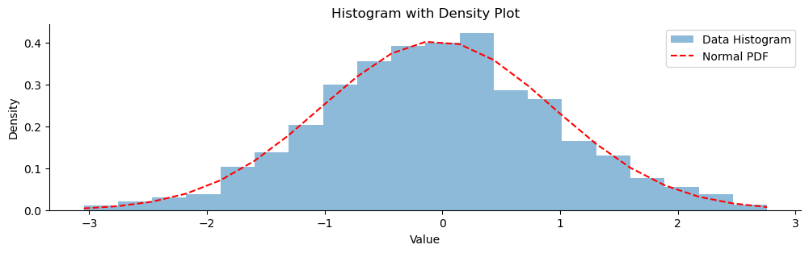
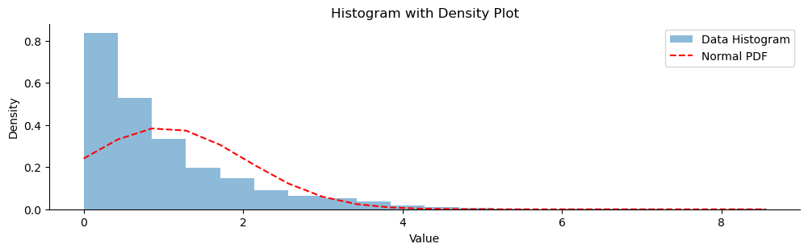
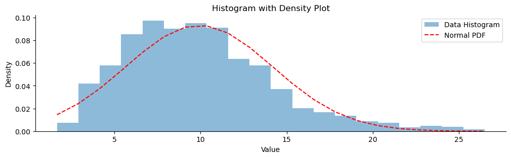
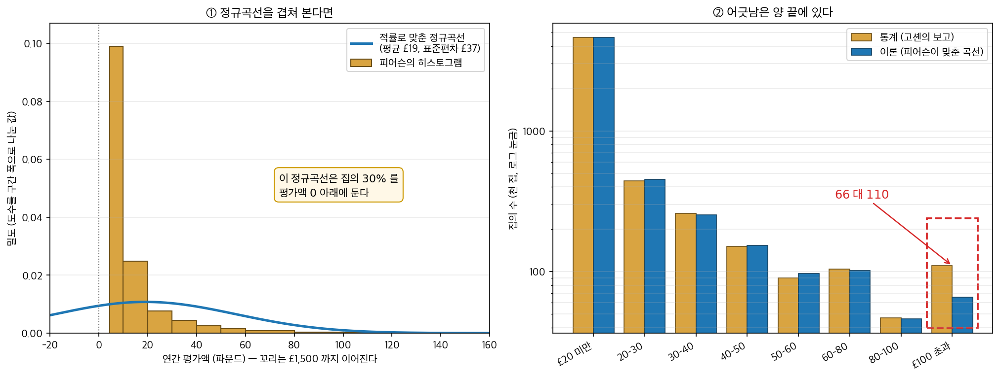
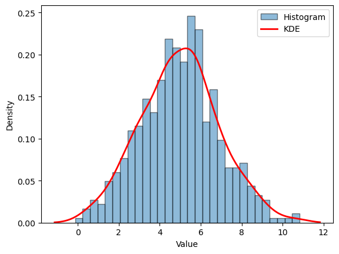

# 히스토그램과 밀도 그림

시각적 방법은 자료가 정규분포를 따르는지 평가하는 눈으로 보는 접근을 제공한다. 형식적 통계검정은 아니지만 자료의 분포를 이해하는 데 유용한 통찰을 준다.

---

## 개요

**히스토그램**은 자료의 분포를 그림으로 나타낸 것이다. 자료를 구간으로 나누고 각 구간에 자료점이 얼마나 자주 들어가는지 보여준다. 자료가 정규분포를 따르면 히스토그램이 익숙한 종 모양 곡선에 가까워야 한다. **밀도 그림**도 비슷하지만 분포를 나타내는 매끄러운 곡선을 제공한다.

---

## 1. 정규 표본에 정규 확률밀도함수 겹치기

<div class="exbox" markdown>

**보기 1.** <span class="diff easy" title="쉬움"></span> 정규 표본에 정규 곡선 겹치기. $\mathcal{N}(0,1)$에서 $n = 1000$개를 뽑아 구간 20개의 히스토그램을 그리고, 표본평균과 표본표준편차로 맞춘 정규 확률밀도함수를 겹친다.

**(1)** 그려 보고 무엇이 읽히는지 말하시오. **히스토그램에서 가장 높은 막대가 표본평균 자리에 서는가**를 수로 확인하시오.

**(2)** **자료를 그대로 둔 채 구간 수만** 5, 10, 20, 40, 80, 160으로 바꾸어 히스토그램의 봉우리(국소최대) 개수를 세시오. 완전히 정규인 자료에서 봉우리가 몇 개까지 생기는가. 이로부터 "히스토그램에 봉우리가 여러 개 보인다"는 관찰을 어떻게 다루어야 하는가.

</div>

??? success "풀이"

    유도할 답이 있는 문제가 아니다. **그림이 무엇을 보여 주고 무엇을 만들어 내는가**가 전부다.

    **(1) 그림.**

    ```python
    import numpy as np
    import matplotlib.pyplot as plt
    from scipy import stats

    plt.rcParams["font.sans-serif"] = ["NanumGothic", "Apple SD Gothic Neo", "Malgun Gothic"]
    plt.rcParams["font.family"] = "sans-serif"
    plt.rcParams["axes.unicode_minus"] = False

    def plot_histogram_with_density(data, figsize=(12, 3)):
        """히스토그램에 적합한 정규 확률밀도함수를 겹쳐 그린다.

        자료의 평균과 표준편차로 만든 곡선이므로 위치와 척도는 이미 맞아 있다.
        남는 차이는 오직 모양이다.

        매개변수
        --------
        data : 그릴 자료
        figsize : 그림 크기 (가로, 세로)
        """
        fig, ax = plt.subplots(figsize=figsize)

        # density=True 로 넓이의 합을 1 로 맞춰야 확률밀도함수와 겹칠 수 있다.
        _, bins, _ = ax.hist(data, bins=20, density=True, alpha=0.5, label="Data Histogram")

        mu = data.mean()
        sigma = data.std()
        pdf = stats.norm(loc=mu, scale=sigma).pdf(bins)

        ax.plot(bins, pdf, "--r", label="Normal PDF")

        ax.spines["top"].set_visible(False)
        ax.spines["right"].set_visible(False)

        ax.set_title('Histogram with Density Plot')
        ax.set_xlabel('Value')
        ax.set_ylabel('Density')
        ax.legend()

        plt.show()

    if __name__ == "__main__":
        # 정규자료: 곡선이 히스토그램에 잘 얹힌다.
        np.random.seed(0)
        sample_data = np.random.normal(loc=0, scale=1, size=1000)
        plot_histogram_with_density(sample_data)
    ```

    

    **(2) 구간 수를 흔들어 본다.**

    ```python
    import numpy as np
    from scipy import stats

    np.random.seed(0)
    x = np.random.normal(loc=0, scale=1, size=1000)

    # 쪽의 함수가 쓰는 것과 같은 설정: bins=20, density=True, sigma = std(ddof=0).
    mu, sigma = x.mean(), x.std()
    dens, bins = np.histogram(x, bins=20, density=True)
    cnt, _ = np.histogram(x, bins=20)
    k = int(dens.argmax())

    print(f"mu = {mu:.4f}   sigma(ddof=0) = {sigma:.4f}   sigma(ddof=1) = {x.std(ddof=1):.4f}")
    print(f"구간 폭 = {bins[1] - bins[0]:.4f}   구간 수 = 20")
    print(f"최고 막대 밀도 = {dens.max():.4f} @ 구간중심 {(bins[k] + bins[k + 1]) / 2:+.4f}")
    print(f"정규 pdf 최대  = {stats.norm(mu, sigma).pdf(mu):.4f} @ mu = {mu:+.4f}")
    print(f"양끝 구간 도수: {cnt[:3]} ... {cnt[-3:]}")


    def n_peaks(counts):
        """막대 높이에서 국소최대의 개수를 센다."""
        pad = np.r_[-1.0, counts.astype(float), -1.0]
        return int(np.sum((pad[1:-1] > pad[:-2]) & (pad[1:-1] >= pad[2:])))


    print("\n구간 수를 바꿔 가며 봉우리를 센다 (자료는 그대로다):")
    for m in (5, 10, 20, 40, 80, 160):
        c, b = np.histogram(x, bins=m)
        print(f"  구간 {m:3d}개  폭 {b[1] - b[0]:.4f}  봉우리 {n_peaks(c):2d}개"
              f"  최고 도수 {c.max():3d}  빈 구간 {int((c == 0).sum()):2d}개")

    n = len(x)
    q1, q3 = np.percentile(x, [25, 75])
    h_fd = 2 * (q3 - q1) * n ** (-1 / 3)
    h_sc = 3.49 * x.std(ddof=1) * n ** (-1 / 3)
    rng_ = x.max() - x.min()
    print(f"\nSturges  k = 1 + log2(n) = {1 + np.log2(n):.2f}")
    print(f"Scott    h = {h_sc:.4f}  ->  k = {rng_ / h_sc:.2f}")
    print(f"FD       h = {h_fd:.4f}  ->  k = {rng_ / h_fd:.2f}")
    ```

    출력:

    ```text
    mu = -0.0453   sigma(ddof=0) = 0.9870   sigma(ddof=1) = 0.9875
    구간 폭 = 0.2903   구간 수 = 20
    최고 막대 밀도 = 0.4237 @ 구간중심 +0.2920
    정규 pdf 최대  = 0.4042 @ mu = -0.0453
    양끝 구간 도수: [3 6 9] ... [16 11  4]

    구간 수를 바꿔 가며 봉우리를 센다 (자료는 그대로다):
      구간   5개  폭 1.1611  봉우리  1개  최고 도수 456  빈 구간  0개
      구간  10개  폭 0.5805  봉우리  1개  최고 도수 239  빈 구간  0개
      구간  20개  폭 0.2903  봉우리  1개  최고 도수 123  빈 구간  0개
      구간  40개  폭 0.1451  봉우리 10개  최고 도수  64  빈 구간  0개
      구간  80개  폭 0.0726  봉우리 27개  최고 도수  37  빈 구간  5개
      구간 160개  폭 0.0363  봉우리 53개  최고 도수  25  빈 구간 23개

    Sturges  k = 1 + log2(n) = 10.97
    Scott    h = 0.3446  ->  k = 16.84
    FD       h = 0.2611  ->  k = 22.24
    ```

    **(1) 읽기.** 곡선과 막대가 전체적으로 잘 겹친다. 겹치는 것이 당연한 까닭을 먼저 짚어 두어야 한다. 곡선의 모수를 자료에서 뽑아 썼으므로 **위치와 척도는 맞을 수밖에 없다.** 남는 비교 대상은 모양뿐이다. 높이로 재면 최고 막대가 밀도 $0.4237$, 정규곡선의 최대가 $0.4042$로 $4.8\%$ 차이이고, 양끝 구간의 도수가 좌 $3, 6, 9$ 대 우 $16, 11, 4$로 대략 맞물린다.

    그런데 **가장 높은 막대는 표본평균 자리에 서지 않는다.** 최고 막대의 중심이 $+0.2920$인데 표본평균은 $-0.0453$이다. 차이 $0.337$은 구간 폭 $0.2903$의 $1.16$배이니, 봉우리가 한 칸 넘게 비껴 있다. 자료가 **정확히** 정규인데도 그렇다. 구간별 도수는 이항변동을 가지므로 최고 막대의 위치는 잡음이 많은 추정량이고, **최빈 구간의 위치로 중심을 읽으려 해서는 안 된다.** 중심을 알고 싶으면 평균이나 중앙값을 계산해야 한다.

    두 가지를 더 적어 둔다. 함수가 쓰는 `data.std()`는 `ddof=0`이라 $\hat\sigma = 0.9870$이고 표본표준편차 $S = 0.9875$와 다르다. $n = 1000$에서는 차이가 $0.05\%$라 그림에서 보이지 않지만 작은 표본에서는 문제가 된다. 또 `pdf(bins)`는 확률밀도함수를 **구간 경계 21개에서만** 계산한다. 곧 빨간 "곡선"은 21점을 이은 꺾은선이다. 구간을 20개로 둔 지금은 매끄럽게 보이지만, 구간 수를 줄이면 꺾임이 눈에 드러난다.

    **(2) 봉우리 개수는 구간 수가 정한다.** 자료는 한 번도 바뀌지 않았다. 그런데도

    | 구간 수 | 5 | 10 | 20 | 40 | 80 | 160 |
    |---|---|---|---|---|---|---|
    | 봉우리 | 1 | 1 | 1 | **10** | **27** | **53** |
    | 빈 구간 | 0 | 0 | 0 | 0 | 5 | 23 |

    로 변한다. **완전히 정규인 자료에서 봉우리가 53개까지 보인다.** 구간 폭이 $0.0363$으로 좁아지면 구간마다 평균 6개쯤만 들어가고, 그 도수의 변동이 그대로 들쭉날쭉한 톱니가 되기 때문이다. 160개 구간에서는 비어 있는 구간도 23개나 생겨 자료에 빈틈이 있는 것처럼 보인다. 없는 빈틈이다.

    경계는 20개와 40개 사이에 있다. 그리고 세 가지 구간 규칙이 모두 그 아래쪽을 가리킨다. Sturges $k = 10.97$, Scott $k = 16.84$, Freedman–Diaconis $k = 22.24$다. 쪽에서 쓴 `bins=20`은 이 세 값의 범위 안에 있으니 적절한 선택이었다.

    따라서 **"히스토그램에 봉우리가 여러 개 보인다"는 관찰은 그 자체로는 아무 정보도 아니다.** 구간 수를 함께 보고해야 하고, 더 나은 방법은 구간 수를 몇 가지로 바꿔 그려 **어느 선택에서도 남는 봉우리만 실제 봉우리로 인정하는 것**이다. 위 표에서는 어떤 구간 수에서도 봉우리가 둘로 갈라지지 않으므로 이 자료는 단봉이라고 판단할 수 있다. 커널밀도추정도 같은 문제를 띠폭의 이름으로 겪는다.

!!! note "`density=True`가 핵심이다"
    `ax.hist(..., density=True)`가 히스토그램의 전체 넓이를 1로 만들어 준다. 이렇게 해야 확률밀도함수 곡선과 같은 척도가 되어 비교가 의미를 갖는다. 빈도(도수)를 그대로 그리면 두 곡선의 척도가 완전히 달라 겹쳐 그리는 것이 무의미해진다.

---

## 2. 지수 표본에 정규 확률밀도함수 겹치기

<div class="exbox" markdown>

**보기 2.** <span class="diff easy" title="쉬움"></span> 지수 표본에 정규 곡선 겹치기. $\text{Exponential}(1)$에서 $n = 1000$개를 뽑아 보기 1과 똑같이 구간 20개의 히스토그램에 적합 정규곡선을 겹친다.

**(1)** 봉우리의 자리와 높이를 **수로** 비교하시오. 히스토그램의 최고 막대와 정규곡선의 최대가 어디에 서고 높이 비가 얼마인가.

**(2)** 겹쳐 그린 정규곡선은 **지수 자료가 있을 수 없는 구간**까지 뻗는다. 그 구간에 곡선이 놓는 확률질량이 얼마인지 구하시오. 이것이 왜 "모수를 자료에서 맞추었으므로 적어도 위치와 척도는 맞다"는 변명을 무너뜨리는가.

</div>

??? success "풀이"

    **(1)·(2) 그림과 수치.** 보기 1과 같은 함수에 자료만 바꾸어 넣는다.

    ```python
    import numpy as np
    import matplotlib.pyplot as plt
    from scipy import stats

    plt.rcParams["font.sans-serif"] = ["NanumGothic", "Apple SD Gothic Neo", "Malgun Gothic"]
    plt.rcParams["font.family"] = "sans-serif"
    plt.rcParams["axes.unicode_minus"] = False

    def plot_histogram_with_density(data, figsize=(12, 3)):
        """히스토그램에 적합한 정규 확률밀도함수를 겹쳐 그린다.

        자료의 평균과 표준편차로 만든 곡선이므로, 위치와 척도는 이미 맞아
        있다. 남는 차이는 오직 모양이다.
        """
        fig, ax = plt.subplots(figsize=figsize)
        _, bins, _ = ax.hist(data, bins=20, density=True, alpha=0.5, label="Data Histogram")

        mu = data.mean()
        sigma = data.std()
        pdf = stats.norm(loc=mu, scale=sigma).pdf(bins)
        ax.plot(bins, pdf, "--r", label="Normal PDF")

        ax.spines["top"].set_visible(False)
        ax.spines["right"].set_visible(False)
        ax.set_title('Histogram with Density Plot')
        ax.set_xlabel('Value')
        ax.set_ylabel('Density')
        ax.legend()
        plt.show()

    if __name__ == "__main__":
        # 지수자료: 곡선이 왼쪽에서 음수 구간까지 뻗어 나가고 봉우리 자리도
        # 어긋난다. 정규로 볼 수 없다는 것이 한눈에 보인다.
        np.random.seed(0)
        sample_data = np.random.exponential(scale=1, size=1000)
        plot_histogram_with_density(sample_data)
    ```

    

    ```python
    import numpy as np
    from scipy import stats

    np.random.seed(0)
    x = np.random.exponential(scale=1, size=1000)

    mu, sigma = x.mean(), x.std()
    dens, bins = np.histogram(x, bins=20, density=True)
    cnt, _ = np.histogram(x, bins=20)
    fit = stats.norm(mu, sigma)
    k = int(dens.argmax())

    print(f"mu = {mu:.4f}   sigma = {sigma:.4f}   (Exp(1) 의 참값은 둘 다 1)")
    print(f"구간 폭 = {bins[1] - bins[0]:.4f}")
    print(f"최고 막대 밀도 = {dens.max():.4f} @ 구간중심 {(bins[k] + bins[k + 1]) / 2:.4f}")
    print(f"정규 pdf 최대  = {fit.pdf(mu):.4f} @ mu = {mu:.4f}   (높이 비 {dens.max() / fit.pdf(mu):.2f})")
    print(f"자료 최소 = {x.min():.4f},  Exp 의 참 최빈값 = 0")
    print(f"왼쪽 세 구간 도수 = {cnt[:3]},  오른쪽 세 구간 = {cnt[-3:]}")

    # 적합한 정규가 음수 구간에 얼마나 질량을 놓는가. 지수자료는 거기 있을 수 없다.
    print(f"P(적합 정규 < 0) = {fit.cdf(0):.6f} = {100 * fit.cdf(0):.2f}%")
    print(f"실제로 음수인 관측값 = {int((x < 0).sum())}개")
    print(f"g1 = {stats.skew(x):.4f}  (Exp 의 이론 왜도 = 2)")
    print(f"g2 = {stats.kurtosis(x):.4f}  (Exp 의 이론 초과첨도 = 6)")
    ```

    출력:

    ```text
    mu = 1.0035   sigma = 1.0291   (Exp(1) 의 참값은 둘 다 1)
    구간 폭 = 0.4280
    최고 막대 밀도 = 0.8387 @ 구간중심 0.2146
    정규 pdf 최대  = 0.3877 @ mu = 1.0035   (높이 비 2.16)
    자료 최소 = 0.0005,  Exp 의 참 최빈값 = 0
    왼쪽 세 구간 도수 = [359 226 143],  오른쪽 세 구간 = [0 0 1]
    P(적합 정규 < 0) = 0.164738 = 16.47%
    실제로 음수인 관측값 = 0개
    g1 = 2.0526  (Exp 의 이론 왜도 = 2)
    g2 = 6.4761  (Exp 의 이론 초과첨도 = 6)
    ```

    **(1) 봉우리가 두 가지로 어긋난다.** 자리가 어긋난다. 히스토그램의 최고 막대는 맨 왼쪽 구간(중심 $0.2146$)이고 정규곡선의 최대는 $\mu = 1.0035$에 있다. 구간 폭 $0.4280$으로 재면 **두 봉우리가 1.8칸 떨어져 있다.** 지수분포의 참 최빈값이 0이므로 이는 표본의 우연이 아니다. 높이도 어긋난다. 최고 막대가 밀도 $0.8387$, 정규곡선의 최대가 $0.3877$로 **히스토그램 쪽이 2.16배 높다.** 왼쪽 세 구간에 $359 + 226 + 143 = 728$개, 곧 자료의 $73\%$가 몰려 있는데 대칭곡선으로는 이런 집중을 흉내낼 수 없다.

    오른쪽도 보아야 한다. 오른쪽 세 구간의 도수가 $0, 0, 1$이다. 히스토그램에서는 이 막대들이 거의 보이지 않으므로 **꼬리가 얼마나 긴지를 이 그림에서 읽어 내기는 어렵다.** 두꺼운 꼬리의 진단은 Q-Q 그림의 몫이다. 표본 모양 통계량은 $g_1 = 2.053$, $g_2 = 6.476$으로 지수분포의 이론값 $2$와 $6$에 가깝다(`scipy.stats.skew`·`kurtosis`의 기본값 `bias=True`·`fisher=True`를 쓴 보정하지 않은 초과첨도 판본이다).

    **(2) 적합 정규는 음수 구간에 $16.47\%$를 놓는다.** 표본평균 $\mu = 1.0035$, 표본표준편차 $\sigma = 1.0291$로 맞춘 곡선에서

    $$
    P(\text{적합 정규} < 0) = \Phi\!\left(\frac{0 - 1.0035}{1.0291}\right) = \Phi(-0.9751) = 0.1647
    $$

    이다. 그런데 지수분포의 지지집합은 $[0, \infty)$이고 실제로 음수인 관측값은 **0개**다. 곧 **적합된 모형이 전체 확률의 6분의 1을 자료가 존재할 수 없는 곳에 버리고 있다.**

    이것이 "모수를 자료에서 맞추었으니 위치와 척도는 맞다"는 변명을 무너뜨리는 자리다. 그 말은 참이다. 평균과 분산은 정의상 맞아 있다. 그러나 **평균과 분산을 맞추는 것이 분포를 맞추는 것이 아니다.** 지지집합부터 틀렸고, 모양이 틀렸고, 그래서 이 모형으로 계산한 확률은 전부 틀린다. 보기 1에서 곡선과 막대가 잘 겹친 것은 모수를 맞췄기 때문이 아니라 자료가 실제로 정규였기 때문이다. **적합의 자유도 두 개로는 모양의 결함을 가릴 수 없다** — 이것이 겹쳐 그리기가 진단으로서 쓸모를 갖는 이유다.

---

## 3. 카이제곱 표본에 정규 확률밀도함수 겹치기

<div class="exbox" markdown>

**보기 3.** <span class="diff easy" title="쉬움"></span> 카이제곱 표본에 정규 곡선 겹치기. $\chi^2_{10}$에서 $n = 1000$개를 뽑아 보기 1·2와 똑같이 겹쳐 그린다. 이 경우는 지수보다 훨씬 정규에 가깝다.

**(1)** 막대와 곡선의 차를 **구간마다** 재어 가장 크게 어긋난 자리를 찾으시오. 그 자리에서 어긋남이 곡선 높이의 몇 퍼센트인가.

**(2)** 이 그림을 보고 "대략 정규로 보아도 되겠다"고 판단했다면 무엇을 놓치는가. **오른쪽 끝 구간**의 막대와 곡선을 수로 비교하여 답하시오.

</div>

??? success "풀이"

    **(1)·(2) 그림과 수치.**

    ```python
    import numpy as np
    import matplotlib.pyplot as plt
    from scipy import stats

    plt.rcParams["font.sans-serif"] = ["NanumGothic", "Apple SD Gothic Neo", "Malgun Gothic"]
    plt.rcParams["font.family"] = "sans-serif"
    plt.rcParams["axes.unicode_minus"] = False

    def plot_histogram_with_density(data, figsize=(12, 3)):
        """히스토그램에 적합한 정규 확률밀도함수를 겹쳐 그린다.

        자료의 평균과 표준편차로 만든 곡선이므로, 위치와 척도는 이미 맞아
        있다. 남는 차이는 오직 모양이다.
        """
        fig, ax = plt.subplots(figsize=figsize)
        _, bins, _ = ax.hist(data, bins=20, density=True, alpha=0.5, label="Data Histogram")

        mu = data.mean()
        sigma = data.std()
        pdf = stats.norm(loc=mu, scale=sigma).pdf(bins)
        ax.plot(bins, pdf, "--r", label="Normal PDF")

        ax.spines["top"].set_visible(False)
        ax.spines["right"].set_visible(False)
        ax.set_title('Histogram with Density Plot')
        ax.set_xlabel('Value')
        ax.set_ylabel('Density')
        ax.legend()
        plt.show()

    if __name__ == "__main__":
        # 카이제곱(자유도 10): 지수보다 훨씬 가깝지만 왼쪽 어깨가 조금 어긋난다.
        np.random.seed(0)
        sample_data = np.random.chisquare(df=10, size=1000)
        plot_histogram_with_density(sample_data)
    ```

    

    ```python
    import numpy as np
    from scipy import stats

    np.random.seed(0)
    x = np.random.chisquare(df=10, size=1000)

    mu, sigma = x.mean(), x.std()
    dens, bins = np.histogram(x, bins=20, density=True)
    fit = stats.norm(mu, sigma)
    k = int(dens.argmax())
    ctr = (bins[:-1] + bins[1:]) / 2

    print(f"mu = {mu:.4f}   sigma = {sigma:.4f}   (chi2_10 의 참값: 10 과 sqrt(20) = {np.sqrt(20):.4f})")
    print(f"구간 폭 = {bins[1] - bins[0]:.4f}")
    print(f"최고 막대 밀도 = {dens.max():.4f} @ 구간중심 {ctr[k]:.4f}")
    print(f"정규 pdf 최대  = {fit.pdf(mu):.4f} @ mu = {mu:.4f}")
    print(f"chi2_10 의 참 최빈값 = d - 2 = 8")
    print(f"P(적합 정규 < 0) = {fit.cdf(0):.6f} = {100 * fit.cdf(0):.2f}%")

    # 막대와 곡선의 차이를 구간마다 재서 가장 크게 어긋난 자리를 찾는다.
    diff = dens - fit.pdf(ctr)
    j = int(np.abs(diff).argmax())
    print(f"가장 크게 어긋난 구간: 중심 {ctr[j]:.3f}, 막대 {dens[j]:.4f} - 곡선 {fit.pdf(ctr[j]):.4f}"
          f" = {diff[j]:+.4f}  (곡선의 {100 * diff[j] / fit.pdf(ctr[j]):+.1f}%)")
    print("구간중심 / 막대 / 곡선 / 차:")
    for i in range(0, 20, 2):
        print(f"  {ctr[i]:6.2f}  {dens[i]:.4f}  {fit.pdf(ctr[i]):.4f}  {diff[i]:+.4f}")
    print(f"g1 = {stats.skew(x):.4f}  (이론 sqrt(8/10) = {np.sqrt(0.8):.4f})")
    print(f"g2 = {stats.kurtosis(x):.4f}  (이론 12/10 = 1.2)")
    ```

    출력:

    ```text
    mu = 9.9224   sigma = 4.2793   (chi2_10 의 참값: 10 과 sqrt(20) = 4.4721)
    구간 폭 = 1.2419
    최고 막대 밀도 = 0.0974 @ 구간중심 7.2509
    정규 pdf 최대  = 0.0932 @ mu = 9.9224
    chi2_10 의 참 최빈값 = d - 2 = 8
    P(적합 정규 < 0) = 0.010205 = 1.02%
    가장 크게 어긋난 구간: 중심 6.009, 막대 0.0854 - 곡선 0.0614 = +0.0240  (곡선의 +39.1%)
    구간중심 / 막대 / 곡선 / 차:
        2.28  0.0072  0.0189  -0.0117
        4.77  0.0580  0.0451  +0.0129
        7.25  0.0974  0.0767  +0.0207
        9.73  0.0950  0.0931  +0.0019
       12.22  0.0636  0.0807  -0.0171
       14.70  0.0370  0.0500  -0.0129
       17.19  0.0169  0.0221  -0.0052
       19.67  0.0089  0.0070  +0.0019
       22.15  0.0032  0.0016  +0.0017
       24.64  0.0040  0.0003  +0.0038
    g1 = 0.8519  (이론 sqrt(8/10) = 0.8944)
    g2 = 0.8951  (이론 12/10 = 1.2)
    ```

    **(1) 가장 크게 어긋난 자리는 왼쪽 어깨다.** 중심 $6.009$인 구간에서 막대가 $0.0854$, 곡선이 $0.0614$로 차가 $+0.0240$이다. **곡선 높이의 $39.1\%$** 이니 작은 어긋남이 아니다. 차의 부호를 왼쪽에서 오른쪽으로 훑으면 $-,\ +,\ +,\ +,\ -,\ -,\ -,\ +,\ +,\ +$로 **세 번 바뀐다.** 이것이 오른쪽 치우침의 서명이다. 봉우리 왼쪽 어깨가 곡선보다 높고($4.77$에서 $+0.0129$, $7.25$에서 $+0.0207$), 봉우리 오른쪽 어깨가 곡선보다 낮고($12.22$에서 $-0.0171$, $14.70$에서 $-0.0129$), 다시 오른쪽 꼬리가 곡선보다 높다. 곧 **질량이 왼쪽으로 몰리고 꼬리만 오른쪽으로 길게 새어 나간 꼴**이다.

    봉우리의 자리도 그 말을 한다. 히스토그램의 최고 막대는 중심 $7.25$에 서고 적합 정규의 최대는 $\mu = 9.92$에 선다. $\chi^2_d$의 참 최빈값은 $d - 2 = 8$이므로 **히스토그램 쪽이 참값에 가깝고 정규곡선은 봉우리를 오른쪽으로 2칸 가까이 밀어 놓았다.** 평균을 중심으로 삼는 대칭곡선은 최빈값과 평균이 다른 분포를 흉내낼 수 없다. 표본 모양 통계량은 $g_1 = 0.852$, $g_2 = 0.895$로 이론값 $\sqrt{8/10} = 0.894$와 $12/10 = 1.2$에 견줄 만하다(둘 다 `scipy` 기본값, 곧 보정하지 않은 판본이다).

    **(2) 놓치는 것은 오른쪽 꼬리다.** 보기 2의 지수 자료에서는 음수 구간의 질량이 $16.47\%$였는데 여기서는 $1.02\%$로 줄었다. 눈으로 보기에 "대략 맞는다"는 인상이 그래서 생긴다. 그러나 **가장 바깥 구간을 보면 이야기가 달라진다.**

    | 구간 중심 | 막대 밀도 | 곡선 밀도 | 비 |
    |---|---|---|---|
    | $24.64$ | $0.004026$ | $0.000252$ | $16.0$ |
    | $25.88$ | $0.001610$ | $0.000089$ | $18.1$ |

    **막대가 곡선의 16배에서 18배다.** 도수로 바꾸면 더 분명하다. 마지막 구간에 실제로 2개가 들어 있고, 참 $\chi^2_{10}$이 예측하는 기대도수는 $1.75$개인데 적합 정규가 예측하는 것은 $0.12$개다. 곧 **적합 정규는 그 구간을 15배 과소평가한다.**

    그런데도 그림에서는 이 결함이 보이지 않는다. 밀도가 $0.004$와 $0.00025$여서 **봉우리 높이 $0.097$의 4% 와 0.26% 에 지나지 않고, 두 막대 모두 축 바닥에 눌려 구별되지 않는다.** 선형 세로축의 히스토그램은 꼬리를 보여 주는 도구가 아니다.

    실무에서 이 차이가 닿는 곳은 분위수다. $\chi^2_{10}$의 $99.9\%$ 분위수는 $29.59$인데 적합 정규가 주는 값은 $9.92 + 3.09 \times 4.28 = 23.15$다. **상위 0.1% 를 6 이상 과소평가한다.** 가운데가 잘 맞는 그림을 근거로 정규근사를 받아들이면 정확히 이 오차를 안고 가게 된다. 그래서 **"대략 정규로 보인다"는 판단은 가운데에 대한 진술일 뿐**이며, 꼬리가 중요한 문제에서는 Q-Q 그림이나 형식적 검정으로 따로 확인해야 한다.

<div class="storybox" markdown>

**그림으로 보는 통계학 1.** 「히스토그램」이라는 말이 처음 찍힌 문장

이 쪽이 세 번 되풀이한 일 — 막대를 세우고 맞춘 곡선을 겹친 다음 **어디가 어긋나는지
본다** — 에는 시작한 자리가 있다. 그 자리에서 **「히스토그램」이라는 낱말도 함께
태어났다.**

$1895$ 년 『**Philosophical Transactions of the Royal Society of London A**』
$186$ 권 $343$–$414$ 쪽. 칼 피어슨이 「진화의 수학적 이론에 관하여 II — 균질한 재료에서의
치우친 변이」를 싣는다($1894$ 년 $12$ 월 $19$ 일 접수, $1895$ 년 $1$ 월 $24$ 일 낭독).
목차의 $9$–$10$ 절 제목이 이 논문의 주장 전부다 — **「실제 통계에 적용했을 때 정규도수
곡선이 갖는 결함에 관한 일반적 고찰」.** 그는 정규곡선 하나로는 세상의 도수분포를 덮을
수 없다고 보고, 치우친 분포를 담을 곡선족을 세운다. 오늘 「피어슨 분포족」이라 부르는
것이다.

그 논문 $399$ 쪽, 보기 $10$ 을 설명하는 문장에서 낱말이 처음 활자가 된다.

> 그러나 **히스토그램**은 곡선의 양 끝에서 어긋나는 정도를 보여 준다.

그리고 그 낱말에 달린 각주.

> \* 글쓴이가 통계학 강의에서, 흔히 쓰는 도형 표시 한 가지를 가리키려고 들여온 말이다.
> 곧 밑변의 범위에 해당하는 도수를 **넓이로 표시하는 기둥들**로 그리는 것이다.

보기 $10$ 의 자료는 꾸민 것이 아니다. 피어슨은 **고셴**의 $1887$ 년 왕립통계학회 회장
연설(『Journal』 $50$ 권 부록 II, $610$–$612$ 쪽)에서 「잉글랜드·웨일스 주택 평가액,
$1885$–$1886$」을 가져왔다. 집과 상점 $583$ 만 채다. 그 수를 그대로 그려 보면 이렇다.

<figure markdown>
{ width="960" }
  <figcaption markdown>구간 폭이 같지 않으므로 왼쪽 칸의 높이는 **도수를 구간 폭으로 나눈 값**이다. 오른쪽 칸의 두 열은 피어슨이 논문 $398$ 쪽에 나란히 실은 그대로다(천 집 단위).</figcaption>
</figure>

왼쪽 칸이 그가 정규곡선을 믿지 않은 까닭이다. 구간 중점으로 적률을 재면 평균 £$19.07$,
표준편차 £$37.03$ 인 정규곡선이 나오는데, **그 곡선은 집의 $30\%$ 를 평가액 $0$ 아래에
둔다.** 봉우리 자리도 맞지 않는다. 실제로는 전체의 $54.5\%$ 가 £$10$ 아래에 몰려 있는데
그 정규곡선이 거기에 주는 확률은 $40.3\%$ 다.

오른쪽 칸이 그의 문장이다. 그가 맞춘 곡선은 £$100$ 아래의 일곱 구간에서 통계와
$3\%$ 넘게 어긋난 적이 한 번뿐이다($50$–$60$ 구간에서 $7.2\%$). 그런데 마지막
구간 — £$100$ 초과 — 에서는 이론이 $66$, 통계가 $110$ 이다. **$1.67$ 배.** 피어슨은
그 어긋남을 호텔이나 공동주택처럼 「같은 갈래로 묶기 어려운 건물」 탓으로 돌렸고,
꼬리가 너무 성글게 기록되어 따로 떼어 볼 수도 없다고 적었다.

그러니 이 쪽의 $3$ 절 끝에서 「선형 세로축의 히스토그램은 꼬리를 보여 주는 도구가
아니다」라고 적은 것과, $1895$ 년에 「히스토그램은 양 끝에서 어긋나는 정도를 보여
준다」고 적은 것은 **같은 자리를 양쪽에서 본 문장**이다. 가운데는 어느 곡선으로도
맞출 수 있고, 판가름은 언제나 끝에서 난다.

_확인한 곳 — 논문의 제목·학술지·권·쪽수·접수일과 낭독일, 목차 $9$–$10$ 절의 제목, $399$ 쪽의 「histogram」 본문 문장과 각주, 자료의 출처(고셴의 $1887$ 년 회장 연설, 『Journal』 $50$ 권 부록 II $610$–$612$ 쪽)와 제목(「잉글랜드·웨일스 주택 평가액, $1885$–$1886$」), $396$ 쪽의 구간별 집 수와 $398$ 쪽의 이론·통계 두 열, 그리고 꼬리의 어긋남에 관한 피어슨 자신의 설명. 모두 [JSTOR 스캔](https://www.jstor.org/stable/90649)에서 직접 읽었다 · 그림의 밀도·적률·정규곡선 값은 그 표에서 직접 계산한 값이다_

</div>

### 커널밀도추정

커널밀도추정(KDE)은 히스토그램을 매끄럽게 만들어 다봉성이나 비대칭을 발견하는 데 유용하다. Gauss 핵과 띠너비 $h$를 쓰면 KDE는

$$
\hat{f}_h(x) = \frac{1}{nh}\sum_{i=1}^{n} \phi\!\Bigl(\frac{x - X_i}{h}\Bigr),
$$

여기서 $\phi$는 표준정규 밀도이다. 이를 적합된 정규 곡선과 겹쳐 그린다. 체계적인 차이가 보이면 정규성에서의 이탈을 나타낸다.

---

### 구간 수가 만드는 울퉁불퉁함

<div class="exbox" markdown>

**보기 4.** <span class="diff easy" title="쉬움"></span> 히스토그램에 정규곡선 겹치기. $\mathcal{N}(0,1)$에서 $n = 100$개를 뽑아 구간 15개의 히스토그램에 적합 정규곡선을 겹친다. 자료는 **정말로** 정규다.

**(1)** 그려 보고 무엇이 읽히는지 말하시오. 구간 도수를 나열하여 **봉우리가 몇 개로 보이는지** 세고, 최고 막대가 적합 곡선을 몇 퍼센트 넘어서는지 적으시오.

**(2)** (1)에서 읽은 울퉁불퉁함이 자료의 성질인지 그림의 성질인지 가르시오. 구간 수를 바꾸어 보고, 세 구간 규칙(Sturges·Scott·Freedman–Diaconis)이 권하는 값과 비교하시오. 자료가 정규라는 것은 어떻게 확인하는가.

</div>

??? success "풀이"

    유도할 답이 있는 문제가 아니다. **그림에서 무엇이 읽히고 그중 무엇이 자료의 성질이 아닌가**가 이 보기의 전부다.

    **(1) 그림.**

    ```python
    import numpy as np
    from scipy import stats
    import matplotlib.pyplot as plt

    np.random.seed(42)

    n = 100
    data = np.random.normal(loc=0, scale=1, size=n)

    # 히스토그램에 적합한 정규곡선을 겹친다. 위치와 척도를 자료에서 뽑아 썼으므로
    # 남는 차이는 모양뿐이다. 다만 계급 수에 따라 인상이 달라지므로, 이 그림만으로
    # 판단하지 말고 Q-Q 그림과 함께 본다.
    fig, ax = plt.subplots(figsize=(7, 4))
    ax.hist(data, bins=15, density=True, alpha=0.6, edgecolor="black")
    x_grid = np.linspace(data.min() - 0.5, data.max() + 0.5, 200)
    ax.plot(x_grid, stats.norm.pdf(x_grid, data.mean(), data.std(ddof=1)),
            linewidth=2, label="Fitted Normal PDF")
    ax.set_xlabel("Value")
    ax.set_ylabel("Density")
    ax.set_title("Histogram with Normal Overlay")
    ax.legend()
    plt.tight_layout()
    plt.show()
    ```

    

    **(2) 구간 수를 흔들고 검정으로 확인한다.**

    ```python
    import numpy as np
    from scipy import stats

    np.random.seed(42)
    n = 100
    data = np.random.normal(loc=0, scale=1, size=n)

    mu, s = data.mean(), data.std(ddof=1)
    dens, bins = np.histogram(data, bins=15, density=True)
    cnt, _ = np.histogram(data, bins=15)
    ctr = (bins[:-1] + bins[1:]) / 2


    def n_peaks(counts):
        pad = np.r_[-1.0, counts.astype(float), -1.0]
        return int(np.sum((pad[1:-1] > pad[:-2]) & (pad[1:-1] >= pad[2:])))


    print(f"평균 = {mu:.4f}   S(ddof=1) = {s:.4f}   구간 폭 = {bins[1] - bins[0]:.4f}")
    print(f"구간 도수: {cnt}")
    print(f"구간당 평균 도수 = {cnt.mean():.2f}   봉우리 {n_peaks(cnt)}개   빈 구간 {int((cnt == 0).sum())}개")

    diff = dens - stats.norm.pdf(ctr, mu, s)
    j = int(np.abs(diff).argmax())
    print(f"최고 막대 밀도 = {dens.max():.4f} @ {ctr[int(dens.argmax())]:+.3f}"
          f"   적합 곡선 최대 = {stats.norm.pdf(mu, mu, s):.4f} @ {mu:+.3f}")
    print(f"가장 어긋난 구간: 중심 {ctr[j]:+.3f}  막대 {dens[j]:.4f}  곡선 {stats.norm.pdf(ctr[j], mu, s):.4f}"
          f"  차 {diff[j]:+.4f} ({100 * diff[j] / stats.norm.pdf(ctr[j], mu, s):.0f}%)")

    print("\n같은 자료, 구간 수만 바꾼다:")
    for m in (5, 8, 10, 15, 20, 30):
        c, b = np.histogram(data, bins=m)
        print(f"  구간 {m:2d}개  폭 {b[1] - b[0]:.3f}  봉우리 {n_peaks(c)}개"
              f"  빈 구간 {int((c == 0).sum())}개  최대 도수 {c.max():2d}")

    q1, q3 = np.percentile(data, [25, 75])
    rg = data.max() - data.min()
    print(f"\n권장 구간 수:  Sturges {1 + np.log2(n):.2f}"
          f"   Scott {rg / (3.49 * s * n ** (-1 / 3)):.2f}"
          f"   FD {rg / (2 * (q3 - q1) * n ** (-1 / 3)):.2f}")

    print(f"\n이 표본은 실제로 정규인가:")
    print(f"  Shapiro-Wilk  p = {stats.shapiro(data).pvalue:.4f}")
    print(f"  D'Agostino K2 p = {stats.normaltest(data).pvalue:.4f}")
    print(f"  G1 = {stats.skew(data, bias=False):.4f}   G2 = {stats.kurtosis(data, bias=False):.4f}")
    ```

    출력:

    ```text
    평균 = -0.1038   S(ddof=1) = 0.9082   구간 폭 = 0.2981
    구간 도수: [ 1  0  4  3  6  5  9 15 12 18  7  7  5  5  3]
    구간당 평균 도수 = 6.67   봉우리 5개   빈 구간 1개
    최고 막대 밀도 = 0.6038 @ +0.213   적합 곡선 최대 = 0.4393 @ -0.104
    가장 어긋난 구간: 중심 +0.213  막대 0.6038  곡선 0.4134  차 +0.1903 (46%)

    같은 자료, 구간 수만 바꾼다:
      구간  5개  폭 0.894  봉우리 1개  빈 구간 0개  최대 도수 36
      구간  8개  폭 0.559  봉우리 1개  빈 구간 0개  최대 도수 23
      구간 10개  폭 0.447  봉우리 3개  빈 구간 0개  최대 도수 21
      구간 15개  폭 0.298  봉우리 5개  빈 구간 1개  최대 도수 18
      구간 20개  폭 0.224  봉우리 7개  빈 구간 1개  최대 도수 14
      구간 30개  폭 0.149  봉우리 9개  빈 구간 4개  최대 도수 10

    권장 구간 수:  Sturges 7.64   Scott 6.55   FD 10.31

    이 표본은 실제로 정규인가:
      Shapiro-Wilk  p = 0.6552
      D'Agostino K2 p = 0.7501
      G1 = -0.1779   G2 = -0.1010
    ```

    **(1) 읽기.** 구간 도수가

    $$
    1,\ 0,\ 4,\ 3,\ 6,\ 5,\ 9,\ 15,\ 12,\ 18,\ 7,\ 7,\ 5,\ 5,\ 3
    $$

    이다. 오르내림을 세면 **봉우리가 5개**이고 **빈 구간도 하나** 있다. 가운데에서 $15 \to 12 \to 18$로 한 번 꺼졌다가 다시 솟는 자리가 특히 눈에 띈다. 최고 막대는 밀도 $0.6038$로 그 자리의 적합 곡선 $0.4134$를 **$46\%$ 넘어선다.** 적합 곡선의 최대 $0.4393$과 견주어도 $37\%$ 높다. 봉우리의 자리도 어긋난다. 최고 막대의 중심이 $+0.213$인데 표본평균은 $-0.104$다.

    그림만 보고 적으면 "가운데가 이봉 같고, 봉우리가 곡선보다 많이 높고, 봉우리 자리도 평균에서 밀려 있으니 정규가 아닌 듯하다"가 된다. **그 결론은 전부 틀렸다.**

    **(2) 울퉁불퉁함은 그림의 성질이다.** 두 가지가 그것을 보인다.

    첫째, **자료는 정규를 잘 통과한다.** 샤피로–윌크 $p = 0.655$, 다고스티노 $K^2$ $p = 0.750$이고 $G_1 = -0.178$, $G_2 = -0.101$로 둘 다 0에 붙어 있다(보정판이다. `bias=False`를 주었다). 애초에 $\mathcal{N}(0,1)$에서 뽑은 자료이니 당연한 일이다.

    둘째, **봉우리 개수가 구간 수만 따라 움직인다.** 자료는 한 번도 바뀌지 않았다.

    | 구간 수 | 5 | 8 | 10 | 15 | 20 | 30 |
    |---|---|---|---|---|---|---|
    | 봉우리 | 1 | 1 | 3 | **5** | 7 | 9 |
    | 빈 구간 | 0 | 0 | 0 | 1 | 1 | 4 |

    8개 이하에서는 봉우리가 하나뿐이다. 그리고 **세 구간 규칙이 모두 그 아래쪽을 권한다.** Sturges $7.64$, Scott $6.55$, Freedman–Diaconis $10.31$이다. 쪽에서 쓴 `bins=15`는 세 권고값을 모두 넘어서니 **$n = 100$에 비해 구간이 너무 많다.**

    까닭은 산술로 분명하다. 구간당 평균 도수가 $6.67$개뿐이다. 각 구간의 도수는 대략 평균 $6.67$의 포아송처럼 흔들리므로 표준편차가 $\sqrt{6.67} = 2.58$, 곧 상대변동이 $39\%$다. **인접한 막대의 높이가 $40\%$씩 들쭉날쭉한 것이 정상이고**, 가운데의 $15 \to 12 \to 18$ 같은 골은 그 변동이 만든 것이다. 최고 막대가 곡선을 $46\%$ 넘어선 것도 같은 크기의 잡음이다.

    **따라서 이 그림에서 읽어야 할 것은 "대략 종 모양이다"까지이고, 봉우리의 개수·높이·위치는 읽어서는 안 된다.** 이 쪽의 '정리하며'는 히스토그램의 강점이 다봉성이라고 적어 두었는데, 그 강점은 $n$이 넉넉할 때의 이야기다. $n = 100$에서는 **없는 다봉성을 만들어 내는 쪽이 먼저다.**

    실무에서 할 일은 둘이다. 구간 수를 몇 가지로 바꿔 그려 **어느 선택에서도 남는 특징만 인정하는 것**, 그리고 Q-Q 그림이나 형식적 검정으로 **그림의 인상을 따로 확인하는 것**이다. 여기서는 구간 8개 이하에서 봉우리가 하나로 합쳐지고 두 검정이 모두 통과하므로, 단봉 정규라고 판단하는 것이 옳다.

---

---

## 연습문제

<div class="drillbox" markdown>

**연습문제 1.** <span class="diff med" title="중간"></span>
구간 폭의 선택이 히스토그램의 모습에 어떤 영향을 주는지 설명하라. 구간이 너무 적으면 어떻게 되는가? 너무 많으면?

</div>

??? success "풀이"
    **구간이 너무 적으면(폭이 넓으면):** 히스토그램이 과도하게 평활된다. 이봉성, 치우침, 자료의 빈틈 같은 중요한 특징이 가려진다. 분포가 실제보다 단순해 보인다.

    **구간이 너무 많으면(폭이 좁으면):** 평활이 부족하다. 무작위 잡음이 들쭉날쭉한 톱니 모양을 만들어 바탕 모양을 가린다. 각 구간에 관측값이 적어 막대 높이를 믿을 수 없다.

    **구간 폭에 대한 지침:** 흔히 쓰는 규칙으로 Sturges 규칙($k = 1 + \log_2 n$), Freedman-Diaconis 규칙($h = 2 \times \text{IQR} \times n^{-1/3}$), Scott 규칙($h = 3.49s \times n^{-1/3}$)이 있다. Freedman-Diaconis 규칙이 이상점에 가장 로버스트하다.

<div class="drillbox" markdown>

**연습문제 2.** <span class="diff med" title="중간"></span>
히스토그램과 커널밀도추정(KDE)의 차이는 무엇인가? 각각의 장점을 하나씩 말하라.

</div>

??? success "풀이"
    **히스토그램**은 자료를 구간으로 나누고 구간마다 관측값을 센다. 불연속(계단함수)이며 구간 경계에 의존한다.

    **KDE**는 각 자료점에 매끄러운 핵(예: Gauss)을 놓고 더하여 밀도의 매끄러운 연속 추정을 만든다.

    **히스토그램의 장점:** 해석이 더 단순하고, 도수와 빈도를 직접 보여주며, 자료의 빈틈이 눈에 보인다.

    **KDE의 장점:** 매끄럽고 연속이며, 임의로 정한 구간 경계에 의존하지 않고, 참 밀도의 모양을 더 잘 나타낸다. 구간화가 만들어 내는 가짜 봉우리나 골짜기를 피한다.

<div class="drillbox" markdown>

**연습문제 3.** <span class="diff med" title="중간"></span>
정규성 평가를 위해 히스토그램에 정규 밀도 곡선을 겹칠 때 히스토그램의 $y$축에 대해 무엇을 확인해야 하는가?

</div>

??? success "풀이"
    히스토그램은 전체 넓이가 1이 되도록 **정규화**되어야 한다(밀도 척도). 이는 확률밀도함수의 성질과 일치한다. matplotlib에서는 보통 `density=True`로 설정하거나 적절한 구간 폭으로 상대도수를 쓴다.

    히스토그램이 원래의 도수(빈도)를 보여준다면, 적분값이 1인 정규 밀도 곡선은 완전히 다른 척도에 놓여 시각적 비교가 무의미해진다. 정규화한 뒤에는 각 막대의 높이가 추정된 밀도를 나타내므로 겹쳐 그린 정규 확률밀도함수와 직접 비교할 수 있다.

<div class="drillbox" markdown>

**연습문제 4.** <span class="diff med" title="중간"></span>
관측값 500개인 자료에 KDE를 겹친 히스토그램을 만드는 Python 코드를 작성하라.

</div>

??? success "풀이"
    ```python
    import numpy as np
    import matplotlib.pyplot as plt
    from scipy.stats import gaussian_kde

    rng = np.random.default_rng(42)
    data = rng.normal(5, 2, 500)

    fig, ax = plt.subplots()
    ax.hist(data, bins=30, density=True, alpha=0.5, edgecolor="black", label="Histogram")

    kde = gaussian_kde(data)
    x_grid = np.linspace(data.min() - 1, data.max() + 1, 200)
    ax.plot(x_grid, kde(x_grid), "r-", lw=2, label="KDE")

    ax.set_xlabel("Value")
    ax.set_ylabel("Density")
    ax.legend()
    plt.show()
    ```

    

<div class="drillbox" markdown>

**연습문제 5.** <span class="diff med" title="중간"></span>
보기 1 의 풀이는 `pdf(bins)` 가 확률밀도함수를 **구간 경계에서만** 계산하므로 그림의 빨간 "곡선"이 실은 꺾은선이라고 지적했다. 이 꺾은선이 봉우리를 얼마나 낮춰 그리는지 재어 보자.

**(1)** 적합 정규의 평균 $\mu$ 가 인접한 두 구간 경계의 **정확히 가운데**에 놓였다고 하자. 구간 폭이 $h$ 일 때 꺾은선이 도달하는 최대 높이를 $\sigma$, $h$ 로 쓰고, 참 최대 $1/(\sigma\sqrt{2\pi})$ 와의 비를 구하시오. 보기 1 의 $\sigma = 0.9870$ 에서 구간 20 개($h = 0.2903$)와 구간 5 개($h = 1.1611$)의 비를 수로 구하고, 참 최대 $0.4042$ 가 각각 얼마로 그려지는지 적으시오.

**(2)** 꺾은선은 봉우리에서는 참 곡선보다 **아래**에 오지만 어떤 구간에서는 **위**에 온다. 그 구간이 어디인지 $\mu$, $\sigma$ 로 답하고, 보기 1 의 $\mu = -0.0453$, $\sigma = 0.9870$ 에서 경계를 수로 구하시오.

</div>

??? success "풀이"
    **(1) 비는 $e^{-h^2/(8\sigma^2)}$ 이다.** $\mu$ 가 두 경계의 가운데에 있으면 가장 가까운 두 경계는 $\mu \pm h/2$ 이고, 꺾은선은 **경계에서만** 참값을 지나므로 두 점 사이에서는 같은 높이의 수평선분이 된다. 그 높이가

    $$
    \frac{1}{\sigma}\varphi\!\left(\frac{h}{2\sigma}\right) = \frac{1}{\sigma\sqrt{2\pi}}\exp\!\left(-\frac{h^2}{8\sigma^2}\right)
    $$

    이고, 다른 경계는 모두 $\mu$ 에서 더 멀어 높이가 더 낮으므로 이것이 꺾은선의 최대다. 따라서 비는

    $$
    \frac{\text{꺾은선 최대}}{\text{참 최대}} = \exp\!\left(-\frac{h^2}{8\sigma^2}\right)
    $$

    이다. $\mu$ 가 경계에 정확히 걸리면 비가 1 이 되니 이 값은 **가장 나쁜 경우**다.

    | 구간 수 | $h$ | $h/(2\sigma)$ | 비 | 그려지는 봉우리 높이 |
    |---|---|---|---|---|
    | 20 | $0.2903$ | $0.14706$ | $0.98924$ | $0.4042 \times 0.98924 = 0.3999$ |
    | 5 | $1.1611$ | $0.58820$ | $0.84115$ | $0.4042 \times 0.84115 = 0.3400$ |

    구간 20 개에서는 $1.08\%$ 만 낮으니 눈에 보이지 않는다. 그런데 구간 5 개에서는 **$15.9\%$** 가 깎여 봉우리가 $0.4042$ 대신 $0.3400$ 으로 그려진다. 게다가 그 봉우리는 뾰족하지 않고 폭 $h$ 의 **평평한 지붕**이다. 보기 1 의 풀이가 "구간 수를 줄이면 꺾임이 눈에 드러난다"고 한 것이 이 계산이다.

    **(2) 변곡점 밖, 곧 $\lvert x - \mu \rvert > \sigma$ 쪽이다.** 선분이 곡선 위에 오는지 아래에 오는지는 볼록성이 정한다. 정규 확률밀도함수는

    $$
    \varphi''(z) = (z^2 - 1)\varphi(z)
    $$

    이므로 $\lvert z \rvert < 1$ 에서 오목(선분이 아래), $\lvert z \rvert > 1$ 에서 볼록(선분이 위)이다. 두 끝점이 모두 $\lvert z \rvert > 1$ 영역에 들어 있는 구간에서는 꺾은선이 참 곡선보다 **위**에 온다. 경계는 변곡점 $x = \mu \pm \sigma$ 이고, 보기 1 의 수치로는

    $$
    \mu - \sigma = -1.0323, \qquad \mu + \sigma = 0.9417
    $$

    이다. 곧 대략 $x < -1.03$ 과 $x > 0.94$ 에서 빨간 꺾은선이 참 정규밀도보다 높게 그려진다.

    해석하면, 이 그림의 빨간 선은 **봉우리는 낮추고 꼬리는 높여** 그린다. 공교롭게도 두 왜곡이 모두 "자료가 정규보다 봉우리는 높고 꼬리는 얇다"는 방향의 인상을 만든다. 진단 도구가 스스로 만들어 내는 편향이니, 겹쳐 그릴 곡선은 구간 경계가 아니라 `np.linspace` 로 만든 촘촘한 격자에서 계산해야 한다.

<div class="drillbox" markdown>

**연습문제 6.** <span class="diff hard" title="어려움"></span>
보기 1(2) 의 표에서 **자료는 한 번도 바뀌지 않았는데** 구간 수를 늘리자 봉우리가 $1, 1, 1, 10, 27, 53$ 개로 늘어났다. 이 숫자들이 어디서 오는지 밝혀 보자.

**(1)** 구간 도수 $C_1, \dots, C_k$ 가 **순수한 잡음**, 곧 동률이 없고 $k!$ 개의 순서가 모두 같은 확률로 나타나는 수열이라고 하자. 보기 1(2) 의 `n_peaks` 가 세는 봉우리 개수의 기댓값을 $k$ 의 식으로 구하시오. 그 값을 표의 여섯 가지 $k$ 에 대해 계산하여 관측값과 비교하시오.

**(2)** 작은 $k$ 에서 관측값이 (1) 의 공식보다 훨씬 작은 까닭을 **인접한 두 구간의 기대도수 차이(신호)** 와 **그 차이의 표준편차(잡음)** 의 비로 설명하시오. 이 비가 $n$ 과 $h$ 에 어떻게 의존하는지 멱으로 쓰고, 범위를 고정한 채 $k$ 를 8 배 늘리면 몇 배로 줄어드는지 답하시오.

</div>

??? success "풀이"
    **(1) 기댓값은 $(k+1)/3$ 이다.** `n_peaks` 는 수열 양끝에 $-1$ 을 덧대고 왼쪽보다 크며 오른쪽보다 크거나 같은 자리를 센다. 동률이 없으면 이는 "길이 3 짜리 창의 최댓값"과 같다.

    내부 자리 $i$ ($2 \le i \le k-1$) 가 봉우리이려면 $C_i$ 가 $C_{i-1}, C_i, C_{i+1}$ 셋 가운데 최대여야 한다. 세 값의 상대순서는 $3! = 6$ 가지가 모두 같은 확률이고 그중 $C_i$ 가 최대인 것이 2 가지이므로 확률은 $1/3$ 이다. 양끝 자리는 덧댄 $-1$ 쪽 조건이 자동으로 참이 되어 이웃 하나와만 겨루므로 확률이 $1/2$ 이다. 지시함수의 기댓값을 더하면

    $$
    E[\#\text{봉우리}] = 2 \cdot \frac{1}{2} + (k-2) \cdot \frac{1}{3} = \frac{k+1}{3}
    $$

    이다. 자리마다의 사건은 서로 독립이 아니지만 기댓값을 더하는 데는 독립이 필요하지 않다.

    | $k$ | 5 | 10 | 20 | 40 | 80 | 160 |
    |---|---|---|---|---|---|---|
    | $(k+1)/3$ | $2.00$ | $3.67$ | $7.00$ | $13.67$ | $27.00$ | $53.67$ |
    | 관측 | 1 | 1 | 1 | 10 | **27** | **53** |

    $k = 80$ 과 $k = 160$ 에서 관측값 $27$ 과 $53$ 이 예측값 $27.00$ 과 $53.67$ 에 거의 그대로 맞는다. 곧 **구간을 80 개 이상으로 쪼갠 히스토그램의 봉우리는 자료의 모양에 대해 아무것도 말하지 않는다.** 순서를 무작위로 섞은 수열에서 세었을 때와 같은 개수다.

    **(2) 신호 대 잡음이 1 을 넘는 동안은 봉우리가 생기지 않는다.** 구간 $i$ 의 중심을 표준화한 값을 $z$ 라 하면 $p_i \approx (h/\sigma)\varphi(z)$ 이므로 인접한 두 구간의 기대도수 차이는

    $$
    n(p_i - p_{i+1}) \approx n \frac{h}{\sigma} \left[\varphi(z) - \varphi\!\left(z + \frac{h}{\sigma}\right)\right] \approx n \frac{h^2}{\sigma^2} \lvert \varphi'(z) \rvert
    $$

    이고, 두 도수 차의 표준편차는 $\sqrt{n(p_i + p_{i+1})} \approx \sqrt{2n(h/\sigma)\varphi(z)}$ 이다. 따라서

    $$
    \frac{\text{신호}}{\text{잡음}} \approx \frac{n (h/\sigma)^2 \lvert \varphi'(z) \rvert}{\sqrt{2n(h/\sigma)\varphi(z)}} \propto n^{1/2} h^{3/2}
    $$

    이다. 기울기가 가장 급한 자리 $z = 1$ ($\lvert \varphi'(1) \rvert = \varphi(1) = 0.24197$) 에서 $n = 1000$, $\sigma = 0.9870$ 으로 계산하면

    | 구간 수 $k$ | 20 | 40 | 80 | 160 |
    |---|---|---|---|---|
    | 신호 | $20.93$ | $5.23$ | $1.31$ | $0.33$ |
    | 잡음 | $11.93$ | $8.44$ | $5.97$ | $4.22$ |
    | 비 | $1.75$ | $0.62$ | $0.22$ | $0.078$ |

    이다. 범위가 고정되어 있으므로 $h \propto 1/k$ 이고 비는 $k^{-3/2}$ 로 줄어든다. $k$ 를 8 배 늘리면 $8^{3/2} = 22.63$ 배 줄어드는데, 표의 $1.7545 / 0.0775 = 22.64$ 가 바로 그 값이다.

    이 표가 보기 1(2) 의 표와 맞물리는 자리가 눈에 보인다. **비가 1 을 넘는 $k = 20$ 까지는 막대가 체계적으로 단조롭게 내려와 봉우리가 1 개**이고, 비가 $0.62$ 로 떨어지는 $k = 40$ 에서 처음으로 봉우리가 10 개로 터지며, 비가 $0.1$ 아래인 $k = 160$ 에서는 (1) 의 순수잡음 공식이 그대로 맞는다. 경계가 20 과 40 사이에 있다는 보기 1(2) 의 관찰에 수치가 붙은 것이다.

<div class="drillbox" markdown>

**연습문제 7.** <span class="diff hard" title="어려움"></span>
보기 2 는 적합 정규가 음수 구간에 $16.47\%$ 를 놓는다고 했고 보기 3 은 같은 값이 $1.02\%$ 라고 했다. 이 수가 무엇으로 정해지는지 따져 보자.

**(1)** 적합 정규가 음수에 놓는 질량이 표본평균과 표본표준편차의 비 하나로만 정해짐을 보이고, 그 비를 변동계수 $\text{CV} = \sigma/\mu$ 로 쓰시오. $\text{Exponential}(1)$ 과 $\chi^2_{10}$ 의 **모수 참값**으로 이 질량의 이론값을 구하여 보기 2·3 의 표본값 $16.47\%$, $1.02\%$ 와 비교하시오.

**(2)** $\chi^2_d$ 에서 이 질량이 $1\%$ 미만이 되는 가장 작은 자유도 $d$ 를 구하시오.

**(3)** 이 진단이 **분포의 모양**을 재는 것이 아님을 보이는 반례를 하나 만드시오. 곧 음수 질량은 사실상 0 이면서 모양은 보기 2 의 지수자료와 똑같은 분포를 적고, 그 왜도를 적으시오.

</div>

??? success "풀이"
    **(1) 질량은 $\Phi(-1/\text{CV})$ 이다.** 적합 정규가 $\mathcal{N}(\hat\mu, \hat\sigma^2)$ 이므로

    $$
    P(\text{적합 정규} < 0) = \Phi\!\left(\frac{0 - \hat\mu}{\hat\sigma}\right) = \Phi\!\left(-\frac{\hat\mu}{\hat\sigma}\right) = \Phi\!\left(-\frac{1}{\widehat{\text{CV}}}\right)
    $$

    이다. 평균과 표준편차가 따로 들어가지 않고 **비 하나로만** 들어간다. 척도를 바꾸어도(모든 자료에 상수를 곱해도) 이 질량은 변하지 않는다.

    $\text{Exponential}(1)$ 은 $\mu = \sigma = 1$ 이라 $\text{CV} = 1$ 이고

    $$
    \Phi(-1) = 0.15866 = 15.87\%
    $$

    이다. 보기 2 의 표본값 $16.47\%$ 와 가깝다. 차이는 $\hat\mu / \hat\sigma = 1.0035/1.0291 = 0.9751 < 1$ 이어서 생긴다.

    $\chi^2_d$ 는 $\mu = d$, $\sigma = \sqrt{2d}$ 이므로 $\mu/\sigma = \sqrt{d/2}$ 이고, $d = 10$ 에서

    $$
    \Phi(-\sqrt{5}) = \Phi(-2.2361) = 0.012674 = 1.27\%
    $$

    이다. 보기 3 의 표본값 $1.02\%$ 와 맞물린다(표본에서는 $\hat\mu/\hat\sigma = 9.9224/4.2793 = 2.3187$ 로 참값 $2.2361$ 보다 커서 질량이 조금 작게 나왔다).

    **(2) $d = 11$ 이다.** $\Phi(-\sqrt{d/2}) < 0.01$ 은 $\sqrt{d/2} > z_{0.99} = 2.32635$, 곧

    $$
    d > 2 \times 2.32635^2 = 10.824
    $$

    와 같다. 자유도는 정수이니 $d = 11$ 이고, 실제로 $\Phi(-\sqrt{5.5}) = 0.00951 = 0.95\%$, $\Phi(-\sqrt{5}) = 1.27\%$ 다. 보기 3 이 $d = 10$ 을 골라 $1\%$ 선 바로 위에 섰던 셈이다.

    **(3) $X \sim \text{Exponential}(1) + 9$ 를 보라.** 이 분포는 $\mu = 10$, $\sigma = 1$ 이므로 $\text{CV} = 0.1$ 이고

    $$
    P(\text{적합 정규} < 0) = \Phi(-10) = 7.6 \times 10^{-24}
    $$

    이다. 사실상 0 이다. 그런데 왜도는 평행이동에 **불변**이므로 여전히

    $$
    \gamma_1 = 2
    $$

    이고 초과첨도도 $6$ 그대로다. 히스토그램의 모양은 보기 2 의 그림을 오른쪽으로 9 만큼 밀어 놓은 것과 글자 하나 다르지 않다. 봉우리는 여전히 왼쪽 끝에 서고 적합 정규의 최대는 여전히 $1.8$ 칸 오른쪽에 선다.

    따라서 **음수 질량은 분포의 모양이 아니라 모양과 위치의 조합을 잰다.** 그 질량이 크면 분명히 정규가 아니라는 좋은 증거이지만, 작다는 것은 아무 증거도 아니다. 게다가 이 진단은 "자료가 음수일 수 없다"는 **쪽 밖의 지식**이 있을 때만 쓸 수 있다. 보기 2 가 강한 결론을 얻은 것은 지수분포의 지지집합이 $[0,\infty)$ 라는 것을 알고 있었기 때문이다.

<div class="drillbox" markdown>

**연습문제 8.** <span class="diff hard" title="어려움"></span>
보기 1(1) 에서 **완전히 정규인** 자료인데도 가장 높은 막대가 표본평균에서 구간 폭의 $1.16$ 배나 떨어져 섰다. 이것이 우연이 아니라 당연한 일임을 수로 보이자. 구간이 평균을 중심으로 놓였다고 이상화하고 $n = 1000$, $h = 0.2903$, $\sigma = 0.9870$ 을 쓴다.

**(1)** 중심 구간 $(\mu - h/2,\ \mu + h/2)$ 와 바로 옆 구간 $(\mu + h/2,\ \mu + 3h/2)$ 의 기대도수를 구하고 그 차를 적으시오.

**(2)** 두 구간 도수의 차 $C_1 - C_2$ 의 표준편차를 다항분포로 구하시오. 공분산의 부호에 주의하시오.

**(3)** (1) 과 (2) 의 비를 구하고, 구간 폭을 그대로 둔 채 이 비가 2 가 되려면 표본크기가 얼마여야 하는지 구하시오.

**(4)** 그러나 Scott 이나 Freedman–Diaconis 규칙은 $h \propto n^{-1/3}$ 으로 폭을 줄인다. 그 규칙을 따르면 (3) 의 비가 $n$ 에 어떻게 의존하는가. 결론을 한 줄로 적으시오.

</div>

??? success "풀이"
    **(1) 차는 $4.91$ 개뿐이다.** 표준화 폭을 $w = h/\sigma = 0.2903/0.9870 = 0.294124$ 라 하면

    $$
    p_1 = \Phi\!\left(\frac{w}{2}\right) - \Phi\!\left(-\frac{w}{2}\right) = 0.116917, \qquad p_2 = \Phi\!\left(\frac{3w}{2}\right) - \Phi\!\left(\frac{w}{2}\right) = 0.112002
    $$

    이므로 기대도수는 $np_1 = 116.92$, $np_2 = 112.00$ 이고 차는

    $$
    n(p_1 - p_2) = 4.9145
    $$

    이다. 봉우리 근처에서는 $\varphi' = 0$ 이라 차가 1 차가 아니라 2 차로만 생긴다. 실제로 $\varphi(0) - \varphi(w) \approx \tfrac{w^2}{2}\varphi(0)$ 를 쓰면

    $$
    n(p_1 - p_2) \approx \frac{n w^3 \varphi(0)}{2} = 5.08
    $$

    로 근사된다. **구간 폭의 세제곱**에 비례하니 가운데에서는 신호가 아주 약하다.

    **(2) 표준편차는 $15.13$ 이다.** $(C_1, C_2)$ 는 다항분포를 따르므로 $\operatorname{Cov}(C_1, C_2) = -np_1p_2$ 다. 음의 공분산이니 차의 분산은 **커진다**.

    $$
    \operatorname{Var}(C_1 - C_2) = np_1(1-p_1) + np_2(1-p_2) + 2np_1p_2 = n(p_1 + p_2) - n(p_1 - p_2)^2
    $$

    에 넣으면 $228.90 - 0.02 = 228.90$, 곧 표준편차 $15.1293$ 이다.

    **(3) 비는 $0.325$ 이고, 2 가 되려면 $n \approx 37{,}900$ 이 필요하다.**

    $$
    \frac{4.9145}{15.1293} = 0.3248
    $$

    이다. 중심 구간이 옆 구간보다 높을 것이라는 "신호"가 잡음의 **3 분의 1 밖에 안 된다.** 그러니 최빈 구간이 옆 칸으로, 두 칸으로 밀리는 것은 흔한 일이고, 보기 1 에서 $1.16$ 칸 밀린 것은 전혀 놀랄 일이 아니다. 폭을 고정하면 신호와 잡음이 각각 $n$ 과 $\sqrt{n}$ 에 비례하므로 비는 $\sqrt{n}$ 에 비례하고

    $$
    n = 1000 \times \left(\frac{2}{0.3248}\right)^2 = 37{,}908
    $$

    이다.

    **(4) 자동 규칙을 쓰면 비가 오히려 줄어든다.** (1) 에서 신호 $\propto n h^3$, (2) 에서 잡음 $\propto \sqrt{nh}$ 이므로

    $$
    \frac{\text{신호}}{\text{잡음}} \propto n^{1/2} h^{5/2}
    $$

    이다. 여기에 $h \propto n^{-1/3}$ 을 넣으면

    $$
    n^{1/2} \cdot n^{-5/6} = n^{-1/3}
    $$

    이다. 수치로 확인하면 $h = 2.903\, n^{-1/3}$ 에서 비가 $n = 10^3$ 일 때 $0.33$, $10^4$ 일 때 $0.154$, $10^5$ 일 때 $0.071$, $10^6$ 일 때 $0.033$ 이다. 표본을 1000 배 늘리면 비가 10 배 **작아진다.**

    결론은 이렇다. **최빈 구간의 위치는 일치추정량이 아니다.** 권장 구간 규칙을 지키며 자료를 아무리 모아도 가장 높은 막대가 중심을 가리키는 정확도는 나아지지 않는다(폭이 함께 줄어 눈금은 고와지지만, 그 눈금으로 재면 비껴 있는 칸 수는 더 늘어난다). 중심이 궁금하면 평균이나 중앙값을 계산해야 한다는 보기 1 의 경고가 바로 이 사실이다.

<div class="drillbox" markdown>

**연습문제 9.** <span class="diff hard" title="어려움"></span>
"정리하며"는 **다봉성은 히스토그램에서 가장 잘 보인다**고 적었고 연습문제 4 는 $n = 500$ 에 `bins=30` 과 기본 띠폭의 `gaussian_kde` 를 썼다. 두 정규의 혼합

$$
f_\Delta(x) = \tfrac{1}{2}\phi(x; -\Delta/2, 1) + \tfrac{1}{2}\phi(x; +\Delta/2, 1)
$$

은 $\Delta > 2$ 일 때만 참 밀도가 이봉이다. 이 사실을 기준으로 두 도구를 채점하자.

**(1)** $n = 500$, $\Delta = 1.5,\ 2.0,\ 2.2,\ 2.5,\ 3.0,\ 4.0$ 에서 KDE 곡선과 히스토그램(`bins=30`, `bins=10`)의 봉우리 개수를 보기 1(2) 의 `n_peaks` 로 세는 모의실험을 1000 회 돌려, 평균 봉우리 개수와 **정확히 2 개**로 보이는 비율을 표로 내시오.

**(2)** 가우스 핵 KDE 가 추정하는 것은 $f_\Delta$ 가 아니라 $f_\Delta$ 를 $\mathcal{N}(0, h^2)$ 로 평활한 것이다. 이로부터 KDE 가 이봉으로 보이기 시작하는 $\Delta$ 의 임계값을 띠폭 $h$ 로 쓰고, Scott 띠폭 $h = n^{-1/5}\hat\sigma$ 를 넣어 그 값을 구하여 (1) 의 표와 맞추어 보시오.

**(3)** `bins=30` 의 결과를 근거로 "정리하며"의 문장을 어떻게 고쳐 적어야 하는지 쓰시오. 연습문제 6 의 공식을 쓰시오.

</div>

??? success "풀이"
    **(1) 모의실험.**

    ```python
    import numpy as np
    from scipy.stats import gaussian_kde


    def n_peaks(y):
        """높이 수열에서 국소최대의 개수를 센다 (보기 1 과 같은 셈법)."""
        pad = np.r_[-1.0, np.asarray(y, float), -1.0]
        return int(np.sum((pad[1:-1] > pad[:-2]) & (pad[1:-1] >= pad[2:])))


    n, reps = 500, 1000
    rng = np.random.default_rng(0)

    print(f"혼합 0.5 N(-D/2, 1) + 0.5 N(+D/2, 1),  n = {n},  반복 {reps} 회")
    print("참 밀도가 이봉인 조건은 D > 2 다.  Sturges k = 1 + log2(500) ="
          f" {1 + np.log2(n):.2f} 이므로 bins=30 은 과하다.\n")
    print("   D   참밀도   KDE 봉우리  KDE 가 2봉   b30 봉우리  b30 이 2봉   b10 봉우리  b10 이 2봉")
    for D in (1.5, 2.0, 2.2, 2.5, 3.0, 4.0):
        k, h30, h10 = [], [], []
        for _ in range(reps):
            x = (rng.integers(0, 2, n) * 2 - 1) * D / 2 + rng.standard_normal(n)
            g = np.linspace(x.min(), x.max(), 400)
            k.append(n_peaks(gaussian_kde(x)(g)))
            h30.append(n_peaks(np.histogram(x, bins=30)[0]))
            h10.append(n_peaks(np.histogram(x, bins=10)[0]))
        k, h30, h10 = np.array(k), np.array(h30), np.array(h10)
        print(f"  {D:3.1f}   {'이봉' if D > 2 else '단봉'}     {k.mean():6.3f}     {100 * (k == 2).mean():5.1f}%"
              f"      {h30.mean():6.3f}     {100 * (h30 == 2).mean():5.1f}%"
              f"      {h10.mean():6.3f}     {100 * (h10 == 2).mean():5.1f}%")

    # Scott 띠폭 h 는 성분의 분산을 1 에서 1 + h^2 로 부풀린다.
    # 그러므로 KDE 가 이봉이 되는 조건은 D > 2 sqrt(1 + h^2) 다.
    c5 = n ** (-1 / 5)
    D = 2.0
    for _ in range(60):
        h = c5 * np.sqrt(1 + D * D / 4)
        D = 2 * np.sqrt(1 + h * h)
    print(f"\nScott 계수 n^(-1/5) = {c5:.4f}")
    print(f"D = 2 sqrt(1 + h^2), h = n^(-1/5) sqrt(1 + D^2/4) 의 해: D = {D:.4f} (h = {h:.4f})")
    ```

    출력:

    ```text
    혼합 0.5 N(-D/2, 1) + 0.5 N(+D/2, 1),  n = 500,  반복 1000 회
    참 밀도가 이봉인 조건은 D > 2 다.  Sturges k = 1 + log2(500) = 9.97 이므로 bins=30 은 과하다.

       D   참밀도   KDE 봉우리  KDE 가 2봉   b30 봉우리  b30 이 2봉   b10 봉우리  b10 이 2봉
      1.5   단봉      1.239      20.9%       8.545       0.0%       1.130      12.6%
      2.0   단봉      1.387      33.0%       8.799       0.0%       1.351      33.3%
      2.2   이봉      1.595      52.1%       8.755       0.0%       1.581      53.3%
      2.5   이봉      1.907      80.7%       8.758       0.0%       1.884      79.6%
      3.0   이봉      2.015      98.3%       8.489       0.0%       2.025      96.9%
      4.0   이봉      2.002      99.8%       7.327       0.0%       2.002      99.8%

    Scott 계수 n^(-1/5) = 0.2885
    D = 2 sqrt(1 + h^2), h = n^(-1/5) sqrt(1 + D^2/4) 의 해: D = 2.1741 (h = 0.4262)
    ```

    **(2) 임계값은 $\Delta > 2\sqrt{1 + h^2}$ 이고 Scott 띠폭에서는 $2.174$ 다.** 가우스 핵 KDE 의 기댓값은

    $$
    E[\hat f_h(x)] = (f_\Delta * \phi_h)(x)
    $$

    인데 정규의 합성곱은 정규이므로 $\mathcal{N}(\pm\Delta/2, 1) * \mathcal{N}(0, h^2) = \mathcal{N}(\pm\Delta/2, 1 + h^2)$ 다. 곧 KDE 가 겨누는 과녁은 **성분 표준편차가 $\sqrt{1+h^2}$ 로 부푼 같은 꼴의 혼합**이다. 등가중 두 정규 혼합이 이봉일 조건 "봉우리 간격 > 성분 표준편차의 2 배"를 그대로 옮기면

    $$
    \Delta > 2\sqrt{1 + h^2}
    $$

    이다. Scott 띠폭은 $h = n^{-1/5}\hat\sigma$ 이고 혼합의 표준편차는 $\hat\sigma = \sqrt{1 + \Delta^2/4}$ 이므로 $\Delta$ 에 대한 식

    $$
    \Delta = 2\sqrt{1 + \left(n^{-1/5}\sqrt{1 + \Delta^2/4}\right)^2}
    $$

    를 풀면 $n = 500$ 에서 $\Delta = 2.1741$ ($h = 0.4262$) 이다. 표를 보면 "2 봉으로 보이는 비율"이 $\Delta = 2.2$ 에서 $52.1\%$ 로 처음 절반을 넘는다. **예측한 임계값 $2.174$ 바로 위에서 반반이 된다.** 띠폭이 자료가 가진 분리의 일부를 먹어 치우므로, 참으로는 이봉인 $2 < \Delta < 2.17$ 구간은 KDE 로 거의 볼 수 없다. 거꾸로 참으로 단봉인 $\Delta = 2.0$ 에서도 $33\%$ 가 2 봉으로 보이는데, 이쪽은 표본잡음이 만든 가짜 봉우리다.

    **(3) 봉우리 개수를 세려면 구간 수부터 줄여야 한다.** `bins=30` 은 1000 회 가운데 **한 번도** 봉우리를 2 개로 보지 못했다. 평균 $8.5$ 개를 본다. 까닭은 연습문제 6 의 공식이다. $n/k = 500/30 = 16.7$ 개뿐인 도수는 거의 잡음이라 봉우리가

    $$
    \frac{k+1}{3} = \frac{31}{3} = 10.3
    $$

    개 생기고, 참 봉우리 2 개는 그 톱니에 묻힌다. 반면 Sturges 가 가리키는 $k \approx 10$ 으로 줄이면($(k+1)/3 = 3.67$ 이지만 구간마다 50 개가 들어 체계적 모양이 잡음을 이긴다) KDE 와 거의 같은 성적을 낸다 — $\Delta = 2.2$ 에서 $53.3\%$ 대 $52.1\%$, $\Delta = 3.0$ 에서 $96.9\%$ 대 $98.3\%$ 다.

    그러므로 "정리하며"의 문장은 이렇게 고쳐 적어야 한다. **다봉성은 구간 수를 자료 크기에 맞게 잡은 히스토그램이나 KDE 에서 보인다. 구간을 잘게 쪼개면 가짜 봉우리에 묻혀 오히려 보이지 않고, 두 봉우리가 성분 표준편차의 2 배보다 조금만 더 떨어진 경우는 평활 때문에 어느 도구로도 보이지 않는다.** 연습문제 4 의 `bins=30` 은 $n = 500$ 에 대해 Sturges 값 $9.97$ 의 3 배이니 다봉성 진단에 쓸 설정이 아니다.

<div class="drillbox" markdown>

**연습문제 10.** <span class="diff hard" title="어려움"></span>
보기 3(2) 는 적합 정규가 $\chi^2_{10}$ 의 $99.9\%$ 분위수 $29.59$ 를 $23.15$ 로 과소평가한다고 했다. 그 오차를 히스토그램이 이미 보여 준 **왜도** 하나로 거의 되찾을 수 있다. 에지워스 전개에서 나오는 코니시–피셔 1 차 보정

$$
x_p \approx \mu + \sigma\left[z_p + \frac{\gamma_1}{6}\left(z_p^2 - 1\right)\right]
$$

을 쓴다. 여기서 $z_p = \Phi^{-1}(p)$ 다.

**(1)** $\chi^2_{10}$ 의 모수 참값 $\mu = 10$, $\sigma = \sqrt{20}$, $\gamma_1 = \sqrt{8/10}$ 으로 $p = 0.5,\ 0.99,\ 0.999$ 의 분위수를 보정값과 정규근사 두 가지로 구하고, 참값 $9.3418$, $23.2093$, $29.5883$ 과의 상대오차를 비교하시오.

**(2)** 같은 보정을 보기 3 의 **표본값** $\hat\mu = 9.9224$, $\hat\sigma = 4.2793$, $g_1 = 0.8519$ 로 $p = 0.999$ 에 대해 다시 하시오.

**(3)** 보정항의 크기가 $z_p$ 에 어떻게 의존하는지 보고, "히스토그램의 가운데가 잘 맞아도 꼬리는 믿을 수 없다"는 보기 3 의 결론이 왜 이 보정에도 불구하고 그대로인지 설명하시오.

</div>

??? success "풀이"
    **(1) 보정 하나로 상대오차가 $19.5\%$ 에서 $0.23\%$ 로 줄어든다.** $\gamma_1 = \sqrt{0.8} = 0.894427$, $\sigma = 4.472136$ 이므로 보정항은 $\sigma \gamma_1 (z_p^2-1)/6$ 이다.

    | $p$ | $z_p$ | 보정항 | 정규근사 | 코니시–피셔 | 참값 |
    |---|---|---|---|---|---|
    | $0.5$ | $0$ | $-0.6667$ | $10.0000$ ($+7.05\%$) | $9.3333$ ($-0.09\%$) | $9.3418$ |
    | $0.99$ | $2.32635$ | $+2.9413$ | $20.4037$ ($-12.09\%$) | $23.3450$ ($+0.58\%$) | $23.2093$ |
    | $0.999$ | $3.09023$ | $+5.6997$ | $23.8199$ ($-19.50\%$) | $29.5196$ ($-0.23\%$) | $29.5883$ |

    $p = 0.999$ 를 손으로 따라가 보면

    $$
    z_p + \frac{\gamma_1}{6}\left(z_p^2 - 1\right) = 3.09023 + \frac{0.894427}{6}(9.54954 - 1) = 3.09023 + 1.27449 = 4.36472
    $$

    이고

    $$
    x_{0.999} \approx 10 + 4.472136 \times 4.36472 = 29.5196
    $$

    이다. 참값 $29.5883$ 에 $0.07$ 차이다. 정규근사는 $10 + 4.472136 \times 3.09023 = 23.8199$ 로 $5.77$ 이나 모자랐다.

    **(2) 표본값으로는 $28.34$ 다.**

    $$
    z^* = 3.09023 + \frac{0.8519}{6}(9.54954 - 1) = 3.09023 + 1.21378 = 4.30412
    $$

    $$
    \hat x_{0.999} \approx 9.9224 + 4.2793 \times 4.30412 = 28.3410
    $$

    이다. 참값 대비 $-4.22\%$ 다. 보기 3 의 적합 정규가 준 $23.15$ 는 $-21.77\%$ 였으니 **오차가 5 분의 1 로 줄었다.** 남은 $4\%$ 는 $g_1 = 0.8519$ 가 참값 $0.8944$ 보다 작게 추정된 것과 4 차 항을 버린 것에서 온다.

    **(3) 보정항이 $z_p^2$ 로 자라기 때문이다.** 보정항

    $$
    \frac{\sigma\gamma_1}{6}\left(z_p^2 - 1\right)
    $$

    은 $z_p = \pm 1$ 에서 정확히 0 이고, 가운데($z_p = 0$)에서는 $-\sigma\gamma_1/6 = -0.667$ 로 작으며, 꼬리로 가면 $z_p^2$ 로 자란다. 한편 분위수 자체는 $z_p$ 로만 자란다. 따라서 **정규근사의 상대오차는 꼬리로 갈수록 커진다.** 표의 정규근사 열이 $+7.05\%,\ -12.09\%,\ -19.50\%$ 로 커지는 것이 그것이다.

    이 사실이 보기 3 의 결론을 보강한다. 가운데가 잘 맞는다는 관찰은 $\lvert z_p \rvert \lesssim 1$ 영역에 대한 진술이고, 그 영역은 보정항이 거의 0 인 영역이다. 곧 **가운데의 일치는 꼬리에 대해 아무 정보도 주지 않는다.** 두 영역을 잇는 것은 세 번째 수 $\gamma_1$ 인데, 평균과 표준편차만 맞춘 적합 정규는 그 수를 쓰지 않는다(쓰지 않는다는 것은 $\gamma_1 = 0$ 으로 놓는다는 뜻이다). 히스토그램에서 왜도를 눈으로 읽는 것은 어렵고 꼬리의 막대는 보기 3(2) 처럼 축 바닥에 눌려 보이지도 않으니, 꼬리가 걸린 문제에서는 왜도를 **수로 계산하거나** Q-Q 그림을 보아야 한다.

<div class="drillbox" markdown>

**연습문제 11.** <span class="diff hard" title="어려움"></span> 위 「커널밀도추정」 절은 KDE $\hat{f}_h$ 를 적합 정규 $\hat{f}$ 와 겹쳐 그려 '체계적인 차이'가 보이면 정규성 이탈이라고 했다. 자료가 **정말로** $\mathcal{N}(\mu, \sigma^2)$일 때 그 차이가 얼마나 생기는지 정확히 계산한다.

**(1)** Gauss 핵을 쓴 $\hat{f}_h$에 대해 $\mathbb{E}[\hat{f}_h(x)]$를 정확히 구하시오. 어떤 정규분포의 밀도가 되는지 밝히시오.

**(2)** $\mathbb{E}[\hat{f}_h]$와 참 밀도가 만나는 점 $\lvert x - \mu \rvert$를 $\sigma$와 $h$로 구하시오.

**(3)** 실버만 띠너비 $h = 1.06 S n^{-1/5}$, $n = 100$, $\sigma = S = 1$, $\mu = 0$에서 $h$, 중심에서의 비 $\mathbb{E}[\hat{f}_h(0)]/\hat{f}(0)$, (2)의 교차점, 그리고 $x = 2$에서의 비를 수로 구하시오.

**(4)** 이 결과가 KDE 겹쳐 그리기를 읽는 방식에 대해 무엇을 말하는지, 3절 표의 용어로 적으시오. $n$이 커지면 어떻게 되는가.

</div>

??? success "풀이"

    **(1) 정규와 정규의 합성곱.** 2절의 정의에서 $\hat{f}_h(x) = \frac{1}{nh}\sum_{i=1}^n \phi\!\bigl(\frac{x - X_i}{h}\bigr)$이고 $X_i$들이 같은 분포이므로

    $$
    \mathbb{E}[\hat{f}_h(x)] = \frac{1}{h}\,\mathbb{E}\Bigl[\phi\Bigl(\frac{x - X}{h}\Bigr)\Bigr]
    = \int_{-\infty}^{\infty} \frac{1}{h}\phi\Bigl(\frac{x - t}{h}\Bigr) f(t)\, dt .
    $$

    이것은 $\mathcal{N}(0, h^2)$의 밀도와 $f$의 합성곱, 곧 $X + hZ$($Z$는 $X$와 독립인 표준정규)의 밀도를 $x$에서 값매김한 것이다. $X \sim \mathcal{N}(\mu, \sigma^2)$이면 독립인 두 정규의 합이므로

    $$
    X + hZ \sim \mathcal{N}(\mu,\, \sigma^2 + h^2), \qquad
    \mathbb{E}[\hat{f}_h(x)] = \frac{1}{\sqrt{2\pi(\sigma^2 + h^2)}} \exp\!\Bigl(-\frac{(x-\mu)^2}{2(\sigma^2 + h^2)}\Bigr).
    $$

    곧 **KDE는 평균적으로 참 밀도가 아니라 표준편차가 $\tau = \sqrt{\sigma^2 + h^2}$로 부푼 정규 밀도다.** 자료가 완벽히 정규일 때에도 그렇다. 편의는 $\tau - \sigma \approx h^2/(2\sigma)$로 $h^2$ 크기다.

    **(2) 교차점.** $\mathbb{E}[\hat{f}_h(x)] = f(x)$를 $\mu = 0$으로 놓고 풀자(일반 $\mu$는 평행이동이다). 양변에 로그를 취하면

    $$
    -\ln \tau - \frac{x^2}{2\tau^2} = -\ln \sigma - \frac{x^2}{2\sigma^2}
    \;\Longrightarrow\;
    \ln\frac{\tau}{\sigma} = \frac{x^2}{2}\Bigl(\frac{1}{\sigma^2} - \frac{1}{\tau^2}\Bigr)
    = \frac{x^2}{2}\cdot\frac{\tau^2 - \sigma^2}{\sigma^2\tau^2}.
    $$

    $\tau^2 - \sigma^2 = h^2$이므로

    $$
    \lvert x - \mu \rvert = \frac{\sigma\tau}{h}\sqrt{2\ln\frac{\tau}{\sigma}}
    = \frac{\sigma\sqrt{\sigma^2 + h^2}}{h}\sqrt{\ln\Bigl(1 + \frac{h^2}{\sigma^2}\Bigr)} .
    $$

    두 정규는 분산이 다르고 평균이 같으므로 이 한 쌍의 점에서만 만난다. 안쪽에서는 넓은 쪽이 낮고 바깥쪽에서는 넓은 쪽이 높다. 곧 $\mathbb{E}[\hat{f}_h]$는 교차점 **안에서 참 밀도보다 낮고 바깥에서 높다.**

    **(3) 수치.** $n = 100$에서 $n^{-1/5} = 100^{-0.2} = 0.398107$이므로

    $$
    h = 1.06 \times 1 \times 0.398107 = 0.421994, \qquad
    \tau^2 = 1 + h^2 = 1.178079, \qquad \tau = 1.085393 .
    $$

    중심에서의 비는 두 밀도의 최고점 비이므로

    $$
    \frac{\mathbb{E}[\hat{f}_h(0)]}{\hat{f}(0)} = \frac{\sigma}{\tau} = \frac{1}{1.085393} = 0.9213 .
    $$

    값으로는 $0.367556$ 대 $0.398942$다. **봉우리가 $7.9\%$ 낮다.** 교차점은

    $$
    \lvert x \rvert = \frac{1 \times 1.085393}{0.421994}\sqrt{2\ln 1.085393}
    = 2.5721 \times \sqrt{0.163885} = 1.0412 .
    $$

    $x = 2$에서는 $\mathbb{E}[\hat{f}_h(2)] = 0.067301$, $\hat{f}(2) = 0.053991$로 비가 $1.2465$다. **꼬리가 $24.7\%$ 높다.** $x = 3$이면 비가 $1.8190$까지 간다.

    **(4) 해석.** 봉우리가 $7.9\%$ 낮고 $\lvert x \rvert > 1.04$의 어깨와 꼬리가 $25\%$ 이상 높다. 이것은 3절 표의 용어로 **두꺼운 꼬리(고첨)의 신호와 똑같은 모양이다.** 그런데 자료는 완벽한 정규다. 2절이 '체계적인 차이가 보이면 정규성에서의 이탈을 나타낸다'고 적은 그 차이가 **귀무가설 아래에서도 한쪽 방향으로 반드시 나타난다.** 표집변동이 아니라 기댓값 수준의 편의이므로 자료를 다시 뽑아도 사라지지 않는다.

    쓸 수 있는 처방이 둘이다. 겹쳐 그릴 곡선을 $\mathcal{N}(\bar{X}, S^2)$가 아니라 **같은 양으로 매끄럽게 한** $\mathcal{N}(\bar{X}, S^2 + h^2)$로 바꾸거나, 띠너비를 줄이는 것이다. 다만 $h$를 줄이면 분산이 커져 KDE가 울퉁불퉁해진다. 연습문제 6에서 히스토그램의 구간 수를 놓고 본 것과 같은 맞바꿈이고, KDE는 그것을 매끄럽게 바꾼 것뿐이다.

    $n$이 커지면 $h \propto n^{-1/5} \to 0$이므로 $\tau \to \sigma$이고 중심의 비 $\sigma/\tau = (1 + h^2/\sigma^2)^{-1/2} \to 1$이다. 봉우리의 상대편의 $1 - \sigma/\tau$는 $\approx h^2/(2\sigma^2) = 0.562\, n^{-2/5}$로 줄어든다. 정확한 값은 $n = 100$에서 $7.9\%$, $n = 1000$에서 $3.4\%$, $n = 10^4$에서 $1.4\%$다. 느리다. **KDE 겹쳐 그리기에서 봉우리 높이의 몇 퍼센트 차이를 읽어서는 안 되고, 읽을 수 있는 것은 비대칭이나 봉우리 개수처럼 이 편의가 만들어 낼 수 없는 특징이다.** $\square$


---

## 정리하며

히스토그램과 밀도 그림은 **분포의 전체 모양**을 보여 준다.

- **정규 밀도를 겹쳐 그리는 것이 요령이다.** 표본 평균과 표준편차로 맞춘 곡선을 올리면 어디가 어긋나는지 비교할 수 있다.
- **구간 폭이 인상을 바꾼다.** 좁으면 울퉁불퉁하고 넓으면 구조가 뭉개지므로, **몇 가지로 바꿔 그려 보는 것이 정석**이다.
- **커널 밀도는 매끄럽지만 대역폭 선택에 좌우된다.** 히스토그램의 구간 폭 문제가 형태만 바뀐 것이다.
- **꼬리를 보기에는 부족하다.** 꼬리의 도수는 0 에 가까워 막대가 거의 보이지 않으므로, **두꺼운 꼬리를 진단하려면 Q-Q 그림이 필요하다.**
- **다봉성은 여기서 가장 잘 보인다.** Q-Q 그림이 놓치기 쉬운 특징이다.

다음 절 **Q-Q 그림**으로 넘어간다.
