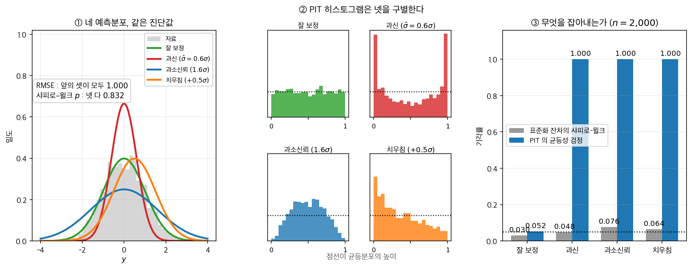
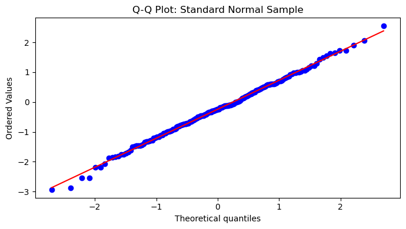
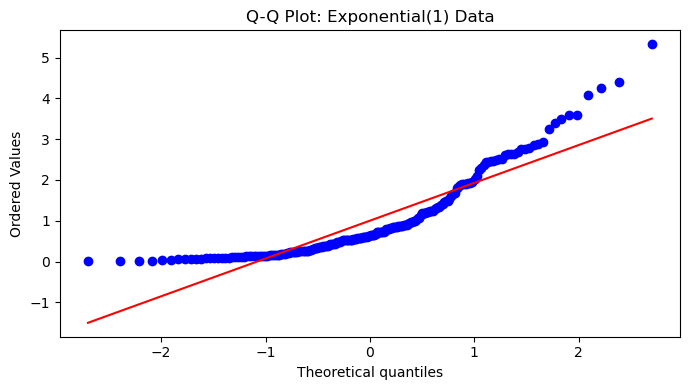

# Q-Q 그림과 정규성 검정

## 개요

분위수-분위수(Q-Q) 그림은 정규성 평가에 가장 널리 쓰이는 시각적 도구이다. 정렬된 표본값을 이론적 정규분위수에 대해 그림으로써 히스토그램이 놓칠 수 있는 이탈을 드러낸다. 이 페이지는 Q-Q 그림을 세 가지 형식적 정규성 검정(Shapiro-Wilk, D'Agostino $K^2$, Anderson-Darling)과 짝지어 시각적 진단과 수치적 진단이 어떻게 서로를 보완하는지 보인다.

---

## 1. Q-Q 그림의 구성

정렬된 표본 $X_{(1)} \leq X_{(2)} \leq \cdots \leq X_{(n)}$이 주어지면, Q-Q 그림은 각 순서통계량을 대응하는 이론적 분위수

$$
q_i = \Phi^{-1}\!\Bigl(\frac{i - 0.5}{n}\Bigr), \qquad i = 1, \ldots, n,
$$

와 짝짓는다. 여기서 $\Phi^{-1}$은 표준정규 분위수함수이다. 그림은 점 $(q_i, X_{(i)})$를 표시한다.

정규성 아래에서 $X_{(i)} \approx \mu + \sigma\, q_i$이므로 점들이 다음 직선을 따라 놓여야 한다.

$$
y = \hat{\mu} + \hat{\sigma}\, x,
$$

여기서 $\hat{\mu} = \bar{X}$, $\hat{\sigma} = S$이다. 적합선은 보통 $X_{(i)}$를 $q_i$에 회귀시키는 최소제곱법으로 얻는다.

---

## 2. 함께 쓰는 정규성 검정

| 검정 | 통계량 | 귀무분포 |
|---|---|---|
| Shapiro-Wilk | $W = \frac{(\sum a_i X_{(i)})^2}{\sum (X_i - \bar{X})^2}$ | 표로 정리 / 모의실험 |
| D'Agostino $K^2$ | $K^2 = Z_1^2 + Z_2^2$ (왜도 + 첨도) | $\chi^2_2$ (점근적) |
| Anderson-Darling | $A^2 = -n - \sum \frac{2i-1}{n}[\ln F_0(X_{(i)}) + \ln(1-F_0(X_{(n+1-i)}))]$ | 표로 정리된 임계값 |

<div class="exbox" markdown>

**보기 1.** <span class="diff easy" title="쉬움"></span> 가운데는 정규, 꼬리만 두꺼운 자료. $\mathcal{N}(0,1)$에서 150개, $t_3$에서 50개를 뽑아 섞은 $n = 200$ 표본에 Q-Q 그림과 세 검정(샤피로–윌크, 다고스티노 $K^2$, 앤더슨–달링)을 함께 걸어 본다.

**(1)** 세 검정 가운데 **하나만** 5% 수준에서 기각하지 못한다. 어느 것인지 통계량과 임계값을 수로 대어 말하시오.

**(2)** Q-Q 그림에서 점들이 적합선을 벗어나는 자리를 찾으시오. 가운데($\lvert q\rvert < 1$)와 꼬리($\lvert q\rvert > 2$)의 잔차를 재어, 어느 구간에서 얼마나 벗어나는지 수로 적으시오. 이 그림이 **말해 주지 않는 것**은 무엇인가.

</div>

??? success "풀이"

    유도할 답이 있는 문제가 아니다. **그림과 검정이 각각 무엇을 보여 주고 무엇을 감추는가**가 전부이므로, 눈으로 본 것을 수치로 바꿔 가며 읽는다.

    ```python
    import numpy as np
    import matplotlib.pyplot as plt
    from scipy import stats

    plt.rcParams["font.sans-serif"] = ["NanumGothic", "Apple SD Gothic Neo", "Malgun Gothic"]
    plt.rcParams["font.family"] = "sans-serif"
    plt.rcParams["axes.unicode_minus"] = False

    # 정규 150개에 자유도 3 인 t 를 50개 섞었다. 가운데는 정규 같지만
    # 꼬리만 두꺼운 자료다.
    rng = np.random.default_rng(0)
    x = np.concatenate([rng.normal(0, 1, size=150),
                        rng.standard_t(df=3, size=50)])

    # fit=False 로 두면 probplot 이 그림을 그리지 않고 좌표만 돌려준다.
    # 그 좌표로 직접 그려야 점과 직선의 모양을 마음대로 손볼 수 있다.
    osm, osr = stats.probplot(x, dist="norm", sparams=(), fit=False)
    b, a = np.polyfit(osm, osr, 1)

    fig, ax = plt.subplots(figsize=(7, 4))
    ax.scatter(osm, osr, s=15)
    xx = np.linspace(osm.min(), osm.max(), 200)
    ax.plot(xx, a + b * xx, linestyle="--")
    ax.set_title("Q-Q Plot vs Normal with Fitted Line")
    ax.set_xlabel("Theoretical quantiles (Normal)")
    ax.set_ylabel("Ordered data")
    plt.tight_layout()
    plt.show()

    # 그림에서 본 것을 검정으로 확인한다. 그림과 검정은 서로를 보완한다 —
    # 검정은 "정규가 아니다"까지만 말하고, 어디가 어긋났는지는 그림이 말한다.
    W, p_sw = stats.shapiro(x)
    K2, p_k2 = stats.normaltest(x)
    ad = stats.anderson(x, dist="norm")

    print(f"Shapiro-Wilk:     W = {W:.4f}, p = {p_sw:.4g}")
    print(f"D'Agostino K^2:   K2 = {K2:.4f}, p = {p_k2:.4g}")
    print(f"Anderson-Darling: A^2 = {ad.statistic:.4f}")
    for crit, sig in zip(ad.critical_values, ad.significance_level):
        print(f"  Critical {sig:.0f}%: {crit:.4f} -> reject if A^2 > crit")
    ```

    출력:

    ```text
    Shapiro-Wilk:     W = 0.9716, p = 0.0004476
    D'Agostino K^2:   K2 = 17.1070, p = 0.0001929
    Anderson-Darling: A^2 = 0.6894
      Critical 15%: 0.5650 -> reject if A^2 > crit
      Critical 10%: 0.6440 -> reject if A^2 > crit
      Critical 5%: 0.7720 -> reject if A^2 > crit
      Critical 2%: 0.9010 -> reject if A^2 > crit
      Critical 1%: 1.0710 -> reject if A^2 > crit
    ```

    

    **(1) 기각하지 못하는 것은 앤더슨–달링이다.** 샤피로–윌크는 $W = 0.9716$에 $p = 0.000448$, 다고스티노는 $K^2 = 17.107$에 $p = 0.000193$으로 둘 다 0.001 아래다. 그런데 앤더슨–달링은 $A^2 = 0.6894$로 5% 임계값 $0.7720$에 **미치지 못한다.** 넘는 것은 15%($0.5650$)와 10%($0.6440$) 임계값뿐이니, 이 검정으로 할 수 있는 가장 강한 진술은 "10% 수준에서 기각"이다. 유의수준을 5%로 못 박아 두었다면 앤더슨–달링 하나만으로는 이 비정규성을 **놓쳤을 것이다.**

    까닭은 가중치의 자리다. $A^2$는 CDF 전체에 걸친 제곱 거리에 $1/\{F(1-F)\}$ 가중을 준 적분이어서 꼬리를 중시하지만, 그 적분이 **전 구간의 합**이라는 점이 여기서 발목을 잡는다. 이 자료의 이탈은 꼬리의 몇 점에만 몰려 있고 나머지 구간은 멀쩡하므로, 합을 내면 임계값 근처까지만 올라간다. 반면 $K^2 = Z_1^2 + Z_2^2$는 왜도와 첨도를 **직접** 겨냥하므로 같은 신호를 훨씬 크게 증폭한다.

    **(2) 벗어나는 자리는 오직 꼬리다.** 적합선은 $\hat y = 0.0071 + 1.1021\,q$로, 절편이 표본평균 $\bar x = 0.0071$과, 기울기가 표본표준편차 $S = 1.1115$와 거의 같다. 잔차 $x_{(i)} - (\hat a + \hat b\, q_i)$를 구간별로 재면

    | 구간 | 점 개수 | 잔차 |
    |---|---|---|
    | $\lvert q\rvert < 1$ | 136 | 최대 절대값 $0.120$ |
    | $\lvert q\rvert > 2$ | 8 | $-0.839,\ -0.185,\ 0.068,\ -0.031,\ -0.306,\ +1.157,\ +1.382,\ +1.579$ |

    이다. **가운데 136점은 직선에서 0.12 이상 벗어나지 않는다.** 자료의 68%가 거의 완벽하게 정규인 셈이고, 히스토그램만 그렸다면 아무 이상도 못 보았을 것이다. 반면 양 끝 네 점씩을 보면 위쪽 세 점이 적합선 위로 $1.16$, $1.38$, $1.58$만큼 올라가고 아래쪽 최저점은 선 아래로 $0.84$만큼 내려간다. 곧 S자 패턴이다. 실제 자료 범위는 $[-3.81,\ 4.56]$으로, $n = 200$인 표준정규 표본의 최댓값이 보통 3 근처에 머무는 것과 비교하면 양쪽이 모두 과하게 길다.

    표본의 모양 통계량도 같은 말을 한다. 보정판으로 $G_1 = 0.349$, 초과첨도 $G_2 = 2.130$이고, 보정하지 않은 판본은 $g_1 = 0.346$, $g_2 = 2.047$이다(`scipy.stats.skew`·`kurtosis`의 기본값은 `bias=True`이므로 후자를 준다). 어느 판본이든 첨도가 압도적으로 크고 왜도는 작으니, **이 자료의 비정규성은 치우침이 아니라 두꺼운 꼬리**다.

    **이 그림이 말해 주지 않는 것**은 "그 벗어남이 우연인가"다. $q = 2.7$ 자리의 점 하나가 선에서 1.58 떨어져 있다는 사실만으로는 판정을 내릴 수 없다. 극단 순서통계량은 정규 자료에서도 변동이 크기 때문이다. 벗어남의 **크기**는 그림이 주지만 **유의성**은 주지 않으며, 그래서 다음 절의 신뢰띠나 위의 세 검정이 필요하다. 거꾸로 세 검정은 $p$값 하나를 줄 뿐 "꼬리가 문제다"라고는 말하지 않는다. 둘은 서로의 결함을 메운다.

---

## 3. 해석

위 예에서 자료는 정규 추출값과 $t_3$ 추출값의 혼합이라 꼬리가 더 두껍다(표본왜도 $0.349$, 초과첨도 $2.13$). Q-Q 그림은 S자 패턴을 보인다. 왼쪽 아래 극단점들이 적합선 아래로 떨어지고 오른쪽 위 극단점들이 선 위로 올라간다.

세 검정의 결론이 **일치하지 않는다**는 점에 주목하라.

| 검정 | 결과 | 5% 수준 판정 |
|---|---|---|
| Shapiro-Wilk | $p = 0.00045$ | 기각 |
| D'Agostino $K^2$ | $p = 0.00019$ | 기각 |
| Anderson-Darling | $A^2 = 0.689$ vs 임계값 $0.772$ | **기각 못 함** |

Shapiro-Wilk와 D'Agostino $K^2$는 강하게 기각하지만 Anderson-Darling은 5% 수준에서 기각하지 못한다($A^2 = 0.689 < 0.772$). 10%와 15% 수준에서만 기각한다. 왜 그럴까? Anderson-Darling은 CDF 전체에 걸친 이탈에 꼬리 가중을 준 측도인데, 이 혼합자료의 이탈은 소수의 극단 관측값에 몰려 있어 $A^2$를 임계값 근처까지만 밀어 올린다. 반면 $K^2$는 첨도를 직접 겨냥하므로 같은 신호를 훨씬 크게 증폭한다.

교훈은 **검정 하나의 판정에 기대지 말라**는 것이다. Q-Q 그림을 형식적 검정과 결합하는 핵심 장점이 여기 있다. 그림은 자료가 정규성에서 *어디서 어떻게* 벗어나는지(이 경우 꼬리에서) 보여주고, 검정은 증거의 강도를 수량화한다. 검정끼리 어긋날 때 그림이 심판 역할을 한다.

<div class="aibox" markdown>

**AI로 보는 통계학 1.** 이 그림이 원리적으로 못 보는 것

위 표의 세 검정은 서로 다른 답을 냈지만 한 가지는 **똑같이** 한다 — 셋 다
**위치와 척도에 불변**이다. 자료에 상수를 더하거나 곱해도 통계량이 변하지 않는다.
$W$ 가 제곱합의 비이고 $K^2$ 가 표준화한 왜도·첨도로 만들어지며 $A^2$ 이 변환된
분위수를 쓰기 때문이다. 그 불변성 덕에 「평균과 분산을 몰라도 모양만 본다」는 편리함이
생긴다.

대가도 같은 자리에서 생긴다. **모양만 보므로 중심과 폭이 맞는지는 못 본다.**
보통은 중심과 폭이 관심사가 아니니 문제가 되지 않는데, 요즘 모형은 그렇지 않다.
점 하나가 아니라 **예측분포**를 내놓기 때문이다. 날씨 예보, 수요 예측, 불확실성을 함께
내는 신경망이 모두 그렇다. 그런 모형에서 틀리는 방식은 셋이다 — 중심이 치우치거나,
폭을 좁게 잡거나(과신), 넓게 잡거나(과소신뢰).



참값이 $N(0,1)$ 인 자료에 네 모형을 세웠다. 셋은 중심이 맞고 폭만 다르며, 하나는
중심이 $0.5\sigma$ 치우쳐 있다.

- **①** 표준화 잔차 $z = (y-\hat\mu)/\hat\sigma$ 의 샤피로–윌크 $p$ 값이 네 모형 모두
  **$0.832$** 다. 똑같다. 우연이 아니라 **불변성의 직접적인 결과**다 — $z$ 는 같은 $y$ 의
  아핀변환이라 $W$ 가 바뀔 수 없다. 앞의 세 모형은 RMSE 도 똑같이 $1.000$ 이다.
  **점 예측의 지표와 정규성 검정이 둘 다 눈을 감고 있다.**
- **②** 확률적분변환을 쓰면 보인다. $u_i = \hat F_i(y_i)$ 가 $U(0,1)$ 이어야 하는데,
  잘 보정된 모형만 평평하다. **과신은 U자**(실제 값이 자꾸 꼬리로 나간다), **과소신뢰는
  언덕**(가운데로만 떨어진다), **치우침은 기울어진다.** 틀린 방식마다 모양이 다르다.
- **③** 수로도 그렇다. 표준화 잔차의 샤피로–윌크는 네 경우 모두 $0.03$–$0.08$ 로
  명목수준 근처에 머문다. PIT 의 균등성 검정은 잘 보정된 경우 $0.052$ 이고 나머지 셋에서
  **$1.000$** 이다.

이 쪽의 결론 — 「그림이 심판이다」 — 은 옳지만 **어떤 그림인지**가 빠져 있다. Q-Q 그림은
잔차의 **모양**을 심판하고, PIT 히스토그램은 예측분포 **전체**를 심판한다. 둘은 같은
생각의 두 쓰임이다. Q-Q 그림이 「관측 분위수 대 이론 분위수」를 그리듯 PIT 는 각 관측을
**자기 몫의 예측분포로** 분위수를 매긴다 — 관측마다 분포가 달라도 된다는 점만 다르다.

그러니 모형이 분포를 내놓는다면 진단도 한 칸 올라가야 한다. 「잔차가 정규인가」는
$\hat\sigma$ 가 두 배로 틀려도 통과하는 물음이고, 「$\hat F$ 가 맞는가」는 그것을 바로
잡아낸다.

_확인한 곳 — 바깥의 사실을 끌어오지 않았다. 샤피로–윌크·다고스티노 $K^2$·앤더슨–달링이
위치·척도 불변이라는 것은 각 통계량의 정의에서 그대로 나오고, 확률적분변환으로 얻은
$u_i$ 가 귀무가설 아래 $U(0,1)$ 이라는 것도 마찬가지다(이 장 [KS 검정](../formal_tests/ks_test.md)
쪽이 같은 성질을 쓴다). ①–③ 의 수는 모두 직접 계산한 값이다_

</div>

---

## 연습문제

<div class="drillbox" markdown>

**연습문제 1.** <span class="diff easy" title="쉬움"></span> 표준정규 관측값 $n = 200$개를 생성하라. Q-Q 그림을 만들고 세 검정을 모두 수행하라. 점들이 적합선 위에 놓이고 모든 $p$값이 0.05를 넘는지 확인하라.

</div>

??? success "풀이"

    ```python
    import numpy as np
    from scipy import stats
    import matplotlib.pyplot as plt

    rng = np.random.default_rng(10)
    x = rng.normal(0, 1, size=200)

    fig, ax = plt.subplots(figsize=(7, 4))
    stats.probplot(x, dist="norm", plot=ax)
    ax.set_title("Q-Q Plot: Standard Normal Sample")
    plt.tight_layout()
    plt.show()

    W, p_sw = stats.shapiro(x)
    K2, p_k2 = stats.normaltest(x)
    ad = stats.anderson(x, dist="norm")

    print(f"Shapiro-Wilk:     p = {p_sw:.4f}")
    print(f"D'Agostino:       p = {p_k2:.4f}")
    print(f"Anderson-Darling: A^2 = {ad.statistic:.4f}")
    ```

    출력:

    ```text
    Shapiro-Wilk:     p = 0.9898
    D'Agostino:       p = 0.8231
    Anderson-Darling: A^2 = 0.1342
    ```

    

    Q-Q 그림은 점들이 대각선에 바짝 붙어 있음을 보인다. 두 $p$값 모두 0.05를 크게 넘고, $A^2 = 0.134$는 가장 느슨한 15% 임계값 $0.565$보다도 훨씬 작다. 표준정규 자료가 모든 정규성 확인을 통과함을 확인해 준다. $\square$

<div class="drillbox" markdown>

**연습문제 2.** <span class="diff easy" title="쉬움"></span> 연습문제 1을 $\text{Exponential}(1)$에서 뽑은 관측값 $n = 200$개로 반복하라. Q-Q 그림의 모양을 기술하고 $p$값들을 비교하라.

</div>

??? success "풀이"

    ```python
    import numpy as np
    from scipy import stats
    import matplotlib.pyplot as plt

    rng = np.random.default_rng(20)
    x = rng.exponential(1.0, size=200)

    fig, ax = plt.subplots(figsize=(7, 4))
    stats.probplot(x, dist="norm", plot=ax)
    ax.set_title("Q-Q Plot: Exponential(1) Data")
    plt.tight_layout()
    plt.show()

    W, p_sw = stats.shapiro(x)
    K2, p_k2 = stats.normaltest(x)
    print(f"Shapiro-Wilk: p = {p_sw:.4g}")
    print(f"D'Agostino:   p = {p_k2:.4g}")
    ```

    출력:

    ```text
    Shapiro-Wilk: p = 4.113e-14
    D'Agostino:   p = 5.462e-14
    ```

    

    Q-Q 그림은 강한 **아래로 볼록한**(convex, 위로 휘는) 패턴을 보인다. 지수분포가 심하게 오른쪽으로 치우쳐 있기 때문이다(이론적 왜도 2). 왼쪽 꼬리는 0에서 잘려 짧고 오른쪽 꼬리는 길게 늘어지므로, 양 끝이 모두 적합선 위로 올라간다.

    두 $p$값 모두 사실상 0으로 정규성을 강하게 기각한다. 두 검정의 $p$값 크기가 거의 같다는 점도 눈에 띈다. 이탈이 압도적으로 크면 어느 검정을 쓰든 결론이 같다. $\square$

<div class="drillbox" markdown>

**연습문제 3.** <span class="diff med" title="중간"></span> Q-Q 그림 적합선의 기울기·절편과 정규분포의 모수 $\mu$, $\sigma$ 사이의 관계를 설명하라.

</div>

??? success "풀이"

    모형 $X \sim \mathcal{N}(\mu, \sigma^2)$ 아래에서 $i$번째 순서통계량은 $\mathbb{E}[X_{(i)}] \approx \mu + \sigma\, q_i$를 만족한다. 여기서 $q_i = \Phi^{-1}((i-0.5)/n)$이다. 따라서 $X_{(i)}$를 $q_i$에 회귀시켜 얻은 적합선 $\hat{y} = a + b\, q$는 절편 $a \approx \bar{X} \approx \mu$, 기울기 $b \approx S \approx \sigma$를 갖는다.

    곧 **절편이 평균을, 기울기가 표준편차를 추정한다**. 자료가 정말로 정규이면 이 추정값은 표본평균 및 표본표준편차와 일치한다. 실용적으로도 유용한 결과이다. Q-Q 그림의 기울기가 1보다 훨씬 크면 자료의 산포가 기준분포보다 크다는 뜻이다. $\square$

<div class="drillbox" markdown>

**연습문제 4.** <span class="diff med" title="중간"></span> SciPy의 Anderson-Darling 검정은 $p$값을 내놓지 않고 임계값을 반환한다. $H_0$이 기각되는 가장 작은 유의수준을 찾아내는 코드를 작성하라.

</div>

??? success "풀이"

    ```python
    import numpy as np
    from scipy import stats

    rng = np.random.default_rng(0)
    x = np.concatenate([rng.normal(0, 1, 150), rng.standard_t(3, 50)])

    ad = stats.anderson(x, dist="norm")
    rejected_levels = [sl for cv, sl in
                       zip(ad.critical_values, ad.significance_level)
                       if ad.statistic > cv]

    if rejected_levels:
        print(f"A^2 = {ad.statistic:.4f}")
        print(f"Reject at significance levels: {rejected_levels}")
        print(f"Smallest rejection level: {min(rejected_levels)}%")
    else:
        print("Fail to reject at all tabulated significance levels.")
    ```

    출력:

    ```text
    A^2 = 0.6894
    Reject at significance levels: [15.0, 10.0]
    Smallest rejection level: 10.0%
    ```

    코드는 (임계값, 유의수준) 쌍을 훑으며 $A^2$가 임계값을 넘는 수준을 모은다. 그중 가장 작은 수준이 우리가 할 수 있는 가장 강한 진술이다.

    이 두꺼운 꼬리 혼합자료에서는 $A^2 = 0.689$가 15%와 10% 임계값($0.565$, $0.644$)만 넘고 5% 임계값 $0.772$는 넘지 못한다. 곧 **Anderson-Darling으로는 10% 수준에서만 기각할 수 있다**. 같은 자료에서 Shapiro-Wilk가 $p = 0.00045$를 내는 것과 대비된다. 유의수준을 5%로 정해 두었다면 Anderson-Darling만으로는 이 비정규성을 놓쳤을 것이다. $\square$

<div class="drillbox" markdown>

**연습문제 5.** <span class="diff hard" title="어려움"></span> 자료가 정확히 표준정규일 때 $n \to \infty$에 따라 Q-Q 그림의 기울기가 1로, 절편이 0으로 수렴함을 보여라.

</div>

??? success "풀이"

    $X_1, \ldots, X_n \overset{\text{iid}}{\sim} \mathcal{N}(0, 1)$이라 하자. $i$번째 순서통계량은

    $$
    \mathbb{E}[X_{(i)}] = \Phi^{-1}\!\Bigl(\frac{i}{n+1}\Bigr) + O(n^{-1})
    $$

    를 만족한다. $n$이 크면 $\frac{i}{n+1} \approx \frac{i - 0.5}{n}$이므로 $\mathbb{E}[X_{(i)}] \approx q_i$이다.

    $X_{(i)}$를 $q_i$에 최소제곱 회귀시키면 대수의 법칙에 의해 기울기 $b \to \sigma = 1$, 절편 $a \to \mu = 0$이다. 더 형식적으로는 $\bar{X} \xrightarrow{p} 0$이고 $S \xrightarrow{p} 1$이며, OLS 계수가 $b = S + o_p(1)$, $a = \bar{X} + o_p(1)$을 만족하여 결과를 얻는다. $\square$

<div class="drillbox" markdown>

**연습문제 6.** <span class="diff hard" title="어려움"></span> 보기 1 의 적합선은 $\hat y = 0.0071 + 1.1021\,q$ 였고, 같은 자료의 표본평균과 표본표준편차는 $\bar x = 0.0071$, $S = 1.1115$ 였다. 연습문제 3 은 "절편이 평균을, 기울기가 표준편차를 추정한다" 고 했는데, 절편은 소수점 아래까지 정확히 맞는 반면 기울기는 $S$ 보다 $0.0094$ 작다. 이 비대칭의 정체를 밝혀라.

**(1)** 위치값이 $q_i = -q_{n+1-i}$ 로 대칭이어서 $\sum_i q_i = 0$ 임을 쓰면, 최소제곱 절편은 $a = \bar x$ 와 **정확히** 같고 기울기는 $b = \sum_i q_i x_{(i)} \big/ \sum_i q_i^2$ 임을 보이시오.

**(2)** $r$ 을 그림의 점 $(q_i, x_{(i)})$ 들의 표본상관계수라 할 때

$$
b = r\, S \sqrt{\frac{n-1}{\sum_i q_i^2}}
$$

임을 보이시오. 보기 1 의 코드가 쓴 위치값에서는 $n = 200$, $\sum_i q_i^2 = 195.5601$ 이다. $r$ 과 $r^2$ 을 수로 구하고 샤피로–윌크의 $W = 0.9716$ 과 비교하시오.

**(3)** (2)에서 $b \le S\sqrt{(n-1)/\sum_i q_i^2}$ 이고 등호는 점들이 정확히 한 직선 위에 있을 때뿐임을 말하시오. 그렇다면 기울기 결손 $S - b$ 가 재는 것은 무엇인가.

</div>

??? success "풀이"

    **(1)** 최소제곱 공식은

    $$
    b = \frac{\sum_i (q_i - \bar q)(x_{(i)} - \bar x)}{\sum_i (q_i - \bar q)^2}, \qquad a = \bar x - b\, \bar q
    $$

    이다. 위치값은 $q_i = \Phi^{-1}(p_i)$ 꼴이고 $p_i$ 들이 $1/2$ 에 대해 대칭($p_i + p_{n+1-i} = 1$)이므로 $q_i = -q_{n+1-i}$ 이고 따라서 $\bar q = 0$ 이다. 이것은 어림이 아니라 등식이다. 그러면 $a = \bar x$ 가 **정확히** 성립하고(보기 1 의 코드가 낸 절편 $0.00709581$ 과 표본평균 $0.00709581$ 이 끝자리까지 같은 까닭이다), 분자에서 $\bar x \sum_i q_i = 0$ 이 떨어져 나가

    $$
    b = \frac{\sum_i q_i x_{(i)}}{\sum_i q_i^2}
    $$

    를 얻는다.

    **(2)** $\bar q = 0$ 이므로 상관계수는

    $$
    r = \frac{\sum_i q_i x_{(i)}}{\sqrt{\sum_i q_i^2}\, \sqrt{\sum_i (x_{(i)} - \bar x)^2}}
    $$

    이고, $\sum_i (x_{(i)} - \bar x)^2 = (n-1)S^2$ 이다. 곧 $\sum_i q_i x_{(i)} = r \sqrt{\sum_i q_i^2}\, S\sqrt{n-1}$ 이므로 이를 (1)의 $b$ 에 넣으면

    $$
    b = r\, S\, \sqrt{\frac{n-1}{\sum_i q_i^2}}
    $$

    이다. 수를 넣어 보자. 보정인자는

    $$
    c = \sqrt{\frac{199}{195.5601}} = \sqrt{1.017588} = 1.008756
    $$

    이고, 따라서

    $$
    r = \frac{b/S}{c} = \frac{1.1021/1.1115}{1.008756} = \frac{0.991543}{1.008756} = 0.98293, \qquad r^2 = 0.96615
    $$

    이다. 샤피로–윌크의 $W = 0.9716$ 과 견주면 둘 다 $0.97$ 근처로 거의 같은 수다. 우연이 아니다. $r^2$ 은 그 자체로 정규성 검정 통계량(섀피로–프란시아 $W'$)이고, $W$ 와 $r^2$ 은 똑같이

    $$
    \frac{(\text{단위벡터} \cdot x_{(\cdot)})^2}{\sum_i (x_i - \bar x)^2}
    $$

    꼴인데 쓰는 단위벡터만 다르다. $W$ 는 순서통계량의 공분산까지 넣은 $a \propto V^{-1}m$ 을, $r^2$ 은 기대 순서통계량 $m$ 자체를 쓴다. 어느 쪽이 크다는 보편적 순서는 없으며 이 자료에서는 $r^2 = 0.966 < W = 0.972$ 다.

    참고로 1 절의 위치값 $(i-0.5)/n$ 을 쓰면 $\sum_i q_i^2 = 198.7192$, $b = 1.0947$, $r^2 = 0.9687$ 이 된다. 위치값 관례를 바꾸면 기울기는 $0.7\%$ 움직이지만 "직선성" 자체는 거의 그대로다.

    **(3)** 코시–슈바르츠(또는 그냥 $\lvert r \rvert \le 1$)에서 곧바로 $b \le S\,c$ 이고, 등호는 $x_{(i)}$ 가 $q_i$ 의 완전한 아핀함수일 때, 곧 모든 점이 한 직선 위에 있을 때뿐이다.

    그러므로 기울기가 $S$ 에 못 미치는 양은 **그림이 직선에서 얼마나 휘었는가**를 재는 수다. 연습문제 3 의 "기울기 $\approx S$" 는 자료가 정규일 때만 좋은 어림이고, 그 어림의 오차 $S(1 - rc)$ 가 바로 샤피로–윌크·섀피로–프란시아가 검정하는 양이다. Q-Q 그림의 눈으로 보는 "휘어짐" 과 $W$ 라는 수는 같은 것의 두 얼굴이다. $\square$

<div class="drillbox" markdown>

**연습문제 7.** <span class="diff hard" title="어려움"></span> 2 절 표의 $A^2$ 식에는 기준분포 $F_0$ 가 들어 있다. 보기 1 에서 `anderson` 이 돌려준 5% 임계값은 $0.772$ 였다. 그런데 $F_0$ 를 완전히 지정된 $\mathcal{N}(0,1)$ 로 두고 같은 식으로 $A^2$ 를 재면 5% 임계값은 $2.492$ 다. 세 배가 넘는다.

**(1)** $\hat\mu = \bar X$, $\hat\sigma = S$ 를 꽂으면 $A^2$ 가 확률적으로 커지는가 작아지는가. 임계값이 작아지는 까닭을 한 문장으로 적으시오.

**(2)** $n = 200$ 인 표준정규 표본 20000 개를 뽑아 한 표본마다 두 가지 $A^2$(모수를 아는 것과 추정하는 것)를 모두 매기고, (통계량, 임계값) 네 짝의 **실제** 1종 오류 확률을 재시오. 두 표를 뒤바꿔 쓰는 두 방향의 잘못이 각각 얼마만큼의 대가를 치르는지 수로 답하시오.

**(3)** 보기 1 의 자료는 $A^2 = 0.6894$ 였다. 이것을 $2.492$ 와 견주었다면 어떤 결론이 났겠는가. 이 잘못을 "보수적" 이라 불러도 좋은가.

</div>

??? success "풀이"

    **(1) 작아진다.** $\bar X$ 와 $S$ 는 자료에서 뽑아낸 수이므로 적합된 기준분포 $\hat F_0(x) = \Phi((x - \bar X)/S)$ 는 참 $\Phi$ 보다 경험분포함수에 더 바짝 붙는다. 첫 두 적률은 이미 맞춰 놓은 셈이기 때문이다. 재는 거리가 작아지니 같은 유의수준을 지키려면 임계값도 같이 내려가야 한다. KS 에 표본평균·표본표준편차를 꽂을 때 릴리포스 표가 따로 필요한 것과 똑같은 사정이다.

    **(2)** 모의실험으로 네 짝을 모두 재어 본다.

    ```python
    import numpy as np
    from scipy import stats

    rng = np.random.default_rng(0)
    n, R = 200, 20000
    w = 2 * np.arange(1, n + 1) - 1

    # 같은 표본에 두 가지 A^2 를 매긴다.
    #   A_known : F0 = Phi 를 그대로 쓴다 (모수를 안다)
    #   A_est   : 표본평균·표본표준편차를 꽂는다 (scipy 의 anderson 이 하는 일)
    A_known = np.empty(R)
    A_est = np.empty(R)
    for r in range(R):
        x = np.sort(rng.normal(0, 1, n))
        lo = stats.norm.logcdf(x)
        hi = stats.norm.logsf(x)[::-1]
        A_known[r] = -n - np.sum(w * (lo + hi)) / n
        A_est[r] = stats.anderson(x, dist="norm").statistic

    print(f"E[A^2]       known = {A_known.mean():.4f}, est = {A_est.mean():.4f}")
    print(f"95% quantile known = {np.quantile(A_known, 0.95):.4f}, "
          f"est = {np.quantile(A_est, 0.95):.4f}")
    print(f"est   > 0.772 (scipy 표)   : 실제 크기 = {(A_est > 0.772).mean():.4f}")
    print(f"est   > 2.492 (모수 아는 표): 실제 크기 = {(A_est > 2.492).mean():.4f}")
    print(f"known > 2.492 (모수 아는 표): 실제 크기 = {(A_known > 2.492).mean():.4f}")
    print(f"known > 0.772 (scipy 표)   : 실제 크기 = {(A_known > 0.772).mean():.4f}")
    ```

    출력:

    ```text
    E[A^2]       known = 1.0015, est = 0.3841
    95% quantile known = 2.5036, est = 0.7527
    est   > 0.772 (scipy 표)   : 실제 크기 = 0.0447
    est   > 2.492 (모수 아는 표): 실제 크기 = 0.0000
    known > 2.492 (모수 아는 표): 실제 크기 = 0.0505
    known > 0.772 (scipy 표)   : 실제 크기 = 0.5006
    ```

    먼저 눈금이 맞는지 본다. 모수를 아는 쪽은 $\mathbb{E}[A^2] = 1.0015$ 로 이론값 $1$ 과 맞고 95% 분위수가 $2.5036$ 으로 표값 $2.492$ 와 맞는다. 추정하는 쪽은 $\mathbb{E}[A^2] = 0.3841$ 로 **40% 도 안 되게** 줄어들고, 95% 분위수는 $0.7527$ 이어서 `scipy` 의 표값 $0.772$ 가 약간 느슨하다(그래서 실제 크기가 $0.0447$ 로 5% 에 조금 못 미친다).

    표를 뒤바꾼 두 잘못의 대가는 전혀 대칭이 아니다.

    | 통계량 | 임계값 | 실제 1종 오류 |
    |---|---|---|
    | 추정판 $A^2$ | $0.772$ (맞는 표) | $0.0447$ |
    | 추정판 $A^2$ | $2.492$ (틀린 표) | $0.0000$ |
    | 완전지정 $A^2$ | $2.492$ (맞는 표) | $0.0505$ |
    | 완전지정 $A^2$ | $0.772$ (틀린 표) | $0.5006$ |

    모수를 추정하고서 완전지정 표를 쓰면 20000 번 가운데 **한 번도** 기각하지 못한다. 크기가 0 이니 검정력도 사실상 0 이다. 거꾸로 완전지정 통계량에 릴리포스식 표를 쓰면 완벽하게 정규인 자료를 **절반**($0.5006$) 기각한다. 명목 5% 의 열 배다.

    **(3)** $0.6894 < 2.492$ 이므로 어느 유의수준에서도 기각하지 못한다. 보기 1 에서 앤더슨–달링은 맞는 표를 써도 5% 에서는 기각하지 못하고 10% 에서 겨우 기각했는데, 틀린 표를 쓰면 그 10% 짜리 결론마저 사라진다.

    "보수적" 이라 부를 수는 있지만 칭찬은 아니다. 1종 오류를 $0.0000$ 으로 눌렀다는 말은 검정이 아무것도 거부하지 않는다는 말과 같다. 모수를 추정해 꽂는 순간 통계량의 **눈금이 바뀐다.** 표를 같이 바꾸지 않은 검정은 눈금 없는 자이고, 그 자가 늘 "정상" 이라고 읽어 주는 것은 안전이 아니라 무지다. $\square$

<div class="drillbox" markdown>

**연습문제 8.** <span class="diff hard" title="어려움"></span> 다고스티노 $K^2 = Z_1^2 + Z_2^2$ 는 3 차·4 차 적률만 본다. 그렇다면 왜도와 초과첨도가 **정확히** 0 이면서 정규와 전혀 닮지 않은 분포를 만들어 이 검정을 통과시킬 수 있을 것이다. 세 성분 정규혼합

$$
f(x) = p\,\varphi_\sigma(x - \mu) + (1 - 2p)\,\varphi_\sigma(x) + p\,\varphi_\sigma(x + \mu), \qquad \mu > 0,\ 0 < p < \tfrac12
$$

을 생각한다. 여기서 $\varphi_\sigma$ 는 $\mathcal{N}(0, \sigma^2)$ 의 밀도이다.

**(1)** 이 분포의 왜도가 $p, \mu, \sigma$ 와 무관하게 0 임을 말하고, 초과첨도가 0 이 되는 $p$ 를 구하시오. 답이 $\mu$ 와 $\sigma$ 에 의존하지 않음을 확인하시오.

**(2)** 그 $p$ 와 $\mu = 1.5$, $\sigma = 0.3$ 으로 $n = 200$ 표본 5000 개를 뽑아 세 검정의 5% 수준 검정력을 재시오. $K^2$ 의 기각률이 5% 보다도 **작게** 나오는데, 표본왜도·초과첨도의 표준편차를 정규 기준값 $\sqrt{6/n}$, $\sqrt{24/n}$ 과 견주어 그 까닭을 밝히시오.

</div>

??? success "풀이"

    **(1)** 밀도가 우함수이므로 모든 홀수 중심적률이 0 이고 따라서 $\gamma_1 = 0$ 이다. $p, \mu, \sigma$ 가 무엇이든 성립한다.

    혼합분포의 적률은 성분 적률의 가중합이다. 성분 $\mathcal{N}(c, \sigma^2)$ 에 대해 $\mathbb{E}[X^2] = \sigma^2 + c^2$, $\mathbb{E}[X^4] = 3\sigma^4 + 6c^2\sigma^2 + c^4$ 이므로, $c \in \{\mu, 0, -\mu\}$ 에 가중치 $\{p, 1-2p, p\}$ 를 주면

    $$
    \mathbb{E}[X^2] = \sigma^2 + 2p\mu^2, \qquad \mathbb{E}[X^4] = 3\sigma^4 + 12 p \mu^2 \sigma^2 + 2p\mu^4
    $$

    이다. 평균이 0 이므로 초과첨도가 0 이라는 조건은 $\mathbb{E}[X^4] = 3\,(\mathbb{E}[X^2])^2$ 이고, 우변은

    $$
    3(\sigma^2 + 2p\mu^2)^2 = 3\sigma^4 + 12 p \mu^2 \sigma^2 + 12 p^2 \mu^4
    $$

    이다. 양변의 $3\sigma^4$ 와 $12p\mu^2\sigma^2$ 이 통째로 지워지고 남는 것은

    $$
    2p\mu^4 = 12 p^2 \mu^4 \iff p = \frac{1}{6}
    $$

    이다. $\mu$ 와 $\sigma$ 가 깨끗이 떨어져 나갔으므로, **가중치 $(1/6,\ 2/3,\ 1/6)$ 이면 봉우리를 얼마나 멀리 떨어뜨려도 왜도와 초과첨도가 둘 다 정확히 0 이다.** 분산은 $\sigma^2 + \mu^2/3$ 이다.

    **(2)** $\mu = 1.5$, $\sigma = 0.3$ 이면 세 뭉치가 서로 $5\sigma$ 씩 떨어져 눈으로 보아도 세 봉우리인 분포다(분산은 $0.09 + 0.75 = 0.84$). 검정력을 재어 본다.

    ```python
    import numpy as np
    from scipy import stats

    rng = np.random.default_rng(1)
    mu, sigma, p = 1.5, 0.3, 1 / 6

    def draw(size):
        """1/6 로 +mu, 1/6 로 -mu, 2/3 로 0 을 고르고 N(0, sigma^2) 잡음을 더한다."""
        u = rng.random(size)
        center = np.where(u < p, mu, np.where(u < 2 * p, -mu, 0.0))
        return center + rng.normal(0, sigma, size)

    n, R = 200, 5000
    rej = np.zeros(3)
    g1 = np.empty(R)
    g2 = np.empty(R)
    for r in range(R):
        x = draw(n)
        rej[0] += stats.shapiro(x).pvalue < 0.05
        rej[1] += stats.normaltest(x).pvalue < 0.05
        ad = stats.anderson(x, dist="norm")
        rej[2] += ad.statistic > ad.critical_values[2]      # 5% 임계값
        g1[r] = stats.skew(x)
        g2[r] = stats.kurtosis(x)

    print(f"n = {n}, 반복 {R}회, 유의수준 5%")
    print(f"Shapiro-Wilk     검정력 = {rej[0] / R:.4f}")
    print(f"D'Agostino K^2   검정력 = {rej[1] / R:.4f}")
    print(f"Anderson-Darling 검정력 = {rej[2] / R:.4f}")
    print(f"표본왜도 g1: 평균 {g1.mean():+.4f}, 표준편차 {g1.std():.4f} "
          f"(정규라면 {np.sqrt(6 / n):.4f})")
    print(f"초과첨도 g2: 평균 {g2.mean():+.4f}, 표준편차 {g2.std():.4f} "
          f"(정규라면 {np.sqrt(24 / n):.4f})")
    ```

    출력:

    ```text
    n = 200, 반복 5000회, 유의수준 5%
    Shapiro-Wilk     검정력 = 1.0000
    D'Agostino K^2   검정력 = 0.0018
    Anderson-Darling 검정력 = 1.0000
    표본왜도 g1: 평균 -0.0025, 표준편차 0.0966 (정규라면 0.1732)
    초과첨도 g2: 평균 +0.0172, 표준편차 0.2586 (정규라면 0.3464)
    ```

    샤피로–윌크와 앤더슨–달링은 5000 번 모두 기각한다(검정력 $1.0000$). 둘은 순서통계량의 배치 전체를 보므로 세 계단으로 끊긴 모양을 놓칠 수 없다. 반면 $K^2$ 의 기각률은 $0.0018$ 이다. **명목 5% 의 3% 도 안 되고, 검정력은커녕 크기보다도 작다.**

    까닭은 두 겹이다. 첫째, $K^2$ 가 보는 두 수는 설계상 0 에 맞춰져 있다. 표본 평균값이 $g_1 = -0.0025$, $g_2 = +0.0172$ 로 거의 정확히 0 이다. 둘째 — 이쪽이 5% 아래로 내려간 이유인데 — $Z_1, Z_2$ 의 표준화에 쓰는 분산은 **정규 아래에서** 계산된 $6/n$, $24/n$ 이다. 그런데 $g_1, g_2$ 의 표집변동은 모분포의 6 차·8 차 적률에 달려 있고, 봉우리가 뭉쳐 있는 이 혼합은 그 고차 적률이 정규보다 훨씬 작다. 실제로 표준편차가 $0.0966$ 대 $0.1732$(정규의 56%), $0.2586$ 대 $0.3464$(정규의 75%)다. 분모를 너무 크게 잡은 셈이니 $Z_1, Z_2$ 가 지나치게 작게 나오고, $K^2$ 는 $\chi^2_2$ 보다 확률적으로 작아진다. 곧 이 분포는 $K^2$ 의 눈에 **정규보다 더 정규처럼** 보인다.

    보기 1 과 정확히 반대의 그림이다. 거기서는 꼬리가 두꺼워 $K^2$ 가 가장 세게($p = 0.000193$) 기각하고 앤더슨–달링이 5% 를 넘기지 못했다. 여기서는 순위가 완전히 뒤집힌다. 3 절의 "검정 하나의 판정에 기대지 말라" 가 왜 수사가 아닌지 보여 주는 두 번째 사례다. 그리고 두 경우 모두 Q-Q 그림은 제대로 말해 준다. 여기서는 세 뭉치가 세 개의 평평한 계단으로 나타나 적률 두 개로는 결코 보이지 않는 구조를 드러낸다. $\square$

<div class="drillbox" markdown>

**연습문제 9.** <span class="diff hard" title="어려움"></span> 앤더슨–달링이 콜모고로프–스미르노프보다 꼬리에 민감한 까닭을 극단으로 보내 확인한다. 기준분포를 완전히 지정된 $F_0 = \Phi$ 로 고정하고, $n$ 개 관측값 가운데 가장 큰 것만 $x_{(n)} = M \to \infty$ 로 보낸다(나머지 $n-1$ 개는 그대로 둔다).

**(1)** 2 절 표의 $A^2$ 식에서 $M$ 이 들어가는 항을 모두 찾고, 밀스 비 $1 - \Phi(M) \sim \varphi(M)/M$ 을 써서

$$
A^2 = \frac{M^2}{2n} + \frac{\ln M}{n} + O(1)
$$

임을 보이시오. 특히 $A^2 \to \infty$ 다.

**(2)** 같은 이동이 KS 통계량 $D_n = \sup_x \lvert F_n(x) - \Phi(x) \rvert$ 를 얼마나 움직이는지 재고, 그 변화가 $1/n$ 을 넘지 못함을 보이시오. $n = 200$ 이면 KS 의 5% 임계값은 $1.358/\sqrt{200} = 0.0960$ 인데, 이 한 점이 기여할 수 있는 최대량은 그중 몇 %인가.

**(3)** $n = 200$ 일 때 이 한 점만으로 $A^2$ 를 모수를 아는 경우의 5% 임계값 $2.492$ 위로 밀어 올리려면 $M$ 이 얼마나 커야 하는가.

</div>

??? success "풀이"

    **(1)** 식

    $$
    A^2 = -n - \sum_{i=1}^{n} \frac{2i-1}{n}\Bigl[\ln F_0(x_{(i)}) + \ln\bigl(1 - F_0(x_{(n+1-i)})\bigr)\Bigr]
    $$

    에서 $M = x_{(n)}$ 이 나타나는 자리는 딱 둘이다.

    - $i = n$ 항의 $\ln F_0(x_{(n)}) = \ln \Phi(M)$. 가중치는 $(2n-1)/n$ 이지만 $\Phi(M) \to 1$ 이므로 $\ln \Phi(M) \to 0$ 이고 이 기여는 사라진다.
    - $i = 1$ 항의 $\ln(1 - F_0(x_{(n)})) = \ln(1 - \Phi(M))$. 가중치는 $(2\cdot 1 - 1)/n = 1/n$ 이다.

    나머지 항은 고정된 $n-1$ 개 점만 담고 있으므로 $M$ 과 무관한 상수 $C_n$ 이다. 따라서

    $$
    A^2 = -\frac{1}{n}\ln\bigl(1 - \Phi(M)\bigr) + C_n + o(1).
    $$

    밀스 비에서 $1 - \Phi(M) = \frac{\varphi(M)}{M}\bigl(1 + O(M^{-2})\bigr)$ 이고 $\varphi(M) = (2\pi)^{-1/2} e^{-M^2/2}$ 이므로

    $$
    -\ln\bigl(1 - \Phi(M)\bigr) = \frac{M^2}{2} + \ln M + \tfrac{1}{2}\ln(2\pi) + O(M^{-2})
    $$

    이다. $n$ 으로 나누면 $A^2 = \frac{M^2}{2n} + \frac{\ln M}{n} + O(1)$ 을 얻고, 특히 점 **하나**로 $A^2$ 를 무제한 키울 수 있다. 가중함수 $1/\{F(1-F)\}$ 가 $F \to 1$ 에서 발산하기 때문이다.

    **(2)** 가장 큰 점을 $m$ 에서 $M > m$ 으로 옮기면 경험분포함수는 구간 $[m, M)$ 에서만 달라진다. 옮기기 전에는 그 구간에서 $n$ 개가 모두 왼쪽에 있어 $F_n = 1$ 이지만, 옮긴 뒤에는 $n-1$ 개뿐이어서 $F_n = (n-1)/n$ 이다. 다른 모든 $x$ 에서는 값이 같다. 곧

    $$
    \bigl\lVert F_n^{\text{new}} - F_n^{\text{old}} \bigr\rVert_\infty = \frac{1}{n}
    $$

    이다. $D_n$ 은 상한노름 거리이므로 삼각부등식에서

    $$
    \bigl\lvert D_n^{\text{new}} - D_n^{\text{old}} \bigr\rvert \le \bigl\lVert F_n^{\text{new}} - F_n^{\text{old}} \bigr\rVert_\infty = \frac{1}{n}
    $$

    이다. $n = 200$ 이면 $1/200 = 0.005$, 임계값 $0.0960$ 의 **5.2%** 다. 관측값 하나가 $+\infty$ 로 날아가도 KS 통계량은 임계값의 20 분의 1 만큼밖에 못 움직인다. 상한노름은 **각 관측값의 영향력을 $1/n$ 으로 상한 지어 버린다.** 바로 이 차이가 "앤더슨–달링이 꼬리에 더 민감하다" 의 내용이다.

    **(3)** (1)에서 $C_n$ 을 무시하고 $i = 1$ 항 하나로 임계값을 넘기려면

    $$
    -\frac{1}{200}\ln\bigl(1 - \Phi(M)\bigr) = 2.492 \iff -\ln\bigl(1 - \Phi(M)\bigr) = 498.4
    $$

    을 풀면 된다. 밀스 어림으로 $\frac{M^2}{2} + \ln M + 0.9189 = 498.4$ 이고, 거친 1 차 근사 $M \approx \sqrt{2 \cdot 200 \cdot 2.492} = 31.57$ 에서 한 번 더 조이면

    $$
    M \approx 31.43
    $$

    을 얻는다(수치해도 $31.4335$ 다).

    두 결과를 나란히 두면 균형이 보인다. KS 는 점 하나에 사실상 눈이 멀고, 앤더슨–달링은 점 하나로 발산하지만 그 발산이 $M^2/(2n)$, 곧 **꼬리확률의 로그** 만큼이어서 생각보다 느리다. $n = 200$ 에서 $31\sigma$ 짜리 관측값이 있어야 혼자서 5% 임계값을 넘긴다. 그래서 보기 1 처럼 꼬리에 $4.56$ 이나 $-3.81$ 정도의 점이 몇 개 있는 자료에서 $A^2$ 가 $0.6894$ 밖에 안 나왔던 것이다. 덧붙여 실제 `anderson` 은 $\bar x$ 와 $S$ 로 표준화하므로 거대한 이상치는 $S$ 도 함께 키워 효과를 더 깎는다. 꼬리 민감성은 상대적인 말이지 무한한 힘이 아니다. $\square$

<div class="drillbox" markdown>

**연습문제 10.** <span class="diff hard" title="어려움"></span> 다고스티노 통계량의 첨도 성분만 떼어 내, 표본 초과첨도 $g_2$ 의 분포를 평균 $\gamma_2$ 와 표준오차 $\sqrt{24/n}$ 의 정규로 어림한다. $\lvert g_2 \rvert \sqrt{n/24} > 1.96$ 일 때 기각하는 양쪽 5% 검정을 생각하자.

**(1)** 검정력이 정확히 $1/2$ 이 되는 초과첨도 $\gamma_2^*(n)$ 을 구하고 $n = 20,\ 200,\ 20000$ 에서 값을 적으시오.

**(2)** $t_d$ 분포는 $d > 4$ 에서 $\gamma_2 = 6/(d-4)$ 다. $n = 20000$ 에서 절반 확률로 걸리는 $t_d$ 의 자유도 $d$ 와, $t_{10}$ 자료를 절반 확률로 잡는 데 필요한 $n$ 을 각각 구하시오.

**(3)** 보기 1 의 자료는 보정하지 않은 표본 초과첨도가 $g_2 = 2.047$ 이었다(보정판은 $G_2 = 2.130$ 이지만, 위 검정이 쓰는 표준오차 $\sqrt{24/n}$ 는 $g_2$ 의 것이므로 $g_2$ 를 꽂아야 한다). (1)의 식에 넣으면 $n \approx 20$ 으로도 거의 절반은 잡힌다는 답이 나온다. 이 계산을 보기 1 의 혼합분포에 그대로 적용할 수 없는 까닭이 있다. 무엇인가. 또 $g_2$ 를 소박하게 표준화한 값과 쪽에서 보고한 $K^2 = 17.107$ 을 견주어, 소박한 표준화가 증거를 과대평가하는지 과소평가하는지 말하시오.

**(4)** "정리하며" 의 두 문장 — 검정이 기각했는데 그림이 멀쩡하면 $n$ 이 큰 것이고, 그림이 이상한데 기각되지 않으면 $n$ 이 작은 것이다 — 이 왜 수사가 아니라 산수인지 한 단락으로 적으시오.

</div>

??? success "풀이"

    **(1)** $\gamma_2 > 0$ 이면 아래쪽 기각영역의 확률은 무시할 수 있으므로

    $$
    \text{검정력} \approx \Pr\!\left(\frac{g_2 - \gamma_2}{\sqrt{24/n}} > 1.96 - \gamma_2\sqrt{\frac{n}{24}}\right) = \Phi\!\left(\gamma_2 \sqrt{\frac{n}{24}} - 1.96\right)
    $$

    이다. 이것이 $1/2$ 이 되는 것은 괄호 안이 0 일 때, 곧

    $$
    \gamma_2^*(n) = 1.96\sqrt{\frac{24}{n}}
    $$

    일 때다. 값을 넣으면

    | $n$ | $\gamma_2^*(n)$ |
    |---|---|
    | $20$ | $2.1471$ |
    | $200$ | $0.6790$ |
    | $20000$ | $0.0679$ |

    이다. $n$ 이 100 배가 되면 잡아낼 수 있는 이탈의 크기는 10 분의 1 로 줄어든다.

    **(2)** $n = 20000$ 에서는 $6/(d-4) = 0.06790$ 에서

    $$
    d = 4 + \frac{6}{0.06790} = 4 + 88.37 = 92.37
    $$

    이므로 $t_{92}$ 쯤이면 절반 확률로 기각된다. 거꾸로 $t_{10}$ 은 $\gamma_2 = 6/6 = 1$ 이므로

    $$
    n = 24\left(\frac{1.96}{1}\right)^2 = 92.2
    $$

    곧 $n \approx 93$ 이 필요하다. (두 답이 모두 92 근처인 것은 공교로운 우연이다.)

    **(3)** 먼저 (1)의 식이 주는 답을 적어 두자. $n = 20$ 이면 $\gamma_2^*(20) = 2.1471$ 이고 $g_2 = 2.047$ 은 그보다 조금 작으므로 검정력은 $\Phi(2.047\sqrt{20/24} - 1.96) = \Phi(-0.091) = 0.464$, 곧 절반에 살짝 못 미친다. 그런데 이 계산 자체를 쓸 수 없다.

    보기 1 의 자료는 $\mathcal{N}(0,1)$ 과 $t_3$ 의 혼합이고, $t_3$ 은 **4 차 적률이 무한**하다($d \le 4$ 에서 $\mathbb{E}[X^4] = \infty$). 따라서 이 혼합분포의 모집단 초과첨도 $\gamma_2$ 는 아예 존재하지 않는다. $g_2 = 2.047$ 은 고정된 수를 추정하는 것이 아니라 $n$ 이 커지면 확률적으로 끝없이 커지는 양이다. (1)의 계산은 $\gamma_2$ 가 유한하게 고정되어 있다고 전제하고, 더구나 $g_2$ 의 표준오차를 $\sqrt{24/n}$ 로 쓰려면 8 차 적률까지 필요하다. 그러므로 "$n \approx 20$ 이면 절반" 이라는 답은 이 자료에 대해서는 의미가 없다. 참인 진술은 더 세다. 모집단 첨도가 발산하므로 검정력은 어떤 고정된 $\gamma_2$ 계산보다도 빠르게 1 로 간다.

    소박한 표준화의 방향도 확인할 수 있다. $n = 200$, $g_2 = 2.047$ 을 그대로 꽂으면

    $$
    Z_2^{\text{소박}} = 2.047\sqrt{\frac{200}{24}} = 2.047 \times 2.887 = 5.91, \qquad (Z_2^{\text{소박}})^2 = 34.9
    $$

    이다. 그런데 쪽이 보고한 값은 $K^2 = Z_1^2 + Z_2^2 = 17.107$ 이므로 반드시 $Z_2^2 \le 17.107 < 34.9$ 이다. 곧 **소박한 표준화는 증거를 과대평가한다.** 유한표본에서 $g_2$ 의 귀무분포는 오른쪽으로 심하게 치우쳐 있어서 큰 양의 값이 생각보다 흔한데, 대칭인 정규 어림은 그 꼬리를 과소평가하기 때문이다. 다고스티노가 $g_2$ 를 바로 쓰지 않고 정규화 변환을 거쳐 $Z_2$ 를 만드는 이유가 여기 있다. 따라서 (1)의 표는 작은 $n$ 쪽에서 낙관적이다.

    **(4)** 핵심은 $\gamma_2^*(n) = 1.96\sqrt{24/n}$ 이 $n^{-1/2}$ 로 줄어든다는 것뿐이다. 정규성을 쓰는 절차들의 오차도 같은 속도로 줄어든다. $t$ 통계량의 참 분포와 기준분포의 거리는 중심극한정리·베리–에센에 따라 $O(n^{-1/2})$ 로 사라진다. 그러나 두 $n^{-1/2}$ 앞의 상수가 다르고, 그래서 두 곡선은 어긋난다. $n = 20000$ 에서 이 검정은 $t_{92}$ 를 절반 확률로 기각하지만, 자유도 92 인 $t$ 자료 20000 개로 만든 $t$ 검정이나 신뢰구간은 실질적으로 흠이 없다. 기각은 참이고 쓸모는 없다. 반대 끝에서 $n = 20$ 이면 잡아낼 수 있는 이탈이 $\gamma_2^* = 2.15$ 로, 보기 1 급의 두꺼운 꼬리($g_2 = 2.05$)조차 절반 넘게 놓친다. 그런데 바로 그 작은 $n$ 이 $t$ 검정이 정규성에 실제로 기대는 구간이다. 곧 검정은 "정규인가" 를 묻지만 우리가 알고 싶은 것은 "정규성을 쓰는 절차가 망가질 만큼 벗어났는가" 이고, $n$ 이 커질수록 검정은 더 민감해지는 반면 절차는 더 둔감해져 두 질문의 답은 서로 반대 방향으로 간다. 그래서 $p$ 값 하나로는 판단할 수 없고, 이탈의 **크기**를 보여 주는 Q-Q 그림이 심판이 되어야 한다. $\square$

---

## 정리하며

Q-Q 그림과 형식적 검정을 **짝지어** 보았다.

- **구성 원리는 단순하다.** 정렬된 관측 $X_{(i)}$ 를 이론 분위수 $\Phi^{-1}\!\left(\frac{i-a}{n+1-2a}\right)$ 에 대해 그린다. 위치 보정 $a$ 는 관례에 따라 $0.5$ 나 $3/8$ 을 쓴다.
- **시각과 수치가 서로를 보완한다.** 샤피로–윌크·다고스티노 $K^2$·앤더슨–달링이 "얼마나 벗어났는가"를 하나의 수로 주고, 그림이 "어떻게 벗어났는가"를 보여 준다.
- **검정이 기각했는데 그림이 멀쩡해 보이면** 표본이 커서 사소한 이탈을 잡은 것이다.
- **반대로 그림이 이상한데 기각되지 않으면** 표본이 작아 검정력이 부족한 것이다.
- **둘이 어긋날 때 그림 쪽을 더 믿는 것이 실무적**이며, 이탈의 크기가 실질적으로 중요한지 판단해야 한다.

다음 절 **Q-Q 신뢰띠**로 넘어간다.
