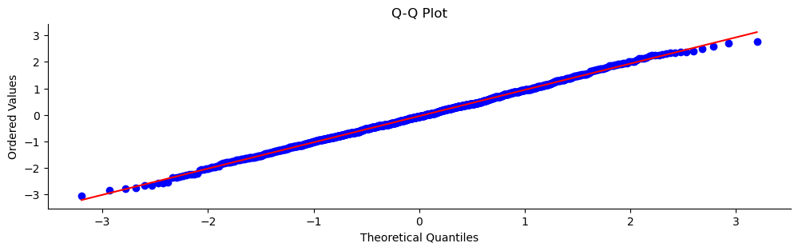
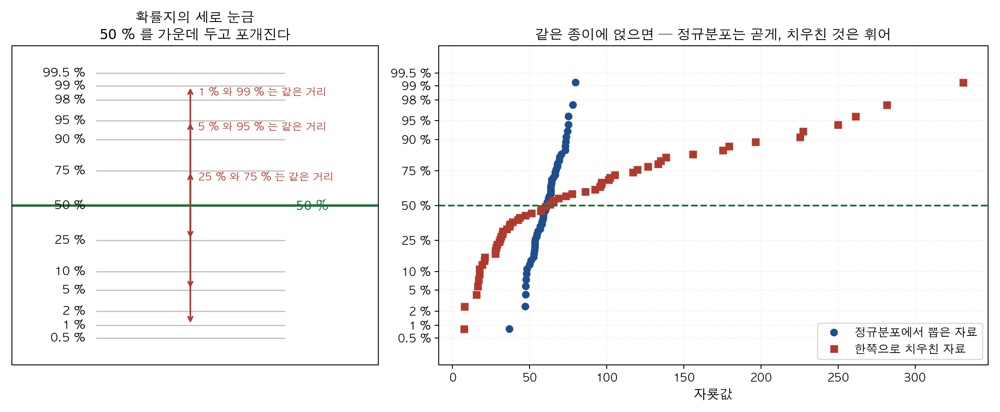
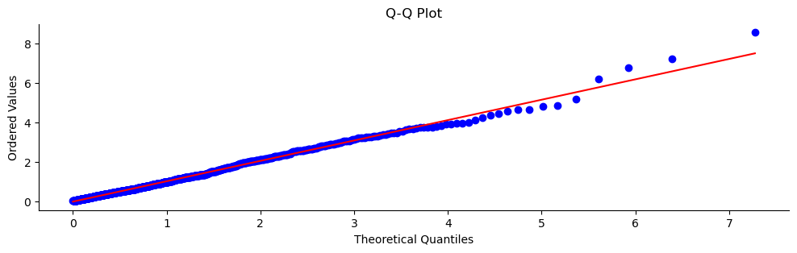
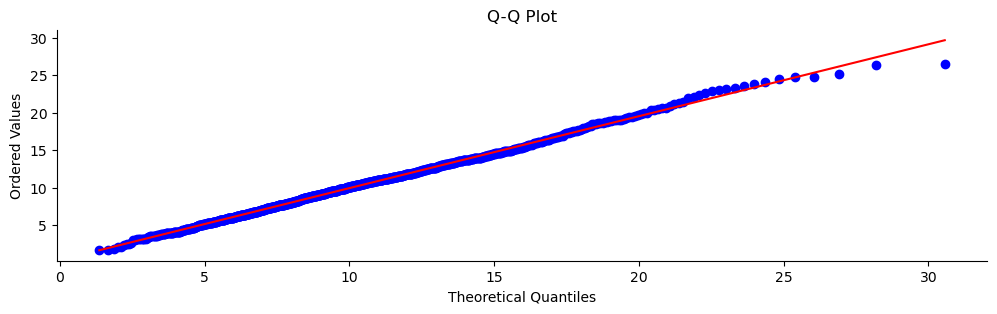
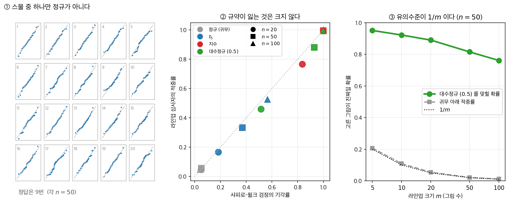
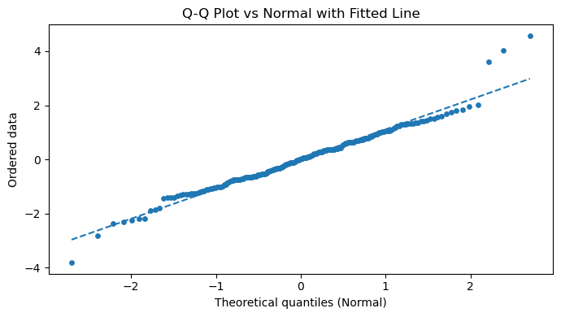
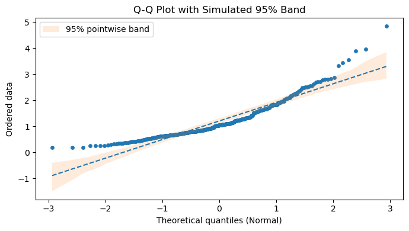
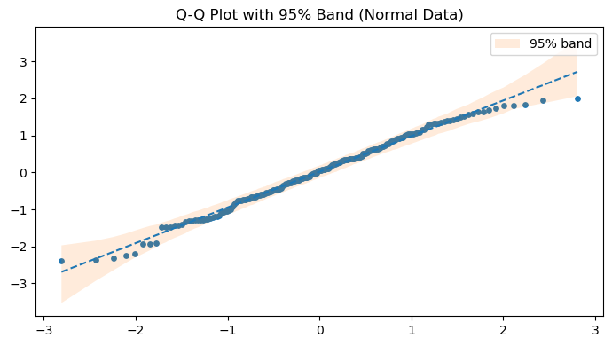
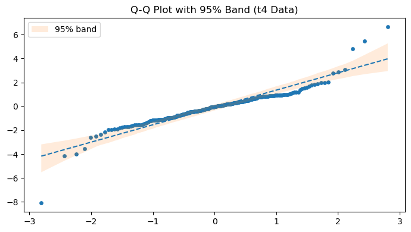
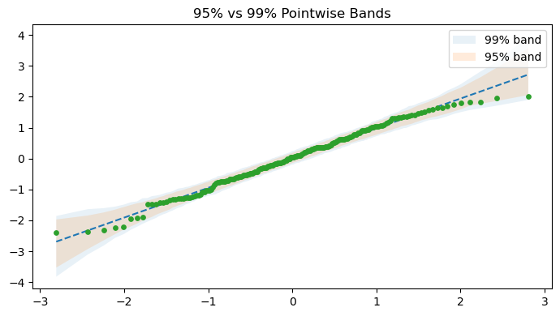

# Q-Q 그림 (분위수–분위수 그림)

## 개요

<div class="leadbox" markdown>

**들어가는 이야기** — 참 정규인데 꼬리가 여섯 배 흔들린다

$\mathcal{N}(0,1)$ 에서 $n = 1000$ 개를 뽑아 Q-Q 그림을 그리면, 자료가 **참으로 정규인데도** 양 끝 점들이 직선에서 벗어난다. 가운데 $682$ 점은 최대 절대잔차가 $0.0544$ 인데 꼬리의 $46$ 점은 $0.3587$ 까지 벌어진다 — **$6.6$ 배**다. 표준편차의 $36\%$ 만큼 벗어난 점이 흠 없는 자료에서 나오는 것이다.

그러니 「양 끝이 벌어졌다」는 관찰만으로는 아무것도 말할 수 없다. 꼬리에서는 순서통계량 자체의 분산이 커지므로 벌어짐은 **정상값**이고, 비정상을 가리려면 정상의 폭을 먼저 알아야 한다. 그 폭을 그림 위에 직접 그려 넣는 길이 있다 — 점마다 흔들릴 수 있는 범위를 띠로 둘러 주는 것이다.

기준이 없으면 눈은 아무 그림에서나 모양을 찾아낸다. 아래 「용의자를 한 줄로 세우기」 상자가 그것을 실험으로 만든 이야기다. 진짜 자료의 Q-Q 그림 하나를 귀무가설에서 만든 그림 여럿 사이에 섞어 놓고 사람에게 고르게 하면, **고르지 못한다는 사실이 그대로 「기각하지 못한다」가 된다.** 그림을 검정으로 바꾸는 수법이다.

그러면 어느 정도의 벗어남까지가 정상이며, 그 기준을 어떻게 그림 위에 그려 넣는가. 그리고 띠를 벗어난 점은 무엇이라고 읽어야 하는가. $\S 5$ 가 띠를 만드는 두 방식과 그 둘의 차이까지 수로 적는다.

_확인한 곳 — 이 쪽 「대칭을 눈금으로 새겨 둔 종이」·「용의자를 한 줄로 세우기」 상자와 그 출처 줄. 잔차와 점의 개수는 모두 직접 계산한 값이다_

</div>

**Q-Q 그림**은 자료의 분위수를 이론적 정규분포의 분위수와 비교한다. 자료가 정규분포를 따르면 Q-Q 그림의 점들이 직선 대각선을 따라 놓여야 한다. 이 선에서 벗어나면 정규성에서 이탈했음을 나타낸다.

---

## 1. 정규분포와의 Q-Q 그림

<div class="exbox" markdown>

**보기 1.** <span class="diff easy" title="쉬움"></span> 맞는 분포끼리 견주면 얼마나 똑바른가. $\mathcal{N}(0,1)$에서 $n = 1000$개를 뽑아 정규 Q-Q 그림을 그린다.

**(1)** 적합선의 기울기와 절편이 각각 무엇을 추정하는지 수로 확인하시오.

**(2)** 자료가 **참으로 정규인데도** 양 끝 점들은 직선에서 벗어난다. 가운데($\lvert q\rvert < 1$)와 꼬리($\lvert q\rvert > 2$)의 최대 잔차를 재어 그 폭을 적으시오. 이 벗어남을 "정규성 위반"으로 읽으면 왜 안 되는가. 이 폭을 그림으로 만든 것이 §5 의 신뢰띠다.

</div>

??? success "풀이"

    유도할 식이 없는 읽기 문제다. **참인 귀무가설 아래에서 Q-Q 그림이 어느 정도까지 흔들리는지**를 수로 재어 기준선을 세우는 것이 이 보기의 몫이다.

    ```python
    import numpy as np
    import matplotlib.pyplot as plt
    import scipy.stats as stats

    plt.rcParams["font.sans-serif"] = ["NanumGothic", "Apple SD Gothic Neo", "Malgun Gothic"]
    plt.rcParams["font.family"] = "sans-serif"
    plt.rcParams["axes.unicode_minus"] = False

    def plot_qq_with_custom_spines(data, dist="norm", sparams=(), figsize=(12, 3)):
        """Q-Q 그림을 그린다.

        자료의 분위수를 기준분포의 분위수와 짝지어 찍는다. 자료가 그 분포에서
        나왔다면 점들이 직선에 놓인다.

        매개변수
        --------
        data : 그릴 자료
        dist : 견줄 기준분포 이름 (기본값 "norm")
        sparams : 그 분포의 모양모수. 카이제곱의 자유도 같은 것이다.
        figsize : 그림 크기 (가로, 세로)
        """
        fig, ax = plt.subplots(figsize=figsize)
        stats.probplot(data, dist=dist, sparams=sparams, plot=ax)

        ax.spines[["top", "right"]].set_visible(False)
        ax.set_title('Q-Q Plot')
        ax.set_xlabel('Theoretical Quantiles')
        ax.set_ylabel('Ordered Values')
        plt.show()

    if __name__ == "__main__":
        # 자료와 기준분포가 맞으므로 점들이 직선에 놓인다.
        np.random.seed(0)
        sample_data = np.random.normal(loc=0, scale=1, size=1000)
        plot_qq_with_custom_spines(sample_data, dist="norm")
    ```

    

    그림에서 읽을 수치를 따로 찍어 둔다. `probplot`은 그림을 그리지 않을 때 `((osm, osr), (기울기, 절편, r))`을 돌려준다. 여기서 $r$ 은 두 축의 상관계수로, 점들이 얼마나 똑바른지를 하나의 수로 요약한다.

    ```python
    np.random.seed(0)
    x = np.random.normal(loc=0, scale=1, size=1000)
    (osm, osr), (slope, intercept, r) = stats.probplot(x, dist="norm")
    resid = osr - (intercept + slope * osm)

    print(f"기울기 {slope:.4f}   표본표준편차 {x.std(ddof=1):.4f}")
    print(f"절편   {intercept:.4f}   표본평균     {x.mean():.4f}")
    print(f"상관계수 r = {r:.6f}   r^2 = {r ** 2:.6f}")

    for lo, lab in [(1, "|q| < 1"), (2, "|q| > 2")]:
        m = np.abs(osm) < lo if lo == 1 else np.abs(osm) > lo
        print(f"{lab}: {m.sum()}점, 최대 절대잔차 {np.abs(resid[m]).max():.4f}")
    print(f"양 끝점의 잔차: {resid[0]:+.4f}, {resid[-1]:+.4f}")
    print(f"샤피로-윌크 p = {stats.shapiro(x)[1]:.4f}")
    print(f"g1 = {stats.skew(x):.4f}   g2 = {stats.kurtosis(x):.4f}")
    ```

    출력:

    ```text
    기울기 0.9893   표본표준편차 0.9875
    절편   -0.0453   표본평균     -0.0453
    상관계수 r = 0.999482   r^2 = 0.998965
    |q| < 1: 682점, 최대 절대잔차 0.0544
    |q| > 2: 46점, 최대 절대잔차 0.3587
    양 끝점의 잔차: +0.1624, -0.3587
    샤피로-윌크 p = 0.5912
    g1 = 0.0339   g2 = -0.0468
    ```

    **(1) 절편은 평균을, 기울기는 표준편차를 추정한다.** 절편 $-0.0453$은 표본평균과 소수 넷째 자리까지 같다. 최소제곱선이 $(\bar q, \bar x)$를 지나고 이론 분위수의 합이 대칭성 때문에 정확히 0 이므로, **절편이 표본평균과 일치하는 것은 우연이 아니다.** 기울기 $0.9893$은 표본표준편차 $0.9875$에 $0.2\%$ 안에서 맞고, 둘 다 참값 $\sigma = 1$보다 조금 작다. 기울기와 표준편차가 완전히 같지는 않다. 최소제곱 기울기는 $\sum q_i x_{(i)}/\sum q_i^2$인데 $\sum q_i^2/n$이 1 에 조금 못 미치기 때문이다.

    **(2) 참으로 정규인 자료도 꼬리에서 흔들린다.** 이것이 이 보기에서 가장 중요한 수치다.

    | 구간 | 점 개수 | 최대 절대잔차 | 표본표준편차 대비 |
    |---|---|---|---|
    | $\lvert q\rvert < 1$ | 682 | $0.0544$ | $5.5\%$ |
    | $\lvert q\rvert > 2$ | 46 | $0.3587$ | $36\%$ |

    가운데 682점은 직선에서 $0.054$ 이상 벗어나지 않는데, 꼬리의 46점은 최대 $0.359$까지 벗어난다. **6.6배**다. 양 끝점만 보면 왼쪽 끝이 선 위로 $0.162$, 오른쪽 끝이 선 아래로 $0.359$다.

    이것을 "정규성 위반"으로 읽으면 안 되는 까닭은 **자료가 참으로 $\mathcal{N}(0,1)$에서 나왔기 때문**이다. 틀릴 수 없는 사실이다. 샤피로–윌크가 $p = 0.5912$, 표본왜도 $g_1 = 0.034$, 초과첨도 $g_2 = -0.047$로 어느 쪽에서도 이상 신호가 없다.

    까닭은 순서통계량의 분산이 꼬리에서 크다는 데 있다. $i$번째 순서통계량의 분산은 대략

    $$
    \operatorname{Var}(X_{(i)}) \approx \frac{p_i(1-p_i)}{n\,\varphi(q_i)^2},
        \qquad p_i = \frac{i - 0.5}{n}
    $$

    인데, 분자 $p(1-p)$는 꼬리로 갈수록 작아지지만 분모의 밀도 $\varphi(q_i)^2$가 **훨씬 빠르게** 0 으로 간다. 그래서 꼬리 쪽 점의 표준오차가 가운데보다 몇 배 크다. 곧 **Q-Q 그림의 양 끝이 흔들리는 것은 정상이고, 신호가 아니라 잡음이다.**

    여기서 따라오는 실무 규칙이 두 가지다. 첫째, **꼬리 점 두세 개의 벗어남만으로 정규성을 의심하지 말라.** 이 보기가 보여 준 대로 참인 경우에도 표준편차의 36%까지 벌어진다. 둘째, **그러므로 눈대중이 아니라 신뢰띠가 필요하다.** 어느 정도의 벗어남이 "정상 범위"인지는 $n$과 $q$에 따라 달라지므로 그림 위에 그 범위를 그려 넣어야 한다 — 다음 절의 주제다.

    $r = 0.999482$라는 값도 기준선으로 기억할 만하다. 참으로 정규인 $n = 1000$ 표본에서 $r$ 이 $0.9995$ 정도 나온다. 뒤의 보기 2·3 에서 이 값과 견주게 된다.

<div class="storybox" markdown>

**그림으로 보는 통계학 1.** 대칭을 눈금으로 새겨 둔 종이

<figure markdown>
  { width=880 }
  <figcaption markdown>왼쪽 — 확률지의 세로 눈금이다. 간격이 고르지 않은데도 **$50$ % 를 가운데 두고 위아래가 정확히 포개진다** — $1$ % 와 $99$ %, $5$ % 와 $95$ % 가 중앙선에서 같은 거리다. 오른쪽 — 그 종이에 자료를 얹은 것으로, 정규분포에서 뽑은 것은 곧게 서고 한쪽으로 치우친 것은 크게 휜다. *(이 책에서 그렸다)*</figcaption>
</figure>

정규분포에서 확률을 견주는 일은 **표준화 값을 견주는 일**과 같다. $\mathrm P(X\le a)$ 를
보는 것과 $z=\frac{a-\mu}{\sigma}$ 를 보는 것이 같다는 것인데, 이 말을 아예 **종이에 새겨
놓은 물건**이 있었다. 확률지다. 보기 1 이 화면에 그린 정규 Q-Q 그림이 바로 그 종이다.

만드는 법은 단순하다. 세로축에 확률 $p$ 를 고르게 매기지 않고, **$\Phi^{-1}(p)$ 자리에**
$p$ 를 적어 둔다. 그러면 정규분포를 따르는 자료는 $x=\mu+\sigma z$ 이므로 이 종이 위에서
반드시 **직선**이 된다. 자를 하나 대어 점들이 곧으면 정규분포이고, 휘면 아니다. 기울기에서
$\sigma$ 를 읽고 $50$ % 선과 만나는 자리에서 $\mu$ 를 읽는다. 보기 1 의 (1) 이 적합선의
기울기와 절편에서 그 둘을 읽어 내는 것과 같은 일이고, 표도 계산기도 필요 없었다.

정규분포의 대칭성이 그 눈금 안에 그대로 들어 있다. $\Phi^{-1}(1-p)=-\Phi^{-1}(p)$ 이므로
$1$ % 와 $99$ % 가 중앙선에서 같은 거리에 놓이고, $5$ % 와 $95$ % 도 그렇다. 그림 왼쪽의
붉은 화살표가 그 짝들이다. 간격은 가운데에서 멀어질수록 벌어지지만 **벌어지는 모양이
위아래로 꼭 같다.** 「밀도의 대소는 평균까지의 거리만으로 정해진다」가 종이 위에서는
이렇게 보인다.

이 종이를 널리 쓰이게 만든 사람은 수학자가 아니라 **물 다루는 기술자**였다. $1914$ 년,
미국의 위생공학자 **앨런 헤이즌**이 저수지에 물을 얼마나 담아 두어야 하는가를 다룬 긴 논문
한가운데에 「Probability Paper」라는 작은 절을 두고 이 종이를 내놓았다. 홍수가 몇 해에 한 번
오는지를 자료에서 읽어야 했는데, 자료는 적고 꼬리는 중요했다. 그는 $n$ 개를 크기 순으로
늘어놓고 $m$ 번째 값을 $P=\dfrac{2m-1}{2n}$, 곧 $\dfrac{m-0.5}{n}$ 자리에 찍으라고 적었다.
오늘 **헤이즌의 자리**라 불리는 것이 이것이고, 보기 1 의 풀이에 나온 $p_i=\dfrac{i-0.5}{n}$
이 바로 그 자리다 — 저수지 논문에서 온 셈법이 백 년 뒤 Q-Q 그림의 가로축을 정하고 있다.

이야기를 옮기다 어긋나기 쉬운 대목이 하나 있다. 같은 해 같은 권에 실린 풀러의 홍수 논문에
헤이즌이 붙인 토론문이 자주 「확률지가 처음 나온 자리」로 인용되는데, 원문을 펴 보면 그
토론문은 「**학회에 곧 내놓을 다른 논문에서** 글쓴이는 … 새로운 모눈종이를 서술했다」고
자기 논문을 가리키고 있을 뿐이다. 종이를 실제로 설명한 자리는 그 다른 논문 쪽이다.

「처음」이라는 말도 조심해야 한다. 확률지 자체는 $1896$ 년부터 쓰인 기록이 있고,
$1950$ 년 이전에만 문헌에 서른 번 넘게 나오는데 그 대부분이 수문학자들의 글이다. 헤이즌이
한 일은 없던 것을 만든 것이라기보다 **쓸 만한 꼴로 정리해 퍼뜨린 것**에 가깝다.

종이는 사라졌지만 눈금은 남았다. 오늘 자료가 정규분포를 따르는지 볼 때 쓰는 그림이 바로
이 쪽의 Q-Q 그림이고, 가로축과 세로축을 바꾸어 그릴 뿐 하는 일이 같다. 백 년 전에는 인쇄된
종이를 사서 연필로 찍었고 지금은 화면에 그린다는 것만 다르다.

_확인한 곳 — 헤이즌의 논문 「Storage to be Provided in Impounding Reservoirs for Municipal
Water Supply」(『Transactions of ASCE』 제$77$ 권 제$1308$ 호, $1539$–$1640$ 쪽)의
[원본 스캔](https://archive.org/stream/transactionsofam77amer/transactionsofam77amer_djvu.txt)
에서 **직접 읽었다** — 「Probability Paper.」 절은 $1549$ 쪽에서 시작하고
$P=\frac{2m-1}{2n}$ 은 $1550$ 쪽에 있다. 같은 권 $626$–$632$ 쪽의 풀러 논문 토론문에서
헤이즌이 「In another paper to be presented to the Society, the writer has described …」
라고 자기 논문을 가리킨 것도 그 스캔에서 읽었다 · 확률지가 이미 $1896$ 년부터 쓰였고
$1950$ 년 이전에 문헌에 서른 번 넘게 — 대부분 수문학자들에 의해 — 나온다는 것은
[『Another look at plotting positions』(Harter, $1984$)의 초록](https://www.tandfonline.com/doi/abs/10.1080/03610928408828781),
그가 $1930$ 년에 죽었다는 것은
[미국 원자력규제위원회의 홍수빈도 역사 자료](https://www.nrc.gov/docs/ML1305/ML13057A720.pdf) ·
그림의 눈금이 $50$ % 에 대하여 대칭이라는 것($\Phi^{-1}(p)+\Phi^{-1}(1-p)$ 이 $10^{-14}$ 아래),
그리고 두 자료가 직선에 맞는 정도($r=0.993$ 대 $0.919$)는 **직접 계산했다**_

</div>

---

## 2. 지수분포와의 Q-Q 그림

<div class="exbox" markdown>

**보기 2.** <span class="diff easy" title="쉬움"></span> 기준분포를 바꾸면 같은 자료가 어떻게 달리 보이는가. $\text{Exponential}(1)$에서 $n = 1000$개를 뽑아 **지수** Q-Q 그림을 그린다. Q-Q 그림이 정규 전용 도구가 아님을 보이는 대목이다.

**(1)** 같은 자료를 지수분포와 견준 그림, 정규분포와 견준 그림의 상관계수 $r$ 과 최대 잔차를 각각 재어 비교하시오.

**(2)** 정규분포와 견준 그림의 모양을 말하고, 표본왜도·초과첨도를 지수분포의 이론값과 견주시오. $\text{Exponential}(\lambda)$의 왜도와 초과첨도는 척도에 무관하게 각각 $2$, $6$ 이다.

</div>

??? success "풀이"

    **(2)** 의 이론값만 유도할 것이 있다. $X \sim \text{Exponential}(1)$이면 $E[X^k] = k!$이므로 $\mu = 1$, $\sigma^2 = 2! - 1 = 1$이고

    $$
    \mu_3 = E[(X-1)^3] = 6 - 3\cdot 2 + 2 = 2,
    \qquad \mu_4 = E[(X-1)^4] = 24 - 4\cdot 6 + 6\cdot 2 - 3 = 9
    $$

    이다. 따라서 왜도는 $\mu_3/\sigma^3 = 2$, 초과첨도는 $\mu_4/\sigma^4 - 3 = 9 - 3 = 6$이다. 척도를 바꾸어도 표준화된 적률이므로 변하지 않는다. **(1)** 은 읽기 문제다.

    ```python
    import numpy as np
    import matplotlib.pyplot as plt
    import scipy.stats as stats

    plt.rcParams["font.sans-serif"] = ["NanumGothic", "Apple SD Gothic Neo", "Malgun Gothic"]
    plt.rcParams["font.family"] = "sans-serif"
    plt.rcParams["axes.unicode_minus"] = False

    def plot_qq_with_custom_spines(data, dist="norm", sparams=(), figsize=(12, 3)):
        """Q-Q 그림을 그린다.

        자료의 분위수를 기준분포의 분위수와 짝지어 찍는다. 자료가 그 분포에서
        나왔다면 점들이 직선에 놓인다. 어느 자리에서 벗어나는지까지 보여 준다는
        점에서 히스토그램보다 낫다.
        """
        fig, ax = plt.subplots(figsize=figsize)
        stats.probplot(data, dist=dist, sparams=sparams, plot=ax)

        ax.spines[["top", "right"]].set_visible(False)
        ax.set_title('Q-Q Plot')
        ax.set_xlabel('Theoretical Quantiles')
        ax.set_ylabel('Ordered Values')
        plt.show()

    if __name__ == "__main__":
        # 이번에는 지수자료를 지수분포와 견준다. 맞는 분포끼리 견주면 역시
        # 직선이 된다. Q-Q 그림이 정규 전용이 아님을 보이는 대목이다.
        np.random.seed(0)
        sample_data = np.random.exponential(scale=1, size=1000)
        plot_qq_with_custom_spines(sample_data, dist="expon")
    ```

    

    같은 자료를 두 기준분포에 대고 수치를 견준다.

    ```python
    np.random.seed(0)
    x = np.random.exponential(scale=1, size=1000)

    for dist in ("expon", "norm"):
        (osm, osr), (slope, intercept, r) = stats.probplot(x, dist=dist)
        resid = osr - (intercept + slope * osm)
        print(f"{dist:6s}  기울기 {slope:.4f}  절편 {intercept:+.4f}"
              f"  r {r:.6f}  최대절대잔차 {np.abs(resid).max():.4f}")

    print(f"\n표본평균 {x.mean():.4f}   표본표준편차 {x.std(ddof=1):.4f}")
    print(f"g1 = {stats.skew(x):.4f}  (이론 2)")
    print(f"g2 = {stats.kurtosis(x):.4f}  (이론 6)")
    print(f"샤피로-윌크 p = {stats.shapiro(x)[1]:.4g}")
    ```

    출력:

    ```text
    expon   기울기 1.0349  절편 -0.0298  r 0.997717  최대절대잔차 1.0621
    norm    기울기 0.9252  절편 +1.0035  r 0.896539  최대절대잔차 4.5991

    표본평균 1.0035   표본표준편차 1.0296
    g1 = 2.0526  (이론 2)
    g2 = 6.4761  (이론 6)
    샤피로-윌크 p = 4.858e-33
    ```

    **(1) 기준분포를 바꾸는 것만으로 $r$ 이 $0.9977$에서 $0.8965$로 떨어진다.** 자료는 한 글자도 바뀌지 않았다.

    | 기준분포 | 기울기 | 절편 | $r$ | 최대 절대잔차 |
    |---|---|---|---|---|
    | 지수 | $1.0349$ | $-0.0298$ | $0.997717$ | $1.0621$ |
    | 정규 | $0.9252$ | $+1.0035$ | $0.896539$ | $4.5991$ |

    최대 잔차는 $1.06$에서 $4.60$으로 **4.3배** 커진다. 지수 쪽 기울기 $1.0349$와 절편 $-0.0298$은 참 척도 $1$ 과 참 위치 $0$ 에 가깝다.

    정규 쪽 계수는 한 가지를 더 알려 준다. 절편 $1.0035$는 표본평균과 정확히 같은데(앞서 본 대로 이론 분위수의 합이 0 이므로 늘 그렇다), **기울기 $0.9252$는 표본표준편차 $1.0296$에서 $10\%$ 어긋난다.** 보기 1 에서 둘이 $0.2\%$ 안에서 맞았던 것과 대비된다. 최소제곱 기울기는 $r \cdot s_x / s_q$이므로 $r$ 이 1 에서 멀어지는 만큼 기울기가 표준편차보다 작아진다. 곧 **"기울기가 표준편차를 추정한다"는 관계 자체가 자료가 기준분포에 맞을 때만 성립한다.**

    보기 1 에서 얻은 기준선과 견주면 더 분명하다. 참으로 맞는 분포끼리 견주었을 때 $r$ 은 $0.9995$(정규/정규)와 $0.9977$(지수/지수)이고, 틀린 분포와 견주면 $0.8965$다. **맞을 때는 $r$ 이 $0.997$ 위, 틀릴 때는 $0.90$ 아래**로 자릿수가 아니라 소수 둘째 자리에서 갈린다.

    지수/지수 쪽의 최대 잔차 $1.06$도 작지 않다는 점은 짚어 둘 만하다. 자료의 표준편차가 $1.03$이니 표준편차만큼 벗어난 점이 있다는 뜻이다. 보기 1 에서 본 그대로 **맞는 분포와 견주어도 꼬리의 한두 점은 크게 흔들린다.** 지수분포의 오른쪽 꼬리는 정규보다 훨씬 길어 그 흔들림이 더 크다.

    **(2) 정규와 견준 그림은 아래로 볼록하다(위로 휜다).** 양 끝이 모두 적합선 위로 올라간다. 왼쪽 꼬리는 0 에서 잘려 짧으므로 기대보다 **덜 음수**이고, 오른쪽 꼬리는 길게 늘어지므로 기대보다 **더 크다.** 둘이 합쳐 위로 휘는 곡선이 된다. 두꺼운 꼬리의 S자와는 다른 모양이며, **오른쪽 치우침의 서명**이다.

    표본의 모양 통계량이 그 치우침을 수로 확인한다. $g_1 = 2.0526$ 대 이론 $2$, $g_2 = 6.4761$ 대 이론 $6$으로 각각 $2.6\%$, $7.9\%$ 차이다(`scipy.stats.skew`·`kurtosis`의 기본값은 `bias=True`이므로 보정하지 않은 $g_1$, $g_2$이고, `fisher=True`이므로 초과첨도다). 네제곱 적률의 추정이 늘 더 불안정하므로 첨도 쪽 오차가 큰 것은 예상된 바다. 왜도 $2$는 작은 수가 아니다 — 참으로 정규인 보기 1 의 자료가 $g_1 = 0.034$였으니 **60배**다. 샤피로–윌크도 $p = 4.9\times10^{-33}$으로 압도적으로 기각한다.

    요점은 **Q-Q 그림이 "정규인가"를 묻는 도구가 아니라 "이 분포인가"를 묻는 도구**라는 것이다. `dist` 인수를 바꾸면 어떤 분포든 기준으로 삼을 수 있고, 지수 자료는 지수분포에 대고 보아야 똑바르다.

---

## 3. 카이제곱분포와의 Q-Q 그림

<div class="exbox" markdown>

**보기 3.** <span class="diff easy" title="쉬움"></span> 모양모수를 틀리게 주면 그림이 알려 주는가. $\chi^2_{10}$에서 $n = 1000$개를 뽑아 `sparams=(10,)`으로 카이제곱 Q-Q 그림을 그린다.

**(1)** `sparams` 를 **빠뜨리면** 어떻게 되는가. 실제로 돌려 확인하시오.

**(2)** 기준분포를 셋으로 바꾸어 — 참 자유도 $\chi^2_{10}$, 틀린 자유도 $\chi^2_{5}$, 정규 — 각각의 $r$ · 기울기 · 절편을 재시오. **$r$ 만 보고 모양모수가 틀렸음을 알아낼 수 있는가?**

</div>

??? success "풀이"

    읽기 문제다. $\chi^2_k$의 왜도 $\sqrt{8/k}$와 초과첨도 $12/k$만 이론값으로 쓴다. $k = 10$이면 각각 $0.8944$, $1.2$다.

    ```python
    import numpy as np
    import matplotlib.pyplot as plt
    import scipy.stats as stats

    plt.rcParams["font.sans-serif"] = ["NanumGothic", "Apple SD Gothic Neo", "Malgun Gothic"]
    plt.rcParams["font.family"] = "sans-serif"
    plt.rcParams["axes.unicode_minus"] = False

    def plot_qq_with_custom_spines(data, dist="norm", sparams=(), figsize=(12, 3)):
        """Q-Q 그림을 그린다.

        자료의 분위수를 기준분포의 분위수와 짝지어 찍는다. 자료가 그 분포에서
        나왔다면 점들이 직선에 놓인다. 어느 자리에서 벗어나는지까지 보여 준다는
        점에서 히스토그램보다 낫다.
        """
        fig, ax = plt.subplots(figsize=figsize)
        stats.probplot(data, dist=dist, sparams=sparams, plot=ax)

        ax.spines[["top", "right"]].set_visible(False)
        ax.set_title('Q-Q Plot')
        ax.set_xlabel('Theoretical Quantiles')
        ax.set_ylabel('Ordered Values')
        plt.show()

    if __name__ == "__main__":
        # 카이제곱은 모양모수가 있으므로 sparams 로 자유도를 넘겨 주어야 한다.
        # 이 값을 빠뜨리면 엉뚱한 분포와 견주게 된다.
        np.random.seed(0)
        sample_data = np.random.chisquare(df=10, size=1000)
        plot_qq_with_custom_spines(sample_data, dist="chi2", sparams=(10,))
    ```

    

    기준분포를 바꾸어 가며 수치를 견준다.

    ```python
    np.random.seed(0)
    x = np.random.chisquare(df=10, size=1000)

    # (1) sparams 를 빠뜨리면?
    try:
        stats.probplot(x, dist="chi2", sparams=())
    except TypeError as e:
        print(f"sparams 생략 -> TypeError: {e}")

    # (2) 세 기준분포를 견준다.
    for dist, sp, lab in [("chi2", (10,), "chi2(10) 참값   "),
                          ("chi2", (5,), "chi2(5)  틀린 값"),
                          ("norm", (), "정규            ")]:
        (osm, osr), (slope, intercept, r) = stats.probplot(x, dist=dist, sparams=sp)
        resid = osr - (intercept + slope * osm)
        print(f"{lab} | 기울기 {slope:7.4f} | 절편 {intercept:7.4f} | "
              f"r {r:.6f} | 최대잔차 {np.abs(resid).max():.4f}")

    print(f"\n표본평균 {x.mean():.4f} (이론 10)   표본분산 {x.var(ddof=1):.4f} (이론 20)")
    print(f"g1 = {stats.skew(x):.4f} (이론 {np.sqrt(8 / 10):.4f})   "
          f"g2 = {stats.kurtosis(x):.4f} (이론 {12 / 10:.1f})")
    ```

    출력:

    ```text
    sparams 생략 -> TypeError: _parse_args() missing 1 required positional argument: 'df'
    chi2(10) 참값    | 기울기  0.9598 | 절편  0.3281 | r 0.999076 | 최대잔차 3.1593
    chi2(5)  틀린 값 | 기울기  1.3537 | 절편  3.1583 | r 0.995366 | 최대잔차 5.5716
    정규             | 기울기  4.2003 | 절편  9.9224 | r 0.978827 | 최대잔차 5.1707

    표본평균 9.9224 (이론 10)   표본분산 18.3304 (이론 20)
    g1 = 0.8519 (이론 0.8944)   g2 = 0.8951 (이론 1.2)
    ```

    **(1) 빠뜨리면 그림이 나오지 않고 `TypeError` 가 난다.** `_parse_args() missing 1 required positional argument: 'df'`다. 카이제곱은 자유도 없이는 분포가 정의되지 않으므로 SciPy 가 조용히 기본값을 쓰지 않고 멈춘다. **이것은 다행한 쪽의 실패다.** 코드가 바로 멈추므로 잘못을 놓칠 수 없다.

    위험한 쪽은 **틀린 값을 주는 경우**다. 그때는 아무 오류도 나지 않고 그럴듯한 그림이 나온다.

    **(2) $r$ 만으로는 알아낼 수 없다.** 이것이 이 보기의 요점이다.

    | 기준분포 | 기울기 | 절편 | $r$ | 최대 잔차 |
    |---|---|---|---|---|
    | $\chi^2_{10}$ (참값) | $0.9598$ | $0.3281$ | $0.999076$ | $3.1593$ |
    | $\chi^2_{5}$ (틀린 값) | $1.3537$ | $3.1583$ | $0.995366$ | $5.5716$ |
    | 정규 | $4.2003$ | $9.9224$ | $0.978827$ | $5.1707$ |

    자유도를 반으로 틀리게 주어도 $r = 0.9954$다. 참값의 $0.9991$보다 낮기는 하지만 **셋째 자리에서야 갈린다.** 심지어 완전히 다른 족인 정규($r = 0.9788$)보다도 높다. $r$ 을 소수 둘째 자리에서 끊어 "$0.99$ 이상이면 합격"이라는 규칙을 쓴다면 **세 경우가 모두 합격한다.** $r$ 은 모양모수에 둔한 수다.

    틀렸다는 신호는 $r$ 이 아니라 **기울기와 절편**에 있다. 기준분포가 맞다면 $X_{(i)} \approx q_i$이므로 기울기가 $1$, 절편이 $0$ 이어야 한다. 참값에서는 $0.9598$과 $0.3281$로 그 근처인데, $\chi^2_5$에서는 $1.3537$과 $3.1583$으로 멀리 벗어난다. $\chi^2_5$의 분위수가 $\chi^2_{10}$보다 작으니 그것을 끌어올리느라 기울기와 절편이 함께 커진 것이다. 정규에서는 아예 $4.2003$과 $9.9224$인데, 절편은 표본평균이고 기울기는 표본표준편차($\sqrt{18.3304} = 4.28$) 근처다.

    까닭은 **Q-Q 그림이 위치·척도 변환에 눈을 감는 도구**라는 데 있다. 최소제곱선이 위치와 척도를 흡수해 버리므로 그림은 오직 **모양**만 본다. **그 흡수가 기울기와 절편이 무엇을 추정하는지를 정한다.** 기준분포에 **자유 위치·척도가 있으면**($\Phi$, $\text{Exp}(1)$) 적합선이 그 둘을 흡수하므로 기울기가 $\hat\sigma$, 절편이 $\hat\mu$ 가 된다. **없으면**($\chi^2_{10}$ — 자유도까지 박았다) 흡수할 것이 없어 $X_{(i)} \approx q_i$, 곧 $(1, 0)$ 이 기대값이다. 위에서 두 수치가 달라 보인 까닭이 이것뿐이다 — 자료도 그림도 같고 **기준분포를 어느 꼴로 주었는지**만 다르다. 모양모수를 틀리게 준 두 카이제곱은 모양이 다르므로($\chi^2_5$의 왜도 $\sqrt{8/5} = 1.265$ 대 $\chi^2_{10}$의 $0.894$) 원리적으로는 구별되어야 하지만, 그 차이가 $r$ 의 셋째 자리에만 나타난다.

    **실무 규칙.** 모양모수가 있는 분포로 Q-Q 그림을 그릴 때는 (ㄱ) 모수를 자료에서 추정했는지 밖에서 가져왔는지 반드시 기록하고, (ㄴ) $r$ 하나로 판정하지 말고 기울기가 $1$, 절편이 $0$ 에 가까운지 함께 보고, (ㄷ) 후보 모수를 여러 개 넣어 그려 비교한다.

    끝으로 표본의 모양 통계량도 견주어 둔다. $g_1 = 0.8519$ 대 이론 $\sqrt{8/10} = 0.8944$, $g_2 = 0.8951$ 대 이론 $12/10 = 1.2$다(`scipy`의 기본값이므로 보정하지 않은 판본이고 초과첨도다). 첨도 쪽이 $25\%$ 작게 나왔는데, 네제곱 적률의 추정이 늘 더 불안정한 탓이다. 표본평균 $9.9224$는 이론 $10$ 에, 표본분산 $18.3304$는 이론 $20$ 에 각각 $0.8\%$ · $8.3\%$ 안에서 맞는다.

<div class="storybox" markdown>

**그림으로 보는 통계학 2.** 용의자를 한 줄로 세우기

시각적 확인은 값지지만 **주관적이다.** 이 장이 그림과 검정을 **함께** 쓰라고
말하는 까닭도 거기 있다. 그림에는 $p$ 값이 없으니까.

$2009$ 년에 안드레아스 부야와 디안 쿡, 하이케 호프만, 해들리 위컴 등 일곱 사람이
그 전제를 뒤집는 글을 냈다. 제목이 「탐색적 자료분석과 모형진단을 위한 통계적 추론」인데,
초록의 첫 문장이 이렇다.

> 우리는 **그림이 검정통계량의 역할을 맡고, 사람의 인지가 통계적 검정의 역할을 맡는**
> 틀을 제안한다.

방법은 형사절차에서 따왔다. **라인업**이다. 진짜 자료의 그림 하나를 **귀무가설에서
만든 그림 $19$ 개** 사이에 섞어 놓고, 보는 사람에게 「다른 하나」를 고르게 한다. 귀무가
참이면 맞힐 확률이 정확히 $1/20$ 이므로, **고르는 행위 자체가 유의수준 $0.05$ 의
검정**이 된다. 같은 논문은 **로르샤흐** 규약도 함께 내놓았다 — 진짜 자료를 보여 주기
전에 **귀무 그림만** 늘어놓아, 보는 사람이 우연한 변동에 익숙해지게 하는 것이다.



- **①** 위가 라인업 한 벌이다. $n = 50$ 짜리 Q-Q 그림 스물 중 **하나만** 정규가 아니다
  (대수정규). 눈으로 찾아보면 이 장이 말하는 「주관적」의 뜻이 몸으로 와 닿는다. 정규
  자료의 Q-Q 그림도 저렇게 구불거린다.
- **②** 그러면 이 규약이 정식 검정에 얼마나 못 미치는가. 사람 대신 **기계 심사자**를
  세워 재어 보았다 — 스무 그림 가운데 샤피로–윌크 통계량이 가장 작은 것을 고르게 한
  것이다. 귀무 아래 적중률이 **$0.0497$** 로 이론값 $1/20$ 과 맞고, 대립에서는
  $t_5$ · 지수 · 대수정규 어느 쪽에서도 점들이 대각선 바로 아래에 붙는다.
  $n = 50$ 의 대수정규에서 라인업 $0.880$ 대 샤피로–윌크 $0.928$ 이다. **규약으로
  치르는 값이 검정력 $5$ 퍼센트포인트 안팎**이다.
- **③** 라인업 크기 $m$ 이 유의수준을 정한다. $m = 5$ 면 귀무 적중률이 $0.207$ 이고
  $m = 100$ 이면 $0.0115$ 로, $1/m$ 선 위에 정확히 얹힌다. 그 대가로 검정력이 $0.95$ 에서
  $0.76$ 으로 내려간다. **더 엄격하게 하려면 그림을 더 많이 그리면 된다** — 보통의 검정에서
  $\alpha$ 를 조이는 일과 같은 거래다.

②를 읽을 때 조심할 것이 하나 있다. 저 수는 **사람의 성적이 아니라 규약의 천장**이다.
심사자가 샤피로–윌크 통계량을 쓰고 있으니 당연히 샤피로–윌크에 가깝게 나온다. 사람의
눈이 어디까지 가는지는 실제로 사람에게 물어봐야 알 수 있다. 다만 ② 가 보여 주는 것은
**규약 자체가 버리는 정보는 거의 없다**는 것이다 — 「$20$ 개 중 하나 고르기」라는 틀로
바꾸는 일이 검정력을 깎지 않는다.

그래서 이 장의 「시각적 방법과 형식적 방법을 함께 쓰라」에 한 줄을 더할 수 있다.
**둘은 꼭 다른 것일 필요가 없다.** 그림을 보는 일에 $p$ 값이 없었던 것은 그림의 성질이
아니라 **그림을 혼자 보여 주었기 때문**이다. 비교할 것을 같이 놓아 주면 눈도 검정이 된다.

_확인한 곳 — Buja · Cook · Hofmann · Lawrence · Lee · Swayne · Wickham, "Statistical
inference for exploratory data analysis and model diagnostics", 『Philosophical
Transactions of the Royal Society A』 $367$ 권 $4361$–$4383$ 쪽($2009$ 년 $11$ 월,
Crossref)의 초록 — 「그림이 검정통계량의 역할을 맡고 사람의 인지가 통계적 검정의 역할을
맡는」 틀을 제안한다는 것, 추론적 타당성을 주는 간단하고 엄밀한 규약을 「형사절차에서
널리 쓰이는 '라인업'을 본떠」 만들었다는 것, 그리고 「(대중)심리학으로 잘 알려진
'로르샤흐' 잉크반점 검사를 본뜬」 또 하나의 규약이 분석자가 진짜 자료의 그림을 보기 전에
우연한 변동에 익숙해지도록 돕는다는 것. ①–③ 의 수는 모두 직접 계산한 값이며, 심사자는
사람이 아니라 샤피로–윌크 통계량을 쓰는 기계다_

</div>

---

## 4. 함께 쓰는 정규성 검정

| 검정 | 통계량 | 귀무분포 |
|---|---|---|
| Shapiro-Wilk | $W = \frac{(\sum a_i X_{(i)})^2}{\sum (X_i - \bar{X})^2}$ | 표로 정리 / 모의실험 |
| D'Agostino $K^2$ | $K^2 = Z_1^2 + Z_2^2$ (왜도 + 첨도) | $\chi^2_2$ (점근적) |
| Anderson-Darling | $A^2 = -n - \sum \frac{2i-1}{n}[\ln F_0(X_{(i)}) + \ln(1-F_0(X_{(n+1-i)}))]$ | 표로 정리된 임계값 |

<div class="exbox" markdown>

**보기 4.** <span class="diff easy" title="쉬움"></span> 가운데는 정규, 꼬리만 두꺼운 자료. $\mathcal{N}(0,1)$에서 150개, $t_3$에서 50개를 뽑아 섞은 $n = 200$ 표본에 Q-Q 그림과 세 검정(샤피로–윌크, 다고스티노 $K^2$, 앤더슨–달링)을 함께 걸어 본다.

**(1)** 세 검정 가운데 **하나만** 5% 수준에서 기각하지 못한다. 어느 것인지 통계량과 임계값을 수로 대어 말하시오.

**(2)** Q-Q 그림에서 점들이 적합선을 벗어나는 자리를 찾으시오. 가운데($\lvert q\rvert < 1$)와 꼬리($\lvert q\rvert > 2$)의 잔차를 재어, 어느 구간에서 얼마나 벗어나는지 수로 적으시오. 이 그림이 **말해 주지 않는 것**은 무엇인가.

</div>

??? success "풀이"

    유도할 답이 있는 문제가 아니다. **그림과 검정이 각각 무엇을 보여 주고 무엇을 감추는가**가 전부이므로, 눈으로 본 것을 수치로 바꿔 가며 읽는다.

    ```python
    import numpy as np
    import matplotlib.pyplot as plt
    from scipy import stats

    plt.rcParams["font.sans-serif"] = ["NanumGothic", "Apple SD Gothic Neo", "Malgun Gothic"]
    plt.rcParams["font.family"] = "sans-serif"
    plt.rcParams["axes.unicode_minus"] = False

    # 정규 150개에 자유도 3 인 t 를 50개 섞었다. 가운데는 정규 같지만
    # 꼬리만 두꺼운 자료다.
    rng = np.random.default_rng(0)
    x = np.concatenate([rng.normal(0, 1, size=150),
                        rng.standard_t(df=3, size=50)])

    # fit=False 로 두면 probplot 이 그림을 그리지 않고 좌표만 돌려준다.
    # 그 좌표로 직접 그려야 점과 직선의 모양을 마음대로 손볼 수 있다.
    osm, osr = stats.probplot(x, dist="norm", sparams=(), fit=False)
    b, a = np.polyfit(osm, osr, 1)

    fig, ax = plt.subplots(figsize=(7, 4))
    ax.scatter(osm, osr, s=15)
    xx = np.linspace(osm.min(), osm.max(), 200)
    ax.plot(xx, a + b * xx, linestyle="--")
    ax.set_title("Q-Q Plot vs Normal with Fitted Line")
    ax.set_xlabel("Theoretical quantiles (Normal)")
    ax.set_ylabel("Ordered data")
    plt.tight_layout()
    plt.show()

    # 그림에서 본 것을 검정으로 확인한다. 그림과 검정은 서로를 보완한다 —
    # 검정은 "정규가 아니다"까지만 말하고, 어디가 어긋났는지는 그림이 말한다.
    W, p_sw = stats.shapiro(x)
    K2, p_k2 = stats.normaltest(x)
    ad = stats.anderson(x, dist="norm")

    print(f"Shapiro-Wilk:     W = {W:.4f}, p = {p_sw:.4g}")
    print(f"D'Agostino K^2:   K2 = {K2:.4f}, p = {p_k2:.4g}")
    print(f"Anderson-Darling: A^2 = {ad.statistic:.4f}")
    for crit, sig in zip(ad.critical_values, ad.significance_level):
        print(f"  Critical {sig:.0f}%: {crit:.4f} -> reject if A^2 > crit")
    ```

    출력:

    ```text
    Shapiro-Wilk:     W = 0.9716, p = 0.0004476
    D'Agostino K^2:   K2 = 17.1070, p = 0.0001929
    Anderson-Darling: A^2 = 0.6894
      Critical 15%: 0.5650 -> reject if A^2 > crit
      Critical 10%: 0.6440 -> reject if A^2 > crit
      Critical 5%: 0.7720 -> reject if A^2 > crit
      Critical 2%: 0.9010 -> reject if A^2 > crit
      Critical 1%: 1.0710 -> reject if A^2 > crit
    ```

    

    **(1) 기각하지 못하는 것은 앤더슨–달링이다.** 샤피로–윌크는 $W = 0.9716$에 $p = 0.000448$, 다고스티노는 $K^2 = 17.107$에 $p = 0.000193$으로 둘 다 0.001 아래다. 그런데 앤더슨–달링은 $A^2 = 0.6894$로 5% 임계값 $0.7720$에 **미치지 못한다.** 넘는 것은 15%($0.5650$)와 10%($0.6440$) 임계값뿐이니, 이 검정으로 할 수 있는 가장 강한 진술은 "10% 수준에서 기각"이다. 유의수준을 5%로 못 박아 두었다면 앤더슨–달링 하나만으로는 이 비정규성을 **놓쳤을 것이다.**

    까닭은 가중치의 자리다. $A^2$는 CDF 전체에 걸친 제곱 거리에 $1/\{F(1-F)\}$ 가중을 준 적분이어서 꼬리를 중시하지만, 그 적분이 **전 구간의 합**이라는 점이 여기서 발목을 잡는다. 이 자료의 이탈은 꼬리의 몇 점에만 몰려 있고 나머지 구간은 멀쩡하므로, 합을 내면 임계값 근처까지만 올라간다. 반면 $K^2 = Z_1^2 + Z_2^2$는 왜도와 첨도를 **직접** 겨냥하므로 같은 신호를 훨씬 크게 증폭한다.

    **(2) 벗어나는 자리는 오직 꼬리다.** 적합선은 $\hat y = 0.0071 + 1.1021\,q$로, 절편이 표본평균 $\bar x = 0.0071$과, 기울기가 표본표준편차 $S = 1.1115$와 거의 같다. 잔차 $x_{(i)} - (\hat a + \hat b\, q_i)$를 구간별로 재면

    | 구간 | 점 개수 | 잔차 |
    |---|---|---|
    | $\lvert q\rvert < 1$ | 136 | 최대 절대값 $0.120$ |
    | $\lvert q\rvert > 2$ | 8 | $-0.839,\ -0.185,\ 0.068,\ -0.031,\ -0.306,\ +1.157,\ +1.382,\ +1.579$ |

    이다. **가운데 136점은 직선에서 0.12 이상 벗어나지 않는다.** 자료의 68%가 거의 완벽하게 정규인 셈이고, 히스토그램만 그렸다면 아무 이상도 못 보았을 것이다. 반면 양 끝 네 점씩을 보면 위쪽 세 점이 적합선 위로 $1.16$, $1.38$, $1.58$만큼 올라가고 아래쪽 최저점은 선 아래로 $0.84$만큼 내려간다. 곧 S자 패턴이다. 실제 자료 범위는 $[-3.81,\ 4.56]$으로, $n = 200$인 표준정규 표본의 최댓값이 보통 3 근처에 머무는 것과 비교하면 양쪽이 모두 과하게 길다.

    표본의 모양 통계량도 같은 말을 한다. 보정판으로 $G_1 = 0.349$, 초과첨도 $G_2 = 2.130$이고, 보정하지 않은 판본은 $g_1 = 0.346$, $g_2 = 2.047$이다(`scipy.stats.skew`·`kurtosis`의 기본값은 `bias=True`이므로 후자를 준다). 어느 판본이든 첨도가 압도적으로 크고 왜도는 작으니, **이 자료의 비정규성은 치우침이 아니라 두꺼운 꼬리**다.

    **이 그림이 말해 주지 않는 것**은 "그 벗어남이 우연인가"다. $q = 2.7$ 자리의 점 하나가 선에서 1.58 떨어져 있다는 사실만으로는 판정을 내릴 수 없다. 극단 순서통계량은 정규 자료에서도 변동이 크기 때문이다. 벗어남의 **크기**는 그림이 주지만 **유의성**은 주지 않으며, 그래서 다음 절의 신뢰띠나 위의 세 검정이 필요하다. 거꾸로 세 검정은 $p$값 하나를 줄 뿐 "꼬리가 문제다"라고는 말하지 않는다. 둘은 서로의 결함을 메운다.

---

### 세 검정이 엇갈릴 때

위 예에서 자료는 정규 추출값과 $t_3$ 추출값의 혼합이라 꼬리가 더 두껍다(표본왜도 $0.349$, 초과첨도 $2.13$). Q-Q 그림은 S자 패턴을 보인다. 왼쪽 아래 극단점들이 적합선 아래로 떨어지고 오른쪽 위 극단점들이 선 위로 올라간다.

세 검정의 결론이 **일치하지 않는다**는 점에 주목하라.

| 검정 | 결과 | 5% 수준 판정 |
|---|---|---|
| Shapiro-Wilk | $p = 0.00045$ | 기각 |
| D'Agostino $K^2$ | $p = 0.00019$ | 기각 |
| Anderson-Darling | $A^2 = 0.689$ vs 임계값 $0.772$ | **기각 못 함** |

Shapiro-Wilk와 D'Agostino $K^2$는 강하게 기각하지만 Anderson-Darling은 5% 수준에서 기각하지 못한다($A^2 = 0.689 < 0.772$). 10%와 15% 수준에서만 기각한다. 왜 그럴까? Anderson-Darling은 CDF 전체에 걸친 이탈에 꼬리 가중을 준 측도인데, 이 혼합자료의 이탈은 소수의 극단 관측값에 몰려 있어 $A^2$를 임계값 근처까지만 밀어 올린다. 반면 $K^2$는 첨도를 직접 겨냥하므로 같은 신호를 훨씬 크게 증폭한다.

교훈은 **검정 하나의 판정에 기대지 말라**는 것이다. Q-Q 그림을 형식적 검정과 결합하는 핵심 장점이 여기 있다. 그림은 자료가 정규성에서 *어디서 어떻게* 벗어나는지(이 경우 꼬리에서) 보여주고, 검정은 증거의 강도를 수량화한다. 검정끼리 어긋날 때 그림이 심판 역할을 한다.

<div class="aibox" markdown>

**AI로 보는 통계학 1.** 이 그림이 원리적으로 못 보는 것

위 표의 세 검정은 서로 다른 답을 냈지만 한 가지는 **똑같이** 한다 — 셋 다
**위치와 척도에 불변**이다. 자료에 상수를 더하거나 곱해도 통계량이 변하지 않는다.
$W$ 가 제곱합의 비이고 $K^2$ 가 표준화한 왜도·첨도로 만들어지며 $A^2$ 이 변환된
분위수를 쓰기 때문이다. 그 불변성 덕에 「평균과 분산을 몰라도 모양만 본다」는 편리함이
생긴다.

대가도 같은 자리에서 생긴다. **모양만 보므로 중심과 폭이 맞는지는 못 본다.**
보통은 중심과 폭이 관심사가 아니니 문제가 되지 않는데, 요즘 모형은 그렇지 않다.
점 하나가 아니라 **예측분포**를 내놓기 때문이다. 날씨 예보, 수요 예측, 불확실성을 함께
내는 신경망이 모두 그렇다. 그런 모형에서 틀리는 방식은 셋이다 — 중심이 치우치거나,
폭을 좁게 잡거나(과신), 넓게 잡거나(과소신뢰).


참값이 $N(0,1)$ 인 자료에 네 모형을 세웠다. 셋은 중심이 맞고 폭만 다르며, 하나는
중심이 $0.5\sigma$ 치우쳐 있다.

- **①** 표준화 잔차 $z = (y-\hat\mu)/\hat\sigma$ 의 샤피로–윌크 $p$ 값이 네 모형 모두
  **$0.832$** 다. 똑같다. 우연이 아니라 **불변성의 직접적인 결과**다 — $z$ 는 같은 $y$ 의
  아핀변환이라 $W$ 가 바뀔 수 없다. 앞의 세 모형은 RMSE 도 똑같이 $1.000$ 이다.
  **점 예측의 지표와 정규성 검정이 둘 다 눈을 감고 있다.**
- **②** 확률적분변환을 쓰면 보인다. $u_i = \hat F_i(y_i)$ 가 $U(0,1)$ 이어야 하는데,
  잘 보정된 모형만 평평하다. **과신은 U자**(실제 값이 자꾸 꼬리로 나간다), **과소신뢰는
  언덕**(가운데로만 떨어진다), **치우침은 기울어진다.** 틀린 방식마다 모양이 다르다.
- **③** 수로도 그렇다. 표준화 잔차의 샤피로–윌크는 네 경우 모두 $0.03$–$0.08$ 로
  명목수준 근처에 머문다. PIT 의 균등성 검정은 잘 보정된 경우 $0.052$ 이고 나머지 셋에서
  **$1.000$** 이다.

이 쪽의 결론 — 「그림이 심판이다」 — 은 옳지만 **어떤 그림인지**가 빠져 있다. Q-Q 그림은
잔차의 **모양**을 심판하고, PIT 히스토그램은 예측분포 **전체**를 심판한다. 둘은 같은
생각의 두 쓰임이다. Q-Q 그림이 「관측 분위수 대 이론 분위수」를 그리듯 PIT 는 각 관측을
**자기 몫의 예측분포로** 분위수를 매긴다 — 관측마다 분포가 달라도 된다는 점만 다르다.

그러니 모형이 분포를 내놓는다면 진단도 한 칸 올라가야 한다. 「잔차가 정규인가」는
$\hat\sigma$ 가 두 배로 틀려도 통과하는 물음이고, 「$\hat F$ 가 맞는가」는 그것을 바로
잡아낸다.

_확인한 곳 — 바깥의 사실을 끌어오지 않았다. 샤피로–윌크·다고스티노 $K^2$·앤더슨–달링이
위치·척도 불변이라는 것은 각 통계량의 정의에서 그대로 나오고, 확률적분변환으로 얻은
$u_i$ 가 귀무가설 아래 $U(0,1)$ 이라는 것도 마찬가지다(이 장 [KS 검정](../formal_tests/ks_test.md)
쪽이 같은 성질을 쓴다). ①–③ 의 수는 모두 직접 계산한 값이다_

</div>

## 5. 띠를 씌우면 흔들림의 폭이 보인다

§1 의 보기 1 에서 **참으로 정규인 자료의** 양 끝 점들이 직선에서 벗어나는 것을 보았다. 맨 Q-Q 그림이 해석하기 어려운 까닭이 그것이다 — 완전한 정규성 아래에서도 표집변동 때문에 점들이 기준선 주위로 흩어지므로, **얼마나 휘어야 휜 것인지** 기준이 없다. 모의실험으로 만드는 점별 신뢰띠는 시각적 포락선을 제공한다. 띠 안의 점들은 정규성이라는 귀무가설과 일관되고, 띠 밖의 점들은 진짜 이탈을 시사한다. 이 페이지는 모의실험 기반 구성을 설명하고 치우친 자료에서 시연한다.

### 모수적 붓스트랩으로 띠를 만든다

관측 표본 $x_1, \ldots, x_n$이 주어졌을 때 알고리즘은 다음과 같다.

1. **모수를 추정한다.** $\hat{\mu} = \bar{x}$와 $\hat{\sigma} = s$(Bessel 보정을 한 표본표준편차)를 계산한다.

2. **이론적 분위수를 계산한다.** $i = 1, \ldots, n$에 대해 플로팅 위치 $p_i = (i - 0.5)/n$을 써서

    $$
    q_i = \Phi^{-1}(p_i).
    $$

3. **관측 자료를 정렬한다.** 순서통계량을 $x_{(1)} \leq x_{(2)} \leq \cdots \leq x_{(n)}$이라 하자.

4. **귀무가설 아래에서 모의생성한다.** $b = 1, \ldots, B$에 대해
    - $x_1^{*(b)}, \ldots, x_n^{*(b)} \overset{\text{iid}}{\sim} \mathcal{N}(\hat{\mu}, \hat{\sigma}^2)$를 뽑는다.
    - 정렬하여 모의 순서통계량 $x_{(1)}^{*(b)} \leq \cdots \leq x_{(n)}^{*(b)}$를 얻는다.

5. **포락선을 계산한다.** 각 순위 $i$에 대해 $\{x_{(i)}^{*(1)}, \ldots, x_{(i)}^{*(B)}\}$의 2.5백분위수와 97.5백분위수를 취한다.

    $$
    L_i = Q_{0.025}\bigl(x_{(i)}^{*(1)}, \ldots, x_{(i)}^{*(B)}\bigr), \qquad U_i = Q_{0.975}\bigl(x_{(i)}^{*(1)}, \ldots, x_{(i)}^{*(B)}\bigr).
    $$

6. **그린다.** $(q_i, x_{(i)})$를 산점으로, 적합선 $y = \hat{\mu} + \hat{\sigma}\, q$를, 음영 영역 $[L_i, U_i]$를 표시한다.

<div class="exbox" markdown>

**보기 5.** <span class="diff easy" title="쉬움"></span> Q-Q 그림에 95% 띠 얹기. 대수정규$(\mu = 0,\ \sigma = 0.6)$에서 $n = 300$개를 뽑아, 적합된 정규분포에서 $B = 600$번 다시 뽑는 모수적 붓스트랩으로 95% 점별 띠를 그린다.

**(1)** 띠를 벗어난 점이 **몇 개**이며 어느 순위 구간인가. 세어 보시오. 벗어남이 흩어져 있는가, 몰려 있는가.

**(2)** 띠의 폭이 가운데와 양 끝에서 각각 얼마인가. 몇 배 차이인가.

**(3)** 띠의 **아래 경계가 음수**인 구간이 있다. 자료는 대수정규라 모두 양수인데 어떻게 된 일인가.

**(4)** 표본왜도를 대수정규의 이론값과 견주시오. 대수정규$(0, \sigma^2)$의 왜도는 $(e^{\sigma^2} + 2)\sqrt{e^{\sigma^2} - 1}$ 이다.

</div>

??? success "풀이"

    **(4)** 의 이론값만 먼저 계산해 둔다. $\sigma^2 = 0.36$이므로 $e^{0.36} = 1.43333$이고

    $$
    \gamma_1 = (e^{\sigma^2} + 2)\sqrt{e^{\sigma^2} - 1}
        = 3.43333 \times \sqrt{0.43333} = 3.43333 \times 0.65828 = 2.2601
    $$

    이다. 표준편차의 이론값은 $\sqrt{(e^{\sigma^2}-1)e^{\sigma^2}} = \sqrt{0.43333 \times 1.43333} = 0.7881$, 평균은 $e^{\sigma^2/2} = 1.1972$다. 나머지는 읽기 문제다.

    ```python
    import numpy as np
    import matplotlib.pyplot as plt
    from scipy import stats

    plt.rcParams["font.sans-serif"] = ["NanumGothic", "Apple SD Gothic Neo", "Malgun Gothic"]
    plt.rcParams["font.family"] = "sans-serif"
    plt.rcParams["axes.unicode_minus"] = False

    def qq_with_band(x, B=800, seed=42):
        """Q-Q 그림에 모의실험으로 만든 95% 띠를 얹는다.

        Q-Q 그림의 점들은 웬만큼 흔들리기 마련이라, 직선에서 조금 벗어난 것이
        문제인지 아닌지 눈으로는 알기 어렵다. 적합한 정규분포에서 같은 크기의
        표본을 B 번 뽑아 각 자리의 2.5·97.5 백분위점을 구하면, "정규라면 이
        정도까지는 흔들린다"는 범위를 그릴 수 있다.
        """
        x = np.asarray(x, dtype=float)
        n = x.size
        mu, sd = x.mean(), x.std(ddof=1)

        # 이론 분위수. 0.5 를 빼는 것은 i/n 이 마지막 점에서 1 이 되어
        # ppf 가 무한이 되는 것을 피하기 위한 흔한 보정이다.
        p = (np.arange(1, n + 1) - 0.5) / n
        q_theor = stats.norm.ppf(p)

        x_sorted = np.sort(x)

        # 적합된 정규분포에서 B 번 표본을 뽑아 각 순서통계량의 분포를 얻는다.
        rng = np.random.default_rng(seed)
        sims = np.sort(rng.normal(mu, sd, size=(B, n)), axis=1)
        lo = np.percentile(sims, 2.5, axis=0)
        hi = np.percentile(sims, 97.5, axis=0)

        fig, ax = plt.subplots(figsize=(7, 4))
        ax.scatter(q_theor, x_sorted, s=15)
        ax.plot(q_theor, mu + sd * q_theor, linestyle="--")
        ax.fill_between(q_theor, lo, hi, alpha=0.15,
                        label="95% pointwise band")
        ax.set_title("Q-Q Plot with Simulated 95% Band")
        ax.set_xlabel("Theoretical quantiles (Normal)")
        ax.set_ylabel("Ordered data")
        ax.legend()
        plt.tight_layout()
        plt.show()

    rng = np.random.default_rng(123)
    x = rng.lognormal(mean=0.0, sigma=0.6, size=300)
    qq_with_band(x, B=600, seed=7)
    ```

    

    그림에서 읽을 수치를 따로 찍어 둔다.

    ```python
    def runs(mask):
        """True 인 자리를 연속 구간으로 묶는다 (1 부터 센 순위로)."""
        idx = np.where(mask)[0]
        if idx.size == 0:
            return []
        out, start, prev = [], idx[0], idx[0]
        for j in idx[1:]:
            if j == prev + 1:
                prev = j
            else:
                out.append((start + 1, prev + 1))
                start = prev = j
        out.append((start + 1, prev + 1))
        return out

    rng = np.random.default_rng(123)
    x = rng.lognormal(mean=0.0, sigma=0.6, size=300)

    n = x.size
    mu, sd = x.mean(), x.std(ddof=1)
    p = (np.arange(1, n + 1) - 0.5) / n
    q = stats.norm.ppf(p)
    x_sorted = np.sort(x)

    sims = np.sort(np.random.default_rng(7).normal(mu, sd, size=(600, n)), axis=1)
    lo = np.percentile(sims, 2.5, axis=0)
    hi = np.percentile(sims, 97.5, axis=0)

    above, below = x_sorted > hi, x_sorted < lo
    print(f"적합된 정규: mu-hat {mu:.4f}, sd-hat {sd:.4f}")
    print(f"띠 밖의 점 {above.sum() + below.sum()}/{n} "
          f"({100 * (above.sum() + below.sum()) / n:.1f}%)")
    print(f"  위로 벗어난 구간(순위): {runs(above)}")
    print(f"  아래로 벗어난 순위 범위: {np.where(below)[0].min() + 1}"
          f" ~ {np.where(below)[0].max() + 1}  ({below.sum()}점)")

    width = hi - lo
    print(f"띠 폭: 가운데 최솟값 {width.min():.4f}, 양 끝 {width[0]:.4f} / "
          f"{width[-1]:.4f}, 최대/최소 = {width.max() / width.min():.2f}")
    print(f"띠 하한의 최솟값 {lo.min():.4f}   자료 최솟값 {x_sorted[0]:.4f}")
    print(f"P(적합된 정규 < 0) = {stats.norm.cdf(0, mu, sd):.4f}")
    print(f"최댓값 {x_sorted[-1]:.4f}  띠 상한 {hi[-1]:.4f}  "
          f"({x_sorted[-1] / hi[-1]:.2f}배)")

    s2 = 0.6 ** 2
    print(f"\n이론: 평균 {np.exp(s2 / 2):.4f}  sd "
          f"{np.sqrt((np.exp(s2) - 1) * np.exp(s2)):.4f}  왜도 "
          f"{(np.exp(s2) + 2) * np.sqrt(np.exp(s2) - 1):.4f}")
    print(f"표본: 평균 {mu:.4f}  sd {sd:.4f}  g1 {stats.skew(x):.4f}"
          f"  G1 {stats.skew(x, bias=False):.4f}")
    print(f"샤피로-윌크 p = {stats.shapiro(x)[1]:.4g}")
    ```

    출력:

    ```text
    적합된 정규: mu-hat 1.2044, sd-hat 0.7138
    띠 밖의 점 204/300 (68.0%)
      위로 벗어난 구간(순위): [(1, 48), (278, 293), (295, 300)]
      아래로 벗어난 순위 범위: 103 ~ 241  (134점)
    띠 폭: 가운데 최솟값 0.1994, 양 끝 1.0862 / 1.0342, 최대/최소 = 5.45
    띠 하한의 최솟값 -1.4917   자료 최솟값 0.1807
    P(적합된 정규 < 0) = 0.0458
    최댓값 4.8422  띠 상한 3.8469  (1.26배)

    이론: 평균 1.1972  sd 0.7881  왜도 2.2601
    표본: 평균 1.2044  sd 0.7138  g1 1.5056  G1 1.5132
    샤피로-윌크 p = 3.877e-14
    ```

    **(1) 300점 가운데 204점(68%)이 띠 밖이고, 흩어져 있지 않고 세 덩어리로 몰려 있다.**

    | 순위 구간 | 점 개수 | 방향 |
    |---|---|---|
    | $1 \sim 48$ | 48 | 띠 **위** |
    | $103 \sim 241$ | 134 | 띠 **아래** |
    | $278 \sim 300$ | 22 | 띠 **위** |

    이 세 덩어리가 "위–아래–위" 순서로 늘어선 것이 **오른쪽 치우침의 서명**이다. 왼쪽 끝이 띠 위에 있는 것은 자료의 왼쪽 꼬리가 적합된 정규분포보다 **짧기** 때문이고(대수정규는 0 에서 잘린다), 오른쪽 끝이 띠 위에 있는 것은 오른쪽 꼬리가 **길기** 때문이다. 가운데가 띠 아래로 내려앉는 것은 자료의 중앙값($\approx 1.0$)이 평균 $1.2044$보다 작기 때문이다. 아래로 볼록이 아니라 **위로 휘는 곡선** 전체가 이렇게 나타난다.

    몰려 있다는 사실 자체가 중요하다. 순서통계량은 강하게 양의 상관을 가지므로 $x_{(i)}$가 띠를 벗어나면 $x_{(i+1)}$도 벗어나기 쉽다. **그래서 벗어난 점의 개수를 "$0.05 \times 300 = 15$개"와 견주는 것은 뜻이 없다.** 연습문제 17 에서 보듯 참으로 정규인 표본에서는 평균 $0.7$개만 벗어나고 $78\%$의 표본에서는 하나도 벗어나지 않는다. 204 개는 그 기준에서 압도적인 신호다. 샤피로–윌크의 $p = 3.9\times10^{-14}$가 같은 말을 한 수로 요약한다.

    **(2) 띠 폭이 5.45배 차이 난다.** 가운데에서 가장 좁은 곳이 $0.1994$인데 양 끝은 $1.0862$와 $1.0342$다. 띠가 나팔처럼 벌어지는 까닭은 순서통계량의 분산이 꼬리에서 크기 때문이다 — 연습문제 19 에서 유도한다.

    **이것이 띠를 그리는 이유다.** 띠가 없다면 양 끝 점이 적합선에서 $1.0$ 벗어난 것과 가운데 점이 $0.2$ 벗어난 것 가운데 어느 쪽이 더 심각한지 눈으로 판단할 수 없다. 띠가 그 환산율을 그림 위에 직접 그려 준다.

    **(3) 적합된 정규분포가 음수를 허용하기 때문이다.** $\hat\mu = 1.2044$, $\hat\sigma = 0.7138$인 정규분포는

    $$
    P(X < 0) = \Phi\!\Bigl(\frac{0 - 1.2044}{0.7138}\Bigr) = \Phi(-1.687) = 0.0458
    $$

    로 전체 질량의 $4.6\%$를 음수에 둔다. $n = 300$이면 음수가 평균 14개쯤 나오는 셈이고, 그래서 가장 작은 순서통계량의 모의분포가 음수 영역에 걸쳐 띠 하한이 $-1.4917$까지 내려간다. 반면 자료의 최솟값은 $0.1807$이다.

    **이것만으로도 정규 모형은 기각된다.** 띠를 그리거나 검정을 돌릴 필요도 없이, "길이·가격·소득처럼 양수일 수밖에 없는 양에 정규분포를 적합하면 모형이 불가능한 영역에 질량을 준다"는 사실이 드러난 것이다. 변동계수 $\hat\sigma/\hat\mu = 0.59$처럼 산포가 큰 양수 자료에서는 늘 이 문제가 생기며, 로그 변환이 표준 처방인 까닭이기도 하다.

    **(4) 표본왜도가 이론값보다 한참 작다.** $g_1 = 1.5056$(보정판 $G_1 = 1.5132$)인데 이론값은 $2.2601$이다. **$33\%$ 작다.** 표준편차도 $0.7138$ 대 이론 $0.7881$로 $9\%$ 작다.

    우연이 아니라 오른쪽 꼬리가 긴 분포에서 늘 일어나는 일이다. 왜도는 세제곱 적률이라 그 추정의 변동이 6차 적률에 지배되는데, 대수정규의 고차 적률은 $e^{k^2\sigma^2/2}$로 폭발적으로 커진다($\sigma = 0.6$에서 6차 적률은 $e^{6.48} = 652$다). 그런 분포에서 $g_1$의 표집분포는 오른쪽으로 길게 늘어지고 **중앙값이 참값 아래에 놓인다.** 평균을 떠받치는 것은 극단적으로 큰 관측값이 섞인 드문 표본이고, 대다수 표본은 참값을 밑돈다.

    요점은 두 가지다. 첫째, **보고된 왜도 하나를 소수점까지 믿지 말라.** 둘째, 그런데도 **방향은 맞는다** — $1.5$든 $2.3$이든 "오른쪽으로 치우쳤다"는 결론은 같다. 크기를 쓰려면 붓스트랩 구간을 함께 보고해야 한다.

    `scipy.stats.skew`의 기본값은 `bias=True`이므로 위 출력의 $1.5056$은 보정하지 않은 $g_1$이다. $n = 300$에서 두 판본의 차이는 $0.5\%$로 결론에 영향이 없다.

### 점별 띠와 동시 띠

위에서 설명한 띠는 *점별*(pointwise)이다. 각 개별 순위 $i$에 대해 정규 순서통계량이 $[L_i, U_i]$ 안에 들어갈 확률이 95%라는 뜻이다. 그러나 $n$개 점이 *모두* 동시에 각자의 구간 안에 들어갈 확률은 95%보다 작다. *동시*(simultaneous) 띠(Bonferroni 보정에 해당)는 더 넓을 것이다. 그럼에도 점별 띠가 표준 관행인 이유는 지나치게 보수적이지 않으면서 유용한 시각적 안내를 주기 때문이다.

### 띠를 벗어난 점을 읽는 법

위 대수정규 예에서는 위쪽 꼬리의 점들이 신뢰띠를 벗어나 음영 영역 위로 휘어 올라간다. 형식적 검정도 탐지했을 오른쪽 치우침을 시각적으로 확인해 준다. 진짜 정규분포에서 뽑은 자료라면 대부분의 점이 띠 안에 놓이고 가끔 우연히 벗어나는 정도이다.

!!! warning "\"5%씩 벗어난다\"는 계산은 성립하지 않는다"
    각 순위가 개별적으로 5% 확률로 띠를 벗어나므로 $n = 200$이면 약 10개가 밖에 있을 것이라고 생각하기 쉽다. **틀렸다.** 실제로는 평균 약 0.7개이고, 정규표본의 약 78%에서는 벗어나는 점이 **하나도 없다**. 이유는 연습문제 17에서 다룬다.

---

## 연습문제

<div class="drillbox" markdown>

**연습문제 1.** <span class="diff med" title="중간"></span>
정규성 평가를 위한 Q-Q 그림의 구성을 기술하라. $x$축과 $y$축은 각각 무엇을 나타내는가?

</div>

??? success "풀이"
    정규 Q-Q 그림을 만드는 절차:

    1. 자료를 정렬한다: $x_{(1)} \leq x_{(2)} \leq \dots \leq x_{(n)}$.
    2. 이론적 분위수를 계산한다: $q_i = \Phi^{-1}((i - 0.5)/n)$. 여기서 $\Phi^{-1}$은 표준정규 분위수함수이다.
    3. 점 $(q_i, x_{(i)})$를 그린다.

    **$x$축**은 이론적 정규분위수(자료가 정규라면 어떤 모습이어야 하는지)를 보여준다. **$y$축**은 실제 정렬된 자료값을 보여준다. 자료가 정규이면 점들이 기울기 $\sigma$, 절편 $\mu$인 직선 위에 대략 놓인다.

<div class="drillbox" markdown>

**연습문제 2.** <span class="diff med" title="중간"></span>
Q-Q 그림에서 (a) 오른쪽으로 치우친 자료, (b) 꼬리가 두꺼운 자료, (c) 꼬리가 얇은 자료가 어떤 패턴을 보이는지 기술하라.

</div>

??? success "풀이"
    **(a) 오른쪽 치우침:** 양 끝이 모두 기준선 **위로** 올라간다. 오른쪽 꼬리에서는 표본분위수가 기대보다 크고(꼬리가 길다), 왼쪽 꼬리에서는 기대보다 덜 음수이다(꼬리가 짧다). 전체적으로 아래로 볼록한(convex) 모양이다.

    **(b) 두꺼운 꼬리(고첨):** 양쪽 꼬리가 모두 선에서 벗어난다. 왼쪽 꼬리는 선 아래로, 오른쪽 꼬리는 선 위로 휘어 S자 모양을 이룬다. 극단값이 정규분포의 예측보다 더 극단적이다.

    **(c) 얇은 꼬리(저첨):** 반대 방향의 S자 모양이다. 왼쪽 꼬리가 선 위로, 오른쪽 꼬리가 선 아래로 휜다. 극단값이 정규보다 덜 극단적이다.

<div class="drillbox" markdown>

**연습문제 3.** <span class="diff med" title="중간"></span>
어떤 Q-Q 그림에서 점들이 중앙에서는 거의 정확히 직선 위에 놓이는데 오른쪽 위에서 세 점이 선보다 훨씬 위에 있다. 이는 무엇을 시사하는가?

</div>

??? success "풀이"
    중앙의 선형성은 자료의 대부분이 근사적으로 정규임을 시사한다. 오른쪽 위에서 선보다 훨씬 위에 있는 세 점은 **이상점**이다. 정규분포가 예측하는 것보다 훨씬 큰 값들이다.

    이 패턴은 다른 과정에서 온 소수의 오염 관측값이 섞였을 때 흔하다(자료 입력 오류, 측정 이상, 또는 꼬리가 두꺼운 분포에서 나온 진짜로 드문 사건).

    조치: 자료 품질 문제가 있는지 이상점을 조사한다. 타당한 관측값이라면 로버스트 방법(절사평균, M 추정량)을 고려하거나, 정규 모형이 분포의 중심에는 맞지만 꼬리에는 맞지 않는다는 점을 인정한다.

<div class="drillbox" markdown>

**연습문제 4.** <span class="diff med" title="중간"></span>
Q-Q 그림과 P-P(확률–확률) 그림의 차이를 설명하라. 각각은 언제 선호되는가?

</div>

??? success "풀이"
    **Q-Q 그림**은 분위수를 비교한다. 정렬된 자료를 이론적 분위수에 대해 그린다. 축에서 꼬리 분위수가 멀리 벌어지므로 꼬리에서의 이탈에 민감하다.

    **P-P 그림**은 누적확률을 비교한다. $\hat F_n(x_{(i)})$를 $F_0(x_{(i)})$에 대해 그린다. 점들이 (0,0)과 (1,1) 근처에 몰리며 분포 중앙에서 해상도가 가장 높다.

    추론에 꼬리 거동이 결정적이고 Q-Q 그림이 꼬리의 이탈을 확대해 보여 주므로, 정규성 평가에는 **Q-Q 그림이 선호된다**. 분포의 중앙이 더 중요하거나(예: 보정 평가) 꼬리 거동이 다른 분포들을 비교할 때는 **P-P 그림이 선호된다**.

<div class="drillbox" markdown>

**연습문제 5.** <span class="diff med" title="중간"></span>
세 보기 모두 정규 기준 적합선의 절편이 표본평균과 **정확히** 같았다. 보기 1 은 절편 $-0.0453$ 에 표본평균 $-0.0453$, 보기 2 의 정규 기준은 절편 $1.0035$ 에 표본평균 $1.0035$, 보기 3 의 정규 기준은 절편 $9.9224$ 에 표본평균 $9.9224$ 다. 보기 1 의 풀이는 "우연이 아니다"라고만 적었다.

**(1)** 연습문제 1 의 플로팅 위치 $p_i = (i-0.5)/n$ 에 대해 $\sum_{i=1}^n q_i = 0$ 임을 보이고, 최소제곱 절편이 표본평균과 정확히 같아짐을 보이시오.

**(2)** 자료가 정규가 아니어도 (1) 이 성립하는가? 보기 2·3 의 수치로 답을 뒷받침하시오.

**(3)** 그런데 보기 2 의 **지수** 기준 절편은 $-0.0298$, 보기 3 의 $\chi^2_{10}$ 기준 절편은 $0.3281$ 로 표본평균과 전혀 다르다. 왜 정규 기준에서만 절편이 표본평균이 되는가? 두 절편에서 그 기준분포의 $\bar q$ 를 역산해 보이시오.

</div>

??? success "풀이"
    **(1)** 최소제곱선은 $(\bar q, \bar x)$ 를 지나므로 절편은
    기울기 $b$ 에 대해

    $$
    a = \bar x - b\,\bar q
    $$

    이다. 따라서 $\bar q = 0$ 이기만 하면 $a = \bar x$ 이고, $b$ 가 무엇이든 상관없다.

    $\bar q = 0$ 은 플로팅 위치의 대칭성에서 나온다. $i$ 번째와 $n+1-i$ 번째를 짝지으면

    $$
    p_i + p_{n+1-i} = \frac{i-0.5}{n} + \frac{n-i+0.5}{n} = 1
    $$

    이다. 표준정규는 0 에 대해 대칭이므로 $\Phi^{-1}(1-p) = -\Phi^{-1}(p)$, 곧 $q_{n+1-i} = -q_i$ 다. 짝끼리 더하면 0 이고, $n$ 이 홀수면 남는 가운데 항은 $p = 0.5$ 에서 $q = \Phi^{-1}(0.5) = 0$ 이다. 그러므로

    $$
    \sum_{i=1}^n q_i = 0, \qquad \bar q = 0, \qquad a = \bar x
    $$

    가 **정확히** 성립한다. 근사가 아니라 항등식이다. $\square$

    **(2) 성립한다.** (1) 의 유도에서 자료 $x_{(i)}$ 에 대해 쓴 가정이 하나도 없다. 쓴 것은 이론 분위수 $q_i$ 의 대칭성뿐이다. 수치가 그대로 보여 준다. 보기 2 의 자료는 $\text{Exponential}(1)$ 로 왜도 $g_1 = 2.05$ 이고, 보기 3 의 자료는 $\chi^2_{10}$ 으로 $g_1 = 0.85$ 다. 둘 다 정규와 거리가 멀고, 보기 2 는 샤피로–윌크가 $p = 4.9\times10^{-33}$ 로 기각한다. 그런데도 정규 기준 절편은 표본평균 $1.0035$, $9.9224$ 와 넷째 자리까지 같다.

    요점은 **절편이 정규성에 대해 아무것도 말해 주지 않는다**는 것이다. 정규 기준으로 그린 Q-Q 그림의 절편은 늘 표본평균이므로, 자료를 보기 전에 이미 아는 값이다.

    **(3)** 기준분포가 0 에 대해 대칭이 아니면 $\bar q \neq 0$ 이고, 그러면 $a = \bar x - b\bar q$ 가 $\bar x$ 와 달라진다. 지수분포와 카이제곱분포는 둘 다 한쪽으로 치우쳐 있으므로 그 분위수의 평균이 0 이 아니다.

    보기의 수치로 $\bar q$ 를 역산한다. 지수 기준은 기울기 $1.0349$, 절편 $-0.0298$, 표본평균 $1.0035$ 이므로

    $$
    \bar q = \frac{\bar x - a}{b} = \frac{1.0035 - (-0.0298)}{1.0349} = \frac{1.0333}{1.0349} = 0.9985
    $$

    이고, $\chi^2_{10}$ 기준은 기울기 $0.9598$, 절편 $0.3281$, 표본평균 $9.9224$ 이므로

    $$
    \bar q = \frac{9.9224 - 0.3281}{0.9598} = \frac{9.5943}{0.9598} = 9.9961
    $$

    이다. 역산된 두 값은 각각 $\text{Exponential}(1)$ 의 평균 $1$ 과 $\chi^2_{10}$ 의 평균 $10$ 이다. $\bar q$ 는 기준분포 분위수의 표본평균이므로 $n$ 이 크면 그 분포의 평균으로 가고, 실제로 $0.9985$ 와 $9.9961$ 은 $1$ 과 $10$ 에 $0.2\%$ · $0.04\%$ 안에서 맞는다.

    정리하면 **"절편이 $\mu$ 를 추정한다"는 말은 기준분포가 0 에 대해 대칭일 때만 쓸 수 있는 말이다.** 일반적으로는 $a = \bar x - b\,\bar q$ 이고, 기준분포의 평균 $\bar q$ 만큼 끌려 내려간다.

<div class="drillbox" markdown>

**연습문제 6.** <span class="diff med" title="중간"></span>
보기 1 에서는 기울기 $0.9893$ 과 표본표준편차 $0.9875$ 가 $0.2\%$ 안에서 맞았는데, 보기 2 의 정규 기준에서는 기울기 $0.9252$ 와 표본표준편차 $1.0296$ 가 $10\%$ 어긋났다. 보기 2 의 풀이는 그 까닭이 최소제곱 기울기 $b = r\,s_x/s_q$ 에 있다고 적는다. 여기서 $s_q$ 는 이론 분위수 $q_1,\dots,q_n$ 의 표본표준편차다.

**(1)** $b = r\,s_x/s_q$ 를 최소제곱 공식에서 유도하시오.

**(2)** 세 보기가 모두 $n = 1000$ 이고 (2)·(3) 에서 보는 것은 모두 정규 기준이므로 $q$ 벡터가, 따라서 $s_q$ 가 셋 다 같다. 보기 1 의 수치로 $s_q$ 를 역산하시오. 1 보다 큰가 작은가, 그 까닭은 무엇인가?

**(3)** (2) 의 $s_q$ 와 보기 2·3 의 $r$ · $s_x$ 로 두 보기의 정규 기준 기울기를 예측하고 실제값 $0.9252$ · $4.2003$ 과 견주시오. 보기 3 의 표본표준편차는 $\sqrt{18.3304}$ 다.

**(4)** 이로부터 "기울기가 $\sigma$ 를 추정한다"는 말에 어떤 조건을 달아야 하는가? 기울기는 $s_x$ 보다 늘 큰가 작은가?

</div>

??? success "풀이"
    **(1)** 최소제곱 기울기와 상관계수를 나란히 적는다.

    $$
    b = \frac{\sum_i (q_i - \bar q)(x_{(i)} - \bar x)}{\sum_i (q_i - \bar q)^2},
    \qquad
    r = \frac{\sum_i (q_i - \bar q)(x_{(i)} - \bar x)}
             {\sqrt{\sum_i (q_i - \bar q)^2}\,\sqrt{\sum_i (x_{(i)} - \bar x)^2}}
    $$

    둘의 분자가 같으므로 분자를 $r$ 로 바꿔 쓰면

    $$
    b = \frac{r\,\sqrt{\sum_i (q_i-\bar q)^2}\,\sqrt{\sum_i (x_{(i)}-\bar x)^2}}
             {\sum_i (q_i - \bar q)^2}
      = r\,\sqrt{\frac{\sum_i (x_{(i)}-\bar x)^2}{\sum_i (q_i-\bar q)^2}}
      = r\,\frac{s_x}{s_q}
    $$

    다. 마지막 단계에서 두 제곱합을 같은 $n-1$ 로 나누므로 그 인수가 약분된다. $\square$

    **(2)** 보기 1 에서 $b = 0.9893$, $r = 0.999482$, $s_x = 0.9875$ 이므로

    $$
    s_q = \frac{r\,s_x}{b} = \frac{0.999482 \times 0.9875}{0.9893}
        = \frac{0.986988}{0.9893} = 0.9977
    $$

    이다. **1 보다 조금 작다.** 까닭은 연습문제 5 에서 본 $\bar q = 0$ 과 이어진다. $\bar q = 0$ 이므로

    $$
    s_q^2 = \frac{1}{n-1}\sum_i q_i^2 = \frac{n}{n-1}\cdot\frac{1}{n}\sum_i q_i^2
    $$

    이고, $\frac{1}{n}\sum_i q_i^2$ 는 $\Phi^{-1}(U)^2$ 의 평균 $=1$ 을 플로팅 위치로 이산 근사한 것이다. 플로팅 위치는 양 끝을 $p = 0.5/n$ 과 $1-0.5/n$ 에서 끊으므로 참 분포의 맨 끝 꼬리를 빼먹고, 그 몫이 제곱에서 가장 크다. 그래서 이산 근사가 1 에 **못 미친다**. 보기 1 의 수치는 $\frac{1}{n}\sum q_i^2 \approx 0.994$ 에 해당하며, 이것이 보기 1 의 풀이가 "$\sum q_i^2/n$ 이 1 에 조금 못 미치기 때문"이라고 적은 그 사실이다.

    (연습문제 1 의 $(i-0.5)/n$ 을 그대로 써서 직접 계산하면 $s_q = 0.9999$ 가 나온다. `probplot` 은 그보다 양 끝이 조금 덜 극단적인 플로팅 위치를 쓰므로 역산값 $0.9977$ 이 나온다. 어느 쪽이든 1 보다 작다는 결론과 그 까닭은 같다.)

    **(3)** $s_q = 0.9977$ 을 그대로 두 보기에 쓴다.

    보기 2 의 정규 기준: $r = 0.896539$, $s_x = 1.0296$ 이므로

    $$
    b = \frac{0.896539 \times 1.0296}{0.9977} = \frac{0.923077}{0.9977} = 0.9252
    $$

    로 실제값 $0.9252$ 와 소수 넷째 자리까지 같다.

    보기 3 의 정규 기준: $s_x = \sqrt{18.3304} = 4.2814$, $r = 0.978827$ 이므로

    $$
    b = \frac{0.978827 \times 4.2814}{0.9977} = \frac{4.190767}{0.9977} = 4.2004
    $$

    로 실제값 $4.2003$ 과 마지막 자리에서 1 만큼 다르다(반올림 때문이다).

    | 적합 | $r$ | $s_x$ | 예측 기울기 | 실제 기울기 |
    |---|---|---|---|---|
    | 보기 1 정규/정규 | $0.999482$ | $0.9875$ | (역산 기준) | $0.9893$ |
    | 보기 2 지수/정규 | $0.896539$ | $1.0296$ | $0.9252$ | $0.9252$ |
    | 보기 3 카이제곱/정규 | $0.978827$ | $4.2814$ | $4.2004$ | $4.2003$ |

    **(4) 기울기는 $s_x/s_q$ 를 $r$ 배로 줄인 값이다.** 곧

    $$
    \frac{b}{s_x} = \frac{r}{s_q}, \qquad \frac{b}{s_x/s_q} = r \le 1
    $$

    이다. 따라서 **기울기는 늘 $s_x/s_q$ 보다 작거나 같다.** $s_x$ 자체와의 비교는 한쪽으로 정해지지 않는다. $s_q = 0.9977 < 1$ 이므로 $r > s_q$ 이면 $b > s_x$ 가 되고, 실제로 보기 1 이 그 경우다: $b/s_x = 0.9893/0.9875 = 1.0018$ 이고 $r/s_q = 0.999482/0.9977 = 1.0018$ 로 **1 보다 크다.** 보기 2 의 정규 기준은 $b/s_x = 0.9252/1.0296 = 0.8986$ 이고 $r/s_q = 0.896539/0.9977 = 0.8986$ 으로 **1 보다 작다.**

    그러므로 조건은 **"그림이 똑바를 때만", 곧 $r \approx 1$ 일 때만** 이다. $r$ 이 1 에서 멀어지는 정확히 그만큼 기울기가 $s_x/s_q$ 를 **과소추정**한다. 보기 1 은 $r = 0.9995$ 라 $0.05\%$ 만 줄어들어 $s_q$ 가 1 에 못 미치는 몫($0.23\%$)에 가려지고, 보기 2 의 정규 기준은 $r = 0.8965$ 라 $10\%$ 줄어들어 그 몫을 압도한다. 자료가 기준분포에 맞지 않을 때 기울기는 $\sigma$ 의 추정값이 아니라 **$\sigma$ 와 적합도를 섞어 놓은 수**다.

<div class="drillbox" markdown>

**연습문제 7.** <span class="diff hard" title="어려움"></span>
보기 1 의 풀이는 순서통계량의 분산을

$$
\operatorname{Var}(X_{(i)}) \approx \frac{p_i(1-p_i)}{n\,\varphi(q_i)^2},
\qquad p_i = \frac{i-0.5}{n}
$$

로 적고 "분모의 밀도가 분자보다 훨씬 빠르게 0 으로 간다"고 말한다. 이것을 수로 만든다. 밀스 비 $1-\Phi(q) \approx \varphi(q)/q$ ($q \to \infty$) 를 쓴다.

**(1)** 오른쪽 꼬리에서 $\operatorname{sd}(X_{(i)}) \approx 1/\sqrt{n\,q\,\varphi(q)}$ 임을 보이고, $n$ 을 고정한 채 $q \to \infty$ 로 보내면 이 값이 발산함을 말하시오.

**(2)** $n = 1000$ 에서 가운데 점($q = 0$)과 맨 위 점($i = n$, 곧 $p = 0.9995$)의 표준편차를 각각 구하고 그 비를 구하시오. $\Phi^{-1}(0.9995) = 3.2905$, $\varphi(3.2905) = 0.0017772$, $\varphi(0) = 0.3989$ 를 쓴다.

**(3)** 보기 1 의 표에 있는 최대 절대잔차 $0.0544$ 와 $0.3587$ 을 (2) 의 표준편차로 각각 나누시오. 관측된 비 $6.6$ 이 (2) 의 비보다 작은 까닭은 무엇인가?

**(4)** 맨 위 점에서는 $1-p = 1/(2n)$ 이고 $q_n \approx \sqrt{2\ln n}$ 이다. 이를 (1) 에 넣어 맨 위 점의 표준편차가 $n$ 에 따라 어떻게 줄어드는지 구하시오. 자료를 1000 배 늘리면 가운데와 양 끝의 흔들림은 각각 몇 배로 줄어드는가?

</div>

??? success "풀이"
    **(1)** 오른쪽 꼬리에서는 $p$ 가 1 에 가까우므로 $p(1-p) \approx 1-p = 1-\Phi(q)$ 다. 여기에 밀스 비를 넣으면

    $$
    \operatorname{Var}(X_{(i)}) \approx \frac{1-\Phi(q)}{n\,\varphi(q)^2}
        \approx \frac{\varphi(q)/q}{n\,\varphi(q)^2} = \frac{1}{n\,q\,\varphi(q)}
    $$

    이고 제곱근을 씌우면 $\operatorname{sd}(X_{(i)}) \approx 1/\sqrt{n\,q\,\varphi(q)}$ 다.

    $\varphi(q) = (2\pi)^{-1/2}e^{-q^2/2}$ 는 지수적으로 0 으로 가므로 $q\varphi(q) \to 0$ 이고, 따라서 고정된 $n$ 에 대해 $q \to \infty$ 에서 표준편차가 **발산**한다. 분자 $p(1-p)$ 도 0 으로 가지만 그것은 $\varphi(q)$ 의 **1 차**에 비례해 줄고 분모는 $\varphi(q)$ 의 **2 차**로 줄기 때문에, 비가 $1/\varphi(q)$ 규모로 커진다. 이것이 "분모가 훨씬 빠르게 0 으로 간다"의 정확한 뜻이다. $\square$

    **(2)** 가운데 점은 $p = 0.5$ 이므로

    $$
    \operatorname{Var} = \frac{0.25}{1000 \times 0.3989^2} = \frac{0.25}{1000 \times 0.15912}
        = 1.5712\times10^{-3},
    \qquad \operatorname{sd} = 0.0396
    $$

    이다. 맨 위 점은 $p(1-p) = 0.9995 \times 0.0005 = 4.9975\times10^{-4}$, $\varphi(3.2905)^2 = 3.1584\times10^{-6}$ 이므로

    $$
    \operatorname{Var} = \frac{4.9975\times10^{-4}}{1000 \times 3.1584\times10^{-6}}
        = \frac{4.9975\times10^{-4}}{3.1584\times10^{-3}} = 0.15823,
    \qquad \operatorname{sd} = 0.3978
    $$

    이다. 비는 $0.3978/0.0396 = 10.0$ 으로 **맨 위 점이 가운데 점보다 열 배 흔들린다.**

    (1) 의 근사식으로 맨 위 점을 재면 $1/\sqrt{1000 \times 3.2905 \times 0.0017772} = 1/\sqrt{5.8485} = 0.4135$ 로 정확값 $0.3978$ 보다 $4\%$ 크다. 밀스 비가 $1-\Phi(3.2905)$ 를 $\varphi/q = 5.40\times10^{-4}$ 로 잡아 참값 $5.00\times10^{-4}$ 보다 $8\%$ 크게 보았고, 제곱근이 그 절반인 $4\%$ 로 옮긴 것이다.

    **(3)** 보기 1 의 두 최대 잔차를 해당 표준편차로 나눈다.

    | 구간 | 최대 절대잔차 | 그 자리의 표준편차 | 표준편차 단위 |
    |---|---|---|---|
    | $\lvert q\rvert < 1$ | $0.0544$ | $0.0396$ | $1.37$ |
    | $\lvert q\rvert > 2$ | $0.3587$ | $0.3978$ | $0.90$ |

    둘 다 표준편차 $1.4$ 배 안이다. 곧 **보기 1 의 꼬리 잔차 $0.3587$ 은 큰 값이 아니라 제 몫보다도 작은 값**이고, 가운데 잔차 $0.0544$ 가 오히려 자기 표준편차에 비해 크다. 샤피로–윌크 $p = 0.5912$ 와 어긋나지 않는다.

    관측된 비 $6.6 = 0.3587/0.0544$ 가 (2) 의 $10.0$ 보다 작은 까닭은 **두 수가 서로 다른 것의 최대값**이기 때문이다. 가운데 수치는 682 개 점의 최대값이므로 한 점의 전형적 흔들림($1\sigma$)보다 위에 있고($1.37$), 꼬리 수치는 사실상 맨 끝 한 점의 흔들림이어서 자기 표준편차 아래에 있다($0.90$). 많은 점의 최대값과 한 점의 값을 견주었으니 **한 점당 비율 $10$ 이 $6.6$ 으로 줄어 보인다.** 점 하나하나로 보면 꼬리가 가운데보다 열 배 흔들리는 것이 맞다.

    **(4)** 맨 위 점에서 $1-\Phi(q_n) = 1-p = 1/(2n)$ 이므로 밀스 비로 $\varphi(q_n) \approx q_n(1-\Phi(q_n)) = q_n/(2n)$ 이다. 이것을 (1) 에 넣으면

    $$
    n\,q_n\,\varphi(q_n) \approx n \cdot q_n \cdot \frac{q_n}{2n} = \frac{q_n^2}{2},
    \qquad
    \operatorname{sd} \approx \frac{\sqrt{2}}{q_n} \approx \frac{\sqrt{2}}{\sqrt{2\ln n}}
        = \frac{1}{\sqrt{\ln n}}
    $$

    이다. $n$ 이 식에서 사라지고 $\ln n$ 만 남는다. $n = 1000$ 이면 $1/\sqrt{\ln 1000} = 1/\sqrt{6.908} = 0.380$ 으로 (2) 의 정확값 $0.3978$ 에 $4\%$ 안에서 맞는다.

    $n$ 을 1000 배 늘려 $n = 10^6$ 으로 가면 가운데 점은 $p(1-p)$ 와 $\varphi$ 가 그대로이고 분모의 $n$ 만 1000 배가 되므로 표준편차가 $\sqrt{1000} \approx 31.6$ 배 줄어 $0.0396 \to 0.00125$ 가 된다. 맨 위 점은

    $$
    \frac{1}{\sqrt{\ln 10^6}} = \frac{1}{\sqrt{13.82}} = 0.269
    $$

    로 $0.380 \to 0.269$, 겨우 $1.4$ 배 줄어든다(정확값으로는 $0.3978 \to 0.2783$).

    | | $n = 1000$ | $n = 10^6$ | 줄어든 배수 |
    |---|---|---|---|
    | 가운데 점 ($q=0$) | $0.0396$ | $0.00125$ | $31.6$ |
    | 맨 위 점 ($i=n$) | $0.3978$ | $0.2783$ | $1.43$ |

    **양 끝의 흔들림은 자료를 아무리 모아도 거의 줄지 않는다.** $1/\sqrt{\ln n}$ 은 실용적으로 상수다. 가운데는 $1/\sqrt{n}$ 으로 빨리 조여지므로, $n$ 이 커질수록 Q-Q 그림은 "가운데는 바늘처럼 가늘고 양 끝은 여전히 벌어진" 모양이 된다. 그래서 (ㄱ) 꼬리 점 두세 개의 벗어남은 $n$ 과 무관하게 늘 흔한 일이고, (ㄴ) 눈대중 대신 쓰는 신뢰띠는 꼭 **꼬리에서 넓어지는** 띠여야 한다.

<div class="drillbox" markdown>

**연습문제 8.** <span class="diff hard" title="어려움"></span>
보기 1 은 $r$ 과 샤피로–윌크 $p$ 외에 $g_1 = 0.0339$, $g_2 = -0.0468$ 을 정규성의 증거로 함께 들었다. 그 두 수만으로 무엇이 보장되는지 반례로 따진다. 세 점에 질량을 두는 분포

$$
P(X=-a) = P(X=a) = p, \qquad P(X=0) = 1-2p
$$

를 생각한다($0 < p < 1/2$, $a > 0$).

**(1)** 왜도가 모든 $p$, $a$ 에서 0 임을 말하고, 초과첨도가 0 이 되는 $p$ 를 구하시오. 그 $p$ 에서 분산이 1 이 되는 $a$ 도 구하시오.

**(2)** (1) 의 분포는 정규분포와 평균·분산·왜도·초과첨도가 모두 같다. 그런데 정규가 아니다. 이 분포에서 뽑은 $n = 1000$ 표본의 정규 Q-Q 그림은 어떤 모양인가? 각 높이에 점이 몇 개쯤 놓이는가? 이 쪽 "정리하며"의 어느 항목에 해당하는가?

**(3)** $n \to \infty$ 에서 이 그림의 상관계수 $r$ 가 얼마로 가는지 구하시오. $x_{(i)} \approx F^{-1}(p_i)$ 와 $q_i = \Phi^{-1}(p_i)$ 를 쓰고, $\int_c^\infty z\varphi(z)\,dz = \varphi(c)$ 와 $\Phi^{-1}(5/6) = 0.9674$, $\varphi(0.9674) = 0.2499$ 를 쓴다. 보기 2 의 지수/정규 $r = 0.8965$ 와 견주시오.

**(4)** 왜도·첨도만 보는 검정과 Q-Q 그림의 관계에 대해 무엇을 말할 수 있는가?

</div>

??? success "풀이"
    **(1)** 이 분포는 0 에 대해 대칭이므로 홀수 차 중심적률이 모두 0 이다. 특히 $\mu_3 = 0$ 이고 왜도 $\gamma_1 = \mu_3/\sigma^3 = 0$ 이 $p$, $a$ 와 무관하게 성립한다.

    짝수 차 적률은 $\mu = 0$ 이므로 곧바로 계산된다.

    $$
    \mu_2 = 2pa^2, \qquad \mu_4 = 2pa^4
    $$

    따라서 보정하지 않은 첨도는

    $$
    \beta_2 = \frac{\mu_4}{\mu_2^2} = \frac{2pa^4}{(2pa^2)^2} = \frac{1}{2p}
    $$

    로 $a$ 에 무관하다. 초과첨도가 0, 곧 $\beta_2 = 3$ 이 되는 것은

    $$
    \frac{1}{2p} = 3 \quad\Longrightarrow\quad p = \frac{1}{6}
    $$

    일 때다. 그 $p$ 에서 $\mu_2 = 2 \cdot \frac{1}{6} a^2 = a^2/3 = 1$ 이므로 $a = \sqrt{3} = 1.7321$ 이다.

    곧 찾는 분포는

    $$
    P(X = -\sqrt3) = P(X = \sqrt3) = \tfrac16, \qquad P(X=0) = \tfrac23
    $$

    이고, $\mu = 0$, $\sigma^2 = 1$, $\gamma_1 = 0$, $\mu_4 = 2\cdot\frac16\cdot 9 = 3$ 이므로 $\beta_2 = 3$, 초과첨도 $0$ 이다. 표준정규와 네 적률이 모두 일치한다.

    **(2) 세 단으로 된 계단이다.** 자료가 $-1.7321$, $0$, $1.7321$ 세 값만 가지므로 정렬한 값 $x_{(i)}$ 는 세 높이에만 놓이고, $x$ 축의 $q_i$ 는 $-3.2$ 에서 $3.2$ 까지 고르게 퍼진다. 그러므로 그림은 길게 뻗은 수평 선분 세 개가 된다.

    점 개수는 각 질량에 $n$ 을 곱한다. $n = 1000$ 이면 $-1.7321$ 에 약 $1000/6 \approx 167$ 개, $0$ 에 약 $1000 \cdot 2/3 \approx 667$ 개, $1.7321$ 에 약 $167$ 개다. 가운데 선분이 전체 폭의 $2/3$ 를 차지한다.

    "정리하며"의 **"벗어나는 모양이 정보다 — … 계단은 이산성이다"** 항목에 해당한다. 치우침의 한쪽 휘어짐도 아니고 두꺼운 꼬리의 S 자도 아니다. 이 분포가 정규와 다른 점은 적률이 아니라 **이산성**이고, Q-Q 그림은 그것을 바로 보여 준다.

    **(3)** $n$ 이 크면 $x_{(i)} \approx F^{-1}(p_i)$ 이고 $q_i = \Phi^{-1}(p_i)$ 이므로, 점들은 곡선 $\{(\Phi^{-1}(p),\,F^{-1}(p)) : 0<p<1\}$ 로 모인다. $p = \Phi(z)$ 로 바꾸면 그 곡선은 $z \mapsto h(z) := F^{-1}(\Phi(z))$ 의 그래프이고, $r$ 는 $Z \sim \mathcal{N}(0,1)$ 에 대한 $\operatorname{Corr}(Z,\,h(Z))$ 로 간다.

    $F^{-1}$ 을 적는다. $F$ 는 $1/6$, $5/6$ 에서 뛰므로 $c := \Phi^{-1}(5/6) = 0.9674$ 로 두면

    $$
    h(z) = \begin{cases}
    -\sqrt3, & z < -c \\
    0, & -c \le z \le c \\
    \sqrt3, & z > c
    \end{cases}
    $$

    이다($\Phi^{-1}(1/6) = -c$). $h(Z)$ 는 구성상 $X$ 와 같은 분포이므로 $E[h(Z)] = 0$, $\operatorname{Var}(h(Z)) = 1$ 이고 $\operatorname{Var}(Z) = 1$ 이다. 그러므로 상관계수는 공분산 그 자체다.

    $$
    \operatorname{Cov}(Z, h(Z)) = E[Z\,h(Z)]
      = \sqrt3\Big(E[Z\mathbf{1}\{Z>c\}] - E[Z\mathbf{1}\{Z<-c\}]\Big)
      = \sqrt3\big(\varphi(c) + \varphi(c)\big)
    $$

    가운데 등식에서 $E[Z\mathbf{1}\{Z>c\}] = \int_c^\infty z\varphi(z)dz = \varphi(c)$ 를 쓰고, 대칭성으로 $E[Z\mathbf{1}\{Z<-c\}] = -\varphi(c)$ 를 썼다. 따라서

    $$
    r \longrightarrow 2\sqrt3\,\varphi(c) = 2 \times 1.7321 \times 0.2499 = 0.8655
    $$

    이다. 실제로 이 분포에서 $n = 1000$ 표본을 뽑아 그리면 $r$ 가 $0.865$ 근처로 나온다.

    보기 2 와 견주면 결과가 날카로워진다. 지수 자료를 정규에 대고 그린 그림이 $r = 0.8965$ 였다. **왜도·첨도가 정규와 완전히 같은 이 분포가 그보다도 더 굽은 그림을 준다**($0.8655 < 0.8965$). 보기 1 의 기준선 $0.9995$ 와는 자릿수가 다르다.

    **(4)** 두 길이 보는 것이 다르다. 왜도·첨도는 분포 전체를 **3 차·4 차 적률 두 수로 압축**한 것이고, 두 수로는 분포를 가둘 수 없다. $\gamma_1 = 0$, $\beta_2 = 3$ 인 분포들의 집합은 정규분포 하나가 아니라 아주 넓고, (1) 의 세 점 분포가 그 안에 있다. 그러므로 $g_1$, $g_2$ 만으로 만든 검정(자크–베라가 그렇다)은 이 반례 앞에서 **원리적으로 눈이 멀어 있다.** 표본을 아무리 늘려도 검정통계량이 커지지 않는다.

    Q-Q 그림과 샤피로–윌크는 분위수함수 전체를 견주므로 정렬된 표본에 담긴 정보를 모두 쓴다. 그래서 같은 자료에서 $r = 0.8655$ 로 즉시 걸린다.

    요점은 **$g_1 \approx 0$, $g_2 \approx 0$ 은 정규성의 필요조건일 뿐 충분조건이 아니다**라는 것이다. 보기 1 이 $g_1 = 0.0339$, $g_2 = -0.0468$ 을 증거로 든 것은 옳지만, 그것은 $r = 0.999482$ 와 샤피로–윌크 $p = 0.5912$ 와 **함께** 들었을 때만 증거다. 적률 두 개만 보고한 논문은 세 점 분포를 정규라고 보고하게 된다.

<div class="drillbox" markdown>

**연습문제 9.** <span class="diff hard" title="어려움"></span>
2장의 부등식 $\beta_2 \ge 1 + \gamma_1^2$ 를 증명하고 이 쪽의 수치로 확인한다. $\gamma_1$ 은 왜도, $\beta_2$ 는 보정하지 않은 첨도(초과첨도 $+\,3$)다.

**(1)** $Z = (X-\mu)/\sigma$ 에 코시–슈바르츠를 써서 부등식을 증명하시오. 등호는 어떤 분포에서 성립하는가?

**(2)** 세 보기의 표본값으로 $b_2 = g_2 + 3$ 을 만들어 여유 $b_2 - 1 - g_1^2$ 을 각각 구하고, 그 분포의 이론값에서 나오는 여유와 견주시오. 보기 1: $g_1 = 0.0339$, $g_2 = -0.0468$. 보기 2: $2.0526$, $6.4761$. 보기 3: $0.8519$, $0.8951$.

**(3)** 표본값 $(g_1, b_2)$ 에도 부등식이 반드시 성립하는 까닭을 말하시오. 보기 2·3 의 풀이가 괄호에 적어 둔 "`scipy` 의 기본값은 `bias=True`" 라는 단서를 쓴다.

**(4)** 연습문제 8 의 세 점 분포는 $(\gamma_1, \beta_2)$ 평면에서 어디에 놓이는가? 그로부터 이 평면이 정규성 판정에서 할 수 있는 일의 한계를 말하시오.

</div>

??? success "풀이"
    **(1)** $Z = (X-\mu)/\sigma$ 로 두면 $E[Z] = 0$, $E[Z^2] = 1$, $\gamma_1 = E[Z^3]$, $\beta_2 = E[Z^4]$ 다. $Z^2$ 과 $Z$ 의 공분산과 분산을 적는다.

    $$
    \operatorname{Cov}(Z^2, Z) = E[Z^3] - E[Z^2]E[Z] = \gamma_1,
    \qquad
    \operatorname{Var}(Z^2) = E[Z^4] - (E[Z^2])^2 = \beta_2 - 1,
    \qquad
    \operatorname{Var}(Z) = 1
    $$

    공분산에 코시–슈바르츠를 쓰면

    $$
    \gamma_1^2 = \big(\operatorname{Cov}(Z^2, Z)\big)^2
        \le \operatorname{Var}(Z^2)\operatorname{Var}(Z) = \beta_2 - 1
    $$

    이고 옮기면 $\beta_2 \ge 1 + \gamma_1^2$ 다. $\square$

    등호는 코시–슈바르츠의 등호 조건, 곧 $Z^2$ 가 $Z$ 의 **일차식**일 때다. 어떤 상수 $\alpha$, $\beta$ 에 대해 $Z^2 = \alpha + \beta Z$ 가 확률 1 로 성립해야 한다. 이것은 $Z$ 에 대한 이차방정식이고 근이 많아야 둘이므로, $Z$ 는 **많아야 두 점**에 질량을 두는 분포다. 거꾸로 두 점 분포는 늘 등호를 준다. 곧 **등호 ⟺ 두 점 분포**다.

    **(2)** 표에 정리한다.

    | 보기 | $g_1$ | $g_2$ | $b_2 = g_2+3$ | $1+g_1^2$ | 여유 | 이론 여유 |
    |---|---|---|---|---|---|---|
    | 보기 1 정규 | $0.0339$ | $-0.0468$ | $2.9532$ | $1.0011$ | $1.9521$ | $2$ |
    | 보기 2 지수 | $2.0526$ | $6.4761$ | $9.4761$ | $5.2132$ | $4.2629$ | $4$ |
    | 보기 3 $\chi^2_{10}$ | $0.8519$ | $0.8951$ | $3.8951$ | $1.7257$ | $2.1694$ | $2.4$ |

    이론 여유는 각 분포의 참값에서 나온다. 정규는 $\gamma_1 = 0$, $\beta_2 = 3$ 이므로 $3 - 1 - 0 = 2$. 지수는 $\gamma_1 = 2$, $\beta_2 = 6+3 = 9$ 이므로 $9 - 1 - 4 = 4$. $\chi^2_{10}$ 은 $\gamma_1 = \sqrt{8/10} = 0.8944$, $\beta_2 = 12/10 + 3 = 4.2$ 이므로 $4.2 - 1 - 0.8 = 2.4$.

    세 표본 모두 여유가 양수이고 이론값에 $2.4\%$ · $6.6\%$ · $9.6\%$ 안에서 맞는다. 셋 중 지수가 경계에서 가장 멀고, 정규와 $\chi^2_{10}$ 은 여유 $2$ 근처다.

    **(3)** `bias=True` 인 $g_1$, $g_2$ 는 **경험분포의 표준화된 중심적률 그 자체**다. 곧 각 자료점에 질량 $1/n$ 을 주는 분포

    $$
    \hat F = \frac{1}{n}\sum_{i=1}^n \delta_{x_i}
    $$

    에 대해 $g_1 = \hat\mu_3/\hat\mu_2^{3/2}$, $b_2 = \hat\mu_4/\hat\mu_2^2$ 이다. $\hat F$ 는 유한한 네 적률을 갖는 멀쩡한 확률분포이므로 (1) 을 $\hat F$ 에 그대로 적용할 수 있고, 따라서

    $$
    b_2 \ge 1 + g_1^2
    $$

    이 **모든 자료 벡터에서** 성립한다. 표본추출의 성질이 아니라 대수적 항등식 수준의 제약이다. 따라서 어떤 보고서가 $(g_1, b_2)$ 를 포물선 아래에 적어 놓았다면 그것은 자료의 성질이 아니라 **계산 오류**다.

    `bias=True` 라는 단서가 중요한 까닭이 여기 있다. 불편보정한 판본 $G_1$, $G_2$ 는 경험분포의 적률이 아니라 거기에 $n$ 에 의존하는 인수를 곱한 수여서, 작은 $n$ 에서는 $B_2 < 1 + G_1^2$ 이 되는 자료가 실제로 있다. 보기 2·3 의 풀이가 "`scipy` 의 기본값이므로 보정하지 않은 판본"이라고 적어 둔 덕분에 (2) 의 확인이 **반드시 통과해야 하는 확인**이 된다.

    **(4)** 연습문제 8 의 세 점 분포는 $\gamma_1 = 0$, $\beta_2 = 3$ 이므로 여유가 $3 - 1 - 0 = 2$ 다. **정규분포가 놓인 바로 그 점이다.** 두 분포는 $(\gamma_1, \beta_2)$ 평면에서 구별되지 않는다 — 자료가 무한히 많아도 그렇다.

    그러므로 이 평면이 할 수 있는 일은 **반증**뿐이다. $(g_1, b_2)$ 가 $(0, 3)$ 에서 멀면 정규가 아니라고 말할 수 있고(보기 2 의 $(2.05,\,9.48)$ 이 그렇다), 포물선 아래에 있으면 계산이 틀렸다고 말할 수 있다. 그러나 $(0, 3)$ 에 있다는 것은 **아무것도 증명하지 않는다.** 왜도·첨도 검정과 자크–베라의 검정력 한계가 곧 이 그림의 한계다. 그래서 적률은 Q-Q 그림을 **보조**할 뿐, 대신할 수 없다.

<div class="drillbox" markdown>

**연습문제 10.** <span class="diff hard" title="어려움"></span>
이 쪽의 세 보기가 적합 여섯 개를 준다. 보기 1 정규/정규 $r = 0.999482$, 보기 2 지수/지수 $0.997717$ 과 지수/정규 $0.896539$, 보기 3 의 $\chi^2_{10}$ 참값 $0.999076$ · $\chi^2_5$ 틀린 값 $0.995366$ · 정규 $0.978827$ 이다. 보기 3 은 "$r$ 을 소수 둘째 자리에서 끊어 판정하면 세 경우가 모두 합격한다"고 적었다. 읽는 자리를 바꾼다.

**(1)** 여섯 적합의 $1-r^2$ 을 구하고, 보기 1 의 값을 $1$ 로 보아 배수를 적으시오. 보기 1 의 $r^2 = 0.998965$ 는 쪽에 적혀 있다.

**(2)** 여섯 값이 $r$ 로는 어느 폭에 몰려 있고 $1-r^2$ 으로는 어느 폭에 퍼지는가? $1-r^2$ 이 무엇의 비율인지 적고, 왜 그쪽이 읽기 좋은 자리인지 말하시오.

**(3)** 지수/지수는 기준분포가 맞는데도 보기 1 의 $4.4$ 배다. "맞을 때의 바닥"이 하나의 상수가 아닌 까닭을 보기 2 의 풀이에서 찾으시오.

**(4)** 정규/정규에서 $1-r^2$ 의 바닥이 대략 $1/n$ 규모라는 것을 받아들인다(보기 1 에서 $n = 1000$, $1-r^2 = 0.001$ 이다). $\chi^2_5$ 의 $1-r^2 = 0.0092$ 가 $n = 1000$ 에서는 바닥의 9 배인데 $n = 100$ 이면 어떻게 되는가? 이것이 14 장의 표본크기 역설과 어떻게 이어지는가?

</div>

??? success "풀이"
    **(1)** $1-r^2$ 을 계산해 작은 것부터 늘어놓는다.

    | 적합 | $r$ | $r^2$ | $1-r^2$ | 보기 1 대비 |
    |---|---|---|---|---|
    | 보기 1 정규/정규 | $0.999482$ | $0.998965$ | $0.001035$ | $1.0$ |
    | 보기 3 $\chi^2_{10}$ 참값 | $0.999076$ | $0.998153$ | $0.001847$ | $1.8$ |
    | 보기 2 지수/지수 | $0.997717$ | $0.995439$ | $0.004561$ | $4.4$ |
    | 보기 3 $\chi^2_5$ 틀린 값 | $0.995366$ | $0.990753$ | $0.009247$ | $8.9$ |
    | 보기 3 정규 | $0.978827$ | $0.958102$ | $0.041898$ | $40.5$ |
    | 보기 2 지수/정규 | $0.896539$ | $0.803782$ | $0.196218$ | $189.4$ |

    **(2)** $r$ 로 보면 여섯 값이 $0.8965$ 와 $0.9995$ 사이, 그중 넷은 $0.995$ 와 $0.9995$ 사이에 몰려 있다. 폭이 $0.1$ 도 안 되고 유효한 차이가 소수 셋째·넷째 자리에 숨는다. $1-r^2$ 으로 보면 $0.001035$ 에서 $0.196218$ 까지 **190 배**로 퍼지고, 이웃한 두 줄 사이도 $1.8$ · $2.5$ · $2.0$ · $4.6$ · $4.7$ 배씩 벌어진다. 같은 수를 읽는 두 자리의 차이다.

    $1-r^2$ 은 **설명되지 않은 변동의 비율**이다. 최소제곱 적합에서

    $$
    1-r^2 = \frac{\sum_i \big(x_{(i)} - (a + b\,q_i)\big)^2}{\sum_i (x_{(i)} - \bar x)^2}
    $$

    곧 (잔차 제곱합)/(전체 제곱합)이다. Q-Q 그림에서 잔차는 "점이 직선에서 벗어난 거리"이므로, $1-r^2$ 은 **벗어남의 제곱을 자료의 퍼짐으로 나눈 무차원 수**다. 보기 1 의 표가 최대 절대잔차를 표본표준편차 대비 백분율로 적은 것과 같은 정신이되, 한 점의 최대값이 아니라 전체를 모은 값이다.

    읽기 좋은 까닭은 두 가지다. 첫째, **$r$ 이 1 에 붙을 때 $1-r^2 \approx 2(1-r)$ 로 차이를 확대한다.** $r$ 의 넷째 자리가 $1-r^2$ 의 첫째 유효숫자가 된다. 둘째, **비율로 읽히므로 배수가 뜻을 갖는다.** "보기 1 의 몇 배인가"가 바로 "참인 귀무가설에서 나오는 잡음의 몇 배인가"이고, 보기 1 이 그 잡음의 기준선을 재는 보기였다. 보기 3 이 경고한 "$0.99$ 이상이면 합격" 규칙은 $1-r^2 \le 0.02$ 라는 규칙인데, 이 자리에서 보면 바닥의 **20 배**까지 통과시키는 느슨한 규칙임이 바로 보인다.

    **(3)** 보기 2 의 풀이가 지수/지수의 최대 잔차 $1.06$ 을 두고 "맞는 분포와 견주어도 꼬리의 한두 점은 크게 흔들린다. **지수분포의 오른쪽 꼬리는 정규보다 훨씬 길어 그 흔들림이 더 크다**"고 적었다. 그것이 답이다.

    연습문제 7 의 식 $\operatorname{Var}(X_{(i)}) \approx p_i(1-p_i)/\big(n\,f(q_i)^2\big)$ 에서 분모의 밀도는 **기준분포의** 밀도다. 지수분포에서는 $q_p = -\ln(1-p)$ 이므로 $f(q_p) = e^{-q_p} = 1-p$ 이고, 식이 깔끔하게 정리된다.

    $$
    \operatorname{Var}(X_{(i)}) \approx \frac{p(1-p)}{n(1-p)^2} = \frac{p}{n(1-p)}
    $$

    $n = 1000$ 의 맨 위 점($p = 0.9995$)에 넣으면 $0.9995/(1000 \times 0.0005) = 2.00$, 곧 $\operatorname{sd} = 1.41$ 이다. 같은 자리의 정규는 연습문제 7 에서 $0.3978$ 이었으니 **$3.6$ 배**다. 보기 2 의 지수/지수 최대 잔차 $1.0621$ 이 그 $0.75$ 배이니 역시 흔들림의 범위 안이다. 꼬리 표준편차가 $3.6$ 배면 제곱합은 그 제곱만큼 커지므로, 바닥이 $4.4$ 배 높은 것과 자릿수가 맞는다. 그래서 **바닥은 $n$ 과 기준분포에 함께 달려 있다.**

    따라서 "$1-r^2$ 이 $0.001$ 이면 합격"처럼 숫자 하나를 외워서는 안 된다. 바닥은 **같은 $n$, 같은 기준분포에서 참인 경우를 돌려 재어야** 한다. 보기 1 의 $0.001$ 은 "$n = 1000$, 정규 기준"의 바닥일 뿐이고, "$n=1000$, 지수 기준"의 바닥은 $0.0046$ 으로 네 배 넘게 높다.

    **(4)** 바닥이 $\approx 1/n$ 이면 $n = 100$ 의 바닥은 $0.01$ 이다. $\chi^2_5$ 가 준 $1-r^2 = 0.0092$ 는 그 **바닥보다도 작다.** $n = 1000$ 에서 바닥의 $8.9$ 배로 또렷했던 신호가 $n = 100$ 에서는 잡음에 완전히 묻힌다. 자유도를 반으로 틀리게 준 것이 자료를 열 분의 일로 줄이는 것만으로 보이지 않게 된다.

    거꾸로도 성립한다. 같은 $1-r^2 = 0.0092$ 를 $n = 10^5$ 에서 보면 바닥이 $10^{-5}$ 이므로 바닥의 **900 배**이고, 어떤 검정이든 천문학적인 유의성을 낸다. 보기 2 의 샤피로–윌크 $p = 4.9\times10^{-33}$ 이 바로 그 자리의 수다 — $1-r^2$ 이 바닥의 $190$ 배이고 $n = 1000$ 이라 그렇게 되었다. 보기 1 의 $p = 0.5912$ 는 배수가 $1.0$ 인 자리의 수다.

    이것이 14 장의 **표본크기 역설**이다. 정규성 검정의 $p$ 값은 "이탈이 얼마나 큰가"가 아니라 "**이탈이 그 $n$ 의 바닥 대비 몇 배인가**"를 재고, 바닥은 $n$ 과 함께 0 으로 간다. 그래서 $n$ 이 크면 실무에서 무해한 이탈이 기각되고($1-r^2 = 0.002$ 쯤의 이탈도 $n = 10^5$ 면 기각된다), $n$ 이 작으면 심한 이탈도 통과한다. 쓸 만한 습관은 $p$ 값 대신 **$1-r^2$ 같은 크기 자체를 보고하고 그 옆에 같은 $n$·같은 기준분포의 바닥을 함께 적는 것**이다. 그러면 "유의한가"와 "큰가"가 분리되고, $p$ 값 하나가 섞어 버린 두 질문을 따로 읽을 수 있다.

<div class="drillbox" markdown>

**연습문제 11.** <span class="diff hard" title="어려움"></span> 연속분포 $F$에서 크기 $n$인 확률표본을 뽑았을 때, $F = \Phi$라는 귀무가설 아래에서 Q-Q 그림의 $i$번째 순서통계량 플로팅 위치의 기댓값이 근사적으로 $\Phi^{-1}\!\bigl(\frac{i - 0.5}{n}\bigr)$임을 보여라.

</div>

??? success "풀이"

    $F = \Phi$ 아래에서 확률적분변환에 의해 $U_i = \Phi(X_i) \sim \text{Uniform}(0,1)$이다. 균등표본의 $i$번째 순서통계량 $U_{(i)}$는 $\mathbb{E}[U_{(i)}] = \frac{i}{n+1}$을 만족한다. $n$이 크면 Blom 근사가 이를 $p_i = \frac{i - 0.375}{n + 0.25} \approx \frac{i - 0.5}{n}$으로 바꾸며, 이는 경계 근처에서 균등 순서통계량의 편향을 보정한다. 여기에 $\Phi^{-1}$을 적용하면 이론적 분위수 $q_i = \Phi^{-1}(p_i)$를 얻는다. 자료가 정말로 $\Phi$에서 왔다면 정렬된 표본값 $X_{(i)}$가 $\mathbb{E}[X_{(i)}] \approx q_i$를 만족하므로 Q-Q 그림이 항등선 위에 놓일 것으로 기대된다. $\square$

---


<div class="drillbox" markdown>

**연습문제 12.** <span class="diff hard" title="어려움"></span> 3절의 표는 Q-Q 그림의 모양과 이탈의 종류를 짝지어 두었다. 그 표 전체가 함수 하나의 볼록성으로 환원된다는 것을 보인다. 자료가 연속이고 강증가인 분포함수 $F$에서 왔다고 하자.

**(1)** 연습문제 11에서 쓴 $U_{(i)} = F(X_{(i)})$와 $U_{(i)} \approx p_i = \frac{i - 0.5}{n}$을 써서, 점 $(q_i, X_{(i)})$들이 곡선

$$
g(q) = F^{-1}(\Phi(q))
$$

를 따라감을 보이시오.

**(2)** $g$가 일차함수인 것과 $F$가 정규인 것이 동치임을 보이시오. 또 자료를 $\alpha + \beta X$($\beta > 0$)로 바꾸면 $g$가 어떻게 바뀌는지 적고, Q-Q 그림을 그리기 전에 표준화할 필요가 없는 까닭을 말하시오.

**(3)** 연습문제 2의 $\text{Lognormal}(0, \sigma)$에서 $g$를 명시적으로 구하고 볼록성을 확인하시오. $\sigma = 0.6$, $q = \pm 2.326$에서의 값이 연습문제 2의 풀이에 적힌 수와 같은지 보시오.

**(4)** 연습문제 4의 $t_\nu$에서 $g$가 기함수임을 보이시오. 그리고 꼬리 근사 $1 - F_\nu(x) \approx c_\nu x^{-\nu}$와 $1 - \Phi(q) \approx \phi(q)/q$에서 출발하여 $q \to \infty$일 때

$$
g(q) \approx C_\nu\, q^{1/\nu} e^{q^2/(2\nu)}
$$

임을 보이고, 이것이 왜 표의 'S자 곡선'으로 보이는지 말하시오.

</div>

??? success "풀이"

    **(1) 점들이 따라가는 곡선.** $F$가 연속이고 강증가이므로 확률적분변환으로 $U_i = F(X_i) \sim \text{Uniform}(0,1)$이고, 순서가 보존되므로 $U_{(i)} = F(X_{(i)})$, 곧 $X_{(i)} = F^{-1}(U_{(i)})$다. 연습문제 11에서 $U_{(i)} \approx p_i$이므로

    $$
    X_{(i)} \approx F^{-1}(p_i).
    $$

    한편 가로축은 $q_i = \Phi^{-1}(p_i)$이므로 $p_i = \Phi(q_i)$다. 이를 위 식에 넣으면

    $$
    X_{(i)} \approx F^{-1}(\Phi(q_i)) = g(q_i),
    $$

    곧 $i$를 훑을 때 점 $(q_i, X_{(i)})$들은 곡선 $y = g(q)$ 위를 움직인다. $g$는 두 증가함수의 합성이므로 증가함수이고, Q-Q 그림의 **모양은 전부 $g$의 모양이다.**

    **(2) 일차함수인 경우.** $F(x) = \Phi\!\bigl(\frac{x - \mu}{\sigma}\bigr)$이면 $F^{-1}(p) = \mu + \sigma \Phi^{-1}(p)$이므로

    $$
    g(q) = \mu + \sigma \Phi^{-1}(\Phi(q)) = \mu + \sigma q
    $$

    로 일차함수다. 거꾸로 $g(q) = a + bq$($b > 0$)라 하자. $p = \Phi(q)$로 바꾸면 $F^{-1}(p) = a + b\Phi^{-1}(p)$이고, 양변에 $F$를 씌워 정리하면 $F(x) = \Phi\!\bigl(\frac{x - a}{b}\bigr)$, 곧 $F$는 $\mathcal{N}(a, b^2)$다. 그러므로

    $$
    g \text{ 가 일차함수} \iff F \text{ 가 정규}
    $$

    이고, Q-Q 그림이 직선인지 보는 것은 정확히 정규성을 보는 것이다.

    자료를 $Y = \alpha + \beta X$로 바꾸면 $F_Y^{-1}(p) = \alpha + \beta F^{-1}(p)$이므로 $g_Y(q) = \alpha + \beta g(q)$다. 세로축이 양의 배율로 늘어나고 평행이동한 것뿐이므로 $g_Y'' = \beta g''$이고 **볼록·오목의 방향과 변곡점의 자리가 그대로다.** 직선은 직선으로, 아래로 볼록한 호는 아래로 볼록한 호로, S자는 S자로 남는다. 그래서 Q-Q 그림은 평균과 척도를 모르는 채로 그려도 되고, 표준화는 눈금만 바꿀 뿐 진단을 바꾸지 않는다.

    **(3) 대수정규.** $X = e^{\sigma Z}$이므로 $F(x) = \Phi\!\bigl(\frac{\ln x}{\sigma}\bigr)$이고 $F^{-1}(p) = e^{\sigma \Phi^{-1}(p)}$다. 따라서

    $$
    g(q) = e^{\sigma q}, \qquad g'(q) = \sigma e^{\sigma q} > 0, \qquad g''(q) = \sigma^2 e^{\sigma q} > 0.
    $$

    모든 $q$에서 $g'' > 0$이니 $g$는 **어디서나 강볼록**하다. 3절의 참고에서 말한 '아래로 볼록한 호'가 바로 이것이고, 변곡점이 없으므로 S자가 될 여지가 아예 없다. $\sigma = 0.6$에서

    $$
    g(2.326) = e^{0.6 \times 2.326} = e^{1.3956} = 4.04, \qquad g(-2.326) = e^{-1.3956} = 0.248
    $$

    이고, 이는 연습문제 2의 풀이가 $99\%$, $1\%$ 분위수로 적은 $4.04$와 $0.248$과 정확히 같다. 즉 그 풀이에서 손으로 계산한 두 분위수는 $g$를 두 점에서 값매김한 것이었다.

    **(4) $t_\nu$.** $t_\nu$는 0에 대해 대칭이므로 $F_\nu(-x) = 1 - F_\nu(x)$, 따라서 $F_\nu^{-1}(1 - p) = -F_\nu^{-1}(p)$다. 또 $\Phi(-q) = 1 - \Phi(q)$이므로

    $$
    g(-q) = F_\nu^{-1}(\Phi(-q)) = F_\nu^{-1}(1 - \Phi(q)) = -F_\nu^{-1}(\Phi(q)) = -g(q),
    $$

    곧 $g$는 기함수다. 기함수는 $g''$가 기함수이므로 **$q > 0$에서 볼록이면 $q < 0$에서 자동으로 오목이다.** S자가 될 수 있는 구조가 여기서 나온다.

    꼬리를 맞춘다. $y = g(q)$는 $1 - F_\nu(y) = 1 - \Phi(q)$를 만족하므로

    $$
    c_\nu y^{-\nu} \approx \frac{\phi(q)}{q} = \frac{1}{q\sqrt{2\pi}} e^{-q^2/2}.
    $$

    $y$에 대해 풀면

    $$
    y^{\nu} \approx c_\nu \sqrt{2\pi}\, q\, e^{q^2/2}, \qquad
    g(q) = y \approx \bigl(c_\nu\sqrt{2\pi}\bigr)^{1/\nu} q^{1/\nu} e^{q^2/(2\nu)}
    $$

    이고 $C_\nu = (c_\nu\sqrt{2\pi})^{1/\nu}$다. $\nu = 4$면 $g(q) \approx C_4\, q^{1/4} e^{q^2/8}$다. 실제 값과 맞추어 보자.

    | $q$ | $g(q) = F_4^{-1}(\Phi(q))$ | $q^{1/4}e^{q^2/8}$ | 비 |
    |---|---|---|---|
    | $2$ | $2.869$ | $1.961$ | $1.463$ |
    | $3$ | $6.620$ | $4.054$ | $1.633$ |
    | $4$ | $17.448$ | $10.450$ | $1.670$ |

    비가 $C_4 \approx 1.67$로 수렴하므로 꼴이 맞다. 기울기를 보면 $g(2) - g(1) = 1.728$, $g(3) - g(2) = 3.751$, $g(4) - g(3) = 10.83$으로 급히 커지니 $q > 0$에서 볼록이고, 기함수이므로 $q < 0$에서 오목이다.

    **해석.** $g$가 $e^{q^2/(2\nu)}$로 자라므로 어떤 직선보다도 빨리 커진다. 가운데 점들에 맞춘 직선을 기준으로 보면 오른쪽 끝이 선 위로 치솟고, 기함수성 때문에 왼쪽 끝은 같은 크기로 선 아래로 떨어진다. 가운데에서는 $g$가 거의 직선이다($\nu = 4$에서 $g'(0) = \phi(0)/f_4(0) = 0.3989/0.375 = 1.064$). 가운데는 직선, 양 끝은 반대 방향으로 휘니 **이것이 표의 'S자 곡선'이다.** 두꺼운 꼬리와 치우침이 다르게 보이는 까닭도 분명해졌다. 치우침은 $g''$의 부호가 한쪽으로 고정된 경우((3)의 $g'' = \sigma^2 e^{\sigma q} > 0$)이고, 두꺼운 꼬리는 $g$가 기함수여서 $g''$가 0에서 부호를 바꾸는 경우다. $\square$

---


<div class="drillbox" markdown>

**연습문제 13.** <span class="diff hard" title="어려움"></span> 연습문제 5의 풀이는 $\mathbb{E}[U_{(i)}] = \frac{i}{n+1}$에 $\Phi^{-1}$을 씌워 $q_i$를 얻었다. 그런데 $\Phi^{-1}$은 비선형이므로

$$
\Phi^{-1}\bigl(\mathbb{E}[U_{(i)}]\bigr) \neq \mathbb{E}\bigl[\Phi^{-1}(U_{(i)})\bigr] = \mathbb{E}[Z_{(i)}]
$$

이고, Q-Q 그림이 항등선 위에 놓인다는 주장의 기준은 오른쪽이다. 그 차이를 재자.

**(1)** $U_{(i)} \sim \text{Beta}(i, n-i+1)$임을 쓰고 $\mathbb{E}[Z_{(i)}]$를 적분으로 적으시오. 옌센 부등식으로 부등호의 방향을 바로 정할 수 없는 까닭도 적으시오.

**(2)** 보기 $1$ 의 $\frac{i - 0.5}{n}$(헤이즌의 자리), 연습문제 11의 $\frac{i}{n+1}$, Blom의 $\frac{i - 0.375}{n + 0.25}$가 모두

$$
p_i(\alpha) = \frac{i - \alpha}{n + 1 - 2\alpha}
$$

의 $\alpha = 0.5,\ 0,\ 0.375$인 경우임을 확인하고, 이 꼴이면 $\alpha$와 무관하게 $p_{n+1-i} = 1 - p_i$임을 보이시오. 이로부터 세 규칙의 오차가 $i$에 대해 반대칭이고 최악의 자리가 $i = 1$임을 결론하시오.

**(3)** $n = 10$에서 $\mathbb{E}[Z_{(i)}]$를 수치적분으로 구해 세 규칙과 비교하고, 최대오차를 적으시오. 또 $i = 1$을 정확히 맞히는 $\alpha$를 구해 Blom의 $0.375$와 견주시오.

**(4)** 정규 자료의 Q-Q 그림에서 3절의 규칙과 연습문제 11의 규칙이 양 끝을 각각 어느 방향으로 틀리게 보이게 하는지, 3절 표의 용어로 말하시오.

</div>

??? success "풀이"

    **(1) 적분 표현.** $F = \Phi$ 아래에서 $U_i = \Phi(X_i)$가 균등이고, 균등표본의 $i$번째 순서통계량은 $U_{(i)} \sim \text{Beta}(i,\, n-i+1)$이다. $Z_{(i)} = \Phi^{-1}(U_{(i)})$이므로

    $$
    \mathbb{E}[Z_{(i)}] = \int_0^1 \Phi^{-1}(u)\, \frac{u^{i-1}(1-u)^{n-i}}{B(i,\, n-i+1)}\, du .
    $$

    옌센 부등식을 쓰려면 $\Phi^{-1}$이 적분구간 전체에서 볼록이거나 오목해야 한다. 그러나

    $$
    \frac{d^2}{du^2}\Phi^{-1}(u) = \frac{\Phi^{-1}(u)}{\phi(\Phi^{-1}(u))^2}
    $$

    는 $u < \tfrac12$에서 음, $u > \tfrac12$에서 양이다. $\Phi^{-1}$은 $(0,\tfrac12)$에서 오목, $(\tfrac12,1)$에서 볼록이고 $u = \tfrac12$가 변곡점이다. Beta 밀도는 $(0,1)$ 전체에서 양이므로 어느 한쪽 볼록성만으로 덮을 수 없고, **부등호의 방향은 옌센으로 정해지지 않는다.** 질량이 어느 쪽에 몰려 있는지를 보고 수치로 정해야 한다. 작은 $i$에서는 질량이 거의 $u < \tfrac12$에 있어 오목성이 이기므로 $\mathbb{E}[Z_{(i)}] < \Phi^{-1}(\mathbb{E}[U_{(i)}])$가 될 것으로 짐작할 수 있고, (3)이 그것을 확인한다.

    **(2) 한 매개변수 집합.** $p_i(\alpha) = \frac{i - \alpha}{n + 1 - 2\alpha}$에 값을 넣으면

    $$
    p_i(0.5) = \frac{i - 0.5}{n}, \qquad
    p_i(0) = \frac{i}{n+1}, \qquad
    p_i(0.375) = \frac{i - 0.375}{n + 0.25}
    $$

    로 셋이 모두 나온다. 반대칭성은

    $$
    1 - p_i(\alpha) = \frac{(n + 1 - 2\alpha) - (i - \alpha)}{n + 1 - 2\alpha}
    = \frac{(n + 1 - i) - \alpha}{n + 1 - 2\alpha} = p_{n+1-i}(\alpha)
    $$

    로 $\alpha$에 관계없이 성립한다. 한편 표준정규의 대칭성에서 $Z_{(n+1-i)} \overset{d}{=} -Z_{(i)}$이므로 $\mathbb{E}[Z_{(n+1-i)}] = -\mathbb{E}[Z_{(i)}]$다. 따라서 오차

    $$
    e_i(\alpha) = \Phi^{-1}(p_i(\alpha)) - \mathbb{E}[Z_{(i)}]
    $$

    는 $e_{n+1-i} = -e_i$를 만족한다. 곧 **세 규칙 모두 그림의 좌우를 똑같이 틀리고**, 가운데 $i \approx (n+1)/2$에서는 오차가 0에 가깝다. $\Phi^{-1}$의 기울기 $1/\phi(\Phi^{-1}(p))$가 $p \to 0, 1$에서 폭발하므로 같은 $p$ 차이가 양 끝에서 가장 크게 확대된다. 최악의 자리는 $i = 1$과 $i = n$이다.

    **(3) 수치.**

    ```python
    import numpy as np
    from scipy import stats, integrate, optimize

    n = 10


    def EZ(i, n):
        """E[Z_(i)] = ∫_0^1 Phi^{-1}(u) · Beta(i, n-i+1) 밀도 du."""
        f = lambda u: stats.norm.ppf(u) * stats.beta.pdf(u, i, n - i + 1)
        return integrate.quad(f, 0, 1, limit=200)[0]


    pos = lambda i, al: (i - al) / (n + 1 - 2 * al)

    exact = np.array([EZ(i, n) for i in range(1, n + 1)])
    print(" i    E[Z_(i)]   a=0.5(쪽)   a=0(문제5)    Blom      오차(쪽)   오차(0)   오차(Blom)")
    for k, i in enumerate(range(1, n + 1)):
        row = [stats.norm.ppf(pos(i, al)) for al in (0.5, 0.0, 0.375)]
        print(f"{i:2d}  {exact[k]:+9.4f}  {row[0]:+9.4f}  {row[1]:+9.4f}  {row[2]:+9.4f}   "
              f"{row[0] - exact[k]:+8.4f}  {row[1] - exact[k]:+8.4f}  {row[2] - exact[k]:+8.4f}")

    for al in (0.5, 0.0, 0.375):
        err = np.array([stats.norm.ppf(pos(i, al)) for i in range(1, n + 1)]) - exact
        print(f"alpha = {al:5.3f}:  최대 |오차| = {np.abs(err).max():.4f}"
              f"   제곱평균 = {np.sqrt((err ** 2).mean()):.4f}")

    # i = 1 을 정확히 맞히는 alpha
    g = lambda al: stats.norm.ppf(pos(1, al)) - exact[0]
    al_star = optimize.brentq(g, 0.0, 0.49)
    print(f"\nE[Z_(1)] = {exact[0]:+.4f},  Phi(E[Z_(1)]) = {stats.norm.cdf(exact[0]):.4f}")
    print(f"i = 1 을 정확히 맞히는 alpha = {al_star:.4f}  (Blom 은 0.375)")
    ```

    출력:

    ```text
     i    E[Z_(i)]   a=0.5(쪽)   a=0(문제5)    Blom      오차(쪽)   오차(0)   오차(Blom)
     1    -1.5388    -1.6449    -1.3352    -1.5466    -0.1061   +0.2036   -0.0079
     2    -1.0014    -1.0364    -0.9085    -1.0005    -0.0351   +0.0929   +0.0009
     3    -0.6561    -0.6745    -0.6046    -0.6554    -0.0184   +0.0515   +0.0006
     4    -0.3758    -0.3853    -0.3488    -0.3755    -0.0096   +0.0270   +0.0003
     5    -0.1227    -0.1257    -0.1142    -0.1226    -0.0030   +0.0085   +0.0001
     6    +0.1227    +0.1257    +0.1142    +0.1226    +0.0030   -0.0085   -0.0001
     7    +0.3758    +0.3853    +0.3488    +0.3755    +0.0096   -0.0270   -0.0003
     8    +0.6561    +0.6745    +0.6046    +0.6554    +0.0184   -0.0515   -0.0006
     9    +1.0014    +1.0364    +0.9085    +1.0005    +0.0351   -0.0929   -0.0009
    10    +1.5388    +1.6449    +1.3352    +1.5466    +0.1061   -0.2036   +0.0079
    alpha = 0.500:  최대 |오차| = 0.1061   제곱평균 = 0.0508
    alpha = 0.000:  최대 |오차| = 0.2036   제곱평균 = 0.1035
    alpha = 0.375:  최대 |오차| = 0.0079   제곱평균 = 0.0036

    E[Z_(1)] = -1.5388,  Phi(E[Z_(1)]) = 0.0619
    i = 1 을 정확히 맞히는 alpha = 0.3638  (Blom 은 0.375)
    ```

    표가 (2)의 반대칭성을 그대로 보인다. 오차의 아래 절반과 위 절반이 부호만 반대다. 최대오차는

    $$
    \alpha = 0.5\!: 0.1061, \qquad \alpha = 0\!: 0.2036, \qquad \alpha = 0.375\!: 0.0079
    $$

    이고 모두 $i = 1, 10$에서 난다. **Blom 규칙이 3절의 규칙보다 13배, 연습문제 11의 $\frac{i}{n+1}$보다 26배 정확하다.** 그리고 $i = 1$을 정확히 맞히는 $\alpha$는 $0.3638$로 Blom의 $0.375$와 $0.011$밖에 차이 나지 않는다. Blom의 상수 $0.375 = 3/8$이 어디서 왔는지가 이 수에서 보인다. 어떤 깊은 공식이 아니라 **$\Phi^{-1}(p_1(\alpha)) = \mathbb{E}[Z_{(1)}]$을 맞추도록 고른 값**이다. $\mathbb{E}[Z_{(1)}] = -1.5388$의 자리를 확률로 읽으면 $\Phi(-1.5388) = 0.0619$인데, 3절의 규칙은 그 자리에 $0.05$를, 연습문제 11의 규칙은 $1/11 = 0.0909$를 놓는다.

    또한 연습문제 11의 풀이가 $\frac{i - 0.375}{n + 0.25} \approx \frac{i - 0.5}{n}$이라 적은 근사는 $n$이 클 때의 이야기다. $n = 10$에서 두 규칙은 가장 중요한 양 끝점에서 $0.1$ 가까이 어긋난다.

    **(4) 양 끝이 틀리는 방향.** 참으로 정규인 자료의 Q-Q 그림에서 $\mathbb{E}[X_{(1)}] = -1.5388$이다.

    - 3절의 $\frac{i - 0.5}{n}$은 가로축에 $q_1 = -1.6449$를 놓는다. 가로축이 참값보다 더 바깥이므로 왼쪽 끝 점은 직선보다 **위**로, 오른쪽 끝 점은 **아래**로 간다. 양 끝이 선 안쪽으로 당겨지니 3절 표의 S자가 **뒤집힌** 모양, 곧 **꼬리가 얇아 보이는** 쪽으로 치우친다.
    - 연습문제 11의 $\frac{i}{n+1}$은 $q_1 = -1.3352$로 참값보다 안쪽이다. 방향이 반대라 왼쪽 끝이 선 아래, 오른쪽 끝이 선 위로 가고 **두꺼운 꼬리처럼 보인다.** 오차가 0.2로 더 크니 왜곡도 더 심하다.

    **해석.** 플로팅 위치의 선택은 가운데 점들에 아무 영향이 없고 오직 양 끝을 움직인다. 그런데 Q-Q 그림을 읽을 때 사람이 보는 곳이 바로 양 끝이다. $n$이 작을 때 Q-Q 그림이 꼬리에서 흔들리는 것처럼 보이는 데에는 표집변동뿐 아니라 **가로축을 어떻게 놓았느냐는 규약의 몫도 섞여 있다.** 작은 표본에서는 Blom 위치를 쓰는 것이 옳다. $\square$

---


<div class="drillbox" markdown>

**연습문제 14.** <span class="diff med" title="중간"></span> SciPy의 Anderson-Darling 검정은 $p$값을 내놓지 않고 임계값을 반환한다. $H_0$이 기각되는 가장 작은 유의수준을 찾아내는 코드를 작성하라.

</div>

??? success "풀이"

    ```python
    import numpy as np
    from scipy import stats

    rng = np.random.default_rng(0)
    x = np.concatenate([rng.normal(0, 1, 150), rng.standard_t(3, 50)])

    ad = stats.anderson(x, dist="norm")
    rejected_levels = [sl for cv, sl in
                       zip(ad.critical_values, ad.significance_level)
                       if ad.statistic > cv]

    if rejected_levels:
        print(f"A^2 = {ad.statistic:.4f}")
        print(f"Reject at significance levels: {rejected_levels}")
        print(f"Smallest rejection level: {min(rejected_levels)}%")
    else:
        print("Fail to reject at all tabulated significance levels.")
    ```

    출력:

    ```text
    A^2 = 0.6894
    Reject at significance levels: [15.0, 10.0]
    Smallest rejection level: 10.0%
    ```

    코드는 (임계값, 유의수준) 쌍을 훑으며 $A^2$가 임계값을 넘는 수준을 모은다. 그중 가장 작은 수준이 우리가 할 수 있는 가장 강한 진술이다.

    이 두꺼운 꼬리 혼합자료에서는 $A^2 = 0.689$가 15%와 10% 임계값($0.565$, $0.644$)만 넘고 5% 임계값 $0.772$는 넘지 못한다. 곧 **Anderson-Darling으로는 10% 수준에서만 기각할 수 있다**. 같은 자료에서 Shapiro-Wilk가 $p = 0.00045$를 내는 것과 대비된다. 유의수준을 5%로 정해 두었다면 Anderson-Darling만으로는 이 비정규성을 놓쳤을 것이다. $\square$


<div class="drillbox" markdown>

**연습문제 15.** <span class="diff hard" title="어려움"></span> 보기 1 의 적합선은 $\hat y = 0.0071 + 1.1021\,q$ 였고, 같은 자료의 표본평균과 표본표준편차는 $\bar x = 0.0071$, $S = 1.1115$ 였다. 연습문제 3 은 "절편이 평균을, 기울기가 표준편차를 추정한다" 고 했는데, 절편은 소수점 아래까지 정확히 맞는 반면 기울기는 $S$ 보다 $0.0094$ 작다. 이 비대칭의 정체를 밝혀라.

**(1)** 위치값이 $q_i = -q_{n+1-i}$ 로 대칭이어서 $\sum_i q_i = 0$ 임을 쓰면, 최소제곱 절편은 $a = \bar x$ 와 **정확히** 같고 기울기는 $b = \sum_i q_i x_{(i)} \big/ \sum_i q_i^2$ 임을 보이시오.

**(2)** $r$ 을 그림의 점 $(q_i, x_{(i)})$ 들의 표본상관계수라 할 때

$$
b = r\, S \sqrt{\frac{n-1}{\sum_i q_i^2}}
$$

임을 보이시오. 보기 4 의 코드가 쓴 위치값에서는 $n = 200$, $\sum_i q_i^2 = 195.5601$ 이다. $r$ 과 $r^2$ 을 수로 구하고 샤피로–윌크의 $W = 0.9716$ 과 비교하시오.

**(3)** (2)에서 $b \le S\sqrt{(n-1)/\sum_i q_i^2}$ 이고 등호는 점들이 정확히 한 직선 위에 있을 때뿐임을 말하시오. 그렇다면 기울기 결손 $S - b$ 가 재는 것은 무엇인가.

</div>

??? success "풀이"

    **(1)** 최소제곱 공식은

    $$
    b = \frac{\sum_i (q_i - \bar q)(x_{(i)} - \bar x)}{\sum_i (q_i - \bar q)^2}, \qquad a = \bar x - b\, \bar q
    $$

    이다. 위치값은 $q_i = \Phi^{-1}(p_i)$ 꼴이고 $p_i$ 들이 $1/2$ 에 대해 대칭($p_i + p_{n+1-i} = 1$)이므로 $q_i = -q_{n+1-i}$ 이고 따라서 $\bar q = 0$ 이다. 이것은 어림이 아니라 등식이다. 그러면 $a = \bar x$ 가 **정확히** 성립하고(보기 4 의 코드가 낸 절편 $0.00709581$ 과 표본평균 $0.00709581$ 이 끝자리까지 같은 까닭이다), 분자에서 $\bar x \sum_i q_i = 0$ 이 떨어져 나가

    $$
    b = \frac{\sum_i q_i x_{(i)}}{\sum_i q_i^2}
    $$

    를 얻는다.

    **(2)** $\bar q = 0$ 이므로 상관계수는

    $$
    r = \frac{\sum_i q_i x_{(i)}}{\sqrt{\sum_i q_i^2}\, \sqrt{\sum_i (x_{(i)} - \bar x)^2}}
    $$

    이고, $\sum_i (x_{(i)} - \bar x)^2 = (n-1)S^2$ 이다. 곧 $\sum_i q_i x_{(i)} = r \sqrt{\sum_i q_i^2}\, S\sqrt{n-1}$ 이므로 이를 (1)의 $b$ 에 넣으면

    $$
    b = r\, S\, \sqrt{\frac{n-1}{\sum_i q_i^2}}
    $$

    이다. 수를 넣어 보자. 보정인자는

    $$
    c = \sqrt{\frac{199}{195.5601}} = \sqrt{1.017588} = 1.008756
    $$

    이고, 따라서

    $$
    r = \frac{b/S}{c} = \frac{1.1021/1.1115}{1.008756} = \frac{0.991543}{1.008756} = 0.98293, \qquad r^2 = 0.96615
    $$

    이다. 샤피로–윌크의 $W = 0.9716$ 과 견주면 둘 다 $0.97$ 근처로 거의 같은 수다. 우연이 아니다. $r^2$ 은 그 자체로 정규성 검정 통계량(샤피로–프랜시아 $W'$)이고, $W$ 와 $r^2$ 은 똑같이

    $$
    \frac{(\text{단위벡터} \cdot x_{(\cdot)})^2}{\sum_i (x_i - \bar x)^2}
    $$

    꼴인데 쓰는 단위벡터만 다르다. $W$ 는 순서통계량의 공분산까지 넣은 $a \propto V^{-1}m$ 을, $r^2$ 은 기대 순서통계량 $m$ 자체를 쓴다. 어느 쪽이 크다는 보편적 순서는 없으며 이 자료에서는 $r^2 = 0.966 < W = 0.972$ 다.

    참고로 1 절의 위치값 $(i-0.5)/n$ 을 쓰면 $\sum_i q_i^2 = 198.7192$, $b = 1.0947$, $r^2 = 0.9687$ 이 된다. 위치값 관례를 바꾸면 기울기는 $0.7\%$ 움직이지만 "직선성" 자체는 거의 그대로다.

    **(3)** 코시–슈바르츠(또는 그냥 $\lvert r \rvert \le 1$)에서 곧바로 $b \le S\,c$ 이고, 등호는 $x_{(i)}$ 가 $q_i$ 의 완전한 아핀함수일 때, 곧 모든 점이 한 직선 위에 있을 때뿐이다.

    그러므로 기울기가 $S$ 에 못 미치는 양은 **그림이 직선에서 얼마나 휘었는가**를 재는 수다. 연습문제 3 의 "기울기 $\approx S$" 는 자료가 정규일 때만 좋은 어림이고, 그 어림의 오차 $S(1 - rc)$ 가 바로 샤피로–윌크·샤피로–프랜시아가 검정하는 양이다. Q-Q 그림의 눈으로 보는 "휘어짐" 과 $W$ 라는 수는 같은 것의 두 얼굴이다. $\square$


<div class="drillbox" markdown>

**연습문제 16.** <span class="diff hard" title="어려움"></span> 2 절 표의 $A^2$ 식에는 기준분포 $F_0$ 가 들어 있다. 보기 1 에서 `anderson` 이 돌려준 5% 임계값은 $0.772$ 였다. 그런데 $F_0$ 를 완전히 지정된 $\mathcal{N}(0,1)$ 로 두고 같은 식으로 $A^2$ 를 재면 5% 임계값은 $2.492$ 다. 세 배가 넘는다.

**(1)** $\hat\mu = \bar X$, $\hat\sigma = S$ 를 꽂으면 $A^2$ 가 확률적으로 커지는가 작아지는가. 임계값이 작아지는 까닭을 한 문장으로 적으시오.

**(2)** $n = 200$ 인 표준정규 표본 20000 개를 뽑아 한 표본마다 두 가지 $A^2$(모수를 아는 것과 추정하는 것)를 모두 매기고, (통계량, 임계값) 네 짝의 **실제** 1종 오류 확률을 재시오. 두 표를 뒤바꿔 쓰는 두 방향의 잘못이 각각 얼마만큼의 대가를 치르는지 수로 답하시오.

**(3)** 보기 4 의 자료는 $A^2 = 0.6894$ 였다. 이것을 $2.492$ 와 견주었다면 어떤 결론이 났겠는가. 이 잘못을 "보수적" 이라 불러도 좋은가.

</div>

??? success "풀이"

    **(1) 작아진다.** $\bar X$ 와 $S$ 는 자료에서 뽑아낸 수이므로 적합된 기준분포 $\hat F_0(x) = \Phi((x - \bar X)/S)$ 는 참 $\Phi$ 보다 경험분포함수에 더 바짝 붙는다. 첫 두 적률은 이미 맞춰 놓은 셈이기 때문이다. 재는 거리가 작아지니 같은 유의수준을 지키려면 임계값도 같이 내려가야 한다. KS 에 표본평균·표본표준편차를 꽂을 때 릴리포스 표가 따로 필요한 것과 똑같은 사정이다.

    **(2)** 모의실험으로 네 짝을 모두 재어 본다.

    ```python
    import numpy as np
    from scipy import stats

    rng = np.random.default_rng(0)
    n, R = 200, 20000
    w = 2 * np.arange(1, n + 1) - 1

    # 같은 표본에 두 가지 A^2 를 매긴다.
    #   A_known : F0 = Phi 를 그대로 쓴다 (모수를 안다)
    #   A_est   : 표본평균·표본표준편차를 꽂는다 (scipy 의 anderson 이 하는 일)
    A_known = np.empty(R)
    A_est = np.empty(R)
    for r in range(R):
        x = np.sort(rng.normal(0, 1, n))
        lo = stats.norm.logcdf(x)
        hi = stats.norm.logsf(x)[::-1]
        A_known[r] = -n - np.sum(w * (lo + hi)) / n
        A_est[r] = stats.anderson(x, dist="norm").statistic

    print(f"E[A^2]       known = {A_known.mean():.4f}, est = {A_est.mean():.4f}")
    print(f"95% quantile known = {np.quantile(A_known, 0.95):.4f}, "
          f"est = {np.quantile(A_est, 0.95):.4f}")
    print(f"est   > 0.772 (scipy 표)   : 실제 크기 = {(A_est > 0.772).mean():.4f}")
    print(f"est   > 2.492 (모수 아는 표): 실제 크기 = {(A_est > 2.492).mean():.4f}")
    print(f"known > 2.492 (모수 아는 표): 실제 크기 = {(A_known > 2.492).mean():.4f}")
    print(f"known > 0.772 (scipy 표)   : 실제 크기 = {(A_known > 0.772).mean():.4f}")
    ```

    출력:

    ```text
    E[A^2]       known = 1.0015, est = 0.3841
    95% quantile known = 2.5036, est = 0.7527
    est   > 0.772 (scipy 표)   : 실제 크기 = 0.0447
    est   > 2.492 (모수 아는 표): 실제 크기 = 0.0000
    known > 2.492 (모수 아는 표): 실제 크기 = 0.0505
    known > 0.772 (scipy 표)   : 실제 크기 = 0.5006
    ```

    먼저 눈금이 맞는지 본다. 모수를 아는 쪽은 $\mathbb{E}[A^2] = 1.0015$ 로 이론값 $1$ 과 맞고 95% 분위수가 $2.5036$ 으로 표값 $2.492$ 와 맞는다. 추정하는 쪽은 $\mathbb{E}[A^2] = 0.3841$ 로 **40% 도 안 되게** 줄어들고, 95% 분위수는 $0.7527$ 이어서 `scipy` 의 표값 $0.772$ 가 약간 느슨하다(그래서 실제 크기가 $0.0447$ 로 5% 에 조금 못 미친다).

    표를 뒤바꾼 두 잘못의 대가는 전혀 대칭이 아니다.

    | 통계량 | 임계값 | 실제 1종 오류 |
    |---|---|---|
    | 추정판 $A^2$ | $0.772$ (맞는 표) | $0.0447$ |
    | 추정판 $A^2$ | $2.492$ (틀린 표) | $0.0000$ |
    | 완전지정 $A^2$ | $2.492$ (맞는 표) | $0.0505$ |
    | 완전지정 $A^2$ | $0.772$ (틀린 표) | $0.5006$ |

    모수를 추정하고서 완전지정 표를 쓰면 20000 번 가운데 **한 번도** 기각하지 못한다. 크기가 0 이니 검정력도 사실상 0 이다. 거꾸로 완전지정 통계량에 릴리포스식 표를 쓰면 완벽하게 정규인 자료를 **절반**($0.5006$) 기각한다. 명목 5% 의 열 배다.

    **(3)** $0.6894 < 2.492$ 이므로 어느 유의수준에서도 기각하지 못한다. 보기 4 에서 앤더슨–달링은 맞는 표를 써도 5% 에서는 기각하지 못하고 10% 에서 겨우 기각했는데, 틀린 표를 쓰면 그 10% 짜리 결론마저 사라진다.

    "보수적" 이라 부를 수는 있지만 칭찬은 아니다. 1종 오류를 $0.0000$ 으로 눌렀다는 말은 검정이 아무것도 거부하지 않는다는 말과 같다. 모수를 추정해 꽂는 순간 통계량의 **눈금이 바뀐다.** 표를 같이 바꾸지 않은 검정은 눈금 없는 자이고, 그 자가 늘 "정상" 이라고 읽어 주는 것은 안전이 아니라 무지다. $\square$


<div class="drillbox" markdown>

**연습문제 17.** <span class="diff med" title="중간"></span> 표준정규 관측값 $n = 200$개를 생성하라. $B = 1000$번의 모의실험으로 95% 점별 띠를 갖는 Q-Q 그림을 만들어라. 거의 모든 점이 띠 안에 들어가는지 확인하라.

</div>

??? success "풀이"

    ```python
    import numpy as np
    from scipy import stats
    import matplotlib.pyplot as plt

    rng = np.random.default_rng(0)
    x = rng.normal(0, 1, size=200)

    n = x.size
    mu, sd = x.mean(), x.std(ddof=1)
    p = (np.arange(1, n + 1) - 0.5) / n
    q = stats.norm.ppf(p)
    x_sorted = np.sort(x)

    sims = np.sort(rng.normal(mu, sd, size=(1000, n)), axis=1)
    lo = np.percentile(sims, 2.5, axis=0)
    hi = np.percentile(sims, 97.5, axis=0)

    outside = np.sum((x_sorted < lo) | (x_sorted > hi))
    print(f"Points outside band: {outside} / {n}")

    fig, ax = plt.subplots(figsize=(7, 4))
    ax.scatter(q, x_sorted, s=15)
    ax.plot(q, mu + sd * q, linestyle="--")
    ax.fill_between(q, lo, hi, alpha=0.15, label="95% band")
    ax.legend()
    ax.set_title("Q-Q Plot with 95% Band (Normal Data)")
    plt.tight_layout()
    plt.show()
    ```

    출력:

    ```text
    Points outside band: 1 / 200
    ```

    

    **왜 10개가 아니라 1개인가?** 순진한 계산 $0.05 \times 200 = 10$은 200개 순위의 벗어남이 서로 독립이라고 가정한다. 두 가지 이유로 성립하지 않는다.

    1. **순서통계량은 강하게 양의 상관을 갖는다.** $x_{(i)}$가 크면 $x_{(i+1)}$도 클 수밖에 없다. 그래서 벗어남이 흩어지지 않고 연속된 구간(run)으로 몰려서 일어난다.

    2. **더 중요하게, 띠가 표본 자신의 $\hat{\mu}, \hat{\sigma}$를 중심으로 만들어진다.** 모수적 붓스트랩이 적합된 모수에 조건부로 작동하므로, 변동의 가장 큰 두 성분인 위치와 척도가 이미 제거되어 있다. 관측 순서통계량이 구성상 띠의 중심에 고정되는 것이다.

    실제로 정규표본 400개에 대해 반복하면 벗어나는 점의 개수는 평균 $0.67$, **중앙값 0**이고 표본의 $77.5\%$에서 하나도 벗어나지 않는다. 다만 분포의 꼬리가 두꺼워서 드물게 20개 이상이 한꺼번에 벗어나기도 한다. 상관된 벗어남이 몰려서 나타나기 때문이다.

    실무적 함의: 이 띠는 명목 95%보다 **훨씬 보수적**이다. 한 점이라도 벗어나면 주목할 만한 신호로 보아야 한다. $\square$


<div class="drillbox" markdown>

**연습문제 18.** <span class="diff med" title="중간"></span> 연습문제 17을 $t_4$ 분포에서 뽑은 관측값 $n = 200$개로 반복하라. Q-Q 그림의 어느 부분이 띠를 벗어나는지 찾고 그 이유를 설명하라.

</div>

??? success "풀이"

    ```python
    import numpy as np
    from scipy import stats
    import matplotlib.pyplot as plt

    rng = np.random.default_rng(1)
    x = rng.standard_t(df=4, size=200)

    n = x.size
    mu, sd = x.mean(), x.std(ddof=1)
    p = (np.arange(1, n + 1) - 0.5) / n
    q = stats.norm.ppf(p)
    x_sorted = np.sort(x)

    sims = np.sort(rng.normal(mu, sd, size=(1000, n)), axis=1)
    lo = np.percentile(sims, 2.5, axis=0)
    hi = np.percentile(sims, 97.5, axis=0)

    fig, ax = plt.subplots(figsize=(7, 4))
    ax.scatter(q, x_sorted, s=15)
    ax.plot(q, mu + sd * q, linestyle="--")
    ax.fill_between(q, lo, hi, alpha=0.15, label="95% band")
    ax.legend()
    ax.set_title("Q-Q Plot with 95% Band (t4 Data)")
    plt.tight_layout()
    plt.show()
    ```

    

    $t_4$ 분포는 정규분포보다 꼬리가 훨씬 두껍다. $t_\nu$의 초과첨도는 $\nu > 4$일 때 $6/(\nu - 4)$인데, $\nu = 4$에서는 이 값이 **발산**한다(네 번째 적률이 존재하지 않는다). 따라서 표본첨도가 표본마다 크게 요동하며 매우 큰 값이 자주 나온다.

    Q-Q 그림에서 가장 작은 순서통계량들은 띠의 아래 경계 밑으로 떨어지고(기대보다 더 음수) 가장 큰 순서통계량들은 위 경계 위로 올라간다(기대보다 더 양수). 포락선 밖으로 튀어나가는 특징적인 S자 모양이 나타난다.

    연습문제 17에서 본 대로 이 띠는 매우 보수적이므로, 양 끝에서 띠를 벗어난다는 것은 꼬리 이탈이 상당히 크다는 강한 증거이다. $\square$


<div class="drillbox" markdown>

**연습문제 19.** <span class="diff med" title="중간"></span> 신뢰띠가 중앙 근처보다 꼬리(극단 분위수)에서 더 넓은 이유를 수학적으로 설명하라.

</div>

??? success "풀이"

    $\mathcal{N}(\mu, \sigma^2)$에서 나온 $i$번째 순서통계량의 분산은 근사적으로

    $$
    \text{Var}(X_{(i)}) \approx \frac{p_i(1 - p_i)}{n\, [\phi(\Phi^{-1}(p_i))]^2}\, \sigma^2,
    $$

    여기서 $p_i = i/(n+1)$이고 $\phi$는 표준정규 밀도이다.

    중앙 근처($p_i \approx 0.5$)에서는 $\phi(\Phi^{-1}(0.5)) = \phi(0) = 1/\sqrt{2\pi} \approx 0.399$로 최대이므로 분모가 커서 분산이 작다. 꼬리($p_i$가 0이나 1에 가까울 때)에서는 $\phi(\Phi^{-1}(p_i))$가 매우 작아진다(정규 밀도가 빠르게 감쇠한다). 예컨대 $p_i = 0.01$이면 $\phi(-2.326) = 0.0267$로 중앙의 $1/15$에 불과하고, 제곱되어 분모에 들어가므로 분산이 크게 늘어난다.

    분자 $p_i(1-p_i)$는 꼬리에서 오히려 작아지지만($0.01 \times 0.99 = 0.0099$ 대 $0.25$), 분모의 감소가 훨씬 빠르다. $p_i = 0.01$에서 비율은 $\frac{0.0099}{0.0267^2} = 13.9$이고 $p_i = 0.5$에서는 $\frac{0.25}{0.399^2} = 1.57$이므로 분산이 약 9배 크다.

    결과적으로 모의 순서통계량의 산포가 꼬리에서 훨씬 커지고 신뢰띠가 나팔 모양으로 벌어진다. $\square$


<div class="drillbox" markdown>

**연습문제 20.** <span class="diff med" title="중간"></span> 99% 점별 띠를 만들도록 모의실험을 수정하라. 폭이 95% 띠와 비교해 어떠한가?

</div>

??? success "풀이"

    ```python
    import numpy as np
    from scipy import stats
    import matplotlib.pyplot as plt

    rng = np.random.default_rng(0)
    x = rng.normal(0, 1, size=200)

    n = x.size
    mu, sd = x.mean(), x.std(ddof=1)
    p = (np.arange(1, n + 1) - 0.5) / n
    q = stats.norm.ppf(p)
    x_sorted = np.sort(x)

    sims = np.sort(rng.normal(mu, sd, size=(1000, n)), axis=1)
    lo95 = np.percentile(sims, 2.5, axis=0)
    hi95 = np.percentile(sims, 97.5, axis=0)
    lo99 = np.percentile(sims, 0.5, axis=0)
    hi99 = np.percentile(sims, 99.5, axis=0)

    print(f"Median width ratio: {np.median((hi99 - lo99) / (hi95 - lo95)):.3f}")

    fig, ax = plt.subplots(figsize=(7, 4))
    ax.fill_between(q, lo99, hi99, alpha=0.10, label="99% band")
    ax.fill_between(q, lo95, hi95, alpha=0.15, label="95% band")
    ax.scatter(q, x_sorted, s=15, zorder=3)
    ax.plot(q, mu + sd * q, linestyle="--")
    ax.legend()
    ax.set_title("95% vs 99% Pointwise Bands")
    plt.tight_layout()
    plt.show()
    ```

    출력:

    ```text
    Median width ratio: 1.305
    ```

    

    99% 띠는 모의 순서통계량의 0.5백분위수와 99.5백분위수를 쓰므로 모든 순위에서 95% 띠보다 넓다. 순서통계량의 분포가 근사적으로 정규이므로 폭의 비율은 대략

    $$
    \frac{\Phi^{-1}(0.995)}{\Phi^{-1}(0.975)} = \frac{2.576}{1.960} \approx 1.31
    $$

    이다. 모의실험에서 얻은 중앙값 $1.305$가 이 예측과 잘 맞는다. 곧 99% 띠는 약 31% 더 넓다. $\square$


<div class="drillbox" markdown>

**연습문제 21.** <span class="diff med" title="중간"></span> Bonferroni 보정을 써서 점별 띠를 근사적 동시 띠로 바꾸는 방법을 기술하라. 명목 전체 수준이 95%이고 $n = 100$이면 각 개별 구간은 어떤 신뢰수준을 써야 하는가?

</div>

??? success "풀이"

    전체 수준 $1 - \alpha$의 동시 띠를 얻으려면 Bonferroni 보정에 따라 $n$개 점별 구간 각각이 수준 $1 - \alpha/n$을 가져야 한다. $\alpha = 0.05$, $n = 100$이면 각 구간이 확률 $1 - 0.05/100 = 0.9995$를 덮어야 한다.

    모의실험에서는 $2.5\%$와 $97.5\%$ 대신 모의 순서통계량의 $0.025\%$와 $99.975\%$ 백분위수를 쓴다. 훨씬 넓은 띠가 만들어진다. 정규분위수가 $z_{0.975} = 1.96$에서 $z_{0.99975} \approx 3.48$로 바뀌므로 폭이 약 1.8배가 된다.

    보수적이기는 하지만 귀무가설 아래에서 $n$개 점이 모두 동시에 띠 안에 있을 확률이 최소 95%임을 보장한다.

    다만 실무에서 Bonferroni 띠는 큰 $n$에 대해 지나치게 보수적이다. 순서통계량이 강하게 상관되어 있어 Bonferroni가 가정하는 최악의 경우(독립)와 거리가 멀기 때문이다. 더 정교한 동시 띠(예: Kolmogorov-Smirnov 분포에 기반한 것)가 선호된다. 또한 연습문제 17에서 보았듯 모수적 붓스트랩 점별 띠 자체가 이미 상당히 보수적이므로, 실용적으로는 Bonferroni 보정 없이 쓰는 편이 낫다. $\square$


<div class="drillbox" markdown>

**연습문제 22.** <span class="diff med" title="중간"></span> 「모수적 붓스트랩으로 띠를 만든다」의 2단계는 플로팅 위치로 $p_i = (i - 0.5)/n$을 쓰고, 연습문제 19의 분산 공식은 $p_i = i/(n+1)$을 쓴다. 같은 그림의 같은 순위에 두 규약이 섞여 있다.

**(1)** $n = 300$에서 $i = 1,\ 5,\ 150$에 대해 두 규약이 주는 $q_i = \Phi^{-1}(p_i)$를 각각 구하고 차이를 적으시오.

**(2)** 보정하지 않은 $p_i = i/n$을 보기 1의 코드에 넣으면 무슨 일이 벌어지는가.

**(3)** 플로팅 위치를 $(i-0.5)/n$에서 $i/(n+1)$로 바꾸면 보기 1의 "띠 밖의 점 204/300"과 연습문제 17의 "1/200"이 달라지는가? 띠 폭의 비 $5.45$는 달라지는가? 이유와 함께 답하시오. 반대로 **달라지는** 양을 하나 들어 보시오.

**(4)** $n \to \infty$에서 두 규약의 차이가 사라지는가. $i = 1$을 고정하고 $n = 30,\ 300,\ 3000,\ 30000$에서 (1)을 되풀이해 답하시오.

</div>

??? success "풀이"

    **(1)** $\Phi^{-1}$의 값은 다음과 같다.

    | 순위 | $p_i = (i-0.5)/n$ | $q_i$ | $p_i = i/(n+1)$ | $q_i$ | 차 |
    |---|---|---|---|---|---|
    | $i = 1$ | $0.0016667$ | $-2.93520$ | $0.0033223$ | $-2.71415$ | $-0.22105$ |
    | $i = 5$ | $0.0150000$ | $-2.17009$ | $0.0166113$ | $-2.12938$ | $-0.04071$ |
    | $i = 150$ | $0.4983333$ | $-0.00418$ | $0.4983389$ | $-0.00416$ | $-1.4 \times 10^{-5}$ |

    가운데에서는 사실상 같고 끝으로 갈수록 벌어진다. 까닭은 두 $p_1$의 **비**다. $0.5/n$과 $1/(n+1) \approx 1/n$은 거의 두 배 차이이고, $p$가 0에 가까울 때 $\Phi^{-1}(p)$는 $p$ 자체가 아니라 $\log(1/p)$에 반응하므로 이 2배가 고정된 간격으로 남는다. 반면 $i = 150$에서는 두 $p$의 차가 $10^{-5}$ 수준이다.

    **(2)** $p_n = n/n = 1$이므로 $q_{300} = \Phi^{-1}(1) = +\infty$다. matplotlib은 무한값을 자동 축범위 계산에서 빼므로 **오류 없이 그림이 그려지지만 가장 큰 점이 조용히 사라진다.** $x$축이 $\pm 2.98$, 곧 $q_{299}$까지만 그려지고 `ax.fill_between`의 마지막 구간도 빠진다. 오류로 멈추는 것보다 이쪽이 더 나쁘다 — 꼬리 이탈을 보려고 그린 그림에서 가장 중요한 한 점이 빠지기 때문이다. 본문이 $0.5$를 빼는 까닭이고 보기 1의 코드 주석이 말하는 바다.

    **(3) 둘 다 달라지지 않는다.** 벗어남의 판정은 $x_{(i)}$와 $[L_i, U_i]$의 비교이고 이 세 수는 모두 **수직 좌표**다. $q_i$는 수평 좌표만 정한다. 플로팅 위치를 바꾸면 점 $(q_i, x_{(i)})$와 그 점의 띠 구간 $[L_i, U_i]$가 **함께** 좌우로 미끄러질 뿐이므로, 어느 점이 띠 밖인지도 띠 폭 $U_i - L_i$도 그대로다. 실제로 보기 1의 출력 가운데 플로팅 위치에 의존하는 수는 하나도 없다 — $\hat\mu, \hat\sigma$, 벗어난 순위 구간, 띠 폭과 그 비, 표본왜도, 샤피로–윌크 $p$값 전부가 $q_i$를 쓰지 않는다.

    달라지는 것은 $q_i$를 **수로 쓰는** 양들이다. 적합선 $y = \hat\mu + \hat\sigma q$를 점이 놓인 자리에서 평가한 값(따라서 점과 직선의 수직 거리), 점들의 $(q_i, x_{(i)})$ 상관계수(샤피로–프랜시아 꼴 검정통계량이 바로 이것이다), 그리고 연습문제 19의 분산 근삿값이 그렇다. 마지막 것이 실제로 얼마나 달라지는지는 연습문제 23에서 본다.

    **(4) 사라지지 않는다.**

    | $n$ | $(i-0.5)/n$ | $i/(n+1)$ | 차 | 근사 $\log 2 / \sqrt{2\log n}$ |
    |---|---|---|---|---|
    | $30$ | $-2.1280$ | $-1.8486$ | $-0.2794$ | $0.2658$ |
    | $300$ | $-2.9352$ | $-2.7142$ | $-0.2210$ | $0.2052$ |
    | $3000$ | $-3.5879$ | $-3.4030$ | $-0.1849$ | $0.1732$ |
    | $30000$ | $-4.1494$ | $-3.9879$ | $-0.1615$ | $0.1527$ |

    마지막 열의 근사는 $\Phi^{-1}(p) \approx -\sqrt{2\log(1/p)}$에서 나온다. $p$가 $0.5/n$과 $1/n$이면

    $$
    \sqrt{2\log(2n)} - \sqrt{2\log n} = \frac{2\log 2}{\sqrt{2\log 2n} + \sqrt{2\log n}} \approx \frac{\log 2}{\sqrt{2\log n}}
    $$

    이다. 실측과 $5\sim7\%$ 안에서 맞는다. $1/\sqrt{\log n}$은 $n$을 천 배 늘려도 $0.28$에서 $0.16$으로 반도 못 줄어든다. **가운데 점들은 $O(1/n)$로 일치하지만 양 끝 점은 아무리 $n$이 커도 규약마다 다른 자리에 찍힌다.** 그래서 Q-Q 그림의 꼬리를 수치로 쓰는 일(기울기 적합, 꼬리지수 추정)에서는 어떤 플로팅 위치를 썼는지 밝혀야 한다. 반면 (3)이 보인 대로 띠 판정은 이 선택에서 자유롭다. $\square$


<div class="drillbox" markdown>

**연습문제 23.** <span class="diff hard" title="어려움"></span> 보기 1의 출력은 $n = 300$에서 띠 폭이 양 끝 $1.0862$, 가운데 최솟값 $0.1994$, 비가 $5.45$라고 한다. 이 수를 연습문제 19의 근사 분산 공식으로 예측해 보자. 띠 폭을 $2 \times 1.96 \times \mathrm{sd}(X_{(i)})$로 보고 $\hat\sigma = 0.7138$을 쓴다.

**(1)** 플로팅 위치 $p_i = (i-0.5)/n$으로 $i = 1$과 $i = 151$의 폭을 구하고 그 비를 구하시오.

**(2)** 같은 것을 $p_i = i/(n+1)$로 하시오.

**(3)** 모의 횟수를 키워 정확히 재면 비의 참값은 $5.33$이고 $\mathrm{sd}(X_{(1)}) = 0.3867\,\hat\sigma$, $\mathrm{sd}(X_{(151)}) = 0.0722\,\hat\sigma$다. (1), (2)의 예측을 이와 견주어 공식이 어느 순위에서 믿을 만하고 어디서 깨지는지 가르시오. 깨지는 까닭을 $n p_i (1 - p_i)$로 설명하고, $n = 300$에서 공식을 믿어도 되는 순위의 범위를 제시하시오.

</div>

??? success "풀이"

    연습문제 19의 공식은

    $$
    \mathrm{sd}(X_{(i)}) \approx \frac{\sqrt{p_i(1-p_i)}}{\sqrt{n}\,\phi(\Phi^{-1}(p_i))}\,\sigma
    $$

    이다. $\sqrt{300} = 17.3205$이고 $\phi(0) = 0.398942$다.

    **(1)** $i = 1$에서 $p_1 = 0.5/300 = 1/600 = 0.00166667$, $\Phi^{-1}(p_1) = -2.93520$, $\phi(-2.93520) = 0.005372$, $\sqrt{p_1(1-p_1)} = \sqrt{0.00166389} = 0.040791$이므로

    $$
    \mathrm{sd}(X_{(1)}) \approx \frac{0.040791}{17.3205 \times 0.005372}\,\sigma = \frac{0.040791}{0.093034}\,\sigma = 0.43843\,\sigma.
    $$

    $i = 151$에서 $p_{151} = 150.5/300 = 0.5016667$, $\Phi^{-1} = 0.00418$, $\phi = 0.398942$, $\sqrt{p(1-p)} = 0.5000$이므로

    $$
    \mathrm{sd}(X_{(151)}) \approx \frac{0.5000}{17.3205 \times 0.398942}\,\sigma = \frac{0.5000}{6.90988}\,\sigma = 0.07236\,\sigma.
    $$

    $\hat\sigma = 0.7138$을 넣어 폭으로 바꾸면 $2 \times 1.96 \times 0.43843 \times 0.7138 = 1.2269$와 $2 \times 1.96 \times 0.07236 \times 0.7138 = 0.2025$다. 비는

    $$
    \frac{1.2269}{0.2025} = \frac{0.43843}{0.07236} = 6.059.
    $$

    **(2)** $p_1 = 1/301 = 0.0033223$, $\Phi^{-1} = -2.71415$, $\phi = 0.010029$, $\sqrt{p_1(1-p_1)} = 0.057543$이므로 $\mathrm{sd}(X_{(1)}) \approx 0.057543/(17.3205 \times 0.010029)\,\sigma = 0.33125\,\sigma$, 폭 $0.9271$이다. $i = 151$에서는 $p = 151/301 = 0.501661$로 (1)과 사실상 같아 폭이 그대로 $0.2025$다. 비는

    $$
    \frac{0.9271}{0.2025} = 4.578.
    $$

    **(3) 가운데에서는 공식이 거의 완벽하고 양 끝에서 깨진다.**

    | 양 | 참값 | $(i-0.5)/n$ 예측 | $i/(n+1)$ 예측 |
    |---|---|---|---|
    | $\mathrm{sd}(X_{(151)})/\sigma$ | $0.0722$ | $0.07236\ (+0.2\%)$ | $0.07236\ (+0.2\%)$ |
    | $\mathrm{sd}(X_{(1)})/\sigma$ | $0.3867$ | $0.43843\ (+13\%)$ | $0.33125\ (-14\%)$ |
    | 폭의 비 | $5.33$ | $6.059$ | $4.578$ |

    가운데 순위에서는 두 규약이 같은 답을 주고 그 답이 참값과 $0.2\%$ 안에서 맞는다. 양 끝에서는 두 예측이 참값을 양쪽에서 **끼운다** — 하나는 $13\%$ 크고 하나는 $14\%$ 작다. 비도 $6.06$과 $4.58$로 참값 $5.33$을 끼운다. 보기 1의 실측 $5.45$는 $B = 600$의 모의오차로 참값보다 $2\%$ 높은 것이다(정확한 폭은 $0.7138 \times 1.5116 = 1.0790$과 $0.7138 \times 0.2835 = 0.2023$).

    **깨지는 까닭.** 연습문제 19의 공식은 **고정된 $p$**에서 표본분위수에 중심극한정리를 적용해 얻는다. 그 극한이 작동하려면 $p$ 근처에 평균될 관측값이 많아야 하고, 그 개수를 재는 양이 $n p_i (1 - p_i)$다.

    - $i = 151$: $300 \times 0.5017 \times 0.4983 = 75$. 넉넉하다.
    - $i = 1$: $n p_1 = 0.5$(규약에 따라 $300/301 = 1.0$). 평균될 것이 사실상 없다.

    $X_{(1)}$은 한 개의 극단값이고 그 분포는 정규가 아니라 왼쪽으로 치우쳐 있다(모의로 재면 왜도 $-0.73$). 그러니 $\pm 1.96\,\mathrm{sd}$ 꼴의 대칭 구간이 애초에 맞지 않는다. 게다가 $np_1$이 $O(1)$인 영역에서는 분모의 $\phi(\Phi^{-1}(p))^2$가 $p$에 지독히 민감해져서, 연습문제 22에서 본 **2배의 $p$ 차이가 sd 에서 $32\%$ 차이로 증폭된다**($0.438$ 대 $0.331$).

    **믿어도 되는 범위.** $n p_i(1-p_i) \ge 10$을 요구하면 $p_i(1-p_i) \ge 1/30$, 곧 $0.0344 \le p_i \le 0.9656$이다. $p_i = (i-0.5)/300$에서 $i \ge 11$, 대칭으로 $i \le 290$. 즉 300개 순위 가운데 양 끝 10개씩만 공식이 못 미친다.

    공식은 띠가 꼬리에서 벌어지는 **까닭**은 정확히 말해 주지만 **얼마나** 벌어지는지는 꼬리에서 $\pm 14\%$를 틀린다. 보기 1이 공식 대신 모수적 붓스트랩을 쓰는 이유가 여기 있다 — 띠가 가장 필요한 자리(꼬리)가 점근공식이 가장 약한 자리다. $\square$


<div class="drillbox" markdown>

**연습문제 24.** <span class="diff hard" title="어려움"></span> 보기 1의 알고리즘을 자료 $x_1, \ldots, x_n$ 대신 $y_j = a + b x_j$에 적용한다. 4단계에서 두 경우 모두 같은 씨앗으로 같은 표준정규 난수 $z_1^{*(b)}, \ldots, z_n^{*(b)}$를 쓴다고 하자.

**(1)** $b > 0$일 때 $\hat\mu_y = a + b\hat\mu$, $\hat\sigma_y = b\hat\sigma$임을 쓰고 $L_i^y = a + bL_i$, $U_i^y = a + bU_i$를 보이시오. 따라서 띠를 벗어난 점의 개수와 순위 구간이 바뀌지 않음을 결론하시오.

**(2)** (1)을 $a = -\hat\mu/\hat\sigma$, $b = 1/\hat\sigma$에 적용해 띠가 $L_i = \hat\mu + \hat\sigma c_i^-$, $U_i = \hat\mu + \hat\sigma c_i^+$ 꼴임을 끌어내시오. 여기서 $c_i^{\pm}$는 자료와 무관한 상수다. $x_{(i)}$가 띠 밖인지는 어떤 양만으로 정해지는가? $B \to \infty$에서 $c_i^{\pm}$를 모의실험 없이 쓸 수 있는가?

**(3)** $b < 0$이면 그림과 띠가 어떻게 되는가. 벗어난 점의 개수는 어떤가.

**(4)** (2)의 결론을 "KS 통계량에 $\bar{x}$와 $s$를 꽂으면 임계값이 KS 표가 아니라 릴리포스 표를 따른다"는 사실과 나란히 놓으시오. 보기 1의 띠는 그 보정을 한 것인가, 하지 않은 것인가?

</div>

??? success "풀이"

    **(1)** $\bar{y} = a + b\bar{x} = a + b\hat\mu$이고

    $$
    s_y^2 = \frac{1}{n-1}\sum_{j=1}^n (y_j - \bar{y})^2 = \frac{1}{n-1}\sum_{j=1}^n b^2 (x_j - \bar{x})^2 = b^2 s^2
    $$

    이므로 $b > 0$에서 $\hat\sigma_y = b\hat\sigma$다. 4단계의 모의표본은

    $$
    y_j^{*(b)} = \hat\mu_y + \hat\sigma_y z_j^{*(b)} = a + b\bigl(\hat\mu + \hat\sigma z_j^{*(b)}\bigr) = a + b\,x_j^{*(b)}
    $$

    이다. $t \mapsto a + bt$가 ($b > 0$이므로) 증가함수여서 정렬과 교환되고, 따라서 $y_{(i)}^{*(b)} = a + b\,x_{(i)}^{*(b)}$다. 표본백분위수도 순서통계량의 선형보간이므로 증가 아핀변환에 동변이고

    $$
    L_i^y = a + bL_i, \qquad U_i^y = a + bU_i
    $$

    를 얻는다. 한편 관측값도 $y_{(i)} = a + b x_{(i)}$이므로

    $$
    L_i^y \le y_{(i)} \le U_i^y \iff L_i \le x_{(i)} \le U_i.
    $$

    수평 좌표 $q_i$는 자료를 보지 않으므로 그대로다. 결국 그림은 세로축만 아핀으로 늘린 같은 그림이고 벗어난 점의 개수·순위·방향이 전부 같다. $\square$

    **(2)** $u_j = (x_j - \hat\mu)/\hat\sigma$로 두면 $\hat\mu_u = 0$, $\hat\sigma_u = 1$이므로 $u$에 대한 4단계는 $\mathcal{N}(0,1)$에서 뽑는 것뿐이다 — 자료가 들어갈 자리가 없다. 그 띠를 $[c_i^-, c_i^+]$라 하고 (1)을 역변환 $x = \hat\mu + \hat\sigma u$에 적용하면 $L_i = \hat\mu + \hat\sigma c_i^-$, $U_i = \hat\mu + \hat\sigma c_i^+$다. 그러므로 벗어남은

    $$
    u_{(i)} = \frac{x_{(i)} - \hat\mu}{\hat\sigma} \notin [c_i^-,\ c_i^+]
    $$

    로, **학생화 순서통계량**만으로 정해진다.

    $B \to \infty$에서 $c_i^{\pm}$는 표준정규 $i$번째 순서통계량의 $2.5$·$97.5$ 백분위점이다. $U_{(i)} = \Phi(X_{(i)})$가 균일 순서통계량이어서 $\mathrm{Beta}(i,\,n-i+1)$을 따르고 $\Phi$가 증가함수이므로 분위점이 그대로 건너간다.

    $$
    c_i^- = \Phi^{-1}\bigl(F^{-1}_{\mathrm{Beta}(i,\,n-i+1)}(0.025)\bigr), \qquad c_i^+ = \Phi^{-1}\bigl(F^{-1}_{\mathrm{Beta}(i,\,n-i+1)}(0.975)\bigr).
    $$

    닫힌 꼴이므로 모의실험이 전혀 필요 없다. 거꾸로 말하면 보기 1의 $B = 600$번 모의는 이 상수표의 잡음 섞인 추정이고, 연습문제 23에서 본 $5.45$ 대 $5.33$의 차이가 바로 그 잡음이다. 연습문제 25와 10에서 이 꼴을 쓴다.

    **(3)** $b < 0$이면 정렬이 뒤집혀 $y_{(i)} = a + b\,x_{(n+1-i)}$이고 띠도 뒤집혀

    $$
    L_i^y = a + b\,U_{n+1-i}, \qquad U_i^y = a + b\,L_{n+1-i}
    $$

    이다. 한편 두 플로팅 위치 규약 모두 $p_i + p_{n+1-i} = 1$을 만족하므로 $q_{n+1-i} = -q_i$다. 결국 점 $(q, x)$가 $(-q,\ a+bx)$로 가므로 그림은 가로·세로를 모두 뒤집은 것이 되고, 벗어난 점의 **개수는 같은데** 순위가 $i \leftrightarrow n+1-i$로, 방향이 위 $\leftrightarrow$ 아래로 바뀐다. 보기 1의 "위–아래–위"가 "아래–위–아래"로 읽히고 오른쪽 치우침이 왼쪽 치우침으로 보일 뿐이다.

    정리하면 **띠 밖의 점의 개수는 $b \neq 0$인 모든 아핀변환의 불변량이다.** 그래서 이 그림은 "$\mathcal{N}(\mu, \sigma^2)$ 족에 속하는가"만 검정하며 특정 $\mu$나 $\sigma$는 검정하지 못한다. 평균이 틀린 것, 분산이 틀린 것은 Q-Q 띠가 원리상 볼 수 없다.

    **(4)** 두 자리에서 같은 일이 벌어진다. KS 검정은 $F_0$가 완전히 알려졌을 때 $D_n$의 분포가 $F_0$에 의존하지 않는다는 사실에 기댄다. 그런데 $\bar{x}, s$를 꽂으면 경험분포가 적합된 분포에 **끌려오므로** $D_n$이 확률적으로 작아지고, KS 표를 그대로 쓰면 검정이 보수적이 된다. 릴리포스가 플러그인 통계량의 분포를 다시 표로 만든 까닭이다.

    보기 1의 띠는 그 보정을 **하지 않았다.** 4단계가 $\mathcal{N}(\hat\mu, \hat\sigma^2)$에서 뽑아 **생짜** 순서통계량의 백분위점 $c_i^{\pm}$를 쓰는데, 정작 그것과 견주는 관측량은 (2)가 보인 대로 같은 $\hat\mu, \hat\sigma$로 **학생화된** $u_{(i)}$다. 학생화가 변동을 줄이므로 $u_{(i)}$는 $[c_i^-, c_i^+]$ 안에 $95\%$보다 자주 들어간다 — 연습문제 17의 풀이가 "위치와 척도가 이미 제거되어 있다"고 말한 바로 그것이다. 그 크기를 연습문제 25에서 재고, 릴리포스식 보정이 여기서 무엇에 해당하는지도 거기서 본다. $\square$


<div class="drillbox" markdown>

**연습문제 25.** <span class="diff hard" title="어려움"></span> 연습문제 17의 풀이는 띠가 보수적인 주된 까닭으로 "띠가 표본 자신의 $\hat\mu, \hat\sigma$를 중심으로 만들어진다"를 들었다. 그것을 순위별로 재어 보자. 연습문제 24(2)의 환산을 쓰면 표본마다 띠를 붓스트랩할 필요가 없다.

**(1)** $n = 100$에서 표준정규 표본 $2 \times 10^5$개를 뽑아 순위별 실제 포괄확률 $P(L_i \le x_{(i)} \le U_i)$를 재시오. 같은 상수 $c_i^{\pm}$로 만들지만 모수를 **안다고** 가정한 띠, 곧 $\mu = 0$, $\sigma = 1$을 꽂은 띠 $[c_i^-,\ c_i^+]$에 대해서도 같이 재어 견주시오.

**(2)** 두 띠에 대해 "띠 밖 점의 평균 개수"와 "한 점이라도 벗어날 확률"을 구하시오. 경고 상자가 물리치는 계산 "$0.05 \times n$개"는 어느 쪽에 맞는 수인가?

**(3)** 순위별 포괄확률을 명목 $95\%$로 되돌리려면 보기 1의 알고리즘 어디를 고쳐야 하는가. 왜 그 고침이 통하는가.

</div>

??? success "풀이"

    ```python
    import numpy as np
    from scipy import stats

    n, reps, chunk = 100, 200_000, 20_000
    i = np.arange(1, n + 1)

    # B 를 무한으로 보낸 띠 상수. U_(i) = Phi(X_(i)) 가 Beta(i, n-i+1) 을 따르고
    # Phi 가 증가함수이므로, 표준정규 i 번째 순서통계량의 백분위점은
    # Phi^{-1}(Beta 의 백분위점) 으로 정확히 구해진다 (모의오차가 없다).
    c_lo = stats.norm.ppf(stats.beta.ppf(0.025, i, n - i + 1))
    c_hi = stats.norm.ppf(stats.beta.ppf(0.975, i, n - i + 1))

    rng = np.random.default_rng(0)
    out_fit = np.zeros(n)
    out_true = np.zeros(n)
    n_fit = n_true = any_fit = any_true = 0

    for _ in range(reps // chunk):
        x = np.sort(rng.standard_normal((chunk, n)), axis=1)
        z = (x - x.mean(axis=1, keepdims=True)) / x.std(axis=1, ddof=1, keepdims=True)
        o_fit = (z < c_lo) | (z > c_hi)    # 적합 모수 mu-hat, sd-hat 로 만든 띠
        o_true = (x < c_lo) | (x > c_hi)   # 참 모수 0, 1 을 아는 띠
        out_fit += o_fit.sum(axis=0)
        out_true += o_true.sum(axis=0)
        n_fit += o_fit.sum()
        n_true += o_true.sum()
        any_fit += o_fit.any(axis=1).sum()
        any_true += o_true.any(axis=1).sum()

    print("순위    적합 모수 띠    참 모수 띠")
    for k in (1, 2, 5, 25, 50, 75, 95, 99, 100):
        print(f"{k:4d}      {100 * (1 - out_fit[k - 1] / reps):6.2f}%      "
              f"{100 * (1 - out_true[k - 1] / reps):6.2f}%")
    print(f"\n띠 밖 점의 평균 개수:      적합 {n_fit / reps:.3f}   참 {n_true / reps:.3f}")
    print(f"한 점이라도 벗어날 확률:   적합 {any_fit / reps:.3f}   참 {any_true / reps:.3f}")
    ```

    출력:

    ```text
    순위    적합 모수 띠    참 모수 띠
       1       97.70%       94.95%
       2       98.56%       95.01%
       5       99.49%       95.02%
      25       99.93%       95.08%
      50       99.92%       95.00%
      75       99.93%       94.99%
      95       99.63%       94.93%
      99       98.56%       94.92%
     100       97.67%       94.92%

    띠 밖 점의 평균 개수:      적합 0.209   참 4.983
    한 점이라도 벗어날 확률:   적합 0.126   참 0.552
    ```

    **(1) 적합 모수 띠는 모든 순위에서 보수적이고, 가운데에서 가장 심하다.** 양 끝 순위에서 $97.7\%$, 가운데에서 $99.9\%$를 덮는다. 명목은 $95\%$인데 가운데 순위의 거짓경보율은 $0.05$가 아니라 $0.0008$이다 — $60$배 작다. 반면 모수를 아는 띠는 모든 순위에서 $94.9 \sim 95.1\%$로, 구성한 그대로 명목을 지킨다(모의오차 $\pm 0.1\%$p).

    가운데가 가장 보수적인 까닭은 $\hat\mu = \bar{x}$가 가운데 순서통계량과 거의 같이 움직이기 때문이다. $x_{(50)}$이 우연히 크면 $\bar{x}$도 같이 커져 띠가 함께 올라간다. 즉 학생화가 가운데에서는 변동의 거의 전부를 걷어낸다. 꼬리에서는 $x_{(1)}$과 $\bar{x}$의 연동이 약해서 보수성이 $97.7\%$로 누그러진다.

    **(2) 평균 $0.209$개 대 $4.983$개다.** $0.05 \times 100 = 5$는 **모수를 아는 띠**에 맞는 계산이다. 경고 상자가 물리치는 그 계산은 본래 틀린 산수가 아니라 **다른 절차에 맞는 수**였던 것이다. 모수를 추정해 띠를 그리는 순간 그 수가 $24$배 틀려진다. 한 점이라도 벗어날 확률도 $0.126$ 대 $0.552$로 갈린다.

    **(3) 4단계와 5단계 사이에 모의표본도 자기 평균·표준편차로 학생화한다.** 곧

    $$
    \tilde{z}_{(i)}^{*(b)} = \frac{x_{(i)}^{*(b)} - \bar{x}^{*(b)}}{s^{*(b)}}
    $$

    의 $2.5$·$97.5$ 백분위점을 $\tilde{c}_i^{\pm}$로 삼고 띠를 $\hat\mu + \hat\sigma \tilde{c}_i^{\pm}$로 그린다.

    통하는 까닭은 학생화 순서통계량 $u_{(i)} = (x_{(i)} - \hat\mu)/\hat\sigma$가 **피봇**이라는 데 있다. 그 분포는 귀무가설 아래에서 $\mu$와 $\sigma$에 전혀 의존하지 않으므로, 표준정규에서 뽑아 똑같이 학생화하면 참 분포를 정확히 재현한다. 그 백분위점으로 자른 구간은 정의상 $95\%$를 덮는다. 실제로 $n = 100$에서 이렇게 하면 띠가 1번 순위에서 폭 $0.88$배, 가운데에서 $0.60$배로 좁아지고, 순위별 포괄확률이 $95.1\%$로, 띠 밖 점의 평균 개수가 $4.98$로 돌아온다.

    이것이 연습문제 24(4)의 릴리포스 보정과 똑같은 수선이다 — **추정한 모수를 꽂았으면 통계량의 분포도 그에 맞게 다시 재야 한다.** 다만 보기 1의 보수적인 띠를 그대로 쓰는 것이 실무에서 꼭 나쁜 선택은 아니다. 왜 그런지는 연습문제 26에서 본다. $\square$


<div class="drillbox" markdown>

**연습문제 26.** <span class="diff hard" title="어려움"></span> 경고 상자와 연습문제 17은 띠가 "명목 $95\%$보다 훨씬 보수적"이며 "한 점이라도 벗어나면 주목할 만한 신호"라고 한다. 그런데 연습문제 25(2)는 참으로 정규인 표본에서도 한 점 이상이 벗어나는 일이 드물지 않다고 말한다. 두 말을 가려 보자. $n = 200$(연습문제 17, 2와 같은 크기), 반복 $4 \times 10^4$회로 한다.

**(1)** "한 점이라도 띠 밖이면 정규성을 기각한다"는 규칙의 실제 유의수준을 점별 수준 $95\%$에서 재시오. 연습문제 21의 Bonferroni 처방 $1 - 0.05/200 = 99.975\%$에서도 재시오.

**(2)** 동시 유의수준이 $5\%$가 되는 점별 수준을 소수 첫째 자리까지 찾으시오. Bonferroni가 요구한 값과 견주시오.

**(3)** (2)로 맞춘 띠 규칙과 샤피로–윌크($\alpha = 0.05$)의 검정력을 $t_4$(연습문제 18)와 대수정규$(0,\ 0.3^2)$에서 견주시오.

**(4)** "보수적"이라는 말과 (1)의 답이 어떻게 양립하는가. 9장의 어떤 문제인가. 그렇다면 Q-Q 띠를 실무에서 어떻게 읽어야 하는가.

</div>

??? success "풀이"

    ```python
    import numpy as np
    from scipy import stats

    n, reps, chunk = 200, 40_000, 2_000
    i = np.arange(1, n + 1)


    def band(alpha):
        """점별 수준 1-alpha 의 표준화 띠 상수 (연습문제 24(2), B -> 무한)."""
        return (stats.norm.ppf(stats.beta.ppf(alpha / 2, i, n - i + 1)),
                stats.norm.ppf(stats.beta.ppf(1 - alpha / 2, i, n - i + 1)))


    bands = {"점별 95.0% (본문)": band(0.05),
             "점별 98.0%": band(0.020),
             "점별 98.3%": band(0.017),
             "점별 99.0%": band(0.010),
             "점별 99.975% (Bonferroni)": band(0.05 / n)}


    def rates(draw, label):
        hit = {k: 0 for k in bands}
        hit["샤피로-윌크 (0.05)"] = 0
        for _ in range(reps // chunk):
            raw = draw(chunk, n)
            x = np.sort(raw, axis=1)
            z = (x - x.mean(axis=1, keepdims=True)) / x.std(axis=1, ddof=1, keepdims=True)
            for k, (lo, hi) in bands.items():
                hit[k] += ((z < lo) | (z > hi)).any(axis=1).sum()
            hit["샤피로-윌크 (0.05)"] += sum(stats.shapiro(r)[1] < 0.05 for r in raw)
        print(label)
        for k, v in hit.items():
            print(f"  {k:26s} 기각률 {v / reps:.4f}")


    rng = np.random.default_rng(0)
    rates(lambda m, k: rng.standard_normal((m, k)), "[정규 — 실제 유의수준]")
    rates(lambda m, k: rng.standard_t(4, size=(m, k)), "[t4 — 검정력]")
    rates(lambda m, k: rng.lognormal(0.0, 0.3, size=(m, k)), "[대수정규(0, 0.3^2) — 검정력]")
    ```

    출력:

    ```text
    [정규 — 실제 유의수준]
      점별 95.0% (본문)              기각률 0.1983
      점별 98.0%                   기각률 0.0622
      점별 98.3%                   기각률 0.0504
      점별 99.0%                   기각률 0.0258
      점별 99.975% (Bonferroni)    기각률 0.0002
      샤피로-윌크 (0.05)              기각률 0.0510
    [t4 — 검정력]
      점별 95.0% (본문)              기각률 0.9629
      점별 98.0%                   기각률 0.9008
      점별 98.3%                   기각률 0.8874
      점별 99.0%                   기각률 0.8379
      점별 99.975% (Bonferroni)    기각률 0.4979
      샤피로-윌크 (0.05)              기각률 0.9239
    [대수정규(0, 0.3^2) — 검정력]
      점별 95.0% (본문)              기각률 0.9962
      점별 98.0%                   기각률 0.9739
      점별 98.3%                   기각률 0.9660
      점별 99.0%                   기각률 0.9310
      점별 99.975% (Bonferroni)    기각률 0.3914
      샤피로-윌크 (0.05)              기각률 0.9943
    ```

    **(1) 점별 $95\%$ 띠로 그 규칙을 쓰면 실제 유의수준이 $0.1983$이다.** $5\%$ 검정이 아니라 **$20\%$ 검정**이다. 다섯 표본 가운데 한 번은 참으로 정규인 자료에서도 점이 띠를 벗어난다. 연습문제 17의 풀이가 말한 "$77.5\%$의 표본에서 하나도 벗어나지 않는다"와 여기 $1 - 0.1983 = 80.2\%$는 같은 양이다(저쪽은 표본 400개와 $B = 1000$으로 잰 추정이어서 $\pm 2\%$p쯤 흔들린다). Bonferroni 띠로는 $0.0002$ — 목표 $5\%$를 $250$배 밑돈다.

    **(2) 점별 $98.3\%$다**(기각률 $0.0504$). $98.0\%$는 $0.0622$, $99.0\%$는 $0.0258$이므로 답이 그 사이에 있다. 점별 $\alpha$로 말하면 $0.017$이면 되는데 Bonferroni는 $0.05/200 = 0.00025$를 요구한다 — **$68$배 넘치는 처방**이다. 까닭은 연습문제 21이 말한 그대로다. 순서통계량이 강하게 양의 상관을 가지므로 200번의 "검정"이 사실상 훨씬 적은 수의 독립된 기회에 해당하고, 독립을 최악으로 가정하는 Bonferroni는 그만큼 과하게 조인다.

    **(3) 맞춘 띠 규칙은 샤피로–윌크보다 조금 약하다.**

    | 분포 | 점별 $98.3\%$ 띠 | 샤피로–윌크 | Bonferroni 띠 |
    |---|---|---|---|
    | 정규(수준) | $0.0504$ | $0.0510$ | $0.0002$ |
    | $t_4$ | $0.8874$ | $0.9239$ | $0.4979$ |
    | 대수정규$(0,\ 0.3^2)$ | $0.9660$ | $0.9943$ | $0.3914$ |

    같은 $5\%$ 수준에서 샤피로–윌크가 $t_4$에서 $3.7\%$p, 대수정규에서 $2.8\%$p 더 많이 잡는다. 정규 열에서 샤피로–윌크가 $0.0510$으로 제 수준을 지키는 것이 모의실험 자체의 점검이 된다. Bonferroni 띠는 수준을 $0.0002$로 떨어뜨린 대가로 검정력을 절반 이하로 버린다 — 연습문제 21의 마지막 문단이 수로 확인된다.

    **(4) 두 말은 서로 다른 것을 재고 있어 모순이 아니다.**

    - **순위 하나를 두고 보면** 띠는 보수적이다. 연습문제 25에서 순위별 포괄확률이 $97.7 \sim 99.9\%$였다. 그래서 "이 점이 이상하다"는 주장의 거짓경보율은 명목 $5\%$보다 훨씬 작다.
    - **그림 전체를 두고 보면** 반보수적이다. 200개 순위를 동시에 훑으며 "어디든 한 곳"을 찾으므로 거짓경보가 $20\%$까지 쌓인다.

    9장의 **다중비교, 곧 가족별 오류율** 문제가 그대로 나타난 것이고, 「점별 띠와 동시 띠」이 점별 띠와 동시 띠를 가른 까닭이다. 두 수가 다른 방향으로 어긋나므로 "띠는 보수적이다"라는 한 문장만 기억하면 반드시 틀린다.

    읽는 법은 이렇게 정리된다. 첫째, **꼬리에서 한 점이 아슬아슬하게 벗어난 것은 신호가 아니다** — 정규 자료에서 다섯 번에 한 번 일어난다. 둘째, 보기 1처럼 연속된 **덩어리**로, 그리고 체계적인 **모양**(위–아래–위)으로 벗어나는 것이 신호다. 셋째, 수로 선을 그어야 한다면 띠를 눈대중하지 말고 검정을 쓰라 — 같은 $5\%$에서 샤피로–윌크가 더 세다. 띠의 값은 검정력이 아니라 **어디가** 어긋났는지 보여 주는 데 있다. $\square$


---

## 정리하며

Q-Q 그림이 **정규성 진단의 주력**이다.

- **점들이 직선을 따르면 정규에 가깝다.** 표본 분위수를 이론 분위수에 대해 그린 것이며, 직선의 기울기와 절편이 $\sigma$ 와 $\mu$ 에 대응한다.
- **벗어나는 **모양**이 정보다.** S 자는 꼬리가 두껍거나 얇은 것, 한쪽 끝만 휘면 치우친 것, 계단은 이산성이다.
- **꼬리를 확대해 보여 준다.** 히스토그램에서 보이지 않는 극단의 차이가 여기서는 위치의 차이로 나타나며, 3장에서 확인한 그대로다.
- **양 끝이 흔들리는 것은 정상이다.** 순서통계량의 분산이 꼬리에서 크기 때문이며, 그래서 다음 절의 신뢰띠가 유용하다.
- **보고에 반드시 포함한다.** "정규성 검정을 했다"보다 Q-Q 그림 하나가 독자에게 더 많은 것을 전한다.

다음 절 **[상자그림과 그 해석](boxplots.md)**으로 넘어간다. Q-Q 그림이 분포 전체를 점으로 늘어놓는 동안 상자그림은 다섯 수로 누르는데, 그 다섯으로도 치우침과 이상점은 보인다.
