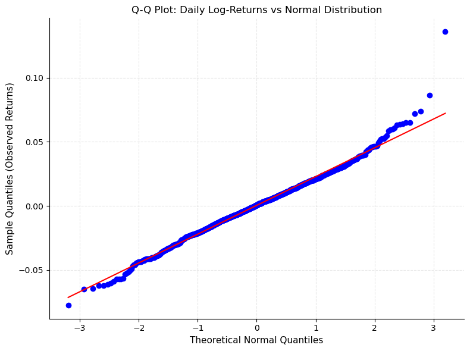
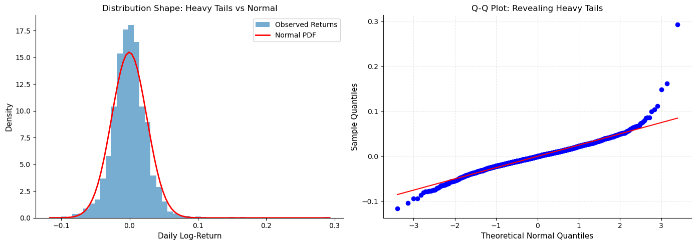
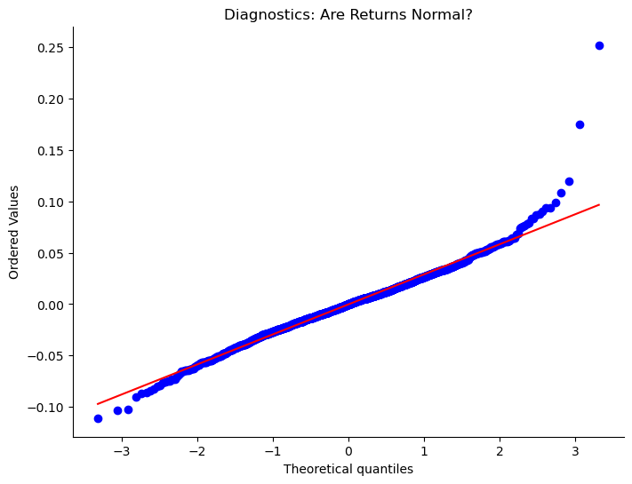
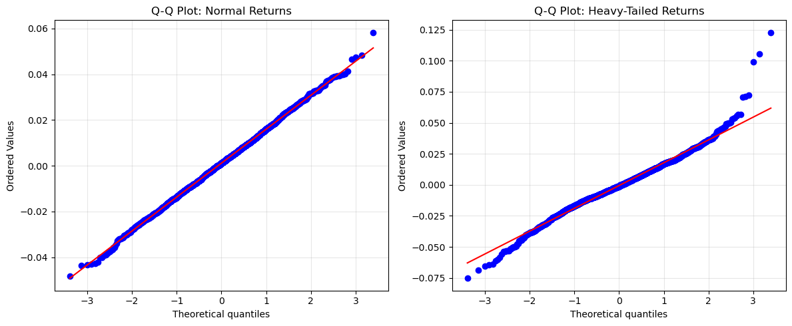

# 금융 자료의 Q-Q 그림: 자산 수익률의 비정규성 탐지

## 개요

Q-Q 그림은 자산 수익률이 정규성에서 벗어나는 정도를 진단하는 데 금융에서 특히 유용하다. 많은 금융 모형이 수익률이 정규분포를 따른다고 가정하지만, 실제 자료는 흔히 **두꺼운 꼬리**와 **치우침**을 보이며 이는 꼬리 위험의 심각한 과소평가로 이어진다. 이 절은 금융 자료의 이런 이탈을 Q-Q 그림으로 시각화하는 데 초점을 맞춘다.

---

## 1. 금융에서 정규성이 중요한 이유

금융 모형은 분포 가정에 크게 기댄다.

- **옵션 가격결정**(Black-Scholes)은 자산 가격이 대수정규분포를 따른다고 가정하며, 이는 로그수익률이 정규분포를 따른다는 것과 동등하다
- **위험가치(VaR)**와 **기대손실(ES)**은 꼬리 거동에 대한 가정에 의존한다
- **포트폴리오 최적화**는 다변량 정규성을 가정하는 분산-공분산 접근을 쓴다

실제 수익률이 정규성에서 벗어나면 이 모형들은 큰 손실의 확률을 체계적으로 과소평가하며, 특히 시장이 스트레스를 받는 시기에 그렇다.

---

## 2. 실제 예: Netflix(NFLX) 로그수익률

Netflix 주식은 정규가 아닌 금융 수익률의 훌륭한 사례이다. 다음 보기는 종가로 계산한 일간 로그수익률을 쓴다.

<div class="exbox" markdown>

**보기 1.** <span class="diff easy" title="쉬움"></span> 두꺼운 꼬리는 Q-Q 그림의 어디에 나타나는가. 넷플릭스 일간 로그수익률을 흉내 내어 $0.02 \cdot t_8$에서 $n = 1000$개를 뽑고 정규 Q-Q 그림을 그린다.

**(1)** 적합선의 기울기와 절편이 무엇을 추정하는지 수로 확인하시오.

**(2)** 가운데($\lvert q\rvert < 1$)와 꼬리($\lvert q\rvert > 2$)의 잔차를 재어 어디가 얼마나 벗어나는지 적으시오. 양쪽 꼬리의 벗어남은 **대칭인가**?

**(3)** 표본 초과첨도를 자료를 만든 분포 $t_8$의 이론값과 비교하시오.

</div>

??? success "풀이"

    **(1)** 과 **(2)** 는 유도할 식이 없는 읽기 문제다. **(3)** 만 이론값이 있다. $t_\nu$의 초과첨도는 $\nu > 4$에서

    $$
    \gamma_2 = \frac{6}{\nu - 4}
    $$

    이므로 $\nu = 8$이면 $\gamma_2 = 6/4 = 1.5$이다. 척도를 $0.02$배 해도 첨도는 변하지 않는다. 분산은 $\nu/(\nu-2) = 4/3$이므로 표준편차의 이론값은 $0.02\sqrt{4/3} = 0.023094$다.

    ```python
    import numpy as np
    import pandas as pd
    import matplotlib.pyplot as plt
    from scipy import stats

    # 넷플릭스 일별 로그수익률을 흉내 낸 자료다. 자유도 8 인 t 를 썼는데,
    # 실제 수익률은 이보다도 꼬리가 두껍다.
    np.random.seed(42)
    returns = np.random.standard_t(df=8, size=1000) * 0.02

    # 정규분포와 견주는 Q-Q 그림
    fig, ax = plt.subplots(figsize=(8, 6))
    stats.probplot(returns, dist="norm", plot=ax)

    ax.set_title("Q-Q Plot: Daily Log-Returns vs Normal Distribution", fontsize=12)
    ax.set_xlabel("Theoretical Normal Quantiles", fontsize=11)
    ax.set_ylabel("Sample Quantiles (Observed Returns)", fontsize=11)

    ax.spines[["top", "right"]].set_visible(False)
    ax.grid(True, alpha=0.3, linestyle='--')

    plt.tight_layout()
    plt.show()
    ```

    

    그림에서 읽을 수치를 따로 찍어 둔다.

    ```python
    osm, osr = stats.probplot(returns, dist="norm", fit=False)
    b, a = np.polyfit(osm, osr, 1)
    resid = osr - (a + b * osm)

    print(f"절편 a = {a:.6f}   표본평균 = {returns.mean():.6f}")
    print(f"기울기 b = {b:.6f}   표본표준편차 = {returns.std(ddof=1):.6f}")
    print(f"이론 표준편차 0.02*sqrt(4/3) = {0.02 * np.sqrt(4 / 3):.6f}")

    for lo, hi, lab in [(0, 1, "|q| < 1"), (2, 99, "|q| > 2")]:
        m = (np.abs(osm) > lo) & (np.abs(osm) < hi)
        print(f"{lab}: {m.sum()}점, 최대 절대잔차 {np.abs(resid[m]).max():.5f}")

    print(f"최솟값 {osr[0]:.4f}  적합선 {a + b * osm[0]:.4f}  잔차 {resid[0]:.4f}")
    print(f"최댓값 {osr[-1]:.4f}  적합선 {a + b * osm[-1]:.4f}  잔차 {resid[-1]:.4f}")
    print(f"g1 = {stats.skew(returns):.4f}   G1 = {stats.skew(returns, bias=False):.4f}")
    print(f"g2 = {stats.kurtosis(returns):.4f}   G2 = "
          f"{stats.kurtosis(returns, bias=False):.4f}   이론 = {6 / (8 - 4):.4f}")

    z = (returns - returns.mean()) / returns.std(ddof=1)
    for k in (3, 4):
        print(f"|z| > {k}: 관측 {np.sum(np.abs(z) > k)}개, "
              f"정규 기대 {1000 * 2 * stats.norm.sf(k):.3f}개")
    ```

    출력:

    ```text
    절편 a = 0.000376   표본평균 = 0.000376
    기울기 b = 0.022470   표본표준편차 = 0.022574
    이론 표준편차 0.02*sqrt(4/3) = 0.023094
    |q| < 1: 682점, 최대 절대잔차 0.00191
    |q| > 2: 46점, 최대 절대잔차 0.06371
    최솟값 -0.0774  적합선 -0.0715  잔차 -0.0060
    최댓값 0.1359  적합선 0.0722  잔차 0.0637
    g1 = 0.2257   G1 = 0.2261
    g2 = 1.6429   G2 = 1.6572   이론 = 1.5000
    |z| > 3: 관측 5개, 정규 기대 2.700개
    |z| > 4: 관측 1개, 정규 기대 0.063개
    ```

    **(1) 절편은 평균을, 기울기는 표준편차를 추정한다.** 절편 $a = 0.000376$은 표본평균과 소수 여섯째 자리까지 같다. 최소제곱선이 $(\bar q, \bar x) = (0, \bar x)$를 지나고 $\bar q = 0$이므로 **절편이 표본평균과 정확히 일치하는 것은 우연이 아니다.** 기울기 $b = 0.022470$은 표본표준편차 $0.022574$에 $0.5\%$ 안에서 맞고, 이론값 $0.023094$보다는 $2.7\%$ 작다. 기울기가 표준편차와 완전히 같지는 않다. 최소제곱 기울기는 $\sum q_i x_{(i)} / \sum q_i^2$인데 $\sum q_i^2 / n$이 1 에 조금 못 미치기 때문이다.

    **(2) 벗어나는 것은 꼬리뿐이고, 대칭이 아니다.** $\lvert q\rvert < 1$인 682점의 최대 절대잔차는 $0.00191$로 표본표준편차의 $8\%$에 지나지 않는다. **자료의 68%는 직선에 붙어 있다.** 반면 $\lvert q\rvert > 2$인 46점에서는 최대 $0.0637$까지 벌어진다.

    그런데 양쪽의 크기가 전혀 다르다.

    | 끝점 | 관측값 | 적합선 | 잔차 |
    |---|---|---|---|
    | 최솟값 | $-0.0774$ | $-0.0715$ | $-0.0060$ |
    | 최댓값 | $+0.1359$ | $+0.0722$ | $+0.0637$ |

    오른쪽 끝의 벗어남이 왼쪽 끝의 **10.7배**다. $t_8$은 대칭분포이므로 이것은 모집단의 성질이 아니라 **이 한 번의 추출에서 오른쪽 극단값이 유난히 크게 나온 결과**다. 표본왜도도 $g_1 = 0.226$으로 0 이 아니다. 그러므로 "두꺼운 꼬리는 Q-Q 그림에서 대칭적인 S자로 나타난다"는 말을 그림 한 장에서 확인하려 들면 안 된다. **대칭은 모집단의 성질이고, 그림은 표본 하나를 보여 준다.**

    **(3) 표본 초과첨도는 이론값보다 크다.** 보정판 $G_2 = 1.657$, 보정하지 않은 판본 $g_2 = 1.643$이고 이론값은 $1.5$다(`scipy.stats.kurtosis`는 기본이 `fisher=True`이므로 초과첨도를, `bias=True`이므로 $g_2$를 준다). $11\%$ 차이는 몬테카를로 오차 범위다. 네제곱 적률의 추정은 매우 불안정해서 $n = 1000$에서도 이 정도 흔들린다.

    꼬리의 초과를 개수로 보면 더 직관적이다. $\lvert z\rvert > 3$이 5개(정규 기대 2.7개), $\lvert z\rvert > 4$가 1개(정규 기대 $0.063$개)다. **정규 세계라면 $n = 1000$ 표본을 16개쯤 모아야 네 시그마 사건 하나를 볼 수 있는데, 여기서는 표본 하나에서 나왔다.** 이것이 꼬리 위험 과소평가의 정체다.

    **이 그림이 말해 주지 않는 것**은 "그 벗어남이 유의한가"다. $q = 3.2$ 자리의 점 하나가 선에서 $0.064$ 떨어져 있다는 사실만으로는 판정할 수 없다. 극단 순서통계량은 정규 자료에서도 변동이 크다. 그 판정에는 신뢰띠나 형식적 검정이 필요하다 — 이 자료에서는 샤피로–윌크가 $p = 2.4\times10^{-7}$, 자르크–베라가 $p = 5.4\times10^{-27}$로 둘 다 압도적으로 기각한다.

---

## 3. 금융 자료의 Q-Q 그림 해석

### 완전한 정규성

자료가 정확히 정규분포를 따르면 Q-Q 그림의 모든 점이 45도 기준선을 따라 촘촘히 모인다.

### 두꺼운 꼬리(금융의 현실)

실제 주식 수익률은 **두꺼운 꼬리**를 보인다. 왼쪽 꼬리(큰 음의 수익률, 곧 손실)와 오른쪽 꼬리(큰 양의 수익률, 곧 이익) 모두 정규분포가 예측하는 것보다 많은 관측값을 담는다.

**시각적 특징:** Q-Q 그림이 오른쪽 꼬리에서 "위로 휘고" 왼쪽 꼬리에서 "아래로 휜다". 그래서 S자 패턴이 만들어진다.

<div class="exbox" markdown>

**보기 2.** <span class="diff easy" title="쉬움"></span> 히스토그램이 감추고 Q-Q 그림이 드러내는 것. $0.02 \cdot t_5$에서 $n = 2000$개를 뽑아 히스토그램(50칸)과 정규 Q-Q 그림을 나란히 그린다.

**(1)** 왼쪽 히스토그램에서 **보이는 것**과 **보이지 않는 것**을 가려내시오. 봉우리 높이와 꼬리 칸의 높이를 수로 재어 왜 꼬리가 보이지 않는지 설명하시오.

**(2)** 오른쪽 Q-Q 그림이 그 보이지 않던 것을 어떻게 드러내는가. 가운데와 꼬리의 잔차를 수로 적으시오.

**(3)** 표본 초과첨도가 $10.42$로 나왔다. $t_5$의 이론값은 $6$이다. 이 차이를 어떻게 읽어야 하는가.

</div>

??? success "풀이"

    $t_\nu$의 이론값은 $\nu > 4$에서 초과첨도 $6/(\nu-4)$, $\nu > 3$에서 왜도 $0$, 분산 $\nu/(\nu-2)$다. $\nu = 5$이므로 초과첨도 $6$, 왜도 $0$, 표준편차 $0.02\sqrt{5/3} = 0.025820$이다. **(1)** 과 **(2)** 는 유도할 식이 없는 읽기 문제이고, **(3)** 만 이론값과 견주는 문제다.

    ```python
    import numpy as np
    import pandas as pd
    import matplotlib.pyplot as plt
    from scipy import stats

    # 히스토그램과 Q-Q 그림을 나란히 놓아, 같은 자료에서 둘이 무엇을 보여
    # 주는지 견준다. 히스토그램은 가운데를, Q-Q 그림은 꼬리를 말한다.
    np.random.seed(42)
    df = 5  # 자유도가 작을수록 꼬리가 두껍다
    heavy_tailed_returns = stats.t.rvs(df=df, scale=0.02, size=2000)

    fig, (ax1, ax2) = plt.subplots(1, 2, figsize=(14, 5))

    # 왼쪽: 히스토그램. 가운데가 정규보다 뾰족하지만, 꼬리의 차이는
    # 자료가 드물어 거의 보이지 않는다.
    ax1.hist(heavy_tailed_returns, bins=50, density=True, alpha=0.6, label='Observed Returns')
    x = np.linspace(heavy_tailed_returns.min(), heavy_tailed_returns.max(), 100)
    ax1.plot(x, stats.norm.pdf(x, loc=heavy_tailed_returns.mean(),
                                scale=heavy_tailed_returns.std()),
             'r-', lw=2, label='Normal PDF')
    ax1.set_xlabel('Daily Log-Return', fontsize=11)
    ax1.set_ylabel('Density', fontsize=11)
    ax1.set_title('Distribution Shape: Heavy Tails vs Normal', fontsize=12)
    ax1.legend()
    ax1.spines[["top", "right"]].set_visible(False)

    # 오른쪽: Q-Q 그림. 히스토그램이 감춘 꼬리의 차이가 양끝의 휘어짐으로
    # 또렷하게 드러난다.
    stats.probplot(heavy_tailed_returns, dist="norm", plot=ax2)
    ax2.set_title("Q-Q Plot: Revealing Heavy Tails", fontsize=12)
    ax2.set_xlabel('Theoretical Normal Quantiles', fontsize=11)
    ax2.set_ylabel('Sample Quantiles', fontsize=11)
    ax2.spines[["top", "right"]].set_visible(False)
    ax2.grid(True, alpha=0.3, linestyle='--')

    plt.tight_layout()
    plt.show()
    ```

    

    두 그림에서 읽을 수치를 따로 찍어 둔다.

    ```python
    r = heavy_tailed_returns
    s = r.std(ddof=1)

    # 왼쪽 그림: 히스토그램의 봉우리와 꼬리 칸을 수로 잰다.
    dens, edges = np.histogram(r, bins=50, density=True)
    print(f"칸 폭 {edges[1] - edges[0]:.5f}   자료 범위 [{r.min():.4f}, {r.max():.4f}]")
    print(f"가장 높은 칸의 밀도 {dens.max():.3f}  vs  정규 봉우리 "
          f"{stats.norm.pdf(r.mean(), r.mean(), r.std()):.3f}")
    print(f"양 끝 칸의 밀도: 왼쪽 {dens[0]:.3f}  오른쪽 {dens[-1]:.3f}"
          f"  (봉우리의 {dens[0] / dens.max():.4f}배)")
    for k in (3, 4):
        n_out = np.sum(np.abs(r - r.mean()) > k * s)
        print(f"|x - 평균| > {k}s: 관측 {n_out}개, 정규 기대 "
              f"{2000 * 2 * stats.norm.sf(k):.2f}개")

    # 오른쪽 그림: Q-Q 적합선에서의 잔차.
    osm, osr = stats.probplot(r, dist="norm", fit=False)
    b, a = np.polyfit(osm, osr, 1)
    resid = osr - (a + b * osm)
    print(f"\n적합선 절편 {a:.6f}  기울기 {b:.6f}  (표본표준편차 {s:.6f})")
    for lo, lab in [(1, "|q| < 1"), (2, "|q| > 2")]:
        m = np.abs(osm) < lo if lo == 1 else np.abs(osm) > lo
        print(f"{lab}: {m.sum()}점, 최대 절대잔차 {np.abs(resid[m]).max():.5f}")
    print(f"최솟값 {osr[0]:.4f}  적합선 {a + b * osm[0]:.4f}  잔차 {resid[0]:.4f}")
    print(f"최댓값 {osr[-1]:.4f}  적합선 {a + b * osm[-1]:.4f}  잔차 {resid[-1]:.4f}")

    print(f"\ng1 = {stats.skew(r):.4f}   G1 = {stats.skew(r, bias=False):.4f}   이론 = 0")
    print(f"g2 = {stats.kurtosis(r):.4f}   G2 = {stats.kurtosis(r, bias=False):.4f}"
          f"   이론 = {6 / (5 - 4):.1f}")
    ```

    출력:

    ```text
    칸 폭 0.00820   자료 범위 [-0.1170, 0.2932]
    가장 높은 칸의 밀도 18.043  vs  정규 봉우리 15.483
    양 끝 칸의 밀도: 왼쪽 0.061  오른쪽 0.061  (봉우리의 0.0034배)
    |x - 평균| > 3s: 관측 18개, 정규 기대 5.40개
    |x - 평균| > 4s: 관측 7개, 정규 기대 0.13개

    적합선 절편 -0.000550  기울기 0.025061  (표본표준편차 0.025772)
    |q| < 1: 1366점, 최대 절대잔차 0.00339
    |q| > 2: 90점, 최대 절대잔차 0.20869
    최솟값 -0.1170  적합선 -0.0856  잔차 -0.0314
    최댓값 0.2932  적합선 0.0845  잔차 0.2087

    g1 = 0.8632   G1 = 0.8639   이론 = 0
    g2 = 10.4205   G2 = 10.4497   이론 = 6.0
    ```

    **(1) 히스토그램이 보여 주는 것은 봉우리뿐이다.** 가장 높은 칸의 밀도가 $18.043$이고 같은 평균·표준편차의 정규 봉우리는 $15.483$이니, 가운데가 정규보다 $17\%$ 뾰족하다. 이것은 눈에 보인다.

    그런데 **꼬리 칸의 높이는 $0.061$이다.** 봉우리의 $0.0034$배, 곧 **1/296**이다. 그림의 세로축이 0 에서 18 까지인데 꼬리 칸을 그리면 300 분의 1 화소가 된다. 봉우리를 한 화면에 담는 순간 꼬리는 선 하나로 눌려 사라지고, **그 칸이 정확히 0 인지 한 개 있는지 분간할 길이 없다.** 그러나 그 보이지 않는 칸들에 실제로 무엇이 있는가 하면, $3s$ 밖에 18개(정규 기대 $5.4$개), $4s$ 밖에 7개(정규 기대 $0.13$개)다. **$4s$ 밖의 사건이 정규 예측의 54배인데 히스토그램에는 흔적이 없다.** 위험 관리에서 중요한 것이 전부 이 보이지 않는 구간에 있다.

    선형 세로축은 꼬리를 보여 주는 도구가 아니다. 보려면 로그 축을 쓰거나 구간을 좁혀야 한다.

    **(2) Q-Q 그림은 세로축을 꼬리에 내준다.** 적합선은 $\hat y = -0.000550 + 0.025061\,q$다. $\lvert q\rvert < 1$인 1366점의 최대 절대잔차는 $0.00339$로 표본표준편차의 $13\%$에 지나지 않는다. 그런데 $\lvert q\rvert > 2$인 90점에서는 최대 $0.2087$까지 간다. **가운데 대 꼬리의 잔차 비가 62배**다.

    끝점을 보면 더 분명하다. 최댓값 $0.2932$는 적합선이 예측하는 $0.0845$의 **3.47배**다. 히스토그램에서 밀도 $0.061$짜리 보이지 않는 칸이었던 그 한 점이, Q-Q 그림에서는 적합선 위로 $0.21$ 올라간 가장 눈에 띄는 점이 된다. 두 그림이 같은 자료를 그렸는데 한쪽이 감춘 것을 다른 쪽이 가장 크게 그린다. **Q-Q 그림의 가로축은 분위수라 꼬리 쪽이 늘어나고, 세로축은 관측값 그대로라 극단값이 눌리지 않는다.** 이것이 꼬리 진단에 Q-Q 그림을 쓰는 이유다.

    왼쪽 끝은 그만큼은 아니다. 최솟값 $-0.1170$의 잔차가 $-0.0314$로 오른쪽 끝의 $1/6.6$이다. $t_5$는 대칭분포이니 이 비대칭은 모집단의 성질이 아니라 **이 한 번의 추출에서 오른쪽 극단값이 유난히 크게 나온 결과**다. 표본왜도 $g_1 = 0.863$도 이론값 $0$에서 멀다.

    **(3) $10.42$와 $6$의 차이는 추정 오차이고, 그 오차가 매우 크다는 것이 요점이다.** 먼저 판본을 밝혀야 한다. `scipy.stats.kurtosis`는 기본이 `fisher=True`이므로 초과첨도를, `bias=True`이므로 보정하지 않은 $g_2$를 준다. 여기서는 $g_2 = 10.4205$, 보정판 $G_2 = 10.4497$이고 둘의 차이는 무의미하다.

    $73\%$나 되는 이 차이를 "자료가 $t_5$가 아니다"로 읽으면 안 된다. $g_2$의 표집분포가 $t_5$에서 어떤 모양인지 모의실험으로 보면 된다.

    ```python
    rng = np.random.default_rng(7)
    for nu in (5, 12):
        g2 = np.array([stats.kurtosis(stats.t.rvs(df=nu, size=2000, random_state=rng))
                       for _ in range(2000)])
        print(f"t_{nu}  이론 {6 / (nu - 4):.2f}  |  g2 중앙값 {np.median(g2):.2f}"
              f"  평균 {g2.mean():.2f}  5~95% [{np.percentile(g2, 5):.2f}, "
              f"{np.percentile(g2, 95):.2f}]  최대 {g2.max():.1f}")
    ```

    출력:

    ```text
    t_5  이론 6.00  |  g2 중앙값 3.24  평균 4.51  5~95% [1.75, 10.42]  최대 197.5
    t_12  이론 0.75  |  g2 중앙값 0.69  평균 0.74  5~95% [0.33, 1.29]  최대 5.0
    ```

    $t_5$에서 $g_2$의 **중앙값이 $3.24$로 참값 $6$의 절반밖에 안 되고**, 90% 구간이 $[1.75,\ 10.42]$로 벌어지며, 2000번 중 최댓값은 $197.5$까지 올라갔다. 관측된 $10.42$는 꼭 95 백분위수다. 곧 **이상한 값이 아니라 흔히 일어나는 값**이다.

    까닭은 $g_2$의 점근분산이 8차 적률 $\mu_8$을 품는데 $t_\nu$는 $\nu$차 이상의 적률을 갖지 않기 때문이다. $\nu = 5$면 $\mu_8 = \infty$이므로 $g_2$에 중심극한정리를 적용할 수 없고, 표집분포가 오른쪽으로 심하게 늘어진다. 대비를 위해 $\nu = 12$를 보면($\mu_8 < \infty$) 중앙값 $0.69$에 90% 구간 $[0.33, 1.29]$로 얌전하다. 같은 이유로 $g_1$의 점근분산은 $\mu_6$을 품으므로 $t_5$에서는 왜도 추정도 믿을 수 없다 — 표본 $g_1 = 0.863$이 이론값 0 에서 멀리 떨어진 것이 그 결과다.

    **꼬리가 두꺼운 자료에서는 꼬리를 재는 통계량 자체가 가장 불안정하다.** 보고된 첨도 하나를 소수점까지 믿지 말고 Q-Q 그림을 함께 보아야 하는 이유가 이것이다.

---

## 4. 비정규성을 무시할 때의 결과

### 꼬리 위험의 과소평가

정규분포의 **첨도**는 3이다. 실제 금융 수익률의 **초과첨도는 대체로 1보다 크다**. 곧 꼬리가 정규보다 두껍다는 뜻이다.

**예:** 정규분포가 5% 손실의 확률을 0.1%로 예측하는데 실제 두꺼운 꼬리 수익률에서는 그 손실이 0.5% 확률로 일어난다면, 5배를 과소평가한 것이다.

### 위험 관리에 대한 함의

- 정규성에 기초한 **VaR 모형**은 99번째나 99.9번째 백분위수에서 손실을 과소평가한다
- 정규 가정에 기초한 **헤지 전략**은 포트폴리오를 꼬리 사건에 취약하게 남긴다
- 정규 가정 위에 세운 **자본 요건**(예: Basel III)은 불충분할 수 있다

### 얼마나 과소평가하는가 — 분위수에 따라 다르다


정규 모형과 두꺼운 꼬리 모형의 차이는 극단 분위수에서 결정적으로 커진다. 포트폴리오의 수준 $\alpha$ 위험가치(VaR)는

$$
\text{VaR}_\alpha = -\mu - \sigma\, q_\alpha,
$$

여기서 $q_\alpha$는 혁신항 분포의 $\alpha$ 분위수이다.

여기서 **$\sigma$와 $q_\alpha$를 어떻게 짝지을지**가 핵심이다. 두 가지 계산을 구분해야 한다.

**(1) 원분위수 비교(잘못된 방식).** $\Phi^{-1}(0.01) = -2.326$과 $t_6^{-1}(0.01) = -3.143$을 그대로 비교하면 35% 차이가 난다. 그러나 $t_6$는 표준편차가 $1.2247$이므로 이 둘은 같은 단위가 아니다. 사과와 오렌지를 비교하는 셈이다.

**(2) 표준화 분위수 비교(올바른 방식).** 실무에서는 변동성 $\sigma$를 과거 자료에서 추정하므로, 혁신항 분포는 반드시 **분산 1로 표준화**해야 한다. 표준화된 $t_6$의 1% 분위수는

$$
\frac{t_6^{-1}(0.01)}{\sqrt{6/4}} = \frac{-3.1427}{1.2247} = -2.566.
$$

정규의 $-2.326$보다 **10.3%** 클 뿐이다. 35%가 아니다.

$\alpha$에 따라 이 비율이 어떻게 달라지는지 보자(표준화 기준).

| $\alpha$ | $\Phi^{-1}(\alpha)$ | 표준화 $t_6^{-1}(\alpha)$ | 비율 | 표준화 $t_5^{-1}(\alpha)$ | 비율 |
|---|---|---|---|---|---|
| 0.05 | $-1.645$ | $-1.586$ | **0.96** | $-1.561$ | **0.95** |
| 0.01 | $-2.326$ | $-2.566$ | 1.10 | $-2.607$ | 1.12 |
| 0.001 | $-3.090$ | $-4.253$ | 1.38 | $-4.565$ | 1.48 |

두 가지가 드러난다.

- **$\alpha = 0.05$에서는 정규 모형이 오히려 VaR를 과대추정한다**(비율 $< 1$). 분산을 맞춘 $t$ 분포는 중앙에 질량이 더 몰려 있어 5% 분위수가 정규보다 **덜** 극단적이다. 꼬리가 두꺼운 대가로 어깨가 얇아지는 것이다.
- 두꺼운 꼬리의 대가는 **극단 분위수에서만** 나타난다. $\alpha = 0.001$(약 4년에 한 번)에서야 40~50% 차이가 된다.

실무적 결론: "정규 모형이 꼬리 위험을 과소평가한다"는 말은 옳지만, 그 크기는 어느 분위수를 보느냐에 크게 의존한다. 표준적인 1% VaR에서는 10% 남짓이고, Basel III가 요구하는 극단 수준에서 비로소 심각해진다.

---

---

## 5. 실전 절차: 수익률 분포 진단하기

<div class="exbox" markdown>

**보기 3.** <span class="diff easy" title="쉬움"></span> 수익률 진단 네 단계와 엇갈리는 세 검정. $0.025 \cdot t_6$에서 $n = 1500$개를 뽑아 요약통계 · 검정 셋 · Q-Q 그림의 순서로 진단한다. 결과는 K-S 가 $p = 0.0710$으로 기각하지 못하는데 자르크–베라는 $p \approx 10^{-309}$, 앤더슨–달링은 $A^2 = 3.65$로 1% 임계값 $1.089$를 크게 넘는다.

**(1)** 자르크–베라 통계량의 닫힌 꼴

$$
\mathrm{JB} = \frac{n}{6}\Bigl(g_1^2 + \frac{g_2^2}{4}\Bigr)
$$

에 출력된 왜도·첨도를 넣어 손으로 계산하고, `scipy.stats.jarque_bera`가 준 값과 맞는지 확인하시오. 어느 판본의 왜도·첨도를 넣어야 하는가.

**(2)** K-S 가 기각하지 못하는 것은 **검정력이 약해서가 아니다.** 이 코드의 K-S 호출이 어떤 잘못을 저지르고 있는지 밝히고, 그 잘못이 검정의 **크기**를 얼마나 망가뜨리는지 모의실험으로 재시오.

</div>

??? success "풀이"

    ```python
    import numpy as np
    import pandas as pd
    import matplotlib.pyplot as plt
    from scipy import stats

    # 1단계: 자료를 읽거나 만든다.
    np.random.seed(42)
    returns = np.random.standard_t(df=6, size=1500) * 0.025

    # 2단계: 요약통계. 왜도와 초과첨도가 정규에서 얼마나 벗어났는지 먼저 본다.
    mean_ret = returns.mean()
    std_ret = returns.std()
    skewness = stats.skew(returns)
    kurtosis = stats.kurtosis(returns)  # Excess kurtosis

    print(f"Mean:     {mean_ret:.4f}")
    print(f"Std Dev:  {std_ret:.4f}")
    print(f"Skewness: {skewness:.4f}")
    print(f"Ex. Kurtosis: {kurtosis:.4f}")

    # 3단계: 검정 셋. KS 는 모수를 자료에서 추정해 넘겼으므로 p-값이
    # 실제보다 크게 나온다는 점을 감안해 읽어야 한다.
    _, p_ks = stats.kstest(returns, 'norm', args=(mean_ret, std_ret))
    _, p_jb = stats.jarque_bera(returns)

    # anderson() 은 (통계량, 기각값, 유의수준) 을 돌려준다. p-값은 주지 않는다
    ad_result = stats.anderson(returns, dist='norm')

    print(f"\nKolmogorov-Smirnov test p-value: {p_ks:.4f}")
    print(f"Jarque-Bera test p-value: {p_jb:.4g}")
    print(f"Anderson-Darling statistic: {ad_result.statistic:.4f}")
    print(f"  critical values (15/10/5/2.5/1%): {ad_result.critical_values}")

    # 4단계: 그림으로 마무리. 검정이 기각했다면 어디가 어긋났는지를 여기서 본다.
    fig, ax = plt.subplots(figsize=(8, 6))
    stats.probplot(returns, dist="norm", plot=ax)
    ax.set_title("Diagnostics: Are Returns Normal?", fontsize=12)
    ax.spines[["top", "right"]].set_visible(False)
    plt.show()
    ```

    출력:

    ```text
    Mean:     -0.0002
    Std Dev:  0.0297
    Skewness: 0.5411
    Ex. Kurtosis: 4.6396

    Kolmogorov-Smirnov test p-value: 0.0710
    Jarque-Bera test p-value: 9.067e-309
    Anderson-Darling statistic: 3.6529
      critical values (15/10/5/2.5/1%): [0.574 0.654 0.785 0.916 1.089]
    ```

    

    **(1) 넣어야 하는 것은 보정하지 않은 $g_1$, $g_2$다.** 자르크–베라의 원래 정의가 표본적률비

    $$
    g_1 = \frac{m_3}{m_2^{3/2}}, \qquad g_2 = \frac{m_4}{m_2^{2}} - 3,
        \qquad m_k = \frac{1}{n}\sum_{i=1}^n (x_i - \bar x)^k
    $$

    위에 세워져 있기 때문이다. 출력된 $0.5411$과 $4.6396$이 바로 그 판본이다 — `scipy.stats.skew`는 기본이 `bias=True`이고 `kurtosis`는 기본이 `bias=True`, `fisher=True`이므로 $g_1$과 초과첨도 $g_2$를 준다. 보정판 $G_1$, $G_2$를 넣으면 값이 어긋난다.

    손으로 계산하면

    $$
    \mathrm{JB} = \frac{1500}{6}\Bigl(0.541087^2 + \frac{4.639645^2}{4}\Bigr)
        = 250\,(0.292775 + 5.381576) = 250 \times 5.674352 = 1418.59
    $$

    이다. $\chi^2_2$의 생존함수는 $\exp(-x/2)$라는 닫힌 꼴이므로 $p = e^{-709.29} = 9.07\times10^{-309}$다. **이 값이 배정도 부동소수의 바닥($\approx 5\times10^{-324}$) 바로 위라는 점을 눈여겨볼 만하다.** $n$이나 첨도가 조금만 더 크면 $p$가 그냥 $0.0$으로 찍힌다.

    ```python
    n = len(returns)
    g1 = stats.skew(returns)          # bias=True 가 기본 -> g1
    g2 = stats.kurtosis(returns)      # bias=True, fisher=True 가 기본 -> g2
    JB = n / 6 * (g1 ** 2 + g2 ** 2 / 4)

    print(f"g1 = {g1:.6f}   g2 = {g2:.6f}")
    print(f"닫힌 꼴 JB      = {JB:.4f}")
    print(f"scipy jarque_bera = {stats.jarque_bera(returns)[0]:.4f}")
    print(f"chi2_2 꼬리확률  = {stats.chi2.sf(JB, 2):.4g}")

    # 보정판을 넣으면 어긋난다.
    G1 = stats.skew(returns, bias=False)
    G2 = stats.kurtosis(returns, bias=False)
    print(f"보정판으로 계산하면 JB = {n / 6 * (G1 ** 2 + G2 ** 2 / 4):.4f}  (어긋남)")
    ```

    출력:

    ```text
    g1 = 0.541087   g2 = 4.639645
    닫힌 꼴 JB      = 1418.5882
    scipy jarque_bera = 1418.5882
    chi2_2 꼬리확률  = 9.067e-309
    보정판으로 계산하면 JB = 1430.0756  (어긋남)
    ```

    **소수 넷째 자리까지 일치한다.** 보정판을 넣으면 $1430.08$로 $0.8\%$ 어긋난다. 여기서는 결론이 바뀌지 않지만, 경계 근처의 자료에서는 판본 하나가 판정을 뒤집는다.

    **(2) 잘못은 `args=(mean_ret, std_ret)`에 있다.** 콜모고로프–스미르노프 검정의 귀무분포는 **$F_0$가 자료와 무관하게 미리 정해져 있을 때** 유도된 것이다. 그런데 이 코드는 평균과 표준편차를 **같은 자료에서 추정해** 넣었다. 추정된 정규분포는 그 자료에 가장 잘 맞도록 맞춰진 것이므로 경험분포함수와의 최대 거리 $D_n$이 체계적으로 작아지고, 표준 임계값을 그대로 쓰면 검정이 **지나치게 보수적**이 된다.

    얼마나 보수적인가. 참으로 정규인 자료에 같은 호출을 되풀이해 $p < 0.05$가 되는 비율을 재면 그것이 실제 크기다.

    ```python
    rng = np.random.default_rng(3)
    n, B = 1500, 4000
    D = np.empty(B)
    p = np.empty(B)
    for i in range(B):
        x = rng.standard_normal(n)          # 귀무가설이 참인 자료
        D[i], p[i] = stats.kstest(x, 'norm', args=(x.mean(), x.std()))

    print(f"명목 0.05 인데 실제 기각률 = {np.mean(p < 0.05):.5f}"
          f"  ({np.sum(p < 0.05)}/{B})")
    print(f"명목 0.10 인데 실제 기각률 = {np.mean(p < 0.10):.5f}")
    print(f"D 의 참 95 백분위수   = {np.percentile(D, 95):.5f}")
    print(f"표준 KS 5% 임계값      = {1.358 / np.sqrt(n):.5f}")
    print(f"릴리포스 임계 근사    = {0.886 / np.sqrt(n):.5f}")
    print(f"관측 D = 0.033246 의 백분위수 = {100 * np.mean(D < 0.033246):.3f}")
    ```

    출력:

    ```text
    명목 0.05 인데 실제 기각률 = 0.00025  (1/4000)
    명목 0.10 인데 실제 기각률 = 0.00100
    D 의 참 95 백분위수   = 0.02317
    표준 KS 5% 임계값      = 0.03506
    릴리포스 임계 근사    = 0.02288
    관측 D = 0.033246 의 백분위수 = 99.925
    ```

    **명목 5% 검정의 실제 크기가 $0.00025$다.** 4000번 중 단 한 번만 기각했다(그러니 이 추정값 자체는 거칠다 — 표준오차가 $\sqrt{0.00025 \times 0.99975/4000} \approx 0.00025$로 추정값과 같은 크기다). 명목 10% 수준에서도 $0.001$로 100배 작다. 자릿수로 보아 **이 검정은 사실상 아무것도 기각하지 않는다.**

    임계값을 견주면 까닭이 한눈에 보인다. 모수를 추정했을 때 $D_n$의 참 95 백분위수는 $0.02317$인데 표준 임계값은 $0.03506$이다. **1.5배나 높은 문턱을 쓰고 있다.** 그리고 참 임계값 $0.02317$은 릴리포스 근사 $0.886/\sqrt{n} = 0.02288$과 $1.3\%$ 안에서 맞는다 — 모의실험이 릴리포스 임계값을 다시 유도해 낸 셈이다.

    관측된 $D = 0.033246$을 올바른 귀무분포에 대고 재면 **99.925 백분위수**, 곧 릴리포스 $p \approx 0.0008$이다. **같은 통계량이 같은 자료에서 "기각 못 함($p = 0.071$)"에서 "강하게 기각($p \approx 0.0008$)"으로 뒤집힌다.** K-S 가 약한 검정이어서 놓친 것이 아니라 **임계값을 잘못 쓴 것**이다. 올바른 교정은 [릴리포스 검정](../formal_tests/ks_lilliefors.md)이다.

    덧붙여, K-S 통계량은 상한 노름이라 경험분포함수가 가장 빽빽한 **분포의 가운데**에서 최댓값을 잡기 쉽다. 이 자료의 문제는 꼬리인데 K-S 는 그쪽을 거의 보지 않는다. 임계값을 바로잡아도 꼬리에는 앤더슨–달링이나 자르크–베라가 낫다는 뜻이다.

!!! warning "`stats.anderson`은 p값을 돌려주지 않는다"
    `stats.anderson`은 `(statistic, critical_values, significance_level)` 세 값을 담은 결과 객체를 돌려준다. `_, p_ad = stats.anderson(...)`처럼 두 값으로 풀면 `ValueError: too many values to unpack`이 난다. 검정통계량을 임계값과 직접 비교해야 한다.

!!! note "세 검정이 엇갈리는 이유"
    초과첨도 $4.64$로 자료가 명백히 두꺼운 꼬리를 갖는데도 K-S 검정의 $p$값은 $0.071$로 5% 수준에서 기각하지 못한다. 반면 Jarque-Bera는 $p \approx 10^{-309}$로 압도적으로 기각하고 Anderson-Darling 통계량 $3.65$도 1% 임계값 $1.089$를 크게 넘는다.

    이유는 K-S 검정이 자료에서 추정한 평균과 분산을 그대로 꽂아 넣었기 때문이다. 이렇게 하면 검정이 보수적이 되어 $p$값이 지나치게 커진다. 추정된 모수를 보정한 [Lilliefors 검정](../formal_tests/ks_lilliefors.md)을 써야 한다. 또한 K-S 검정은 꼬리보다 분포의 중앙에 민감한데, 여기서 문제가 되는 것은 정확히 꼬리이다.

---

## 6. 비정규성에 대한 조정

### 1. 대안 분포

정규분포 대신 스튜던트 $t$ 분포나 일반화 쌍곡분포를 적합한다.

<div class="exbox" markdown>

**보기 4.** <span class="diff easy" title="쉬움"></span> $t$ 를 적합해 꼬리 두께를 수로 바꾸기. 보기 3 의 `returns`(참값 $\nu = 6$, 척도 $0.025$)에 `scipy.stats.t.fit`을 걸면 $\hat\nu = 6.68$, $\hat{\text{loc}} = -0.000468$, $\hat{\text{scale}} = 0.024562$가 나온다.

**(1)** 적합된 척도 $0.024562$를 표본표준편차 $0.029671$과 바로 견주면 안 된다. 왜 그런가. 올바른 환산식을 적고 수로 확인하시오.

**(2)** $\hat\nu = 6.68$이 참값 $6$에서 $11\%$ 벗어났다. 이것이 걱정할 만한 차이인지 모의실험으로 판정하시오.

</div>

??? success "풀이"

    **(1) `scale` 은 표준편차가 아니다.** `scipy.stats.t`의 모수화는 $X = \text{loc} + \text{scale}\cdot T_\nu$이고 $T_\nu$ 자체의 분산이 1 이 아니다. $\nu > 2$에서

    $$
    \operatorname{Var}(T_\nu) = \frac{\nu}{\nu - 2}
    $$

    이므로

    $$
    \operatorname{sd}(X) = \text{scale}\cdot\sqrt{\frac{\nu}{\nu-2}}
    $$

    이다. 적합값을 넣으면 $0.024562\sqrt{6.6758/4.6758} = 0.029349$로, 표본표준편차 $0.029671$에 $1.1\%$ 안에서 맞는다. **환산을 잊고 $0.0246$과 $0.0297$을 바로 견주면 $17\%$ 어긋난 것처럼 보여 적합이 실패했다고 오판하게 된다.**

    자료를 만든 쪽에서도 같은 관계가 성립한다. 참 척도는 $0.025$이고 참 자유도는 6 이므로 참 표준편차는 $0.025\sqrt{6/4} = 0.030619$다.

    **(2) 걱정할 차이가 아니다.** $\hat\nu$의 표집분포를 모의실험으로 재면 된다.

    ```python
    from scipy.stats import t as student_t

    # 정규가 아니라면 대안 분포를 찾는 것이 다음 걸음이다. t 를 적합하면
    # 자유도가 꼬리 두께를 재는 값이 된다. 작을수록 두껍다.
    df, loc, scale = student_t.fit(returns)
    print(f"Fitted df: {df:.2f} (lower df → heavier tails)")
    ```

    출력:

    ```text
    Fitted df: 6.68 (lower df → heavier tails)
    ```

    ```python
    print(f"적합 df {df:.4f}  loc {loc:.6f}  scale {scale:.6f}")
    print(f"참값   df 6       loc 0        scale 0.025")
    print(f"환산한 표준편차 scale*sqrt(df/(df-2)) = "
          f"{scale * np.sqrt(df / (df - 2)):.6f}")
    print(f"표본표준편차                          = {returns.std(ddof=1):.6f}")
    print(f"참 표준편차 0.025*sqrt(6/4)            = {0.025 * np.sqrt(6 / 4):.6f}")

    # 참 nu = 6 인 자료를 되풀이 적합해 nu-hat 의 표집분포를 본다.
    rng = np.random.default_rng(11)
    fits = np.array([student_t.fit(student_t.rvs(df=6, scale=0.025, size=1500,
                                                 random_state=rng))[:3]
                     for _ in range(400)])
    nu_hat, sc_hat = fits[:, 0], fits[:, 2]
    print(f"\nnu-hat 표집분포 (nu=6, n=1500, 400회)")
    print(f"  중앙값 {np.median(nu_hat):.2f}  평균 {nu_hat.mean():.2f}"
          f"  5~95% [{np.percentile(nu_hat, 5):.2f}, "
          f"{np.percentile(nu_hat, 95):.2f}]  최대 {nu_hat.max():.2f}")
    print(f"  P(nu-hat >= 6.68) = {np.mean(nu_hat >= 6.68):.3f}")
    print(f"scale-hat 표집분포: 중앙값 {np.median(sc_hat):.5f}"
          f"  5~95% [{np.percentile(sc_hat, 5):.5f}, "
          f"{np.percentile(sc_hat, 95):.5f}]")

    # nu 를 5 로 보든 8 로 보든 99% 분위수가 얼마나 달라지는가.
    # 표준편차를 1 로 맞춰 견준다.
    for nu in (5, 8):
        print(f"t_{nu} 의 표준화 99% 분위수 = "
              f"{stats.t.ppf(0.99, nu) / np.sqrt(nu / (nu - 2)):.3f}")
    print(f"정규의 99% 분위수            = {stats.norm.ppf(0.99):.3f}")
    ```

    출력:

    ```text
    적합 df 6.6758  loc -0.000468  scale 0.024562
    참값   df 6       loc 0        scale 0.025
    환산한 표준편차 scale*sqrt(df/(df-2)) = 0.029349
    표본표준편차                          = 0.029671
    참 표준편차 0.025*sqrt(6/4)            = 0.030619

    nu-hat 표집분포 (nu=6, n=1500, 400회)
      중앙값 6.12  평균 6.26  5~95% [4.96, 8.10]  최대 11.68
      P(nu-hat >= 6.68) = 0.275
    scale-hat 표집분포: 중앙값 0.02500  5~95% [0.02395, 0.02653]
    t_5 의 표준화 99% 분위수 = 2.606
    t_8 의 표준화 99% 분위수 = 2.508
    정규의 99% 분위수            = 2.326
    ```

    $\nu = 6$인 자료를 400번 적합했을 때 $\hat\nu$의 중앙값은 $6.12$, 90% 구간은 $[4.96,\ 8.10]$이고, 최대는 $11.68$까지 올라갔다. **$\hat\nu \ge 6.68$이 되는 표본이 27.5%**다. 곧 $6.68$은 드문 값이 아니라 **네 번 중 한 번 넘게 일어나는 흔한 값**이다.

    까닭은 자유도가 **꼬리의 모양만** 지배하는 모수라는 데 있다. 정보가 극단 관측값 몇 개에 들어 있으므로, 표본의 대부분을 이루는 가운데 자료는 $\nu$에 대해 거의 말해 주지 않는다. 그래서 $\hat\nu$의 상대오차가 $\hat{\text{scale}}$보다 훨씬 크다.

    | 모수 | 참값 | 90% 구간 | 상대폭 |
    |---|---|---|---|
    | 척도 | $0.025$ | $[0.02395,\ 0.02653]$ | $-4.2\%$, $+6.1\%$ |
    | 자유도 | $6$ | $[4.96,\ 8.10]$ | $-17\%$, $+35\%$ |

    **실무에서의 함의는 분명하다.** "추정된 자유도가 $6.68$"을 소수점까지 보고하면 안 된다. 말할 수 있는 것은 "$\nu$가 대략 5 에서 8 사이, 곧 정규보다 확실히 두껍고 코시만큼은 아니다" 정도다.

    다행히 꼬리 위험 계산에 필요한 정밀도는 그 정도로 충분한 경우가 많다. 표준편차를 1 로 맞춰 견주면 $99\%$ 분위수가 $t_5$에서 $2.606$, $t_8$에서 $2.508$, 정규에서 $2.326$이다. **$\nu$를 5 로 보든 8 로 보든 차이는 $0.098$인데, 정규로 보는 것과의 차이는 $0.182$에서 $0.280$이다.** 자유도를 정밀하게 집어내지 못하는 것보다 정규를 쓰는 것이 더 큰 잘못이라는 뜻이다. 다만 이 비교는 $99\%$ 수준의 이야기다. 더 깊은 꼬리로 갈수록 $\nu$의 불확실성이 빠르게 커지므로, $99.9\%$ 이상을 다룰 때는 자유도의 구간을 그대로 끌고 가며 민감도를 보아야 한다.

### 2. 비모수 방법

붓스트랩과 분위수 기반 접근은 분포 가정을 두지 않는다.

### 3. 수정된 위험 측도

VaR 대신 기대손실(CVaR)을 쓴다. 정규가 아닌 분포에서 꼬리 거동을 더 잘 포착한다.

### 요약통계 넷 가운데 믿을 수 있는 것

<div class="exbox" markdown>

**보기 5.** <span class="diff easy" title="쉬움"></span> 요약통계 넷 가운데 믿을 수 있는 것은 몇 개인가. 일평균 $\mu = 0.0005$, 척도 $0.015$로 정규 계열과 $t_6$ 계열을 각각 $n = 2000$개 만들어 평균 · 표준편차 · 왜도 · 초과첨도를 재고 자르크–베라를 돌린다.

**(1)** 정규 계열의 표본평균이 $0.001176$으로 지정한 $\mu = 0.0005$의 두 배를 넘는다. 이것이 이상한 일인가. 표준오차로 판정하시오. 그리고 **$\mu$ 를 2 표준오차 안에서 집어내려면 며칠의 자료가 필요한가.**

**(2)** 두 계열의 표준편차가 $0.014823$과 $0.018552$로 다르다. 둘 다 `scale=0.015`로 만들었는데 왜 그런가. 이론값을 계산해 표본값과 견주시오.

**(3)** 꼬리 계열의 초과첨도 $2.4735$를 $t_6$의 이론값 $6/(6-4) = 3$과 견주시오. 작게 나온 것이 우연인가.

</div>

??? success "풀이"

    ```python
    import numpy as np
    from scipy import stats

    np.random.seed(42)
    n = 2000

    # 정규 수익률: 일평균 0.05%, 변동성 1.5%
    normal_returns = np.random.normal(loc=0.0005, scale=0.015, size=n)

    # 꼬리가 두꺼운 수익률: 자유도 6 인 t. 평균과 척도는 위와 같게 맞췄으므로
    # 달라지는 것은 꼬리뿐이다. 요약통계에서 초과첨도만 크게 벌어진다.
    heavy_returns = stats.t.rvs(df=6, loc=0.0005, scale=0.015, size=n)

    for name, r in [("Normal", normal_returns), ("Heavy-tailed", heavy_returns)]:
        g1 = stats.skew(r)
        g2 = stats.kurtosis(r)
        _, p_jb = stats.jarque_bera(r)
        print(f"{name}: mean={r.mean():.6f}, std={r.std():.6f}, "
              f"skew={g1:.4f}, excess_kurt={g2:.4f}, JB p={p_jb:.4g}")
    ```

    출력:

    ```text
    Normal: mean=0.001176, std=0.014823, skew=0.0329, excess_kurt=0.0513, JB p=0.7486
    Heavy-tailed: mean=-0.000555, std=0.018552, skew=0.2201, excess_kurt=2.4735, JB p=6.062e-115
    ```

    **(1) 이상한 일이 아니고, 오히려 평균은 애초에 추정할 수 없는 양이다.** 표본평균의 표준오차는

    $$
    \mathrm{SE}(\bar r) = \frac{\sigma}{\sqrt n} = \frac{0.015}{\sqrt{2000}} = 0.000335
    $$

    이다. 관측된 치우침 $0.001176 - 0.0005 = 0.000676$은 $2.02\,\mathrm{SE}$이니 흔한 흔들림이다.

    요점은 그 다음이다. **지정한 $\mu = 0.0005$ 자체가 $1.49\,\mathrm{SE}$에 지나지 않는다.** 곧 $n = 2000$일(약 8년)의 자료로도 "일평균 수익률이 0 인지 $0.05\%$인지"를 구별할 수 없다. $\mu$ 를 2 표준오차 안에서 집어내려면

    $$
    \frac{\mu}{\sigma/\sqrt n} \ge 2
    \quad\Longrightarrow\quad
    n \ge \Bigl(\frac{2\sigma}{\mu}\Bigr)^2 = \Bigl(\frac{2 \times 0.015}{0.0005}\Bigr)^2 = 3600
    $$

    일, 곧 거래일 252일로 치면 **14년 이상**이 필요하다. 그만한 기간이면 $\mu$ 자체가 일정하다고 볼 수 없다. **금융 수익률에서 1차 적률은 사실상 추정 불가능하고, 추정할 수 있는 것은 2차 적률 이상**이라는 것이 이 수치의 뜻이다.

    꼬리 계열도 같은 사정이다. 표본평균 $-0.000555$는 지정값과 부호마저 다른데, 이론 표준오차 $0.018371/\sqrt{2000} = 0.000411$로 재면 $-2.57\,\mathrm{SE}$다. 조금 큰 편이지만 계열 둘을 본 것이므로 놀랄 값은 아니다.

    **(2) `scale` 은 표준편차가 아니다.** `stats.t.rvs(df, scale=s)`의 모수화는 $X = \text{loc} + s\,T_\nu$이고 $T_\nu$ 자체의 분산이 1 이 아니다. $\nu > 2$에서 $\operatorname{Var}(T_\nu) = \nu/(\nu-2)$이므로

    $$
    \operatorname{sd}(X) = s\sqrt{\frac{\nu}{\nu-2}}
        = 0.015\sqrt{\frac{6}{4}} = 0.015 \times 1.2247 = 0.018371
    $$

    이다. 표본값 $0.018552$가 이 이론값에 $1.0\%$ 안에서 맞는다. 표본 비 $0.018552/0.014823 = 1.2515$도 이론 비 $\sqrt{1.5} = 1.2247$에 가깝다.

    그러므로 **"꼬리만 두꺼운 두 계열"이 아니다.** 꼬리 계열은 변동성 자체가 $22\%$ 크다. 순수한 꼬리 효과만 보려면 `scale=0.015/np.sqrt(1.5)`로 두어 표준편차를 맞춰야 한다. 이 혼동은 뒤의 VaR 계산에서 $35\%$ 대 $10\%$라는 자릿수 차이를 낳는다.

    **(3) 우연이 아니라 규칙이다.** $t_6$에서 $g_2$의 표집분포를 재 보면 된다.

    ```python
    print(f"g1: 정규 g1={stats.skew(normal_returns):.4f} G1="
          f"{stats.skew(normal_returns, bias=False):.4f}  |  "
          f"꼬리 g1={stats.skew(heavy_returns):.4f} G1="
          f"{stats.skew(heavy_returns, bias=False):.4f}")
    print(f"g2: 정규 g2={stats.kurtosis(normal_returns):.4f} G2="
          f"{stats.kurtosis(normal_returns, bias=False):.4f}  |  "
          f"꼬리 g2={stats.kurtosis(heavy_returns):.4f} G2="
          f"{stats.kurtosis(heavy_returns, bias=False):.4f}")
    print(f"정규 아래 SE: g1 sqrt(6/n)={np.sqrt(6 / n):.4f}, "
          f"g2 sqrt(24/n)={np.sqrt(24 / n):.4f}")

    # 참으로 t_6 인 자료에서 g2 의 표집분포.
    rng = np.random.default_rng(5)
    g2s = np.array([stats.kurtosis(stats.t.rvs(df=6, size=2000, random_state=rng))
                    for _ in range(2000)])
    print(f"\nt_6 에서 g2 (이론 3.0): 중앙값 {np.median(g2s):.2f}"
          f"  평균 {g2s.mean():.2f}  5~95% [{np.percentile(g2s, 5):.2f}, "
          f"{np.percentile(g2s, 95):.2f}]  최대 {g2s.max():.1f}")
    print(f"  P(g2 <= 2.4735) = {np.mean(g2s <= 2.4735):.3f}")
    ```

    출력:

    ```text
    g1: 정규 g1=0.0329 G1=0.0329  |  꼬리 g1=0.2201 G1=0.2203
    g2: 정규 g2=0.0513 G2=0.0544  |  꼬리 g2=2.4735 G2=2.4827
    정규 아래 SE: g1 sqrt(6/n)=0.0548, g2 sqrt(24/n)=0.1095

    t_6 에서 g2 (이론 3.0): 중앙값 2.17  평균 2.68  5~95% [1.22, 5.78]  최대 22.9
      P(g2 <= 2.4735) = 0.626
    ```

    참으로 $t_6$인 자료 2000벌에서 $g_2$의 **중앙값이 $2.17$로 참값 $3$보다 훨씬 작고**, 90% 구간은 $[1.22,\ 5.78]$로 벌어지며 최댓값은 $22.9$까지 올라갔다. 관측된 $2.4735$는 **63 백분위수**다. 곧 작게 나온 것이 아니라 **중앙값보다 오히려 큰** 값이다.

    왜 중앙값이 참값 아래로 쏠리는가. $g_2$의 점근분산이 8차 적률 $\mu_8$을 품는데 $t_\nu$는 $\nu$차 이상의 적률을 갖지 않으므로 $\nu = 6$이면 $\mu_8 = \infty$다. 중심극한정리가 적용되지 않고, 표집분포가 오른쪽으로 길게 늘어진 꼴이 된다. 그런 분포에서는 **평균이 참값에 맞아도 중앙값은 참값 아래**가 된다 — 실제로 평균 $2.68$이 중앙값 $2.17$보다 크다. 극단값이 몇 개 뽑히는 드문 표본이 평균을 떠받치고, 나머지 대다수 표본은 참값을 밑도는 구조다.

    **판본을 밝혀 두자.** 위 출력은 `scipy.stats.skew`·`kurtosis`의 기본값(`bias=True`, `fisher=True`)이므로 보정하지 않은 $g_1$, $g_2$이고 초과첨도다. 이 쪽의 연습문제 1 은 `bias=False`를 주어 $G_1 = 0.2203$, $G_2 = 2.4827$을 보고하는데, $n = 2000$에서 두 판본의 차이는 $0.4\%$ 미만이라 결론에 영향이 없다. 그러나 **자르크–베라에 넣을 때는 반드시 $g_1$, $g_2$를 써야 한다.** 그 통계량의 정의가 보정하지 않은 적률비 위에 세워져 있다.

    요약하면 **넷 가운데 믿을 만한 것은 표준편차 하나뿐이다.** 평균은 신호가 잡음에 묻혀 있고, 왜도는 $t_6$의 참값 0 에 대해 $0.22$가 나왔으며($\mu_6 = \infty$이므로 역시 불안정하다), 초과첨도는 참값의 $72\%$ 자리에 중앙값이 놓인다. 그런데도 자르크–베라는 $p = 6\times10^{-115}$로 비정규성을 확실하게 잡아낸다 — **방향은 맞히지만 크기는 못 믿는다**는 것이 적률 기반 진단의 성격이다.

!!! warning "`scale` 모수는 표준편차가 아니다"
    두 계열의 표준편차가 $0.0148$과 $0.0186$으로 25% 차이가 난다. 둘 다 `scale=0.015`로 생성했는데도 그렇다.

    이유는 `stats.t.rvs(df, scale=s)`의 `scale`이 표준편차가 아니라 **척도 모수**이기 때문이다. $t_\nu$ 척도족의 표준편차는

    $$
    \text{sd} = s \sqrt{\frac{\nu}{\nu - 2}}
    $$

    이며, $\nu = 6$, $s = 0.015$이면 $0.015 \times \sqrt{1.5} = 0.01837$이다(표본값 $0.01855$가 이에 부합한다).

    곧 위 비교에서 "두꺼운 꼬리" 계열은 꼬리만 두꺼운 것이 아니라 **변동성 자체가 22% 크다**. 순수한 꼬리 효과만 보려면 `scale=0.015/np.sqrt(1.5)`로 두어 표준편차를 맞춰야 한다. 이 구분은 뒤의 VaR 논의에서 결정적으로 중요해진다.

---

### 같은 눈금으로 두 칸을 나란히

<div class="exbox" markdown>

**보기 6.** <span class="diff easy" title="쉬움"></span> 같은 눈금으로 두 칸을 나란히. 보기 $5$ 의 두 계열을 정규 Q-Q 그림 두 칸에 나란히 그린다. 왼쪽이 정규 계열, 오른쪽이 $t_6$ 계열이다.

**(1)** 두 칸의 상관계수 $r$ 과 구간별 잔차를 재어, S자가 **꼬리에서만** 생기는 것임을 수로 보이시오. 왼쪽 칸(참으로 정규인 자료)도 양 끝에서는 직선을 벗어난다 — 그 폭은 오른쪽 칸의 몇 분의 몇인가.

**(2)** 본문은 Q-Q 그림이 **척도에 불변**이라고 한다. 두 칸의 적합선 기울기를 재어 그 말이 무슨 뜻인지 확인하시오.

**(3)** 두 계열에서 $\lvert z\rvert > 3$, $\lvert z\rvert > 4$인 관측값의 개수를 세어 정규분포의 기대와 견주시오.

</div>

??? success "풀이"

    유도할 식이 없는 읽기 문제다. **두 칸의 차이를 눈대중이 아니라 수로 잡아내는 것**이 이 보기의 몫이다.

    ```python
    import numpy as np
    import matplotlib.pyplot as plt
    from scipy import stats

    np.random.seed(42)
    normal_returns = np.random.normal(0.0005, 0.015, 2000)
    heavy_returns = stats.t.rvs(df=6, loc=0.0005, scale=0.015, size=2000)

    # 왼쪽은 직선에 붙고, 오른쪽은 양끝이 S 자로 휘어 오른다.
    # 이 휘어짐이 두꺼운 꼬리의 눈에 보이는 모습이다.
    fig, axes = plt.subplots(1, 2, figsize=(12, 5))

    stats.probplot(normal_returns, dist="norm", plot=axes[0])
    axes[0].set_title("Q-Q Plot: Normal Returns")
    axes[0].grid(True, alpha=0.3)

    stats.probplot(heavy_returns, dist="norm", plot=axes[1])
    axes[1].set_title("Q-Q Plot: Heavy-Tailed Returns")
    axes[1].grid(True, alpha=0.3)

    plt.tight_layout()
    plt.show()
    ```

    

    두 칸에서 읽을 수치를 따로 찍어 둔다.

    ```python
    for name, r in [("정규", normal_returns), ("꼬리", heavy_returns)]:
        (osm, osr), (slope, intercept, rho) = stats.probplot(r, dist="norm")
        resid = osr - (intercept + slope * osm)
        s = r.std(ddof=1)
        print(f"[{name}] 기울기 {slope:.6f}  표본표준편차 {s:.6f}  r {rho:.6f}")
        for lo, lab in [(1, "|q| < 1"), (2, "|q| > 2")]:
            m = np.abs(osm) < lo if lo == 1 else np.abs(osm) > lo
            mx = np.abs(resid[m]).max()
            print(f"    {lab}: {m.sum()}점  최대절대잔차 {mx:.5f}"
                  f"  (표준편차의 {mx / s:.3f}배)")
        print(f"    끝점 잔차 {resid[0]:+.5f}, {resid[-1]:+.5f}")
        print(f"    최댓값 {osr[-1]:.5f}  적합선 {intercept + slope * osm[-1]:.5f}")
        z = (r - r.mean()) / s
        print(f"    |z|>3 {np.sum(np.abs(z) > 3)}개 (정규 기대 "
              f"{2000 * 2 * stats.norm.sf(3):.2f}), "
              f"|z|>4 {np.sum(np.abs(z) > 4)}개 (기대 "
              f"{2000 * 2 * stats.norm.sf(4):.3f})")
        print(f"    샤피로-윌크 p = {stats.shapiro(r)[1]:.4g}")
    ```

    출력:

    ```text
    [정규] 기울기 0.014842  표본표준편차 0.014827  r 0.999734
        |q| < 1: 1366점  최대절대잔차 0.00050  (표준편차의 0.034배)
        |q| > 2: 90점  최대절대잔차 0.00677  (표준편차의 0.456배)
        끝점 잔차 +0.00105, +0.00677
        최댓값 0.05829  적합선 0.05152
        |z|>3 7개 (정규 기대 5.40), |z|>4 0개 (기대 0.127)
        샤피로-윌크 p = 0.9086
    [꼬리] 기울기 0.018386  표본표준편차 0.018556  r 0.989588
        |q| < 1: 1366점  최대절대잔차 0.00225  (표준편차의 0.121배)
        |q| > 2: 90점  최대절대잔차 0.06098  (표준편차의 3.286배)
        끝점 잔차 -0.01236, +0.06098
        최댓값 0.12280  적합선 0.06182
        |z|>3 17개 (정규 기대 5.40), |z|>4 4개 (기대 0.127)
        샤피로-윌크 p = 6.076e-16
    ```

    **(1) S자는 꼬리에서만 생긴다.** 구간별로 재면 한눈에 보인다.

    | 구간 | 정규 칸 | 꼬리 칸 | 비 |
    |---|---|---|---|
    | $\lvert q\rvert < 1$ (1366점) | $0.034\,s$ | $0.121\,s$ | $3.6$ |
    | $\lvert q\rvert > 2$ (90점) | $0.456\,s$ | $3.286\,s$ | $7.2$ |

    가운데 1366점에서는 두 칸의 잔차가 각각 표준편차의 $3.4\%$와 $12\%$다. **둘 다 작다.** $t_6$ 자료도 분포의 가운데에서는 정규와 거의 구별되지 않는다는 뜻이다. 그런데 꼬리의 90점으로 가면 정규 칸이 $0.456\,s$인데 꼬리 칸은 $3.286\,s$다. 표준편차의 **세 배를 넘게** 벗어난 점이 있다. 상관계수로 요약하면 $0.999734$ 대 $0.989588$이다.

    오른쪽 칸의 최댓값이 특히 극적이다. $0.12280$인데 적합선이 예측하는 자리는 $0.06182$니 **거의 두 배($1.99$배)**다. 일간 수익률로 읽으면 "정규 모형이 $6.2\%$를 예상한 자리에서 $12.3\%$가 일어났다"는 말이다.

    **왼쪽 칸도 양 끝에서는 벗어난다.** $0.456\,s$는 작은 값이 아니다. 이 자료가 참으로 $\mathcal{N}(0.0005, 0.015^2)$에서 나왔음은 틀릴 수 없는 사실이고, 샤피로–윌크도 $p = 0.909$로 조용하다. 꼬리 칸과의 비는 $3.286/0.456 = 7.2$배다. 곧 **"양 끝이 조금 벌어졌다"만으로는 아무것도 말할 수 없고, 7 배쯤 벌어져야 신호다.** 이 보기가 두 칸을 나란히 놓은 까닭이 여기 있다. 비교할 기준 칸이 없으면 $0.456\,s$를 보고도 비정규라고 오판한다.

    S자의 좌우가 고르지 않은 점도 적어 둘 만하다. 꼬리 칸의 아래쪽 끝 잔차가 $-0.01236$, 위쪽 끝이 $+0.06098$로 오른쪽이 $4.9$배 크다. $t_6$는 대칭분포이니 이것은 모집단의 성질이 아니라 **이 한 번의 추출 결과**다. 보기 1 에서 본 표본왜도 $g_1 = 0.22$가 같은 사실의 다른 표현이다.

    **(2) 척도 불변이란 기울기가 척도를 흡수한다는 뜻이다.** 두 칸의 기울기가 $0.014842$와 $0.018386$으로 다르고, 각각 자기 계열의 표본표준편차 $0.014827$ · $0.018556$과 $0.1\%$ · $0.9\%$ 안에서 맞는다. 보기 1 에서 본 대로 꼬리 계열의 변동성이 $22\%$ 크지만, **그 차이는 전부 기울기로 빨려 들어간다.**

    남는 것은 모양이다. 두 칸 모두 세로축이 자기 자료의 범위에 맞추어 그려지므로, 변동성이 큰 쪽이 "더 퍼져 보이는" 일은 일어나지 않는다. 오른쪽 칸에서 보이는 휘어짐은 변동성 차이가 아니라 **순수하게 꼬리 두께의 결과**다. 그래서 Q-Q 그림은 서로 단위가 다른 계열끼리도 모양을 비교할 수 있다 — 적률을 직접 견주는 방식이 할 수 없는 일이다.

    **(3) $4\sigma$ 밖의 개수가 결정적이다.**

    | 사건 | 정규 기대 | 정규 계열 | 꼬리 계열 |
    |---|---|---|---|
    | $\lvert z\rvert > 3$ | $5.40$개 | 7개 | 17개 |
    | $\lvert z\rvert > 4$ | $0.127$개 | 0개 | 4개 |

    $3\sigma$ 밖만 보면 두 계열이 7개 대 17개로 세 배 남짓이라 그럭저럭 흔한 차이처럼 보인다. 그런데 $4\sigma$ 밖으로 가면 정규 계열은 0개(기대 $0.127$개와 일치)인데 꼬리 계열은 **4개**다. 정규 세계에서 $n = 2000$ 표본에 4개가 나올 확률은 포아송 근사로 $e^{-0.127}\,0.127^4/4! \approx 9.5\times10^{-6}$, 곧 10만 번에 한 번이다.

    **위험 관리에서 중요한 것이 전부 이 구간에 있다.** 자료의 $0.2\%$에 해당하는 네 점이고 평균이나 표준편차를 거의 움직이지 않지만, VaR 와 기대손실은 바로 이 네 점이 결정한다. 그리고 이 네 점은 히스토그램에서 보이지 않는다 — Q-Q 그림이 금융 자료의 기본 진단 도구인 까닭이다.

---

---

## 연습문제

<div class="drillbox" markdown>

**연습문제 1.** <span class="diff med" title="중간"></span>
일간 주식 수익률을 정규 Q-Q 그림에 그렸더니 중앙에서는 직선을 따르지만 양극단에서 급격히 벗어난다. 이 패턴을 해석하라.

</div>

??? success "풀이"
    금융 수익률 자료에서 **두꺼운 꼬리**(고첨)의 전형적인 특징이다. 중앙의 수익률은 근사적으로 정규분포를 따르지만, 극단적 수익률(큰 손실과 큰 이익 모두)이 정규분포의 예측보다 훨씬 극단적이다.

    왼쪽 꼬리가 선 아래로 휘는 것은 큰 음의 수익률이 기대보다 더 음수라는 뜻이고, 오른쪽 꼬리가 선 위로 휘는 것은 큰 양의 수익률이 기대보다 더 양수라는 뜻이다. 이 초과 꼬리 확률 때문에 정규 기반 위험 모형(VaR, 옵션 가격결정)이 극단적 사건의 가능성을 체계적으로 과소평가한다.

<div class="drillbox" markdown>

**연습문제 2.** <span class="diff med" title="중간"></span>
금융 수익률을 자유도 5인 $t$ 분포의 분위수에 대해 그렸더니 Q-Q 그림이 선형으로 보인다. 이는 수익률 분포에 대해 무엇을 시사하는가?

</div>

??? success "풀이"
    $t_5$ 분위수에 대한 Q-Q 그림이 선형이라는 것은 수익률이 자유도 약 5인 $t$ 분포로 잘 모형화된다는 뜻이다. 곧 정규보다 꼬리가 두껍지만 코시분포만큼 극단적이지는 않다.

    $t_5$ 분포의 초과첨도는 $6/(5-4) = 6$으로, 자료가 정규(초과첨도 0)보다 상당히 두꺼운 꼬리를 가짐을 뜻한다. 일간 주식 수익률에서 흔히 발견되는 결과이며, 추정된 자유도는 대체로 3에서 8 사이이다.

<div class="drillbox" markdown>

**연습문제 3.** <span class="diff med" title="중간"></span>
Q-Q 그림으로 위험 모형을 보정하는 방법을 설명하라. 꼬리 영역이 왜 가장 중요한가?

</div>

??? success "풀이"
    위험가치(VaR)나 기대손실 같은 위험 측도는 수익률 분포의 꼬리(1번째나 5번째 백분위수)에 의존한다. Q-Q 그림은 모형의 꼬리가 자료의 꼬리와 맞는지를 직접 보여준다.

    Q-Q 그림이 전체적으로 선형이면 모형이 잘 맞고 위험 추정을 믿을 수 있다. 꼬리가 벗어나면(금융 수익률에 정규 모형을 적용할 때 그렇듯이) 모형이 꼬리 위험을 과소평가한다.

    꼬리 영역이 가장 중요한 이유: (1) 위험 관리는 근본적으로 극단적 사건에 관한 것이다. (2) 중앙은 잘 맞지만 꼬리를 놓치는 모형은 잘못된 확신을 준다. (3) 규제 요건(Basel 협약)이 정확한 꼬리 모형화를 명시적으로 요구한다.

<div class="drillbox" markdown>

**연습문제 4.** <span class="diff med" title="중간"></span>
일간 수익률과 월간 수익률의 정규 Q-Q 그림을 비교하라. 어느 쪽이 선형에 가까울 가능성이 높으며 그 이유는 무엇인가?

</div>

??? success "풀이"
    **월간 수익률**이 근사적으로 선형에(정규에 가깝게) 보일 가능성이 높다. 이유는

    1. **집계 효과:** 월간 수익률은 약 21일치 일간 수익률의 합이다. CLT에 의해 독립동일분포 확률변수의 합은 개별 일간 수익률이 정규가 아니어도 정규로 수렴한다.
    2. **첨도의 감소:** 독립인 확률변수 $T$개를 더하면 합의 초과첨도가 개별 값의 $1/T$이 된다. 곧 21일을 합치면 초과첨도가 대략 $1/21$로 줄어든다.
    3. **변동성 군집의 완화:** 일간 수익률을 정규가 아니게 만드는 GARCH 효과가 한 달에 걸쳐 부분적으로 평균화된다.

    다만 월간 수익률도 완벽하게 정규는 아니다. 여전히 어느 정도의 두꺼운 꼬리와 치우침을 보이며, 다만 일간보다 덜 두드러질 뿐이다. 꼬리가 두꺼운 분포에서는 정규로의 수렴이 느리다.

<div class="drillbox" markdown>

**연습문제 5.** <span class="diff med" title="중간"></span>
보기 1 과 보기 2 는 Q-Q 적합선의 절편이 표본평균과 소수점 아래까지 **정확히** 같은데 기울기는 표본표준편차와 **조금 어긋난다**고 적었다. 그 어긋남의 정체를 가려내자. 이론분위수를 $q_1 \le \cdots \le q_n$, 순서통계량을 $x_{(1)} \le \cdots \le x_{(n)}$, 최소제곱 적합선을 $\hat y = a + bq$ 라 하고

$$
s_q^2 = \frac{1}{n-1}\sum_{i=1}^n q_i^2, \qquad
s_x^2 = \frac{1}{n-1}\sum_{i=1}^n (x_{(i)} - \bar x)^2
$$

로 둔다. `scipy.stats.probplot`의 이론분위수는 $0$ 에 대해 대칭이므로 $\bar q = 0$ 이다.

**(1)** $a = \bar x$ 가 **정확히** 성립함을 보이고, 기울기가

$$
b = \frac{\sum_i q_i x_{(i)}}{\sum_i q_i^2} = r\,\frac{s_x}{s_q}
$$

임을 보이시오. 여기서 $r$ 은 $q_i$ 와 $x_{(i)}$ 의 표본상관계수다.

**(2)** 보기 1 은 $n = 1000$ 에서 $b = 0.022470$, $s_x = 0.022574$ 였고 보기 2 는 $n = 2000$ 에서 $b = 0.025061$, $s_x = 0.025772$ 였다. 두 경우의 $s_q$ 는 각각 $0.997720$, $0.998741$ 이다. 각각의 $r$ 을 구하고, 두 그림에서 기울기가 표준편차에서 벗어난 정도가 왜 그렇게 다른지 설명하시오.

**(3)** 보기 1 의 풀이는 어긋남의 까닭으로 "$\sum q_i^2 / n$ 이 1 에 조금 못 미치기 때문"을 들었다. 이 설명만으로 $b < s_x$ 가 나오는지 따지시오. $b < s_x$ 가 되는 필요충분조건을 $r$ 과 $s_q$ 로 적으시오.

</div>

??? success "풀이"
    **(1)** 최소제곱의 정규방정식에서 $b = \dfrac{\sum_i (q_i - \bar q)(x_{(i)} - \bar x)}{\sum_i (q_i - \bar q)^2}$, $a = \bar x - b\bar q$ 다. $\bar q = 0$ 이므로 **둘째 식에서 $b\bar q$ 항이 통째로 사라져 $a = \bar x$ 가 정확히 성립한다.** 이것은 근사가 아니라 항등식이다. 분자도 $\bar q = 0$ 덕에

    $$
    \sum_i (q_i - 0)(x_{(i)} - \bar x) = \sum_i q_i x_{(i)} - \bar x \sum_i q_i = \sum_i q_i x_{(i)}
    $$

    로 줄어들어 $b = \sum_i q_i x_{(i)} \big/ \sum_i q_i^2$ 를 얻는다. 한편 표본상관계수의 정의

    $$
    r = \frac{\frac{1}{n-1}\sum_i (q_i - \bar q)(x_{(i)} - \bar x)}{s_q s_x}
        = \frac{\frac{1}{n-1}\sum_i q_i x_{(i)}}{s_q s_x}
    $$

    를 쓰면 $\sum_i q_i x_{(i)} = (n-1) r s_q s_x$ 이고 $\sum_i q_i^2 = (n-1)s_q^2$ 이므로

    $$
    b = \frac{(n-1) r s_q s_x}{(n-1) s_q^2} = r\,\frac{s_x}{s_q}
    $$

    이다. $\square$

    **(2)** $r = b\,s_q / s_x$ 로 거꾸로 푼다.

    | 보기 | $n$ | $b$ | $s_x$ | $b/s_x$ | $s_q$ | $r$ | $r^2$ |
    |---|---|---|---|---|---|---|---|
    | 보기 1 ($t_8$) | $1000$ | $0.022470$ | $0.022574$ | $0.995393$ | $0.997720$ | $0.993123$ | $0.986294$ |
    | 보기 2 ($t_5$) | $2000$ | $0.025061$ | $0.025772$ | $0.972412$ | $0.998741$ | $0.971188$ | $0.943205$ |

    **$s_q$ 는 두 경우에 $0.1\%$ 밖에 다르지 않은데 $r$ 은 $0.9931$ 와 $0.9712$ 로 다르다.** 곧 기울기와 표준편차의 간격($0.5\%$ 대 $2.8\%$)을 만드는 것은 거의 전부 $r$ 이다. 그리고 $r$ 은 Q-Q 그림이 얼마나 직선에 가까운지를 재는 값이다. $t_5$ 는 $t_8$ 보다 꼬리가 두꺼워 그림이 양끝에서 더 심하게 휘므로 $r$ 이 더 작고, 따라서 기울기가 표준편차에서 더 멀어진다.

    덧붙여 $r^2$ 은 섀피로–프란시아 통계량 $W'$ 바로 그것이다. $0.9863$ 대 $0.9432$ 라는 차이가 "보기 2 의 비정규성이 보기 1 보다 훨씬 심하다"는 말의 수치판이다.

    **(3) 그 설명만으로는 방향이 거꾸로 나온다.** $\sum q_i^2/n < 1$, 곧 $s_q < 1$ 이라는 사실을 $b = r s_x/s_q$ 에 넣으면

    $$
    r = 1 \ \Longrightarrow\ b = \frac{s_x}{s_q} > s_x
    $$

    이다. **$s_q < 1$ 은 기울기를 표준편차보다 크게 만드는 효과다.** 실제로는 $b < s_x$ 였으니 그 효과를 뒤집는 다른 원인이 있어야 하고, 그것이 $r < 1$ 이다. 정확한 조건은

    $$
    b < s_x \iff r\,\frac{s_x}{s_q} < s_x \iff r < s_q
    $$

    다. 보기 1 은 $0.993123 < 0.997720$, 보기 2 는 $0.971188 < 0.998741$ 로 둘 다 조건을 만족한다. $s_q$ 가 1 에 매우 가깝기 때문에 **자료가 정규에서 조금이라도 휘면 거의 언제나 $b < s_x$ 가 된다.** 기울기가 표준편차를 조금 과소추정하는 것은 표본크기의 문제가 아니라 비정규성 그 자체의 신호다.

<div class="drillbox" markdown>

**연습문제 6.** <span class="diff med" title="중간"></span>
연습문제 4 는 "독립인 확률변수 $T$ 개를 더하면 합의 초과첨도가 개별 값의 $1/T$ 이 된다"고 적었다. 이 주장을 증명하고, 보기 2 의 자료에 걸어 월간으로 집계했을 때 자르크–베라 검정이 어떻게 되는지 수로 따지자. 보기 2 의 일간 수익률은 참으로 $t_5$ 를 척도조정한 것이고 $n = 2000$ 일이며, 한 달은 $T = 21$ 거래일로 본다.

**(1)** 평균이 0 이고 적률이 4차까지 있는 독립동일분포 $X_1,\dots,X_T$ 에 대해 $S_T = \sum_{i=1}^T X_i$ 의 초과첨도가 $\gamma_2(S_T) = \gamma_2(X)/T$ 임을 보이시오.

**(2)** 월간 수익률의 이론 초과첨도를 구하고, 표본왜도·표본첨도가 이론값과 똑같이 나왔다고 가정할 때 일간 자료($n = 2000$)와 월간 자료($n = 2000/21$)의 자르크–베라 통계량을 각각 계산하시오. 두 값의 비를 $T$ 의 거듭제곱으로 적으시오.

**(3)** 같은 가정 아래, 월간 수익률만으로 5% 수준에서 정규성을 기각하려면 몇 달치 자료가 필요한가. 햇수로 바꾸시오. ($\chi^2_2$ 의 95 백분위수는 $5.9915$ 다.)

</div>

??? success "풀이"
    **(1)** $\mu_k = E(X^k)$ 라 두자. 독립이고 평균이 0 이므로 $\operatorname{Var}(S_T) = T\mu_2$ 이고, 4차 중심적률을 전개하면 교차항 중 살아남는 것은 $E(X_i^4)$ 꼴 $T$ 개와 $E(X_i^2X_j^2)$ 꼴 $\binom{T}{2}$ 개(각각 다항계수 $\binom{4}{2} = 6$ 을 받아 $3 \cdot T(T-1)$ 개)뿐이다. 홀수 차수를 품은 항은 $E(X_i) = 0$ 과 $E(X_i^3 X_j) = \mu_3 \cdot 0 = 0$ 으로 모두 죽는다. 따라서

    $$
    E(S_T^4) = T\mu_4 + 3T(T-1)\mu_2^2
    $$

    이고 첨도는

    $$
    \beta_2(S_T) = \frac{T\mu_4 + 3T(T-1)\mu_2^2}{(T\mu_2)^2}
        = \frac{1}{T}\cdot\frac{\mu_4}{\mu_2^2} + 3\,\frac{T-1}{T}
        = \frac{\beta_2(X)}{T} + 3 - \frac{3}{T}
    $$

    이다. 양변에서 3 을 빼면

    $$
    \gamma_2(S_T) = \beta_2(S_T) - 3 = \frac{\beta_2(X) - 3}{T} = \frac{\gamma_2(X)}{T}
    $$

    이다. $\square$ 왜도도 같은 방식으로 $\gamma_1(S_T) = \gamma_1(X)/\sqrt{T}$ 가 된다.

    **(2)** $t_5$ 의 초과첨도는 $6/(5-4) = 6$ 이고 왜도는 0 이다. 척도를 곱해도 둘 다 변하지 않는다. 그러므로 월간 초과첨도는

    $$
    \gamma_2^{\text{월}} = \frac{6}{21} = 0.285714
    $$

    다. 자르크–베라는 $\mathrm{JB} = \frac{n}{6}\bigl(g_1^2 + g_2^2/4\bigr)$ 이고 $g_1 = 0$ 이므로 첨도 항만 남는다.

    | 빈도 | $n$ | $\gamma_2$ | $\mathrm{JB}$ | $p$ |
    |---|---|---|---|---|
    | 일간 | $2000$ | $6$ | $\frac{2000}{6}\cdot\frac{36}{4} = 3000$ | $\approx 0$ |
    | 월간 | $95.24$ | $0.285714$ | $\frac{95.24}{6}\cdot\frac{0.285714^2}{4} = 0.3239$ | $0.851$ |

    비는 $3000 / 0.3239 = 9261 = 21^3 = T^3$ 이다. 까닭이 식에 그대로 보인다. $\mathrm{JB} \propto n\gamma_2^2$ 인데 집계는 $n$ 을 $1/T$ 로, $\gamma_2$ 를 $1/T$ 로 줄이므로 $\gamma_2^2$ 가 $1/T^2$ 이 되어

    $$
    \mathrm{JB}^{\text{월}} = \frac{1}{T}\cdot\frac{1}{T^2}\,\mathrm{JB}^{\text{일}} = T^{-3}\,\mathrm{JB}^{\text{일}}
    $$

    이다. **집계는 검정력을 $T$ 배가 아니라 $T^3$ 배로 깎는다.** 같은 8 년치 자료가 일간으로는 $p \approx 0$ 인데 월간으로는 $p = 0.851$ 로 "정규와 구별되지 않는다"가 된다.

    **(3)** $\frac{n}{6}\cdot\frac{0.285714^2}{4} \ge 5.9915$ 를 $n$ 에 대해 풀면

    $$
    n \ge \frac{6 \times 5.9915}{0.285714^2/4} = \frac{35.949}{0.0204082} = 1761.5
    $$

    이므로 $n = 1762$ 개월, 곧 $1762/12 = 146.8$ 년이다. **147 년치 월간 수익률을 모아야 비로소 $t_5$ 짜리 일간 꼬리가 월간 자료에서 유의해진다.** 그런데 그만큼 긴 기간이면 시장 구조 자체가 여러 번 바뀌므로 독립동일분포 가정이 먼저 깨진다. 곧 이 계산의 결론은 "147 년을 모으자"가 아니라 **"월간 자료로 정규성을 검정하는 것은 사실상 불가능하다"** 이다.

    이것이 연습문제 4 의 결론을 뒤집지는 않는다. 월간 수익률은 실제로 정규에 더 가깝다. 다만 **"검정이 기각하지 못한다"와 "정규다"는 전혀 다른 말**이고, 집계된 자료에서는 그 간격이 $T^3$ 만큼 벌어진다.

<div class="drillbox" markdown>

**연습문제 7.** <span class="diff hard" title="어려움"></span>
자르크–베라 통계량은 $\mathrm{JB} = \frac{n}{6}\bigl(g_1^2 + g_2^2/4\bigr)$ 로 $n$ 에 **정비례**한다. 그러므로 왜도와 첨도를 고정해 놓고 $n$ 만 줄여 가면 어느 지점에서 기각이 멈춘다. 그 지점을 찾아보자. $\chi^2_2$ 의 95 백분위수는 $5.9915$ 다.

**(1)** 보기 1 의 값 $g_1 = 0.2257$, $g_2 = 1.6429$ 가 표본크기와 무관하게 그대로 나온다고 가정할 때, 자르크–베라가 5% 수준에서 기각하는 가장 작은 $n$ 을 구하시오.

**(2)** 보기 3 의 값 $g_1 = 0.5411$, $g_2 = 4.6396$ 에 대해 같은 계산을 하시오.

**(3)** (2) 의 답은 쓸 수 없는 답이다. 표본을 표준화한 값 $z_i = (x_i - \bar x)/\sqrt{m_2}$ 에 대해 $\sum_i z_i = 0$, $\frac{1}{n}\sum_i z_i^2 = 1$ 이 성립한다. 코시–슈바르츠로 $z_i^2 \le n-1$ 을 보이고, 이로부터 $g_2 \le n - 4$ 를 얻으시오. 이 상한에 따르면 $g_2 = 4.6396$ 이라는 값이 나올 수 있는 가장 작은 $n$ 은 얼마인가.

</div>

??? success "풀이"
    **(1)** 괄호 안의 값은

    $$
    g_1^2 + \frac{g_2^2}{4} = 0.2257^2 + \frac{1.6429^2}{4} = 0.050940 + 0.674780 = 0.725721
    $$

    이다. $\frac{n}{6}\times 0.725721 \ge 5.9915$ 에서

    $$
    n \ge \frac{6 \times 5.9915}{0.725721} = 49.54
    $$

    이므로 $n = 50$ 이다. 확인하면 $n = 50$ 에서 $\mathrm{JB} = 6.048$ ($p = 0.0486$), $n = 49$ 에서 $\mathrm{JB} = 5.927$ ($p = 0.0516$) 로 꼭 경계를 넘나든다.

    **(2)** 같은 계산을 하면

    $$
    g_1^2 + \frac{g_2^2}{4} = 0.5411^2 + \frac{4.6396^2}{4} = 0.292789 + 5.381472 = 5.674261
    $$

    이고

    $$
    n \ge \frac{6 \times 5.9915}{5.674261} = 6.34
    $$

    이므로 $n = 7$ 이다. $n = 7$ 에서 $\mathrm{JB} = 6.620$ ($p = 0.0365$), $n = 6$ 에서 $\mathrm{JB} = 5.674$ ($p = 0.0586$) 다.

    **(3)** $\sum_j z_j = 0$ 이므로 $\sum_{j \ne i} z_j = -z_i$ 다. 이 합에 코시–슈바르츠를 걸면

    $$
    z_i^2 = \Bigl(\sum_{j \ne i} z_j\Bigr)^2 \le (n-1)\sum_{j \ne i} z_j^2 = (n-1)\bigl(n - z_i^2\bigr)
    $$

    이다(마지막에 $\sum_j z_j^2 = n$ 을 썼다). 정리하면 $z_i^2\,\{1 + (n-1)\} \le n(n-1)$, 곧

    $$
    z_i^2 \le n-1 \qquad (i = 1,\dots,n)
    $$

    이다. 이제 네제곱 평균을 한 개의 $z_i^2$ 과 제곱합으로 쪼개면

    $$
    b_2 = \frac{1}{n}\sum_i z_i^4 \le \frac{1}{n}\Bigl(\max_i z_i^2\Bigr)\sum_i z_i^2
        \le \frac{1}{n}\,(n-1)\,n = n-1
    $$

    이므로 $g_2 = b_2 - 3 \le n - 4$ 다. $\square$

    따라서 $g_2 = 4.6396$ 이려면 $n \ge 8.6396$, 곧 **$n \ge 9$** 가 필요하다. (2) 의 답 $n = 7$ 에서는 초과첨도의 상한이 $7 - 4 = 3$ 이므로 $4.6396$ 이라는 값 자체가 **산술적으로 불가능**하다. 곧 (2) 의 계산은 존재하지 않는 자료에 대한 계산이다.

    상한을 더 조이면 문턱이 더 올라간다. $z$ 하나만 멀리 두고 나머지를 같게 놓은 배치가 $\sum z_i^4$ 를 최대로 만들며 그때

    $$
    b_2 \le \frac{(n-1)^2 + (n-1)^{-1}}{n}
    $$

    이다. $n = 9$ 에서 이 값은 $7.125$ (초과첨도 $4.125$) 로 $4.6396$ 에 미치지 못하고, $n = 10$ 에서 $8.111$ (초과첨도 $5.111$) 이 되어 비로소 가능해진다.

    **읽을 것은 두 가지다.** 첫째, $\mathrm{JB} \propto n$ 이라는 사실만 보고 $n$ 을 아래로 외삽하면 자료가 가질 수 없는 적률을 가정하게 된다. **초과첨도는 $n$ 에 갇혀 있다** — 표본크기가 작으면 두꺼운 꼬리를 "볼" 수조차 없다. 둘째, $\chi^2_2$ 근사는 작은 $n$ 에서 맞지 않는다. 모의실험으로 재면 $n = 50$ 에서 $\mathrm{JB}$ 의 참 95 백분위수는 $5.00$ 이고 임계값 $5.9915$ 를 쓴 검정의 실제 크기는 $0.037$ 이다. (1) 의 답 $n = 50$ 은 약간 보수적인 쪽이라 쓸 만하지만, $n$ 이 한 자리인 영역에서는 공식이 아무 뜻도 갖지 않는다.

<div class="drillbox" markdown>

**연습문제 8.** <span class="diff hard" title="어려움"></span>
1절은 정규성 가정이 깨질 때 VaR 가 꼬리 위험을 과소평가한다고 했고 4절은 "5배 과소평가" 같은 예를 들었다. 그 배수를 보기 3·보기 4 의 수치로 직접 계산하자. 보기 3 의 자료는 표본평균 $-0.000233$, 표본표준편차 $0.029671$ 이고, 보기 4 에서 적합한 $t$ 는 $\hat\nu = 6.6758$, $\hat{\text{loc}} = -0.000468$, $\hat{\text{scale}} = 0.024562$ 다. 필요한 분위수는 $z_{0.01} = -2.326348$, $z_{0.001} = -3.090232$, $t_{6.6758}(0.01) = -3.038979$, $t_{6.6758}(0.001) = -4.903049$ 다.

**(1)** 일간 99% VaR(손실의 양수로 적는다)를 정규 가정과 적합된 $t$ 아래에서 각각 구하고 비를 적으시오.

**(2)** 적합된 $t$ 가 참이라고 할 때, 정규 가정으로 구한 99% VaR 를 넘는 손실이 실제로 일어날 확률을 구하시오. 명목 1% 의 몇 배인가.

**(3)** 같은 계산을 99.9% 수준에서 하시오. 과소평가의 배수가 꼬리 깊이에 따라 어떻게 변하는가.

</div>

??? success "풀이"
    **(1)** 정규 가정에서 1% 분위수는

    $$
    \hat q^{\,\mathcal N}_{0.01} = -0.000233 + (-2.326348)(0.029671) = -0.000233 - 0.069025 = -0.069258
    $$

    이므로 $\mathrm{VaR}^{\mathcal N}_{0.99} = 0.069258$, 곧 $6.93\%$ 다. 적합된 $t$ 에서는 $X = \text{loc} + \text{scale}\cdot T_\nu$ 이므로

    $$
    \hat q^{\,t}_{0.01} = -0.000468 + (0.024562)(-3.038979) = -0.000468 - 0.074643 = -0.075111
    $$

    로 $\mathrm{VaR}^{t}_{0.99} = 0.075111$, 곧 $7.51\%$ 다. 비는 $0.075111/0.069258 = 1.0845$ 로 $8.5\%$ 과소평가다.

    **(2)** 적합된 $t$ 아래에서 손실이 $0.069258$ 을 넘을 확률은 $-0.069258$ 을 $t$ 분포의 눈금으로 되돌려 재면 된다. 표준화하면

    $$
    \frac{-0.069258 - (-0.000468)}{0.024562} = \frac{-0.068790}{0.024562} = -2.80064
    $$

    이고 $P(T_{6.6758} \le -2.80064) = 0.013914$ 다. **명목 1% 자리가 실제로는 $1.39\%$**, 곧 $1.39$ 배다. 날수로 바꾸면 "100 일에 한 번"으로 설계한 한도가 "72 일에 한 번" 깨진다. 보기 3 의 자료에서 실제로 이 한도를 넘은 날이 $18$ 일 $(18/1500 = 1.2\%)$ 이었으니 모의자료도 이 계산과 어긋나지 않는다.

    **(3)** 같은 절차를 $p = 0.001$ 에 적용한다.

    $$
    \hat q^{\,\mathcal N}_{0.001} = -0.000233 + (-3.090232)(0.029671) = -0.091923
    $$

    $$
    \hat q^{\,t}_{0.001} = -0.000468 + (0.024562)(-4.903049) = -0.120897
    $$

    비는 $0.120897/0.091923 = 1.3152$ 로 $31.5\%$ 과소평가다. 초과확률은 $(-0.091923 + 0.000468)/0.024562 = -3.72344$ 에서 $P(T_{6.6758} \le -3.72344) = 0.004043$, 곧 명목 $0.1\%$ 의 **$4.04$ 배**다.

    | 수준 | 정규 VaR | $t$ VaR | VaR 비 | 명목 초과확률 | 실제 초과확률 | 배수 |
    |---|---|---|---|---|---|---|
    | $99\%$ | $0.069258$ | $0.075111$ | $1.085$ | $1\%$ | $1.391\%$ | $1.39$ |
    | $99.9\%$ | $0.091923$ | $0.120897$ | $1.315$ | $0.1\%$ | $0.404\%$ | $4.04$ |

    **과소평가는 꼬리로 들어갈수록 빠르게 커진다.** 까닭은 두 분포의 꼬리가 다른 속도로 줄어드는 데 있다. 정규는 $e^{-x^2/2}$ 로, $t_\nu$ 는 $x^{-\nu}$ 로 줄어들므로 비 $\bar F_t(x)/\bar F_{\mathcal N}(x)$ 가 $x$ 에 대해 단조증가하며 발산한다. 그래서 $99\%$ 에서는 $1.39$ 배였던 오차가 $99.9\%$ 에서 $4.04$ 배가 되고, 더 깊이 가면 더 벌어진다.

    이것이 보기 4 의 마지막 경고와 정확히 같은 이야기다. 보기 4 는 "표준편차를 1 로 맞추면 $99\%$ 분위수가 $t_5$ 에서 $2.606$, $t_8$ 에서 $2.508$ 로 둘의 차이($0.098$)가 정규와의 차이($0.182$–$0.280$)보다 작다"고 했다. 곧 **$99\%$ 에서는 $\hat\nu$ 를 정밀하게 못 맞혀도 괜찮지만 정규를 쓰면 안 된다.** 그러나 $99.9\%$ 로 가면 $\nu$ 자체의 불확실성도 함께 커지므로, 거기서는 $\hat\nu$ 의 $90\%$ 구간 $[4.96,\ 8.10]$ 을 끝까지 끌고 가며 민감도를 보아야 한다.

<div class="drillbox" markdown>

**연습문제 9.** <span class="diff hard" title="어려움"></span>
보기 3 은 자르크–베라가 $p \approx 10^{-309}$ 로 압도적으로 기각하는 것을 보였다. 그런데 자르크–베라가 보는 것은 $g_1$ 과 $g_2$, 곧 3차·4차 적률뿐이다. 그 사각지대를 드러내는 반례를 만들자.

**(1)** $-c,\ 0,\ +c$ 세 값만 갖는 확률변수 $X$ 를 $P(X = \pm c) = p$, $P(X = 0) = 1 - 2p$ 로 두자. $\gamma_1 = 0$ 임을 보이고, $\beta_2$ 를 $p$ 로 나타내시오. 초과첨도가 정확히 0 이 되는 $p$ 를 구하고, 분산이 1 이 되도록 $c$ 를 정하시오.

**(2)** 이 분포에서 $n = 1500$ 개를 뽑아 자르크–베라를 걸면 무슨 일이 일어나는가. 표본크기를 아무리 키워도 사정이 달라지지 않는 까닭을 밝히시오.

**(3)** 같은 자료의 정규 Q-Q 그림은 어떤 모양이 되는가. 보기 3 에 나온 다른 검정들(섀피로–윌크, K-S, 앤더슨–달링)은 이 자료를 잡아내는가. 실제 수치는 $n = 1500$ 한 표본에서 $\mathrm{JB} = 0.0091\ (p = 0.995)$, 섀피로–윌크 $W = 0.7480\ (p = 6.3\times10^{-43})$, 앤더슨–달링 $A^2 = 191.0$ (1% 임계값 $1.089$), K-S $D = 0.3358$ 이었다.

</div>

??? success "풀이"
    **(1)** 분포가 0 에 대해 대칭이므로 모든 홀수 차 중심적률이 0 이고, 특히 $\mu_3 = 0$ 에서 $\gamma_1 = 0$ 이다. 짝수 차 적률은

    $$
    \mu_2 = 2pc^2, \qquad \mu_4 = 2pc^4
    $$

    이므로

    $$
    \beta_2 = \frac{\mu_4}{\mu_2^2} = \frac{2pc^4}{4p^2c^4} = \frac{1}{2p}
    $$

    다. $c$ 가 깨끗하게 약분되는 것이 요점이다 — **첨도는 척도에 무관하고 오직 $p$ 로 정해진다.** 초과첨도가 0 이려면 $\beta_2 = 3$, 곧

    $$
    \frac{1}{2p} = 3 \iff p = \frac16
    $$

    이다. 그러면 $P(X = \pm c) = 1/6$, $P(X = 0) = 2/3$ 이고 $\mu_2 = 2 \cdot \frac16 c^2 = c^2/3$ 이므로 분산을 1 로 맞추려면 $c = \sqrt 3$ 이다. 정리하면

    $$
    P(X = -\sqrt3) = P(X = +\sqrt3) = \tfrac16, \qquad P(X = 0) = \tfrac23
    $$

    이 $\gamma_1 = 0$, $\gamma_2 = 0$, 평균 0, 분산 1 을 모두 정규분포와 공유한다. 2장의 부등식 $\beta_2 \ge 1 + \gamma_1^2$ 도 $3 \ge 1$ 로 여유 있게 만족한다. 그런데 이 분포는 값이 셋뿐이고 유계이므로 정규와 조금도 닮지 않았다.

    **(2) 자르크–베라는 영원히 기각하지 못한다.** $\mathrm{JB} = \frac{n}{6}(g_1^2 + g_2^2/4)$ 에서 $g_1 \to \gamma_1 = 0$, $g_2 \to \gamma_2 = 0$ 이므로 $n$ 이 커지면 **괄호 안이 $n$ 과 같은 속도로 0 으로 간다.** 더 정확히, 정규성 아래에서 $\sqrt{n}\,g_1$ 과 $\sqrt{n}\,g_2$ 가 각각 극한분포를 가지므로 $\mathrm{JB}$ 가 $\chi^2_2$ 로 수렴하는 것인데, 이 분포에서도 $\gamma_1 = \gamma_2 = 0$ 이라서 $g_1$, $g_2$ 가 똑같이 $O(n^{-1/2})$ 로 줄어든다. 결과적으로 $\mathrm{JB}$ 는 $n$ 과 함께 커지지 않고 어떤 $O(1)$ 분포에 머문다. **$n$ 을 아무리 늘려도 검정력이 올라가지 않는다** — 연습문제 7 에서 본 "$n$ 만 키우면 무엇이든 유의해진다"는 역설의 정반대 쪽이다.

    실제로 $n = 1500$ 에서 $\mathrm{JB} = 0.0091$, $p = 0.995$ 다. 되풀이해 재면 명목 5% 수준의 기각률이 $0.0045$ 로 명목값보다도 작다. 정규성과 다른 점이 3차·4차 적률에 전혀 나타나지 않으므로 자르크–베라의 눈에는 **정규보다 더 정규처럼** 보이는 것이다.

    **(3) Q-Q 그림은 계단이 되고, 분포함수 전체를 보는 검정은 모두 즉시 잡아낸다.** 자료가 세 값만 가지므로 순서통계량을 세로축에 놓으면 $-\sqrt3$ 에서 약 $1/6$ 의 점, $0$ 에서 $2/3$ 의 점, $+\sqrt3$ 에서 $1/6$ 의 점이 각각 **완벽히 수평인 세 선분**을 이룬다. 직선과 비슷한 구석이 없다 — 눈으로 1초면 판정이 끝난다.

    | 검정 | 통계량 | 판정 | 보는 것 |
    |---|---|---|---|
    | 자르크–베라 | $0.0091$ | $p = 0.995$, 기각 못 함 | $g_1$, $g_2$ (3·4차 적률) |
    | 섀피로–윌크 | $W = 0.7480$ | $p = 6.3\times10^{-43}$ | 순서통계량과 정규점수의 상관 |
    | 앤더슨–달링 | $A^2 = 191.0$ | 1% 임계값 $1.089$ 의 $175$ 배 | 분포함수 차이의 가중 적분 |
    | K-S | $D = 0.3358$ | 릴리포스 임계값 $0.0229$ 의 $14.7$ 배 | 분포함수 차이의 최댓값 |

    **구조가 분명하다.** 자르크–베라는 **두 개의 수**로 분포를 요약하므로 그 두 수가 맞는 비정규 분포에는 무력하다. 섀피로–윌크·앤더슨–달링·K-S 는 **분포함수나 순서통계량 전체**를 보므로 적률이 어떻든 상관없이 잡아낸다. 계단형 자료에서 K-S 조차 $D = 0.3358$ 이라는 큰 값을 내는 것은, 이 자료의 어긋남이 꼬리가 아니라 **분포의 가운데**에 있기 때문이다(확률질량 $2/3$ 이 한 점 0 에 쌓여 있다).

    실무적 결론은 **검정 하나만 돌리지 말라**는 것이다. 보기 3 은 K-S 가 놓치고 자르크–베라가 잡는 경우를, 이 문제는 자르크–베라가 놓치고 나머지가 잡는 경우를 보여 준다. 그리고 두 경우 모두 Q-Q 그림은 처음부터 답을 보여 주고 있었다.

<div class="drillbox" markdown>

**연습문제 10.** <span class="diff hard" title="어려움"></span>
보기 3 의 마지막 단락은 "K-S 통계량은 상한 노름이라 경험분포함수가 가장 빽빽한 분포의 가운데에서 최댓값을 잡기 쉽고, 꼬리에는 앤더슨–달링이 낫다"고 적었다. 이 말을 수로 바꾸자. 두 통계량은

$$
D_n = \sup_x \bigl\lvert F_n(x) - F_0(x) \bigr\rvert, \qquad
A^2 = n\int \frac{\{F_n(x) - F_0(x)\}^2}{F_0(x)\{1 - F_0(x)\}}\, dF_0(x)
$$

다. $u = F_0(x)$ 로 치환해 생각한다.

**(1)** 귀무가설 아래에서 $nF_n(x) \sim \mathrm{Bin}(n, u)$ 임을 이용해 $F_n(x) - F_0(x)$ 의 표준편차를 $u$ 와 $n$ 으로 적으시오. 이로써 $A^2$ 의 피적분함수가 무엇을 재는 양인지 한 문장으로 말하시오.

**(2)** 표준 K-S 의 5% 임계값은 $D_n > 1.358/\sqrt n$ 이다. 위치 $u$ 에서의 이탈이 이 문턱을 혼자 넘으려면 몇 배의 표준편차만큼 벌어져야 하는가. 그 배수 $k(u)$ 를 적고 $u = 0.5$, $u = 0.01$, $u = 1/1500$ 에서 값을 구하시오(마지막 값은 보기 3 의 $n = 1500$ 에서 가장 바깥 관측값이 놓이는 자리다).

**(3)** (1) 과 (2) 를 합쳐, 보기 3 에서 $D$ 가 분포의 가운데에서 잡힌 것이 우연이 아닌 까닭과 앤더슨–달링이 $A^2 = 3.6529$ 로 1% 임계값 $1.089$ 를 크게 넘은 까닭을 설명하시오.

</div>

??? success "풀이"
    **(1)** 귀무가설이 참이면 $F_0(X_i) \sim \mathrm{U}(0,1)$ 이므로 $X_i \le x$ 인 사건은 확률 $u = F_0(x)$ 의 베르누이 시행이고 $nF_n(x) \sim \mathrm{Bin}(n, u)$ 다. 따라서

    $$
    E\{F_n(x) - F_0(x)\} = 0, \qquad
    \operatorname{sd}\{F_n(x) - F_0(x)\} = \sqrt{\frac{u(1-u)}{n}}
    $$

    이다. 그러면 $A^2$ 의 피적분함수는

    $$
    \frac{\{F_n - F_0\}^2}{u(1-u)}\cdot n
        = \left(\frac{F_n(x) - F_0(x)}{\sqrt{u(1-u)/n}}\right)^{\!2}
    $$

    로, **각 자리의 이탈을 그 자리의 표준편차로 나눈 뒤 제곱한 값**이다. 곧 $A^2$ 은 표준화된 이탈의 제곱을 분포 전체에 걸쳐 평균한 것이고, 모든 분위수를 **각자의 변동 크기로 재어** 동등하게 취급한다. 반면 $D_n$ 은 표준화하지 않은 절대 이탈의 최댓값이다.

    **(2)** 위치 $u$ 에서 이탈이 $k$ 표준편차라면 $\lvert F_n - F_0 \rvert = k\sqrt{u(1-u)/n}$ 이다. 이것이 $1.358/\sqrt n$ 을 넘으려면

    $$
    k\sqrt{\frac{u(1-u)}{n}} > \frac{1.358}{\sqrt n}
    \iff k > k(u) = \frac{1.358}{\sqrt{u(1-u)}}
    $$

    이다. $n$ 이 양변에서 정확히 약분되므로 **$k(u)$ 는 표본크기와 무관하다.**

    | 자리 $u$ | $\sqrt{u(1-u)}$ | 필요한 $k(u)$ | AD 가중치 $\{u(1-u)\}^{-1}$ |
    |---|---|---|---|
    | $0.5$ (중앙값) | $0.500000$ | $2.72$ | $4.00$ |
    | $0.05$ | $0.217945$ | $6.23$ | $21.1$ |
    | $0.01$ | $0.099499$ | $13.65$ | $101.0$ |
    | $1/1500$ (최소값 자리) | $0.025811$ | $52.61$ | $1501.0$ |

    가장 바깥 관측값 자리에서 K-S 가 반응하려면 **$52.6$ 시그마**의 이탈이 필요하다. 이것은 일어날 수 있는 일이 아니다 — 그 자리의 이탈은 위로도 $\lvert F_n - F_0 \rvert \le \max(u, 1-u)$ 꼴로 묶여 있고, 실제 변동폭이 $\sqrt{u(1-u)/n}$ 로 $u \to 0$ 에서 0 으로 사라지기 때문이다.

    **(3) K-S 가 가운데를 보는 것은 통계량의 정의가 강요하는 결과다.** $D_n$ 은 표준화하지 않은 최댓값이므로, 변동폭 자체가 $\sqrt{u(1-u)}$ 에 비례해 가운데에서 가장 크다. 꼬리에서는 분모가 작아 이탈이 **아무리 심해도 절대값이 작다.** $u = 0.01$ 에서 $13.65$ 시그마, $u = 1/1500$ 에서 $52.61$ 시그마가 필요하다는 표가 그 말이다. 그러므로 상한이 가운데에서 달성되는 것은 자료의 성질이 아니라 **노름의 선택**이 정한 일이다. 보기 3 에서 $D = 0.033246$ 이 가운데에서 잡힌 것은 우연이 아니다.

    **앤더슨–달링은 그 불균형을 분모로 정확히 상쇄한다.** 가중치 $\{u(1-u)\}^{-1}$ 는 꼬리로 갈수록 커지며, $u = 1/1500$ 자리의 가중치 $1501.0$ 은 중앙 가중치 $4.00$ 의 $375$ 배다. 하필 그만큼 커지는 것이 핵심이다 — (1) 에서 본 대로 그 가중치가 바로 분산의 역수이므로, **꼬리의 3 시그마 이탈과 가운데의 3 시그마 이탈이 피적분함수에 똑같이 9 를 기여한다.** 보기 3 의 자료는 가운데가 거의 맞고 꼬리만 어긋나 있었으므로(보기 2 의 수치로 보면 $\lvert q \rvert < 1$ 의 잔차는 표준편차의 $13\%$, $\lvert q \rvert > 2$ 의 잔차는 그 $62$ 배였다), 꼬리를 제대로 세는 $A^2$ 이 $3.6529$ 로 임계값 $1.089$ 를 크게 넘은 것이다.

    **정리하면 세 검정은 같은 차이 $F_n - F_0$ 에 서로 다른 노름을 씌운 것이다.** K-S 는 표준화 없는 상한 노름, 앤더슨–달링은 분산으로 표준화한 $L^2$ 노름, 자르크–베라는 3차·4차 적률만 보는 두 차원 투영이다. 꼬리가 문제인 금융 수익률에서는 앤더슨–달링이, 적률이 어긋나 있을 때는 자르크–베라가 강하고, **K-S 는 임계값을 릴리포스로 바로잡아도 꼬리에는 구조적으로 약하다.**

<div class="drillbox" markdown>

**연습문제 11.** <span class="diff hard" title="어려움"></span> 보기 1 에서 자르크–베라는 $t_6$ 자료를 $p = 6 \times 10^{-115}$ 로 잡아냈다. 그러나 이 통계량이 보는 것은 $g_1$ 과 $g_2$, 곧 3차와 4차 적률뿐이다. **그 둘만 정규와 똑같이 맞춘 비정규분포**를 손으로 만들어 보자. 서로 독립인 $\varepsilon$, $B$, $Z$ 를 $\mathrm{P}(\varepsilon = 1) = \mathrm{P}(\varepsilon = -1) = 1/2$, $B \sim \mathrm{Bern}(p)$, $Z \sim \mathcal{N}(0,1)$ 로 두고

$$
X = a\,\varepsilon B + Z, \qquad a > 0,\quad 0 < p < 1
$$

로 정의한다. 곧 확률 $p$ 로 $\pm a$ 만큼 옮겨진 정규이고 확률 $1-p$ 로 제자리의 정규다.

**(1)** $X$ 의 왜도가 모든 $a$, $p$ 에서 0 임을 보이시오.

**(2)** $X$ 의 초과첨도를 $a$ 와 $p$ 의 식으로 구하고, 그것이 **모든** $a > 0$ 에서 0 이 되는 $p$ 를 구하시오.

**(3)** 그 $p$ 에서는 $a$ 를 아무리 키워도 자르크–베라의 검정력이 올라가지 않는다. 까닭을 한 줄로 적고, 이것이 2장의 부등식 $\beta_2 \ge 1 + \gamma_1^2$ 와 어긋나지 않는지 확인하시오.

</div>

??? success "풀이"

    **(1) 대칭이기 때문이다.** $\varepsilon$ 과 $Z$ 가 각각 0 을 중심으로 대칭이고 $B$ 와 독립이므로, $B$ 를 고정한 조건부분포가 이미 0 을 중심으로 대칭이다($B = 0$ 이면 $\mathcal{N}(0,1)$, $B = 1$ 이면 $\tfrac12\mathcal{N}(-a,1) + \tfrac12\mathcal{N}(a,1)$). 대칭분포의 섞음은 다시 대칭이므로 $X \overset{d}{=} -X$ 다. 정규 혼합이라 모든 적률이 유한하니 홀수 중심적률은 전부 0 이고, 따라서

    $$
    \gamma_1 = \frac{\mu_3}{\mu_2^{3/2}} = 0 .
    $$

    **(2) $p = 1/3$ 이다.** $\varepsilon^2 = 1$, $B^2 = B^3 = B^4 = B$, $\mathrm{E}[B] = p$, $\mathrm{E}[Z] = \mathrm{E}[Z^3] = 0$, $\mathrm{E}[Z^2] = 1$, $\mathrm{E}[Z^4] = 3$ 을 쓴다. 평균이 0 이므로 중심적률을 바로 쓸 수 있다.

    $$
    \mu_2 = \mathrm{E}[a^2\varepsilon^2B^2] + \mathrm{E}[Z^2] = 1 + p\,a^2
    $$

    이고, 이항정리로 교차항을 펼치면 $\mathrm{E}[Z]$ 와 $\mathrm{E}[Z^3]$ 이 붙은 항이 사라져

    $$
    \mu_4 = \mathrm{E}[a^4\varepsilon^4B^4] + 6\,\mathrm{E}[a^2\varepsilon^2B^2]\,\mathrm{E}[Z^2] + \mathrm{E}[Z^4]
          = p\,a^4 + 6p\,a^2 + 3 .
    $$

    그러므로

    $$
    \gamma_2 = \frac{\mu_4}{\mu_2^2} - 3
      = \frac{p a^4 + 6p a^2 + 3 - 3(1 + p a^2)^2}{(1 + p a^2)^2}
      = \frac{p a^4 + 6p a^2 + 3 - 3 - 6p a^2 - 3p^2 a^4}{(1 + p a^2)^2}
    $$

    이고 분자가 $p(1-3p)a^4$ 으로 깨끗하게 접힌다.

    $$
    \gamma_2 = \frac{p(1 - 3p)\,a^4}{(1 + p a^2)^2}
    $$

    $a > 0$ 이므로 이것이 0 이 되는 것은 $p = 1/3$ 일 때뿐이다(그리고 $p = 1/3$ 이면 $a$ 와 무관하게 **정확히** 0 이다). 덧붙여 $p < 1/3$ 이면 $\gamma_2 > 0$(꼬리가 두꺼운 쪽), $p > 1/3$ 이면 $\gamma_2 < 0$(평평한 쪽)이다. $p = 1/3$ 은 그 경계다.

    $p = 1/3$, $a = 3$ 으로 두면 $\mu_2 = 1 + 3 = 4$ 이니 표준편차가 정확히 2 이고, 밀도는 $-3, 0, 3$ 에 봉우리 셋을 가진 분포가 된다. 눈으로 보면 정규와 조금도 닮지 않았는데 $\gamma_1 = \gamma_2 = 0$ 이다.

    **(3) 자르크–베라가 보는 두 수가 모두 참값 0 이기 때문이다.** $\mathrm{JB} = n(g_1^2/6 + g_2^2/24)$ 는 $g_1 \to \gamma_1 = 0$, $g_2 \to \gamma_2 = 0$ 인 분포 앞에서 영가설에서와 똑같이 행동하므로, 기각률이 유의수준에 머물고 $a$ 가 커져도 올라가지 않는다. **$a$ 를 키우면 비정규성은 커지지만 그 비정규성이 3차·4차 적률에 전혀 적히지 않는다.**

    2장의 부등식과는 어긋나지 않는다. 그 부등식은 $\beta_2 = \gamma_2 + 3 \ge 1 + \gamma_1^2$ 를 말하는데 여기서는 $3 \ge 1$ 로 넉넉히 성립한다. 부등식이 금지하는 것은 "왜도가 큰데 첨도가 작은" 조합이고, 우리가 만든 것은 그 금지선에서 멀리 떨어진 $(\gamma_1, \beta_2) = (0, 3)$ 이다. **정규분포의 $(\gamma_1, \beta_2)$ 와 같은 점에 놓이는 비정규분포가 무수히 많다**는 것이 이 문제의 요점이다. 적률 두 개는 분포를 결정하지 못한다. $\square$


<div class="drillbox" markdown>

**연습문제 12.** <span class="diff hard" title="어려움"></span> 연습문제 6 의 분포를 $p = 1/3$ 으로 고정하고 $a = 1, 2, 3$ 에서 $n = 2000$ 짜리 표본을 4000 벌씩 만들어 수치로 확인하라.

**(1)** $g_1$ 과 $g_2$ 의 표본평균이 참값 0 에 맞는지 보고, **그 흩어짐**을 정규이론 표준오차 $\sqrt{6/n}$, $\sqrt{24/n}$ 과 견주시오.

**(2)** 자르크–베라 · 샤피로–윌크 · 앤더슨–달링의 5% 기각률을 재시오. 자르크–베라의 기각률이 $a$ 가 커질 때 5% 아래로 **내려가는** 것까지 (1) 의 수치로 설명하시오.

**(3)** $a = 3$ 인 한 표본에서 보기 6 와 같은 방식으로 Q-Q 적합선 잔차를 $\lvert q\rvert < 1$ 과 $\lvert q\rvert > 2$ 로 나누어 재고, 보기 6 의 정규 계열($0.034\,s$, $0.456\,s$)과 꼬리 계열($0.121\,s$, $3.286\,s$)에 견주어 **이 분포의 이탈이 어디에 있는지** 말하시오.

</div>

??? success "풀이"

    ```python
    import numpy as np
    from scipy import stats

    rng = np.random.default_rng(0)
    n, reps = 2000, 4000

    def draw(m, a):
        """X = a*eps*B + Z,  B ~ Bern(1/3), eps = +-1.  왜도와 초과첨도가 모두 0 이다."""
        b = rng.random((m, n)) < 1 / 3
        eps = np.where(rng.random((m, n)) < 0.5, -1.0, 1.0)
        return a * eps * b + rng.standard_normal((m, n))

    # a=3 인 한 표본: 보기 6 와 같은 방식으로 Q-Q 적합선 잔차를 구간별로 잰다.
    x = draw(1, 3.0)[0]
    s = x.std(ddof=1)
    print(f"a=3 한 표본: g1={stats.skew(x):+.4f}  g2={stats.kurtosis(x):+.4f}  s={s:.4f}")
    (osm, osr), (slope, icept, rho) = stats.probplot(x, dist="norm")
    resid = osr - (icept + slope * osm)
    for lo, lab in [(1, "|q| < 1"), (2, "|q| > 2")]:
        sel = np.abs(osm) < lo if lo == 1 else np.abs(osm) > lo
        print(f"    {lab}: {sel.sum()}점  최대절대잔차 {np.abs(resid[sel]).max() / s:.3f} s")
    print(f"    Q-Q 상관계수 r = {rho:.6f}")

    # 적률의 평균과 흩어짐, 그리고 세 검정의 5% 기각률.
    ad_crit = stats.anderson(x, "norm").critical_values[2]
    print(f"\nAD 5% 임계값(n={n}) = {ad_crit}"
          f"   정규이론 SE: g1 {np.sqrt(6 / n):.4f}, g2 {np.sqrt(24 / n):.4f}")
    print("   a   mean g1   mean g2     sd g1     sd g2      JB      SW      AD")
    for a in [1.0, 2.0, 3.0]:
        X = draw(reps, a)
        g1 = stats.skew(X, axis=1)
        g2 = stats.kurtosis(X, axis=1)
        jb = np.mean([stats.jarque_bera(r)[1] < 0.05 for r in X])
        sw = np.mean([stats.shapiro(r)[1] < 0.05 for r in X])
        ad = np.mean([stats.anderson(r, "norm").statistic > ad_crit for r in X])
        print(f"{a:4.1f} {g1.mean():+9.4f} {g2.mean():+9.4f} {g1.std():9.4f} "
              f"{g2.std():9.4f} {jb:7.3f} {sw:7.3f} {ad:7.3f}")
    ```

    출력:

    ```text
    a=3 한 표본: g1=+0.0174  g2=+0.0950  s=2.0106
        |q| < 1: 1366점  최대절대잔차 0.148 s
        |q| > 2: 90점  최대절대잔차 0.586 s
        Q-Q 상관계수 r = 0.995168

    AD 5% 임계값(n=2000) = 0.785   정규이론 SE: g1 0.0548, g2 0.1095
       a   mean g1   mean g2     sd g1     sd g2      JB      SW      AD
     1.0   -0.0003   -0.0025    0.0541    0.1053   0.048   0.047   0.037
     2.0   -0.0001   -0.0029    0.0493    0.0887   0.021   0.470   0.580
     3.0   +0.0012   -0.0008    0.0422    0.0773   0.004   1.000   1.000
    ```

    **(1) 평균은 맞고 흩어짐은 작아진다.** $\mathrm{E}[g_1]$ 과 $\mathrm{E}[g_2]$ 의 모의값이 세 $a$ 에서 모두 $\pm 0.003$ 안에 있다. 연습문제 11 의 계산대로 참값이 정확히 0 이다.

    그런데 **흩어짐**이 $a$ 와 함께 줄어든다. $a = 3$ 에서 $\operatorname{sd}(g_1) = 0.0422$, $\operatorname{sd}(g_2) = 0.0773$ 인데 정규이론값은 $0.0548$, $0.1095$ 다. 비는

    $$
    \Bigl(\frac{0.0422}{0.0548}\Bigr)^2 = 0.59, \qquad
    \Bigl(\frac{0.0773}{0.1095}\Bigr)^2 = 0.50
    $$

    이다. $g_1$, $g_2$ 의 점근분산은 6차·8차 적률에 달려 있다. 이 분포는 표준편차가 $\sqrt{1 + pa^2} = 2$ 로 부풀어 있는데 극단값은 $\pm a$ 만큼 밀린 정규의 꼬리에서만 나오므로, **표준화하면 꼬리가 정규보다 얇다.** 그래서 고차 적률비가 작아지고 두 통계량의 분산이 정규의 절반쯤으로 줄어든다.

    **(2) 그래서 자르크–베라는 5% 아래로 내려간다.** JB 는 분모에 정규이론 분산 $6/n$, $24/n$ 을 박아 두고 쓰는 통계량이다. 참분산이 그 절반이면

    $$
    \mathrm{JB} \approx 0.59\,\chi^2_{(1)} + 0.50\,\chi^2_{(1)} \approx 0.55\,\chi^2_{(2)}
    $$

    이 되고, 기각률은 $\mathrm{P}(\chi^2_{(2)} > 5.991/0.55) = \mathrm{P}(\chi^2_{(2)} > 10.89) = e^{-5.45} = 0.0043$ 으로 떨어진다. 모의값 $0.004$ 와 맞는다. 곧 **JB 는 못 잡는 데 그치지 않고, 이 분포 앞에서 명목 유의수준조차 지키지 못한다**(보수적이 된다).

    반면 $a = 3$ 에서 샤피로–윌크와 앤더슨–달링은 기각률 $1.000$ 이다. 두 검정은 적률 두 개가 아니라 **순서통계량 전체**(혹은 경험분포함수 전체)를 보기 때문이다. $a = 2$ 에서는 $0.470$ 과 $0.580$ 으로 갈라져 이 이탈에서는 앤더슨–달링이 조금 낫고, $a = 1$ 에서는 셋 모두 기각률이 $0.037 \sim 0.048$ 로 유의수준 자리에 머문다. $a = 1$ 이면 봉우리가 녹아 하나로 합쳐져서 $n = 2000$ 으로도 정규와 가릴 수 없다.

    **(3) 이탈은 가운데에 있다.**

    | 구간 | 정규 계열 | $t_6$ 계열 | 이 혼합 |
    |---|---|---|---|
    | $\lvert q\rvert < 1$ (1366점) | $0.034\,s$ | $0.121\,s$ | $0.148\,s$ |
    | $\lvert q\rvert > 2$ (90점) | $0.456\,s$ | $3.286\,s$ | $0.586\,s$ |

    꼬리 쪽 90 점에서 이 혼합의 잔차는 $0.586\,s$ 인데, 참으로 정규인 계열의 $0.456\,s$ 보다 겨우 $1.3$ 배다($t_6$ 는 $7.2$ 배였다). **꼬리는 거의 정규와 같다** — 사실 조금 얇다. 그런데 가운데 1366 점에서는 $0.148\,s$ 로 정규 계열의 $4.3$ 배이고 $t_6$ 계열의 $0.121\,s$ 보다도 크다.

    여기서 한 가지가 분명해진다. $0.148\,s$ 는 절댓값으로 작은 수인데도 검정력이 1 이 된다. 꼬리의 몇 점이 크게 튀는 것과 달리 **가운데 1366 점이 한 방향으로 나란히 어긋나기** 때문이다. 샤피로–윌크와 앤더슨–달링은 그런 조직적인 어긋남을 모아서 세고, 사람의 눈도 Q-Q 그림에서 그것을 계단 모양으로 본다. 자르크–베라만 그것을 볼 수단이 없다.

    요약하면 **적률 기반 검정은 "꼬리의 두께" 라는 한 방향으로만 눈이 밝다.** 보기 5 에서 $t_6$ 를 $p = 10^{-115}$ 로 잡아낸 그 밝음과, 여기서 봉우리 셋을 못 보는 이 어둠이 같은 사실의 양면이다. Q-Q 그림을 먼저 보라는 본문 §4 의 처방이 바로 이것을 겨눈다. $\square$


<div class="drillbox" markdown>

**연습문제 13.** <span class="diff hard" title="어려움"></span> §3 의 표에서 표준화한 $t_6$ 의 5% 분위수가 $-1.586$ 으로 정규의 $-1.645$ 보다 **덜** 극단적이었다. 이것이 $t$ 분포의 우연한 성질이 아니라 피할 수 없는 일임을 보이자. 평균 0, 분산 1 인 연속분포 $F$ 의 분위수함수를 $q(u) = F^{-1}(u)$ 라 한다.

**(1)** $\int_0^1 q(u)^2\,du = 1$ 임을 보이시오.

**(2)** 이것으로, $F$ 가 정규가 아니면 $\lvert q(u)\rvert \ge \lvert \Phi^{-1}(u)\rvert$ 가 모든 $u \in (0,1)$ 에서 성립할 수 없음을 보이시오. 곧 **분산을 1 로 맞춘 채 꼬리를 두껍게 하면 어딘가는 반드시 얇아진다.**

**(3)** 표준화한 $t_\nu$ 와 표준정규의 분위수함수가 왼쪽 꼬리에서 만나는 점을 $u^*_\nu$ 라 한다. §3 표의 세 수치만으로 $u^*_6$ 이 놓인 구간을 좁히시오. 그리고 $\nu \to \infty$ 에서 $u^*_\nu$ 가 $\Phi(-\sqrt 3) = 0.0416$ 으로 가는 것을 에지워스 보정 $t_\nu^{-1}(u) \approx z + (z^3 + z)/(4\nu)$, $z = \Phi^{-1}(u)$ 로 보이시오.

</div>

??? success "풀이"

    **(1) 분위수변환으로 바로 나온다.** $U \sim \mathrm{Unif}(0,1)$ 이면 $q(U) \sim F$ 이므로

    $$
    \int_0^1 q(u)^2\,du = \mathrm{E}\bigl[q(U)^2\bigr] = \mathrm{E}[X^2] = \operatorname{Var}(X) + (\mathrm{E}X)^2 = 1 + 0 = 1 .
    $$

    표준정규도 평균 0, 분산 1 이므로 $\int_0^1 \Phi^{-1}(u)^2\,du = 1$ 이다. **두 분위수함수는 제곱적분이 같다.**

    **(2) 같은 적분값을 가진 두 함수 가운데 하나가 다른 하나를 늘 덮을 수는 없다.** $\lvert q(u)\rvert \ge \lvert \Phi^{-1}(u)\rvert$ 가 모든 $u$ 에서 성립한다고 하자. 그러면 피적분함수 $q(u)^2 - \Phi^{-1}(u)^2 \ge 0$ 인데 (1) 에 의해

    $$
    \int_0^1 \bigl[q(u)^2 - \Phi^{-1}(u)^2\bigr]\,du = 1 - 1 = 0
    $$

    이므로, 음이 아닌 함수의 적분이 0 이니 거의 모든 $u$ 에서 $\lvert q(u)\rvert = \lvert \Phi^{-1}(u)\rvert$ 다.

    이제 부호를 맞춘다. $q$ 는 비감소함수다. 만약 어떤 $u_0 < 1/2$ 에서 $q(u_0) = -\Phi^{-1}(u_0) > 0$ 이라면, $u \in (u_0, 1/2)$ 에서 $q(u) \ge q(u_0) > 0$ 이고 $\lvert q(u)\rvert = \lvert \Phi^{-1}(u)\rvert$ 이므로 $q(u) = -\Phi^{-1}(u)$ 가 되는데, 오른쪽은 그 구간에서 **감소**하므로 $q$ 가 비감소라는 것에 어긋난다. 그러므로 거의 모든 $u < 1/2$ 에서 $q(u) = \Phi^{-1}(u)$ 이고, $u > 1/2$ 에서도 같은 논법이 적용된다. 곧 $F = \Phi$ 이니 $F$ 가 정규가 아니라는 가정에 어긋난다.

    따라서 어떤 $u$ 에서는 $\lvert q(u)\rvert < \lvert \Phi^{-1}(u)\rvert$ 다. $\square$

    **$t$ 분포에 적용하면** 이렇다. 표준화한 $t_\nu$ 는 $u \to 0$ 에서 $\lvert q(u)\rvert / \lvert \Phi^{-1}(u)\rvert \to \infty$ 이므로(정칙변동하는 꼬리가 지수꼬리를 이긴다) 꼬리 끝에서는 분명히 정규보다 극단적이다. 그런데 (2) 는 어딘가에서 반드시 덜 극단적이어야 한다고 말한다. 그 둘을 이으면 **두 분위수함수는 $(0, 1/2)$ 안에서 적어도 한 번 만난다.** §3 표의 "$\alpha = 0.05$ 에서 비율 $0.96$" 은 이 교차의 영수증이다. 꼬리를 두껍게 한 질량은 공짜로 생기지 않고 어깨에서 꺼내 온다.

    **(3) 교차점.** §3 표에서 표준화 $t_6$ 의 비율이 $\alpha = 0.05$ 에서 $0.96 < 1$, $\alpha = 0.01$ 에서 $1.10 > 1$ 이다. 비율이 1 을 지나는 자리가 교차점이므로

    $$
    0.01 < u^*_6 < 0.05 .
    $$

    수치로 풀면 $u^*_6 = 0.0316$, 곧 $\Phi^{-1}(u^*_6) = -1.858$ 이다. **표준편차의 $1.86$ 배보다 바깥에서만 $t_6$ 가 정규보다 극단적이고, 그 안쪽에서는 오히려 덜 극단적이다.** 각 꼬리의 $3.2\%$ 밖에 안 되는 영역이다. 보기 6 에서 $\lvert q\rvert < 1$ 인 1366 점의 잔차가 $0.121\,s$ 로 작았던 까닭이 이것이고, 같은 교차 때문에 §3 의 $\alpha = 0.05$ 비율이 1 아래($0.96$)로 내려간 것이다.

    큰 $\nu$ 에서는 손으로 풀린다. $\operatorname{sd}(T_\nu) = \sqrt{\nu/(\nu-2)} = (1 - 2/\nu)^{-1/2} = 1 + 1/\nu + O(\nu^{-2})$ 이므로 표준화한 분위수는

    $$
    \frac{t_\nu^{-1}(u)}{\operatorname{sd}(T_\nu)}
      \approx \Bigl(z + \frac{z^3 + z}{4\nu}\Bigr)\Bigl(1 - \frac{1}{\nu}\Bigr)
      = z + \frac{z^3 + z - 4z}{4\nu} + O(\nu^{-2})
      = z + \frac{z^3 - 3z}{4\nu} + O(\nu^{-2}) .
    $$

    이것이 $z$ 와 같아지는 것은 $z^3 - 3z = 0$, 곧 $z = 0$ 또는 $z = \pm\sqrt 3$ 일 때다. 왼쪽 꼬리의 교차점은 $z = -\sqrt 3 = -1.7321$ 이므로

    $$
    u^*_\nu \longrightarrow \Phi(-\sqrt 3) = 0.0416 .
    $$

    실제로 $u^*_6 = 0.0316$, $u^*_{10} = 0.0360$, $u^*_{30} = 0.0399$, $u^*_{1000} = 0.0416$ 으로 올라간다.

    남는 것은 $z^3 - 3z$ 가 3차 에르미트 다항식 $He_3(z)$ 라는 사실이다. 에지워스 전개에서 **초과첨도가 분위수를 미는 방향이 바로 $He_3$** 이고, 교차점은 그 다항식의 영점이다. 꼬리를 두껍게 하는 섭동이 어디서 부호를 바꾸는지는 분포의 종류가 아니라 **"초과첨도" 라는 방향 자체**가 정한다는 뜻이다. 그래서 $\nu$ 가 바뀌어도 교차점이 $z = -1.73 \sim -1.86$ 사이에서 거의 움직이지 않는다. $\square$


<div class="drillbox" markdown>

**연습문제 14.** <span class="diff hard" title="어려움"></span> 보기 1 에서 $n = 2000$ 이면 자르크–베라가 $t_6$ 를 $p = 6\times10^{-115}$ 로 잡아냈다. 거꾸로 묻자. 자유도 $\nu$ ($> 4$) 인 $t$ 자료에서 **JB 통계량이 평균적으로 겨우 기각 문턱에 닿는** 표본크기 $n_\nu$ 를 추정한다.

**(1)** $\mathrm{JB} = n(g_1^2/6 + g_2^2/24)$ 에서 $g_1 \approx 0$, $g_2 \approx \gamma_2 = 6/(\nu-4)$ 로 바꿔 넣어 $n_\nu$ 를 $\nu$ 의 식으로 구하시오($\chi^2_{(2)}$ 의 95 백분위수는 $5.991$).

**(2)** $\nu = 6, 10, 20, 30$ 에서 $n_\nu$ 를 거래일과 연수(1년 252일)로 적고, 같은 $\nu$ 에서 §3 방식으로 표준화한 1% VaR 비율도 함께 적어 두 수를 나란히 읽으시오. 거꾸로 $n = 2000$ 에 붙어 있는 $\nu$ 는 얼마인가.

**(3)** (1) 의 식은 $\nu = 6$ 에서 $n_6 = 16$ 을 준다. 이 수를 믿을 수 있는가. 보기 5 에서 재어 둔 $g_2$ 의 표집분포 수치를 근거로 답하고, $n$ 이 작을 때 $g_2$ 에 걸리는 대수적 상한 $b_2 \le (n^2 - 3n + 3)/(n-1)$ 도 함께 쓰시오.

</div>

??? success "풀이"

    **(1)** $g_1 = 0$, $g_2 = \gamma_2$ 를 꽂고 $5.991$ 과 같게 두면

    $$
    n\,\frac{\gamma_2^2}{24} = 5.991
    \quad\Longrightarrow\quad
    n_\nu = \frac{24 \times 5.991}{\gamma_2^2}
          = \frac{143.8}{\bigl(6/(\nu-4)\bigr)^2}
          = \frac{143.8}{36}(\nu - 4)^2
          = 3.994\,(\nu-4)^2 .
    $$

    곧 **$n_\nu \approx 4(\nu-4)^2$** 이다. 탐지에 드는 표본크기가 $\gamma_2^{-2}$ 로 커진다.

    **(2)** 두 수를 나란히 놓으면 이렇다.

    | $\nu$ | $\gamma_2 = 6/(\nu-4)$ | $n_\nu$ (일) | 연수 | 표준화 1% VaR 비율 |
    |---|---|---|---|---|
    | 6 | $3.000$ | $16$ | $0.06$ | $1.103$ |
    | 10 | $1.000$ | $144$ | $0.6$ | $1.063$ |
    | 20 | $0.375$ | $1022$ | $4.1$ | $1.031$ |
    | 30 | $0.231$ | $2700$ | $10.7$ | $1.021$ |

    거꾸로 $n = 2000$ 을 고정하면 탐지 가능한 최소 초과첨도가

    $$
    \gamma_2^{\min} = \sqrt{\frac{24 \times 5.991}{2000}} = 0.268
    \quad\Longrightarrow\quad
    \nu = 4 + \frac{6}{0.268} = 26.4
    $$

    이고, 그 $\nu$ 에서 표준화 1% VaR 비율은 $1.023$ 이다.

    **읽는 법.** 보기 5 의 8년치 자료($n = 2000$)를 들고 있으면 자르크–베라는 **1% VaR 를 겨우 $2.3\%$ 움직이는 이탈까지 유의하다고 선고한다.** 자본금 계산에서 $2.3\%$ 는 아무 뜻이 없는 차이인데도 $p$ 값은 0 에 가깝게 나온다. 반대 끝에서는 $\nu = 20$ 짜리 자료를 4년 모아야 비로소 기각이 시작되는데, 그 $\nu$ 에서도 VaR 오차는 $3.1\%$ 다. **"유의한가" 와 "중요한가" 가 이 장에서 완전히 분리된다** — 표본크기가 커질수록 전자는 쉬워지고 후자는 그대로다. 이것이 정규성 검정을 $p$ 값 하나로 쓰면 안 되는 까닭이고, $\hat\nu$ 나 VaR 비율처럼 **크기를 재는 양**을 함께 보고해야 하는 까닭이다.

    **(3) 믿을 수 없다. 이 식은 $\nu$ 가 클 때만 쓸 수 있다.** 이유가 셋이다.

    첫째, **$\gamma_2$ 의 점추정값을 통계량 자리에 꽂았다.** 이것이 뜻을 가지려면 $g_2$ 의 표집분포가 참값 주위에 좁게 모여 있어야 한다. 보기 5 이 바로 그것을 재어 두었다. 참으로 $t_6$ 인 자료 2000벌에서 $g_2$ 의 중앙값이 $2.17$(참값은 3), 90% 구간이 $[1.22,\ 5.78]$, 최댓값이 $22.9$ 였다. $n = 2000$ 에서도 이 모양인데 $n = 16$ 에서 $g_2 \approx 3$ 을 기대하는 것은 말이 안 된다. 게다가 $t_6$ 는 $\mu_8 = \infty$ 라 $g_2$ 의 점근분산 자체가 무한이어서, "평균적으로" 라는 말조차 성립하지 않는다.

    둘째, **작은 $n$ 에서는 $g_2$ 가 대수적으로 막혀 있다.** 자료 $n$ 개의 표본첨도는 $b_2 \le (n^2-3n+3)/(n-1)$ 를 넘을 수 없고 $n = 16$ 이면

    $$
    b_2 \le \frac{16^2 - 3\cdot 16 + 3}{15} = \frac{211}{15} = 14.07,
    \qquad g_2 = b_2 - 3 \le 11.07
    $$

    이다. 한 점만 멀리 떼어 놓으면 이 상한에 바로 닿는다. 곧 $n = 16$ 의 JB 는 첨도를 재는 검정이 아니라 **"튀는 점이 하나 있나" 를 묻는 검정**이다.

    셋째, **$n = 16$ 에서 JB 의 영분포는 $\chi^2_{(2)}$ 와 닮지 않았다.** JB 의 $\chi^2$ 수렴은 몹시 느리기로 알려져 있고(작은 표본에서는 보수적이다), 그러므로 $5.991$ 이라는 문턱 자체가 틀린 문턱이다.

    정리하면 $n_\nu \approx 4(\nu-4)^2$ 는 **표의 오른쪽 끝에서만 쓸 만하다.** $\nu$ 가 커서 $\gamma_2$ 가 작고 $g_2$ 의 분포가 거의 정규일 때가 그런 자리다. 하필 금융 자료가 사는 $\nu \in [4, 10]$ 은 표의 왼쪽 끝, 곧 이 식이 깨지는 자리다. 거기서는 "몇 개 필요한가" 를 식으로 묻지 말고 연습문제 12 처럼 모의로 검정력을 재야 한다. $\square$


<div class="drillbox" markdown>

**연습문제 15.** <span class="diff hard" title="어려움"></span> 보기 2 는 두 칸의 Q-Q 상관계수를 $r = 0.999734$(정규 계열)와 $r = 0.989588$($t_6$ 계열)로 보고했다. 이 $r$ 자체를 정규성 검정통계량으로 쓸 수 있다(샤피로–프랜시아 검정이 본질적으로 $W' = r^2$ 이다). 다만 $r$ 은 언제나 1 에 붙어 있으므로 "1 에 가깝다" 는 말로는 아무 판정도 못 한다. 임계값을 직접 만들어 쓰자.

**(1)** 정규 자료에서 $r$ 의 영분포를 모의로 재어 $n = 100, 500, 2000$ 의 5% 임계값을 구하시오. $1 - r$ 로 바꿔 보면 임계값이 $n$ 과 함께 어떻게 움직이는가.

**(2)** $n = 2000$ 의 임계값으로 보기 6 의 두 $r$ 과 연습문제 12 의 혼합분포 표본이 준 $r = 0.995168$ 을 판정하시오.

**(3)** $t_6$ 계열의 $r = 0.989588$ 을 $n = 100$ 의 임계값과 견주면 어떻게 되는가. 이 한 줄이 이 장의 어떤 긴장을 요약하는지 적으시오.

</div>

??? success "풀이"

    모의의 요령은 Q-Q 그림의 가로축 $\Phi^{-1}(p_i)$ 가 **$n$ 에만 달려 있다**는 점이다. 한 번 만들어 두고 되쓰면 20000 벌을 벡터로 처리할 수 있다.

    ```python
    import numpy as np
    from scipy import stats

    rng = np.random.default_rng(0)

    def null_r(n, reps=20000, chunk=1000):
        """정규 자료에서 Q-Q 상관계수 r 의 영분포. osm 은 n 에만 의존하므로 한 번만 만든다."""
        (osm, _), _ = stats.probplot(rng.standard_normal(n), dist="norm")
        m = osm - osm.mean()
        den = np.sqrt((m**2).sum())
        out = np.empty(reps)
        for k in range(0, reps, chunk):
            X = np.sort(rng.standard_normal((chunk, n)), axis=1)
            Xc = X - X.mean(axis=1, keepdims=True)
            out[k:k+chunk] = (Xc @ m) / (np.sqrt((Xc**2).sum(axis=1)) * den)
        return out

    print(f"{'n':>6} {'r 5% 임계값':>14} {'중앙값':>12} {'1-r 임계값':>12}")
    tables = {}
    for n in [100, 500, 2000]:
        r0 = tables[n] = null_r(n)
        c5, med = np.percentile(r0, 5), np.median(r0)
        print(f"{n:>6} {c5:>14.6f} {med:>12.6f} {1 - c5:>12.2e}")

    r0 = tables[2000]
    print(f"\n관측된 r (n=2000) 판정, 임계값 {np.percentile(r0, 5):.6f}")
    for lab, r_obs in [("정규 계열 (보기 6)", 0.999734),
                       ("t6 계열 (보기 6)", 0.989588),
                       ("혼합 (연습문제 12)", 0.995168)]:
        p = (np.sum(r0 <= r_obs) + 1) / (len(r0) + 1)
        print(f"  {lab:20s} 1-r = {1 - r_obs:.2e}   p = {p:.5f}"
              f"   {'기각' if p < 0.05 else '기각 못 함'}")
    ```

    출력:

    ```text
         n       r 5% 임계값          중앙값      1-r 임계값
       100       0.986918     0.994528     1.31e-02
       500       0.997024     0.998618     2.98e-03
      2000       0.999202     0.999604     7.98e-04

    관측된 r (n=2000) 판정, 임계값 0.999202
      정규 계열 (보기 6)         1-r = 2.66e-04   p = 0.83206   기각 못 함
      t6 계열 (보기 6)         1-r = 1.04e-02   p = 0.00005   기각
      혼합 (연습문제 12)         1-r = 4.83e-03   p = 0.00005   기각
    ```

    **(1) 임계값은 $1-r$ 로 보면 거의 $1/n$ 으로 줄어든다.** $n = 100, 500, 2000$ 에서 $1 - r_{0.05}$ 가 $1.31\times10^{-2}$, $2.98\times10^{-3}$, $7.98\times10^{-4}$ 다. 비가 $4.4$ 배와 $3.7$ 배이고 $n$ 의 비는 5 배와 4 배이니, 대략 $1 - r_{0.05} \propto n^{-1}$ 로 읽을 수 있다. 바꿔 말하면 $n(1-r)$ 쪽이 $n$ 에 둔감한 눈금이다.

    그러므로 **$r$ 을 $n$ 없이 보고하는 것은 아무 정보가 아니다.** $r = 0.99$ 는 $n = 100$ 에서는 흔한 값이고 $n = 2000$ 에서는 $10^{-4}$ 보다 작은 $p$ 값이다.

    **(2) 판정.** 보기 6 의 정규 계열은 $r = 0.999734$ 로 임계값 $0.999202$ 보다 위, $p = 0.83$ 이다. 중앙값 $0.999604$ 보다도 큰 값이니 전혀 의심스럽지 않다 — 샤피로–윌크가 준 $p = 0.909$ 와 같은 결론이다. $t_6$ 계열은 $1 - r = 1.04\times10^{-2}$ 로 임계값의 $13$ 배여서 20000 벌 가운데 한 벌도 그만큼 나쁘지 않았다($p < 10^{-4}$).

    연습문제 12 의 혼합도 $1 - r = 4.83\times10^{-3}$ 으로 임계값의 $6.1$ 배, 역시 완전한 기각이다. 바로 그 표본에서 자르크–베라는 $g_1 = 0.0174$, $g_2 = 0.0950$ 만 보고

    $$
    \mathrm{JB} = 2000\Bigl(\frac{0.0174^2}{6} + \frac{0.0950^2}{24}\Bigr) = 0.853,
    \qquad p = \mathrm{P}(\chi^2_{(2)} > 0.853) = 0.653
    $$

    으로 그냥 보냈다. **JB 가 $p = 0.65$ 로 통과시킨 자료를 $r$ 하나가 $p < 10^{-4}$ 로 잡는다.** $r$ 은 적률 두 개가 아니라 순서통계량 전부를 쓰므로 이탈이 가운데에 있어도 보인다.

    여기서 눈금의 속임수를 분명히 해 두자. 세 $r$ 이 $0.9896$, $0.9952$, $0.9997$ 로 모두 "1 에 가깝다". 판정의 전부가 **넷째 소수점 이하**에서 일어난다. $r$ 을 소수 셋째 자리까지만 적어 "$1.000$ 이므로 정규" 라고 쓰는 보고서는 이 장의 내용을 전부 버린 것이다. 그래서 눈금을 $1 - r$ 이나 $n(1-r)$ 로 바꿔 보는 것이 좋다.

    **(3) $n = 100$ 이면 같은 $r$ 이 통과한다.** $0.989588 > 0.986918$ 이므로 $t_6$ 계열이 보인 그 비정규성이 $n = 100$ 의 임계값 앞에서는 유의하지 않다. 임계값이 $0.9869$ 에서 $0.9992$ 로 올라가는 동안 $1-r$ 로는 $16$ 배가 좁아졌다.

    이것이 이 장의 긴장이다. **같은 모양의 이탈이 $n$ 에 따라 유의하기도 하고 유의하지 않기도 하다.** $n = 100$(넉 달 반의 일별 자료)로는 $\gamma_2 = 3$ 인 분포 — 금융에서 아주 심한 꼬리 — 조차 놓칠 수 있고, $n = 2000$ 으로는 연습문제 14 에서 본 대로 $\gamma_2 = 0.27$ 인 거의 정규인 분포까지 기각한다. **검정의 결론은 자료의 성질과 표본크기의 곱이고, 그 둘을 떼어 읽으려면 $p$ 값이 아니라 $1-r$ 이나 $\hat\gamma_2$ 같은 크기의 눈금을 보아야 한다.** $\square$


---

## 정리하며

- **Q-Q 그림**은 표본분위수를 이론적 분위수와 시각적으로 비교하여 분포의 모양을 드러낸다
- **금융 수익률은 두꺼운 꼬리를 보이며** Q-Q 그림에서 S자 패턴으로 나타난다
- **비정규성을 무시하면** 꼬리 위험을 체계적으로 과소평가하게 된다
- **실용적 해법**: 대안 분포, 비모수 방법, 또는 관측된 꼬리 거동에 맞춘 로버스트 위험 측도를 쓴다

다음 절부터 **기술통계 기반 방법**으로 넘어간다. 그림으로 본 치우침과 두꺼운 꼬리를
왜도와 첨도라는 수로 바꾸고, 그 수에 검정을 붙인다.
