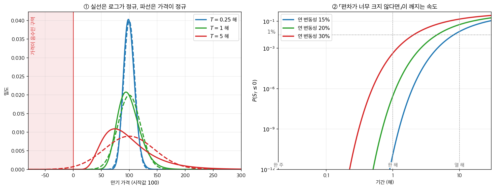
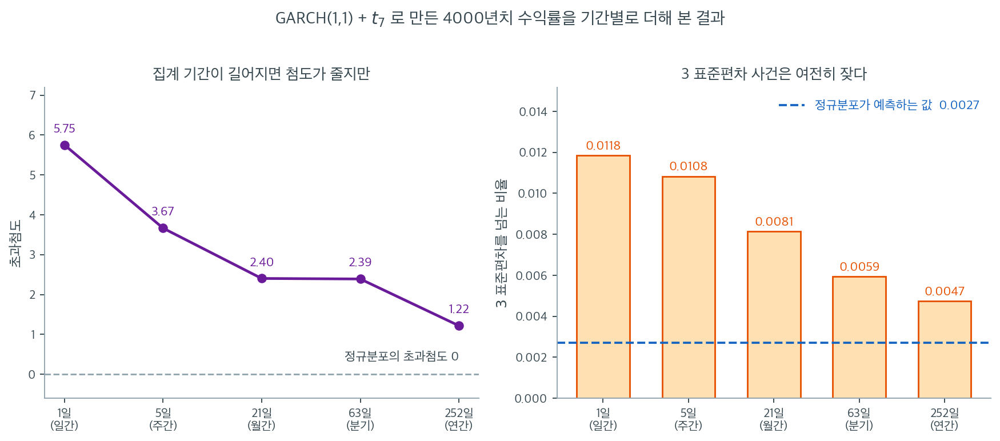

# 금융 자료에서의 정규성

## 1. 동기

정규분포는 금융에서 중심적인 역할을 한다. 포트폴리오 이론, 옵션 가격결정, 위험 관리의 기초 모형들이 모두 자산 수익률이 정규분포를 따른다고 가정한다. 그러나 수십 년의 경험적 증거는 실제 금융 수익률이 체계적이고 중대한 방식으로 정규성에서 벗어난다는 것을 보여준다. 금융 자료에 통계 방법을 적용하는 사람이라면 이 이탈을 반드시 이해해야 한다.

---

## 2. 금융에서의 정규성 가정

$R_t$를 시점 $t$에서 어떤 자산의 로그수익률이라 하면 정규 모형은 다음을 가정한다.

$$
R_t \overset{\text{iid}}{\sim} N(\mu, \sigma^2)
$$

여기서 $\mu$는 기대수익률, $\sigma$는 변동성이다. 이 가정 아래에서 포트폴리오 수익률도 (정규들의 선형결합이므로) 정규이고, 위험가치(VaR) 같은 위험 측도를 닫힌 형태로 계산할 수 있다. 예를 들어 정규성 아래에서 $\alpha$ 수준의 VaR는

$$
\text{VaR}_\alpha = -\left(\mu + z_\alpha \, \sigma\right)
$$

여기서 $z_\alpha$는 표준정규분포의 $\alpha$ 분위수이다($\alpha = 0.01$이면 $z_{0.01} = -2.326$이므로 VaR는 양수가 된다).

<div class="storybox" markdown>

**그림으로 보는 통계학 1.** 그 가정에는 처음부터 단서가 붙어 있었다

방금 적은 $R_t \sim N(\mu, \sigma^2)$ 를 금융에 처음 들여온 사람은 **$1900$ 년 $3$ 월
$29$ 일**에 그 일을 했다. 그리고 그날 심사보고서를 쓴 사람이 **이 장 전체가 다루는 단서**를
한 문장으로 적어 두었다.

그날 소르본에서 **루이 바슐리에**($1870$–$1946$)가 「투기의 이론」으로 학위를 받는다.
심사위원은 폴 아펠, 조제프 부시네스크, 그리고 **앙리 푸앵카레**였고 보고서는 푸앵카레가
썼다. 논문은 『**Annales scientifiques de l'École Normale Supérieure**』 제 $3$ 계열
$17$ 권 $21$–$86$ 쪽에 실린다. 그 안에서 바슐리에는 가격의 분포가 오늘 **채프먼–콜모고로프
방정식**이라 부르는 관계를 만족함을 보이고, **분산이 시간에 비례해 커지는 가우스 밀도**가
그 방정식을 푼다는 것을 알아낸다. 무작위 걸음의 극한으로도 같은 법칙에 닿는다.
아인슈타인의 브라운 운동 논문보다 **다섯 해** 앞이다.

푸앵카레의 보고서는 왜 가우스 법칙이 나오는지를 이렇게 적는다.

> 편차가 아주 크지 않다고 가정하면, 호가에서 벗어나는 편차의 확률이 **그 가격의 절대적
> 크기에 기대지 않는다**고 놓을 수 있다. 이 조건 아래에서는 수학적 기댓값의 원리만으로
> 확률법칙이 정해지고, 우리는 가우스의 저 유명한 오차법칙을 얻는다.

그리고 조금 뒤에 단서를 못 박는다.

> 이 가설은 **편차가 너무 크지 않은 한** 성립한다. 글쓴이는 이것을 분명히 말하고 있으나,
> 아마도 마땅히 그래야 할 만큼 강조하지는 않았다.

$1900$ 년에 심사위원이 적어 둔 「편차가 너무 크지 않은 한」이 바로 다음 절의 제목
—「금융 수익률의 정형화된 사실」— 이 가리키는 자리다. 그 단서가 어디서 깨지는지는
그릴 수 있다. 바슐리에의 가정(편차가 가격 수준에 기대지 않는다)은 **가격 자체가 정규**인
모형을 낳고, 오늘 쓰는 모형은 **로그가격이 정규**다.

<figure markdown>
{ width="960" }
  <figcaption markdown>연 변동성 $20\%$, 시작값 $100$. 왼쪽 칸의 붉은 구역은 **가격이 음수**인 자리다.</figcaption>
</figure>

왼쪽 칸의 파란 쌍($T = 0.25$ 해)을 보라. 실선과 파선이 거의 포개진다. **편차가 작으면
두 모형은 같은 말을 한다** — 푸앵카레가 적은 그대로다. 붉은 쌍($T = 5$ 해)에서는
봉우리 자리도 꼬리도 갈라지고, 파선은 $0$ 왼쪽까지 밀려 나간다.

한 해짜리로 수를 적으면 이렇다. 왼쪽 꼬리 확률을 두 모형에서 재어 견주면

| 편차 | 가격이 정규 | 로그가 정규 | 비 |
|---:|---:|---:|---:|
| $-1\sigma$ | $0.1587$ | $0.1549$ | $1.02$ |
| $-2\sigma$ | $0.02275$ | $0.00706$ | $3.22$ |
| $-3\sigma$ | $0.00135$ | $3.71 \times 10^{-6}$ | $364$ |
| $-4\sigma$ | $3.17 \times 10^{-5}$ | $9.54 \times 10^{-16}$ | $3.3 \times 10^{10}$ |

$1\sigma$ 에서는 $2\%$ 차이고 $3\sigma$ 에서는 **$364$ 배**다. 오른쪽 칸은 그 갈라짐이
남기는 가장 눈에 띄는 자국이다. 가격이 정규인 모형은 가격이 음수가 되는 데에 확률을
주는데, 그 확률이 한 주에는 $0$ 과 다름없다가($5.65 \times 10^{-285}$) 한 해에
$2.9 \times 10^{-7}$, 다섯 해에 $1.3\%$, 서른 해에 $18\%$ 가 된다. $1960$ 년대에
새뮤얼슨이 로그를 씌운 까닭이 이것이다.

바슐리에 자신의 뒷이야기는 짧게 적을 만하다. 흔히 도는 전설 — 「평점이 **honorable** 에
그쳐 앞길이 막혔다」 — 은 $2000$ 년에 쿠르토 등이 심사 문서를 들여다보고 **틀렸다**고
적었다. 수학 바깥의 주제를 다룬 논문에 줄 수 있던 가장 높은 평점이 그것이었고,
푸앵카레는 그 논문을 당대 가장 권위 있는 학술지에 싣도록 추천했다. 정작 그의 길을
막은 것은 $26$ 년 뒤였다. $1926$ 년 디종 대학의 자리에 지원했다가 **폴 레비**의 혹평으로
떨어졌는데, 레비는 바슐리에의 표기를 잘못 읽은 것이었다. 레비는 몇 해 뒤 콜모고로프의
논문에서 바슐리에 인용을 발견하고 $1931$ 년에 편지로 사과한다.

논문은 그 뒤 $50$ 년 넘게 잊혔다. $1950$ 년대 중반, 3.1절
[확률의 공리](../../ch03/probability/axioms.md)에 나오는 **레너드 새비지**가
경제학자 친구들에게 엽서를 돌려 「이런 글이 있다」고 알렸다. 그 가운데 한 장이
새뮤얼슨에게 닿았고, 때마침 그는 옵션과 신주인수권의 가격을 붙들고 있었다.

_확인한 곳 — 심사일($1900$ 년 $3$ 월 $29$ 일, 소르본)과 심사위원 셋, 논문이 실린 학술지·계열·권·쪽수, 바슐리에의 생몰년, 그가 채프먼–콜모고로프 관계와 가우스 밀도에 닿은 것, 푸앵카레 보고서의 인용 두 대목(쿠르토 외, 『Mathematical Finance』 $10$ 권 $3$ 호 $341$–$353$ 쪽($2000$)의 부록에 실린 영역본에서 옮겼다), 같은 글이 「honorable 평점」 전설을 문서로 반박한 것, $1926$ 년 디종 건과 레비의 오독·$1931$ 년 사과 편지, $1950$ 년대 중반 새비지의 엽서가 새뮤얼슨에게 닿은 경위와 새뮤얼슨이 $1960$ 년대에 이 줄기를 이어받은 것. 그림과 표의 수는 모두 직접 계산한 값이다_

</div>

---

## 3. 금융 수익률의 정형화된 사실

금융 수익률 자료에 대한 경험적 연구는 정규성에서 벗어나는 몇 가지 특징을 일관되게 기록해 왔으며, 이를 흔히 **정형화된 사실**이라 부른다.

### 두꺼운 꼬리(초과첨도)

금융 수익률은 정규분포보다 두꺼운 꼬리를 보인다. 평균 $\mu$, 표준편차 $\sigma$인 확률변수 $X$의 **첨도**는

$$
\beta_2 = \frac{E\left[(X - \mu)^4\right]}{\sigma^4}
$$

정규분포에서는 $\beta_2 = 3$이다. **초과첨도**는 $\gamma_2 = \beta_2 - 3$이므로 정규분포의 초과첨도는 0이다. 금융 수익률은 대체로 양의 초과첨도를 가지며, 이는 극단적 사건이 정규 모형의 예측보다 자주 일어난다는 뜻이다. 일간 주식 수익률의 초과첨도는 자산과 기간에 따라 흔히 3에서 50 사이의 값을 보인다.

??? warning "꼬리 위험의 과소평가"
    실제 수익률 분포와 평균·분산이 같은 정규 모형은 큰 손실의 확률을 체계적으로 과소평가한다. 예를 들어 4 표준편차 움직임은 정규분포 아래에서 63년에 한 번 일어나지만($P(|Z| > 4) = 6.33 \times 10^{-5}$이고 연 252 거래일이면 62.6년), 실제 금융시장에서는 10년에 몇 번씩 일어나기도 한다.

### 왜도

분포의 **왜도**는

$$
\gamma = \frac{E\left[(X - \mu)^3\right]}{\sigma^3}
$$

정규분포에서는 $\gamma_1 = 0$이다. 주식 수익률은 흔히 음의 왜도를 보이는데, 같은 크기의 큰 이익보다 큰 손실이 더 자주 일어난다는 뜻이다. 이 비대칭은 시장이 스트레스를 받을 때 특히 두드러진다.

### 변동성 군집

금융 수익률은 **변동성 군집**을 보인다. 변동성이 높은 기간 뒤에는 높은 변동성이, 낮은 기간 뒤에는 낮은 변동성이 이어지는 경향이 있다. 형식적으로 말하면 수익률 $R_t$ 자체는 대체로 무상관인데 제곱수익률 $R_t^2$은 유의한 자기상관을 보인다. 분산이 시간에 따라 일정하지 않으므로 이는 독립동일분포 정규 모형의 독립성 가정을 위배한다.

### 집계에 따른 정규화

수익률의 기간이 일간에서 주간, 월간으로 길어질수록 수익률의 분포는 정규에 가까워진다. 이는 CLT와 일관된다. 일간 수익률이 약하게 종속되어 있지만 분산이 유한하다면 더 긴 기간의 합은 정규 쪽으로 수렴한다. 다만 수렴이 느려서 월간 수익률조차 초과첨도를 보일 수 있다.

"수렴이 느리다"가 얼마나 느린지는 숫자로 봐야 실감이 난다. 아래 그림은 $t_7$ 혁신을 쓴 GARCH(1,1) 모형으로 4000년치 일간 수익률 100만 개를 만든 뒤, 이를 5일·21일·63일·252일 단위로 더해 본 결과이다. 두꺼운 꼬리와 변동성 군집을 둘 다 갖춘 인공 자료이므로 실제 시장 수익률의 축소판이라 할 만하다. 표본이 이렇게 커야 하는 이유는 첨도가 4차적률이라 추정이 몹시 불안정하기 때문이다. 연간 수익률 몇십 개로 첨도를 재면 숫자가 요동쳐 아무 말도 할 수 없다.



왼쪽 칸에서 초과첨도는 일간 $5.75$에서 주간 $3.67$, 월간 $2.40$, 분기 $2.39$, 연간 $1.22$로 줄어든다. 방향은 분명히 CLT가 말하는 대로다. 그러나 속도를 보라. 기간을 21배로 늘린 월간 수익률조차 초과첨도가 $2.40$으로 정규분포의 $0$과는 거리가 멀고, 252배로 늘린 연간 수익률도 $1.22$에 머문다. 독립인 자료라면 $h$ 기간 합의 초과첨도는 정확히 $1/h$배로 줄어야 하므로 일간 $5.75$에서 월간은 $0.27$이 되어야 한다. 실제로 얻은 $2.40$은 그 아홉 배다. 변동성 군집이 만드는 종속성이 CLT의 수렴을 크게 늦추는 것이다.

오른쪽 칸은 같은 이야기를 위험관리자의 언어로 옮긴 것이다. 평균에서 3 표준편차를 넘는 움직임의 비율은 일간 $0.0118$에서 연간 $0.0047$까지 줄지만, 정규분포가 예측하는 $0.0027$에는 끝내 닿지 못한다. 연간 수익률조차 극단적 움직임이 정규 모형의 $1.7$배로 일어나고, 일간 수익률에서는 $4.4$배다. 앞의 경고 상자가 말한 "63년에 한 번"의 산술이 실제 자료에서 왜 그렇게 빗나가는지가 이 비율에 들어 있다.

실무적 결론은 이렇다. 월간이나 분기 수익률로 집계했다는 사실만으로 정규성을 가정해도 좋다고 생각해서는 안 된다. 집계는 꼬리를 얇게 만들지만 지워 주지는 않으며, 정규성을 확인하는 일은 어느 주기의 자료를 쓰든 여전히 필요하다.

---

## 4. 통계적 추론에 대한 함의

금융 자료의 비정규성은 통계 절차에 직접적인 영향을 준다.

**평균 수익률의 신뢰구간.** 수익률의 꼬리가 정규분포보다 두꺼우면 $t$ 기반 신뢰구간이 참 불확실성을 과소평가할 수 있다. 극단적 관측값이 $S$를 부풀리면 표준오차 $S / \sqrt{n}$이 $\bar{R}$의 변동을 믿을 수 없게 추정한다.

**가설검정.** 수익률의 정규성에 기대는 시장 효율성 검정, CAPM 베타 검정, 포트폴리오 성과 검정은 왜곡된 $p$값을 낼 수 있다. 수익률 분포의 꼬리가 두껍고 $n$이 중간 정도이면 $t$ 검정의 실제 크기가 명목 $\alpha$를 넘을 수 있다.

**위험 측도.** 정규 VaR 공식은 꼬리 위험을 과소평가한다. 참 수익률 분포의 초과첨도가 $\gamma_2 > 0$이면 Cornish-Fisher 전개가 보정을 제공한다.

$$
\text{VaR}_\alpha^{\text{CF}} \approx -\left(\mu + \tilde{z}_\alpha \, \sigma\right)
$$

여기서

$$
\tilde{z}_\alpha = z_\alpha + \frac{1}{6}(z_\alpha^2 - 1)\gamma_1 + \frac{1}{24}(z_\alpha^3 - 3z_\alpha)\gamma_2 - \frac{1}{36}(2z_\alpha^3 - 5z_\alpha)\gamma_1^2
$$

이고 $\gamma_1$은 왜도, $\gamma_2$는 수익률 분포의 **초과**첨도다. 이 전개가 $\gamma_1$과 $\gamma_2$로 깔끔하게 적히는 것은 우연이 아니다. Cornish–Fisher는 에지워스 전개에서 나오고 에지워스 전개는 누율의 언어로 쓰이는데, $\gamma_1 = \kappa_3/\kappa_2^{3/2}$이고 $\gamma_2 = \kappa_4/\kappa_2^2$이기 때문이다(3.3절). 정규분포는 3차 이상 누율이 모두 0이라 두 보정항이 함께 사라지고 $\tilde z_\alpha = z_\alpha$로 돌아간다.

!!! note "금융 문헌의 표기"

    금융과 위험관리 문헌에서는 첨도를 $\kappa$로 쓰는 일이 흔하다. 정규에서 3인 값을 가리킬 때도 있고 초과첨도를 가리킬 때도 있으니, 다른 자료를 읽을 때는 **정규분포에서 그 값이 3인지 0인지**를 먼저 확인하는 것이 안전하다. 이 책은 2.3절의 약속대로 $\beta_2$(정규에서 3)와 $\gamma_2$(정규에서 0)를 쓰고, $\kappa_n$은 누율에만 쓴다.

<div class="exbox" markdown>

**보기 1.** <span class="diff easy" title="쉬움"></span> 참 꼬리확률은 경험값과 정규값 사이 어디인가. 자유도 5인 $t$ 에 $0.01$을 곱해 일간 수익률 2000일을 만들고 $P(\lvert R - \mu\rvert > 3\sigma)$ 를 경험값과 정규값으로 견준다. 출력은 경험 $0.0090$, 정규 $0.0027$이다.

**(1)** 이 모형은 자료생성과정을 알고 있으므로 **참 꼬리확률을 정확히 계산할 수 있다.** $t_5$ 로 구하시오. 경험값 $0.0090$과 정규값 $0.0027$ 가운데 어느 쪽에 가까운가.

**(2)** 경험값이 참값에서 벗어난 폭이 몬테카를로 오차 안인지 확인하시오.

**(3)** 거꾸로 묻자. 정규분포가 $3\sigma$ 에 주는 확률 $0.0027$을 $t_5$ 에서 얻으려면 몇 $\sigma$ 까지 나가야 하는가.

</div>

??? success "풀이"

    **쪽의 코드를 먼저 그대로 돌린다.**

    ```python
    import numpy as np
    from scipy import stats

    # ===================================================================
    # 수익률의 꼬리가 정규분포의 꼬리와 얼마나 다른가
    #
    # 정규분포를 가정하면 큰 손실이 일어날 확률을 실제보다 훨씬 작게 잡는다.
    # 그 차이를 숫자 하나로 보이는 것이 이 코드의 목적이다.
    # ===================================================================

    np.random.seed(42)

    # 자유도 5 인 t 로 수익률을 만든다. 실제 수익률과 비슷하게 꼬리가 두껍다.
    n = 2000
    df = 5
    returns = stats.t.rvs(df=df, size=n) * 0.01  # scale to ~1% daily vol

    mean_r = np.mean(returns)
    std_r = np.std(returns, ddof=1)
    skew_r = stats.skew(returns)
    kurt_r = stats.kurtosis(returns)  # excess kurtosis

    # 평균에서 3 표준편차 밖으로 나갈 확률을 견준다. 정규라면 0.0027,
    # 곧 1000일에 세 번이다. 실제 자료에서는 이보다 몇 배 잦게 일어난다.
    threshold = 3 * std_r
    empirical_tail = np.mean(np.abs(returns - mean_r) > threshold)
    normal_tail = 2 * (1 - stats.norm.cdf(3))

    if __name__ == "__main__":
        print(f"Sample mean:           {mean_r:.6f}")
        print(f"Sample std dev:        {std_r:.6f}")
        print(f"Sample skewness:       {skew_r:.4f}")
        print(f"Sample excess kurtosis: {kurt_r:.4f}")
        print(f"\nP(|R - mean| > 3 std):")
        print(f"  Empirical:  {empirical_tail:.4f}")
        print(f"  Normal:     {normal_tail:.4f}")
    ```

    출력:

    ```text
    Sample mean:           -0.000275
    Sample std dev:        0.012886
    Sample skewness:       0.8632
    Sample excess kurtosis: 10.4205

    P(|R - mean| > 3 std):
      Empirical:  0.0090
      Normal:     0.0027
    ```

    **(1) 참값은 $0.011725$ 로, 경험값보다도 크다.** 자료생성과정을 알고 있으니 추정할 필요가 없다. $R = 0.01\,T$, $T \sim t_5$ 이고 $t_\nu$ 의 분산이 $\nu/(\nu-2)$ 이므로

    $$
    \sigma = 0.01\sqrt{\frac{5}{3}} = 0.012910, \qquad \mu = 0
    $$

    이다. 따라서 $3\sigma$ 라는 문턱을 $T$ 의 단위로 되돌리면

    $$
    \frac{3\sigma}{0.01} = 3\sqrt{\frac{5}{3}} = \sqrt{15} = 3.872983
    $$

    이고

    $$
    P(\lvert R\rvert > 3\sigma) = P(\lvert T\rvert > \sqrt{15}) = 2\,\bigl[1 - F_{t_5}(3.872983)\bigr] = 0.011725 .
    $$

    세 수를 나란히 놓으면

    | | $P(\lvert R - \mu\rvert > 3\sigma)$ | 정규값과의 비 |
    |---|---|---|
    | 정규 | $0.002700$ | $1.000$ |
    | 경험($n = 2000$) | $0.009000$ | $3.334$ |
    | **참($t_5$)** | **$0.011725$** | **$4.343$** |

    본문이 지적한 "$3.3$배"는 **표본에서 읽은 값**이고, 이 모형의 **참** 배수는 $4.34$ 다. 곧 이 보기의 경험값은 두꺼운 꼬리를 과장한 것이 아니라 오히려 **덜 보여 준 것**이다. 꼬리 확률을 표본에서 세는 방식은 구조적으로 아래쪽으로 치우치기 쉽다. 드문 사건이라 개수가 적고, 2000일 가운데 몇 개가 더 들어오거나 빠지는 것으로 값이 크게 움직인다.

    **(2) 벗어난 폭은 몬테카를로 오차 안이다.** 경험값은 $18/2000 = 0.0090$ 이다. 초과 여부가 성공확률 $p = 0.011725$ 인 베르누이 시행이므로 비율의 표준오차는

    $$
    \mathrm{SE} = \sqrt{\frac{p(1-p)}{n}} = \sqrt{\frac{0.011725 \times 0.988275}{2000}} = 0.00241
    $$

    이고, 경험값과 참값의 차는 $0.0090 - 0.011725 = -0.00272$, 곧 $-1.13$ 표준오차다. **평범한 변동이다.**

    상대오차로 보면 이야기가 더 뚜렷하다. $\mathrm{SE}/p = 0.00241/0.011725 = 21\%$ 다. 2000일(8년치)을 모아도 꼬리 확률은 상대오차 $20\%$ 로밖에 못 재는 셈이다. 기대 초과 개수가 $2000 \times 0.011725 = 23.5$ 개뿐이니 당연하다. **꼬리를 세려면 자료가 아주 많아야 한다**는 것, 그리고 바로 그 자리에서 정규 가정의 오차가 가장 크다는 것이 이 장이 거듭 짚는 비대칭이다.

    **(3) $t_5$ 에서 $0.0027$ 을 얻으려면 $4.266\sigma$ 까지 나가야 한다.** $t_5$ 의 양쪽 꼬리확률 $0.0027$ 을 주는 지점은 $\pm 5.5071$ 이고 이를 $\sqrt{5/3} = 1.2910$ 으로 나누면

    $$
    \frac{5.5071}{1.2910} = 4.266
    $$

    이다. 정규분포라면 $3\sigma$ 가 "1000일에 세 번"인데, 같은 희소성을 $t_5$ 에서는 $4.27\sigma$ 에 가야 만난다. 거꾸로 읽으면 **정규 모형이 $4.27\sigma$ 사건이라 부르는 것이 실제로는 $3\sigma$ 사건**이라는 뜻이다. 앞의 경고 상자가 든 "4 표준편차는 63년에 한 번"이라는 산술이 어디서 무너지는지가 여기에 있다.

    참고로 표본 왜도 $0.8632$ 와 초과첨도 $10.4205$ 도 참값과 견주어 보아야 한다. $t_5$ 의 모집단 왜도는 **정확히 0**(대칭이고 $\nu > 3$)이고 모집단 초과첨도는 $6/(\nu - 4) = 6$ 이다. 표본값이 각각 $+0.86$ 과 $10.42$ 로 크게 벗어났는데, $\hat g_1$ 의 분산은 6차 적률을, $\hat g_2$ 의 분산은 8차 적률을 요구하고 $t_5$ 에는 5차 이상 적률이 없어 **두 추정량의 분산이 무한**하기 때문이다. 두 값은 `scipy.stats.skew`·`kurtosis` 의 기본값이므로 보정하지 않은 $g_1$ 과 초과첨도 $g_2$ 다.

    ```python
    import numpy as np
    from scipy import stats

    np.random.seed(42)
    n, nu = 2000, 5
    r = stats.t.rvs(df=nu, size=n) * 0.01
    m, s = r.mean(), r.std(ddof=1)
    sig = 0.01 * np.sqrt(nu / (nu - 2))        # 참 표준편차

    print(f"표본 sd = {s:.6f},  참 sigma = {sig:.6f},  s/sigma = {s/sig:.4f}")
    k = 3 * np.sqrt(nu / (nu - 2))             # 3 sigma 를 t 단위로 환산
    p_true = 2 * stats.t.sf(k, nu)
    p_norm = 2 * stats.norm.sf(3)
    p_emp = np.mean(np.abs(r - m) > 3 * s)
    print(f"3 sigma = {3*sig:.6f}  ->  t 단위 {k:.6f}")
    print(f"참   P(|R| > 3 sigma) = {p_true:.6f}")
    print(f"정규 P              = {p_norm:.6f}   (참/정규 = {p_true/p_norm:.3f})")
    print(f"경험 P              = {p_emp:.6f}   ({int(round(p_emp*n))}/{n} 개,"
          f" 경험/정규 = {p_emp/p_norm:.3f})")
    se = np.sqrt(p_true * (1 - p_true) / n)
    print(f"경험값의 MC SE = {se:.5f};  경험 - 참 = {p_emp-p_true:+.5f}"
          f" = {(p_emp-p_true)/se:+.2f} SE")
    print(f"t5 에서 꼬리확률 0.0027 을 주는 문턱 = "
          f"{stats.t.isf(p_norm/2, nu)/np.sqrt(nu/(nu-2)):.3f} sigma")
    print(f"모집단 초과첨도 6/(nu-4) = {6/(nu-4):.1f},"
          f"  표본 g2 = {stats.kurtosis(r):.4f},  표본 g1 = {stats.skew(r):.4f}")
    ```

    출력:

    ```text
    표본 sd = 0.012886,  참 sigma = 0.012910,  s/sigma = 0.9982
    3 sigma = 0.038730  ->  t 단위 3.872983
    참   P(|R| > 3 sigma) = 0.011725
    정규 P              = 0.002700   (참/정규 = 4.343)
    경험 P              = 0.009000   (18/2000 개, 경험/정규 = 3.334)
    경험값의 MC SE = 0.00241;  경험 - 참 = -0.00272 = -1.13 SE
    t5 에서 꼬리확률 0.0027 을 주는 문턱 = 4.266 sigma
    모집단 초과첨도 6/(nu-4) = 6.0,  표본 g2 = 10.4205,  표본 g1 = 0.8632
    ```

    손으로 구한 $\sigma = 0.012910$, 문턱 $\sqrt{15} = 3.872983$, 참 확률 $0.011725$, 비 $4.343$, 벗어남 $-1.13\,\mathrm{SE}$, 문턱 $4.266\sigma$ 가 모두 코드와 맞는다. 표본 표준편차는 $s/\sigma = 0.9982$ 로 참값과 거의 같으므로, 코드가 $3s$ 를 쓴 것과 $3\sigma$ 를 쓴 것의 차이는 무시할 수 있다.

경험적 꼬리 확률 $0.0090$이 정규분포의 예측 $0.0027$의 3.3배로, 금융 수익률의 두꺼운 꼬리와 일관된다. 초과첨도 $10.42$도 정규분포의 0에서 크게 벗어나 있다.

---

## 연습문제

<div class="drillbox" markdown>

**연습문제 1.** <span class="diff med" title="중간"></span>
효율적 시장 가설(EMH)이 왜 주식 수익률이 근사적으로 정규분포를 따를 것이라고 시사하는지, 그리고 이 예측이 경험적으로 왜 실패하는지 설명하라.

</div>

??? success "풀이"
    EMH 아래에서 가격은 이용 가능한 모든 정보를 온전히 반영하며, 가격 변화는 무작위로 도착하는 예측 불가능한 새 정보가 이끈다. 작고 독립적인 정보 충격이 많이 모여 수익률을 만든다면 CLT는 총합 수익률이 근사적으로 정규일 것이라고 시사한다.

    이 예측이 경험적으로 실패하는 이유: (1) 정보 충격이 독립이 아니다 — 변동성이 군집한다(큰 움직임 뒤에 큰 움직임이 온다). (2) 충격이 동일한 분포를 따르지 않는다 — 분산이 시간에 따라 변한다. (3) 어떤 충격은 크고 드물다(실적 서프라이즈, 지정학적 사건). 이는 "작고 독립적인 것이 많다"는 가정을 위배한다. 그 결과 두꺼운 꼬리와 변동성 군집이 나타나며 둘 다 정규 모형과 맞지 않는다.

<div class="drillbox" markdown>

**연습문제 2.** <span class="diff med" title="중간"></span>
수익률이 실제로는 꼬리가 두꺼운데 정규성을 가정하여 위험가치(VaR)를 계산하면 어떤 실질적 결과가 따르는가?

</div>

??? success "풀이"
    $\alpha$ 수준의 정규 VaR는 $\text{VaR}_\alpha = -(\mu + z_\alpha \sigma)$이며 $z_\alpha$는 표준정규의 $\alpha$ 분위수이다($\alpha = 0.01$에서 $z_{0.01} = -2.326$이므로 $\mu = 0$이면 $\text{VaR}_{0.01} = 2.326\sigma$이다). 수익률의 꼬리가 더 두꺼우면 참 $\alpha$ 분위수는 $z_\alpha \sigma$보다 극단적이다.

    결과: 정규 VaR가 잠재적 손실을 **과소평가한다**. 예를 들어 정규 99% VaR가 어떤 포트폴리오의 일간 최대 손실을 2.3%로 예측하더라도 실제 1% 최악 손실은 4% 이상일 수 있다. 이는 자본 준비금 부족, 예기치 못한 위험 한도 초과, 규제 위반 가능성으로 이어진다.

<div class="drillbox" markdown>

**연습문제 3.** <span class="diff med" title="중간"></span>
수익률 대신 주가에 대수정규분포를 흔히 쓴다. 대수정규 가격과 정규분포 로그수익률의 관계를 설명하라.

</div>

??? success "풀이"
    주가 $S_t$가 대수정규분포를 따르면 $\log(S_t/S_{t-1}) = \log S_t - \log S_{t-1}$(로그수익률)이 정규분포를 따른다. 동등하게 $S_t = S_0 \exp(\sum r_i)$이며 $r_i$는 로그수익률이다.

    이 모형(기하 브라운 운동)이 Black-Scholes 옵션 가격 공식의 바탕이다. 대수정규 변수는 항상 양수이므로 가격이 양수로 유지되면서 수익률은 음수가 될 수 있다.

    이 모형은 수익률이 진짜로 정규가 아닌 것과 같은 이유로 실패한다. 두꺼운 꼬리, 변동성 군집, 점프이다. 확장 모형으로는 점프-확산 모형, 확률변동성 모형, GARCH 과정이 있다.

<div class="drillbox" markdown>

**연습문제 4.** <span class="diff med" title="중간"></span>
개별 주식 수익률보다 포트폴리오 수익률에서 정규성이 더 합리적인 가정인 이유를 설명하라.

</div>

??? success "풀이"
    포트폴리오 수익률은 개별 주식 수익률의 가중평균이다. 분산투자(약하게 상관된 자산을 여럿 결합)를 통해 CLT가 포트폴리오 수익률 분포를 정규 쪽으로 밀어붙인다. 구체적으로 분산이 유한하고 약하게 종속된 확률변수를 많이 더하면 정규로 수렴한다.

    수렴이 빨라지는 조건: (1) 포트폴리오에 자산이 많다, (2) 자산들이 지나치게 강하게 상관되어 있지 않다, (3) 어느 한 자산이 비중을 지배하지 않는다. 주식 30개 이상으로 잘 분산된 포트폴리오는 개별 주식보다 정규에 가까운 수익률 분포를 갖는 일이 많다.

    다만 시장 위기 때는 상관이 급등하여(전염) 실효 분산투자가 줄고 포트폴리오 수익률이 정규보다 꼬리가 두꺼워진다. 하필 정확한 위험 모형화가 가장 중요한 때에 그렇게 된다.

<div class="drillbox" markdown>

**연습문제 5.** <span class="diff med" title="중간"></span>
보기 1의 모형 $R = 0.01\,T$, $T \sim t_5$ 를 그대로 쓴다. 이 분포는 대칭이므로 $\gamma_1 = 0$ 이고 초과첨도는 $\gamma_2 = 6/(\nu - 4) = 6$ 이다. $\mu = 0$ 으로 둔다.

**(1)** 4절의 Cornish–Fisher 전개로 $\tilde z_{0.01}$ 과 $\text{VaR}_{0.01}^{\text{CF}}$ 를 $\sigma$ 의 배수로 구하시오.

**(2)** 참 $\text{VaR}_{0.01}$ 을 $t_5$ 의 분위수로 구하고, 정규 VaR·CF VaR·참 VaR 셋을 견주시오. 보정이 과소평가를 고쳤는가.

**(3)** $\gamma_1 = 0$ 을 유지한 채 CF 전개가 참값을 정확히 맞히게 하는 $\gamma_2$ 를 구하시오. 그 값을 집계 그림의 초과첨도들과 견주어, CF 보정을 믿어도 좋은 영역이 어디인지 말하시오.

</div>

??? success "풀이"
    **(1) $\tilde z_{0.01} = -3.729075$, 곧 $\text{VaR}_{0.01}^{\text{CF}} = 3.7291\,\sigma$ 다.** $\gamma_1 = 0$ 이므로 전개의 둘째 항과 넷째 항이 함께 사라지고

    $$
    \tilde z_\alpha = z_\alpha + \frac{1}{24}\left(z_\alpha^3 - 3 z_\alpha\right)\gamma_2
    $$

    만 남는다. $z_{0.01} = -2.326348$ 이므로 $z_\alpha^3 = -12.589953$, $3z_\alpha = -6.979044$, 따라서

    $$
    z_\alpha^3 - 3z_\alpha = -5.610909, \qquad \frac{6}{24}\times(-5.610909) = -1.402727
    $$

    이고 $\tilde z_{0.01} = -2.326348 - 1.402727 = -3.729075$ 다. $\mu = 0$ 이므로 $\text{VaR}_{0.01}^{\text{CF}} = -\tilde z_{0.01}\,\sigma = 3.7291\,\sigma$ 다.

    **(2) 참값은 $2.6065\,\sigma$ 이고, CF 는 과소평가를 과대평가로 바꾸면서 오차를 네 배로 키웠다.** $R = 0.01\,T$ 는 $T$ 의 단조변환이므로 분위수도 그대로 옮겨진다. $t_5$ 의 1% 분위수는 $-3.364930$ 이고 $\sigma = 0.01\sqrt{5/3}$ 이므로

    $$
    \frac{q_{0.01}(R)}{\sigma} = \frac{0.01 \times (-3.364930)}{0.01\sqrt{5/3}} = \frac{-3.364930}{1.290994} = -2.606464
    $$

    곧 참 $\text{VaR}_{0.01} = 2.6065\,\sigma$ 다. 셋을 나란히 놓으면

    | | $\text{VaR}_{0.01}/\sigma$ | 참값 대비 | 오차 |
    |---|---|---|---|
    | 정규 | $2.3263$ | $0.893$ | $-0.2801\,\sigma$ ($-10.7\%$) |
    | Cornish–Fisher | $3.7291$ | $1.431$ | $+1.1226\,\sigma$ ($+43.1\%$) |
    | 참($t_5$) | $2.6065$ | $1.000$ | — |

    $\lvert +1.1226 \rvert / \lvert -0.2801 \rvert = 4.01$ 이다. 보정의 부호는 옳았지만(정규 VaR 는 참값보다 작다) 크기가 네 배 넘쳤다. 보정하지 않은 정규 VaR 가 CF VaR 보다 참값에 네 배 가깝다.

    **(3) $\gamma_2 = 1.1982$ 다.** 필요한 보정량은 $-2.606464 - (-2.326348) = -0.280116$ 이므로

    $$
    \frac{\gamma_2}{24}\times(-5.610909) = -0.280116 \ \Longrightarrow\ \gamma_2 = \frac{24 \times 0.280116}{5.610909} = 1.1982
    $$

    집계 그림의 초과첨도는 일간 $5.75$, 주간 $3.67$, 월간 $2.40$, 분기 $2.39$, 연간 $1.22$ 였다. $1.1982$ 는 **연간 수익률의 $1.22$ 바로 옆**이다. 곧 CF 전개는 집계를 많이 한 자료에서는 쓸 만하고 일간 자료에서는 못 쓴다.

    까닭은 전개의 구조에 있다. Cornish–Fisher 는 누율에 대한 점근전개를 $\gamma_2$ 항에서 끊은 것이므로, 끊어도 좋은지는 보정항이 주항보다 충분히 작은지에 달렸다. 여기서는 $1.402727 / 2.326348 = 60\%$ 로 전혀 작지 않다. 버린 다음 항($\kappa_5$, $\kappa_6$ 이 들어가는 항)도 그만큼 클 것이므로 전개 자체가 의미를 잃는다. **"비정규성 보정"은 비정규성이 약할 때만 보정이다.**

<div class="drillbox" markdown>

**연습문제 6.** <span class="diff med" title="중간"></span>
3절은 "독립인 자료라면 $h$ 기간 합의 초과첨도는 정확히 $1/h$배로 줄어야" 한다고 적었다.

**(1)** 평균 $\mu$, 분산 $\sigma^2$, 초과첨도 $\gamma_2$ 인 독립동일분포 $X_1, \dots, X_h$ 의 합 $S_h$ 의 초과첨도가 $\gamma_2 / h$ 임을 보이시오.

**(2)** 그림의 네 집계 수준마다 **실효 독립일수** $h_{\text{eff}} = \gamma_2^{(1)} / \gamma_2^{(h)}$ 를 구하시오. 곧 관측된 첨도 감소를 독립인 자료 며칠을 더한 것과 같다고 읽는 것이다.

**(3)** 월간과 분기의 $h_{\text{eff}}$ 를 견주시오. 집계가 꼬리를 얇게 만드는 일을 멈춘 듯 보이는 까닭을 변동성 군집으로 설명하시오.

</div>

??? success "풀이"
    **(1)** 두 가지로 보인다. 4절이 적은 $\gamma_2 = \kappa_4 / \kappa_2^2$ 를 쓰면 한 줄이다. 누율은 독립인 확률변수의 합에서 더해지므로 $\kappa_2(S_h) = h\kappa_2$, $\kappa_4(S_h) = h\kappa_4$ 이고

    $$
    \gamma_2(S_h) = \frac{\kappa_4(S_h)}{\kappa_2(S_h)^2} = \frac{h\kappa_4}{h^2\kappa_2^2} = \frac{\gamma_2}{h}
    $$

    적률로 직접 해도 된다. $Y_i = X_i - \mu$ 로 두면 $E[Y_i] = 0$ 이므로 $E\bigl[(\sum Y_i)^4\bigr]$ 를 펼칠 때 살아남는 항은 $Y_i^4$ 꼴 $h$ 개와 $Y_i^2 Y_j^2$ 꼴($i \ne j$) 뿐이고, 후자의 다항계수는 $\binom{4}{2} = 6$ 이며 순서없는 쌍이 $h(h-1)/2$ 개이므로 계수 합이 $3h(h-1)$ 이다. 따라서

    $$
    E\bigl[(S_h - h\mu)^4\bigr] = h\mu_4 + 3h(h-1)\sigma^4
    $$

    이고 $\text{Var}(S_h) = h\sigma^2$ 이므로

    $$
    \beta_2(S_h) = \frac{h\mu_4 + 3h(h-1)\sigma^4}{h^2\sigma^4} = \frac{\beta_2}{h} + 3 - \frac{3}{h} = 3 + \frac{\beta_2 - 3}{h}
    $$

    곧 $\gamma_2(S_h) = \gamma_2/h$ 다. $\square$

    **(2)** $\gamma_2^{(1)} = 5.75$ 로 두고 계산한다.

    | 집계 | $h$ | 독립일 때 예측 $\gamma_2/h$ | 관측 $\gamma_2$ | $h_{\text{eff}}$ | $h / h_{\text{eff}}$ |
    |---|---|---|---|---|---|
    | 주간 | $5$ | $1.150$ | $3.67$ | $1.57$ | $3.19$ |
    | 월간 | $21$ | $0.274$ | $2.40$ | $2.40$ | $8.77$ |
    | 분기 | $63$ | $0.091$ | $2.39$ | $2.41$ | $26.19$ |
    | 연간 | $252$ | $0.023$ | $1.22$ | $4.71$ | $53.47$ |

    마지막 줄을 소리내어 읽으면 이렇다. **252 거래일을 더해서 얻은 첨도 감소가, 독립인 자료 $4.7$ 일을 더한 것과 같다.** 한 해를 모아 한 주도 못 얻는다. $h / h_{\text{eff}}$ 가 $3.19 \to 8.77 \to 26.19 \to 53.47$ 로 커지는 것은 집계를 늘릴수록 손실 비율이 더 나빠진다는 뜻이다.

    **(3) 월간 $2.40$ 과 분기 $2.41$ 은 사실상 같다.** 창을 21일에서 63일로 세 배 늘려 얻은 것이 없다. 독립이라면 $0.274 \to 0.091$ 로 세 배 얇아져야 했다.

    변동성 군집으로 읽으면 이렇다. 집계된 수익률의 첨도에는 두 원천이 있다. 하나는 혁신 자체의 두꺼운 꼬리($t_7$)이고, 이것은 창이 독립인 덩어리 여럿을 덮는 순간 $1/h$ 로 얇아진다. 다른 하나는 **분산이 확률변수라는 사실**이다. 창 안의 평균 변동성이 창마다 다르면 집계 수익률은 "분산이 다른 정규들의 혼합"이 되고, 혼합은 그 자체로 초과첨도를 만든다. 이 둘째 원천은 창의 길이가 GARCH 변동성의 지속기간보다 충분히 길어질 때까지 사라지지 않는다. 21일과 63일은 둘 다 그 지속기간에 비해 짧으므로 같은 양만 얻고 멈춰 선 것처럼 보이고, 252일에 이르러 창이 변동성 순환 몇 개를 덮기 시작하면서 다시 $1.22$ 로 내려간다.

    $2.40$ 과 $2.39$ 의 대소를 두고 "분기가 월간보다 나빠졌다"고 읽어서는 안 된다. 100만 개를 63일로 묶으면 표본이 $15{,}873$ 개뿐이고 4차적률의 추정오차가 그보다 크다. 읽어야 할 것은 **멈춰 섰다**는 사실이다.

<div class="drillbox" markdown>

**연습문제 7.** <span class="diff hard" title="어려움"></span>
경고 상자는 $4\sigma$ 움직임을 정규분포 아래에서 "63년에 한 번", 실제 시장에서는 "10년에 몇 번"이라고 적었다. 셋을 숫자로 맞세워 보자. 연 252 거래일로 두고, 하루당 확률이 $p$ 일 때 재현주기를 $1/(252p)$ 년으로 센다.

**(1)** 보기 1의 모형 $R = 0.01\,T$, $T \sim t_5$ 에서 $P(\lvert R \rvert > 4\sigma)$ 와 재현주기를 구하시오.

**(2)** "10년에 세 번"을 하루당 확률로 옮기고, 정규값 $6.334 \times 10^{-5}$ 의 몇 배인지 구하시오.

**(3)** 조정된 $t_\nu$ 족에서 초과첨도가 정확히 1 인 것은 $\nu = 10$ 이다. $t_{10}$ 의 $4\sigma$ 재현주기를 구해 (2)와 견주시오. 그 결과를 3절의 "일간 주식 수익률의 초과첨도는 흔히 3에서 50"과 맞세우면 어긋남이 드러난다. 어긋남이 뜻하는 바를 말하시오.

</div>

??? success "풀이"
    **(1) $P(\lvert R \rvert > 4\sigma) = 0.0035728$ 이고 재현주기는 $1.11$ 년이다.** 보기 1의 풀이와 같은 환산으로 문턱을 $T$ 의 단위로 되돌리면

    $$
    \frac{4\sigma}{0.01} = 4\sqrt{\frac{5}{3}} = 5.163978
    $$

    이고 $P(\lvert T \rvert > 5.163978) = 2\bigl[1 - F_{t_5}(5.163978)\bigr] = 0.0035728$ 이다. 재현주기는

    $$
    \frac{1}{252 \times 0.0035728} = 1.1107 \text{ 년}
    $$

    곧 $279$ 거래일에 한 번이다. 정규값의 $0.0035728 / 0.00006334 = 56.4$ 배이고, "63년에 한 번"이 "열석 달에 한 번"으로 바뀐다.

    **(2) $p = 3/(10 \times 252) = 1.1905 \times 10^{-3}$ 로, 정규값의 $18.8$ 배다.** 재현주기는 $10/3 = 3.33$ 년이다.

    **(3) $t_{10}$ 의 재현주기는 $3.33$ 년으로 (2)와 거의 정확히 같다.** 문턱은 $4\sqrt{10/8} = 4.472136$ 이고 $P(\lvert T \rvert > 4.472136) = 0.0011935$, 재현주기는 $1/(252 \times 0.0011935) = 3.325$ 년이다. 네 모형을 나란히 놓으면

    | 모형 | $\gamma_2$ | $P(\lvert R \rvert > 4\sigma)$ | 재현주기 | 정규 대비 |
    |---|---|---|---|---|
    | 정규 | $0$ | $6.334 \times 10^{-5}$ | $62.6$ 년 | $1.0$ |
    | 조정 $t_{10}$ | $1.00$ | $1.1935 \times 10^{-3}$ | $3.33$ 년 | $18.8$ |
    | 정형화된 사실(10년에 세 번) | — | $1.1905 \times 10^{-3}$ | $3.33$ 년 | $18.8$ |
    | 조정 $t_5$(보기 1) | $6.00$ | $3.5728 \times 10^{-3}$ | $1.11$ 년 | $56.4$ |

    **어긋남은 이것이다.** "$4\sigma$ 가 10년에 몇 번"이라는 정형화된 사실만 재현하려면 초과첨도 $1$ 로 충분하다. 그런데 3절은 실제 일간 수익률의 초과첨도가 $3$ 에서 $50$ 이라고 적었다. 초과첨도 $6$ 인 $t_5$ 는 $4\sigma$ 사건을 실제 시장보다 $0.0035728/0.0011905 = 3.00$ 배 자주 낸다. $t$ 족 안에서는 **관측된 첨도와 관측된 $4\sigma$ 빈도를 동시에 맞출 수 없다.**

    까닭은 4차적률이 거리의 네제곱으로 가중하기 때문이다. 실제 수익률의 큰 첨도는 $4\sigma$ 근처 사건이 많아서 생기는 것이 아니라, $4\sigma$ 를 훨씬 넘는 **몇 개**가 혼자 만든다. 1987년 10월 19일의 하루 같은 $20\sigma$ 급 움직임 하나는 $4\sigma$ 사건 하나보다 4차적률에 $(20/4)^4 = 625$ 배 기여하면서 "$4\sigma$ 초과 횟수"에는 똑같이 1 만 보탠다. 초과첨도 $50$ 짜리 표본이란 그런 하루가 섞인 표본이다.

    정규성 검정을 읽을 때 이것이 실질적인 차이를 만든다. 자크–베라처럼 적률을 보는 검정은 저 몇 개의 극단값에 거의 전부를 걸고, 초과 횟수 백테스트나 Q–Q 그림의 끝은 다른 것을 센다. 두 진단이 다른 답을 낼 때 어느 쪽이 틀린 것이 아니라 **서로 다른 것을 재고 있는** 것이다.

<div class="drillbox" markdown>

**연습문제 8.** <span class="diff hard" title="어려움"></span>
자크–베라 통계량은 표본왜도 $g_1$ 과 표본초과첨도 $g_2$ 로

$$
\mathrm{JB} = \frac{n}{6}\left(g_1^2 + \frac{g_2^2}{4}\right)
$$

이고 정규성 아래에서 근사적으로 $\chi^2_2$ 를 따른다. $\chi^2_2$ 의 꼬리확률은 정확히 $e^{-x/2}$ 이므로 유의수준 $\alpha$ 의 임계값은 $-2\ln\alpha$ 다($\alpha = 0.05$ 에서 $5.9915$, $\alpha = 0.01$ 에서 $9.2103$).

**(1)** 보기 1의 표본값 $g_1 = 0.8632$, $g_2 = 10.4205$, $n = 2000$ 으로 JB 와 그 $p$ 값의 규모를 구하시오.

**(2)** 집계 그림이 만든 세계에서 **같은 40 년**을 관측한다고 하자. 일간으로 쓰면 $n = 10{,}080$ 이고 연간으로 집계하면 $n = 40$ 이다. 모집단 값 $\gamma_1 = 0$ 과 그림의 초과첨도(일간 $5.75$, 연간 $1.22$)를 $g_1, g_2$ 자리에 꽂아 JB 의 규모를 어림하고, 두 어림값의 비를 구하시오. 그 비를 $n$ 의 몫과 $\gamma_2^2$ 의 몫으로 쪼개시오.

**(3)** 연간 자료로 $5\%$ 에서 기각하려면 몇 해가 필요한가. 그리고 (2)의 일간 어림값을 그대로 믿어서는 안 되는 이유 둘을 3절에서 찾으시오.

</div>

??? success "풀이"
    **(1) $\mathrm{JB} = 9297.3$ 이고 $p \approx 10^{-2019}$ 다.** 차례대로

    $$
    g_1^2 = 0.745114, \qquad \frac{g_2^2}{4} = \frac{108.58675}{4} = 27.146705
    $$

    이므로 괄호는 $27.891819$ 이고 $\mathrm{JB} = (2000/6) \times 27.891819 = 333.3333 \times 27.891819 = 9297.3$ 이다. $p = e^{-9297.3/2} = e^{-4648.6}$ 이고 상용로그로는 $-4648.6/\ln 10 = -2018.9$ 이므로 $p \approx 10^{-2019}$ 다. 임계값 $9.2103$ 과 견줄 수준이 아니다.

    **(2) 일간 $13{,}886$, 연간 $2.48$ 로 비는 $5598$ 배다.** $\gamma_1 = 0$ 이므로 $\mathrm{JB} \approx n\gamma_2^2/24$ 다.

    $$
    \text{일간: } \frac{10{,}080 \times 5.75^2}{24} = 420 \times 33.0625 = 13{,}886.25
    $$

    $$
    \text{연간: } \frac{40 \times 1.22^2}{24} = 1.66667 \times 1.4884 = 2.4807
    $$

    일간은 어떤 유의수준에서도 기각하고, 연간은 $5\%$ 임계값 $5.9915$ 에 못 미쳐 기각하지 못한다. 비는 $13{,}886.25 / 2.4807 = 5597.8$ 이고 쪼개면

    $$
    \frac{n_{\text{일}}}{n_{\text{연}}} \times \left(\frac{\gamma_2^{\text{일}}}{\gamma_2^{\text{연}}}\right)^2 = 252 \times \left(\frac{5.75}{1.22}\right)^2 = 252 \times 4.7131^2 = 252 \times 22.213 = 5597.8
    $$

    집계는 **표본크기를 252 배 깎으면서 신호도 22 배 깎는다.** 두 손실이 곱으로 겹친다.

    **(3) $97$ 해가 필요하다.** $\mathrm{JB} = n \times 1.4884/24 = 5.9915$ 를 풀면

    $$
    n = \frac{24 \times 5.9915}{1.4884} = \frac{143.80}{1.4884} = 96.6
    $$

    곧 연간 수익률 $97$ 개다. 실제로 모을 수 없는 자료다. 그림이 $4000$ 년치를 만들어야 했던 이유가 여기에 있다.

    일간 어림값을 믿어서는 안 되는 이유는 둘 다 3절에 있다.

    첫째, **변동성 군집**이다. JB 의 $\chi^2_2$ 귀무분포는 관측값이 독립이라는 가정 위에 서 있다. 제곱수익률이 유의한 자기상관을 보이는 자료에서는 실효 표본크기가 $n$ 보다 훨씬 작고(연습문제 6의 $h_{\text{eff}}$ 와 같은 이야기다) JB 의 참 귀무분포는 $\chi^2_2$ 보다 훨씬 넓다. $13{,}886$ 이라는 값의 상당 부분은 "정규가 아니다"가 아니라 "독립이 아니다"를 재고 있다.

    둘째, **$\hat g_2$ 의 분산**이다. 혁신이 $t_7$ 이면 8차적률이 존재하지 않고, 보기 1의 풀이가 지적한 대로 $\hat g_2$ 의 분산은 8차적률을 요구하므로 무한하다. 그러면 $n\gamma_2^2/24$ 는 믿을 만한 중심이 아니다. 한 표본의 JB 는 이 어림값보다 훨씬 클 수도 훨씬 작을 수도 있다.

    여기에 하나 더 붙일 것이 있다. $n = 10{,}080$ 이면 경제적으로 무의미한 이탈도 기각된다. 거꾸로 $n = 40$ 이면 초과첨도 $1.22$ 라는 뚜렷한 이탈을 못 잡는다. **같은 세계를 같은 40 년 동안 보면서 일간으로는 압도적으로 기각하고 연간으로는 기각하지 못한다.** 연간 수익률이 정규여서가 아니다. 유의성은 이탈의 크기를 재지 않는다.

<div class="drillbox" markdown>

**연습문제 9.** <span class="diff hard" title="어려움"></span>
집계 그림의 두 칸은 같은 자료의 다른 요약이다. 왼쪽은 초과첨도, 오른쪽은 $P(\lvert R - \mu \rvert > 3\sigma)$ 다. 조정된 $t_\nu$ 족(대칭이므로 $\gamma_1 = 0$, 초과첨도 $6/(\nu - 4)$)이 두 칸을 동시에 설명할 수 있는지 보자.

**(1)** 왼쪽 칸의 일간 초과첨도 $5.75$ 에 $t_\nu$ 의 초과첨도를 맞추어 $\nu$ 를 구하고, 그 $\nu$ 가 주는 $P(\lvert R \rvert > 3\sigma)$ 를 오른쪽 칸의 일간값 $0.0118$ 과 견주시오.

**(2)** 같은 일을 연간($\gamma_2 = 1.22$, $P = 0.0047$)에 대해 하시오.

**(3)** 두 결과가 다르다. 집계가 분포의 어느 부분을 먼저 정규로 만드는지에 대해 무엇을 말해 주는가. 그리고 "모형의 첨도를 맞추면 VaR 도 맞는다"는 생각이 왜 위험한지 연습문제 5 와 묶어 말하시오.

</div>

??? success "풀이"
    **(1) 거의 완벽히 맞는다.** $6/(\nu - 4) = 5.75$ 에서 $\nu = 4 + 6/5.75 = 5.04348$ 이다. 문턱을 $T$ 의 단위로 환산하면

    $$
    3\sqrt{\frac{\nu}{\nu - 2}} = 3\sqrt{\frac{5.04348}{3.04348}} = 3 \times 1.287303 = 3.861909
    $$

    이고 $P(\lvert T \rvert > 3.861909) = 0.011662$ 다. 관측값 $0.0118$ 과 비가 $0.988$ 이니 $1.2\%$ 차이다. 모수 하나를 왼쪽 칸에 맞췄을 뿐인데 오른쪽 칸이 따라왔다.

    **(2) 맞지 않는다.** $\nu = 4 + 6/1.22 = 8.91803$ 이고 문턱은 $3\sqrt{8.91803/6.91803} = 3 \times 1.135385 = 3.406156$, 확률은 $P(\lvert T \rvert > 3.406156) = 0.007902$ 다. 관측값은 $0.0047$ 이므로 $t$ 가 $1.68$ 배 과대예측한다. 거꾸로 $0.0047$ 을 정확히 맞히는 $\nu$ 를 찾으면 $\nu = 21.86$ 이고 그 초과첨도는 $6/17.86 = 0.336$ 으로, 실제 $1.22$ 의 $1/3.6$ 이다.

    | 집계 | 관측 $\gamma_2$ | 첨도를 맞춘 $\nu$ | 그 $\nu$ 의 $P(>3\sigma)$ | 관측 $P$ | 관측을 맞춘 $\nu$ | 그 $\nu$ 의 $\gamma_2$ |
    |---|---|---|---|---|---|---|
    | 일간 | $5.75$ | $5.04$ | $0.01166$ | $0.0118$ | $4.95$ | $6.33$ |
    | 연간 | $1.22$ | $8.92$ | $0.00790$ | $0.0047$ | $21.86$ | $0.34$ |

    **(3) 집계는 어깨를 먼저 정규로 만들고 먼 꼬리를 늦게 남긴다.** 연간 수익률의 $3\sigma$ 초과확률은 정규값의 $0.0047/0.0027 = 1.74$ 배인데, 같은 첨도를 가진 $t_{8.92}$ 라면 $0.00790/0.0027 = 2.93$ 배여야 했다. 곧 $3\sigma$ 라는 "어깨" 자리는 첨도가 시사하는 것보다 더 많이 정규화되었다. 그러면서도 초과첨도는 $1.22$ 로 남아 있으니, 그 $1.22$ 를 만드는 질량은 $3\sigma$ 근처가 아니라 **그보다 훨씬 먼 곳**에 있다. 변동성 군집이 만드는 드문 큰 분산 국면이 집계 후에도 살아남아 먼 꼬리를 떠받치는 것이다. 3절이 말한 "수렴이 느리다"의 정체가 이것이고, 연습문제 7이 1987년 하루로 설명한 것과 같은 현상을 집계 쪽에서 본 것이다.

    $t$ 족이 일간에서는 맞고 연간에서는 틀리는 까닭도 여기서 나온다. $t_\nu$ 는 모수 하나로 어깨와 꼬리를 함께 묶으므로 "어깨는 정규에 가깝고 꼬리는 두꺼운" 분포를 아예 표현할 수 없다. 일간 수익률은 어깨도 꼬리도 두꺼워서 $t$ 가 잘 맞고, 집계된 수익률은 그렇지 않다.

    연습문제 5와 묶으면 결론이 뚜렷해진다. 거기서는 $\gamma_2 = 6$ 을 **정확히 알고도** Cornish–Fisher 로 구한 1% 분위수가 $43\%$ 틀렸다. 여기서는 $\gamma_2$ 를 정확히 맞춘 모형이 $3\sigma$ 초과빈도를 $1.68$ 배 틀린다. **4차적률은 분위수의 요약이 아니다.** 위험측도는 적률을 맞추는 방식으로 얻을 것이 아니라 쓰려는 분위수에서 직접 맞추어야 한다.

<div class="drillbox" markdown>

**연습문제 10.** <span class="diff hard" title="어려움"></span>
자크–베라는 3차·4차적률만 본다. 그러니 $\gamma_1 = 0$ 이고 $\gamma_2 = 0$ 인 비정규분포가 있다면 모집단 수준에서 JB 의 비중심성이 정확히 $0$ 이고, $n$ 을 얼마로 키워도 기각률이 명목수준 $\alpha$ 를 넘지 않는다. 그런 분포를 손으로 만들자.

**(1)** $X$ 가 $-a$, $0$, $a$ 를 각각 확률 $q$, $1 - 2q$, $q$ 로 취한다. $\gamma_1 = 0$ 과 $\gamma_2 = 0$ 을 만드는 $q$ 를 구하시오.

**(2)** 연속인 예를 만들자. 평균 $0$, 분산 $1$ 로 표준화한 균등분포 $U(-\sqrt3, \sqrt3)$($\beta_2 = 1.8$)과 표준화한 $t_5$, 곧 $T/\sqrt{5/3}$($\beta_2 = 9$)을 섞는다. $t$ 성분의 무게를 $w$ 라 할 때 $\gamma_2 = 0$ 이 되는 $w$ 를 구하시오. 두 성분의 분산이 같으므로 혼합의 분산은 $1$ 이다.

**(3)** (2)의 분포에서 $\text{VaR}_{0.01}$, $P(\lvert X \rvert > 3)$, $P(\lvert X \rvert > 4)$ 를 정규값과 견주시오. 정규 모형은 위험을 과대평가하는가 과소평가하는가. 4절의 Cornish–Fisher 보정은 여기서 무엇을 해 주는가.

</div>

??? success "풀이"
    **(1) $q = 1/6$ 이다.** 분포가 $0$ 에 대칭이므로 홀수적률이 모두 $0$ 이고 $\mu = 0$, $\gamma_1 = 0$ 이다. 또

    $$
    \sigma^2 = 2qa^2, \qquad E[X^4] = 2qa^4
    $$

    이므로

    $$
    \beta_2 = \frac{2qa^4}{(2qa^2)^2} = \frac{2qa^4}{4q^2a^4} = \frac{1}{2q}
    $$

    $\beta_2 = 3$ 은 $q = 1/6$ 이다. 곧 $P(X = \pm a) = 1/6$, $P(X = 0) = 2/3$ 이다. 질량이 세 점에만 있는 이산분포인데 왜도 $0$, 초과첨도 $0$ 이다. 자크–베라는 이것을 영원히 못 잡는다. 반면 분포함수 전체를 보는 검정(KS·릴리포스·앤더슨–달링)이나 Q–Q 그림은 한눈에 알아본다. 계단이 셋뿐이니 경험분포함수가 정규분포함수와 어긋나는 폭이 $n$ 과 무관하게 $O(1)$ 로 남는다.

    **(2) $w = 1/6$ 이다.** 혼합의 적률은 성분적률의 가중평균이고 두 성분의 분산이 모두 $1$ 이므로 혼합의 분산도 $1$, 따라서 $\sigma^4 = 1$ 이다. 그러면

    $$
    \beta_2 = (1 - w) \times 1.8 + w \times 9 = 1.8 + 7.2w
    $$

    이고 $\beta_2 = 3$ 에서 $w = 1.2/7.2 = 1/6$ 이다. 곧

    $$
    X \sim \frac{5}{6}\,U(-\sqrt3, \sqrt3) + \frac{1}{6}\,\frac{T}{\sqrt{5/3}}, \qquad T \sim t_5
    $$

    가 평균 $0$, 분산 $1$, 왜도 $0$, 초과첨도 $0$ 이다. 중심은 상자처럼 납작하고($\beta_2 = 1.8$) 꼬리는 $t_5$ 만큼 두꺼운데($\beta_2 = 9$), 두 이탈이 4차적률에서 정확히 상쇄된다.

    **(3) 정규 모형은 $1\%$ 에서 위험을 $35\%$ 과대평가하고 $0.01\%$ 에서 $27\%$ 과소평가한다.** 먼저 균등 성분의 지지 밖으로 나가는 질량을 센다. $\sqrt3 \times \sqrt{5/3} = \sqrt5$ 이므로

    $$
    P(X < -\sqrt3) = \frac{1}{6}P(T < -\sqrt5) = \frac{0.0377934}{6} = 0.0062989
    $$

    이것이 $0.01$ 보다 작으므로 $1\%$ 분위수는 균등 상자 **안**에 있다. 분포함수를

    $$
    F(x) = \frac{5}{6}\cdot\frac{x + \sqrt3}{2\sqrt3} + \frac{1}{6}F_{t_5}\!\left(x\sqrt{5/3}\right)
    $$

    로 적고 $F(x) = 0.01$ 을 풀면 $x = -1.71728$ 이다(균등 쪽이 $0.003549$, $t$ 쪽이 $0.006451$ 을 낸다). 세 수치를 정규값과 나란히 놓으면

    | | 혼합 | 정규 | 혼합/정규 |
    |---|---|---|---|
    | $\text{VaR}_{0.01}/\sigma$ | $1.7173$ | $2.3263$ | $0.738$ |
    | $P(\lvert X \rvert > 3\sigma)$ | $0.001954$ | $0.002700$ | $0.724$ |
    | $P(\lvert X \rvert > 4\sigma)$ | $0.0005955$ | $0.00006334$ | $9.40$ |

    방향이 분위수마다 뒤집힌다. $\alpha = 0.01$ 에서는 정규 VaR 가 $2.3263/1.7173 = 1.355$ 배로 **과대평가**하고, 두 분포함수가 교차하는 $\alpha = 0.00080$ 을 지나면 부호가 바뀌어 $\alpha = 10^{-4}$ 에서는 참 분위수가 $-5.113$ 인데 정규는 $-3.719$ 로 **$27\%$ 과소평가**한다. $4\sigma$ 재현주기로 옮기면 정규가 $62.6$ 년이라 부르는 사건이 실제로는 $1/(252 \times 0.0005955) = 6.7$ 년에 한 번이다.

    **Cornish–Fisher 는 아무것도 해 주지 않는다.** $\gamma_1 = 0$ 이고 $\gamma_2 = 0$ 이므로 네 보정항이 모두 사라지고 $\tilde z_\alpha = z_\alpha$, 곧 CF VaR 가 정규 VaR 와 글자까지 같다. 위에서 본 $35\%$ 와 $27\%$ 의 오차를 하나도 건드리지 못한다.

    정리하면, 적률 둘로 요약하는 모든 장치가 이 분포에 무력하다. 자크–베라는 통과시키고, Cornish–Fisher 는 보정하지 않으며, "초과첨도가 $0$ 이니 정규로 다루어도 좋다"는 판단은 $4\sigma$ 사건의 빈도를 $9.4$ 배 틀린다. 3절의 정형화된 사실은 "꼬리가 두껍다"와 "초과첨도가 양이다"를 거의 같은 말처럼 쓰지만 둘은 같은 말이 아니다. 정규성을 확인할 때 자크–베라 하나로 끝내지 말고 분포함수 전체를 보는 검정과 Q–Q 그림을 함께 보아야 하는 이유가 이것이다.

---

## 정리하며

금융 수익률은 초과첨도, 음의 왜도, 변동성 군집을 통해 정규성 가정을 위배한다. 이 이탈은 사소한 통계적 호기심거리가 아니라 위험 측정, 가설검정, 신뢰구간 구성에 직접적인 영향을 준다. 금융 자료를 다룰 때는 정규성을 검정하고, 로버스트한 대안을 고려하며, 두꺼운 꼬리를 반영하는 위험 모형을 써야 한다.
