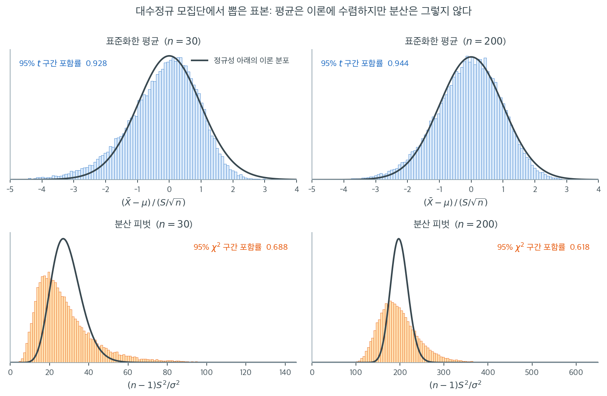
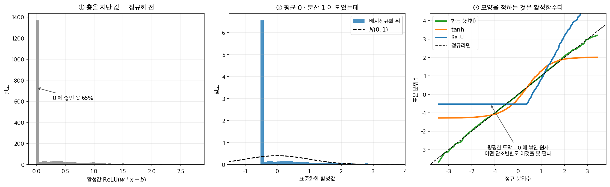

# 정규성 입문

## 1. 정규성이란 무엇인가

자료가 **정규분포**라고 알려진 종 모양 곡선을 따를 때 그 자료가 **정규분포를 따른다**고 말한다. 정규분포는 다음 확률밀도함수로 정의되는 연속확률분포이다.

$$
f(x) = \frac{1}{\sigma \sqrt{2\pi}} \exp\!\left( -\frac{(x - \mu)^2}{2\sigma^2} \right)
$$

여기서

- $\mu$는 분포의 평균,
- $\sigma > 0$은 표준편차,
- $x \in \mathbb{R}$은 임의의 실수값을 취할 수 있는 변수이다.

정규분포는 평균 $\mu$를 중심으로 대칭이다. **경험 법칙**이 확률의 집중 정도를 요약해 준다.

| 구간 | 근사 확률 |
|----------|------------------------|
| $\mu \pm \sigma$ | 68.3% |
| $\mu \pm 2\sigma$ | 95.4% |
| $\mu \pm 3\sigma$ | 99.7% |

!!! tip "표준정규분포"
    $\mu = 0$, $\sigma = 1$이면 **표준정규분포** $Z \sim N(0,1)$을 얻는다. 임의의 정규변수 $X \sim N(\mu, \sigma^2)$는 $Z = (X - \mu)/\sigma$로 표준화할 수 있다.

---

## 2. 왜 이 가정이 중요한가

$t$ 검정·분산분석·선형회귀가 모두 이 가정에 기대고, 가정이 깨지면 그 방법들이
내놓는 $p$ 값과 신뢰구간이 틀어진다. 그런데 **중심극한정리**가 그 요건을 크게
완화해 준다 — 평균 $\mu$, 유한 분산 $\sigma^2$ 의 독립동일분포 표본에서

$$
\frac{\bar{X}_n - \mu}{\sigma / \sqrt{n}} \xrightarrow{d} N(0, 1)
\qquad (n \to \infty)
$$

이므로 모집단이 정규가 아니어도 표본평균은 정규에 가까워진다. 그래서 정규성은
모집단의 성질이 아니라 **쓰려는 통계량의 성질**로 물어야 한다. 그 완화가 어디까지
가는지는 다음 절이 절차마다 따로 다루고, **어디서 멈추는지는 바로 다음 절이 말한다.**

---

## 3. 중심극한정리가 구해 주는 것과 구해 주지 못하는 것

CLT 이야기를 들으면 "표본만 크면 정규성은 신경 쓸 필요가 없다"고 정리하기 쉽다. 절반만 맞는 말이다. CLT는 **표본평균**에 대한 정리이지 표본에서 계산하는 모든 양에 대한 정리가 아니다. 다음 그림은 그 경계선을 한눈에 보인다. 모집단은 왜도 $2.26$인 대수정규분포이고, 각 표본에서 두 가지를 계산해 40000번 되풀이했다. 위 두 칸은 $t$ 통계량 $(\bar{X}-\mu)/(S/\sqrt{n})$이고, 아래 두 칸은 분산의 피벗 $(n-1)S^2/\sigma^2$이다. 검은 곡선은 모집단이 정규였다면 성립했을 이론 분포($t_{n-1}$과 $\chi^2_{n-1}$)이다.

위 칸을 보라. $n = 30$에서도 히스토그램이 $t_{29}$ 곡선과 제법 겹치고, 왼쪽으로 약간 끌린 꼬리 때문에 95% 신뢰구간의 실제 포함률은 $0.928$에 그친다. $n$을 200으로 늘리면 $0.944$로 올라 약속한 $0.95$에 거의 닿는다. CLT가 약속한 대로 작동한 것이다. 표본을 늘리는 것이 곧 치료가 된다.

아래 칸은 사정이 전혀 다르다. $n = 30$에서 주황색 히스토그램은 $\chi^2_{29}$ 곡선보다 왼쪽으로 몰려 있고 오른쪽 꼬리는 훨씬 길다. 95% 구간의 포함률은 $0.688$에 불과하다. 더 놀라운 것은 $n = 200$으로 표본을 여섯 배 이상 늘렸을 때의 결과다. 포함률이 나아지기는커녕 $0.618$로 **더 나빠졌다**. 이유는 간단하다. $S^2$의 표집분포는 모집단의 4차적률에 의존하는데, 대수정규의 4차적률은 정규의 그것과 애초에 다르다. 표본을 늘리면 $S^2$의 표집분포는 자기 자신의 극한에 정확히 수렴하지만 그 극한은 $\chi^2_{n-1}$이 아니다. 틀린 곳으로 정확하게 수렴하는 셈이다.

그래서 "자료가 정규인가"라는 물음은 언제나 "무엇을 하려는가"와 함께 던져야 한다. 평균을 다루는 절차라면 비정규성은 표본을 늘려 줄일 수 있는 오차이고, 분산을 다루는 절차라면 표본을 늘려도 사라지지 않는 편향이다. 이 장에서 배울 정규성 진단 도구들은 후자의 경우에 특히 값지다.

---

## 4. 정규성을 가정하는 자리

신뢰구간·가설검정·선형모형이 어디에서 정규성을 쓰는지는 다음 절
[통계적 추론에서의 핵심 역할](role_in_inference.md)이 $t$·$F$·구간의 식을 들고
하나씩 짚는다. 여기서는 한 가지만 새겨 둔다.

!!! warning "가정과 사실은 다르다"
    정규성은 가정이지 실제 자료가 보장하는 성질이 아니다. 정규성에 의존하는 방법을 쓰기 전에 반드시 확인하라. 확인 도구 — 시각적 방법(Q-Q 그림, 히스토그램)과 형식적 검정(Shapiro-Wilk, Anderson-Darling) — 은 14.2절부터 다룬다.

---

## 5. 정규가 아닌 자료의 예

모든 자료가 정규분포를 따르는 것은 아니다. 정규가 아닌 자료의 흔한 예는 다음과 같다.

- **치우친 분포**: 소득 자료는 대체로 오른쪽으로 치우쳐 있으며, 고소득자의 긴 꼬리가 평균을 중앙값 위로 끌어올린다.
- **두꺼운 꼬리 분포**: 금융 수익률은 흔히 정규분포보다 두꺼운 꼬리를 보이며, 극단적 사건이 정규 모형의 예측보다 자주 일어난다는 뜻이다.
- **이봉 또는 다봉 분포**: 봉우리가 둘 이상인 자료 — 예를 들어 성인 남녀가 섞인 집단의 키 — 는 정규성에서 크게 벗어난다.
- **유계이거나 이산인 자료**: 비율, 계수, 리커트 척도 응답은 범위가 제한되거나 이산이라는 성질 때문에 본래 정규가 아니다.

자료가 언제 정규성에서 벗어나는지 이해하는 일은 분석에 적절한 통계 도구와 방법을 고르는 데 필수적이다.

**AI로 보는 통계학 1.** 정규화는 정규성이 아니다

이 장 전체가 「정규인가」를 **묻는** 방법에 관한 것이다. 딥러닝은 그 물음을 거의 하지
않는다. 대신 다른 일을 한다 — **만들어 버린다.**

$2015$ 년 **세르게이 이오페**와 **크리스천 세게디**가 **배치정규화**를 내놓는다.
층 사이에 한 칸을 끼워 넣고, 미니배치 안에서 평균을 빼고 표준편차로 나눈다. 그게 전부다.
효과는 극적이어서 학습률을 몇 배 키울 수 있게 되었고, 오늘날 거의 모든 신경망이
이것이나 그 사촌(층정규화 등)을 달고 있다.

이름이 함정이다. **정규화(normalization)와 정규성(normality)은 다른 말이다.**
배치정규화가 맞추는 것은 **첫째·둘째 적률뿐**이고, 분포의 모양에는 손대지 않는다.

<figure markdown>
{ width="960" }
  <figcaption markdown>세 곡선 모두 평균 $0$, 분산 $1$ 이다. 그런데 하나만 대각선 위에 있다.</figcaption>
</figure>

왼쪽 칸이 층 하나를 지난 값이다. 입력 $64$ 차원에 무작위 가중치를 곱하고 ReLU 를
걸었더니 $2048$ 개 가운데 **$64.7\%$ 가 정확히 $0$** 이 되었다. 가운데 칸은 거기에
배치정규화를 건 결과다. 평균은 $0.0000$, 표준편차는 $1.0000$ — 소수 넷째 자리까지
정확하다. 그런데 왜도 $2.25$, 초과첨도 $4.99$ 는 **정규화 전과 한 자리도 다르지 않다.**
선형변환은 이 둘을 바꾸지 못하기 때문이다.

오른쪽 칸은 같은 선형결합에 활성함수만 바꿔 끼운 것이다. 셋 다 배치정규화를 걸었다.

| 활성함수 | 평균 | 표준편차 | 왜도 | 초과첨도 | $W$ | $p$ |
|---|---:|---:|---:|---:|---:|---:|
| 항등 (선형) | $0.0000$ | $1.0000$ | $0.04$ | $-0.02$ | $0.998$ | $0.68$ |
| $\tanh$ | $0.0000$ | $1.0000$ | $0.47$ | $-1.11$ | $0.907$ | $6\times10^{-17}$ |
| ReLU | $0.0000$ | $1.0000$ | $2.25$ | $4.99$ | $0.586$ | $9\times10^{-33}$ |

앞 두 칸이 같고 뒤 네 칸이 갈린다. 선형이면 중심극한정리가 알아서 정규로 만들어 주고
($p = 0.68$), $\tanh$ 는 양끝을 $\pm 1$ 에 가두어 **꼬리를 깎고**(초과첨도 $-1.11$),
ReLU 는 음수를 통째로 한 점에 모아 **원자를 만든다.** 모양을 정하는 것은 정규화가 아니라
활성함수다.

ReLU 쪽은 한 걸음 더 간다. 값의 $65\%$ 가 한 점에 있으면 — 오른쪽 칸의 평평한 토막이
그것이다 — **어떤 단조변환으로도 정규로 만들 수 없다.** 단조변환은 점을 옮길 뿐
쪼개지 못하기 때문이다. [변수변환](../non_normal_data/transformations.md)이 손댈 수
없는 종류의 비정규성이고,
$5$ 절 마지막 줄의 「유계이거나 이산인 자료」가 바로 이 경우다.

뒷이야기가 하나 더 있다. 이오페와 세게디는 배치정규화가 듣는 까닭을 **내부 공변량
이동**을 줄이기 때문이라고 설명했다. $2018$ 년에 **산투르카르·치프라스·일리아스·마드리**
가 그 설명을 직접 검증했고, 제목이 모든 것을 말한다 — 「배치정규화는 어떻게 최적화를
돕는가(**아니다, 내부 공변량 이동 때문이 아니다**)」. 공변량 이동은 거의 줄지 않으며,
실제로 일어나는 일은 손실 지형이 매끄러워지는 것이었다.

$2015$ 년부터 수십만 번 인용된 기법의 **작동 이유가 $3$ 년 뒤에 뒤집혔는데도 기법은
그대로 쓰인다.** 효과를 재는 일과 까닭을 대는 일이 다른 일이라는 것 — 이 책의
[인과 추론의 기준](../../ch12/causation/causal_criteria.md) 쪽이 내내 하는 말이기도 하다.

_확인한 곳 — 두 논문의 해와 제목, 저자 이름. 표의 수는 모두 직접 모의실험한 값이다_

---

## 연습문제

**연습문제 1.** 
정규분포 $N(\mu, \sigma^2)$의 확률밀도함수를 쓰고 두 모수의 역할을 밝혀라.

??? success "풀이"
    확률밀도함수는

    $$
    f(x) = \frac{1}{\sqrt{2\pi\sigma^2}} \exp\!\left(-\frac{(x-\mu)^2}{2\sigma^2}\right), \quad x \in \mathbb{R}
    $$

    - $\mu$(평균)는 분포의 중심이다. 봉우리의 위치와 대칭축을 결정한다.
    - $\sigma^2$(분산)는 산포를 조절한다. $\sigma^2$이 크면 넓고 평평한 종 모양이 되고, 작으면 높고 좁은 모양이 된다.
    - $\sigma$(표준편차)는 $x$와 같은 단위이므로 $\sigma^2$보다 해석하기 쉽다.

**연습문제 2.** 
정규분포의 68-95-99.7 법칙을 서술하고 표준정규 누적분포함수로 95% 값을 확인하라.

??? success "풀이"
    68-95-99.7 법칙은 $X \sim N(\mu, \sigma^2)$에 대해 다음을 말한다.

    - $P(\mu - \sigma < X < \mu + \sigma) \approx 0.683$
    - $P(\mu - 2\sigma < X < \mu + 2\sigma) \approx 0.954$
    - $P(\mu - 3\sigma < X < \mu + 3\sigma) \approx 0.997$

    $Z \sim N(0,1)$일 때 95% 값을 확인하면, 표준정규 누적분포함수를 $\Phi$라 할 때 $P(-2 < Z < 2) = \Phi(2) - \Phi(-2) = 0.9772 - 0.0228 = 0.9544 \approx 95.4\%$이다.

    정확히 95%가 되는 구간은 $z = 1.96$을 쓴다: $P(-1.96 < Z < 1.96) = 0.95$.

**연습문제 3.** 
$X \sim N(70, 100)$(평균 70, 분산 100)일 때 $P(X > 85)$를 구하라.

??? success "풀이"
    표준화한다: $Z = (X - \mu)/\sigma = (85 - 70)/10 = 1.5$.

    $$
    P(X > 85) = P(Z > 1.5) = 1 - \Phi(1.5) = 1 - 0.9332 = 0.0668
    $$

    85를 넘을 확률은 약 6.7%이다.

**연습문제 4.** 
정규분포가 실무에서 그토록 자주 나타나는 이유를 중심극한정리를 들어 설명하라.

??? success "풀이"
    중심극한정리(CLT)는 평균과 분산이 유한한 독립동일분포 확률변수 $n$개의 합(또는 평균)이 원래 분포와 무관하게 $n \to \infty$일 때 정규분포로 분포수렴한다고 말한다.

    현실의 많은 측정값은 수많은 작고 독립적인 요인이 합쳐진 결과이다. 키는 여러 유전자와 환경 요인의 영향을 받고, 측정오차는 작은 기기 오차들의 합이며, 금융 수익률은 (근사적으로) 여러 독립적인 정보 충격이 쌓인 것이다. 각 경우에 CLT가 합계를 정규 쪽으로 밀어붙인다.

    CLT는 또한 $n$이 클 때 정규가 아닌 자료에서도 정규 기반 방법(t 검정, 회귀)이 잘 작동하는 이유를 설명해 준다. 평균의 표집분포가 어쨌든 근사적으로 정규이기 때문이다.

**연습문제 5.** 
5절은 비율처럼 범위가 제한된 자료를 "본래 정규가 아닌" 예로 들었다. 가장 단순한 유계 자료로 $X \sim U(0,1)$을 놓자.

(a) $\mu$와 $\sigma$를 구하고, 1절 표에 나온 세 구간 $\mu \pm \sigma$, $\mu \pm 2\sigma$, $\mu \pm 3\sigma$의 확률을 정확히 구하라.

(b) 세 값을 68.3%, 95.4%, 99.7%와 비교해 어긋나는 방향(부족인지 과다인지)을 말하고, 그 방향이 "유계"라는 성질에서 어떻게 나오는지 설명하라.

(c) 체비셰프 부등식 $P(\lvert X - \mu \rvert \ge k\sigma) \le 1/k^2$를 써서 유한분산 분포라면 $P(\lvert X - \mu \rvert < 2\sigma)$와 $P(\lvert X - \mu \rvert < 3\sigma)$가 각각 최소 얼마인지 구하라. $\mu \pm \sigma$ 줄에는 그런 하한이 없음을 분포 하나를 들어 보여라.

??? success "풀이"
    (a) $U(0,1)$은 $\mu = 1/2$, $\sigma^2 = 1/12$, $\sigma = 1/\sqrt{12} = 0.2887$이다. 밀도가 $[0,1]$에서 1로 평평하므로 구간의 확률은 구간이 $[0,1]$과 겹치는 길이와 같다.

    - $\mu \pm \sigma = (0.2113,\ 0.7887)$ — 길이 $2\sigma = 1/\sqrt{3} = 0.5774$, 확률 $0.5774$.
    - $\mu \pm 2\sigma$ — 길이 $4\sigma = 1.1547 > 1$이므로 $[0,1]$ 전체를 덮는다. 확률 $1$.
    - $\mu \pm 3\sigma$ — 역시 전체를 덮는다. 확률 $1$.

    (b) 비교하면 다음과 같다.

    | 구간 | 정규 | $U(0,1)$ | 차 |
    |---|---|---|---|
    | $\mu \pm \sigma$ | 0.683 | 0.577 | $-0.106$ (부족) |
    | $\mu \pm 2\sigma$ | 0.954 | 1.000 | $+0.046$ (과다) |
    | $\mu \pm 3\sigma$ | 0.997 | 1.000 | $+0.003$ (과다) |

    $U(0,1)$의 지지집합은 $[\mu - \sqrt{3}\sigma,\ \mu + \sqrt{3}\sigma]$이고 $\sqrt{3} = 1.732 < 2$이므로 $2\sigma$ 밖에는 확률이 **전혀** 없다. 정규라면 그곳에 4.6%가 놓인다. 꼬리에 놓이지 못한 그 확률이 중심에서 바깥쪽으로 밀려 분포가 평평해지고, 그만큼 $1\sigma$ 안의 확률이 모자라게 된다. 유계성이 두 줄을 반대 방향으로 밀어내는 것이다.

    (c) $k = 2$면 $P(\lvert X - \mu \rvert \ge 2\sigma) \le 1/4$이므로 $P(\lvert X - \mu \rvert < 2\sigma) \ge 0.75$이고, $k = 3$이면 $\ge 1 - 1/9 = 0.8889$이다. 그러나 $k = 1$에서는 $1/k^2 = 1$이라 부등식이 공허하다. 실제로 $P(X = \mu - \sigma) = P(X = \mu + \sigma) = 1/2$인 두 점 분포는 평균이 $\mu$, 표준편차가 $\sigma$인데 $P(\lvert X - \mu \rvert < \sigma) = 0$이다.

    따라서 "$2\sigma$ 구간에 95% 정도가 들어 있다"는 확인은 정규성의 증거가 되지 못한다. 분포와 무관하게 최소 75%가 보장되고, 꼬리가 없는 분포에서는 오히려 100%가 되어 버린다. 정작 분포에 민감한 줄은 하한이 없는 $1\sigma$ 줄이다.

**연습문제 6.** 
3절은 왜도 $2.26$인 대수정규 모집단에서 95% 명목 절차의 실제 포함률을 보고했다. $t$ 구간은 $n = 30$에서 $0.928$, $n = 200$에서 $0.944$였고, 분산의 카이제곱 구간은 $n = 30$에서 $0.688$, $n = 200$에서 $0.618$이었다.

(a) 네 경우의 실제 비포함률, 즉 유의수준 $0.05$로 쓴 검정의 실제 1종오류율을 적고 명목 $0.05$의 몇 배인지 구하라.

(b) 두 절차 중 어느 쪽 오차가 "표본을 늘려 줄일 수 있는 오차"이고 어느 쪽이 "표본을 늘려도 남는 편향"인지 3절의 근거를 들어 분류하라.

(c) 분산 쪽에서 $n$을 30에서 200으로 늘렸을 때 포함률이 떨어진 것은 어떤 의미에서 수렴 현상인가. 무엇이 무엇으로 수렴하고 있는지 한 문장으로 적어라.

??? success "풀이"
    (a) 비포함률은 $1$에서 포함률을 뺀 값이다.

    | 절차 | $n$ | 포함률 | 실제 오류율 | 명목의 배수 |
    |---|---|---|---|---|
    | $t$ 구간 | 30 | 0.928 | 0.072 | 1.44 |
    | $t$ 구간 | 200 | 0.944 | 0.056 | 1.12 |
    | 분산 구간 | 30 | 0.688 | 0.312 | 6.24 |
    | 분산 구간 | 200 | 0.618 | 0.382 | 7.64 |

    (b) $t$ 구간의 오차는 줄일 수 있는 오차다. 중심극한정리가 $(\bar{X}_n - \mu)/(\sigma/\sqrt{n})$을 $N(0,1)$로 몰아가므로 $t$ 통계량의 표집분포는 $n$이 커지면서 $t_{n-1}$에 가까워지고, 실제로 오류율이 $0.072$에서 $0.056$으로 내려갔다.

    분산 구간의 오차는 남는 편향이다. $(n-1)S^2/\sigma^2$의 표집분포는 모집단의 4차적률에 의존하는데 대수정규의 4차적률은 정규의 것과 애초에 다르다. 표본을 늘리면 이 피벗의 표집분포는 자기 자신의 극한으로 정확히 수렴하지만 그 극한이 $\chi^2_{n-1}$이 아니다.

    (c) 실제 표집분포가 $\chi^2_{n-1}$이 아닌 자기 극한으로 수렴하면서 포함률도 그 극한이 정하는 값(연습문제 8에서 $\approx 0.571$)으로 내려가며 수렴하고 있다.

    즉 $0.688 \to 0.618$은 수렴이 깨진 것이 아니라 틀린 곳으로 정확하게 수렴하는 과정의 한 토막이다.

**연습문제 7.** 
3절의 $t$ 구간 포함률만 본다. 명목이 $0.95$이므로 포함률 오차를 $e_n = 0.95 - (\text{포함률})$로 정의하자.

(a) $e_{30}$과 $e_{200}$을 구하고 비 $e_{30}/e_{200}$을 계산하라.

(b) 오차가 $c/\sqrt{n}$ 꼴로 줄어든다면 이 비가 얼마여야 하는가. $c/n$ 꼴이라면?

(c) 관측된 비가 $c/\sqrt{n}$이 예측하는 값보다 큰 것이 베리–에센 정리와 모순인가? 답하고 까닭을 밝혀라.

(d) 3절의 모의는 40000번 되풀이한 것이다. 포함률의 몬테카를로 표준오차를 구해, (a)의 비로 (b)의 두 가설을 가릴 수 있는지 판단하라.

??? success "풀이"
    (a) $e_{30} = 0.950 - 0.928 = 0.022$, $e_{200} = 0.950 - 0.944 = 0.006$이고

    $$
    \frac{e_{30}}{e_{200}} = \frac{0.022}{0.006} = 3.67
    $$

    (b) $e_n = c/\sqrt{n}$이면 비는 $\sqrt{200/30} = \sqrt{6.667} = 2.58$이어야 한다. $e_n = c/n$이면 비는 $200/30 = 6.67$이다.

    (c) 모순이 아니다. 베리–에센 정리는 표준화한 표본평균의 분포와 $N(0,1)$ 사이 거리에 대한 **상한**을 준다. 상한이 $n^{-1/2}$로 줄어든다는 말은 실제 오차가 그보다 느리게 줄 수 없다는 뜻일 뿐, 그보다 빨리 줄 수 없다는 뜻이 아니다. 실제로 양쪽 구간의 포함률에서는 더 빠른 감소가 흔히 일어난다. 에지워스 전개에서 $n^{-1/2}$ 항은 왜도가 곱해진 $z$의 홀함수이므로 $\pm z$ 두 끝에서 부호가 반대가 되어 상쇄되고, 양쪽 포함률의 선행 오차는 $n^{-1}$ 항에서 비로소 나타난다. 한쪽 꼬리만 보면 $n^{-1/2}$이지만 대칭 구간에서는 두 꼬리의 오차가 서로 상쇄되는 것이다.

    (d) 포함률 $\hat{p}$는 비율 추정값이므로 표준오차는 $\sqrt{\hat{p}(1-\hat{p})/40000}$이다.

    $$
    \mathrm{se}(0.928) = \sqrt{\frac{0.928 \times 0.072}{40000}} = 0.00129, \qquad \mathrm{se}(0.944) = \sqrt{\frac{0.944 \times 0.056}{40000}} = 0.00115
    $$

    두 표준오차만큼 양쪽으로 벌려 보면 $e_{30} \in [0.0194,\ 0.0246]$, $e_{200} \in [0.0037,\ 0.0083]$이다. 비가 가질 수 있는 범위는

    $$
    \frac{0.0194}{0.0083} = 2.34 \quad \text{부터} \quad \frac{0.0246}{0.0037} = 6.64 \quad \text{까지}
    $$

    이고 이 구간은 $2.58$과 $6.67$을 모두 품는다. 따라서 이 모의 하나로는 $n^{-1/2}$과 $n^{-1}$을 가릴 수 없다.

    작은 수 두 개의 비는 분모의 상대오차가 그대로 증폭된다. $e_{200}$이 $0.006$밖에 되지 않아 반복 40000번도 수렴률을 판정하기에는 부족하다.

**연습문제 8.** 
3절의 모집단은 왜도 $2.26$인 대수정규분포다. $Y = \exp(\mu_0 + sZ)$, $Z \sim N(0,1)$일 때 $w = e^{s^2}$로 쓰면 왜도와 (초과가 아닌) 첨도 $\beta_2 = E[(Y - EY)^4]/\mathrm{Var}(Y)^2$는

$$
\gamma_1 = (w + 2)\sqrt{w - 1}, \qquad \beta_2 = w^4 + 2w^3 + 3w^2 - 3
$$

(a) $s = 0.6$이 $\gamma_1 = 2.26$을 주는지 확인하라.

(b) 그 $s$에서 $\beta_2$와 초과첨도를 구하고, 2장의 부등식 $\beta_2 \ge 1 + \gamma_1^2$가 얼마의 여유로 성립하는지 보라.

(c) 큰 $n$에서 $\mathrm{Var}(S^2) \approx \sigma^4(\beta_2 - 1)/n$이다. 이것으로 $\chi^2_{n-1}$을 믿고 만든 95% 분산구간의 극한 포함률을 구하고 3절이 보고한 $0.688 \to 0.618$과 비교하라.

??? success "풀이"
    (a) $s^2 = 0.36$이므로 $w = e^{0.36} = 1.43333$이다. 그러면 $w - 1 = 0.43333$, $\sqrt{w-1} = 0.65828$, $w + 2 = 3.43333$이고

    $$
    \gamma_1 = 3.43333 \times 0.65828 = 2.2601
    $$

    3절이 말한 왜도 $2.26$과 일치한다. 그림의 모집단은 로그 척도 표준편차가 $0.6$인 대수정규분포다.

    (b) $w^2 = 2.05443$, $w^3 = 2.94466$, $w^4 = 4.22070$이므로

    $$
    \beta_2 = 4.22070 + 2(2.94466) + 3(2.05443) - 3 = 4.22070 + 5.88932 + 6.16330 - 3 = 13.2733
    $$

    초과첨도는 $13.2733 - 3 = 10.2733$이다. 한편 $1 + \gamma_1^2 = 1 + 2.26^2 = 6.1080$이므로

    $$
    \beta_2 - (1 + \gamma_1^2) = 13.2733 - 6.1080 = 7.17 > 0
    $$

    부등식은 $7.17$의 여유로 성립한다. 이 분포는 왜도가 요구하는 최소 첨도보다 두 배 이상 뚱뚱한 꼬리를 가진 것이다.

    (c) 정규라면 $\beta_2 = 3$이어서 $\mathrm{Var}(S^2) \approx 2\sigma^4/n$이고, 이것이 바로 $\chi^2_{n-1}$ 구간이 전제하는 산포다. 실제 산포는 그보다

    $$
    \frac{\beta_2 - 1}{2} = \frac{12.2733}{2} = 6.137 \ \text{배}
    $$

    이고 표준편차로는 $\sqrt{6.137} = 2.477$배다. 피벗 $T = (n-1)S^2/\sigma^2$는 큰 $n$에서 평균이 $n-1$ 근처이고 표준편차가 $\chi^2_{n-1}$의 $\sqrt{2(n-1)}$의 $2.477$배다. 구간은 $\chi^2$ 분위수로 만들었으므로 폭이 대략 $\pm 1.96\sqrt{2(n-1)}$이고, 극한 포함률은

    $$
    P\!\left( \lvert Z \rvert \le \frac{1.96\sqrt{2(n-1)}}{\sqrt{(n-1)(\beta_2 - 1)}} \right) = P\!\left( \lvert Z \rvert \le 1.96\sqrt{\frac{2}{12.2733}} \right) = P(\lvert Z \rvert \le 0.791) = 2(0.7855) - 1 = 0.571
    $$

    3절의 수치는 $n = 30$에서 $0.688$, $n = 200$에서 $0.618$이었다. 두 값은 이 극한값 $0.571$을 향해 내려가는 중이다. 표본을 늘릴수록 포함률은 명목 $0.95$가 아니라 4차적률이 정하는 $0.571$에 가까워진다.

**연습문제 9.** 
5절은 이산이거나 유계인 자료를 정규가 아닌 예로 들었다. 다음 세 점 분포를 보라.

$$
P(X = -\sqrt{3}) = P(X = \sqrt{3}) = \tfrac{1}{6}, \qquad P(X = 0) = \tfrac{2}{3}
$$

(a) $E[X] = 0$, $\mathrm{Var}(X) = 1$, 왜도 $0$, 초과첨도 $0$임을 확인하라.

(b) 1절 표의 세 구간 확률을 구해 68.3%, 95.4%, 99.7%와 비교하라. 어느 줄이 가장 비슷하고 어느 줄이 가장 어긋나는가.

(c) 연습문제 8 (c)의 식에 이 분포의 $\beta_2$를 넣으면 무엇이 나오는가. 큰 $n$에서 평균에 대한 $t$ 절차와 분산에 대한 카이제곱 구간이 각각 어떻게 되는지 말하고, 그것이 3절의 교훈과 어긋나지 않는 까닭을 밝혀라.

??? success "풀이"
    (a) 분포가 $0$에 대해 대칭이므로 홀수 적률은 모두 $0$이다. 따라서 $E[X] = 0$, $E[X^3] = 0$이고 왜도는 $0$이다. 나머지는

    $$
    E[X^2] = 2 \times \tfrac{1}{6} \times 3 = 1, \qquad E[X^4] = 2 \times \tfrac{1}{6} \times 9 = 3
    $$

    이므로 $\mathrm{Var}(X) = 1$, $\beta_2 = E[X^4]/\mathrm{Var}(X)^2 = 3$, 초과첨도는 $3 - 3 = 0$이다. 왜도와 초과첨도가 정규분포와 똑같다.

    (b) $\mu = 0$, $\sigma = 1$이므로

    | 구간 | 정규 | 이 분포 |
    |---|---|---|
    | $\lvert X \rvert < \sigma$ | 0.683 | $P(X = 0) = 0.667$ |
    | $\lvert X \rvert < 2\sigma$ | 0.954 | $1.000$ |
    | $\lvert X \rvert < 3\sigma$ | 0.997 | $1.000$ |

    $\sqrt{3} = 1.732 < 2$이므로 $2\sigma$ 밖에는 확률이 없다. $1\sigma$ 줄은 $0.667$ 대 $0.683$으로 $0.016$밖에 차이 나지 않아 가장 비슷하고, $2\sigma$ 줄이 $0.046$ 차이로 가장 어긋난다. 값 셋만 가지는 이산분포가 세 구간 요약에서는 정규와 상당히 닮아 보인다는 점을 눈여겨보라. 왜도, 초과첨도, 경험 법칙 세 줄 중 둘까지 맞춰 놓고도 분포는 전혀 정규가 아니다. 적률 몇 개를 보는 진단은 이런 분포를 그냥 통과시킨다.

    (c) $\beta_2 - 1 = 2$이므로 $\mathrm{Var}(S^2) \approx 2\sigma^4/n$으로 정규와 같다. 연습문제 8 (c)의 식에 넣으면

    $$
    P\!\left( \lvert Z \rvert \le 1.96\sqrt{\tfrac{2}{2}} \right) = P(\lvert Z \rvert \le 1.96) = 0.95
    $$

    평균에 대한 $t$ 절차는 중심극한정리로 작동하고, 분산에 대한 카이제곱 구간도 큰 $n$에서 포함률이 명목 $0.95$에 수렴한다. (작은 $n$에서는 $S^2$가 몇 개 값만 가지는 심하게 이산인 양이므로 정확한 $\chi^2$ 분위수와는 여전히 어긋난다.)

    3절이 말한 것은 "정규가 아니면 분산 추론이 망한다"가 아니라 "분산 추론은 모집단의 4차적률에 의존한다"였다. 의존하는 양이 정규의 값과 같으면 비정규성이 해를 입히지 않는다. 비정규성 자체가 아니라 **어떤 적률이 어긋났는지**가 절차의 운명을 정한다.

**연습문제 10.** 
3절의 대수정규 모집단($\gamma_1 = 2.26$, 초과첨도 $10.27$)에서 표본을 뽑는다.

(a) $t$ 구간의 포함률 오차가 $c/\sqrt{n}$ 꼴로 줄어든다고 보고, $n = 200$의 오차 $0.006$에서 $n = 2000$의 포함률을 외삽하라. 같은 $n = 2000$에서 분산구간의 포함률은 어디로 가는가.

(b) 수준 $0.05$의 일치성 있는 정규성 검정을 쓰면 $n = 2000$에서 기각확률이 사실상 $1$이다. 귀무가설이 무엇인지로 그 까닭을 설명하라.

(c) (a)와 (b)를 합쳐, "정규성 검정이 기각했으니 평균에 대한 $t$ 절차를 쓰지 않는다"는 규칙과 "$n = 10$에서 기각하지 못했으니 분산의 카이제곱 구간을 써도 된다"는 규칙이 각각 왜 틀린 판단인지 적어라. 어느 쪽 잘못이 더 위험한가.

??? success "풀이"
    (a) $c/\sqrt{n}$ 꼴이면 $n$을 10배로 늘릴 때 오차는 $\sqrt{10}$배로 줄어든다.

    $$
    e_{2000} \approx 0.006 \times \sqrt{\frac{200}{2000}} = \frac{0.006}{3.162} = 0.0019
    $$

    따라서 $t$ 구간의 포함률은 약 $0.948$로 명목 $0.95$와 사실상 구별되지 않는다. 분산구간은 반대 방향이다. $0.688 \to 0.618$에 이어 연습문제 8에서 구한 극한 $0.571$ 쪽으로 더 내려간다. 같은 모집단, 같은 표본에서 한 절차는 고쳐지고 다른 절차는 더 나빠진다.

    (b) 정규성 검정의 귀무가설은 "모집단이 **정확히** 정규"이다. 대수정규는 정규가 아니므로 $H_0$는 거짓이고, 일치성 있는 검정이라면 검정력이 $n \to \infty$에서 $1$로 간다. 기각은 "이탈이 크다"는 말이 아니라 "이탈이 $0$이 아니다"는 말일 뿐이다. $n$이 크면 실무상 무해한 크기의 이탈도 반드시 유의해진다.

    (c) 첫째 규칙이 틀린 까닭. $n = 2000$에서 기각은 거의 확실하지만 바로 그 $n$에서 $t$ 구간의 포함률 오차는 $0.002$로 무해하다. 검정이 가장 잘 기각하는 자리가 $t$ 절차가 가장 건강한 자리다. 이 규칙은 쓸 수 있는 절차를 버리게 한다.

    둘째 규칙이 틀린 까닭. $n = 10$에서는 검정력이 거의 없어 통과가 정규성의 증거가 되지 못한다. 그런데 바로 그 자리에서 분산구간의 왜곡이 가장 크고($n = 30$에서 이미 포함률 $0.688$), 표본을 늘려도 사라지지 않는다. 이 규칙은 명목 95%가 실제로는 60%대인 구간을 믿게 한다.

    둘째가 더 위험하다. 첫째 잘못은 멀쩡한 도구를 쓰지 않는 보수적 손실이고, 둘째 잘못은 틀린 구간을 참으로 보고하는 손실이다.

    두 방향 모두에서 틀리는 까닭은 하나다. 검정이 답하는 물음은 "모집단이 정규인가"이고 결정에 필요한 물음은 "이 $n$에서 이 절차의 왜곡이 얼마인가"인데, 두 물음의 답이 $n$에 대해 서로 반대로 움직이기 때문이다.

---

## 정리하며

정규성은 **자료가 아니라 절차에 대한 요구**로 이해해야 한다.

- **정규분포는 두 모수로 정해진다.** $\mu$ 가 위치, $\sigma$ 가 퍼짐이며 대칭이고 봉우리가 하나다.
- **정규성이 필요한 곳은 생각보다 좁다.** $t$ 와 $F$ 의 **정확한** 분포, 분산의 카이제곱 구간, 예측구간이 그것이다. 계수의 불편성이나 큰수의 법칙에는 필요 없다.
- **중심극한정리가 많은 것을 덮어 준다.** 표본평균에 기반한 절차는 $n$ 이 크면 모집단이 정규가 아니어도 작동한다.
- **하지만 모두 그런 것은 아니다.** 분산 추론은 4차적률에 의존해 표본을 늘려도 나아지지 않으며, 이 책에서 여러 번 확인했다.
- **"자료가 정규인가"보다 "이 절차가 위반을 견디는가"가 옳은 물음이다.** 14장 전체가 그 판단을 돕는 도구들이다.

다음 절 **[통계적 추론에서의 핵심 역할](role_in_inference.md)**로 넘어간다. 정규성이 어디에 쓰이는지를 추론의 자리마다 짚고, 그다음 14.2절부터 [그림으로 판정하는 방법](../graphical_methods/histogram_density.md)으로 들어간다.
