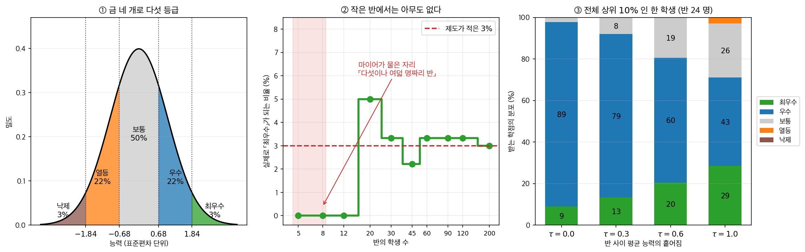
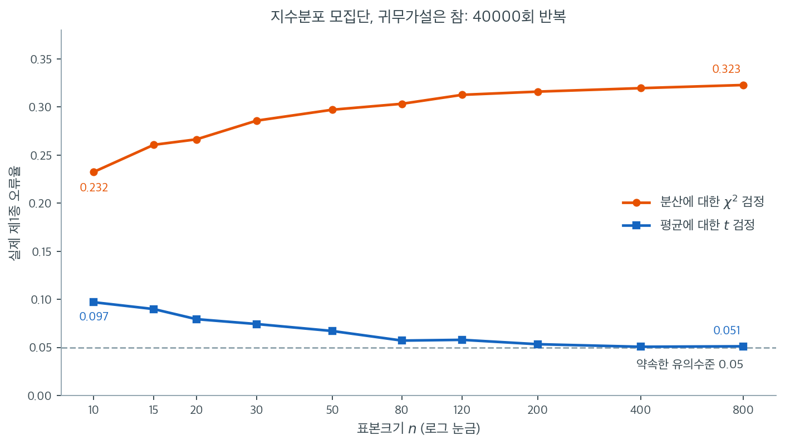

# 통계적 추론에서의 중심적 역할

## 1. 정규성이 중요한 이유

가장 널리 쓰이는 통계 절차 상당수가 자료 또는 자료의 어떤 함수가 정규분포를 따른다는 가정에 기댄다. 이 가정은 단순한 기술적 세부가 아니다. 그 방법들이 내놓는 $p$값, 신뢰구간, 검정통계량이 타당한지를 곧바로 결정한다. 정규성이 성립하면 고전적 추론을 떠받치는 이론적 표집분포가 정확하다. 정규성이 무너지면 그로부터 얻은 결론이 오도할 수 있다.

정규성 가정이 어디서 들어오며 각 절차가 위배에 얼마나 민감한지 이해하면, 정규성 검정이 언제 필요하고 언제 가정을 안전하게 완화할 수 있는지 판단할 수 있다.

<div class="storybox" markdown>

**그림으로 보는 통계학 1.** 물어보지 않고 정해 버린 분포

$1908$ 년 $8$ 월 $21$ 일 『사이언스』에 미주리대 심리학 교수 막스 마이어가 「학생의 등급 매기기」를 실었다. 그는 학생의 능력이 정규곡선을 따른다고 보고 그 곡선 위에 금을 그었다. 능력이 사실상 바닥나는 극단점을 $3$ 으로 잡고, 상위 집단과 중간 집단을 가르는 자리를 $0.68$ 로 두었다. 그다음이 그의 수법이다 — 그 둘의 **중점** $1.84$ 를 다시 그었다. "가장 뛰어난 학생이 둘째 집단의 으뜸보다 나은 만큼, 그 사람이 중간 집단의 으뜸보다 낫도록" 나눈다는 뜻이었다. $\Phi(-1.84) = 0.033$, $\Phi(-0.68) = 0.248$ 이니 다섯 칸의 몫은 $3 / 22 / 50 / 22 / 3$ 퍼센트가 된다(그림 ①). 상대평가의 눈금은 이렇게 태어났다.



그런데 그 비율을 적은 바로 그 문장은 주장이 아니라 **물음**이었다. "$3$ 퍼센트를 최우수, $22$ 퍼센트를 우수, $50$ 퍼센트를 보통, $22$ 퍼센트를 열등, $3$ 퍼센트를 낙제라 부르는 이런 제도를 기관이 채택한다면, **학생이 다섯이나 여덟밖에 없는 반을 맡은** 개별 교사는 어떻게 그 제도를 따를 수 있는가?" 마이어는 자기 눈금의 급소를 알고 있었다.

그림 ②가 그 물음에 답한다. 다섯 명 반에서 $3\%$ 는 $0.15$ 명, 여덟 명 반에서는 $0.24$ 명이다. 사람을 쪼갤 수 없으니 **둘 다 $0$ 명이다.** $12$ 명까지도 $0$ 명이고, $20$ 명이 되어야 비로소 한 명이 나오는데 그 한 명은 전체의 $5\%$ 라서 이번에는 제도가 적은 $3\%$ 를 $1.7$ 배로 넘는다. 눈금은 연속곡선에서 왔는데 적용 대상은 스물 안팎의 사람이다. 마이어가 내놓은 답은 "교사가 스스로 방법을 찾아야 한다"였다.

그림 ③은 더 나쁜 쪽이다. 반마다 수준이 다르면 어떻게 되는가. 전체 학생 중 상위 $10\%$ 에 드는 **한 사람**을 $24$ 명짜리 반에 넣어 본다. 모든 반이 똑같은 모집단이면($\tau = 0$) 그는 거의 언제나 우수를 받는다 — 최우수 $9\%$, 우수 $89\%$. 반 평균이 표준편차 하나만큼 흩어지면($\tau = 1$) 같은 사람이 최우수 $29\%$, 우수 $43\%$, 보통 $26\%$, 열등 $3\%$ 로 **네 등급에 걸쳐 흩어진다.** 능력은 한 번도 변하지 않았고 급우만 바뀌었다.

마이어는 이것을 짐작만 한 것이 아니다. 같은 글의 앞쪽에서 그는 미주리대가 $5$ 년간 시행한 결과를 교사 마흔 명의 성적부로 집계했고, 그 실험이 "완전한 실패로 선언되어야 한다"고 적었다. "성적 매기기에 통일성이란 없고 가장 큰 격차만 있다. 우등을 노리는 학생은 어떤 교사의 수업을 고르고 어떤 교사를 피할지 신경 써야 한다는 것이 **공공연히 인정되기에 이르렀다**." 자기 제도를 제안하는 논문에서 그 제도가 이미 실패한 기록을 먼저 보고한 셈이다.

이 장이 하는 일은 자료에게 정규인지 **묻는** 것이다. 마이어의 눈금은 그 물음을 건너뛰고 답을 먼저 정한 뒤 사람을 거기 맞춰 넣었다. 답을 먼저 정하면 틀리는 쪽은 자료가 아니라 제도다.

_확인한 곳 — 마이어의 $1908$ 년 『사이언스』 논문 원문(N. S. Vol. XXVIII, No. 712, $243$–$250$ 쪽). 인용한 두 문장, $3/22/50/22/3$ 이라는 비율, 그 비율을 $0.68$ 과 $1.84$ 에서 얻은 과정, 교사 마흔 명을 집계해 내린 「완전한 실패」라는 평가를 모두 그 글에서 확인했다. 그림과 표의 수는 모두 직접 계산한 값이다_

</div>

---

## 2. 흔한 추론 절차에서의 정규성

### 일표본·이표본 t 검정

일표본 $t$ 검정은 모평균 $\mu$가 가설값 $\mu_0$과 같은지 평가한다. 검정통계량은

$$
t = \frac{\bar{X} - \mu_0}{S / \sqrt{n}}
$$

여기서 $\bar{X}$는 표본평균, $S$는 표본표준편차, $n$은 표본크기이다. $X_1, X_2, \ldots, X_n \overset{\text{iid}}{\sim} N(\mu, \sigma^2)$이라는 가정 아래에서 통계량 $t$는 표본크기 $n$과 무관하게 자유도 $n - 1$의 $t$ 분포를 **정확히** 따른다.

평균 $\mu_1$과 $\mu_2$를 비교하는 이표본 $t$ 검정도 마찬가지로 두 모집단의 정규성을 요구한다. 모집단 분포가 정규이고 분산이 같으면 합동 검정통계량

$$
t = \frac{\bar{X}_1 - \bar{X}_2}{S_p \sqrt{1/n_1 + 1/n_2}}
$$

가 자유도 $n_1 + n_2 - 2$의 $t$ 분포를 따른다. 여기서 $S_p$는 합동 표준편차이다.

### F 검정과 분산분석

일원배치 분산분석에서 $F$ 통계량은 집단 간 분산과 집단 내 분산을 비교한다.

$$
F = \frac{\text{MSB}}{\text{MSW}}
$$

여기서 MSB는 집단 간 평균제곱, MSW는 집단 내 평균제곱이다. 모든 집단 평균이 같다는 귀무가설 아래에서, 그리고 각 집단의 관측값이 분산이 같은 정규 모집단에서 독립적으로 뽑혔다는 가정 아래에서, 통계량 $F$는 자유도 $k - 1$과 $N - k$의 $F$ 분포를 따른다. $k$는 집단의 개수, $N$은 전체 표본크기이다.

### 신뢰구간

모분산을 모를 때 모평균에 대한 $100(1 - \alpha)\%$ 신뢰구간은 다음 형태이다.

$$
\bar{X} \pm t_{\alpha/2,\, n-1} \cdot \frac{S}{\sqrt{n}}
$$

(반복표집에서 그런 구간의 $100(1 - \alpha)\%$가 참 $\mu$를 포함한다는) 포함 보장은 $\bar{X}$의 표집분포가 정규이고 $S^2$이 $\bar{X}$와 독립이라는 데 달려 있다. 두 성질 모두 바탕 자료의 정규성에서 따라 나온다.

---

## 3. 정당화로서의 중심극한정리

**중심극한정리(CLT)**는 엄격한 정규성 요건을 중요한 방식으로 완화해 준다. 평균 $\mu$, 유한 분산 $\sigma^2$을 갖는 독립동일분포 확률변수 $X_1, X_2, \ldots, X_n$에 대해

$$
\frac{\bar{X} - \mu}{\sigma / \sqrt{n}} \xrightarrow{d} N(0, 1) \quad (n \to \infty)
$$

이 분포수렴은 $n$이 충분히 크면 모집단 분포의 모양과 무관하게 표준화한 표본평균의 표집분포가 근사적으로 정규임을 뜻한다. 실무에서는 이 사실이, 자료 자체가 정규가 아니더라도 $n$이 충분히 크다면 $z$ 검정과 근사적 $t$ 검정을 쓰는 것을 정당화한다.

다만 CLT에는 중요한 단서가 따른다.

- **"충분히 크다"는 모집단의 모양에 달려 있다.** 정규에 가까운 대칭분포라면 $n \geq 20$으로 충분할 수 있다. 심하게 치우쳤거나 꼬리가 두꺼운 분포라면 $n$이 수백 개 필요할 수 있다.
- **CLT는 표본평균에 적용되며 다른 통계량에는 적용되지 않는다.** 표본분산, 중앙값, 상관계수 같은 통계량은 각자의 점근분포를 가지며 정규성이나 다른 조건을 요구할 수 있다.
- **정확한 추론과 근사적 추론.** $n$이 작으면 CLT 근사를 믿을 수 없고, 정규성을 요구하는 정확한 분포 결과가 필수적이 된다.

---

## 4. 정규성이 무너지면 무엇이 깨지는가

정규성 가정이 위배되면 여러 문제가 생길 수 있다.

**제1종 오류율의 부풀림.** 참 표집분포의 꼬리가 가정한 $t$ 분포보다 두꺼우면 실제 유의수준이 명목 $\alpha$를 넘을 수 있다. 검정이 마땅한 것보다 자주 귀무가설을 기각한다는 뜻이다.

**떨어진 검정력.** 실제 분포가 치우쳐 있으면 $t$ 검정은 정규성을 가정하지 않는 대안 절차(비모수 검정 등)에 비해 검정력을 잃을 수 있다.

**타당하지 않은 신뢰구간.** 자료의 분포가 충분히 비정규이면 $t$ 기반 신뢰구간의 포함확률이 $1 - \alpha$ 아래로 떨어질 수 있으며, 특히 작은 표본에서 그렇다.

**분산 기반 절차의 민감성.** 분산의 동일성에 대한 $F$ 검정과 단일 분산에 대한 카이제곱 검정은 비정규성에 특히 민감하다. 중간 정도의 이탈만으로도 $p$값이 심각하게 왜곡될 수 있다.

??? warning "분산 검정은 평균 검정보다 민감하다"
    평균에 관한 검정($t$ 검정 등)은 CLT 덕분에 가벼운 비정규성에 비교적 로버스트하다. 분산에 관한 검정(두 분산을 비교하는 $F$ 검정이나 단일 분산의 카이제곱 검정)은 비정규성에 훨씬 민감하여 표본이 어느 정도 커도 오도하는 결과를 낼 수 있다.

### 표본을 늘리면 무엇이 낫고 무엇이 그대로인가

위 경고는 말로만 들으면 정도의 차이처럼 들린다. 실제로는 종류의 차이다. 아래 그림은 평균 $1$, 분산 $1$인 지수분포에서 표본을 뽑아 두 가지 검정을 각각 40000번 되풀이한 결과이다. 둘 다 귀무가설이 **참**인 상황이므로($\mu = 1$이고 $\sigma^2 = 1$이다) 기각률은 약속한 $0.05$여야 한다. 같은 자료에 평균에 대한 $t$ 검정과 분산에 대한 카이제곱 검정을 함께 걸었으므로, 두 곡선의 차이는 모집단 탓이 아니라 오로지 **검정이 자료의 무엇에 기대는가**의 차이다.



파란 곡선을 먼저 보라. $n = 10$에서 실제 오류율이 $0.097$로 약속한 값의 두 배 가까이 된다. 그러나 $n$이 커지면서 꾸준히 내려와 $n = 80$에서 $0.057$, $n = 400$에서 $0.051$에 이른다. 비정규성이 일으킨 왜곡이 표본을 늘리는 것만으로 사라졌다. 앞 절에서 본 $n = 15$의 $0.090$도 이 곡선 위의 한 점일 뿐이다. 이것이 CLT의 보호다.

주황 곡선에는 그런 보호가 없다. $n = 10$에서 $0.232$로 출발해 표본을 늘릴수록 **올라가서** $n = 800$에서 $0.323$이 된다. 5%라고 약속한 검정이 실제로는 세 번에 한 번씩 참인 귀무가설을 기각한다. 표본 800개면 어떤 기준으로도 큰 표본이지만 아무 도움이 되지 않았다. $(n-1)S^2/\sigma^2$이 $\chi^2_{n-1}$을 따른다는 결과는 근사가 아니라 정규성에서만 나오는 **정확한** 항등식이고, 정규성이 없으면 $n$을 아무리 키워도 그 항등식이 되살아나지 않기 때문이다.

실무적으로 이 그림은 정규성 검사의 우선순위를 정해 준다. 평균을 비교하는 것이 목적이고 $n$이 넉넉하다면 정규성 위배는 대체로 관리 가능한 위험이다. 분산이나 분산비를 검정하는 것이 목적이라면 표본크기는 변명이 되지 못하며, 정규성 진단은 선택이 아니라 필수다.

---

## 5. 실무 지침

다음 지침이 정규성 검정이 언제 가장 중요한지 판단하는 데 도움이 된다.

1. **작은 표본($n < 30$)**: CLT의 보호가 거의 없으므로 정규성이 가장 중요한 자리다. **그런데 형식적 검정이 가장 무력한 자리도 여기다** — 검정력이 $n$ 에 지배되므로 어지간한 이탈은 통과시킨다. 볼 것은 Q-Q 그림과 이상점이고, 더 중요한 것은 **그 측정이 어떤 양인지**다(로그정규로 알려진 농도·소득·대기시간이라면 $n$ 과 무관하게 옮기거나 다른 절차를 쓴다). 14.5절 [표본크기와 검정력](../limitations/sample_size_power.md) $\S 7$ 이 같은 말을 구간별로 적는다.
2. **중간 표본($30 \leq n \leq 100$)**: 평균 기반 추론에는 CLT가 어느 정도 보호를 제공하지만 분산 기반 추론에는 여전히 근사적 정규성이 필요하다. 시각적 진단으로 빠르게 확인하라.
3. **큰 표본($n > 100$)**: 평균 기반 추론은 대체로 로버스트하다. 다만 형식적 정규성 검정의 검정력이 매우 커져 사소한 이탈에도 정규성을 기각할 수 있다. 통계적 유의성보다 그 이탈이 실질적으로 의미 있는지에 집중하라.

<div class="exbox" markdown>

**보기 1.** <span class="diff easy" title="쉬움"></span> 부풀어 오른 $0.0900$ 은 어느 쪽 꼬리에서 왔는가. 평균을 0으로 맞춘 지수분포와 표준정규에서 각각 $n = 15$를 뽑아 일표본 $t$ 검정을 10000번 되풀이한다. 귀무가설이 참이므로 기각률은 $0.05$여야 하는데, 지수분포에서는 $0.0900$, 정규에서는 $0.0527$이 나온다.

**(1)** 명목 $0.05$에 대한 **몬테카를로 표준오차**를 구하시오. 정규자료의 $0.0527$은 실제 왜곡인가 모의실험의 잡음인가.

**(2)** 지수자료의 $0.0900$을 **양쪽 꼬리로 쪼개어** 각각 재시오. 명목값은 한쪽에 $0.025$씩이다. 두 쪽이 대칭인가?

**(3)** $n$을 키우면 두 단측 기각률이 어떻게 움직이는가. 한쪽 오차가 $n^{-1/2}$ 로 줄어든다는 것을 수로 보이고, 지수분포의 왜도 $\gamma_1 = 2$ 로 그 **계수까지** 맞추시오. 양쪽 합은 왜 더 빨리 줄어드는가.

</div>

??? success "풀이"

    **쪽의 코드를 먼저 그대로 돌린다.**

    ```python
    import numpy as np
    from scipy import stats

    # ===================================================================
    # 정규성이 깨지면 t 검정의 제1종 오류율이 어떻게 되는가
    #
    # 귀무가설이 참인 자료에서 검정을 되풀이해, 5%로 약속한 오류율이 실제로
    # 지켜지는지 센다. 모집단만 바꾸고 나머지는 모두 같게 두었다.
    # ===================================================================

    np.random.seed(42)
    n = 15
    alpha = 0.05
    n_simulations = 10_000

    # 정규모집단: 오류율이 0.05 에 붙어야 한다. 이것이 기준선이다.
    rejections_normal = 0
    for _ in range(n_simulations):
        sample = np.random.normal(loc=0, scale=1, size=n)
        _, p = stats.ttest_1samp(sample, popmean=0)
        if p < alpha:
            rejections_normal += 1

    # 지수모집단: 평균을 0 으로 맞췄으므로 귀무가설은 여전히 참이다.
    # 달라진 것은 모양뿐인데, n=15 로 작아 중심극한정리가 아직 듣지 않는다.
    # 그래서 오류율이 0.05 에서 벗어난다.
    rejections_exp = 0
    for _ in range(n_simulations):
        sample = np.random.exponential(scale=1, size=n) - 1  # mean = 0
        _, p = stats.ttest_1samp(sample, popmean=0)
        if p < alpha:
            rejections_exp += 1

    if __name__ == "__main__":
        print(f"Type I error rate (normal data):      "
              f"{rejections_normal / n_simulations:.4f}")
        print(f"Type I error rate (exponential data):  "
              f"{rejections_exp / n_simulations:.4f}")
        print(f"Nominal alpha:                         {alpha:.4f}")
    ```

    출력:

    ```text
    Type I error rate (normal data):      0.0527
    Type I error rate (exponential data):  0.0900
    Nominal alpha:                         0.0500
    ```

    **(1) 정규자료의 $0.0527$ 은 잡음이다.** 기각 여부가 성공확률 $\alpha$ 인 베르누이 시행이므로 $R = 10000$ 번의 기각률의 표준오차는

    $$
    \mathrm{SE} = \sqrt{\frac{\alpha(1-\alpha)}{R}} = \sqrt{\frac{0.05 \times 0.95}{10000}} = 0.00218 .
    $$

    두 결과를 이 자로 재면

    | 모집단 | 기각률 | 명목값과의 차 | 표준오차 단위 |
    |---|---|---|---|
    | 정규 | $0.0527$ | $+0.0027$ | $+1.24$ |
    | 지수 | $0.0900$ | $+0.0400$ | $+18.3$ |

    이다. 정규자료의 $+1.24$ 는 **두 표준오차 안**이므로 $t$ 검정이 정규자료에서 정확하다는 것과 완전히 일치한다. ($n = 15$ 에서 $t$ 검정은 근사가 아니라 정확하므로, 여기서 $0.05$ 가 아닌 값이 체계적으로 나왔다면 모의실험 자체가 틀린 것이다.) 지수자료의 $+18.3$ 은 우연일 수 없다. **하나는 잡음이고 하나는 왜곡이며, 그 둘을 가르는 것이 몬테카를로 표준오차다.**

    **(2) 전혀 대칭이 아니다. 거의 전부 아래쪽 꼬리에서 왔다.** 같은 설정을 $R = 200000$ 번으로 늘려 양쪽을 따로 세면 $n = 15$ 에서

    $$
    P(T < -t_{0.975,14}) = 0.0837, \qquad P(T > +t_{0.975,14}) = 0.0050
    $$

    이다. 명목값이 한쪽에 $0.025$ 씩인데 **아래쪽은 $3.3$ 배로 기각하고 위쪽은 $5$ 분의 1 로 기각한다.** 합이 $0.0887$ 로 쪽의 $0.0900$ 과 맞지만(모의실험 횟수가 달라 생긴 차이는 $0.46$ 표준오차), 그 $0.0887$ 은 두 개의 크게 틀린 수가 **부분적으로 상쇄되어** 남은 값이다.

    까닭은 $\bar X$ 와 $S$ 가 **양의 상관**을 갖는 데 있다. 오른쪽으로 치우친 모집단에서 큰 관측값 하나가 들어오면 $\bar X$ 가 올라가는 동시에 $S$ 도 함께 올라간다. $T = \bar X/(S/\sqrt n)$ 의 분자와 분모가 같은 방향으로 움직이니 $T$ 가 크게 양수가 되기 어렵다. 반대로 $\bar X$ 가 참값보다 낮게 나오는 흔한 경우에는 $S$ 도 작아져 $T$ 가 크게 음수가 된다. 그래서 **$T$ 의 분포가 왼쪽으로 치우친다.** 모집단이 오른쪽으로 치우쳤는데 통계량은 왼쪽으로 치우치는, 방향이 뒤집히는 현상이다.

    실무적 함의는 단측검정에서 심각하다. 양측검정을 하면 두 오차가 상쇄되어 $0.089$ 로 보이지만, **한쪽만 보면 $0.084$ 대 $0.005$, 곧 $17$ 배 차이**다. 치우친 자료에 단측 $t$ 검정을 걸면 방향에 따라 검정이 지나치게 느슨해지거나 지나치게 보수적이 된다.

    **(3) 한쪽 오차는 $n^{-1/2}$ 로 줄어들고 계수까지 맞는다.**

    $t$ 통계량의 에지워스 전개 1차 항은

    $$
    P(T \le x) = \Phi(x) + \frac{\gamma_1}{6\sqrt{n}}\,(2x^2 + 1)\,\varphi(x) + O(n^{-1})
    $$

    이다. $x = z_{0.975} = 1.95996$, $\varphi(z) = 0.05844$, $2z^2 + 1 = 8.6828$ 이고 지수분포의 왜도는 $\gamma_1 = 2$ 이므로 계수는

    $$
    \frac{\gamma_1}{6}(2z^2+1)\varphi(z) = \frac{2}{6}\times 8.6828 \times 0.05844 = 0.1692
    $$

    이다. 전개를 양쪽 꼬리에 각각 적용하면

    $$
    P(T < -z) - 0.025 \approx +\frac{0.1692}{\sqrt n},
    \qquad
    P(T > +z) - 0.025 \approx -\frac{0.1692}{\sqrt n}
    $$

    을 얻는다. **부호가 반대이고 크기가 같다.** 모의실험으로 확인하면

    | $n$ | 아래쪽 | 위쪽 | 합 | $\sqrt n\,(\text{아래}-0.025)$ | $\sqrt n\,(\text{위}-0.025)$ |
    |---|---|---|---|---|---|
    | 15 | $0.0837$ | $0.0050$ | $0.0887$ | $+0.227$ | $-0.077$ |
    | 30 | $0.0658$ | $0.0072$ | $0.0730$ | $+0.223$ | $-0.097$ |
    | 60 | $0.0519$ | $0.0104$ | $0.0624$ | $+0.209$ | $-0.113$ |
    | 120 | $0.0439$ | $0.0135$ | $0.0574$ | $+0.207$ | $-0.126$ |
    | 240 | $0.0380$ | $0.0159$ | $0.0538$ | $+0.201$ | $-0.142$ |
    | 480 | $0.0342$ | $0.0181$ | $0.0523$ | $+0.201$ | $-0.151$ |

    $\sqrt n$ 을 곱한 두 열이 $n$ 을 32배 늘리는 동안 **거의 변하지 않는다.** $n^{-1/2}$ 로 줄어든다는 뜻이고, 그 값이 예측한 $\pm 0.169$ 쪽으로 다가가고 있다. 수렴이 느린 것은 전개의 $O(n^{-1})$ 항이 남아 있기 때문이다. 더 키워 보면 $n = 4000$ 에서(같은 방식, $R = 200000$) 아래쪽 $+0.163$, 위쪽 $-0.190$ 이 나오는데, 이 규모에서 $\sqrt n$ 을 곱한 값의 몬테카를로 표준오차가 $0.022$ 이므로 둘 다 $\pm 0.169$ 와 구별되지 않는다. **유도한 계수와 수치가 맞는다.**

    **양쪽 합이 더 빨리 줄어드는 이유도 이 식에 있다.** 두 단측 오차가 $+0.1692/\sqrt n$ 과 $-0.1692/\sqrt n$ 이므로 더하면 $n^{-1/2}$ 항이 **정확히 소거되고** $O(n^{-1})$ 항만 남는다. 표에서 그대로 보인다. 아래쪽 오차는 $n = 15$ 의 $+0.0587$ 에서 $n = 480$ 의 $+0.0092$ 로 $6.4$ 배 줄었을 뿐인데($\sqrt{32} = 5.7$ 배에 해당), 합의 오차는 $+0.0387$ 에서 $+0.0023$ 으로 **$17$ 배** 줄었다.

    그러므로 "$n$ 을 키우면 $t$ 검정이 괜찮아진다"는 말은 **양측검정에 대해서만 빠르게 참**이다. 본문의 그림에서 파란 곡선이 $n = 400$ 에서 $0.051$ 로 내려앉은 것이 그 $O(n^{-1})$ 소거의 결과이고, 비슷한 규모인 $n = 480$ 에서도 단측 기각률은 여전히 $0.034$ 대 $0.018$ 로 어긋나 있다. **양측검정의 정확함이 단측검정의 정확함을 뜻하지 않는다.**

    ```python
    import numpy as np
    from scipy import stats

    R = 200_000
    z = stats.norm.ppf(0.975)
    coef = (2 / 6) * (2 * z**2 + 1) * stats.norm.pdf(z)   # gamma1 = 2 (지수분포)
    print(f"명목: 양쪽 0.050, 한쪽 0.025")
    print(f"MC SE: 양쪽 {np.sqrt(0.05*0.95/R):.5f},  한쪽 {np.sqrt(0.025*0.975/R):.5f}")
    print(f"에지워스 1차 예측 계수 = (gamma1/6)(2z^2+1)phi(z) = {coef:.4f}\n")

    print("   n   아래쪽    위쪽     합      sqrt(n)*(아래-0.025)  sqrt(n)*(위-0.025)")
    rng = np.random.default_rng(77)
    for n in [15, 30, 60, 120, 240, 480]:
        tc = stats.t.ppf(0.975, n - 1)
        lo = hi = done = 0
        while done < R:
            b = min(20_000, R - done)
            x = rng.exponential(1.0, size=(b, n)) - 1        # 평균 0, 귀무가설 참
            t = x.mean(1) / (x.std(1, ddof=1) / np.sqrt(n))
            lo += int((t < -tc).sum()); hi += int((t > tc).sum()); done += b
        lo, hi = lo / R, hi / R
        print(f"{n:4d}  {lo:.5f}  {hi:.5f}  {lo+hi:.5f}        "
              f"{np.sqrt(n)*(lo-0.025):+.4f}             {np.sqrt(n)*(hi-0.025):+.4f}")
    ```

    출력:

    ```text
    명목: 양쪽 0.050, 한쪽 0.025
    MC SE: 양쪽 0.00049,  한쪽 0.00035
    에지워스 1차 예측 계수 = (gamma1/6)(2z^2+1)phi(z) = 0.1692

       n   아래쪽    위쪽     합      sqrt(n)*(아래-0.025)  sqrt(n)*(위-0.025)
      15  0.08370  0.00504  0.08874        +0.2273             -0.0773
      30  0.06580  0.00721  0.07301        +0.2234             -0.0974
      60  0.05194  0.01043  0.06237        +0.2087             -0.1129
     120  0.04390  0.01346  0.05736        +0.2070             -0.1264
     240  0.03797  0.01586  0.05383        +0.2009             -0.1416
     480  0.03419  0.01812  0.05231        +0.2012             -0.1507
    ```

위 모의실험은 $n$이 작고 모집단이 치우쳐 있을 때 $t$ 검정의 실제 제1종 오류율이 명목 $\alpha = 0.05$에서 눈에 띄게 벗어날 수 있음을 보여준다. 지수분포 자료에서 실제 기각률은 $0.090$으로 명목값의 거의 두 배이다. 정규분포 자료에서는 기대대로 경험적 기각률이 $0.053$으로 0.05에 가깝다.

---

## 연습문제

<div class="drillbox" markdown>

**연습문제 1.** <span class="diff med" title="중간"></span>
정규분포에 의존하는 통계학의 기본 결과 세 가지를 들어라. 각각에 대해 정규성이 정확히 필요한지 근사적으로만 필요한지 서술하라.

</div>

??? success "풀이"

    1. **평균에 대한 t 검정:** 유한한 $n$에서 검정통계량이 $t$ 분포를 따르려면 정확한 정규성이 필요하다. 중간 정도의 $n$에서는 (CLT에 의해) 근사적으로 정규인 자료로 충분하다.

    2. **회귀계수의 신뢰구간:** 정확한 $t$ 기반 추론을 위해서는 OLS 추정이 정규분포 오차를 요구한다. $n$이 크면 추정량의 점근적 정규성으로 충분하다.

    3. **분산에 대한 카이제곱 검정:** 정확한 정규성이 필요하다($\sum(X_i - \bar{X})^2/\sigma^2 \sim \chi^2_{n-1}$은 $X_i$가 정규일 때에만 성립한다). CLT가 구해 주지 못한다. 분산 추정량의 카이제곱분포는 점근적으로도 정규성에 의존한다.

<div class="drillbox" markdown>

**연습문제 2.** <span class="diff med" title="중간"></span>
중심극한정리가 추론을 위한 "근사적 정규성"을 어떻게 제공하며 그 한계는 무엇인지 설명하라.

</div>

??? success "풀이"
    CLT는 $\sqrt{n}(\bar{X}_n - \mu) \xrightarrow{d} N(0, \sigma^2)$이라고 말한다. 이 덕분에 자료가 정규가 아니어도 $n$이 "충분히 크면" 표본평균에 대해 정규 기반 추론(z 검정, 신뢰구간)을 쓸 수 있다.

    한계: (1) "충분히 크다"는 바탕 분포에 달려 있다. 대칭분포는 빠르게 수렴하지만($n \geq 20$) 심하게 치우쳤거나 꼬리가 두꺼운 분포는 $n > 100$이 필요할 수 있다. (2) CLT는 평균에 적용되며 분산, 분위수, 상관 같은 다른 통계량에는 적용되지 않고 그것들은 더 느리게 수렴할 수 있다. (3) 분산이 무한하면(예: 코시분포) CLT가 적용되지 않는다.

<div class="drillbox" markdown>

**연습문제 3.** <span class="diff med" title="중간"></span>
어떤 통계학자가 "CLT가 구해 줄 것"이므로 정규성 검정이 불필요하다고 주장한다. 이 주장은 어떤 조건에서 타당하고 언제 실패하는가?

</div>

??? success "풀이"
    주장이 타당한 경우: (1) 표본크기가 크다(가벼운 비정규 자료에서 $n \geq 30$–$50$). (2) 추론의 대상이 평균이나 자료의 선형결합이다. (3) 바탕 분포의 분산이 유한하다.

    주장이 실패하는 경우: (1) $n$이 작다(CLT 근사가 나쁘다). (2) 자료가 심하게 치우쳤거나 극단적 이상점이 있다. (3) 추론이 분산, 분위수, 그 밖의 비선형 통계량에 관한 것이다. (4) 분포의 분산이 무한하다. (5) 정확한 분포 결과가 필요하다(예: 평균이 아니라 오차 분포에 의존하는 예측구간).

<div class="drillbox" markdown>

**연습문제 4.** <span class="diff med" title="중간"></span>
예측구간이 평균의 신뢰구간보다 더 강한 정규성 가정을 요구하는 이유를 설명하라.

</div>

??? success "풀이"
    **평균의 신뢰구간**은 $\bar{X}$의 표집분포에 의존하며, 자료가 정규가 아니어도 CLT에 의해 근사적으로 정규이다.

    미래 관측값 $X_{n+1}$에 대한 **예측구간**은 평균이 아니라 $X_{n+1}$ 자체의 분포에 의존한다. 구간은 $\bar{X} \pm t_{\alpha/2} \cdot s\sqrt{1 + 1/n}$이며, 그 포함확률은 $X_{n+1}$이 실제로 정규분포를 따르는지에 달려 있다.

    $X_{n+1}$이 치우쳤거나 꼬리가 두꺼운 분포에서 나온다면 예측구간의 포함확률이 틀리게 된다. 꼬리가 두꺼우면 지나치게 좁아 극단값을 놓치고, 치우친 자료에서는 비대칭적으로 포함되어 한쪽은 좁고 다른 쪽은 넓어진다. 평균이 아니라 관측값 하나를 예측하는 것이므로 어떤 CLT도 이를 고쳐 주지 못한다.

<div class="drillbox" markdown>

**연습문제 5.** <span class="diff med" title="중간"></span>
§4 의 그림에서 $t$ 검정의 실제 제1종 오류율은 $n = 10$ 에서 $0.097$, $n = 80$ 에서 $0.057$, $n = 400$ 에서 $0.051$ 이고, 같은 자료에 걸린 카이제곱 분산검정은 $n = 800$ 에서 $0.323$ 이다. 되풀이 횟수는 $40000$ 번이다.

**(1)** 명목 $\alpha = 0.05$ 에 대한 몬테카를로 표준오차를 구하고, 위 네 수치가 각각 $0.05$ 에서 몇 표준오차 떨어져 있는지 적으시오.

**(2)** 자료가 지수분포이므로 $n$ 이 커지면 어떤 형식적 정규성 검정도 거의 확실히 정규성을 기각한다. 그런데 (1) 에서 $n = 400$ 의 $t$ 검정 오류율은 $0.05$ 와 구별되지 않는다. 두 사실이 모순인가? 두 검정이 각각 무엇을 묻는지 밝혀 설명하시오.

**(3)** §5 의 지침 3 은 큰 표본에서 "통계적 유의성보다 그 이탈이 실질적으로 의미 있는지에 집중하라"고 한다. 같은 모집단, 같은 $n$ 에서 그 '실질적 의미'가 절차에 따라 어떻게 갈리는지 (1) 의 수치를 들어 쓰시오.

</div>

??? success "풀이"
    **(1)** 기각 여부가 성공확률 $\alpha$ 인 베르누이 시행이므로 $R = 40000$ 에서

    $$
    \mathrm{SE} = \sqrt{\frac{0.05 \times 0.95}{40000}} = 0.00109 .
    $$

    | 검정 | $n$ | 기각률 | 명목값과의 차 | 표준오차 단위 |
    |---|---|---|---|---|
    | $t$ | 10 | $0.097$ | $+0.047$ | $+43.1$ |
    | $t$ | 80 | $0.057$ | $+0.007$ | $+6.4$ |
    | $t$ | 400 | $0.051$ | $+0.001$ | $+0.9$ |
    | 카이제곱 | 800 | $0.323$ | $+0.273$ | $+250.5$ |

    $n = 10$ 과 $n = 80$ 의 $t$ 검정은 왜곡이 분명히 실재하고($43$ 과 $6.4$ 표준오차), $n = 400$ 에서는 $+0.9$ 로 **모의실험의 잡음과 구별되지 않는다.** 분산검정의 $+250$ 은 다른 세계의 수다.

    **(2) 모순이 아니다. 두 검정이 서로 다른 것을 묻는다.** 정규성 검정은 "$X$ 의 분포가 정규인가"를 묻는다. 지수분포는 어떤 $n$ 에서도 정규가 아니므로 $n$ 이 커지면 이 질문의 답은 **점점 더 확실하게 '아니다'** 가 된다(검정력 $\to 1$). $t$ 검정의 타당성이 요구하는 것은 그것이 아니라 "$t = (\bar X - \mu)/(S/\sqrt n)$ 의 표집분포가 $t_{n-1}$ 에 충분히 가까운가"이고, CLT 때문에 이 질문의 답은 $n$ 이 커지면 **점점 더 확실하게 '그렇다'** 가 된다. 두 극한이 서로 반대 방향으로 간다.

    그래서 큰 표본에서 정규성 검정의 작은 $p$값은 $t$ 검정을 버릴 근거가 되지 못한다. 오히려 정규성 검정이 가장 확실하게 기각해 주는 $n$ 에서 $t$ 검정이 가장 안전하고, 정규성 검정이 아무것도 잡아내지 못하는 작은 $n$ 에서 $t$ 검정이 가장 위험하다. **진단의 검정력이 커지는 방향과 진단이 필요한 방향이 반대다.**

    **(3)** 같은 "정규성 기각"이라도 뒤에 붙는 절차가 무엇이냐에 따라 실질적 의미가 전혀 다르다. 평균을 비교한다면 그 이탈의 실질적 크기는 $0.051$ 대 $0.050$, 곧 **$0.9$ 표준오차로 무시할 수 있는 양**이다. 같은 자료에서 분산을 검정한다면 그 이탈의 실질적 크기는 $0.323$ 대 $0.050$, 곧 **$250$ 표준오차로 절차 자체를 폐기해야 하는 양**이다. 정규성 검정의 $p$값만으로는 이 둘을 가를 수 없고, 가르는 것은 "무엇을 추론하려는가"다.

<div class="drillbox" markdown>

**연습문제 6.** <span class="diff med" title="중간"></span>
§2 의 $t$ 통계량을 두 인자로 쪼갠다.

$$
t = \frac{\bar X - \mu}{S/\sqrt n} = \underbrace{\frac{\bar X - \mu}{\sigma/\sqrt n}}_{A_n} \cdot \underbrace{\frac{\sigma}{S}}_{B_n}
$$

**(1)** 모집단이 평균 $\mu$, 유한분산 $\sigma^2$ 을 갖는 **임의의** 분포일 때 $A_n$ 과 $B_n$ 이 $n \to \infty$ 에서 각각 어디로 가는지, 어떤 정리를 쓰는지 밝히시오.

**(2)** 유한한 $n$ 에서 $t$ 가 **정확히** $t_{n-1}$ 을 따르려면 정규성이 세 자리에서 쓰인다. 그 세 자리를 적고, 큰 $n$ 에서는 그중 어느 것이 필요 없어지는지 (1) 로 설명하시오.

**(3)** 같은 분해로 카이제곱 분산검정을 구해 낼 수 없는 이유를 쓰시오. 특히 $S^2 \xrightarrow{p} \sigma^2$ 이 이 검정에는 왜 도움이 되지 않는가?

</div>

??? success "풀이"
    **(1)** $A_n \xrightarrow{d} N(0, 1)$ 이고, 이것은 모집단의 모양과 무관한 CLT 의 결론이다. 한편 $S^2 \xrightarrow{p} \sigma^2$ (대수의 법칙)이고 $x \mapsto \sigma/\sqrt{x}$ 가 $x = \sigma^2$ 에서 연속이므로 연속사상정리로 $B_n \xrightarrow{p} 1$ 이다. 슬러츠키 정리로 곱 $t = A_n B_n \xrightarrow{d} N(0, 1)$ 이다. **극한에서는 모양이 전혀 들어오지 않는다.**

    **(2)** $t_{n-1}$ 의 정의는 $Z/\sqrt{V/(n-1)}$ 이고 여기서 $Z \sim N(0,1)$, $V \sim \chi^2_{n-1}$, 둘이 독립이다. $t = (\bar X - \mu)/(S/\sqrt n)$ 을 이 꼴에 맞추려면

    1. $A_n$ 이 **정확히** $N(0,1)$ 이어야 한다 — 즉 $\bar X \sim N(\mu, \sigma^2/n)$.
    2. $(n-1)S^2/\sigma^2$ 이 **정확히** $\chi^2_{n-1}$ 이어야 한다.
    3. $\bar X$ 와 $S^2$ 이 **독립**이어야 한다.

    세 가지가 함께 성립하는 것은 정규모집단뿐이다. 큰 $n$ 에서는 2 와 3 이 필요 없어진다. $B_n$ 이 상수 $1$ 로 굳어 버리므로 분모가 어떤 분포를 따르는지도, 분자와 독립인지도 극한분포에 영향을 주지 못한다. 남는 요건은 1 의 **근사판**뿐이고 그것은 CLT 가 모양과 무관하게 공급한다. 이것이 그림의 파란 곡선이 내려오는 메커니즘이다.

    **(3)** 분산검정의 통계량은 $(n-1)S^2/\sigma_0^2$ 이고, 이 검정이 쓰는 것은 $S^2$ 의 **극한값이 아니라 요동의 크기**다. $S^2 \xrightarrow{p} \sigma^2$ 은 "요동이 0 으로 줄어든다"는 말일 뿐, $\sqrt n$ 으로 확대했을 때 그 요동이 얼마인지는 말해 주지 않는다. 그리고 바로 거기서 모양이 들어온다.

    $$
    \mathrm{Var}(\bar X) = \frac{\sigma^2}{n}, \qquad \mathrm{Var}(S^2) \approx \frac{\mu_4 - \sigma^4}{n}
    $$

    왼쪽은 2차 적률만으로 정해지므로 모양과 무관하다. 오른쪽은 **4차 적률**에 달려 있다. 평균에 관한 절차는 척도가 모양과 무관한 양($\sigma$)으로 정해지고, 분산에 관한 절차는 척도 자체가 모양에 달린 양($\mu_4$)으로 정해진다. $n$ 을 키워도 이 비율은 그대로이므로 주황 곡선은 내려오지 않는다. 다음 문제에서 그 비율을 수로 잰다.

<div class="drillbox" markdown>

**연습문제 7.** <span class="diff hard" title="어려움"></span>
연습문제 6(3) 을 수로 만든다. 분산 $\sigma_0^2$ 에 대한 양측 카이제곱 검정은 $(n-1)S^2/\sigma_0^2$ 이 $\chi^2_{n-1}$ 의 양쪽 $2.5\%$ 점 밖에 떨어지면 기각한다. 큰 $n$ 에서 $\chi^2_{n-1}$ 의 분위수는 $(n-1) \pm z_{0.975}\sqrt{2(n-1)}$ 로 근사되고, 모집단이 임의일 때 $\sqrt n\,(S^2 - \sigma^2) \xrightarrow{d} N(0,\ \mu_4 - \sigma^4)$ 이다.

**(1)** 기각역을 $S^2/\sigma^2$ 에 대한 구간으로 다시 쓰고, 그 반폭이 **정규성을 가정했을 때** $S^2/\sigma^2$ 의 표준편차의 몇 배인지 밝히시오.

**(2)** 평균 $1$, 분산 $1$ 인 지수분포에서 $\mu_4$ 를 구하고, 실제 표준편차가 가정한 것의 몇 배인지 구하시오.

**(3)** $n \to \infty$ 에서 실제 제1종 오류율의 극한을 구하고 그림의 $n = 800$ 값 $0.323$ 과 비교하시오. 이 극한이 $n$ 에 의존하지 않는다는 사실이 §4 의 "표본크기는 변명이 되지 못한다"를 어떻게 정량화하는가?

</div>

??? success "풀이"
    **(1)** 기각하지 않는 구간은 $(n-1) - z\sqrt{2(n-1)} \le (n-1)S^2/\sigma^2 \le (n-1) + z\sqrt{2(n-1)}$ 이고, $n-1$ 로 나누면

    $$
    \left\lvert \frac{S^2}{\sigma^2} - 1 \right\rvert \le z_{0.975}\sqrt{\frac{2}{n-1}}
    $$

    이다. 한편 정규모집단이면 $(n-1)S^2/\sigma^2 \sim \chi^2_{n-1}$ 이고 $\chi^2_{n-1}$ 의 분산이 $2(n-1)$ 이므로

    $$
    \mathrm{SD}\!\left(\frac{S^2}{\sigma^2}\right) = \sqrt{\frac{2}{n-1}} .
    $$

    즉 기각역의 반폭은 **가정된 표준편차의 정확히 $z_{0.975} = 1.96$ 배**다. 당연하다 — 정규자료에서 오류율이 $0.05$ 가 되도록 임계값을 그었으니 그렇게 나와야 한다. 이 검정은 "$S^2$ 이 $\sigma^2$ 에서 $1.96$ 표준편차 넘게 벗어났는가"를 묻고 있고, **그 '표준편차'를 정규성에서 빌려 온다.**

    **(2)** $X \sim \text{Exp}(1)$ 이면 $E X^k = k!$ 이므로

    $$
    \mu_4 = E(X-1)^4 = 24 - 4\cdot 6 + 6 \cdot 2 - 4 \cdot 1 + 1 = 9 .
    $$

    따라서 참 표준편차는 $\sqrt{(\mu_4 - \sigma^4)/n} = \sqrt{8/n}$ 이고 빌려 온 값은 $\sqrt{2/n}$ 이다. 비는

    $$
    \sqrt{\frac{8}{2}} = 2
    $$

    로 **실제 요동이 가정보다 두 배** 크다. 그리고 이 비는 $n$ 이 약분되어 사라지므로 $n$ 과 무관하다.

    **(3)** 임계값을 참 표준편차 단위로 다시 재면

    $$
    \frac{z_{0.975}\sqrt{2/n}}{\sqrt{8/n}} = \frac{1.95996}{2} = 0.97998
    $$

    이므로 극한 오류율은

    $$
    \lim_{n \to \infty} \alpha_{\text{실제}} = 2\bigl[1 - \Phi(0.98)\bigr] = 2(1 - 0.83646) = 0.3271 .
    $$

    그림의 $n = 800$ 값 $0.323$ 과의 차는 $0.004$ 인데, $R = 40000$ 에서 $p \approx 0.32$ 의 몬테카를로 표준오차가 $\sqrt{0.323 \times 0.677/40000} = 0.0023$ 이므로 $1.7$ 표준오차이고, 아직 남아 있는 $O(n^{-1/2})$ 보정(지수자료에서 $S^2$ 의 분포가 오른쪽으로 치우쳐 있다)이 바로 그 정도 크기다. **곡선이 올라가다 멈추는 높이가 $0.327$ 이다.**

    정량화는 이렇다. $t$ 검정의 왜곡은 $n$ 과 함께 $0$ 으로 가는 **오차**였다(보기 1 풀이 (3) 에서 양측은 $O(n^{-1})$). 분산검정의 왜곡은 $n$ 과 무관한 상수 $0.327$ 로 굳는 **편향**이다. "표본이 작아서 생긴 문제"가 아니므로 표본을 늘려서 없앨 수 없고, $n = 800$ 이나 $n = 8{,}000{,}000$ 이나 명목 $5\%$ 검정이 실제로는 $33\%$ 검정이다.

<div class="drillbox" markdown>

**연습문제 8.** <span class="diff hard" title="어려움"></span>
연습문제 7 의 계산에서 "지수분포"라는 사실은 오직 $\mu_4$ 를 통해서만 들어왔다. 첨도를 $\beta_2 = \mu_4/\sigma^4$ 로 쓴다.

**(1)** 양측 카이제곱 분산검정의 실제 제1종 오류율의 극한이

$$
\alpha_\infty(\beta_2) = 2\left[1 - \Phi\!\left(z_{0.975}\sqrt{\frac{2}{\beta_2 - 1}}\right)\right]
$$

임을 보이고, $\beta_2 = 3$ 에서 값이 정확히 $0.05$ 임을 확인하시오. 균일분포($\beta_2 = 1.8$)와 라플라스분포($\beta_2 = 6$)에서 값을 구하시오.

**(2)** (1) 은 이 검정이 **첨도 하나만** 본다는 뜻이다. 정규와 전혀 닮지 않았는데도 $\alpha_\infty = 0.05$ 를 정확히 만족하는 분포를 하나 만드시오. (힌트: $-c,\ 0,\ c$ 세 값만 갖는 대칭분포에서 $\beta_2$ 를 계산하라.)

**(3)** 2장의 부등식 $\beta_2 \ge 1 + \gamma_1^2$ 을 써서 왜도만 아는 경우의 $\alpha_\infty$ 하한을 구하시오. 왜도가 얼마를 넘으면 이 검정이 **반드시** 느슨해지는가. 지수분포($\gamma_1 = 2$)에 적용한 하한을 참값 $0.3271$ 과 비교하시오.

</div>

??? success "풀이"
    **(1)** 연습문제 7(1) 의 기각역 $\lvert S^2/\sigma^2 - 1 \rvert > z_{0.975}\sqrt{2/(n-1)}$ 에

    $$
    \sqrt n\left(\frac{S^2}{\sigma^2} - 1\right) \xrightarrow{d} N\!\left(0,\ \frac{\mu_4 - \sigma^4}{\sigma^4}\right) = N(0,\ \beta_2 - 1)
    $$

    을 쓴다. 임계값을 참 표준편차 $\sqrt{(\beta_2-1)/n}$ 단위로 재면

    $$
    \frac{z_{0.975}\sqrt{2/n}}{\sqrt{(\beta_2-1)/n}} = z_{0.975}\sqrt{\frac{2}{\beta_2-1}}
    $$

    이므로 양쪽 꼬리를 더해 주장한 식을 얻는다. $\beta_2 = 3$ 이면 $\sqrt{2/2} = 1$ 이라 임계값이 그대로 $1.96$ 이고 $\alpha_\infty = 2[1-\Phi(1.96)] = 0.05$ 다.

    | 분포 | $\beta_2$ | $z_{0.975}\sqrt{2/(\beta_2-1)}$ | $\alpha_\infty$ |
    |---|---|---|---|
    | 균일 | $1.8$ | $3.0990$ | $0.0019$ |
    | 정규 | $3$ | $1.9600$ | $0.0500$ |
    | 라플라스 | $6$ | $1.2396$ | $0.2151$ |
    | 지수 | $9$ | $0.9800$ | $0.3271$ |

    $\beta_2 > 3$ 이면 느슨해지고, $\beta_2 < 3$ 이면 **보수적**이 된다. 균일분포 자료에 명목 $5\%$ 분산검정을 걸면 실제로는 $0.2\%$ 검정이어서 참인 귀무가설을 거의 기각하지 않는 대신 검정력을 거의 전부 잃는다. 비정규성은 한 방향으로만 해롭지 않다.

    **(2)** $P(X = c) = P(X = -c) = 1/6$, $P(X = 0) = 2/3$ 으로 두면

    $$
    \sigma^2 = \frac{2c^2}{6} = \frac{c^2}{3}, \qquad \mu_4 = \frac{2c^4}{6} = \frac{c^4}{3}, \qquad \beta_2 = \frac{c^4/3}{(c^2/3)^2} = 3 .
    $$

    왜도는 대칭이므로 $\gamma_1 = 0$ 이다. 이 분포는 이산이고 유계이고 세 점에만 질량이 있으며 그중 $2/3$ 이 원점에 몰려 있어 정규와 전혀 닮지 않았지만, $\alpha_\infty = 0.05$ 로 분산검정은 **점근적으로 정확하다.** 일반적으로 $P(X = \pm c) = p$, $P(X=0) = 1-2p$ 이면 $\beta_2 = 1/(2p)$ 이므로 $p = 1/6$ 이 유일한 해이고, $p < 1/6$ 이면 느슨, $p > 1/6$ 이면 보수적이 된다.

    교훈은 14장 전체에 걸린다. 어떤 검정이 자료의 특정 적률만 쓰면, 그 적률을 정규와 맞춰 놓은 비정규분포에서는 그 검정이 아무 이상도 보고하지 않는다. 거꾸로 **정규성을 기각했다는 사실 자체가 어떤 절차가 망가진다는 뜻은 아니다** — 망가지는지는 그 절차가 어느 적률에 기대는지로 결정된다.

    **(3)** $\alpha_\infty(\beta_2)$ 는 $\beta_2$ 의 증가함수이므로(괄호 안이 $\beta_2$ 에 대해 감소) $\beta_2 - 1 \ge \gamma_1^2$ 를 넣으면

    $$
    \alpha_\infty \ \ge\ 2\left[1 - \Phi\!\left(\frac{z_{0.975}\sqrt 2}{\lvert \gamma_1 \rvert}\right)\right] .
    $$

    이 하한이 $0.05$ 를 넘는 조건은 $z_{0.975}\sqrt2/\lvert\gamma_1\rvert < z_{0.975}$, 즉 $\lvert \gamma_1 \rvert > \sqrt 2 = 1.414$ 다. **왜도의 절댓값이 $\sqrt2$ 를 넘으면 첨도를 몰라도 $\beta_2 > 3$ 이 강제되어 분산검정은 반드시 느슨해진다.**

    지수분포는 $\gamma_1 = 2$ 이므로 하한이

    $$
    2\left[1 - \Phi\!\left(\frac{1.95996 \times 1.41421}{2}\right)\right] = 2\bigl[1 - \Phi(1.38590)\bigr] = 0.1658
    $$

    로, 왜도 하나만으로 "실제 오류율이 명목의 $3.3$ 배 이상"이 나온다. 참값 $0.3271$ 보다 작은 것은 지수분포의 실제 $\beta_2 = 9$ 가 부등식의 하한 $1 + \gamma_1^2 = 5$ 보다 훨씬 크기 때문이다(등호는 두 점 분포에서만 성립한다). **치우친 자료에서 분산검정이 망가지는 것은 우연이 아니라 적률 부등식이 강제하는 결과다.**

<div class="drillbox" markdown>

**연습문제 9.** <span class="diff hard" title="어려움"></span>
보기 1 의 풀이 (2) 는 꼬리의 비대칭을 "$\bar X$ 와 $S$ 가 양의 상관을 갖는다"로 설명했다. 그 상관을 수로 잰다. 다음을 쓸 수 있다.

$$
\mathrm{Cov}(\bar X, S^2) = \frac{\mu_3}{n}, \qquad \mathrm{Var}(\bar X) = \frac{\sigma^2}{n}, \qquad \mathrm{Var}(S^2) = \frac{\mu_4 - \sigma^4}{n} + O(n^{-2})
$$

**(1)** $\mathrm{Corr}(\bar X, S^2)$ 의 $n \to \infty$ 극한을 $\gamma_1$ 과 $\beta_2$ 로 나타내시오. 이 값은 $n$ 에 의존하는가? 지수분포에서 값을 구하시오.

**(2)** (1) 의 결과에 상관계수의 기본 성질을 적용하면 2장의 $\beta_2 \ge 1 + \gamma_1^2$ 이 그대로 나온다. 그 논리를 쓰고, 등호가 성립할 때 $\bar X$ 와 $S^2$ 사이에 무슨 일이 벌어지는지 베르누이 표본에서 확인하시오.

**(3)** (1) 의 상관은 $n$ 이 커져도 $0$ 으로 줄지 않는다. 그런데 연습문제 6(1) 에 따르면 $t \xrightarrow{d} N(0,1)$ 이고 양측 오류율은 $0.05$ 로 간다. 모순이 아닌 이유를 설명하고, 이 상관이 보기 1 풀이 (3) 의 어느 항으로 나타나는지 짚으시오.

</div>

??? success "풀이"
    **(1)** 세 양이 모두 $1/n$ 차수이므로 $n$ 이 약분된다.

    $$
    \mathrm{Corr}(\bar X, S^2) \to \frac{\mu_3/n}{\sqrt{\sigma^2/n}\ \sqrt{(\mu_4-\sigma^4)/n}} = \frac{\mu_3}{\sigma\sqrt{\mu_4 - \sigma^4}} = \frac{\gamma_1 \sigma^3}{\sigma \cdot \sigma^2\sqrt{\beta_2-1}} = \frac{\gamma_1}{\sqrt{\beta_2 - 1}}
    $$

    **$n$ 에 전혀 의존하지 않는다.** 지수분포는 $\mu_3 = 6 - 3\cdot 2 + 3 - 1 = 2$ 이므로 $\gamma_1 = 2$, $\beta_2 = 9$ 이고

    $$
    \mathrm{Corr}(\bar X, S^2) \to \frac{2}{\sqrt 8} = 0.7071 .
    $$

    보기 1 의 $n = 15$ 에서든 그 풀이 끝의 $n = 4000$ 에서든 같은 $0.707$ 이다. 정규모집단이면 $\mu_3 = 0$ 이라 상관이 $0$ 이고, 실은 $\bar X$ 와 $S^2$ 이 완전히 독립이다(연습문제 6(2) 의 세 번째 자리).

    **(2)** 상관계수는 코시–슈바르츠 부등식에 의해 절댓값이 $1$ 을 넘을 수 없다. (1) 에 적용하면

    $$
    \frac{\gamma_1^2}{\beta_2 - 1} \le 1 \quad\Longleftrightarrow\quad \beta_2 \ge 1 + \gamma_1^2 .
    $$

    즉 2장의 적률 부등식은 "$\bar X$ 와 $S^2$ 의 점근적 상관이 $1$ 을 넘을 수 없다"는 말과 같은 내용이다. 등호가 성립하면 극한에서 두 통계량이 완전한 선형관계에 있어야 하고, 그것은 $S^2$ 이 $\bar X$ 의 함수여야 한다는 뜻이다.

    베르누이($p$) 표본이 바로 그 경우다. $X_i \in \{0,1\}$ 이면 $\sum X_i^2 = \sum X_i$ 이므로

    $$
    S^2 = \frac{n}{n-1}\,\bar X (1 - \bar X)
    $$

    로 $S^2$ 이 $\bar X$ 만의 함수다. 적률로 확인하면 $q = 1-p$ 에 대해 $\gamma_1 = (1-2p)/\sqrt{pq}$, $\beta_2 = (1 - 3pq)/(pq)$ 이고, $(1-2p)^2 = 1 - 4pq$ 를 쓰면

    $$
    1 + \gamma_1^2 = 1 + \frac{1-4pq}{pq} = \frac{pq + 1 - 4pq}{pq} = \frac{1-3pq}{pq} = \beta_2
    $$

    로 등호가 성립한다. 또 $p \ne 1/2$ 이면 $\bar X \mapsto \bar X(1-\bar X)$ 의 $p$ 에서의 기울기가 $1-2p$ 이므로 상관이 $\mathrm{sgn}(1-2p) = \mathrm{sgn}(\gamma_1)$ 에 이르고, 이는 (1) 의 공식 $\gamma_1/\sqrt{\beta_2-1} = \gamma_1/\lvert \gamma_1 \rvert$ 와 일치한다. $p = 1/2$ 면 대칭이어서 상관이 $0$ 이다.

    **(3)** 모순이 아니다. 상관의 **방향**은 그대로 $0.707$ 이지만 $S^2$ 의 **요동의 크기**가 $O_p(n^{-1/2})$ 로 줄어든다. 연습문제 6 의 분해를 한 걸음 더 펼치면

    $$
    t = A_n \left(1 + \frac{S^2 - \sigma^2}{\sigma^2}\right)^{-1/2} = A_n\left(1 - \frac12 \cdot \frac{S^2-\sigma^2}{\sigma^2} + \cdots\right)
    $$

    이고 $(S^2-\sigma^2)/\sigma^2 = O_p(n^{-1/2})$ 이므로, 상관이 $t$ 의 분포를 흔드는 폭은 $O(n^{-1/2})$ 다. 극한분포에는 보이지 않고 $n^{-1/2}$ 차 보정항에만 보인다.

    그 항이 바로 보기 1 풀이 (3) 의 에지워스 1차 항

    $$
    \frac{\gamma_1}{6\sqrt n}\,(2x^2+1)\,\varphi(x)
    $$

    이고, 계수에 다른 적률이 아니라 $\gamma_1$ 이 들어 있는 것이 이 상관의 흔적이다($\mathrm{Cov}(\bar X, S^2) = \mu_3/n$ 이 그 출처다). 이 항은 $x$ 의 짝함수여서 $x \to -x$ 에서 값이 변하지 않고, 따라서 아래쪽 꼬리 오차에는 $+g(z)$, 위쪽 꼬리 오차에는 $-g(z)$ 로 **부호가 반대로** 들어가 양측 합에서 소거된다.

    그래서 세 문장이 동시에 참이다. 상관은 $n$ 이 커져도 $0.707$ 로 남는다. 양측 $t$ 검정의 오류율은 $O(n^{-1})$ 로 $0.05$ 에 간다. 단측 오류율은 $n^{-1/2}$ 로만 느리게 맞아 간다. **사라지지 않는 의존성이 사라지는 양측 오차와 공존하는 까닭은, 그 의존성이 꼬리에 비대칭으로만 작용하기 때문이다.**

<div class="drillbox" markdown>

**연습문제 10.** <span class="diff hard" title="어려움"></span>
§5 의 지침은 $n < 30$, $30 \le n \le 100$, $n > 100$ 으로 경계를 그었다. 이 경계가 정리에서 나오는지 따져 본다. 베리–에센 부등식은 $\rho = E\lvert X - \mu \rvert^3 < \infty$ 일 때

$$
\sup_x \left\lvert P\!\left(\frac{\bar X - \mu}{\sigma/\sqrt n} \le x\right) - \Phi(x) \right\rvert \ \le\ \frac{C\rho}{\sigma^3 \sqrt n}, \qquad C = 0.4748
$$

이라고 말한다.

**(1)** 평균 $1$, 분산 $1$ 인 지수분포에서 $\rho$ 를 구하시오. $\int_0^\infty \lvert x-1 \rvert^3 e^{-x}\,dx$ 를 $x \ge 1$ 과 $x < 1$ 두 조각으로 나누어 계산하라.

**(2)** 이 상한만으로 꼬리확률의 오차를 $0.005$ 아래로 묶으려면 $n$ 이 얼마나 필요한가. 지침 1 의 경계 $30$ 과 비교하고, $n = 30$ 에서 상한값이 얼마인지도 적으시오.

**(3)** 보기 1 풀이 (3) 의 표에서 $n = 30$ 의 실제 한쪽 오차는 $0.0658 - 0.025 = 0.0408$, 양쪽 오차는 $0.0730 - 0.05 = 0.0230$ 이다. (2) 의 답이 터무니없이 큰 까닭을 두 가지로 설명하고, 지침의 "$n \ge 30$ 이면 평균 기반 추론이 어느 정도 괜찮다"가 실제로 무엇에 기대고 있는지 쓰시오.

</div>

??? success "풀이"
    **(1)** $\sigma = 1$ 이므로 $\rho$ 를 그대로 쓰면 된다. $x \ge 1$ 조각은 $u = x - 1$ 로 두면

    $$
    \int_1^\infty (x-1)^3 e^{-x}\,dx = e^{-1}\int_0^\infty u^3 e^{-u}\,du = \frac{3!}{e} = \frac{6}{e} = 2.20728 .
    $$

    $x < 1$ 조각은 $u = 1 - x$ 로 두면 $\int_0^1 u^3 e^{-(1-u)}du = e^{-1}\int_0^1 u^3 e^u\,du$ 이고, 부분적분을 세 번 하여

    $$
    \int_0^1 u^3 e^u\,du = \Bigl[e^u(u^3 - 3u^2 + 6u - 6)\Bigr]_0^1 = e(1-3+6-6) + 6 = 6 - 2e = 0.56344
    $$

    이므로 이 조각은 $0.56344/e = 0.20728$ 이다. 합하여

    $$
    \rho = \frac{6}{e} + \frac{6 - 2e}{e} = 2.20728 + 0.20728 = 2.41455 .
    $$

    따라서 상한은 $0.4748 \times 2.41455/\sqrt n = 1.14643/\sqrt n$ 이다.

    **(2)** $1.14643/\sqrt n \le 0.005$ 에서 $\sqrt n \ge 229.3$, 곧

    $$
    n \ge 52{,}572
    $$

    이다. 지침 1 의 경계 $30$ 보다 **$1700$ 배 넘게** 크다. $n = 30$ 에서 상한은

    $$
    \frac{1.14643}{\sqrt{30}} = 0.2093
    $$

    으로, 명목 $\alpha = 0.05$ 자체보다 크다. 베리–에센을 액면 그대로 읽으면 "$n = 30$ 에서 꼬리확률이 $0.025$ 일 수도 있고 $0.23$ 일 수도 있다"는 말뿐이어서 **아무 정보도 주지 않는다.** 지침의 경계는 이 정리에서 나온 것이 아니다.

    **(3) 첫째, 베리–에센은 최악의 $x$ 와 최악의 분포에 동시에 맞춘 한 줄 상한이다.** 분포를 지수로 고정하면 보기 1 풀이 (3) 의 에지워스 1차 항이 계수까지 알려 주고, 그 계수는 $0.16916$ 으로 베리–에센의 $1.14643$ 의 약 $1/6.8$ 이다. 실제로 $n = 30$ 에서 에지워스 예측은 $0.16916/\sqrt{30} = 0.0309$ 이고 실측 한쪽 오차 $0.0408$ 과 같은 자리수다. 상한이 $0.2093$, 예측이 $0.0309$, 실측이 $0.0408$ — 쓸 수 있는 자는 상한이 아니라 전개다.

    **둘째, 베리–에센은 $\sup_x$ 를 재므로 양쪽 꼬리의 소거를 볼 수 없다.** 연습문제 9(3) 에서 보았듯 $n^{-1/2}$ 항은 두 꼬리에 반대 부호로 들어가 양측 합에서 사라진다. $n = 30$ 의 실측이 그대로 보여 준다. 한쪽 오차를 둘 더하면 $2 \times 0.0408 = 0.0816$ 이어야 하는데 실제 양쪽 오차는 $0.0230$ 으로 그 $1/3.5$ 다. 한 꼬리의 어긋남을 재는 자로는 양측검정이 왜 괜찮은지 설명할 수 없다.

    덧붙여 이 부등식은 $\sigma$ 를 아는 $z$ 통계량에 대한 것이어서 $S$ 를 꽂은 $t$ 에는 그대로 적용되지도 않는다. 연습문제 9 의 $\bar X$–$S^2$ 상관이 한 겹 더 들어오기 때문이다.

    그러므로 지침의 "$n \ge 30$" 은 균등한 분포수렴 속도에 대한 보장이 아니라 **양측검정에서의 $n^{-1/2}$ 항 소거**에 기댄 경험규칙이다. 결론은 보기 1 풀이 (3) 과 같다. 같은 $n$ 에서 양측은 괜찮아도 단측은 괜찮지 않으므로, 지침을 단측검정에 그대로 옮겨 쓰면 안 된다.

---

## 정리하며

정규성 가정은 $t$ 검정, $F$ 검정, 신뢰구간의 바탕이 되는 정확한 분포 결과를 통해 통계적 추론에 들어온다. CLT는 큰 표본과 평균 기반 절차에 대해 이 요건을 완화해 주지만, 작은 표본의 추론, 분산 기반 검정, 표본평균을 넘어서는 절차에서는 여전히 정규성에 주의해야 한다. 따라서 정규성 검정은 추상적인 연습이 아니라 통계적 결론의 타당성을 지키는 실용적 안전장치이다.

다음 쪽 **[금융 자료에서의 정규성](financial_context.md)**으로 넘어간다. 정규성이 깨졌을 때 값을 가장 비싸게 치르는 자리다 — 포트폴리오 이론·옵션 가격결정·위험 관리가 모두 수익률의 정규성에 기대고 있는데, 수십 년의 자료가 그 가정을 **체계적으로** 어긋난다고 말한다.
