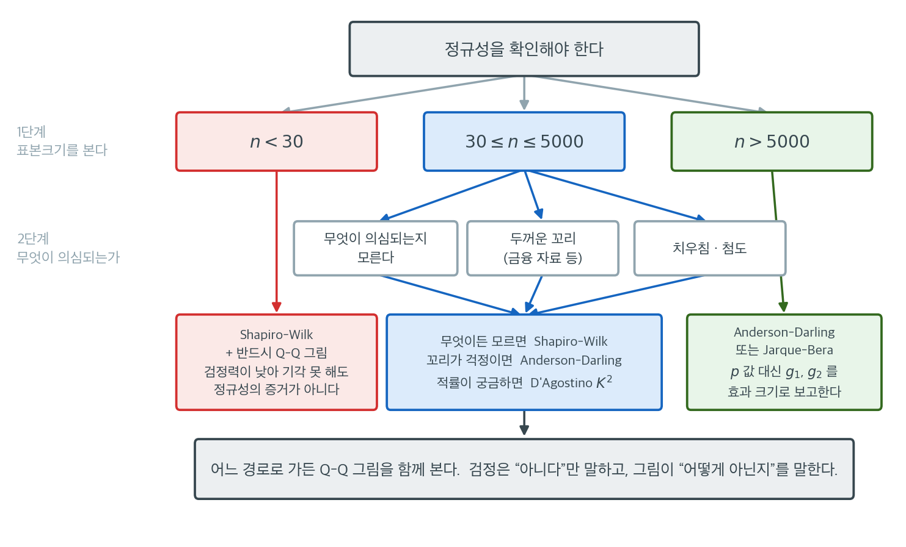

# 올바른 검정 고르기

## 1. 검정 선택이 중요한 이유

정규성 검정에는 여러 가지가 있으며 각각 강점과 민감도가 다르다. Shapiro-Wilk 검정, Anderson-Darling 검정, Kolmogorov-Smirnov 검정, Jarque-Bera 검정은 모두 정규성을 평가하지만, 어떤 유형의 이탈을 가장 효과적으로 탐지하는지, 어떤 표본크기를 감당하는지, 표준 소프트웨어에서 어떻게 구현되어 있는지가 다르다. 올바른 검정의 선택은 표본크기, 의심되는 이탈의 유형, 추론의 맥락에 달려 있다.

---

## 2. 흔한 정규성 검정 개관

### Shapiro-Wilk 검정

Shapiro-Wilk 검정은 정렬된 표본값이 정규분포의 기대 순서통계량과 얼마나 잘 맞는지를 재는 검정통계량 $W$를 계산하여 귀무가설 $H_0$: "자료가 정규분포에서 왔다"를 평가한다. 통계량은

$$
W = \frac{\left(\sum_{i=1}^{n} a_i X_{(i)}\right)^2}{\sum_{i=1}^{n} (X_i - \bar{X})^2}
$$

여기서 가중치 $a_i$는 정규 순서통계량의 공분산행렬에서 유도된다. $W$가 1에 가까우면 정규성을, 작으면 이탈을 나타낸다.

**강점:** 정규성 이탈을 탐지하는 데 대체로 가장 강력하며, 특히 작거나 중간 크기의 표본($n \leq 50$)에서 그렇다. 치우침과 두꺼운 꼬리 모두에 민감하다.

**한계:** 대부분의 구현이 $n$을 최대 5000으로 제한한다. 이탈의 유형(치우침 대 첨도)을 알려주지 않는다.

### Anderson-Darling 검정

Anderson-Darling 검정은 경험분포함수(EDF)에 기초한다. EDF $F_n(x)$와 가정한 정규 누적분포함수 $\Phi(x)$ 사이의 거리를 가중하여 잰다.

$$
A^2 = -n - \sum_{i=1}^{n} \frac{2i - 1}{n} \left[\ln \Phi(Z_{(i)}) + \ln\left(1 - \Phi(Z_{(n+1-i)})\right)\right]
$$

여기서 $Z_{(i)} = (X_{(i)} - \bar{X}) / S$는 표준화된 순서통계량이다. Anderson-Darling 통계량은 Kolmogorov-Smirnov 검정보다 분포의 꼬리에 더 큰 가중치를 준다.

**강점:** KS 검정보다 꼬리 이탈에 민감하다. 더 큰 표본크기에도 쓸 수 있다. 다양한 대립가설에서 좋은 성능을 낸다.

**한계:** 작은 표본에서는 Shapiro-Wilk보다 조금 덜 강력하다. 임계값이 모수를 추정했는지 알고 있는지에 따라 달라진다.

### Kolmogorov-Smirnov 검정

Kolmogorov-Smirnov(KS) 검정은 EDF와 가정한 누적분포함수 사이의 최대 절대거리를 잰다.

$$
D = \sup_x \left| F_n(x) - \Phi(x) \right|
$$

모수를 추정한 정규분포와 비교할 때는 반드시 Lilliefors 보정을 적용해야 한다. 표준 KS 임계값이 모수가 완전히 지정되었다고 가정하기 때문이다.

**강점:** 개념이 단순하다. 임의의 연속분포에 적용할 수 있다. 표본크기 제한이 없다.

**한계:** 정규성 위배 탐지에서 Shapiro-Wilk와 Anderson-Darling보다 대체로 검정력이 낮다. 분포 중앙의 이탈에 가장 민감하고 꼬리의 이탈에는 상대적으로 둔감하다.

### Jarque-Bera 검정

Jarque-Bera 검정은 표본왜도와 표본첨도에 기초한다. 검정통계량은

$$
JB = \frac{n}{6}\left(\hat\gamma_1^{\,2} + \frac{\hat\gamma_2^{\,2}}{4}\right)
$$

여기서 $\hat\gamma_1$은 표본왜도, $\hat\gamma_2 = \hat\beta_2 - 3$은 표본 **초과**첨도다. $H_0$ 아래에서 $n \to \infty$일 때 $JB \overset{d}{\to} \chi^2_2$이다.

**강점:** 정규성 이탈의 가장 흔한 두 유형인 치우침과 첨도를 직접 겨냥한다. 계산이 단순하다. 계량경제학과 금융에서 널리 쓰인다.

**한계:** 점근적 검정이므로 작은 표본($n < 30$)에서는 믿을 수 없다. 왜도와 첨도에 영향을 주지 않는 이탈(예: 대칭이고 중첨인 성분으로 이루어진 이봉분포)에는 둔감하다.

---

## 3. 비교표

| 검정 | 적합한 표본크기 | 민감한 대상 | 꼬리 민감도 | 계산 비용 |
|---|---|---|---|---|
| Shapiro-Wilk | $n \leq 5000$ | 일반적 이탈 | 높음 | 중간 |
| Anderson-Darling | 제한 없음 | 꼬리 이탈 | 매우 높음 | 낮음 |
| Kolmogorov-Smirnov (Lilliefors) | 제한 없음 | 중앙의 이탈 | 낮음 | 낮음 |
| Jarque-Bera | $n \geq 30$ | 왜도와 첨도 | 중간 | 매우 낮음 |

---

## 4. 판단의 틀

다음 지침이 적절한 검정을 고르는 데 도움이 된다.

**1단계: 표본크기를 고려한다.**

- $n < 30$이면 Shapiro-Wilk 검정을 쓴다. 작은 표본에서 검정력이 가장 좋다. Q-Q 그림으로 보완하라.
- $30 \leq n \leq 5000$이면 Shapiro-Wilk가 여전히 강력한 기본 선택이다. 꼬리 거동이 주된 관심사라면 Anderson-Darling 검정이 좋은 대안이다.
- $n > 5000$이면 (표본크기 제한이 없는) Anderson-Darling 검정을 쓴다. 왜도나 첨도가 관심사라면 Jarque-Bera 검정도 적절하다.

**2단계: 의심되는 이탈을 고려한다.**

- 두꺼운 꼬리가 의심되면(예: 금융 자료) Anderson-Darling이나 Jarque-Bera를 선호한다. KS 검정은 꼬리에서 너무 둔감하다.
- 치우침이 주된 관심사면 Jarque-Bera가 그것을 직접 검정한다.
- 이탈의 유형을 모르면 Shapiro-Wilk가 가장 폭넓게 강력한 선택이다.

**3단계: 추론의 맥락을 고려한다.**

- 후속 분석이 $t$ 검정이나 분산분석이면 범용 검정(Shapiro-Wilk)이 적절하다.
- 후속 분석이 분산이나 꼬리 위험과 관련되면 꼬리에 민감한 검정(Anderson-Darling)이 더 적합하다.

??? tip "언제나 시각적 방법으로 보완하라"
    어떤 정규성 검정도 시각적 평가를 대체하지 못한다. Q-Q 그림은 이탈의 유형과 위치(꼬리, 중앙, 치우침)를 드러내고 히스토그램은 전반적 모양을 보여준다. 형식적 검정과 Q-Q 그림의 조합이 가장 유익한 평가를 제공한다.

### 세 단계를 한 장으로

위의 세 단계를 실제로 따라가는 경로는 그림으로 그려 두면 기억하기 쉽다.



이 그림에서 눈여겨볼 곳은 세 갈래의 **성격이 다르다**는 점이다. 가운데 파란 경로만이 "검정을 골라 돌린다"는 보통의 의미를 갖는다. 양옆의 두 경로는 검정을 고르는 문제라기보다 **검정에 무엇을 기대하지 말아야 하는가**의 문제다.

왼쪽 $n < 30$ 경로에서는 Shapiro-Wilk가 여전히 최선의 선택이지만, 그 최선이 그리 좋지 않다. 검정력이 낮아 웬만한 이탈도 놓치므로 "기각하지 못했다"가 정규성의 증거가 되지 못한다. 이 구간에서 실제로 판단을 내리는 도구는 Q-Q 그림이고, 검정은 보조 자료다. 상자의 문구를 "Shapiro-Wilk를 쓰되 결과를 믿지 말라"로 읽어도 크게 틀리지 않는다.

오른쪽 $n > 5000$ 경로는 정반대 이유로 검정을 믿을 수 없다. 어떤 검정이든 거의 확실히 기각하므로 기각 자체에 정보가 없다. Anderson-Darling이나 Jarque-Bera를 쓰는 이유는 표본크기 제한이 없어서이지 결과가 더 유익해서가 아니다. 이 구간에서 보고해야 할 숫자는 $p$값이 아니라 $g_1$과 $g_2$, 곧 **이탈의 크기**다.

가운데 경로 안에서의 선택은 의심되는 이탈의 종류가 정한다. 짚이는 데가 없으면 폭넓게 강력한 Shapiro-Wilk, 금융 수익률처럼 꼬리가 걱정이면 Anderson-Darling, 치우침인지 첨도인지 진단까지 원하면 $Z_1$과 $Z_2$를 따로 돌려주는 D'Agostino $K^2$이다. Kolmogorov-Smirnov가 어느 갈래에도 없다는 점에 주목하라. 정규성만이 목적이라면 KS를 고를 이유가 거의 없다.

맨 아래 띠가 전체를 관통하는 규칙이다. 어느 경로로 가든 Q-Q 그림을 함께 본다. 검정은 "정규가 아니다"까지만 말해 주고, 어떻게 아닌지는 그림만이 보여준다.

<div class="exbox" markdown>

**보기 1.** <span class="diff easy" title="쉬움"></span> 같은 자료에 네 검정 돌려 보기. $t_5$에서 $n = 100$개를 뽑아 샤피로–윌크, 앤더슨–달링, 콜모고로프–스미르노프, 자르크–베라를 모두 돌린다.

**(1)** 자르크–베라의 닫힌 꼴 $JB = \frac{n}{6}\bigl(g_1^2 + \frac{g_2^2}{4}\bigr)$을 코드가 준 $JB = 5365.90$과 맞춰 보고, `scipy`가 **어느 판본**의 왜도·첨도를 쓰는지 밝히시오. $t_5$의 이론값($\gamma_1 = 0$, $\gamma_2 = 6$)을 넣으면 $JB$가 얼마인가. 관측값과의 차이는 어디서 오는가.

**(2)** KS 의 $p = 0.0030$은 나머지 셋과 **견줄 수 있는 수가 아니다.** 왜 그런가. 모수 추정을 반영한 올바른 귀무분포를 모의로 만들어 바른 $p$값과 5% 임계값을 구하고, 표준 KS 임계값을 그대로 썼을 때 검정의 **실제 크기**를 재시오.

</div>

??? success "풀이"

    ```python
    import numpy as np
    from scipy import stats

    # ===================================================================
    # 같은 자료에 네 검정을 모두 돌려 결론을 견준다
    #
    # 검정마다 무엇에 민감한지가 달라, 같은 자료에서도 p-값이 꽤 갈린다.
    # 하나만 골라 돌리고 끝낼 일이 아니라는 것이 요점이다.
    # ===================================================================

    np.random.seed(42)
    n = 100

    # 자유도 5 인 t. 대칭이지만 꼬리가 두꺼운 자료다.
    data = stats.t.rvs(df=5, size=n)

    if __name__ == "__main__":
        # Shapiro-Wilk — 두루 쓰기 좋고 작은 표본에서 검정력이 높다.
        sw_stat, sw_p = stats.shapiro(data)
        print(f"Shapiro-Wilk:      W = {sw_stat:.4f}, p = {sw_p:.4f}")

        # Anderson-Darling — 꼬리에 무게를 싣는다. 이 자료에 가장 민감할 것이다.
        ad_result = stats.anderson(data, dist="norm")
        print(f"Anderson-Darling:  A2 = {ad_result.statistic:.4f}, "
              f"critical (5%) = {ad_result.critical_values[2]:.4f}")

        # KS — 모수를 자료에서 추정해 넘겼으므로 p-값이 실제보다 크게 나온다.
        # 제대로 하려면 Lilliefors 기각값을 써야 한다.
        ks_stat, ks_p = stats.kstest(data, "norm", args=(np.mean(data), np.std(data)))
        print(f"KS (estimated):    D = {ks_stat:.4f}, p = {ks_p:.4f}")

        # Jarque-Bera — 왜도와 첨도만 본다. 큰 표본에서 쓸 만하다.
        jb_stat, jb_p = stats.jarque_bera(data)
        print(f"Jarque-Bera:       JB = {jb_stat:.4f}, p = {jb_p:.4f}")
    ```

    출력:

    ```text
    Shapiro-Wilk:      W = 0.6287, p = 0.0000
    Anderson-Darling:  A2 = 6.0914, critical (5%) = 0.7590
    KS (estimated):    D = 0.1783, p = 0.0030
    Jarque-Bera:       JB = 5365.9041, p = 0.0000
    ```

    표본의 모양 통계량은 $g_1 = 4.8256$, $g_2 = 34.5640$이다(보정판은 $G_1 = 4.8994$, $G_2 = 36.4190$). 네 검정이 모두 기각한다.

    ```python
    import numpy as np
    from scipy import stats

    np.random.seed(42)
    n = 100
    d = stats.t.rvs(df=5, size=n)

    print("t_5 의 이론값:  왜도 0,  초과첨도 6/(5-4) = 6")
    print(f"이 표본:  g1 = {stats.skew(d):.4f}   g2 = {stats.kurtosis(d):.4f}")
    print(f"  (보정판 G1 = {stats.skew(d, bias=False):.4f},"
          f" G2 = {stats.kurtosis(d, bias=False):.4f})")

    # 자르크-베라의 닫힌 꼴을 직접 확인한다.
    g1, g2 = stats.skew(d), stats.kurtosis(d)
    print(f"\nJB = n/6*(g1^2 + g2^2/4) = {n / 6 * (g1 ** 2 + g2 ** 2 / 4):.4f}"
          f"   scipy = {stats.jarque_bera(d).statistic:.4f}")
    print(f"t_5 의 이론값을 넣으면 JB = {n / 6 * (0 ** 2 + 6 ** 2 / 4):.1f}")

    # 이 표본의 극단값 하나가 모든 것을 끌고 간다.
    z = (d - d.mean()) / d.std(ddof=1)
    print(f"\n표준화 최대/최소:  {z.max():+.2f}  {z.min():+.2f}")
    drop = np.sort(d)[:-1]
    print("가장 큰 관측 하나를 빼면 (n = 99):")
    print(f"  g1 = {stats.skew(drop):+.4f}   g2 = {stats.kurtosis(drop):+.4f}")
    print(f"  W = {stats.shapiro(drop).statistic:.4f}  p = {stats.shapiro(drop).pvalue:.4f}")
    print(f"  A2 = {stats.anderson(drop, dist='norm').statistic:.4f}")
    print(f"  JB = {stats.jarque_bera(drop).statistic:.4f}"
          f"  p = {stats.jarque_bera(drop).pvalue:.4f}")

    # KS 를 추정 모수로 쓰면 p 값이 얼마나 과대평가되는가.
    D_obs = stats.kstest(d, "norm", args=(np.mean(d), np.std(d))).statistic


    def ks_est(x):
        return stats.kstest(x, "norm", args=(np.mean(x), np.std(x))).statistic


    rng = np.random.default_rng(404)
    R = 40000
    Dnull = np.array([ks_est(rng.normal(0, 1, n)) for _ in range(R)])
    p_lillie = np.mean(Dnull >= D_obs)
    print(f"\nKS:  D = {D_obs:.4f}")
    print(f"  표준 KS p값 (모수를 안다고 가정)        = "
          f"{stats.kstest(d, 'norm', args=(np.mean(d), np.std(d))).pvalue:.4f}")
    print(f"  릴리에포르 p값 (모수 추정을 반영, R={R}) = {p_lillie:.5f}")
    print(f"  5% 임계값:  표준 KS {stats.ksone.ppf(0.975, n):.4f}"
          f"   릴리에포르 {np.percentile(Dnull, 95):.4f}")

    # 그 임계값을 잘못 쓰면 검정의 실제 크기는 얼마가 되는가.
    crit_std = stats.ksone.ppf(0.975, n)
    print(f"\n표준 KS 임계값 {crit_std:.4f} 를 추정 모수에 그대로 쓰면")
    print(f"  명목 0.05 인 검정의 실제 크기 = {np.mean(Dnull > crit_std):.5f}")
    ```

    출력:

    ```text
    t_5 의 이론값:  왜도 0,  초과첨도 6/(5-4) = 6
    이 표본:  g1 = 4.8256   g2 = 34.5640
      (보정판 G1 = 4.8994, G2 = 36.4190)

    JB = n/6*(g1^2 + g2^2/4) = 5365.9041   scipy = 5365.9041
    t_5 의 이론값을 넣으면 JB = 150.0

    표준화 최대/최소:  +7.75  -1.45
    가장 큰 관측 하나를 빼면 (n = 99):
      g1 = +0.8195   g2 = +2.7637
      W = 0.9548  p = 0.0019
      A2 = 0.6086
      JB = 42.5870  p = 0.0000

    KS:  D = 0.1783
      표준 KS p값 (모수를 안다고 가정)        = 0.0030
      릴리에포르 p값 (모수 추정을 반영, R=40000) = 0.00000
      5% 임계값:  표준 KS 0.1340   릴리에포르 0.0892

    표준 KS 임계값 0.1340 를 추정 모수에 그대로 쓰면
      명목 0.05 인 검정의 실제 크기 = 0.00015
    ```

    **(1) 닫힌 꼴이 소수점 넷째 자리까지 맞는다.** $\frac{100}{6}\bigl(4.8256^2 + \frac{34.5640^2}{4}\bigr) = 5365.9041$이고 `scipy.stats.jarque_bera`가 준 값과 같다. 이 일치가 **판본을 결정해 준다.** 보정판 $G_1 = 4.8994$, $G_2 = 36.4190$을 넣으면 $\frac{100}{6}(24.00 + 331.59) = 5926$이 되어 전혀 다른 수가 나오므로, `scipy`의 자르크–베라는 보정하지 않은 $g_1$, $g_2$를 쓴다. 자르크–베라를 손으로 계산할 때 pandas 의 `.skew()`($G_1$)를 가져다 쓰면 값이 맞지 않는다.

    $t_5$의 이론값을 넣으면 $JB = \frac{100}{6}\bigl(0 + \frac{36}{4}\bigr) = 150$이다. 관측값 $5365.9$는 그 **36배**다. 이론이 예측하는 것보다 훨씬 큰 값이 나왔으니, 이 표본이 $t_5$를 대표하지 못한다는 뜻이다.

    차이의 출처는 **관측값 하나**다. 표준화한 최댓값이 $+7.75$인데 최솟값은 $-1.45$에 지나지 않는다. 그 한 점을 빼면 $g_1$이 $4.83 \to 0.82$로, $g_2$가 $34.56 \to 2.76$으로 떨어지고 $JB$는 $5366 \to 42.6$이 된다. $t_5$는 **대칭** 분포인데 이 표본의 왜도가 $4.83$이나 되는 것은 꼬리가 두꺼워서가 아니라 오른쪽 꼬리에서 하나가 유독 멀리 나왔기 때문이다. 코드의 주석이 "대칭이지만 꼬리가 두꺼운 자료"라 적은 것은 모집단의 성질이고, 이 표본은 그 성질을 왜도로는 보여 주지 못한다.

    **한 점이 판정을 뒤집기도 한다.** 앤더슨–달링은 $A^2 = 6.0914$로 5% 임계값 $0.759$의 여덟 배였지만, 같은 한 점을 빼면 $A^2 = 0.6086$으로 **임계값 아래로 내려가 기각하지 못한다.** 샤피로–윌크는 $W = 0.6287 \to 0.9548$($p = 0.0019$)로, 자르크–베라는 $p$값이 여전히 $10^{-9}$ 아래로 기각을 유지한다. 곧 이 자료에서 네 검정의 결론이 갈리는 정도는 "검정마다 민감도가 다르다"보다 **"극단점 하나에 얼마나 끌려가는가"** 가 더 크게 설명한다. $A^2$의 $1/\{F(1-F)\}$ 가중이 꼬리를 중시하는 만큼 꼬리의 한 점에 취약하기도 한 것이다.

    **(2) KS 의 $p = 0.0030$은 틀린 귀무분포에서 읽은 수다.** `stats.kstest`에 `args=(np.mean(data), np.std(data))`를 넘기는 것은 "평균과 표준편차를 **미리 알고 있었다**"고 주장하는 것이다. 실제로는 자료에서 추정했고, 추정된 모수는 정의상 경험분포에 **가장 잘 맞도록** 정해지므로 $D$가 체계적으로 작아진다. 그러므로 표준 KS 귀무분포에서 읽은 $p$값은 **실제보다 크다.**

    모의로 바른 귀무분포(릴리에포르 분포)를 만들면 그 차이가 드러난다. 5% 임계값이 표준 KS 의 $0.1340$에서 릴리에포르의 $0.0892$로 **1.5배 낮아진다.** 관측 $D = 0.1783$은 40,000번의 귀무 모의에서 한 번도 넘어서지 못했으므로 바른 $p$값은 $1/40000 = 2.5\times 10^{-5}$보다 작다. 곧 **올바르게 교정한 KS 는 $p = 0.003$이 아니라 $p < 2.5\times 10^{-5}$로 압도적으로 기각한다.**

    반대 방향의 피해가 더 크다. 표준 KS 임계값 $0.1340$을 추정 모수에 그대로 쓰면 명목 5% 검정의 실제 크기가 $0.00015$(40,000번 중 6번)로 **333분의 1**로 쪼그라든다. 검정이 지나치게 **보수적**이 되어, 참으로 비정규인 자료도 거의 기각하지 못한다. 이것이 모수를 추정했을 때 릴리에포르 보정이 선택이 아니라 필수인 까닭이다.

---

## 연습문제

<div class="drillbox" markdown>

**연습문제 1.** <span class="diff med" title="중간"></span>
어떤 연구자가 $n = 25$인 표본의 정규성을 검정해야 한다. 검정을 추천하고 이유를 설명하라.

</div>

??? success "풀이"
    $n = 25$에서는 **Shapiro-Wilk 검정**을 권장한다. 작거나 중간 크기의 표본에서 정규성 검정 가운데 검정력이 가장 높고 폭넓은 이탈(치우침, 두꺼운 꼬리, 다봉성)을 탐지한다.

    꼬리 이탈이 주된 관심사라면 Anderson-Darling 검정이 합리적인 대안이다. 적률 기반 검정(D'Agostino, Jarque-Bera)은 $n = 25$에서 검정력이 부족하므로 피해야 한다. KS/Lilliefors 검정은 Shapiro-Wilk와 Anderson-Darling 둘 다보다 검정력이 낮다.

    형식적 검정은 언제나 Q-Q 그림으로 보완하여 시각적으로 평가하라.

<div class="drillbox" markdown>

**연습문제 2.** <span class="diff med" title="중간"></span>
큰 자료($n = 10{,}000$)에서 형식적 정규성 검정이 도움이 되지 않을 수 있는 이유와 더 나은 접근을 설명하라.

</div>

??? success "풀이"
    $n = 10{,}000$이면 모든 정규성 검정의 검정력이 극도로 높아, 추론에 실질적 영향이 없는 사소한 이탈에도 정규성을 기각한다. 기각은 자료가 *정확히* 정규는 아니라는 사실(실제 자료에서는 언제나 참이다)을 알려줄 뿐 그 이탈이 문제가 되는지는 알려주지 않는다.

    더 나은 접근: (1) Q-Q 그림으로 비정규성의 정도를 시각적으로 평가한다. (2) 왜도와 첨도를 계산해 이탈을 수량화한다. (3) 그 이탈이 의도한 분석에 실질적으로 관련 있는지 평가한다(예: 신뢰구간의 포함확률이나 검정의 크기에 영향을 주는가?). (4) 민감도 확인으로 정규론 방법의 결과를 로버스트한 대안의 결과와 비교한다.

<div class="drillbox" markdown>

**연습문제 3.** <span class="diff med" title="중간"></span>
표본크기와 의심되는 이탈 유형에 따라 정규성 검정을 고르는 판단 흐름도를 만들어라.

</div>

??? success "풀이"

    1. **언제나 Q-Q 그림으로 시작한다**(모든 $n$).
    2. $n < 50$이면 **Shapiro-Wilk**를 쓴다(전반적 검정력이 가장 좋다).
    3. $50 \leq n \leq 5000$이면 **Shapiro-Wilk**나 **Anderson-Darling**을 쓴다(꼬리 특유의 이탈에는 AD가 낫다).
    4. $n > 5000$이면 형식적 검정이 지나치게 강력하므로 **Q-Q 그림**, **왜도/첨도** 값, 실질적 유의성 평가에 의존한다.
    5. **치우침이 구체적으로** 의심되면 `skewtest`로 보완한다.
    6. **두꺼운 꼬리가 구체적으로** 의심되면 `kurtosistest`나 (꼬리에 가중치를 주는) Anderson-Darling으로 보완한다.
    7. **특정 대립가설**(예: $t$ 분포)을 검정한다면 그 분포에 대한 Q-Q 그림을 쓴다.

<div class="drillbox" markdown>

**연습문제 4.** <span class="diff med" title="중간"></span>
두 검정이 엇갈린다. Shapiro-Wilk는 정규성을 기각하고($p = 0.03$) Anderson-Darling은 기각하지 않는다($p = 0.08$). 어떻게 진행해야 하는가?

</div>

??? success "풀이"
    검정마다 민감도가 다르므로 결과가 엇갈리는 일은 드물지 않다. Shapiro-Wilk는 전반적으로 더 강력하고 Anderson-Darling은 꼬리 이탈에 더 민감하다. 이 엇갈림은 비정규성이 가볍고 꼬리보다는 중앙에 몰려 있을 가능성을 시사한다.

    진행 방법: (1) Q-Q 그림을 살펴 이탈의 성격과 정도를 확인한다. (2) 이탈이 가벼우면(Q-Q 그림이 거의 선형이면) 정규론 방법으로 진행한다. (3) 비모수 대안으로 민감도 분석을 수행한다. (4) 투명성을 위해 두 검정 결과와 시각적 평가를 모두 보고한다.

<div class="drillbox" markdown>

**연습문제 5.** <span class="diff med" title="중간"></span>
비교표는 콜모고로프–스미르노프의 꼬리 민감도를 "낮음", 앤더슨–달링을 "매우 높음"으로 적었다. 이 차이가 두 통계량의 정의에서 어떻게 나오는지 수로 확인하자. $A^2$ 는 다음 적분꼴로 다시 쓸 수 있다는 사실을 써라.

$$
A^2 = n \int_{-\infty}^{\infty} \frac{\{F_n(x) - \Phi(x)\}^2}{\Phi(x)\{1 - \Phi(x)\}} \, d\Phi(x)
$$

**(1)** 가중함수 $w(F) = 1/\{F(1-F)\}$ 의 값을 $F = 0.5$ 와 $F = 0.01$ 에서 구하고 그 비율을 적으시오.

**(2)** 귀무가설 아래에서 $n F_n(x) \sim \mathrm{Bin}(n, \Phi(x))$ 이므로 $F_n(x) - \Phi(x)$ 의 표준편차는 $\sqrt{\Phi(x)\{1-\Phi(x)\}/n}$ 이다. $n = 100$ 에서 이 값을 $\Phi = 0.5$ 와 $\Phi = 0.01$ 에서 구하고, $A^2$ 의 가중함수가 바로 이 분산의 역수라는 점을 확인하시오.

**(3)** 아래쪽 1% 꼬리가 정규보다 세 배 두꺼운 자료를 생각하자. 곧 $\Phi(x) = 0.01$ 인 자리에서 $F_n(x) = 0.03$ 이다. 이 어긋남이 $D$ 에 주는 기여를 보기 1 의 릴리에포르 5% 임계값 $0.0892$ 와 견주시오. 같은 어긋남은 (2)의 표준편차 단위로 몇 배인가. 같은 크기 $0.02$ 가 중앙($\Phi = 0.5$)에서 일어났다면 몇 배인가. 콜모고로프–스미르노프가 이 꼬리 이탈을 그 자리에서 기각하려면 1% 꼬리가 몇 배나 두꺼워야 하는가.

</div>

??? success "풀이"
    **(1)** $w(0.5) = 1/(0.5 \times 0.5) = 4$ 이고 $w(0.01) = 1/(0.01 \times 0.99) = 101.01$ 이다. 비율은 $101.01/4 = 25.25$ 로, 앤더슨–달링은 1% 자리의 어긋남을 중앙의 어긋남보다 **25 배 무겁게** 센다.

    **(2)** $n = 100$ 에서

    $$
    \sqrt{\frac{0.5 \times 0.5}{100}} = 0.0500, \qquad \sqrt{\frac{0.01 \times 0.99}{100}} = 0.00995
    $$

    비율은 $0.0500/0.00995 = 5.03$ 이다. 가중함수와의 관계가 분명하다. $\mathrm{Var}\{F_n(x) - \Phi(x)\} = \Phi(1-\Phi)/n$ 이므로 적분꼴의 피적분함수는

    $$
    \frac{\{F_n(x) - \Phi(x)\}^2}{\Phi(1-\Phi)/n} = \left(\frac{F_n(x) - \Phi(x)}{\mathrm{sd}}\right)^2
    $$

    곧 $A^2$ 는 어긋남을 **그 자리의 잡음 크기로 나눈** 표준화 제곱을 적분한다. 반면 $D = \sup_x \lvert F_n - \Phi \rvert$ 는 나누지 않는다. 같은 절대 어긋남이라도 중앙에서는 잡음의 $0.4$ 배, 1% 자리에서는 잡음의 $2$ 배인데, $D$ 는 둘을 똑같이 센다. 비율 $25.25 = 5.03^2$ 인 것도 가중이 표준편차의 제곱의 역수이기 때문이다.

    **(3)** 어긋남의 절대 크기는 $0.03 - 0.01 = 0.02$ 다. 릴리에포르 5% 임계값 $0.0892$ 의 $0.02/0.0892 = 0.22$ 배에 지나지 않으므로, 이 이탈만으로는 콜모고로프–스미르노프가 **결코 기각하지 못한다.** 그러나 표준편차 단위로 보면 $0.02/0.00995 = 2.01$ 배로 이미 두 표준편차 바깥이다. 같은 $0.02$ 가 중앙에서 일어났다면 $0.02/0.0500 = 0.40$ 배, 곧 잡음에 묻히는 크기다. 두 비의 비는 $2.01/0.40 = 5.03$ 으로 (2)와 같다.

    콜모고로프–스미르노프가 그 자리에서 $D = 0.0892$ 에 이르려면 $F_n(x) = 0.01 + 0.0892 = 0.0992$ 가 되어야 한다. 곧 1% 꼬리가 **9.9 배** 두꺼워야 한다. 세 배로는 어림도 없다.

    이것이 표의 "꼬리 민감도 낮음"의 정확한 뜻이다. 꼬리에서는 확률 자체가 작으므로 절대 어긋남이 커질 여지가 애초에 작다. $\sup$ 를 재는 통계량은 여지가 큰 중앙에서 거의 언제나 최댓값을 얻고, 꼬리에서 무슨 일이 일어나도 $D$ 는 움직이지 않는다. 앤더슨–달링은 그 자리의 잡음으로 나누어 **여지의 크기를 보정**함으로써 이 맹점을 없앤다.

<div class="drillbox" markdown>

**연습문제 6.** <span class="diff med" title="중간"></span>
보기 1 (2)는 $R = 40{,}000$ 회의 모의로 세 가지를 주장했다. 릴리에포르 5% 임계값 $0.0892$, 바른 $p$값 $< 2.5 \times 10^{-5}$, 그리고 표준 콜모고로프–스미르노프 임계값을 잘못 썼을 때의 실제 크기 $0.00015$(40,000 번 중 6 번)이다. 이 수들을 얼마나 믿을 수 있는지 재 보자.

**(1)** 표준 콜모고로프–스미르노프의 양쪽 5% 임계값은 큰 $n$ 에서 $d_{0.05} \approx \sqrt{\ln(2/0.05)/(2n)}$ 로 근사된다. $n = 100$ 에서 이 값을 구해 코드가 쓴 정확값 $0.1340$ 과 견주시오.

**(2)** 실제 크기 $\hat p = 0.00015$ 의 모의 표준오차를 이항 표준오차로 구하고 95% 구간을 적으시오. 보기 1 이 쓴 "333 분의 1"이라는 표현은 이 구간에서 어느 범위의 수가 되는가.

**(3)** 이 실제 크기를 상대표준오차 5% 로 재려면 $R$ 이 얼마나 필요한가. 또 $R = 40{,}000$ 회의 모의로 보일 수 있는 가장 작은 $p$값은 얼마이며, $p < 10^{-6}$ 을 주장하려면 $R$ 이 얼마여야 하는가.

</div>

??? success "풀이"
    **(1)** $\ln(2/0.05) = \ln 40 = 3.6889$ 이므로

    $$
    d_{0.05} \approx \sqrt{\frac{3.6889}{200}} = \sqrt{0.018444} = 0.13581
    $$

    정확값 $0.13403$ 보다 $1.3\%$ 크다. 근사가 임계값을 조금 **높게** 주므로 이 근사를 쓰면 검정이 약간 보수적이 된다. 어느 쪽이든 릴리에포르 임계값 $0.0892$ 와의 차이($0.1340$ 대 $0.0892$, 1.5 배)는 근사 오차 $1.3\%$ 로는 설명될 수 없는 크기다. 곧 보기 1 이 지적한 간극은 모의의 잡음이 아니라 **귀무분포가 다르기 때문**이다.

    **(2)** $\hat p = 6/40{,}000 = 1.5 \times 10^{-4}$ 이므로

    $$
    \mathrm{SE}(\hat p) = \sqrt{\frac{\hat p (1 - \hat p)}{R}} = \sqrt{\frac{1.5 \times 10^{-4} \times 0.99985}{40{,}000}} = 6.12 \times 10^{-5}
    $$

    95% 구간은 $1.5 \times 10^{-4} \pm 1.96 \times 6.12 \times 10^{-5}$, 곧 $(3.0 \times 10^{-5},\ 2.70 \times 10^{-4})$ 다. 이를 축소배수 $0.05/p$ 로 옮기면 $0.05/(2.70\times10^{-4}) = 185$ 부터 $0.05/(3.0\times10^{-5}) = 1667$ 까지다. 곧 "333 분의 1"은 **"185 분의 1 에서 1,670 분의 1 사이"** 라고 읽어야 한다. 더구나 성공횟수가 6 회뿐이어서 정규근사 자체가 거칠다. 정직한 주장은 "명목 5% 가 $10^{-4}$ 수준으로, 곧 수백 분의 일로 쪼그라든다"까지다. 셋째 자리 숫자에는 아무 정보가 없다.

    **(3)** 상대표준오차가 $\mathrm{SE}/p = \sqrt{(1-p)/(pR)}$ 이므로 이를 $0.05$ 로 만들려면

    $$
    R = \frac{1 - p}{p \times 0.05^2} = \frac{0.99985}{1.5 \times 10^{-4} \times 0.0025} = 2.67 \times 10^{6}
    $$

    약 **270 만 회**가 필요하다. 40,000 회의 67 배다. 작은 확률을 셋째 자리까지 재는 일의 값이 이만큼 비싸다.

    $p$값 쪽은 더 단순하다. $R$ 회의 모의에서 한 번도 관측값을 넘지 않았을 때 말할 수 있는 것은 $p \lesssim 1/R$ 이 전부이므로, $R = 40{,}000$ 의 바닥은 $1/40{,}000 = 2.5 \times 10^{-5}$ 다. 보기 1 이 "$p < 2.5 \times 10^{-5}$" 에서 멈춘 것은 겸양이 아니라 한계다. $p < 10^{-6}$ 을 주장하려면 $R \ge 10^{6}$, 곧 **100 만 회** 이상이 필요하다. 모의로 얻은 $p$값에는 횟수가 정하는 바닥이 있고, 그 아래의 수는 모의가 아니라 이론으로만 얻는다.

<div class="drillbox" markdown>

**연습문제 7.** <span class="diff hard" title="어려움"></span>
자르크–베라의 한계로 "왜도와 첨도에 영향을 주지 않는 이탈(예: 대칭이고 중첨인 성분으로 이루어진 이봉분포)에는 둔감하다"고 적혀 있다. 이 말을 반례로 다져 보자. $\chi^2_2$ 의 꼬리확률은 $P(\chi^2_2 > t) = e^{-t/2}$ 임을 쓴다.

**(1)** 혼합분포 $\frac12 N(-\mu, \sigma^2) + \frac12 N(\mu, \sigma^2)$ 의 $\gamma_1$ 과 $\gamma_2$ 를 구하시오. $\mu \neq 0$ 일 때 $\gamma_2 = 0$ 이 될 수 있는가. $\mu = 2$, $\sigma = 1$, $n = 100$ 에서 모집단 값을 그대로 꽂은 $JB$ 와 그 $p$값을 구하시오.

**(2)** 세 점 분포 $P(X = \pm a) = p$, $P(X = 0) = 1 - 2p$ 에서 $\gamma_1$ 과 $\beta_2$ 를 구하고, $\gamma_1 = \gamma_2 = 0$ 이 **정확히** 성립하는 $p$ 를 찾으시오. 이 값이 2 장의 부등식 $\beta_2 \ge 1 + \gamma_1^2$ 과 어긋나지 않는지 확인하시오.

**(3)** (2)의 분포에 독립인 $Y \sim N(0, \epsilon^2)$ 을 더해 연속분포로 만들면 $\gamma_2$ 가 어떻게 되는가. (힌트: $\gamma_1 = 0$, $\mu_2 = v$, $\mu_4 = 3v^2$ 인 대칭 $X$ 에 대해 $X + Y$ 의 2 차·4 차 중심적률을 계산하라.) 이 분포에 자르크–베라와 샤피로–윌크를 돌리면 각각 어떻게 되겠는가. $n$ 을 키우면 해결되는 문제인가.

</div>

??? success "풀이"
    **(1)** 분포가 0 에 대해 대칭이므로 모든 홀수 차 중심적률이 0 이고 $\gamma_1 = 0$ 이다. 평균이 0 이므로 중심적률은 원점적률과 같고, 각 성분이 $N(\pm\mu, \sigma^2)$ 이므로

    $$
    \mu_2 = \mu^2 + \sigma^2, \qquad \mu_4 = \mu^4 + 6\mu^2\sigma^2 + 3\sigma^4
    $$

    따라서

    $$
    \gamma_2 = \frac{\mu^4 + 6\mu^2\sigma^2 + 3\sigma^4 - 3(\mu^2+\sigma^2)^2}{(\mu^2+\sigma^2)^2} = \frac{-2\mu^4}{(\mu^2+\sigma^2)^2}
    $$

    $\mu \neq 0$ 이면 $\gamma_2 < 0$ 이므로 **$\gamma_2 = 0$ 은 불가능하다.** 등분산 두 정규의 반반 혼합은 언제나 저첨(platykurtic)이다. 즉 이 이봉분포는 자르크–베라에게 완전히 안 보이는 것이 아니라, 음의 방향으로 **약한** 신호를 준다.

    $\mu = 2$, $\sigma = 1$ 이면 $\gamma_2 = -2(16)/25 = -1.28$ 이고

    $$
    JB = \frac{100}{6}\left(0 + \frac{1.28^2}{4}\right) = \frac{100}{6}(0.4096) = 6.83, \qquad p = e^{-3.413} = 0.033
    $$

    임계값 $5.991$ 을 간신히 넘는다. 두 봉우리가 $4\sigma$ 떨어진, 히스토그램만 봐도 정규가 아닌 자료인데도 자르크–베라의 신호는 경계선에 걸려 있다(모의로 재면 $n = 100$ 에서 검정력 $0.84$ 로, 샤피로–윌크의 $1.00$ 에 못 미친다).

    **(2)** 다시 대칭이므로 $\gamma_1 = 0$ 이다. 적률은

    $$
    \mu_2 = 2pa^2, \qquad \mu_4 = 2pa^4 \quad \Longrightarrow \quad \beta_2 = \frac{2pa^4}{(2pa^2)^2} = \frac{1}{2p}
    $$

    $a$ 가 약분되어 사라진다. $\gamma_2 = \beta_2 - 3 = 0$ 은 $\beta_2 = 3$, 곧

    $$
    p = \frac{1}{6}
    $$

    에서 성립한다. 따라서 $P(X = \pm a) = 1/6$, $P(X = 0) = 2/3$ 인 세 점 분포는 왜도와 초과첨도가 **정확히 0** 이다. 2 장의 부등식은 $\beta_2 = 3 \ge 1 + 0 = 1$ 로 넉넉히 만족한다. 참고로 $p = 1/2$(두 점 분포)에서 $\beta_2 = 1$ 로 그 부등식의 등호가 달성되고, $p$ 를 $1/2$ 에서 0 으로 줄이면 $\beta_2 = 1/(2p)$ 가 1 에서 $\infty$ 까지 훑으므로 그 길목의 $p = 1/6$ 에서 $\beta_2 = 3$ 을 지나는 것은 필연이다.

    **(3)** $X$ 와 $Y$ 가 독립이고 둘 다 대칭이므로 $X+Y$ 도 대칭이고 $\gamma_1 = 0$ 이다. 적률은

    $$
    \mu_2' = v + \epsilon^2, \qquad \mu_4' = \mu_4 + 6 v \epsilon^2 + 3\epsilon^4 = 3v^2 + 6v\epsilon^2 + 3\epsilon^4 = 3(v + \epsilon^2)^2
    $$

    따라서 $\beta_2' = 3(v+\epsilon^2)^2/(v+\epsilon^2)^2 = 3$, 곧 $\gamma_2' = 0$ 이 **모든 $\epsilon > 0$ 에서 정확히** 성립한다. 정규분포를 섞어 매끄럽게 만들어도 두 적률 신호가 되살아나지 않는다. $a = 1$, $\epsilon = 0.15$ 로 두면 $-1, 0, +1$ 에 봉우리가 선 삼봉 연속분포인데 $\gamma_1 = \gamma_2 = 0$ 이다.

    자르크–베라는 이 분포에서 **아무 것도 보지 못한다.** 모집단 신호가 정확히 0 이므로 $JB$ 의 분포는 귀무분포와 거의 같다. 모의로 확인하면 $n = 100$ 에서 기각률이 $0.012$ 로, 정규자료에서의 실제 크기 $0.041$ 보다도 **낮다**(저첨 방향으로 표본첨도의 산포가 줄어 오히려 덜 기각한다). 검정력이 자기 크기보다 작은, 편의된(biased) 검정이다. 같은 자료에서 샤피로–윌크와 앤더슨–달링은 $n = 100$ 에서 기각률 $1.00$, $n = 30$ 에서도 각각 $0.92$, $0.97$ 로 거의 언제나 기각한다.

    $n$ 을 키워도 고쳐지지 않는다. 자르크–베라는 분포를 $(\gamma_1, \gamma_2)$ 라는 **2 차원 사영**으로만 들여다보므로, 그 사영에서 정규와 구별되지 않는 대립가설에 대해서는 일치검정(consistent test)이 아니다. 표본크기 부족은 $n$ 으로 메울 수 있지만 맹점은 메울 수 없다. 이것이 $n > 5000$ 갈래에서조차 자르크–베라만 믿지 말고 Q-Q 그림을 함께 보아야 하는 까닭이다.

<div class="drillbox" markdown>

**연습문제 8.** <span class="diff hard" title="어려움"></span>
보기 1 에서 가장 큰 관측 하나를 빼자 $A^2$ 가 $6.0914 \to 0.6086$ 으로 떨어져 5% 임계값 $0.759$ 아래로 내려갔다. 표가 적은 "앤더슨–달링의 꼬리 민감도 매우 높음"을 "가장 먼 점이 얼마나 먼지에 민감하다"로 읽으면 이 수들이 설명되지 않는다. 정의로 돌아가 보자. $n = 100$, 표준화 최댓값 $Z_{(100)} = 7.75$, 최솟값 $Z_{(1)} = -1.45$ 다.

**(1)** $A^2$ 의 합에서 $Z_{(100)}$ 이 들어가는 항을 모두 찾고 그 가중치 $\frac{2i-1}{n}$ 을 적으시오. $1 - \Phi(7.75) = 4.59 \times 10^{-15}$ 를 써서 $Z_{(100)}$ 이 $A^2 = 6.0914$ 에 **직접** 기여하는 몫을 구하시오. 그 점이 $z = 3$ 에 있었다면($1 - \Phi(3) = 0.001350$) 기여가 얼마로 바뀌는가.

**(2)** 그렇다면 $A^2 = 6.09$ 의 나머지는 어디서 왔는가. $S$ 가 $n - 1$ 로 나눈 표본표준편차이므로 $\sum_{i=1}^{100} Z_i^2 = 99$ 다. 이를 써서 나머지 99 개 점의 표준화값의 제곱평균제곱근(rms)을 구하시오. 그 99 개가 대략 $N(0, 0.627^2)$ 처럼 놓여 있다고 보면 $\sup_x \lvert \Phi(x/0.627) - \Phi(x) \rvert$ 는 얼마인가(최댓값은 $x = 0.778$ 에서 잡힌다). 보기 1 의 $D = 0.1783$ 과 견주시오.

**(3)** (1)과 (2)로부터 "앤더슨–달링이 꼬리에 가중을 준다"가 실제로 뜻하는 바를 한 문장으로 다시 쓰시오.

</div>

??? success "풀이"
    **(1)** 합의 $i$ 번째 항은 $-\frac{2i-1}{n}\{\ln\Phi(Z_{(i)}) + \ln(1 - \Phi(Z_{(n+1-i)}))\}$ 이므로 $Z_{(100)}$ 은 **두 자리**에 나타난다.

    첫째, $i = 100$ 의 $\ln\Phi(Z_{(100)})$ 로 가중치 $\frac{2(100)-1}{100} = 1.99$ 를 받는다. 그런데 $\Phi(7.75) = 1 - 4.59\times10^{-15}$ 이므로 $\ln\Phi(7.75) \approx -4.59 \times 10^{-15} \approx 0$ 이고, 기여는 $1.99 \times 4.59\times10^{-15} \approx 10^{-14}$, 곧 **없다.**

    둘째, $n + 1 - i = 100$ 곧 $i = 1$ 의 $\ln(1 - \Phi(Z_{(100)}))$ 로, 가중치는 $\frac{2(1)-1}{100} = 0.01$ 밖에 안 된다. $\ln(4.59\times10^{-15}) = -33.01$ 이므로 기여는

    $$
    -0.01 \times (-33.01) = 0.330
    $$

    둘을 합쳐 $0.330$ 으로 $A^2 = 6.0914$ 의 **$5.4\%$** 다. 그 점이 $z = 3$ 에 있었다면 $-0.01 \times \ln(0.001350) = -0.01\times(-6.61) = 0.066$ 이므로, 점을 $z = 3$ 에서 $z = 7.75$ 로 멀리 보내면서 $A^2$ 에 더해지는 양은 $0.330 - 0.066 = 0.264$ 에 지나지 않는다. $A^2$ 가 최극단점의 위치에 반응하는 방식은 **로그**이고, 그나마 $1/n$ 가중이 붙는다. 가장 먼 점을 두 배 더 멀리 보내도 $A^2$ 는 거의 꿈쩍하지 않는다.

    **(2)** $Z_{(100)}^2 = 7.75^2 = 60.06$ 이므로 남은 99 개는

    $$
    \sum_{i=1}^{99} Z_{(i)}^2 = 99 - 60.06 = 38.94, \qquad \mathrm{rms} = \sqrt{\frac{38.94}{99}} = 0.627
    $$

    한 점이 전체 제곱합의 $61\%$ 를 차지하고, 나머지 99 개는 표준편차 $0.627$ 짜리로 **쪼그라든다.** 표준화한 자료의 본체가 $N(0,1)$ 이 아니라 $N(0, 0.627^2)$ 처럼 보이는 셈이다. 그 두 분포함수의 최대 거리는 $x = 0.778$ 에서

    $$
    \lvert \Phi(0.778/0.627) - \Phi(0.778) \rvert = \lvert \Phi(1.240) - \Phi(0.778) \rvert = 0.8925 - 0.7817 = 0.111
    $$

    관측된 $D = 0.1783$ 과 같은 자리수다(남은 차이는 99 개 점 자체도 정규가 아니기 때문이다. 보기 1 에서 그 99 개의 $g_1 = 0.82$, $g_2 = 2.76$ 이었다). 중요한 것은 이 $0.111$ 이 **분포의 중앙에서** 생겼다는 점이다. $A^2$ 의 적분은 $d\Phi$ 로 재므로 중앙에 확률질량이 몰려 있고, 거기서 어긋남이 0.1 씩 벌어지면 $A^2$ 는 크게 불어난다.

    곧 한 점이 $A^2$ 를 $6.09$ 로 밀어올린 경로는 자기 자신의 꼬리 항($0.330$)이 아니라 **$S$ 를 부풀려 나머지 전부를 중앙으로 밀어 넣은 것**이다. 그 점을 빼면 $S$ 가 줄어 본체가 제 크기로 돌아오고, $A^2$ 는 $0.6086$ 으로 임계값 아래로 내려간다. 표준화에 쓰인 $\bar X$ 와 $S$ 가 로버스트하지 않다는 사실이 통계량의 꼬리 가중보다 더 많은 것을 설명한다.

    **(3)** "꼬리에 가중을 준다"는 **꼬리 쪽 누적확률의 어긋남을 그 자리의 표준편차 $\sqrt{\Phi(1-\Phi)/n}$ 로 나누어 중앙의 어긋남과 같은 자격으로 센다**는 뜻이며, 가장 먼 점이 얼마나 먼지에 민감하다는 뜻이 아니다. 그러므로 앤더슨–달링이 잘 잡는 것은 **적당히 큰 값이 여럿** 있는 두꺼운 꼬리이고, 극단값 하나는 꼬리 항이 아니라 $S$ 를 통해 간접적으로 작용한다. 이상치 하나와 두꺼운 꼬리를 가려내는 일은 어느 검정통계량도 하지 못하며, 그림 맨 아래 띠가 Q-Q 그림을 요구하는 까닭이 바로 이것이다.

<div class="drillbox" markdown>

**연습문제 9.** <span class="diff hard" title="어려움"></span>
표는 자르크–베라의 적합한 표본크기를 $n \ge 30$ 으로 적었다. 보기 1 은 $t_5$ 의 이론값을 꽂아 $n = 100$ 에서 $JB = 150$ 을 얻었다. 같은 셈을 $n = 4$ 에 하면 $JB = \frac{4}{6}(0 + \frac{36}{4}) = 6.0 > 5.991$ 이 되어 "$n = 4$ 로도 $t_5$ 를 기각할 수 있다"는 엉뚱한 결론이 나온다. 어디가 틀렸는지 유한표본의 부등식으로 밝히자. $m_k$ 를 $k$ 차 표본중심적률, $b_2 = m_4/m_2^2 = g_2 + 3$ 이라 쓴다.

**(1)** 임의의 표본에 대해 $b_2 \le n$ 임을 보이시오. (힌트: $d_i = X_i - \bar X$ 에 대해 $\sum d_i^4 \le \left(\sum d_i^2\right)^2$.)

**(2)** 2 장의 부등식 $\beta_2 \ge 1 + \gamma_1^2$ 은 임의의 분포에 성립하므로 표본의 경험분포에도 성립한다. 곧 $b_2 \ge 1 + g_1^2$ 이다. 이를 (1)과 함께 써서 $n \le 5$ 인 **모든** 표본에서 $JB < 5.991$ 임을 보이시오. 자료가 무엇이든 그러한가. 같은 논증을 $n = 6$ 에 쓰면 어떻게 되는가.

**(3)** 보기 1 의 $g_2 = 34.5640$ 과 $g_1 = 4.8256$ 이 나타나려면 $n$ 이 적어도 얼마여야 하는가. $t_5$ 의 $\gamma_2 = 6$ 은 어느 $n$ 부터 표본에서 나타날 수 있는가. 작은 $n$ 의 $JB$ 에 모집단 값을 꽂는 셈이 왜 뜻이 없는지 한 줄로 적으시오.

</div>

??? success "풀이"
    **(1)** $\sum_i d_i^4 \le \left(\sum_i d_i^2\right)^2$ 는 제곱의 전개 $\left(\sum d_i^2\right)^2 = \sum_i d_i^4 + \sum_{i \neq j} d_i^2 d_j^2$ 에서 교차항이 음이 아니므로 성립한다. $\sum d_i^2 = n m_2$ 이므로

    $$
    m_4 = \frac{1}{n}\sum_i d_i^4 \le \frac{1}{n}\left(\sum_i d_i^2\right)^2 = \frac{1}{n}(n m_2)^2 = n\, m_2^2
    $$

    양변을 $m_2^2$ 로 나누면 $b_2 \le n$, 곧 $g_2 \le n - 3$ 이다. **표본첨도에는 표본크기가 정하는 천장이 있다.** $\square$

    **(2)** 두 부등식을 이으면

    $$
    1 + g_1^2 \le b_2 \le n \quad \Longrightarrow \quad g_1^2 \le n - 1, \qquad g_1^2 - 2 \le g_2 \le n - 3
    $$

    아래쪽은 $g_2 \ge -2$ 로 눌려 있고 위쪽은 $n - 3$ 으로 막혀 있다. $n = 5$ 이면 $g_1^2 \le 4$ 이고 $g_2 \in [-2, 2]$ 이므로 $g_2^2 \le 4$ 다. 따라서

    $$
    JB = \frac{n}{6}\left(g_1^2 + \frac{g_2^2}{4}\right) \le \frac{5}{6}\left(4 + \frac{4}{4}\right) = 4.17 < 5.991
    $$

    $n = 4$ 이면 $g_1^2 \le 3$, $g_2 \in [-2, 1]$ 이므로 $JB \le \frac{4}{6}(3 + 1) = 2.67$ 이다. 두 상한이 동시에 달성될 수는 없으므로 실제 최댓값은 이보다 더 작다. 곧 **$n \le 5$ 에서는 자료가 무엇이든 $\chi^2_2$ 의 5% 임계값을 넘을 수 없고, 검정력이 정확히 0 이다.** 어떤 비정규 자료를 가져와도 자르크–베라는 기각하지 못한다.

    $n = 6$ 이면 같은 상한이 $\frac{6}{6}\left(5 + \frac{9}{4}\right) = 7.25 > 5.991$ 이 되어 이 논증이 더는 결론을 주지 못한다. 상한을 넘었다는 것이 실제로 기각이 가능하다는 뜻은 아니지만, 이 거친 부등식으로 막을 수 있는 구간은 $n \le 5$ 까지다.

    **(3)** $g_2 \le n - 3$ 에서 $34.5640 \le n - 3$, 곧 $n \ge 37.56$ 이므로 $n \ge 38$ 이어야 한다. $g_1^2 \le n - 1$ 에서 $4.8256^2 = 23.29 \le n - 1$, 곧 $n \ge 24.29$ 이므로 $n \ge 25$ 다. 보기 1 의 $n = 100$ 은 둘을 모두 만족한다. $t_5$ 의 $\gamma_2 = 6$ 은 $6 \le n - 3$, 곧 $n \ge 9$ 부터 비로소 표본에서 나타날 수 있다.

    한 줄로: **표본왜도와 표본첨도는 $n$ 에 의해 위에서 막혀 있으므로, 작은 $n$ 의 $JB$ 에 모집단 값을 꽂는 것은 그 표본크기에서 도달할 수 없는 값을 가정하는 셈이다.** $n = 4$ 에서 $g_2$ 는 아무리 커도 $1$ 인데 $\gamma_2 = 6$ 을 꽂았으니 $JB = 6.0$ 이라는 수가 나왔던 것이다. 표가 $n \ge 30$ 을 요구하는 것은 $\chi^2_2$ 근사의 수렴이 느리다는 이유만이 아니라, 작은 $n$ 에서는 통계량이 들어갈 자리 자체가 좁다는 이유에서도 그렇다.

<div class="drillbox" markdown>

**연습문제 10.** <span class="diff hard" title="어려움"></span>
그림의 양옆 두 갈래("$n < 30$ 이면 결과를 믿지 말라", "$n > 5000$ 이면 기각에 정보가 없다")를 자르크–베라에 대해 수로 그려 보자. 모집단 값을 그대로 꽂은 $\frac{n}{6}\left(\gamma_1^2 + \frac{\gamma_2^2}{4}\right)$ 을 거친 안내로 쓰고 임계값은 $\chi^2_{2,\,0.95} = 5.991$ 로 둔다.

**(1)** 2 장의 부등식에서 대칭 분포($\gamma_1 = 0$)의 초과첨도는 $\gamma_2 \ge -2$ 다. 가장 극단적인 저첨 대립가설 $\gamma_2 = -2$ 조차 기각하려면 $n$ 이 적어도 얼마여야 하는가. 균일분포($\gamma_2 = -1.2$)는 얼마인가.

**(2)** 실용적으로 무시할 만한 이탈 $\gamma_1 = 0.1$, $\gamma_2 = 0.2$ 를 생각하자. 이것이 기각되기 시작하는 $n$ 과, $n = 10{,}000$ 에서의 $JB$ 및 $p$값을 구하시오.

**(3)** (1)과 (2)의 수로 표의 "$n \ge 30$" 과 그림의 오른쪽 갈래를 각각 설명하시오. 연습문제 9 의 엄밀한 경계와는 어떻게 어긋나며 어느 쪽을 어떻게 믿어야 하는가.

</div>

??? success "풀이"
    **(1)** 조건 $\frac{n}{6}\left(\gamma_1^2 + \frac{\gamma_2^2}{4}\right) > 5.991$ 은 $n > \dfrac{35.95}{\gamma_1^2 + \gamma_2^2/4}$ 와 같다. $\gamma_1 = 0$, $\gamma_2 = -2$ 이면 분모가 $4/4 = 1$ 이므로

    $$
    n > 35.95 \quad \Longrightarrow \quad n \ge 36
    $$

    균일분포는 $\gamma_2 = -1.2$ 이므로 분모가 $1.44/4 = 0.36$ 이고 $n > 35.95/0.36 = 99.86$, 곧 $n \ge 100$ 이다.

    **(2)** 분모가 $0.01 + 0.04/4 = 0.02$ 이므로 $n > 35.95/0.02 = 1797.4$, 곧 $n \ge 1798$ 부터 기각이 시작된다. $n = 10{,}000$ 에서는

    $$
    JB = \frac{10{,}000}{6}(0.02) = 33.33, \qquad p = e^{-16.67} = 5.8 \times 10^{-8}
    $$

    **(3)** 표의 "$n \ge 30$"은 (1)이 설명한다. 2 장의 부등식이 저첨 쪽 신호를 $\gamma_2 \ge -2$ 로 막아 두므로, **$n \lesssim 36$ 에서는 아무리 극단적인 대칭 저첨 대립가설이라도 자르크–베라가 기각할 수 없다.** 첨도축의 음의 절반 전체가 닫혀 있는 것이다(양의 쪽은 $\gamma_2$ 에 상한이 없으므로 두꺼운 꼬리라면 더 작은 $n$ 에서도 잡을 수 있다). 균일분포처럼 흔한 저첨 대립가설이라면 $n \ge 100$ 이 필요하다. 표의 $n \ge 30$ 은 이 바닥에 맞춘 수다.

    오른쪽 갈래는 (2)가 설명한다. $\gamma_1 = 0.1$, $\gamma_2 = 0.2$ 는 Q-Q 그림에서 눈으로 알아볼 수도 없고 어떤 $t$ 검정도 망치지 않는 이탈인데, $n = 10{,}000$ 에서 $p = 5.8 \times 10^{-8}$ 로 압도적으로 기각된다. 이때 $p$값이 알려 주는 것은 자료가 아니라 **$n$ 이 크다는 사실**뿐이다. 그래서 그 구간에서 보고할 숫자는 $p$값이 아니라 $g_1$ 과 $g_2$, 곧 이탈의 크기다. 둘을 합치면 자르크–베라가 저첨 대립가설에 대해 쓸모 있는 창은 대략 $36 \lesssim n \lesssim 1800$ 이라는 좁은 구간이다.

    연습문제 9 의 경계와 이 수는 성격이 다르다. 9 는 "$n \le 5$ 에서는 어떤 자료로도 기각 불가"라는 **정리**이고, 여기의 36 은 모집단 값을 통계량에 꽂아 본 **눈금**이다. 이 꽂기는 확률변수 $g_1, g_2$ 를 상수로 바꾸고 그 표본변동(특히 오른쪽으로 길게 치우친 $g_2$ 의 분포)을 무시하므로, 경계 근처에서는 양쪽으로 틀린다. 연습문제 7 (1)에서 꽂아 얻은 $JB = 6.83$ 은 임계값을 간신히 넘었을 뿐이지만 실제 검정력은 $0.84$ 였다. 그러므로 9 의 부등식은 정리로 믿고, 36 과 1798 같은 수는 자리수를 가늠하는 눈금으로만 쓰는 것이 옳다. 정확한 검정력이 필요하면 귀무분포와 대립분포를 모두 모의로 만들어야 하고, 그 모의의 정밀도에는 연습문제 6 이 보인 바닥이 있다.

---

## 정리하며

보편적으로 최적인 정규성 검정은 없다. Shapiro-Wilk 검정은 폭넓은 검정력 덕분에 작거나 중간 크기의 표본에서 가장 나은 기본 선택이다. Anderson-Darling 검정은 꼬리 이탈 탐지에 뛰어나고 표본크기 제한이 없다. Jarque-Bera 검정은 왜도나 첨도가 의심될 때 효율적이지만 최소한 중간 크기의 표본이 필요하다. Kolmogorov-Smirnov 검정은 널리 알려져 있지만 정규성 검정으로는 대체로 검정력이 가장 낮다. 어떤 경우에도 형식적 검정에는 시각적 진단이 따라야 한다.
