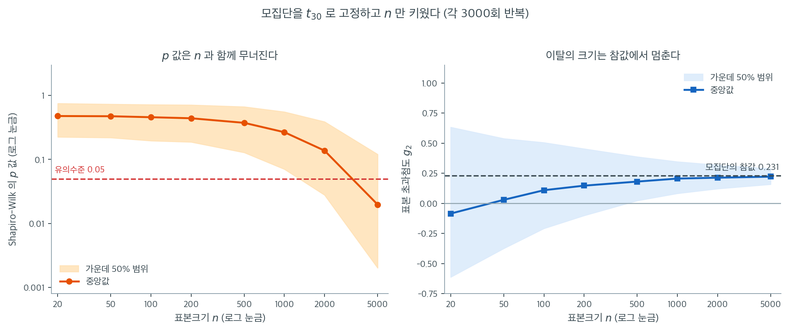
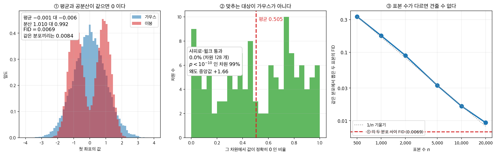

# 정규성 검정의 한계와 함정

표준정규에서 $n = 20$ 과 $n = 10{,}000$ 짜리 표본을 각각 뽑아 Shapiro-Wilk 를 걸면 $p$ 값이 $0.7136$ 과 $0.7507$ 로 거의 같게 나온다. 두 수가 같다는 것이 「두 표본의 정규성 정도가 비슷하다」는 뜻인가. 표본크기가 $500$ 배 차이 나는데 같은 $p$ 값이 나온다면, 그 $p$ 값은 애초에 **무엇을 재고 있었는가.** 정규성 검정을 읽다가 걸려 넘어지는 자리가 바로 여기다.

형식적 정규성 검정은 값진 통찰을 주지만 한계가 있다. 실무에서 이 검정들은 표본크기, 검정력, 실제 자료의 분포 같은 요인에 영향을 받는다. 정규성 검정이 적절한지 판단하려면 이 함정들을 이해하는 것이 결정적이다.

---

## 1. 표본크기에 대한 민감성

정규성 검정은 표본크기에 매우 민감하다. 작은 표본에서는 정규성 이탈을 탐지할 검정력이 부족하여 **제2종 오류**(귀무가설이 거짓인데 기각하지 못함)로 이어질 수 있다. 반대로 아주 큰 표본에서는 사소한 이탈만으로도 귀무가설을 기각하게 되어, 실질적으로 의미 없는 차이에 반응하게 된다.

- **작은 표본**: 실제 정규성 이탈을 탐지하지 못할 수 있다.
- **큰 표본**: 실질적으로 유의하지 않은 사소한 이탈까지 탐지할 수 있다.

<div class="exbox" markdown>

**보기 1.** <span class="diff easy" title="쉬움"></span> 같은 $p$값, 다른 뜻. 표준정규에서 $n = 20$과 $n = 10{,}000$ 짜리 표본을 각각 뽑아 샤피로–윌크 검정을 걸면 두 $p$값이 $0.71$과 $0.75$로 거의 같게 나온다.

**(1)** 두 $p$값이 거의 같은 것이 "두 표본의 정규성 정도가 비슷하다"는 뜻인가. 귀무가설 아래 $p$값의 분포로 설명하고, 통계량 $W$와 그 임계값을 두 $n$에서 비교하시오.

**(2)** 이 보기만으로는 "큰 표본이 사소한 이탈도 기각한다"가 **드러나지 않는다.** 왜 드러나지 않는가. 드러내려면 무엇을 바꾸어야 하는지 말하고, $t_{30}$ 자료로 표본크기별 검정력을 재어 확인하시오.

</div>

??? success "풀이"

    ```python
    import numpy as np
    from scipy.stats import shapiro

    np.random.seed(0)

    # 두 자료 모두 참으로 정규다. 그런데 표본크기만 다르게 두면 검정의
    # 성질이 달라진다. 작은 표본에서는 웬만한 이탈도 잡아내지 못하고,
    # 큰 표본에서는 무시할 만한 이탈에도 기각한다.
    small_sample = np.random.normal(0, 1, 20)
    stat_small, p_value_small = shapiro(small_sample)
    print(f"Shapiro-Wilk Test (small sample): p-value={p_value_small}")

    # 표본이 커지면 검정력이 올라가는데, 그것이 늘 좋은 일은 아니다.
    large_sample = np.random.normal(0, 1, 10000)
    stat_large, p_value_large = shapiro(large_sample)
    print(f"Shapiro-Wilk Test (large sample): p-value={p_value_large}")
    ```

    출력:

    ```text
    Shapiro-Wilk Test (small sample): p-value=0.7136380887419513
    Shapiro-Wilk Test (large sample): p-value=0.7506816458200554
    ```

    **(1) 아니다. 두 $p$값이 비슷한 것에는 아무 뜻이 없다.** 이론이 먼저 답을 준다. 귀무가설이 참일 때 $p$값은 **표본크기와 무관하게** $\text{Uniform}(0,1)$을 따른다. 그러므로 중앙값은 $0.5$, 기각률은 명목수준 $\alpha = 0.05$이며, $n$을 20에서 10,000으로 키워도 이 둘은 꿈쩍하지 않는다. 두 표본은 모두 **정확히** $\mathcal{N}(0,1)$에서 나왔으니 $0.7136$과 $0.7507$은 그저 균등분포에서 뽑은 두 수다. 비슷하게 나온 것은 우연이고, 다르게 나와도 똑같이 의미가 없었다.

    반면 **통계량은 전혀 다르다.** $W = 0.968067$ 대 $W = 0.999844$이고, 표본의 모양 통계량도 $(g_1, g_2) = (+0.183,\, -0.624)$ 대 $(+0.027,\, -0.031)$로 자릿수가 다르다($g_1$, $g_2$는 보정하지 않은 판본, 곧 `scipy.stats.skew`·`kurtosis`의 기본값 `bias=True`·`fisher=True`가 주는 값이다). 작은 표본은 초과첨도가 $-0.62$나 되는데도 통과하고, 큰 표본은 $-0.03$밖에 안 되는데도 같은 $p$값을 받는다.

    임계값을 재어 보면 왜 그런지 분명해진다. 5% 임계값이 $n = 20$에서 $W < 0.9035$, $n = 10{,}000$에서 $W < 0.999656$이다. 부적합의 크기를 $1 - W$로 재면 허용폭이 $0.0965$에서 $0.000344$로 **280배 좁아진다.** 같은 $p = 0.7$이 작은 표본에서는 "10% 가까이 어긋나도 괜찮다", 큰 표본에서는 "0.03% 넘게 어긋나면 안 된다"를 뜻한다. **$p$값은 적합도의 척도가 아니다.**

    **(2) 두 표본이 모두 참으로 정규이기 때문에 드러나지 않는다.** 귀무가설이 참이면 큰 표본이 기각하는 일은 $\alpha$의 비율로만 일어나야 하고, 실제로 그렇다. 과잉 검정력을 보려면 자료가 정규에서 **조금이라도** 벗어나 있어야 한다. 그래서 초과첨도가 $6/(30-4) = 0.2308$인 $t_{30}$으로 바꾸어 검정력을 잰다.

    ```python
    import warnings

    import numpy as np
    from scipy import stats

    warnings.filterwarnings("ignore")   # n > 5000 에서 shapiro 가 내는 경고

    # (1) 보기의 두 표본을 다시 뽑아 p 값만이 아니라 통계량까지 함께 본다.
    np.random.seed(0)
    small = np.random.normal(0, 1, 20)
    large = np.random.normal(0, 1, 10000)
    for name, x in [("n=20   ", small), ("n=10000", large)]:
        W, p = stats.shapiro(x)
        print(f"{name}  W = {W:.6f}  p = {p:.4f}"
              f"  g1 = {stats.skew(x):+.4f}  g2 = {stats.kurtosis(x):+.4f}")


    def pvals(draw, n, R, seed):
        """같은 분포에서 n 개짜리 표본을 R 번 뽑아 샤피로 p 값을 모은다."""
        rng = np.random.default_rng(seed)
        return np.array([stats.shapiro(draw(rng, n)).pvalue for _ in range(R)])


    # 귀무가설이 참이면 p 값은 n 과 무관하게 균등분포이고 기각률은 알파와 같다.
    normal = lambda rng, n: rng.normal(0, 1, n)
    print("\n귀무(정규) 아래 기각률 — n 과 무관하게 0.05 여야 한다")
    for n, R, seed in [(20, 4000, 7), (200, 4000, 8), (1000, 2000, 9), (10000, 1500, 23)]:
        p = pvals(normal, n, R, seed)
        print(f"  n = {n:5d}  기각률 {np.mean(p < 0.05):.4f}"
              f"  (MC SE {np.sqrt(0.05 * 0.95 / R):.4f})  p 중앙값 {np.median(p):.3f}")

    # 5% 임계값. 같은 p 값이 n 에 따라 얼마나 다른 적합도를 뜻하는지 본다.
    print("\nW 의 5% 임계값")
    for n, R, seed in [(20, 20000, 120), (10000, 1500, 10100)]:
        rng = np.random.default_rng(seed)
        W = np.array([stats.shapiro(rng.normal(0, 1, n)).statistic for _ in range(R)])
        print(f"  n = {n:5d}  W 5% 분위수 {np.percentile(W, 5):.6f}"
              f"  -> 1-W 의 허용폭 {1 - np.percentile(W, 5):.6f}")

    # (2) 자료를 정규에서 살짝 떼어 놓으면 비로소 n 의 효과가 보인다.
    t30 = lambda rng, n: rng.standard_t(30, n)
    print(f"\nt_30 의 참 초과첨도 = 6/(30-4) = {6 / 26:.4f}  (n 과 무관하다)")
    print("t_30 자료에 대한 검정력")
    for n, R, seed in [(30, 3000, 11), (200, 3000, 12), (1000, 1500, 13), (5000, 400, 14)]:
        p = pvals(t30, n, R, seed)
        print(f"  n = {n:5d}  검정력 {np.mean(p < 0.05):.3f}  p 중앙값 {np.median(p):.4f}")
    ```

    출력:

    ```text
    n=20     W = 0.968067  p = 0.7136  g1 = +0.1826  g2 = -0.6244
    n=10000  W = 0.999844  p = 0.7507  g1 = +0.0274  g2 = -0.0312

    귀무(정규) 아래 기각률 — n 과 무관하게 0.05 여야 한다
      n =    20  기각률 0.0437  (MC SE 0.0034)  p 중앙값 0.500
      n =   200  기각률 0.0450  (MC SE 0.0034)  p 중앙값 0.507
      n =  1000  기각률 0.0525  (MC SE 0.0049)  p 중앙값 0.509
      n = 10000  기각률 0.0360  (MC SE 0.0056)  p 중앙값 0.552

    W 의 5% 임계값
      n =    20  W 5% 분위수 0.903472  -> 1-W 의 허용폭 0.096528
      n = 10000  W 5% 분위수 0.999656  -> 1-W 의 허용폭 0.000344

    t_30 의 참 초과첨도 = 6/(30-4) = 0.2308  (n 과 무관하다)
    t_30 자료에 대한 검정력
      n =    30  검정력 0.072  p 중앙값 0.4752
      n =   200  검정력 0.101  p 중앙값 0.4506
      n =  1000  검정력 0.219  p 중앙값 0.2564
      n =  5000  검정력 0.615  p 중앙값 0.0175
    ```

    **이론값이 재현된다.** 귀무 아래 기각률이 $n = 20, 200, 1000$에서 $0.0437$, $0.0450$, $0.0525$로 모두 명목 $0.05$에서 몬테카를로 표준오차 두 배 안에 있고, $p$값 중앙값도 $0.500$, $0.507$, $0.509$로 균등분포의 $0.5$와 맞는다. **표본크기는 귀무가설 아래에서 아무것도 바꾸지 않는다.**

    $t_{30}$으로 바꾸면 그림이 완전히 달라진다. 검정력이 $n = 30$의 $0.072$에서 $n = 5000$의 $0.615$로 올라간다. 그동안 **모집단의 이탈은 한 치도 변하지 않았다** — 초과첨도는 언제나 $0.2308$이다. $n = 30$에서는 기각률이 명목수준 $0.05$보다 겨우 높아 사실상 아무것도 탐지하지 못하고, $n = 5000$에서는 세 번에 두 번 기각한다. $t_{30}$과 정규를 실무에서 구별할 이유가 거의 없다는 사실을 생각하면, 뒤쪽의 기각은 **발견이 아니라 소음**이다.

    **어긋난 것 하나.** $n = 10{,}000$의 귀무 기각률만 $0.0360$으로 명목 $0.05$보다 2.5 표준오차 낮고, $p$값 중앙값도 $0.552$로 $0.5$에서 벗어난다. 씨앗을 바꾸어도 $0.033$, $0.043$으로 되풀이되므로 몬테카를로 오차가 아니다. `scipy.stats.shapiro`가 $N > 5000$에서 내는 "계산된 $p$값이 정확하지 않을 수 있다"는 경고가 바로 이것이고, 그 부정확의 방향은 **보수적**이다. 큰 표본에서 이 검정의 실제 크기는 명목보다 작다. 아래 경고 상자의 표에서 $n = 5000$의 $p$값을 읽을 때도 이 점을 염두에 두어야 한다.

!!! warning "이 보기만으로는 '큰 표본이 기각한다'가 드러나지 않는다"
    두 표본 모두 **정확히 정규분포**에서 생성했으므로 $n = 10{,}000$이어도 기각하지 않는 것이 옳다($p = 0.75$). 큰 표본의 과잉 검정력을 보이려면 자료가 정규에서 **조금이라도** 벗어나 있어야 한다. 예를 들어 $t_{30}$ 분포(초과첨도 0.23)에서 뽑으면

    | $n$ | 30 | 200 | 1000 | 5000 |
    |---|---|---|---|---|
    | Shapiro-Wilk $p$값 | 0.49 | 0.29 | 0.92 | **0.0013** |

    $n = 5000$에서 비로소 기각된다. 실용적으로는 $t_{30}$과 정규를 구별할 이유가 거의 없는데도 그렇다.

    또한 `scipy.stats.shapiro`는 $N > 5000$이면 "계산된 p값이 정확하지 않을 수 있다"는 경고를 낸다는 점에 유의하라.

### n 이 바꾸는 것과 바꾸지 않는 것

위 경고 상자의 표는 $t_{30}$ 표본 하나씩을 뽑아 본 결과라 운이 섞여 있다. 같은 실험을 표본크기마다 3000번씩 되풀이하면 그 밑에 깔린 규칙이 드러난다.



왼쪽 칸은 Shapiro-Wilk $p$값이다. 세로축이 로그 눈금임에 유의하라. 중앙값이 $n = 20$에서 $0.478$로 출발해 $n = 1000$에서 $0.267$, $n = 2000$에서 $0.138$, $n = 5000$에서 $0.0197$까지 내려간다. 그리고 여기서 멈추지 않는다. 자료가 $t_{30}$인 한 $n$을 계속 키우면 $p$값은 계속 0으로 간다. **$p$값은 모집단의 성질이 아니라 표본크기의 함수다.**

오른쪽 칸은 같은 표본들에서 잰 표본 초과첨도 $g_2$다. 중앙값은 $n = 20$에서 $-0.085$였다가 표본이 커지면서 올라와 $n = 1000$에서 $0.206$, $n = 5000$에서 $0.222$가 된다. 모집단의 참값 $6/(30-4) = 0.231$에 다가가 거기서 **멈춘다**. 가운데 50% 범위도 $n = 20$의 $[-0.61, +0.63]$에서 $n = 5000$의 $[0.16, 0.29]$로 좁아진다. 추정이 정확해질 뿐 값 자체는 움직이지 않는다.

두 칸의 대비가 이 쪽 전체의 요지다. 표본을 키우면 $p$값은 바뀌지만 **자료가 정규에서 얼마나 벗어났는지는 바뀌지 않는다.** $t_{30}$은 $n = 20$에서나 $n = 5000$에서나 똑같이 정규에서 초과첨도 $0.23$만큼 떨어져 있는 분포다. 그 $0.23$이 $t$ 검정을 망가뜨릴 만한 크기인지는 $n$과 무관하게 답할 수 있는 물음이고, 답은 "아니다"이다.

그러므로 보고서에 "Shapiro-Wilk $p = 0.0013$이므로 정규성이 기각되었다"라고만 적는 것은 독자에게 $n$을 알려준 것이나 다름없다. 함께 적어야 할 것은 $g_1$과 $g_2$, 그리고 Q-Q 그림이다. 그것들이 있어야 독자가 "그래서 문제가 되는가"를 스스로 판단할 수 있다.

---

## 2. 검정의 검정력

정규성 검정의 **검정력**은 자료가 정규분포를 따르지 않을 때 귀무가설을 올바르게 기각하는 능력이다. **Shapiro-Wilk 검정** 같은 일부 검정은 다른 것들보다 강력하다. 그러나 완벽한 검정은 없으며, 검정력은 표본크기와 정규성 이탈의 정도 양쪽에 의존한다.

자료가 조금 치우쳤거나 첨도가 어긋나 있어도, 특히 표본이 작으면 검정이 그 이탈을 탐지할 검정력을 갖지 못하는 경우가 있다.

<div class="exbox" markdown>

**보기 2.** <span class="diff easy" title="쉬움"></span> 치우침을 숫자로 재기. $\text{Gamma}(2, 2)$에서 $n = 1000$개를 뽑아 표본왜도와 표본초과첨도를 재고 샤피로–윌크 검정을 함께 걸면, 왜도 $1.3583$, 초과첨도 $2.4079$, $p = 7.09 \times 10^{-25}$가 나온다.

**(1)** $\text{Gamma}(k, \theta)$의 왜도와 초과첨도를 $k$로 나타내고 $k = 2$에서의 값을 구하시오. `scipy.stats.skew`와 `kurtosis`가 **어느 판본**을 돌려주는지 밝히고, 표본값을 이론값과 비교하시오.

**(2)** 표본값이 이론값에서 벗어난 폭이 우연으로 설명되는지 재려면 표집 표준편차가 필요하다. 교과서의 정규 가정 표준오차 $\sqrt{6/n}$, $\sqrt{24/n}$을 그대로 쓰면 무슨 일이 일어나는가. 실제 표집분포를 만들어 확인하시오.

</div>

??? success "풀이"

    ```python
    import numpy as np
    from scipy.stats import skew, kurtosis, shapiro

    np.random.seed(0)

    # 감마분포는 오른쪽으로 치우쳐 있다. n=1000 이면 검정력이 충분해
    # 이 정도 치우침도 확실하게 기각한다.
    skewed_data = np.random.gamma(2, 2, 1000)

    # 검정이 기각했을 때 "얼마나" 벗어났는지는 이 값들이 말해 준다.
    # 실무에서는 p-값보다 이쪽이 더 쓸모 있다.
    print(f"Skewness: {skew(skewed_data)}, Kurtosis: {kurtosis(skewed_data)}")

    # Shapiro-Wilk 검정
    stat, p_value = shapiro(skewed_data)
    print(f"Shapiro-Wilk Test: p-value={p_value}")
    ```

    출력:

    ```text
    Skewness: 1.358332294792333, Kurtosis: 2.4079180806130145
    Shapiro-Wilk Test: p-value=7.094914686692259e-25
    ```

    **(1) 해석적으로.** $X \sim \text{Gamma}(k, \theta)$의 중심적률은

    $$
    \mu_2 = k\theta^2, \qquad \mu_3 = 2k\theta^3, \qquad \mu_4 = 3k(k+2)\theta^4
    $$

    이다. 척도 $\theta$는 표준화하면 약분되므로

    $$
    \gamma_1 = \frac{\mu_3}{\mu_2^{3/2}} = \frac{2k\theta^3}{(k\theta^2)^{3/2}} = \frac{2}{\sqrt{k}},
    \qquad
    \gamma_2 = \frac{\mu_4}{\mu_2^2} - 3 = \frac{3k(k+2)}{k^2} - 3 = \frac{6}{k}
    $$

    를 얻는다. **모양만이 왜도와 첨도를 정하고 척도는 아무 몫도 하지 않는다.** $k = 2$에서 $\gamma_1 = 2/\sqrt{2} = \sqrt{2} = 1.4142$, $\gamma_2 = 3$이다.

    **판본을 밝혀야 한다.** `scipy.stats.skew`의 기본값은 `bias=True`이므로 보정하지 않은 $g_1$을, `kurtosis`의 기본값은 `bias=True`·`fisher=True`이므로 보정하지 않은 **초과**첨도 $g_2$를 준다. 곧 위 출력의 두 수는 $g_1 = 1.3583$, $g_2 = 2.4079$이다. 보정판은 $G_1 = 1.3604$, $G_2 = 2.4260$으로 $n = 1000$에서는 차이가 0.2% 안쪽이다. 그러나 pandas의 `.skew()`는 $G_1$을 돌려주므로, 작은 표본에서 두 도구의 값을 맞춰 보려면 **어느 판본인지 반드시 적어야 한다.**

    비교하면 왜도는 $1.3583$ 대 이론 $1.4142$로 $-0.056$, 초과첨도는 $2.4079$ 대 이론 $3$으로 $-0.592$ 벗어났다. 왜도는 4% 오차지만 첨도는 20% 오차다.

    **(2) 정규 가정의 표준오차를 쓰면 틀린 판정을 내린다.**

    ```python
    import warnings

    import numpy as np
    from scipy import stats

    warnings.filterwarnings("ignore")

    k, theta, n = 2, 2, 1000
    print(f"Gamma({k}, {theta}) 이론값:  왜도 {2 / np.sqrt(k):.4f}   초과첨도 {6 / k:.1f}")

    np.random.seed(0)
    x = np.random.gamma(k, theta, n)
    print(f"표본 왜도      g1 = {stats.skew(x):.4f}   G1 = {stats.skew(x, bias=False):.4f}")
    print(f"표본 초과첨도  g2 = {stats.kurtosis(x):.4f}   G2 = {stats.kurtosis(x, bias=False):.4f}")

    # 벗어난 폭이 우연인가. 정규 가정의 SE 를 적어 보고, 같은 감마분포에서
    # 표집분포를 직접 만들어 그 SE 를 쓸 수 있는지 본다.
    print(f"\n정규 가정 SE:  왜도 sqrt(6/n) = {np.sqrt(6 / n):.4f}"
          f"   초과첨도 sqrt(24/n) = {np.sqrt(24 / n):.4f}")

    rng = np.random.default_rng(31)
    R = 20000
    Y = rng.gamma(k, theta, size=(R, n))
    g1s, g2s = stats.skew(Y, axis=1), stats.kurtosis(Y, axis=1)
    print(f"Gamma(2,2) 실제 표집분포 (R = {R}):")
    print(f"  g1  평균 {g1s.mean():.4f}  SD {g1s.std():.4f}"
          f"  95% 범위 [{np.percentile(g1s, 2.5):.3f}, {np.percentile(g1s, 97.5):.3f}]")
    print(f"  g2  평균 {g2s.mean():.4f}  SD {g2s.std():.4f}"
          f"  95% 범위 [{np.percentile(g2s, 2.5):.3f}, {np.percentile(g2s, 97.5):.3f}]")
    print(f"  관측 g1 은 평균에서 {(stats.skew(x) - g1s.mean()) / g1s.std():+.2f} SD")
    print(f"  관측 g2 는 평균에서 {(stats.kurtosis(x) - g2s.mean()) / g2s.std():+.2f} SD")

    # 교과서의 왜도 표준오차 공식은 어느 판본의 것인가. 정규 자료에서 확인한다.
    se_G1 = lambda m: np.sqrt(6 * m * (m - 1) / ((m - 2) * (m + 1) * (m + 3)))
    print("\n왜도 표준오차 공식 sqrt(6n(n-1)/((n-2)(n+1)(n+3))) 은 누구의 것인가"
          "  (정규 자료, R = 60000)")
    for m in (20, 100, 1000):
        rng = np.random.default_rng(900 + m)
        Z = rng.normal(0, 1, size=(60000, m))
        print(f"  n = {m:5d}  공식 {se_G1(m):.5f}"
              f"   SD(G1) {stats.skew(Z, axis=1, bias=False).std():.5f}"
              f"   SD(g1) {stats.skew(Z, axis=1).std():.5f}")
    ```

    출력:

    ```text
    Gamma(2, 2) 이론값:  왜도 1.4142   초과첨도 3.0
    표본 왜도      g1 = 1.3583   G1 = 1.3604
    표본 초과첨도  g2 = 2.4079   G2 = 2.4260

    정규 가정 SE:  왜도 sqrt(6/n) = 0.0775   초과첨도 sqrt(24/n) = 0.1549
    Gamma(2,2) 실제 표집분포 (R = 20000):
      g1  평균 1.4010  SD 0.1706  95% 범위 [1.124, 1.784]
      g2  평균 2.8993  SD 1.2936  95% 범위 [1.289, 5.971]
      관측 g1 은 평균에서 -0.25 SD
      관측 g2 는 평균에서 -0.38 SD

    왜도 표준오차 공식 sqrt(6n(n-1)/((n-2)(n+1)(n+3))) 은 누구의 것인가  (정규 자료, R = 60000)
      n =    20  공식 0.51210   SD(G1) 0.51384   SD(g1) 0.47447
      n =   100  공식 0.24138   SD(G1) 0.24151   SD(g1) 0.23788
      n =  1000  공식 0.07734   SD(G1) 0.07785   SD(g1) 0.07774
    ```

    **정규 가정 SE 를 쓰면 두 벗어남이 모두 "유의"해진다.** $-0.056/0.0775 = -0.72$는 괜찮지만 $-0.592/0.1549 = -3.82$는 네 배 가까운 표준오차이니, 그 공식을 믿으면 "표본의 첨도가 감마분포의 이론값과 유의하게 다르다"는 터무니없는 결론에 이른다. 자료는 정확히 $\text{Gamma}(2,2)$에서 나왔는데도 그렇다.

    **틀린 것은 자료가 아니라 표준오차다.** $\sqrt{6/n}$과 $\sqrt{24/n}$은 **정규 자료에서만** 성립한다. 같은 감마분포에서 20,000번 다시 뽑아 실제 표집분포를 만들면 표준편차가 $g_1$에서 $0.1706$, $g_2$에서 $1.2936$으로 각각 $2.2$배와 $8.4$배 크다. 그 척도로 재면 관측값은 평균에서 $-0.25\,\mathrm{SD}$와 $-0.38\,\mathrm{SD}$에 지나지 않는다. **아무 이상도 없다.** $g_2$의 95% 범위가 $[1.29,\ 5.97]$로 네 단위를 넘게 벌어져 있다는 사실이 핵심이다. 치우친 자료에서 $n = 1000$이어도 초과첨도는 사실상 한 자리 수조차 믿을 수 없는 추정이다.

    표집분포는 **치우쳐 있고 아래로 편향되어** 있다. 모의 평균이 $g_1$에서 $1.4010$, $g_2$에서 $2.8993$으로 참값 $1.4142$, $3$보다 낮다. 유한표본에서 적률추정량이 모양을 과소평가하는 쪽으로 기울기 때문이고, 그래서 "관측값이 이론값보다 작게 나왔다"는 것 자체는 놀랄 일이 아니다.

    **공식의 주인도 확인해 둘 만하다.** 흔히 쓰는 왜도 표준오차 $\sqrt{6n(n-1)/\{(n-2)(n+1)(n+3)\}}$는 정규 자료에서 $G_1$의 표준편차다. $n = 20$에서 공식값 $0.51210$이 모의 $\mathrm{SD}(G_1) = 0.51384$와 0.3% 안에서 맞고, $\mathrm{SD}(g_1) = 0.47447$보다는 8% 크다. 곧 **이 공식을 `scipy` 의 기본 출력 $g_1$에 걸면 작은 표본에서 분모가 과대해져 검정이 보수적이 된다.** $n = 1000$에서는 두 판본이 $0.0777$ 대 $0.0778$로 구별되지 않지만, $n$이 작을 때는 판본을 맞춰야 한다.

    요약하면, 이 보기의 $p = 7 \times 10^{-25}$는 올바른 기각이다. 자료는 참으로 왜도 $1.41$, 초과첨도 $3$인 분포에서 나왔으니 $n = 1000$에서 기각되어야 마땅하다. 그러나 **기각 여부가 아니라 $g_1$, $g_2$를 보고하는 쪽이 실무에 쓸모 있고**, 그때 그 값에 붙일 오차는 정규 가정 공식이 아니라 자료에 맞는 것이어야 한다.

---

## 3. 치우친 분포 다루기

현실의 많은 자료는 정규분포를 따르지 않고 치우침을 보인다. 그런 경우 정규성 검정은 귀무가설을 기각하지만, $t$ 검정이나 분산분석 같은 여러 모수적 검정은 중간 정도의 정규성 이탈에 로버스트하므로 여전히 적용할 수 있다.

금융 자료, 생물학적 측정값, 소득 분포는 흔히 긴 꼬리나 치우침을 보여 정규성 가정을 엄밀히 따르지 않지만, 많은 모수적 기법을 합리적인 신뢰 아래 여전히 적용할 수 있다.

<div class="exbox" markdown>

**보기 3.** <span class="diff easy" title="쉬움"></span> 검정을 돌리기 전에 이미 아는 경우. 평균 5만의 지수분포에서 소득 자료 $n = 1000$개를 만들어 샤피로–윌크 검정을 걸면 $p = 4.86 \times 10^{-33}$이 나온다.

**(1)** 자료의 **단위**를 원에서 만원으로 바꾸면 $p$값이 어떻게 변하는가. 통계량 $W$의 꼴에서 답을 먼저 유도하고 코드로 확인하시오.

**(2)** $\text{Exponential}$의 왜도와 초과첨도는 얼마인가. 이 자료에서 검정의 결과가 **돌리기 전에 정해져 있다**는 것을 검정력으로 보이고, $n$이 얼마부터 그러한지 말하시오.

</div>

??? success "풀이"

    ```python
    import numpy as np
    from scipy.stats import shapiro

    np.random.seed(0)

    # 소득처럼 오른쪽으로 크게 치우친 자료는 정규성 검정이 언제나 기각한다.
    # 검정을 돌리기 전에 이미 알 수 있는 일이므로, 이럴 때는 검정이 아니라
    # 변환이나 비모수 방법으로 바로 넘어가는 편이 낫다.
    income_data = np.random.exponential(scale=50000, size=1000)

    # Shapiro-Wilk 검정
    stat, p_value = shapiro(income_data)
    print(f"Shapiro-Wilk Test on Skewed Data: p-value={p_value}")
    ```

    출력:

    ```text
    Shapiro-Wilk Test on Skewed Data: p-value=4.8578866080562626e-33
    ```

    **(1) 해석적으로. $p$값은 전혀 변하지 않는다.** 샤피로–윌크 통계량은

    $$
    W = \frac{\bigl(\sum_i a_i X_{(i)}\bigr)^2}{\sum_i (X_i - \bar{X})^2}
    $$

    이고, 계수 $a = (a_1, \ldots, a_n)$는 기대 정규순서통계량에서 정해지는 상수벡터다. 기대 정규순서통계량은 $0$을 중심으로 **반대칭**이므로 $a_{n+1-i} = -a_i$, 따라서

    $$
    \sum_i a_i = 0
    $$

    이다. 이제 $Y_i = cX_i + d$($c > 0$)로 바꾸면 순서가 보존되어 $Y_{(i)} = cX_{(i)} + d$이므로 분자는

    $$
    \Bigl(\sum_i a_i (cX_{(i)} + d)\Bigr)^2 = \Bigl(c\sum_i a_i X_{(i)} + d\underbrace{\sum_i a_i}_{=\,0}\Bigr)^2 = c^2 \Bigl(\sum_i a_i X_{(i)}\Bigr)^2
    $$

    가 되고, 분모도 $\sum (Y_i - \bar{Y})^2 = c^2 \sum (X_i - \bar{X})^2$이다. $c^2$이 약분되어

    $$
    W(cX + d) = W(X)
    $$

    를 얻는다. 곧 **$W$는 위치·척도 변환에 불변**이고, 귀무분포도 $\mu$, $\sigma$에 의존하지 않으므로 $p$값 역시 그대로다. 소득을 원으로 적든 만원으로 적든, 평균을 빼고 표준편차로 나누든 결과는 같은 수다. 척도 $50000$은 **장식일 뿐 아무 몫도 하지 않는다.**

    **(2)** $X \sim \text{Exponential}$의 표준화된 적률은 척도와 무관하게 $\gamma_1 = 2$, $\gamma_2 = 6$이다. 앞 보기에서 구한 $\text{Gamma}(k,\theta)$ 공식에 $k = 1$을 넣으면 바로 나온다. 이것은 **매우 큰** 이탈이다. 보기 2의 $\text{Gamma}(2,2)$가 $(1.41,\ 3)$이었고 $t_{30}$이 $(0,\ 0.23)$이었던 것과 견주어 보라.

    ```python
    import numpy as np
    from scipy import stats

    # 1) 자료의 단위는 아무 몫도 하지 않는다. W 가 양의 아핀변환에 불변이기 때문이다.
    np.random.seed(0)
    income = np.random.exponential(scale=50000, size=1000)
    for name, y in [("원 단위 (scale=50000)", income),
                    ("만원 단위 (/10000)", income / 10000),
                    ("표준화 (-mean)/sd", (income - income.mean()) / income.std())]:
        W, p = stats.shapiro(y)
        print(f"{name:24s}  W = {W:.10f}  p = {p:.6e}")

    x = np.arange(1.0, 11.0)
    print(f"\n자료에 3 을 곱하고 7 을 더해도 W 가 그대로인가: "
          f"{stats.shapiro(x).statistic:.10f} vs {stats.shapiro(3 * x + 7).statistic:.10f}")

    # 2) 치우침의 크기는 척도와 무관하게 정해져 있다.
    print("\nExponential 이론값: 왜도 2, 초과첨도 6")
    print(f"표본 g1 = {stats.skew(income):.4f}   g2 = {stats.kurtosis(income):.4f}")

    # 3) 그러므로 결과는 검정을 돌리기 전에 이미 정해져 있다. n 이 얼마부터 그런가.
    print("\nExponential 자료에 대한 샤피로 검정력 (alpha = 0.05, R = 20000)")
    R = 20000
    for n in (5, 10, 20, 30, 50, 100):
        rng = np.random.default_rng(500 + n)
        p = np.array([stats.shapiro(rng.exponential(1.0, n)).pvalue for _ in range(R)])
        print(f"  n = {n:4d}  검정력 {np.mean(p < 0.05):.4f}   놓친 횟수 {np.sum(p >= 0.05):5d}")
    ```

    출력:

    ```text
    원 단위 (scale=50000)        W = 0.8050169741  p = 4.857887e-33
    만원 단위 (/10000)            W = 0.8050169741  p = 4.857887e-33
    표준화 (-mean)/sd            W = 0.8050169741  p = 4.857887e-33

    자료에 3 을 곱하고 7 을 더해도 W 가 그대로인가: 0.9701646111 vs 0.9701646111

    Exponential 이론값: 왜도 2, 초과첨도 6
    표본 g1 = 2.0526   g2 = 6.4761

    Exponential 자료에 대한 샤피로 검정력 (alpha = 0.05, R = 20000)
      n =    5  검정력 0.1601   놓친 횟수 16798
      n =   10  검정력 0.4373   놓친 횟수 11254
      n =   20  검정력 0.8383   놓친 횟수  3235
      n =   30  검정력 0.9677   놓친 횟수   645
      n =   50  검정력 0.9995   놓친 횟수    10
      n =  100  검정력 1.0000   놓친 횟수     0
    ```

    **유도한 불변성이 소수점 열째 자리까지 확인된다.** 세 척도에서 $W = 0.8050169741$이 똑같고 $p$도 $4.857887 \times 10^{-33}$로 같다. 선형 자료에 $3$을 곱하고 $7$을 더한 경우도 $0.9701646111$로 일치한다. 표본 모양 통계량은 $g_1 = 2.0526$, $g_2 = 6.4761$로 이론값 $2$와 $6$에 가깝다.

    **검정력은 $n = 50$에서 이미 $0.9995$다.** 20,000번 가운데 놓친 것이 열 번뿐이고 $n = 100$에서는 한 번도 놓치지 않는다. 뒤집어 말하면 소득처럼 지수분포에 가까운 자료에서 $n \ge 50$이면 **검정의 결과는 자료를 보기 전에 이미 알려져 있다.** 알려진 답을 다시 확인하는 데 유의수준을 쓰는 것은 정보를 얻는 일이 아니다. 이럴 때 물어야 할 것은 "정규인가"가 아니라 "$\gamma_1 = 2$만큼 치우친 자료에 이 절차를 써도 되는가"이고, 그 답은 검정이 아니라 절차의 강건성이 정한다.

    한편 $n = 10$에서는 검정력이 $0.4373$에 지나지 않는다. **왜도가 $2$나 되는 극단적으로 치우친 자료조차 열 개 표본에서는 절반 넘게 놓친다.** 작은 표본에서 "정규성 검정을 통과했다"는 말이 얼마나 공허한지 보여 주는 수치다.

    자료가 치우쳐 있어도 많은 통계검정은 여전히 로버스트하고 믿을 만하다. 정규성 검정에만 기대면 불필요한 자료 변환이나 타당한 방법의 배제로 이어질 수 있다.

---

## 4. 실제 자료에서의 실용적 고려

실무에서 현실 자료가 완벽한 정규분포를 따르는 일은 거의 없다. 형식적 검정은 지나치게 엄격할 수 있으며, 정규성에서의 작은 이탈이 언제나 모수적 방법의 사용을 무효화하지는 않는다. **중심극한정리(CLT)** 같은 통계적 결과는 자료 자체가 정규가 아니어도 큰 표본에서 평균의 표집분포가 근사적으로 정규임을 보장하여 정규성에 대한 우려를 덜어 준다.

<div class="exbox" markdown>

**보기 4.** <span class="diff easy" title="쉬움"></span> 중심극한정리가 지켜 주는 것. 보기 2에서 본 $\text{Gamma}(2, 2)$는 왜도 $1.4142$, 초과첨도 $3$으로 결코 정규가 아니다. 그 분포에서 $n = 100$개를 뽑아 표본평균과 표준오차를 계산한다.

**(1)** $\text{Gamma}(2,2)$의 $\mu$와 $\sigma$를 구하고 표본평균의 표준오차 이론값을 적으시오. 코드의 `np.std`는 기본값이 `ddof=0`인데 이것이 어떤 차이를 만드는가.

**(2)** 자료의 왜도는 $1.4142$, 초과첨도는 $3$이다. **표본평균의 표집분포**의 왜도와 초과첨도를 $n$으로 나타내고 $n = 100$에서의 값을 구하시오. 그 값으로 "자료의 정규성이 기각되었는데 $t$ 검정을 써도 되는가"에 답하고, $t$ 구간의 포함률로 확인하시오.

</div>

??? success "풀이"

    ```python
    import numpy as np

    np.random.seed(0)

    # 자료 자체는 크게 치우쳐 있다.
    skewed_data = np.random.gamma(2, 2, 100)

    mean_sample = np.mean(skewed_data)
    std_error = np.std(skewed_data) / np.sqrt(len(skewed_data))

    # 그런데 t 검정이 정규성을 요구하는 대상은 자료가 아니라 표본평균의
    # 표집분포다. 중심극한정리 덕분에 n=100 이면 그쪽은 이미 정규에 가깝다.
    # 자료의 정규성 검정이 기각되었다고 t 검정을 못 쓰는 것이 아닌 까닭이다.
    print(f"Sample mean: {mean_sample}, Standard error: {std_error}")
    ```

    출력:

    ```text
    Sample mean: 4.097224928182177, Standard error: 0.2886128975105421
    ```

    **(1) 해석적으로.** $\text{Gamma}(k, \theta)$의 평균과 분산은 $\mu = k\theta$, $\sigma^2 = k\theta^2$이므로 $k = \theta = 2$에서

    $$
    \mu = 4, \qquad \sigma^2 = 8, \qquad \sigma = 2\sqrt{2} = 2.8284
    $$

    이고 표준오차의 이론값은

    $$
    \mathrm{SE}(\bar{X}) = \frac{\sigma}{\sqrt{n}} = \frac{2\sqrt{2}}{10} = 0.28284
    $$

    이다. 코드가 낸 $0.28861$은 이 값을 $S$로 추정한 것이고 2.0% 높다. 표본에서 잰 $S$가 참 $\sigma$보다 조금 컸을 뿐이다.

    `ddof=0`은 별개의 문제다. `np.std`의 기본값은 $\sqrt{\frac1n\sum(X_i-\bar X)^2}$로 **$\sigma^2$을 과소추정**하는 쪽이고, 표준오차에 써야 하는 것은 불편추정량 $S$(`ddof=1`)다. 차이는 $\sqrt{(n-1)/n}$ 배이므로 $n = 100$에서 $0.28861$ 대 $0.29006$으로 0.5%에 지나지 않는다. 그러나 $n = 5$라면 $\sqrt{4/5} = 0.894$로 11% 차이가 나므로 작은 표본에서는 반드시 `ddof=1`을 써야 한다.

    **(2) 해석적으로.** 독립합에 대해 누적률(cumulant)이 더해진다는 사실을 쓴다. $\kappa_r$을 $X_i$의 $r$차 누적률이라 하면 $\kappa_r(\sum_i X_i) = n\kappa_r$이고, $\bar X = \frac1n\sum X_i$에 척도 성질 $\kappa_r(cY) = c^r\kappa_r(Y)$를 적용하면

    $$
    \kappa_r(\bar X) = \frac{n\kappa_r}{n^r}
    $$

    이다. $\kappa_2(\bar X) = \sigma^2/n$이므로

    $$
    \gamma_1(\bar X) = \frac{\kappa_3(\bar X)}{\kappa_2(\bar X)^{3/2}} = \frac{\kappa_3/n^2}{(\sigma^2/n)^{3/2}} = \frac{\kappa_3}{\sigma^3\sqrt{n}} = \frac{\gamma_1}{\sqrt{n}},
    $$

    $$
    \gamma_2(\bar X) = \frac{\kappa_4(\bar X)}{\kappa_2(\bar X)^2} = \frac{\kappa_4/n^3}{\sigma^4/n^2} = \frac{\kappa_4}{n\,\sigma^4} = \frac{\gamma_2}{n}
    $$

    를 얻는다. **왜도는 $\sqrt{n}$으로, 초과첨도는 $n$으로 줄어든다.** 이것이 중심극한정리를 적률로 본 모습이다. $n = 100$에서

    $$
    \gamma_1(\bar X) = \frac{1.4142}{10} = 0.1414, \qquad \gamma_2(\bar X) = \frac{3}{100} = 0.0300
    $$

    이다. 자료는 왜도 $1.41$로 심하게 치우쳐 있지만 **표본평균은 왜도 $0.14$로 거의 대칭**이고 초과첨도는 $0.03$으로 사실상 0이다. 보기 1의 $t_{30}$이 초과첨도 $0.23$이었던 것을 떠올리면, 이 표집분포는 그보다도 정규에 가깝다.

    ```python
    import numpy as np
    from scipy import stats

    k, theta, n = 2, 2, 100
    mu, sigma = k * theta, np.sqrt(k) * theta
    g1_pop, g2_pop = 2 / np.sqrt(k), 6 / k
    print(f"Gamma({k},{theta}) 모집단:  mu = {mu}  sigma = {sigma:.4f}"
          f"  왜도 {g1_pop:.4f}  초과첨도 {g2_pop:.1f}")
    print(f"표본평균의 이론값:  SE = sigma/sqrt(n) = {sigma / np.sqrt(n):.4f}"
          f"  왜도 = {g1_pop / np.sqrt(n):.4f}  초과첨도 = {g2_pop / n:.4f}")

    np.random.seed(0)
    x = np.random.gamma(k, theta, n)
    print(f"\n보기의 표본:  평균 {x.mean():.4f}"
          f"  SE(ddof=0) {x.std() / np.sqrt(n):.4f}"
          f"  SE(ddof=1) {x.std(ddof=1) / np.sqrt(n):.4f}")

    # 표본평균의 표집분포를 직접 만들어 세 이론값을 확인한다.
    rng = np.random.default_rng(77)
    R = 200000
    xbar = rng.gamma(k, theta, size=(R, n)).mean(axis=1)
    print(f"\n표집분포 모의 (R = {R}):  SD {xbar.std():.4f}"
          f"  왜도 {stats.skew(xbar):.4f}  초과첨도 {stats.kurtosis(xbar):.4f}")

    # t 구간의 포함률. t 검정이 요구하는 것은 자료가 아니라 xbar 의 정규성이다.
    print("\nmu 에 대한 95% t 구간의 포함률 (명목 0.95, R = 40000)")
    R2 = 40000
    for m in (5, 10, 30, 100):
        rng = np.random.default_rng(1000 + m)
        Y = rng.gamma(k, theta, size=(R2, m))
        half = stats.t.ppf(0.975, m - 1) * Y.std(axis=1, ddof=1) / np.sqrt(m)
        cov = np.mean(np.abs(Y.mean(axis=1) - mu) <= half)
        print(f"  n = {m:4d}  포함률 {cov:.4f}  (MC SE {np.sqrt(cov * (1 - cov) / R2):.4f})"
              f"   xbar 의 이론 왜도 {g1_pop / np.sqrt(m):.3f}")
    ```

    출력:

    ```text
    Gamma(2,2) 모집단:  mu = 4  sigma = 2.8284  왜도 1.4142  초과첨도 3.0
    표본평균의 이론값:  SE = sigma/sqrt(n) = 0.2828  왜도 = 0.1414  초과첨도 = 0.0300

    보기의 표본:  평균 4.0972  SE(ddof=0) 0.2886  SE(ddof=1) 0.2901

    표집분포 모의 (R = 200000):  SD 0.2826  왜도 0.1354  초과첨도 0.0210

    mu 에 대한 95% t 구간의 포함률 (명목 0.95, R = 40000)
      n =    5  포함률 0.9136  (MC SE 0.0014)   xbar 의 이론 왜도 0.632
      n =   10  포함률 0.9234  (MC SE 0.0013)   xbar 의 이론 왜도 0.447
      n =   30  포함률 0.9386  (MC SE 0.0012)   xbar 의 이론 왜도 0.258
      n =  100  포함률 0.9472  (MC SE 0.0011)   xbar 의 이론 왜도 0.141
    ```

    **세 이론값이 모두 재현된다.** 표집분포의 표준편차가 모의 $0.2826$ 대 이론 $0.28284$로 맞고, 왜도가 $0.1354$ 대 $0.1414$, 초과첨도가 $0.0210$ 대 $0.0300$이다. 뒤의 두 값은 $R = 200{,}000$에서 각각 몬테카를로 표준오차 $\sqrt{6/R} = 0.0055$와 $\sqrt{24/R} = 0.011$를 가지므로 $-1.1$과 $-0.8$ 표준오차, 곧 일치한다.

    **그러므로 답은 "써도 된다"이다.** 자료의 정규성 검정이 $p = 10^{-25}$로 기각되는 것은 사실이고 그 기각은 옳다. 그러나 $t$ 검정이 정규성을 요구하는 대상은 자료가 아니라 $\bar X$이며, $n = 100$에서 $\bar X$는 왜도 $0.14$로 거의 정규다. 포함률이 $0.9472$로 명목 $0.95$에서 $0.3$퍼센트포인트밖에 떨어져 있지 않은 것이 그 결과다.

    **다만 지켜 주는 데에는 $n$이 든다.** 같은 분포에서 $n = 5$이면 포함률이 $0.9136$으로 명목보다 $3.6$퍼센트포인트 낮다. $\bar X$의 왜도가 $0.63$이나 되기 때문이다. $n$을 $10 \to 30 \to 100$으로 키우면 $0.9234 \to 0.9386 \to 0.9472$로 올라가는데, 이 증가가 $\bar X$의 왜도 $0.45 \to 0.26 \to 0.14$가 줄어드는 것과 나란히 간다. **"CLT 가 있으니 괜찮다"는 $n$을 말하지 않으면 공허한 문장이다.**

    엄밀히 말하면 $n = 100$의 $0.9472$도 명목값에서 몬테카를로 표준오차 2.5배만큼 낮다. 치우친 자료에서 $t$ 구간은 $n = 100$에서도 아주 조금 과소포함 쪽으로 기운다. 실무에서 무시할 만한 크기이지만, **중심극한정리가 주는 것은 수렴이고 등식이 아니라는 것**을 기억해 둘 만하다.

    CLT는 자료 자체가 정규가 아니어도 큰 표본에서 정규 기반 방법을 쓰는 것을 정당화한다. 따라서 정규성 검정에 엄격히 기대기 전에 맥락과 분석의 목적을 고려하는 것이 중요하다.

---

## 5. 결론

정규성 검정은 자료가 근사적으로 정규인지 평가하는 유용한 도구이지만 맹목적으로 적용해서는 안 된다. 표본크기, 검정력, 분석에서 정규성이 갖는 실질적 중요성이 결정적인 고려 사항이다. 특히 표본이 크거나 자료가 중간 정도로 치우친 경우에는 정규성이 엄밀하게 충족되지 않아도 모수적 방법이 여전히 로버스트하다.

<div class="aibox" markdown>

**AI로 보는 통계학 1.** 아무도 검정하지 않는 정규성 가정

이 장의 한계들은 모두 **검정을 돌렸을 때** 생기는 문제다. 더 조용한 경우가 있다 —
정규성 가정이 **지표의 정의 안에** 들어가 있어서 검정할 생각조차 하지 않는 경우다.

생성모형을 재는 가장 널리 쓰이는 수가 **FID**(프레셰 인셉션 거리)다. 생성한 그림과
진짜 그림을 각각 신경망에 넣어 특징벡터를 뽑고, 두 특징 집합에 **가우스를 하나씩
맞춘 뒤** 그 둘 사이의 거리를 잰다.

$$
\mathrm{FID} = \lVert\mu_1-\mu_2\rVert^2
  + \operatorname{tr}\!\left(\Sigma_1+\Sigma_2-2(\Sigma_1\Sigma_2)^{1/2}\right)
$$

식에 들어가는 것이 **평균과 공분산뿐**이다. 그러므로 두 분포의 평균과 공분산이 같으면
나머지가 아무리 달라도 FID 는 $0$ 이다. 이것은 근사나 어림이 아니라 **정의가 그렇다.**



- **①** $16$ 차원에서 가우스 하나와, 첫 좌표만 뚜렷하게 **두 봉우리**인 분포 하나를
  평균과 분산이 같도록 만들었다. 그림으로 보면 한눈에 다르고, 첫 좌표의 콜모고로프–스미르노프
  검정이 $p = 4\times10^{-97}$ 을 준다. 그런데 **$\mathrm{FID} = 0.0069$** 다. 같은
  가우스에서 뽑은 두 표본 사이의 FID 가 $0.0084$ 이니, **전혀 다른 두 분포의 거리가
  같은 분포의 두 표본보다 가깝다.**
- **②** 「그래도 실제 특징은 대체로 가우스겠지」가 아니다. ReLU 층 셋을 지난 특징
  $128$ 차원을 만들어 보면 **값의 절반($50.5\%$)이 정확히 $0$** 이다. $0$ 에 점질량이
  있는 분포다. 샤피로–윌크를 걸면 통과하는 차원이 **$0.0\%$**, $p < 10^{-10}$ 인 차원이
  $99\%$ 이고 왜도 중앙값이 $+1.66$ 이다. 가우스에서 조금 벗어난 정도가 아니다.
- **③** 한 가지 더. 같은 분포에서 뽑은 두 표본 사이의 FID 는 $0$ 이어야 하는데
  $n = 500$ 에서 $0.33$, $n = 20{,}000$ 에서 $0.0094$ 다. 로그–로그 기울기가 $-0.99$ 로
  정확히 $1/n$ 이다. **표본 수가 다르면 두 FID 를 견줄 수 없다** — 많이 뽑은 쪽이
  그냥 좋아 보인다.

그렇다고 FID 가 쓸모없다는 뜻은 아니다. 실제로 그림이 망가지면 평균과 공분산도 같이
움직이므로 큰 고장은 잘 잡는다. ① 처럼 평균·공분산을 정확히 맞춘 짝은 일부러 만들어야
나온다. 다만 **모형 둘의 FID 가 $8.1$ 과 $7.9$ 로 나왔을 때** 그 차이를 읽는 일은
①–③ 이 말하는 자리 위에 있다.

이 장이 가르치는 것을 한 칸 밀면 이렇게 된다. 정규성 가정은 검정을 돌릴 때만 문제가
되는 것이 아니다. **지표를 고르는 순간 이미 가정을 한 것**이고, 그 가정은 검정되지
않은 채로 남는다. 새 지표를 만날 때 물어볼 것은 「이게 얼마나 잘 맞나」보다 먼저
**「이 수가 자료에 대해 무엇을 가정하고 있나」**다.

_확인한 곳 — 바깥의 사실을 끌어오지 않았다. FID 가 두 특징 집합에 가우스를 맞추어
프레셰 거리를 재는 양이라는 것은 그 정의에서 그대로 나오고, ①–③ 의 수는 모두 직접
계산한 값이다. 쓰인 특징은 실제 인셉션 망이 아니라 ReLU 층 셋짜리 무작위 망으로
흉내 낸 것이다_

</div>

---

## 연습문제

<div class="drillbox" markdown>

**연습문제 1.** <span class="diff med" title="중간"></span>
"모든 모형은 틀렸지만 어떤 것은 쓸모 있다"라는 말을 정규성 검정의 맥락에서 설명하라.

</div>

??? success "풀이"
    현실의 어떤 자료도 정확히 정규분포를 따르지 않는다. 정규성은 이상화된 수학적 모형이며, 자료가 충분하면 정규성 검정은 언제나 기각한다. 관련 있는 질문은 "자료가 정확히 정규인가?"(답: 결코 아니다)가 아니라 "정규 기반 방법이 믿을 만한 결과를 줄 만큼 자료가 정규에 충분히 가까운가?"이다.

    이 관점은 정규성 검정을 이분법적 판정(정규 대 비정규)에서 근사 품질에 대한 실용적 평가로 다시 틀 짓는다. $n = 50{,}000$에서 형식적 검정이 기각했더라도 Q-Q 그림이 거의 선형이라면 정규론 방법을 쓰지 못할 이유가 없다. 모형은 "틀렸지만" 당면한 분석에는 여전히 "쓸모 있을" 수 있다.

<div class="drillbox" markdown>

**연습문제 2.** <span class="diff med" title="중간"></span>
시각적 점검 없이 형식적 정규성 검정에만 의존할 때의 함정을 세 가지 들어라.

</div>

??? success "풀이"

    1. **과잉 검정력:** 큰 표본은 사소한 이탈에도 정규성을 기각하여, 정규 기반 방법으로 충분한데도 불필요하게 복잡한 대안을 쓰게 만든다.
    2. **부족한 검정력:** 작은 표본은 심하게 비정규인 자료에도 기각하지 못해 잘못된 안심을 준다.
    3. **이탈 유형이 감춰짐:** p값은 *어떤 종류의* 비정규성인지(치우침? 이상점? 이봉성?) 아무것도 말해 주지 않는다. Q-Q 그림이나 히스토그램 없이는 적절한 대책을 고를 수 없다.

<div class="drillbox" markdown>

**연습문제 3.** <span class="diff med" title="중간"></span>
한 연구자가 회귀모형 잔차의 정규성을 검정하여 $p = 0.48$을 얻고 "잔차가 정규분포를 따른다"라고 썼다. 이 서술을 비판하라.

</div>

??? success "풀이"
    이 서술은 논리적 오류를 범한다. $H_0$을 기각하지 못한 것이 $H_0$이 참임을 증명하지 않는다. 올바른 서술은 "잔차의 정규성에 반하는 유의한 증거가 없다($p = 0.48$)"이다.

    $n$이 중간 정도이면 정규가 아닌 많은 분포도 $p > 0.05$를 낸다. 검정이 참된 이탈을 탐지할 검정력이 부족했을 뿐일 수 있다. 게다가 p값은 표본크기에 의존한다. 같은 정도의 비정규성이 $n = 30$에서는 $p = 0.48$을, $n = 3000$에서는 $p = 0.001$을 낼 수 있다.

<div class="drillbox" markdown>

**연습문제 4.** <span class="diff med" title="중간"></span>
서로 다른 회귀모형 20개의 잔차에 대해 동시에 정규성을 검정할 때의 다중검정 문제를 논하라.

</div>

??? success "풀이"
    검정마다 $\alpha = 0.05$로 모형 20개를 검정하면 집단별 오류율이 $1 - 0.95^{20} \approx 0.64$이다. 20개 모형의 잔차가 모두 진짜 정규여도 적어도 하나를 잘못 기각할 확률이 64%이다.

    연구자가 정규성을 기각한 모형에만 "보정"(변환, 비모수 방법)을 적용한다면 특히 문제가 된다. 결정이 자료에 의존하게 되어 오류율이 더욱 부풀려진다.

    해법: (1) Bonferroni 보정을 적용한다($\alpha/20 = 0.0025$), (2) 이분법적 검정 결과보다 Q-Q 그림의 시각적 평가에 집중한다, (3) 개별 정규성 검정 결과와 무관하게 모든 모형에 같은 분석 방식(예: 로버스트 표준오차)을 쓴다.

<div class="drillbox" markdown>

**연습문제 5.** <span class="diff med" title="중간"></span>
보기 1 은 $W$ 의 5% 임계값을 $n = 20$ 에서 $0.903472$, $n = 10{,}000$ 에서 $0.999656$ 으로 재었다. 부적합의 크기를 $1 - W$ 로 재면 허용폭이 $0.096528$ 에서 $0.000344$ 로 좁아진다.

**(1)** 허용폭이 $1 - W_{\text{crit}} \approx c\,n^{-a}$ 꼴이라고 보고 두 점에서 $a$ 와 $c$ 를 구하시오.

**(2)** 구한 $a$ 를 "정리하며" 의 **"같은 자료의 절반만 써도 결론이 달라질 수 있다"** 와 이으시오. 표본을 절반으로 줄이면 허용폭은 몇 배가 되는가.

**(3)** 보기 3 의 지수분포 자료는 $n = 1000$ 에서 $W = 0.8050$, 곧 $1 - W = 0.1950$ 이었다. 허용폭이 이 값까지 좁혀지는 $n$ 을 (1) 의 식으로 구하고 보기 3 의 검정력 표와 맞는지 확인하시오. 그리고 이 계산을 "$n$ 이 충분히 크면 모든 정규성 검정은 결국 기각한다" 의 뜻으로 옮겨 적으시오.

</div>

??? success "풀이"

    **(1)** 두 점의 비를 취하면 $c$ 가 떨어져 나간다.

    $$
    \frac{0.096528}{0.000344} = 280.6 = \left(\frac{10{,}000}{20}\right)^{a} = 500^{a}
    \;\Longrightarrow\;
    a = \frac{\ln 280.6}{\ln 500} = \frac{5.6368}{6.2146} = 0.9070
    $$

    이고, $n = 20$ 을 넣어 $c = 0.096528 \times 20^{0.9070} = 0.096528 \times 15.139 = 1.4614$ 를 얻는다. 검산하면 $1.4614 \times 10{,}000^{-0.9070} = 1.4614/4252 = 0.000344$ 로 맞는다. 곧

    $$
    1 - W_{\text{crit}} \approx \frac{1.461}{n^{0.907}} \approx \frac{1.5}{n}
    $$

    이다. **허용폭은 거의 정확히 $1/n$ 로 줄어든다.**

    **(2)** $n \to n/2$ 이면 허용폭은 $2^{0.907} = 1.875$ 배, 곧 거의 두 배로 **넓어진다.** 한편 자료가 참으로 비정규라면 관측된 $1 - W$ 는 모집단의 성질을 재는 양이어서 표본을 절반으로 줄여도 거의 그대로다(보기 3 의 지수분포에서 $1 - W$ 가 $0.19$ 쯤인 것은 척도도 $n$ 도 바꾸지 못하는 값이다). 움직이는 것은 자료가 아니라 임계선뿐이므로, 임계선 바로 왼쪽에 있던 표본은 자료를 절반만 쓰는 순간 임계선 오른쪽으로 넘어간다. **"절반만 써도 결론이 달라진다" 는 수사가 아니라 $1/n$ 이라는 비율의 결과다.**

    **(3)** $1.4614\,n^{-0.907} = 0.1950$ 을 풀면

    $$
    n^{0.907} = \frac{1.4614}{0.1950} = 7.494,
    \qquad
    n = 7.494^{1/0.907} = 7.494^{1.1025} = 9.2
    $$

    이다. 보기 3 의 검정력 표와 견주어 보자. 교차점 근처에서는 전형적인 표본의 $W$ 가 임계값 위아래로 반반 떨어지므로 검정력이 $0.5$ 쯤이어야 하는데, 표의 값은 $n = 5$ 에서 $0.1601$, $n = 10$ 에서 $0.4373$, $n = 20$ 에서 $0.8383$ 이다. **$n \approx 9$ 라는 예측이 자리를 맞혔다.** 남은 작은 차이도 방향이 설명된다. $1 - W = 0.1950$ 은 $n = 1000$ 에서 잰 값인데 표본이 작으면 어떤 자료든 정규처럼 보이기 쉬워 $1 - W$ 가 이보다 작고, 그러면 교차점은 9 보다 조금 뒤로 밀린다. $n = 10$ 에서 검정력이 아직 절반을 넘지 못한 것이 그 때문이다.

    일반화하면 이렇다. 고정된 비정규 모집단에서는 $1 - W$ 가 $n$ 과 무관한 양수 $\delta$ 로 수렴하는데, 임계 허용폭은 $O(1/n)$ 으로 $0$ 에 간다. 상수 수열과 $0$ 으로 가는 수열은 반드시 한 번 교차하고 그 뒤로는 영영 만나지 않으므로, 교차점

    $$
    n^{*} \approx \left(\frac{1.461}{\delta}\right)^{1/0.907} \approx \delta^{-1.1}
    $$

    를 넘기면 기각은 **자료에 대한 발견이 아니라 산술의 결과**다. 이탈이 작을수록($t_{30}$ 처럼) $n^{*}$ 가 뒤로 밀릴 뿐 사라지지는 않는다.

<div class="drillbox" markdown>

**연습문제 6.** <span class="diff med" title="중간"></span>
보기 4 는 $\text{Gamma}(2,2)$ 자료 $n = 100$ 에서 $\bar X$ 의 왜도가 $\gamma_1/\sqrt n = 0.1414$, 초과첨도가 $\gamma_2/n = 0.0300$ 이고 95% $t$ 구간의 포함률이 $0.9472$ 임을 보았다. 같은 잣대를 보기 3 의 지수분포 자료(척도는 무엇이든)에 댄다.

**(1)** "$\bar X$ 의 왜도가 $0.1414$ 이하" 를 기준으로 삼으면 지수분포 자료는 $n$ 이 얼마 이상이어야 하는가. 그 기준을 왜도 $\gamma_1$ 인 임의의 모집단에 대해 $n \ge (\text{상수}) \times \gamma_1^2$ 꼴로 적으시오.

**(2)** 지수분포는 $\text{Gamma}(1,\theta)$ 다. $\text{Gamma}(k,\theta)$ 자료에서 $\bar X$ 의 왜도와 초과첨도가 $k$ 와 $n$ 의 **어떤 조합** 에만 의존하는지 보이고, (1) 에서 얻은 $n$ 에서는 $\bar X$ 의 **분포 자체가** 보기 4 의 것과 척도만 빼고 같음을 보이시오. 그런데도 $t$ 구간의 포함률이 정확히 $0.9472$ 가 될 이유는 없다. 왜인가.

**(3)** 보기 1 의 $t_{30}$ 자료는 (1) 의 기준을 어떤 $n$ 에서도 통과한다. 그런데 샤피로–윌크는 $n = 5000$ 에서 검정력 $0.615$ 로 기각한다. 두 사실이 모순이 아닌 까닭을 한 줄로 적으시오.

</div>

??? success "풀이"

    **(1)** 지수분포는 $\gamma_1 = 2$ 이므로

    $$
    \frac{2}{\sqrt n} \le 0.14142
    \;\Longleftrightarrow\;
    \sqrt n \ge 14.142
    \;\Longleftrightarrow\;
    n \ge 200
    $$

    이다. 일반적으로는 $\gamma_1/\sqrt n \le 0.14142$ 를 풀어

    $$
    n \ge \frac{\gamma_1^2}{0.14142^2} = 50\,\gamma_1^2
    $$

    를 얻는다. $\text{Gamma}(2,2)$ 는 $\gamma_1^2 = 2$ 이므로 $n \ge 100$ 이고, 기준을 거기서 가져왔으니 보기 4 의 $n = 100$ 과 정확히 맞는다. **치우침이 두 배면 필요한 표본은 네 배다.**

    **(2)** $\text{Gamma}(k,\theta)$ 는 보기 2 에서 구한 대로 $\gamma_1 = 2/\sqrt k$, $\gamma_2 = 6/k$ 이므로 보기 4 의 축소법칙을 쓰면

    $$
    \gamma_1(\bar X) = \frac{2}{\sqrt{kn}}, \qquad \gamma_2(\bar X) = \frac{6}{kn}
    $$

    이다. **둘 다 곱 $kn$ 에만 의존한다.** 지수분포에 $n = 200$ 이면 $kn = 200$, $\text{Gamma}(2,2)$ 에 $n = 100$ 이면 역시 $kn = 200$ 이다.

    적률 두 개만 같은 것이 아니다. 감마의 가법성에서 $X_i \sim \text{Gamma}(k,\theta)$ 가 독립이면 $\sum_i X_i \sim \text{Gamma}(nk, \theta)$ 이고 따라서

    $$
    \bar X \sim \text{Gamma}\left(nk,\ \frac{\theta}{n}\right)
    $$

    이다. 지수($k=1$)에 $n = 200$ 이면 $\bar X \sim \text{Gamma}(200, \theta/200)$, $\text{Gamma}(2,\theta)$ 에 $n = 100$ 이면 $\bar X \sim \text{Gamma}(200, \theta/100)$ 이다. 형상모수가 둘 다 $200$ 이므로 표준화하면 **완전히 같은 분포**다. $kn$ 이 $\bar X$ 의 모양을 혼자 정하는 까닭이 여기 있다.

    그래도 포함률이 똑같을 이유는 없다. $t$ 통계량은 $\bar X$ 만의 함수가 아니다.

    $$
    T = \frac{\bar X - \mu}{S/\sqrt n}
    $$

    의 분모에는 $S$ 가 있고, 그 $S$ 는 한쪽에서는 관측 200 개, 다른 쪽에서는 100 개로 계산된다. 자유도도 $199$ 대 $99$ 로 다르고 $(\bar X, S)$ 의 결합분포도 다르다. **일치하는 것은 $\bar X$ 의 주변분포뿐**이므로 두 포함률은 가깝겠지만 같은 수가 아니다.

    **(3)** $t_{30}$ 은 대칭이라 $\gamma_1 = 0$ 이고, 따라서 $\bar X$ 의 왜도는 모든 $n$ 에서 $0$ 으로 기준을 통과한다. 그런데도 샤피로–윌크가 기각하는 것은 **검정이 묻는 대상과 $t$ 절차가 요구하는 대상이 다르기 때문**이다. 검정은 자료의 분포를 묻고 그 분포는 $n$ 과 무관하게 초과첨도 $0.2308$ 로 비정규인 채 남아 있다. $t$ 절차가 요구하는 것은 $\bar X$ 의 분포이고 그쪽은 초과첨도 $0.2308/n$ 으로 $n$ 이 커질수록 정규에 가까워진다. 같은 $n$ 을 키우는 동작이 두 양을 반대 방향으로 움직이는 것이므로 모순이 아니다.

<div class="drillbox" markdown>

**연습문제 7.** <span class="diff hard" title="어려움"></span>
보기 1 의 모의에서 $n = 10{,}000$ 의 귀무 기각률만 $0.0360$ 이었고($R = 1500$, 몬테카를로 표준오차 $0.0056$), $p$값 중앙값은 $0.552$ 였다. 씨앗을 바꾸면 $0.033$, $0.043$ 이 나왔다.

**(1)** 세 모의를 합쳐 기각률이 명목 $0.05$ 보다 작다는 것이 몬테카를로 오차로 설명되지 않음을 보이시오. 이어서 $p$값 중앙값 $0.552$ 만으로도 같은 판정을 내리시오($R$ 개의 $\text{Uniform}(0,1)$ 표본중앙값의 표준오차는 $1/(2\sqrt R)$ 이다).

**(2)** 이 검정의 임계값을 참 크기가 $0.05$ 가 되도록 다시 매긴다면 같은 대립가설에 대한 검정력은 올라가는가 내려가는가. 그러므로 큰 표본의 과잉 검정력은 보기 1 의 표에 **과장되어** 적혀 있는가 **덜하게** 적혀 있는가.

**(3)** 이 보수성 때문에 다시 읽어야 하는 수치와 그대로 믿어도 되는 수치를 보기 1 에서 각각 하나씩 고르고 까닭을 적으시오.

</div>

??? success "풀이"

    **(1)** 세 모의가 각각 $R = 1500$ 이므로 합치면 $R = 4500$ 이고 기각률은

    $$
    \frac{0.0360 + 0.033 + 0.043}{3} = 0.03733
    $$

    이다. 참 크기가 명목값 $0.05$ 라면 표준오차는 $\sqrt{0.05 \times 0.95/4500} = 0.003249$ 이므로

    $$
    z = \frac{0.03733 - 0.05}{0.003249} = -3.90
    $$

    이고 한쪽 꼬리 확률은 $4.8 \times 10^{-5}$ 다. **우연이 아니다.**

    $p$값 중앙값으로도 같은 결론이 난다. 귀무가설이 참이면 $p \sim \text{Uniform}(0,1)$ 이므로 중앙값의 기댓값은 $0.5$, 표준오차는 $1/(2\sqrt{1500}) = 0.01291$ 이다. 따라서

    $$
    z = \frac{0.552 - 0.5}{0.01291} = +4.03
    $$

    이다. 기각률은 아래로 $3.9$ 표준오차, 중앙값은 위로 $4.0$ 표준오차 — **같은 사실을 두 눈금으로 읽은 것이다.** $p$값이 확률적으로 커지는 쪽으로 어긋나 있고, 그것이 곧 "검정이 보수적이다" 의 정의다.

    **(2)** 참 크기가 $0.0373$ 이라는 것은 실제 기각영역이 명목수준에 맞는 영역보다 **좁다** 는 뜻이다. 임계값을 참 크기 $0.05$ 에 맞추면 기각영역이 넓어지고, 기각영역을 넓히면 **어떤** 분포의 자료에 대해서도 기각확률이 줄어들 수 없다. 그러므로 검정력은 **올라간다.**

    따라서 큰 표본의 과잉 검정력은 표에 **덜하게** 적혀 있다. 올바르게 보정된 검정이라면 $t_{30}$ 같은 사소한 이탈을 지금보다 더 자주 기각할 것이므로, 보수성은 본문의 주장을 깎지 않고 오히려 세운다.

    **(3) 다시 읽어야 하는 것: $n = 10{,}000$ 행의 $p$값과 기각률.** 이 수들은 `scipy` 가 $N > 5000$ 에서 근사로 계산한 $p$값에서 나왔고 그 근사의 방향이 보수적이다. 명목 $0.05$ 를 참 크기로 읽을 수 없으므로 "$p = 0.7507$ 이니 적합도가 이러하다" 는 해석도 그만큼 무뎌진다.

    **그대로 믿어도 되는 것: $W$ 의 5% 임계값 $0.999656$ 과 허용폭 $0.000344$.** 이것은 정규 자료에서 뽑은 $W$ 의 모의 5% 분위수, 곧 **통계량의 분포에서 바로 읽은 수**이고 $p$값 근사를 거치지 않는다. 그러므로 "허용폭이 $280$ 배 좁아진다" 와 "$p$값은 적합도의 척도가 아니다" 는 보수성과 무관하게 성립한다.

    정리하면 보수성은 본문의 주장을 약화시키기는커녕, 큰 표본에서는 명목수준이라는 말조차 믿을 수 없게 만들어 $p$값을 한 겹 더 읽기 어렵게 한다.

<div class="drillbox" markdown>

**연습문제 8.** <span class="diff hard" title="어려움"></span>
"$n$ 이 바꾸는 것과 바꾸지 않는 것" 의 그림에서 $t_{30}$ 자료에 대한 샤피로–윌크 $p$값의 중앙값이 $n = 20,\ 1000,\ 2000,\ 5000$ 에서 각각 $0.478,\ 0.267,\ 0.138,\ 0.0197$ 이었다.

**(1)** 멱법칙 $p \approx c\,n^{-b}$ 와 지수법칙 $p \approx c\,e^{-\lambda n}$ 가운데 어느 것이 맞는지 판정하시오. $n = 2000$ 과 $n = 5000$ 의 두 점으로 각각을 맞춘 다음 $n = 1000$ 과 $n = 20$ 을 예측해 비교하면 된다.

**(2)** 이긴 모형에서 $p$값 중앙값의 **반감기**(절반이 되는 데 필요한 추가 관측 수)를 구하고, 중앙값이 $0.05$ 가 되는 $n$ 을 구하시오. 그 $n$ 이 보기 1 의 검정력 표와 어떻게 맞물리는지 설명하시오.

**(3)** $n = 5000$ 짜리 자료의 절반만 쓰면 중앙값이 얼마가 되는가.

**(4)** 모집단의 초과첨도는 $0.2308$ 로 못박혀 있는데 $\log p$ 가 $n$ 에 비례해 내려가는 까닭을 연습문제 5 의 허용폭과 이어 한 줄로 적으시오.

</div>

??? success "풀이"

    **(1) 지수법칙이 맞다.** 두 점 $(2000,\ 0.138)$ 과 $(5000,\ 0.0197)$ 로 맞춘다. 멱법칙이라면

    $$
    b = \frac{\ln(0.138/0.0197)}{\ln(5000/2000)} = \frac{1.9466}{0.9163} = 2.1245
    $$

    이고, 이 모형의 예측은 $n = 1000$ 에서 $0.138 \times 2^{2.1245} = 0.602$ 다. 실제 $0.267$ 의 $2.3$ 배다. $n = 20$ 에서는 $0.138 \times 100^{2.1245} = 2.4 \times 10^{3}$ 으로 확률이 1 을 넘어 버려 **애초에 말이 되지 않는다.**

    지수법칙이라면

    $$
    \lambda = \frac{\ln(0.138/0.0197)}{5000 - 2000} = \frac{1.9466}{3000} = 6.489 \times 10^{-4}
    $$

    이고 예측은

    $$
    p(1000) = 0.138\,e^{0.6489} = 0.2641, \qquad
    p(20) = 0.138\,e^{1.2848} = 0.4987
    $$

    이다. 실제 $0.267$ 과 $0.478$ 에 각각 $1\%$, $4\%$ 안에서 맞는다. **네 점이 세로축 로그 눈금에서 거의 한 직선에 놓인다** — 본문이 세로축을 로그로 그린 까닭이기도 하다.

    **(2)** 반감기는

    $$
    \frac{\ln 2}{\lambda} = \frac{0.69315}{6.489 \times 10^{-4}} = 1068
    $$

    이다. **$t_{30}$ 자료에서는 관측 1070 개쯤을 더 모을 때마다 $p$값 중앙값이 반으로 준다.** 중앙값이 $0.05$ 가 되는 지점은

    $$
    n = 2000 + \frac{\ln(0.138/0.05)}{6.489 \times 10^{-4}} = 2000 + \frac{1.0152}{6.489 \times 10^{-4}} = 2000 + 1564 = 3564
    $$

    이다. 맞물림은 이렇다. $p$값 중앙값이 $\alpha$ 와 같다는 것은 표본의 절반이 $p < \alpha$ 라는 뜻, 곧 **검정력이 정확히 $0.5$** 라는 뜻이다. 보기 1 의 표에서 검정력은 $n = 1000$ 의 $0.219$ 에서 $n = 5000$ 의 $0.615$ 로 올라가므로 $0.5$ 를 지나는 자리는 그 사이이고, $n \approx 3600$ 은 바로 거기다. 두 모의가 서로를 검산해 준다.

    **(3)** $n = 2500$ 에서

    $$
    p = 0.138\,e^{-6.489 \times 10^{-4} \times 500} = 0.138 \times 0.7228 = 0.0998
    $$

    로 약 $0.10$ 이다. $0.0197$ 에서 $0.10$ 으로 **다섯 배** 올라가며 그 사이에 있는 $0.05$ 를 건너간다. 모집단도, 이탈의 크기도, 검정도 그대로인데 자료를 절반만 쓰면 전형적인 결론이 "기각" 에서 "기각하지 못함" 으로 뒤집힌다.

    **(4)** 연습문제 5 에서 임계 허용폭은 $O(1/n)$ 로 줄고 자료의 부적합 $1 - W$ 는 $n$ 과 무관한 양수로 남는다. 그래서 관측된 통계량이 임계선에서 떨어진 거리가 $n$ 에 비례해 커지고, 꼬리확률은 그 거리에 대해 지수적으로 작아져 $\log p \approx -\lambda n$ 이 된다. **$\log p$ 의 기울기 $\lambda$ 는 이탈의 크기가 정하고, $p$값 자체는 $n$ 이 정한다.**

<div class="drillbox" markdown>

**연습문제 9.** <span class="diff hard" title="어려움"></span>
보기 4 는 $\text{Gamma}(2,2)$ 자료에서 95% $t$ 구간의 포함률을 $n = 5,\ 10,\ 30,\ 100$ 에서 $0.9136,\ 0.9234,\ 0.9386,\ 0.9472$ 로 재었다(각각 몬테카를로 표준오차 약 $0.0012$).

**(1)** 부족분 $d(n) = 0.95 - (\text{포함률})$ 이 $c/\sqrt n$ 과 $c'/n$ 가운데 어느 쪽에 맞는지 각 $n$ 에서 $c$ 와 $c'$ 를 추정해 판정하시오. 몬테카를로 오차도 함께 적으시오.

**(2)** 그 차수가 **양쪽** 구간이라는 사실에서 온다는 것을 14 장 서론의 에지워스 1차 항

$$
P(T \le x) = \Phi(x) + \frac{\gamma_1}{6\sqrt n}\,(2x^2+1)\,\varphi(x) + O(n^{-1})
$$

으로 설명하고, **한쪽** 꼬리 확률이 $n = 100$ 에서 얼마나 어긋나는지 수치로 구하시오($x = 1.9842$, $\varphi(x) = 0.05572$).

**(3)** $d(n) \approx c'/n$ 로 보고 부족분이 $0.001$(0.1 퍼센트포인트) 아래가 되는 $n$ 을 구하시오. 같은 자료에 대한 샤피로–윌크의 기각확률은 $n$ 이 커지면 $1$ 로 간다(보기 2 는 $n = 1000$ 에서 $p = 7.09 \times 10^{-25}$ 였다). 두 양이 $n$ 에 대해 어떻게 움직이는지 한 문장으로 적고, 그것이 "정규성 검정으로 $t$ 검정의 전제를 점검한다" 는 관행에 무엇을 뜻하는지 쓰시오.

</div>

??? success "풀이"

    **(1) $1/n$ 이 맞다.** 부족분은 $d = 0.0364,\ 0.0266,\ 0.0114,\ 0.0028$ 이다. 두 모형의 상수를 각각 추정하면

    | $n$ | 5 | 10 | 30 | 100 |
    |---|---|---|---|---|
    | $d(n)$ | 0.0364 | 0.0266 | 0.0114 | 0.0028 |
    | $c = d\sqrt n$ | 0.0814 | 0.0841 | 0.0624 | 0.0280 |
    | $c' = d\,n$ | 0.182 | 0.266 | 0.342 | 0.280 |

    이다. $c$ 는 $n$ 이 커지면서 단조로 작아져 범위 안에서 세 배 변하므로 상수가 아니다. $c'$ 는 $n \ge 10$ 에서 $0.27$ 과 $0.34$ 사이에 머문다. 몬테카를로 오차를 얹으면 판정이 더 분명해진다. $d$ 의 표준오차가 $0.0012$ 이므로 $c'$ 의 표준오차는 $0.0012n$, 곧 $n = 10,\ 30,\ 100$ 에서 $0.012,\ 0.036,\ 0.12$ 다. 세 추정값 $0.266 \pm 0.012$, $0.342 \pm 0.036$, $0.280 \pm 0.12$ 는 모두 $c' \approx 0.3$ 과 어긋나지 않는다.

    가장 깨끗한 비교는 양 끝이다. $n$ 을 $10 \to 100$ 으로 열 배 키울 때 부족분은 $0.0266 \to 0.0028$ 로 $9.5$ 배 줄었다. $1/\sqrt n$ 이면 $3.2$ 배, $1/n$ 이면 $10$ 배 줄어야 한다. 같은 구간에서 $\bar X$ 의 왜도는 $0.447 \to 0.141$ 로 $3.2$ 배만 줄었으니, **포함률 오차는 $\bar X$ 의 왜도보다 빨리 좋아진다.** $n = 5$ 의 $c' = 0.182$ 가 혼자 작은 것은 그 $n$ 에서 점근전개 자체가 아직 쓸 만하지 않기 때문이다.

    **(2)** 에지워스 1차 항의 $x$ 의존성은 $(2x^2+1)\varphi(x)$ 로 **짝함수**다. 따라서 아래쪽 꼬리와 위쪽 꼬리에서 크기가 같고 부호가 반대로 들어간다. $t = 1.9842$ 를 쓰면

    $$
    \frac{\gamma_1}{6\sqrt n}(2t^2+1)\varphi(t)
    = \frac{1.4142}{6\sqrt{100}} \times 8.874 \times 0.05572 = 0.01165
    $$

    이므로 한쪽 꼬리들은

    $$
    P(T \le -t) \approx 0.025 + 0.01165 = 0.0366,
    \qquad
    P(T \ge t) \approx 0.025 - 0.01165 = 0.0134
    $$

    가 된다. **명목 $0.025$ 가 $1.5$ 배와 $0.5$ 배로 갈라진다.** 그런데 양쪽을 더하면 $0.0366 + 0.0134 = 0.0500$ 으로 $n^{-1/2}$ 항이 깔끔히 소거되고, 남는 것은 그다음 차수인 $O(1/n)$ 뿐이다. (1) 에서 잰 $1/n$ 이 바로 그 항이다.

    뒤집어 말하면 보기 4 의 "포함률이 $0.9472$ 로 명목에 가깝다" 는 안심을 **단측검정으로 옮겨 쓸 수 없다.** 단측 오차는 $O(\gamma_1/\sqrt n)$ 으로만 느리게 줄어, $n = 100$ 에서도 한쪽 꼬리는 명목보다 $47\%$ 과대기각하고 다른 쪽은 $47\%$ 과소기각한다.

    **(3)** $0.3/n < 0.001$ 에서 $n > 300$ 이다. 곧 $n \gtrsim 300$ 이면 양측 $t$ 구간의 포함률이 명목에서 $0.1$ 퍼센트포인트 안에 든다. 그런데 바로 그 대역에서 샤피로–윌크는 이 자료를 사실상 언제나 기각한다. $\log p$ 가 $n$ 에 비례해 내려가므로(연습문제 8) $n = 1000$ 의 $p = 7 \times 10^{-25}$ 는 $n = 300$ 에서도 $10^{-7}$ 쯤이고 검정력은 1 에 붙어 있다.

    **$n$ 이 커질수록 $t$ 절차는 좋아지고 정규성 검정은 더 확실히 기각한다 — 두 양이 반대 방향으로 간다.** 그러므로 정규성 검정의 기각을 $t$ 검정을 포기하는 근거로 쓰면 근거와 결론의 방향이 서로 맞지 않는다. 점검해야 할 것은 "자료가 정규인가" 가 아니라 "$\gamma_1$ 과 $n$ 이 이만큼일 때 포함률 오차가 얼마인가" 이고, 그 답은 $0.3/n$ 처럼 $n$ 이 커지면 작아지는 수다.

<div class="drillbox" markdown>

**연습문제 10.** <span class="diff hard" title="어려움"></span>
보기 2 는 $\text{Gamma}(2,2)$ 에서 $n = 1000$ 짜리 표본을 20,000 벌 뽑아 $\mathrm{SD}(g_1) = 0.1706$, $\mathrm{SD}(g_2) = 1.2936$ 을 얻었다. 정규 가정 공식 $\sqrt{6/n} = 0.0775$, $\sqrt{24/n} = 0.1549$ 보다 각각 $2.2$ 배와 $8.4$ 배 크다. 그 두 배수가 어디서 오는지 적률로 따진다. $m_r = \frac1n\sum_i (X_i - \bar X)^r$ 이라 하고 두 사실을 쓴다. 중심적률의 표집공분산은

$$
A_{rs} := \lim_{n \to \infty} n\,\mathrm{Cov}(m_r, m_s) = \mu_{r+s} - \mu_r\mu_s - r\mu_{r-1}\mu_{s+1} - s\mu_{s-1}\mu_{r+1} + rs\,\mu_{r-1}\mu_{s-1}\mu_2
$$

이고, 누적률 $\kappa_r$ 로 쓴 중심적률은 $\mu_2 = \kappa_2$, $\mu_3 = \kappa_3$ 과

$$
\mu_4 = \kappa_4 + 3\kappa_2^2, \qquad \mu_5 = \kappa_5 + 10\kappa_3\kappa_2, \qquad \mu_6 = \kappa_6 + 15\kappa_4\kappa_2 + 10\kappa_3^2 + 15\kappa_2^3
$$

$$
\mu_8 = \kappa_8 + 28\kappa_6\kappa_2 + 56\kappa_5\kappa_3 + 35\kappa_4^2 + 210\kappa_4\kappa_2^2 + 280\kappa_3^2\kappa_2 + 105\kappa_2^4
$$

이다.

**(1)** $g_1 = m_3/m_2^{3/2}$ 와 $g_2 = m_4/m_2^2 - 3$ 에 델타법을 써서 $n\,\mathrm{Var}$ 를 $A_{rs}$ 로 나타내고, 정규($r \ge 3$ 에서 $\kappa_r = 0$)에서 각각 $6$ 과 $24$ 가 나옴을 확인하시오. 정규의 표준화 6차·8차 적률 $15$ 와 $105$ 가 들어가는 자리를 짚으시오.

**(2)** $\text{Gamma}(k,\theta)$ 의 누적률은 $\kappa_r = (r-1)!\,k\,\theta^r$ 이다. $k = 2$ 에서 표준화 적률 $\mu_6/\sigma^6$ 과 $\mu_8/\sigma^8$ 을 구해 정규의 $15$, $105$ 와 비교하시오.

**(3)** 같은 공식으로 $\text{Gamma}(2,2)$ 의 $n\,\mathrm{Var}(g_1)$ 과 $n\,\mathrm{Var}(g_2)$ 를 구하고, $n = 1000$ 에서의 표준편차와 정규 가정 공식에 대한 비를 보기 2 의 $0.1706$, $1.2936$, $2.2$, $8.4$ 와 비교하시오.

**(4)** $g_2$ 쪽의 어긋남이 $g_1$ 쪽보다 훨씬 큰 까닭을 한 줄로 적으시오.

</div>

??? success "풀이"

    **(1)** $g_1$ 은 $(m_2, m_3)$ 의 함수이고 편미분은 $\partial g_1/\partial m_3 = m_2^{-3/2}$, $\partial g_1/\partial m_2 = -\frac32 m_3 m_2^{-5/2}$ 다. 델타법에 넣으면

    $$
    n\,\mathrm{Var}(g_1) = \frac{A_{33}}{\mu_2^3} + \frac94\frac{\mu_3^2}{\mu_2^5}A_{22} - 3\frac{\mu_3}{\mu_2^4}A_{23}
    $$

    이고, 같은 방식으로 $\partial g_2/\partial m_4 = m_2^{-2}$, $\partial g_2/\partial m_2 = -2m_4m_2^{-3}$ 에서

    $$
    n\,\mathrm{Var}(g_2) = \frac{A_{44}}{\mu_2^4} + 4\frac{\mu_4^2}{\mu_2^6}A_{22} - 4\frac{\mu_4}{\mu_2^5}A_{24}
    $$

    이다. $\mu_1 = 0$ 을 넣어 $A$ 들을 적률로 쓰면

    $$
    A_{22} = \mu_4 - \mu_2^2, \quad
    A_{23} = \mu_5 - 4\mu_2\mu_3, \quad
    A_{33} = \mu_6 - \mu_3^2 - 6\mu_2\mu_4 + 9\mu_2^3
    $$

    $$
    A_{24} = \mu_6 - \mu_2\mu_4 - 4\mu_3^2, \qquad
    A_{44} = \mu_8 - \mu_4^2 - 8\mu_3\mu_5 + 16\mu_2\mu_3^2
    $$

    가 된다. 정규는 $\sigma = 1$ 로 두면 $\mu_2 = 1$, $\mu_3 = \mu_5 = 0$, $\mu_4 = 3$, $\mu_6 = 15$, $\mu_8 = 105$ 이므로

    $$
    A_{22} = 2, \quad A_{23} = 0, \quad A_{33} = 15 - 18 + 9 = 6
    \;\Longrightarrow\;
    n\,\mathrm{Var}(g_1) = 6
    $$

    $$
    A_{24} = 15 - 3 = 12, \quad A_{44} = 105 - 9 = 96
    \;\Longrightarrow\;
    n\,\mathrm{Var}(g_2) = 96 + 4\cdot 9\cdot 2 - 4\cdot 3\cdot 12 = 24
    $$

    이다. **$6/n$ 과 $24/n$ 은 정규의 $\mu_6 = 15$ 를 $A_{33}$ 에, $\mu_8 = 105$ 를 $A_{44}$ 에 꽂아 얻은 특수값**이다. 교과서가 "정규 가정 표준오차" 라고 부르는 것의 정체가 이 두 수다.

    **(2)** 표준화 적률은 척도와 무관하므로 $\theta = 1$ 로 둔다. $\kappa_r = (r-1)!\,k$ 에 $k = 2$ 를 넣으면 $\kappa_2 = 2$, $\kappa_3 = 4$, $\kappa_4 = 12$, $\kappa_5 = 48$, $\kappa_6 = 240$, $\kappa_8 = 10080$ 이고

    $$
    \mu_2 = 2, \quad \mu_3 = 4, \quad \mu_4 = 12 + 12 = 24, \quad \mu_5 = 48 + 80 = 128
    $$

    $$
    \mu_6 = 240 + 360 + 160 + 120 = 880
    $$

    $$
    \mu_8 = 10080 + 13440 + 10752 + 5040 + 10080 + 8960 + 1680 = 60032
    $$

    이다($\mu_4/\mu_2^2 = 6$ 이므로 초과첨도 $3$ 으로 보기 2 와 맞는다). $\sigma^6 = 2^3 = 8$, $\sigma^8 = 2^4 = 16$ 이므로

    $$
    \frac{\mu_6}{\sigma^6} = \frac{880}{8} = 110, \qquad
    \frac{\mu_8}{\sigma^8} = \frac{60032}{16} = 3752
    $$

    이다. 정규의 $15$, $105$ 와 견주면 $7.3$ 배와 $35.7$ 배다. **차수가 올라갈수록 비가 폭발한다.**

    **(3)** 위의 적률을 넣는다.

    $$
    A_{22} = 24 - 4 = 20, \qquad
    A_{23} = 128 - 4\cdot 2\cdot 4 = 96, \qquad
    A_{33} = 880 - 16 - 288 + 72 = 648
    $$

    $$
    n\,\mathrm{Var}(g_1) = \frac{648}{8} + \frac94\cdot\frac{16}{32}\cdot 20 - 3\cdot\frac{4}{16}\cdot 96 = 81 + 22.5 - 72 = 31.5
    $$

    $$
    A_{24} = 880 - 48 - 64 = 768, \qquad
    A_{44} = 60032 - 576 - 4096 + 512 = 55872
    $$

    $$
    n\,\mathrm{Var}(g_2) = \frac{55872}{16} + 4\cdot\frac{576}{64}\cdot 20 - 4\cdot\frac{24}{32}\cdot 768 = 3492 + 720 - 2304 = 1908
    $$

    그러므로 $n = 1000$ 에서 $\mathrm{SD}(g_1) = \sqrt{0.0315} = 0.1775$, $\mathrm{SD}(g_2) = \sqrt{1.908} = 1.3813$ 이다. 보기 2 의 모의값 $0.1706$ 과 $1.2936$ 보다 각각 $4\%$, $6\%$ 크다. 방향이 설명된다. 보기 2 에서 모의 평균이 참값보다 낮았듯 유한표본의 $g_1$, $g_2$ 는 모양을 과소평가하는 쪽으로 눌려 있고, 그러면 산포도 점근값보다 조금 작게 나온다.

    정규 가정 공식에 대한 비는

    $$
    \sqrt{\frac{31.5}{6}} = 2.29, \qquad \sqrt{\frac{1908}{24}} = 8.92
    $$

    로 보기 2 가 읽은 $2.2$ 와 $8.4$ 를 재현한다(모의값이 점근값보다 조금 작은 만큼 비도 조금 작다). **$2.2$ 와 $8.4$ 는 모의실험이 우연히 내놓은 수가 아니라 $31.5/6$ 과 $1908/24$ 의 제곱근이다.**

    **(4)** $g_1$ 의 분산은 적률 사다리를 6차까지 올라가고 $g_2$ 는 8차까지 올라간다. 치우친 분포에서 고차 적률비는 차수와 함께 폭발하므로($110/15 = 7.3$ 대 $3752/105 = 35.7$), **사다리를 더 높이 올라가는 통계량일수록 정규 가정 표준오차가 더 크게 틀린다.** 첨도가 왜도보다 늘 더 믿기 어려운 구조적 까닭이 여기 있다.

---

## 정리하며

정규성 검정의 **근본적 한계**를 정리한다.

- **표본크기가 결과를 지배한다.** 작으면 큰 이탈도 못 잡고(제2종 오류), 크면 무의미한 이탈도 기각한다. **같은 자료의 절반만 써도 결론이 달라질 수 있다.**
- **$H_0$ 의 방향이 불편하다.** "정규다"가 귀무가설이므로 **기각하지 못한 것이 정규성의 증거가 아니다.** 우리가 원하는 결론을 증명할 수 없는 구조다.
- **정확한 정규성은 어차피 성립하지 않는다.** 실제 자료는 유한하고 이산이며 유계다. **$n$ 이 충분히 크면 모든 정규성 검정은 결국 기각한다.**
- **옳은 물음은 다르다.** "정규인가"가 아니라 **"이 절차가 이 정도 이탈을 견디는가"** 이며, 그 답은 검정이 아니라 절차의 강건성이 정한다.
- **실무 지침.** 그림으로 이탈의 모양과 크기를 보고, 절차의 강건성을 고려해 판단하며, 의심스러우면 비모수나 부트스트랩으로 옮긴다.

다음 절 **[표본크기가 검정력에 미치는 영향](sample_size_power.md)**에서 이 의존성을 수치로 확인한다.
