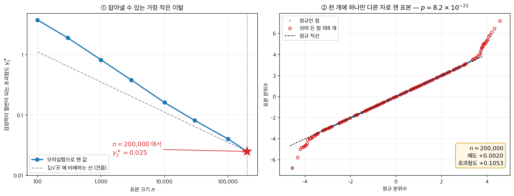
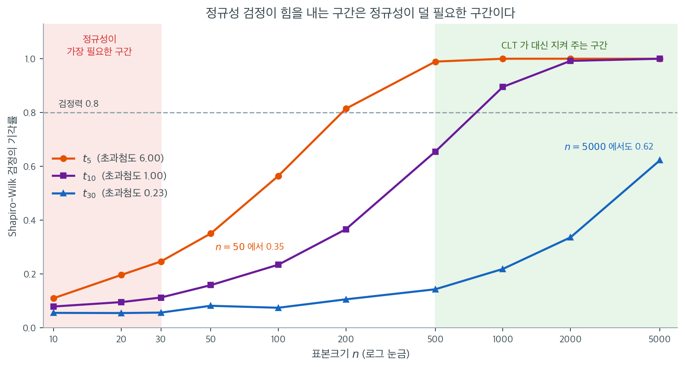

# 표본크기가 검정력에 미치는 영향

## 1. 핵심 문제

$20$ 만 개짜리 표본에서 $188$ 개만 세 배 넓은 자로 재어 넣었다. 오염된 비율은 $0.09\%$, 그 표본의 왜도는 $+0.0020$, 초과첨도는 $+0.105$ 이고 Q-Q 그림은 직선이다. 그런데 정규성 검정의 $p$ 값은 $10^{-21}$ 이다. 같은 오염을 $n = 1{,}000$ 에 넣으면 기각률이 $0.174$ 에 지나지 않는다. **아무도 신경 쓰지 않을 이탈은 확실히 잡아내고, 신경 써야 할 때는 못 잡는 것이다.** 검정력이 표본크기에 어떻게 매여 있기에 이렇게 되는가.

정규성 검정도 가설검정이며, 모든 가설검정과 마찬가지로 정규성 이탈을 탐지하는 능력이 표본크기 $n$에 의존한다. 여기서 실용적인 딜레마가 생긴다. $n$이 작아 정규성이 가장 중요할 때는 검정이 위배를 탐지할 검정력이 없고, $n$이 커서 중심극한정리가 로버스트성을 제공할 때는 검정이 너무 강력해져 사소한 이탈에도 정규성을 기각한다. 정규성 검정 결과를 올바르게 해석하려면 이 관계를 이해해야 한다.

---

## 2. 정규성 검정의 검정력

정규성 검정의 **검정력**은 자료가 실제로 정규가 아닌 분포에서 왔을 때 귀무가설 $H_0$: "자료가 정규분포를 따른다"를 기각할 확률이다. 형식적으로 $F$를 자료의 참 분포, $\Phi$를 정규 누적분포함수라 하면

$$
\text{Power} = P\left(\text{Reject } H_0 \mid F \neq \Phi\right)
$$

검정력은 세 요인에 의존한다.

1. **표본크기 $n$.** 표본이 클수록 분포의 모양에 대한 정보가 많아져 이탈을 탐지하는 능력이 커진다.
2. **유의수준 $\alpha$.** $\alpha$가 크면 검정력이 커지지만 제1종 오류율도 커진다.
3. **비정규성의 정도.** 참 분포 $F$가 정규에서 멀수록 탐지하기 쉽다.

---

## 3. 작은 표본에서의 거동

$n$이 작으면(대략 $n < 30$) 정규성 검정의 검정력이 낮다. 정규성에서 상당히 벗어나 있어도 탐지되지 않을 수 있다. 강하게 오른쪽으로 치우친 지수분포에서 $n = 15$인 표본을 뽑았다고 하자. Shapiro-Wilk 검정은 그런 표본의 상당 비율에서 $H_0$을 기각하지 못할 수 있다. 자료가 정규여서가 아니라 이탈을 탐지할 증거가 부족하기 때문이다.

이 낮은 검정력이 문제인 이유는, 작은 표본에서의 추론이야말로 정규성 가정이 가장 중요한 상황이기 때문이다. $t$ 검정과 신뢰구간에 쓰는 $t$ 분포는 정확한 정규성 아래에서 유도되었고, $n$이 작으면 중심극한정리가 거의 보호해 주지 못한다.

??? warning "기각하지 못한 것이 정규성을 확인해 주지는 않는다"
    정규성 검정의 유의하지 않은 결과는 "정규성을 기각할 증거가 부족하다"는 뜻이지 "자료가 정규이다"라는 뜻이 아니다. 이 구분은 검정이 큰 이탈조차 탐지할 검정력이 없을 수 있는 작은 표본에서 특히 중요하다.

---

## 4. 큰 표본에서의 거동

$n$이 커지면 일치성 있는 정규성 검정의 검정력은 고정된 어떤 비정규 분포에 대해서든 1로 수렴한다. 곧 자료가 충분히 많으면 참 분포가 정규에 아무리 가까워도 결국 $H_0$을 기각한다는 뜻이다. 형식적으로 $F \neq \Phi$인 임의의 분포와 임의의 $\alpha > 0$에 대해

$$
\lim_{n \to \infty} P\left(\text{Reject } H_0 \mid F\right) = 1
$$

이 일치성은 표본이 아주 크면 정규성 검정이 거의 언제나 기각한다는 것을 뜻한다. 초과첨도가 0.1인(실용적으로는 정규와 거의 구별되지 않는) 분포에서 뽑은 $n = 10{,}000$짜리 자료는 Shapiro-Wilk나 Anderson-Darling 검정에서 유의한 결과를 낼 가능성이 높다.

기각은 자료가 정확히 정규는 아니라는 사실을 알려줄 뿐이며, 실제 자료에서는 그것이 거의 언제나 참이다. 그 이탈이 후속 통계 절차의 타당성에 영향을 줄 만큼 큰지는 알려주지 않는다.

<div class="storybox" markdown>

**그림으로 보는 통계학 1.** 그가 적어 둔 수는 $200{,}000$ 이었다

위의 $\lim_{n\to\infty} P(\text{기각}) = 1$ 은 정리다. 그런데 이 정리를 **불평으로** 먼저
적은 사람이 있다. 정리보다 먼저였고, 그는 통계학자가 아니라 의사였다.

$1938$ 년 『**Journal of the American Statistical Association**』 $33$ 권 $526$–$536$ 쪽,
「카이제곱 검정을 적용할 때 부딪히는 해석상의 어려움들」. 쓴 사람은 **조지프 버크슨**
($1899$–$1982$). 뉴욕 시립대에서 물리학 학사, 컬럼비아에서 석사, 존스홉킨스에서
$1927$ 년 **의학박사**와 $1928$ 년 통계학 박사를 받고, $1934$ 년부터 $1964$ 년까지
**메이요 클리닉의 생물측정·의학통계부**를 맡았다. 날마다 진료 기록에 정규곡선을
맞춰 보던 사람이다. $527$ 쪽에 그가 적은 문장은 이렇다.

> ⋯ 자료의 수가 꽤 크면 $P$ 들이 작게 나오는 경향이 있다. ⋯ 관측 수가 아주 크면 —
> 이를테면 $200{,}000$ 정도 — 카이제곱의 $P$ 는 통상적인 유의 한계를 넘어 작아질
> 것이다. ⋯ 그렇다면 나올 $P$ 를 우리가 미리 알고 있는 셈이니, **그것은 검정이
> 아니다.**

마지막 한 마디가 바로 위의 극한을 가장 날카롭게 옮긴 말이다. 그런데 $200{,}000$ 이라는
수는 어림잡아 던진 것이 아니다. 그 눈금이 실제로 어디를 가리키는지 재어 볼 수 있다.

<figure markdown>
{ width="960" }
  <figcaption markdown>왼쪽에서 읽는 것은 **「잡히는 가장 작은 이탈」**이고, 오른쪽은 그 눈금을 넘긴 표본이 **눈에는 어떻게 보이는가**이다.</figcaption>
</figure>

왼쪽 칸은 검정력이 꼭 절반이 되는 초과첨도 $\gamma_2^\ast$ 를 $n$ 마다 찾아 그린 것이다
(대립은 $(1-\varepsilon)\,\mathcal{N}(0,1) + \varepsilon\,\mathcal{N}(0,3^2)$,
검정은 Jarque–Bera — $n$ 이 수십만이라 샤피로–윌크는 쓸 수 없다).

| $n$ | $100$ | $1{,}000$ | $10{,}000$ | $100{,}000$ | $200{,}000$ |
|---:|---:|---:|---:|---:|---:|
| $\gamma_2^\ast$ | $3.774$ | $0.824$ | $0.162$ | $0.040$ | $0.025$ |
| 그만큼 되려면 섞여야 하는 점 | $3.2$ 개 | $4.6$ 개 | $8.5$ 개 | $21$ 개 | $26$ 개 |

아랫줄이 버크슨의 수다. **$200{,}000$ 개 가운데 스물여섯 개**만 세 배 넓은 자로 재였으면
검정은 반쯤 기각한다. $n = 100$ 에서는 초과첨도가 $3.8$ — $t_5$ 보다도 두꺼운 꼬리 — 이라야
반이 잡히던 것이, $n$ 이 이천 배가 되면 $0.025$ 로 내려앉는다.

오른쪽 칸은 그 눈금을 넉넉히 넘긴 표본 하나다. $200{,}000$ 개 가운데 **천 개에 하나꼴**로
$188$ 개가 세 배 넓은 자로 재였다. 왜도 $+0.0020$, 초과첨도 $+0.105$. Q-Q 그림은 직선이다.
그런데 $JB = 92.5$, $p = 8.2 \times 10^{-21}$ 이다. 같은 자료에서 그 $188$ 개를 빼면
$JB = 0.48$ 로 내려앉는다. **기각은 전적으로 그 $188$ 개가 만든 것**이고, 그 $188$ 개는
$0.09\%$ 다. 같은 오염을 $n = 1{,}000$ 에 넣으면 기각률이 $0.174$ 에 지나지 않는다.

버크슨은 이 말을 다섯 해 뒤에 다시 꺼냈고($1942$, 같은 학술지 $37$ 권 $325$–$335$ 쪽
「증거로 본 유의성 검정」), 피셔가 받아쳤으며($1943$, $38$ 권 $103$–$104$ 쪽
「버크슨 박사의 유의성 검정 비판에 관한 노트」), 버크슨이 다시 답했다
($1943$, $38$ 권 $242$–$246$ 쪽). 둘은 끝내 합의하지 않았다.

덧붙이자면 이 사람의 이름은 이 책에 한 번 더 나온다. $1946$ 년 『Biometrics』에
병원 자료만 모아 보면 없던 음의 상관이 생긴다고 적은 글이 **버크슨의 역설**이고,
그것은 3.2절 [조건부 독립](../../ch03/probability/conditional_independence.md)
정리 $2$ 다. 두 글은 여덟 해 차이로 같은 책상에서 나왔다.

_확인한 곳 — 세 논문(과 $1942$·$1943$ 년 응답들)의 권·쪽수와 연도, $527$ 쪽의 인용문, 버크슨의 생몰년·학위·메이요 클리닉 재직 기간($1934$–$1964$), $1946$ 년 『Biometrics』 글이 버크슨의 역설이라는 것. 그림과 표의 수는 모두 직접 모의실험한 값이다_

</div>

---

## 5. 실용적 역설

이는 "정규성을 검정한 뒤 모수적 추론으로 진행한다"는 표준 작업 흐름에 역설을 만든다.

| 표본크기 | 정규성 검정의 검정력 | 정규성의 필요성 | 실제 상황 |
|---|---|---|---|
| 작음 ($n < 30$) | 낮음 | 높음 | 중요한 위배를 검정이 탐지하지 못한다 |
| 중간 ($30 \leq n \leq 100$) | 중간 | 중간 | 검정이 유익하고 쓸모 있다 |
| 큼 ($n > 500$) | 매우 높음 | 낮음(CLT가 돕는다) | 무관한 이탈에도 기각한다 |

중간 크기의 표본 구간이 실제 필요에 견주어 정규성 검정이 가장 유용한 정보를 주는 "적정 지점"이다.

---

## 6. 효과의 수량화

예시로 자유도 $\nu$인 $t$ 분포를 대립가설로 두었을 때 $\alpha = 0.05$에서 Shapiro-Wilk 검정의 검정력을 살펴보자. $\nu \to \infty$이면 $t$ 분포가 정규로 수렴하므로 $\nu$가 작을수록 정규성에서 더 크게 벗어난 것이다.

아래는 모의실험(반복 8,000회)으로 얻은 실제 검정력이다.

**$\nu = 5$**(초과첨도 $= 6/(5-4) = 6$, 상당히 큰 이탈):

| $n$ | 5 | 10 | 20 | 30 | 50 | 100 | 200 | 300 | 500 |
|---|---|---|---|---|---|---|---|---|---|
| 검정력 | 0.066 | 0.117 | 0.184 | 0.248 | 0.352 | 0.567 | 0.812 | 0.926 | 0.992 |

**$\nu = 30$**(초과첨도 $= 6/(30-4) = 0.231$, 가벼운 이탈):

| $n$ | 20 | 50 | 100 | 200 | 500 | 1000 | 2000 | 5000 |
|---|---|---|---|---|---|---|---|---|
| 검정력 | 0.062 | 0.073 | 0.083 | 0.093 | 0.149 | 0.201 | 0.334 | 0.631 |

이 수치들이 말하는 바는 분명하다. 초과첨도가 6이나 되는 뚜렷한 이탈조차 $n = 50$에서 탐지 확률이 35%에 지나지 않고, 80% 검정력에 이르려면 $n \approx 200$이 필요하다. 반면 초과첨도 0.23인 가벼운 이탈은 $n = 5000$에서도 검정력이 63%에 머문다. "표본이 크면 무조건 기각한다"는 말은 점근적으로는 옳지만, 그 "충분히 큰" $n$이 이탈의 크기에 따라 극적으로 달라진다는 점을 함께 기억해야 한다.

### 두 표를 한 그림에 겹쳐 보면

위의 두 표를 같은 축 위에 올리고, 중간 단계인 $t_{10}$까지 더해 그린 것이 아래 그림이다. 배경의 붉은 띠는 정규성 가정이 가장 중요한 $n < 30$ 구간이고, 초록 띠는 중심극한정리가 평균 기반 추론을 대신 지켜 주는 $n > 500$ 구간이다.



세 곡선 모두 왼쪽 붉은 띠 안에서는 바닥을 긴다. 초과첨도 $6$이라는 극단적 이탈조차 $n = 30$에서 기각률이 $0.25$이고, $t_{10}$은 $0.11$, $t_{30}$은 $0.06$으로 사실상 크기와 구별되지 않는다. **정규성이 가장 절실한 구간에서 검정은 아무것도 말해 주지 못한다.** 이 구간에서 "$p = 0.4$였으니 정규다"라고 적는 것은 아무 정보도 없는 문장을 쓰는 일이다.

세 곡선이 $0.8$ 선을 넘는 지점을 보라. $t_5$는 $n \approx 200$, $t_{10}$은 $n \approx 800$, $t_{30}$은 $n = 5000$에서도 $0.62$로 아직 못 넘었다. 곧 검정이 쓸 만해지는 표본크기는 이탈의 크기에 따라 수백에서 수만까지 벌어진다. 그런데 그 무렵이면 이미 초록 띠에 들어와 있다. **검정이 힘을 내기 시작하는 곳은 그 답이 실무적으로 덜 중요해지는 곳이다.** 이것이 이 쪽 첫머리에서 말한 역설의 그림이다.

역설에서 빠져나오는 길은 검정을 더 잘 고르는 것이 아니라 질문을 바꾸는 것이다. "$p$값이 얼마인가" 대신 "$g_1$과 $g_2$가 얼마이고, 그 크기가 내가 쓰려는 절차를 망가뜨리는가"를 물어야 한다. 작은 표본에서는 Q-Q 그림이 검정보다 훨씬 많은 것을 알려주고, 큰 표본에서는 효과 크기가 $p$값보다 훨씬 많은 것을 알려준다. 정규성 검정이 두 방식 모두를 이기는 구간은 가운데 $30 \leq n \leq 500$ 정도로 좁다.

<div class="exbox" markdown>

**보기 1.** <span class="diff easy" title="쉬움"></span> 표본크기에 따른 검정력. 모집단을 $t_5$로 고정하고 $n$만 $15$에서 $1000$까지 바꾸어, 샤피로–윌크 검정이 비정규성을 잡아내는 비율을 반복 5,000회로 잰다.

**(1)** 이 모의실험의 **검정력 곡선이 바닥에서 수렴하는 값**은 얼마여야 하는가. 그 값을 귀무가설에서 직접 확인하시오.

**(2)** 반복 5,000회의 몬테카를로 표준오차를 구하고, 본문의 표(반복 8,000회로 따로 돌린 것)와 같은 $n$에서 한 자리씩 견주어 **두 모의가 일치하는지** 판정하시오. 검정력이 $0.8$에 이르는 $n$도 좁혀 구하시오.

</div>

??? success "풀이"

    ```python
    import numpy as np
    from scipy import stats

    # ===================================================================
    # 표본크기가 커지면 정규성 검정의 검정력이 어떻게 되는가
    #
    # 모집단은 자유도 5 인 t 로 고정해 두고 n 만 바꾼다. 정규에서 벗어난
    # 정도는 내내 같은데, n 이 커지면 검정력이 1 로 다가간다.
    # 큰 표본에서 정규성 검정이 거의 늘 기각하는 까닭이 이것이다.
    # ===================================================================

    np.random.seed(42)
    n_simulations = 5000
    alpha = 0.05

    sample_sizes = [15, 30, 50, 100, 200, 500, 1000]

    if __name__ == "__main__":
        print("Power of Shapiro-Wilk test vs. t(5) distribution")
        print(f"{'n':>6}  {'Power':>8}")
        print("-" * 16)

        for n in sample_sizes:
            rejections = 0
            for _ in range(n_simulations):
                sample = stats.t.rvs(df=5, size=n)
                # scipy 의 shapiro 는 n<=5000 까지만 정확하다.
                if n <= 5000:
                    _, p = stats.shapiro(sample)
                    if p < alpha:
                        rejections += 1
            power = rejections / n_simulations
            print(f"{n:>6}  {power:>8.3f}")
    ```

    출력:

    ```text
    Power of Shapiro-Wilk test vs. t(5) distribution
         n     Power
    ----------------
        15     0.153
        30     0.253
        50     0.355
       100     0.556
       200     0.811
       500     0.990
      1000     1.000
    ```

    **(1) 바닥값은 유의수준 $\alpha = 0.05$다.** 검정력은 $P(\text{기각} \mid F)$이고, $n$이 작아지면 자료가 참 분포 $F$에 대해 아무 정보도 주지 못하는 쪽으로 가므로 기각률은 귀무가설이 참일 때의 값, 곧 **검정의 크기**로 수렴한다. 올바르게 교정된 검정의 크기는 $\alpha$이므로 검정력 곡선은 $0$이 아니라 $0.05$에서 출발한다.

    표의 $n = 15$에서 $0.153$이라는 수를 이 기준으로 읽어야 한다. 겉보기에 "15%는 잡는다"처럼 보이지만, 바닥이 $0.05$이니 **이탈이 실제로 기여한 몫은 $0.10$뿐**이다. 초과첨도가 $6$이나 되는 극단적 이탈에서도 그렇다.

    **(2)** 반복 $R$회 모의의 몬테카를로 표준오차는 $\sqrt{\pi(1-\pi)/R}$이다. $R = 5000$, $\pi \approx 0.5$에서 가장 커져 $0.0071$이고, $\pi = 0.99$ 근처에서는 $0.0014$로 작아진다. 곧 이 표의 수는 **셋째 자리까지 믿을 것이 아니다.**

    ```python
    import numpy as np
    from scipy import stats

    alpha, R = 0.05, 5000


    def power(df, n, seed, R=R):
        rng = np.random.default_rng(seed)
        p = np.array([stats.shapiro(rng.standard_t(df, n)).pvalue for _ in range(R)])
        return np.mean(p < alpha)


    # 1) 귀무가설이 참이면 검정력은 알파와 같다. 검정력 곡선의 왼쪽 끝 값이다.
    print("귀무(정규) 아래 기각률 — 검정력 곡선의 바닥")
    for n in (5, 15, 30):
        rng = np.random.default_rng(300 + n)
        p = np.array([stats.shapiro(rng.normal(0, 1, n)).pvalue for _ in range(20000)])
        print(f"  n = {n:4d}  기각률 {np.mean(p < alpha):.4f}"
              f"  (MC SE {np.sqrt(alpha * (1 - alpha) / 20000):.4f})")

    # 2) 본문 표(반복 8000회)와 이 보기(반복 5000회)를 같은 자리에서 견준다.
    book = {5: 0.066, 10: 0.117, 20: 0.184, 30: 0.248, 50: 0.352,
            100: 0.567, 200: 0.812, 300: 0.926, 500: 0.992}
    code = {15: 0.153, 30: 0.253, 50: 0.355, 100: 0.556, 200: 0.811, 500: 0.990}
    print("\nt_5 검정력: 본문 표(8000회) 대 이 보기(5000회)")
    print(f"{'n':>6} {'본문':>7} {'보기':>7} {'차이':>7} {'합산 MC SE':>11} {'차이/SE':>8}")
    for n, b in book.items():
        if n not in code:
            continue
        c = code[n]
        se = np.sqrt(b * (1 - b) / 8000 + c * (1 - c) / R)
        print(f"{n:>6} {b:>7.3f} {c:>7.3f} {c - b:>+7.3f} {se:>11.4f} {(c - b) / se:>+8.2f}")

    # 3) 검정력 0.8 에 이르는 n 과 n=1000 에서 놓치는 횟수.
    print("\n0.8 선 근처를 좁혀 본다")
    for n in (150, 175, 200, 225):
        print(f"  n = {n:4d}  검정력 {power(5, n, 2000 + n):.3f}")
    rng = np.random.default_rng(9001)
    p = np.array([stats.shapiro(rng.standard_t(5, 1000)).pvalue for _ in range(R)])
    print(f"\n  n = 1000  검정력 {np.mean(p < alpha):.4f}  놓친 횟수 {np.sum(p >= alpha)} / {R}")
    ```

    출력:

    ```text
    귀무(정규) 아래 기각률 — 검정력 곡선의 바닥
      n =    5  기각률 0.0490  (MC SE 0.0015)
      n =   15  기각률 0.0521  (MC SE 0.0015)
      n =   30  기각률 0.0527  (MC SE 0.0015)

    t_5 검정력: 본문 표(8000회) 대 이 보기(5000회)
         n      본문      보기      차이    합산 MC SE    차이/SE
        30   0.248   0.253  +0.005      0.0078    +0.64
        50   0.352   0.355  +0.003      0.0086    +0.35
       100   0.567   0.556  -0.011      0.0089    -1.23
       200   0.812   0.811  -0.001      0.0071    -0.14
       500   0.992   0.990  -0.002      0.0017    -1.16

    0.8 선 근처를 좁혀 본다
      n =  150  검정력 0.708
      n =  175  검정력 0.769
      n =  200  검정력 0.798
      n =  225  검정력 0.845

      n = 1000  검정력 1.0000  놓친 횟수 0 / 5000
    ```

    **바닥값이 확인된다.** 귀무가설 아래 기각률이 $n = 5, 15, 30$에서 $0.0490$, $0.0521$, $0.0527$로 모두 명목 $0.05$에서 2 표준오차 안에 있다. 검정력 곡선은 $0.05$에서 출발한다.

    **두 모의가 일치한다.** 차이를 합산 표준오차로 나눈 값이 다섯 자리 모두 $\lvert\,\cdot\,\rvert \le 1.23$이다. 가장 크게 벌어진 $n = 100$조차 $0.567$ 대 $0.556$으로 $1.23$ 표준오차이니, 두 숫자는 같은 값을 재고 있다. 반복 횟수와 씨앗이 다른 두 모의가 이렇게 맞는 것이 모의실험 자체가 올바르다는 증거다.

    **검정력 $0.8$은 $n \approx 200$에서 달성된다.** 좁혀 보면 $n = 150$에서 $0.708$, $175$에서 $0.769$, $200$에서 $0.798$, $225$에서 $0.845$이므로 $0.8$ 선은 $n \approx 200$과 $205$ 사이다. $n = 1000$에서는 5,000번 가운데 한 번도 놓치지 않았으므로 검정력이 $0.9994$보다 크다.

    두 사실을 나란히 놓으면 이 쪽의 요지가 수로 드러난다. 초과첨도 $6$은 결코 사소한 이탈이 아니다. 그런데 **그것을 다섯 번에 네 번 잡으려면 표본이 200개는 되어야 하고**, 정작 정규성이 절실한 $n = 15$에서는 바닥값 위로 $0.10$밖에 올라가지 못한다. **정규성 검정을 통과했다는 말은 "정규다"가 아니라 "이 표본크기로는 구별할 수 없다"는 뜻이다.**

    끝으로 코드에 한 가지 군더더기가 있다. `if n <= 5000:` 조건은 `sample_sizes`의 최댓값이 $1000$이므로 **언제나 참**이어서 아무 일도 하지 않는다. $n > 5000$에서 `scipy.stats.shapiro`의 $p$값이 부정확해진다는 주의를 조건문으로 적어 둔 것인데, 지금 설정에서는 실행 경로에 아무 영향을 주지 않는다.

### 치우침 대립에서는 더 빨리 올라간다

절 $6$ 의 표는 $t_\nu$, 곧 **두꺼운 꼬리** 대립에서 재었다. 치우침 대립에서는
곡선이 훨씬 가파르다 — 같은 샤피로–윌크 검정인데도 그렇다.

<div class="exbox" markdown>

**보기 2.** <span class="diff easy" title="쉬움"></span> Shapiro-Wilk 검정력 곡선. 대립가설 쪽 모집단을 $\text{Lognormal}(0,\, 0.6)$으로 **고정**하고 $n$만 $20$에서 $300$까지 키워, 각 $n$에서 반복 400회로 검정력을 잰다.

**(1)** $\text{Lognormal}(0, \sigma)$의 왜도와 초과첨도를 $m = e^{\sigma^2}$으로 나타내고 $\sigma = 0.6$에서의 값을 구하시오. 본문이 말하는 왜도 $2.26$과 맞는가.

**(2)** 반복 400회가 주는 몬테카를로 표준오차를 구하고, 표의 **"검정력 = 1.000"을 어떻게 읽어야 하는지** 말하시오. 검정력이 $0.8$을 넘는 $n$도 더 촘촘히 좁혀 구하시오.

</div>

??? success "풀이"

    ```python
    import numpy as np
    import matplotlib.pyplot as plt
    from scipy import stats

    plt.rcParams["font.sans-serif"] = ["NanumGothic", "Apple SD Gothic Neo", "Malgun Gothic"]
    plt.rcParams["font.family"] = "sans-serif"
    plt.rcParams["axes.unicode_minus"] = False

    def power_for_n(n, sims=500, sigma_ln=0.6, alpha=0.05, seed=0):
        """주어진 표본크기에서 Shapiro-Wilk 검정의 검정력을 모의실험으로 잰다.

        대립가설 쪽 모집단은 로그정규로 고정한다. 정규에서 벗어난 정도는
        내내 같으므로, 검정력의 변화는 오직 표본크기 때문이다.
        """
        rng = np.random.default_rng(seed)
        rejections = 0
        for _ in range(sims):
            x = rng.lognormal(mean=0.0, sigma=sigma_ln, size=n)
            W, p = stats.shapiro(x)
            if p < alpha:
                rejections += 1
        return rejections / sims

    # n 을 키워 가며 검정력 곡선을 그린다. 같은 이탈인데도 n=20 에서는
    # 절반도 잡아내지 못하고 n=300 에서는 거의 놓치지 않는다.
    ns = [20, 30, 50, 80, 120, 200, 300]
    powers = [power_for_n(n, sims=400, sigma_ln=0.6, alpha=0.05,
                          seed=42 + n) for n in ns]

    fig, ax = plt.subplots(figsize=(7, 4))
    ax.plot(ns, powers, marker="o")
    ax.set_ylim(0, 1)
    ax.set_xlabel("Sample size (n)")
    ax.set_ylabel("Empirical power (alpha = 0.05)")
    ax.set_title("Shapiro-Wilk power vs n (lognormal alt, sigma = 0.6)")
    plt.tight_layout()
    plt.show()

    for n, pw in zip(ns, powers):
        print(f"n = {n:>3}: power = {pw:.3f}")
    ```

    출력:

    ```text
    n =  20: power = 0.647
    n =  30: power = 0.833
    n =  50: power = 0.978
    n =  80: power = 1.000
    n = 120: power = 1.000
    n = 200: power = 1.000
    n = 300: power = 1.000
    ```

    

    **(1) 해석적으로.** $X = e^{Z}$, $Z \sim \mathcal{N}(0, \sigma^2)$이면 $E[X^k] = e^{k^2\sigma^2/2}$이다. $m = e^{\sigma^2}$으로 두고 표준화된 적률을 정리하면

    $$
    \gamma_1 = (m + 2)\sqrt{m - 1}, \qquad \gamma_2 = m^4 + 2m^3 + 3m^2 - 6
    $$

    이다. **$\sigma$만이 모양을 정하고 위치 모수 $\mu$는 척도로만 작용하므로 아무 몫도 하지 않는다.** $\sigma = 0.6$에서 $m = e^{0.36} = 1.43333$이므로

    $$
    \gamma_1 = 3.43333 \times \sqrt{0.43333} = 2.2601,
    \qquad
    \gamma_2 = 10.2734
    $$

    를 얻는다. 본문이 말하는 왜도 $2.26$과 **맞는다.** 초과첨도 $10.27$도 함께 적어 두는 것이 좋다. 왜도만 보면 $t_5$($\gamma_1 = 0$, $\gamma_2 = 6$)와 견줄 데가 없어 보이지만, 첨도까지 보면 이 대립가설은 $t_5$보다도 정규에서 멀다. $n = 20$에서 이미 검정력이 $0.65$나 되는 까닭이 이것이고, 앞 절의 $t_{30}$($\gamma_2 = 0.23$)과 대비하면 차이가 분명하다.

    **(2)** 반복 $M$회 모의의 추정 검정력은 성공확률 $\pi$인 이항비율이므로 표준오차는 $\sqrt{\hat\pi(1-\hat\pi)/M}$이다. $M = 400$에서 가장 커지는 $\hat\pi \approx 0.5$ 근처라면 $0.025$이니, **이 표의 수는 둘째 자리까지만 의미가 있다.**

    ```python
    import numpy as np
    from scipy import stats

    sigma_ln, alpha = 0.6, 0.05

    # 1) 대립가설의 이탈 크기는 닫힌 꼴로 정해져 있다.
    m = np.exp(sigma_ln ** 2)
    g1 = (m + 2) * np.sqrt(m - 1)
    g2 = m ** 4 + 2 * m ** 3 + 3 * m ** 2 - 6
    print(f"Lognormal(0, {sigma_ln}):  m = exp(sigma^2) = {m:.5f}")
    print(f"  왜도      (m+2) sqrt(m-1)        = {g1:.4f}")
    print(f"  초과첨도  m^4 + 2m^3 + 3m^2 - 6  = {g2:.4f}")
    lg = stats.lognorm(s=sigma_ln)
    print(f"  scipy 확인:  왜도 {lg.stats('s'):.4f}   초과첨도 {lg.stats('k'):.4f}")

    # 2) 반복 400 회가 주는 정밀도. 기각 횟수까지 함께 본다.
    print(f"\n보기의 표를 기각 횟수와 몬테카를로 오차까지 적으면 (sims = 400)")
    sims = 400
    for n in (20, 30, 50, 80, 120, 200, 300):
        rng = np.random.default_rng(42 + n)
        rej = sum(1 for _ in range(sims)
                  if stats.shapiro(rng.lognormal(0.0, sigma_ln, n)).pvalue < alpha)
        ph = rej / sims
        se = np.sqrt(ph * (1 - ph) / sims)
        if rej == sims:
            lower = alpha ** (1 / sims)       # 클로퍼-피어슨 95% 하한
            note = f"-> 95% 하한 {lower:.4f}"
        else:
            note = f"+- {1.96 * se:.4f}  (MC SE {se:.4f})"
        print(f"  n = {n:4d}  기각 {rej:3d}/{sims}  검정력 {ph:.4f}  {note}")

    # 3) 0.8 선을 더 촘촘히, 반복을 늘려 좁힌다.
    print("\n0.8 선 좁히기 (sims = 20000)")
    for n in (22, 24, 26, 28, 30):
        rng = np.random.default_rng(7000 + n)
        rej = sum(1 for _ in range(20000)
                  if stats.shapiro(rng.lognormal(0.0, sigma_ln, n)).pvalue < alpha)
        print(f"  n = {n:4d}  검정력 {rej / 20000:.4f}  (MC SE "
              f"{np.sqrt(rej / 20000 * (1 - rej / 20000) / 20000):.4f})")
    ```

    출력:

    ```text
    Lognormal(0, 0.6):  m = exp(sigma^2) = 1.43333
      왜도      (m+2) sqrt(m-1)        = 2.2601
      초과첨도  m^4 + 2m^3 + 3m^2 - 6  = 10.2734
      scipy 확인:  왜도 2.2601   초과첨도 10.2734

    보기의 표를 기각 횟수와 몬테카를로 오차까지 적으면 (sims = 400)
      n =   20  기각 259/400  검정력 0.6475  +- 0.0468  (MC SE 0.0239)
      n =   30  기각 333/400  검정력 0.8325  +- 0.0366  (MC SE 0.0187)
      n =   50  기각 391/400  검정력 0.9775  +- 0.0145  (MC SE 0.0074)
      n =   80  기각 400/400  검정력 1.0000  -> 95% 하한 0.9925
      n =  120  기각 400/400  검정력 1.0000  -> 95% 하한 0.9925
      n =  200  기각 400/400  검정력 1.0000  -> 95% 하한 0.9925
      n =  300  기각 400/400  검정력 1.0000  -> 95% 하한 0.9925

    0.8 선 좁히기 (sims = 20000)
      n =   22  검정력 0.6968  (MC SE 0.0033)
      n =   24  검정력 0.7439  (MC SE 0.0031)
      n =   26  검정력 0.7819  (MC SE 0.0029)
      n =   28  검정력 0.8154  (MC SE 0.0027)
      n =   30  검정력 0.8436  (MC SE 0.0026)
    ```

    **닫힌 꼴이 `scipy`와 소수점 넷째 자리까지 맞는다.** 손으로 유도한 $\gamma_1 = 2.2601$, $\gamma_2 = 10.2734$가 `stats.lognorm(s=0.6).stats('sk')`가 주는 값과 같다.

    **"검정력 = 1.000"은 1이 아니다.** 그것은 400번 가운데 400번 기각했다는 뜻일 뿐이며, 참 검정력이 $0.99$라면 400번 모두 기각할 확률이 $0.99^{400} = 0.018$로 결코 무시할 만하지 않다. 정규근사 표준오차는 $\hat\pi = 1$에서 $0$을 주어 쓸 수 없으므로 클로퍼–피어슨 하한을 쓴다. $400$번 모두 성공했을 때 95% 하한은 $0.05^{1/400} = 0.9925$이므로, **표의 $1.000$은 "검정력 $\ge 0.993$"으로 읽어야 한다.** 연습문제 5가 같은 계산을 한다.

    다른 행도 눈금을 붙여 읽어야 한다. $n = 20$은 $259/400 = 0.6475$이고 95% 오차한계가 $\pm 0.047$이므로 참 검정력은 대략 $[0.60,\, 0.69]$ 안에 있다. (본문은 같은 수를 $0.648$로, 코드 출력은 $0.647$로 적는데 둘 다 $0.6475$를 셋째 자리에서 끊은 것이다.) $n = 30$은 $333/400 = 0.8325 \pm 0.037$이니 관례적 기준 $0.8$을 넘었다는 판정 자체는 오차 안에서 간신히 유지된다.

    **$0.8$ 선은 $n \approx 27$이다.** 반복을 20,000회로 올려 촘촘히 재면 $n = 26$에서 $0.7819$, $n = 28$에서 $0.8154$이므로 선형보간으로 $n = 27.1$을 얻는다. 표준오차가 $0.003$으로 줄어 이제 셋째 자리까지 믿을 수 있다. 연습문제 1이 400–500회의 거친 격자에서 보간해 얻은 $n \approx 28$과 한 칸 차이인데, 그 격자의 분해능($n = 20$과 $30$ 사이를 직선으로 이은 것) 안이다.

    요점은 두 가지다. 첫째, **이탈이 크면 작은 표본으로도 잡힌다.** 왜도 $2.26$에 초과첨도 $10.27$인 이 대립가설은 $n = 27$이면 다섯 번에 네 번 잡힌다. 둘째, **모의실험으로 얻은 검정력에는 반드시 오차를 붙여야 한다.** $0.647$과 $1.000$을 같은 자리까지 적어 늘어놓으면 앞의 수가 뒤의 수만큼 정밀해 보이지만, 실제 오차한계는 $\pm 0.047$ 대 $[0.993,\, 1]$로 전혀 다르다.

---


검정력 곡선은 작은 $n$에서 시작해 $n$이 커지면서 1.0으로 올라간다. 핵심은 다음과 같다.

- $n = 20$에서 이미 검정력이 $0.648$이다. 그래도 대수정규 표본의 **35%를 놓친다**.
- $n = 30$에서 $0.833$으로 관례적 기준 0.8을 넘고, $n = 50$에서 $0.978$, $n = 80$에서는 400회 반복 중 한 번도 놓치지 않았다.
- 곡선의 가파름은 $\sigma$(대수정규의 모양 모수)에 의존한다. $\sigma$가 크면 정규에서 더 멀어져 곡선이 가팔라진다.

$\sigma = 0.6$인 대수정규는 왜도가 $2.26$으로 상당히 극단적인 대립가설이라는 점을 기억하라. 그래서 이렇게 작은 표본에서도 검정력이 높다. 아래 연습문제가 더 미묘한 대립가설을 다룬다.

---

## 7. 실무자를 위한 지침

표본크기와 검정력의 관계에 근거하여 다음 접근을 권장한다.

1. **작은 표본($n < 30$)**: 형식적 정규성 검정에만 의존하지 말라. Q-Q 그림과 히스토그램으로 시각적으로 평가하라. Q-Q 그림에 뚜렷한 이탈이 보이면 비모수 대안을 고려하라.

2. **중간 표본($30 \leq n \leq 200$)**: 이 구간에서 형식적 정규성 검정이 가장 유익하다. Shapiro-Wilk나 Anderson-Darling 검정을 시각적 진단과 함께 쓰라. 여기서의 유의한 결과는 의미 있는 이탈을 반영할 가능성이 높다.

3. **큰 표본($n > 500$)**: 정규성 검정이 기각할 것을 예상하라. $p$값보다 이탈의 크기에 집중하라. 초과첨도와 왜도 같은 효과 크기 측도를 쓰고, 그 이탈이 자신의 특정 추론 절차에 영향을 줄 만큼 큰지 평가하라.

---

## 연습문제

<div class="drillbox" markdown>

**연습문제 1.** <span class="diff med" title="중간"></span>
가볍게 치우친 자료의 관측값 $n = 500$개에 대한 Shapiro-Wilk 검정에서 $p = 0.001$을 얻었다. 같은 분포의 관측값 $n = 20$개에서는 $p = 0.35$였다. 이 차이를 설명하라.

</div>

??? success "풀이"
    검정력과 표본크기의 관계 때문에 생기는 차이이다. $n = 500$이면 검정이 정규성에서의 작은 이탈까지 탐지할 매우 높은 검정력을 갖는다. 실질적으로는 무의미한 가벼운 치우침이지만 통계적으로는 탐지된다. $n = 20$이면 검정력이 낮아 같은 가벼운 이탈을 탐지하지 못한다.

    $p$값은 비정규성의 **정도**를 재는 것이 아니라, 주어진 표본크기에서 정규성에 반하는 증거의 강도를 잰다. 같은 정도의 치우침이 $n$이 크면 아주 작은 $p$값을, $n$이 작으면 큰 $p$값을 낸다. 실질적 정규성을 평가할 때 $p$값보다 효과 크기(실제 왜도와 첨도 값)가 더 유익한 이유가 여기 있다.

<div class="drillbox" markdown>

**연습문제 2.** <span class="diff med" title="중간"></span>
$t_5$ 대립가설에 대한 Shapiro-Wilk 검정의 검정력을 $n$의 함수로 그려라. 곡선의 전반적 모양을 기술하라.

</div>

??? success "풀이"
    검정력 곡선은 아주 작은 $n$에서 유의수준 $\alpha$ 근처에서 시작해($t_5$를 정규와 구별하지 못한다) $n$이 커지면서 1을 향해 단조롭게 증가한다.

    $t_5$(중간 정도로 꼬리가 두꺼움)에 대한 실제 모의실험 값은

    | $n$ | 5 | 20 | 30 | 50 | 100 | 200 | 300 | 500 |
    |---|---|---|---|---|---|---|---|---|
    | 검정력 | 0.066 | 0.184 | 0.248 | 0.352 | 0.567 | 0.812 | 0.926 | 0.992 |

    곧 검정력 0.8은 $n \approx 200$, 0.95는 $n \approx 350$에서 달성된다. 상당히 두꺼운 꼬리를 갖는 대립가설인데도 안정적으로 탐지하려면 표본이 수백 개는 필요하다는 뜻이다.

    선형 척도에서 곡선은 S자(시그모이드) 모양이다. 처음에는 느리게 오르다가 중간에서 가파르고 1 근처에서 포화된다. 가파른 정도는 대립가설이 정규에서 얼마나 다른지에 달려 있다. 더 극단적인 대립가설(예: $t_3$)은 더 가파른 곡선을 만든다.

<div class="drillbox" markdown>

**연습문제 3.** <span class="diff med" title="중간"></span>
"정규성 검정을 위한 검정력 분석"의 개념을 설명하라. 실무에서 흔히 수행되는가?

</div>

??? success "풀이"
    정규성 검정의 검정력 분석은 특정한 정규성 이탈(예: 초과첨도 2)을 주어진 확률(예: 검정력 80%)과 주어진 유의수준에서 탐지하는 데 필요한 표본크기를 정하는 것이다.

    실무에서는 **거의 수행되지 않는다**. 이유는 (1) 연구자가 대개 구체적인 대립분포를 미리 모른다, (2) 정규성 검정의 목적은 참 분포를 식별하는 것이 아니라 정규 기반 방법이 믿을 만한지 평가하는 것이다, (3) 특정 대립가설에 대한 정규성 검정의 검정력 표가 존재하지만 널리 쓰이지 않는다.

    대신 실무자들은 경험 법칙에 기댄다. Shapiro-Wilk는 $n \geq 20$에서 쓸 만한 검정력을 갖고, $n > 200$에서는 형식적 검정이 지나치게 강력해져 시각적 방법이 선호된다.

<div class="drillbox" markdown>

**연습문제 4.** <span class="diff med" title="중간"></span>
비정규성의 정도가 고정되어 있을 때 정규성 검정의 p값은 표본크기 $n$에 따라 어떻게 변하는가? 근사적 관계를 제시하라.

</div>

??? success "풀이"
    고정된 대립가설(고정된 정규성 이탈)에 대해 검정통계량은 대략 $\sqrt{n}$에 비례해 커진다(많은 정규성 검정에서 표준화된 통계량이 $\sqrt{n}$에 비례한다). 그러면 p값은 $n$에 대해 대략 지수적으로 줄어든다.

    더 정확히는 검정통계량 $T_n$이 $T_n \approx \sqrt{n} \cdot \delta + Z$를 만족한다. 여기서 $\delta$는 (이탈을 재는) 비중심 모수이고 $Z$는 잡음이다. p값은 대략 $P(Z > c - \sqrt{n}\delta)$이며, $\delta > 0$인 한 $n \to \infty$일 때 0으로 간다.

    실질적 함의: 표본크기를 두 배로 늘리면 검정통계량이 $\sqrt{2} \approx 1.41$배가 되어 정규성에 반하는 증거가 커진다. 자료가 정규에 아무리 가까워도 $n$이 충분히 크면 기각을 피할 수 없다.

<div class="drillbox" markdown>

**연습문제 5.** <span class="diff med" title="중간"></span>
6절의 $\nu = 30$ 표(초과첨도 $0.231$)를 보기 1 풀이가 밝힌 **바닥값** $\alpha = 0.05$에 비추어 다시 읽는다.

**(1)** $n = 20, 200, 500, 5000$에서 **비정규성이 실제로 기여한 몫** 곧 검정력에서 바닥값을 뺀 값을 구하시오.

**(2)** 표에 있는 $n$ 가운데, 그 기여분이 바닥값 자체($0.05$)보다 커지는 가장 작은 것을 찾으시오.

**(3)** $n = 20$과 $n = 200$에서 **기각이 일어났을 때 그 기각을 꼬리에 돌릴 수 있는 지분** $(\text{검정력} - \alpha)/\text{검정력}$을 구하고, 5절 표의 "큼($n > 500$) — 검정력 매우 높음"이라는 칸과 견주시오.

</div>

??? success "풀이"
    **(1)** 표의 값에서 $0.05$를 뺀다.

    | $n$ | 20 | 200 | 500 | 5000 |
    |---|---|---|---|---|
    | 검정력 | 0.062 | 0.093 | 0.149 | 0.631 |
    | 기여분 | 0.012 | 0.043 | 0.099 | 0.581 |

    **(2)** 기여분이 $0.05$를 넘는 가장 작은 표본크기는 $n = 500$이다. $n = 200$에서는 $0.043 < 0.05$이고 $n = 500$에서 $0.099 > 0.05$다. 곧 **표본이 500개는 되어야 비로소 "꼬리를 봐서 기각한 것"이 "그냥 제1종 오류로 기각한 것"보다 많아진다.**

    **(3)** 지분은

    $$
    n = 20: \quad \frac{0.062 - 0.05}{0.062} = \frac{0.012}{0.062} = 0.194,
    \qquad
    n = 200: \quad \frac{0.043}{0.093} = 0.462
    $$

    이다. $n = 20$에서 기각 다섯 번 가운데 네 번은 자료가 정확히 정규였어도 똑같이 일어났을 기각이고, $n = 200$에서조차 절반이 넘는($1 - 0.462 = 0.538$) 기각이 꼬리와 무관하다.

    5절 표는 $n > 500$이면 검정력이 "매우 높음"이라 적었지만, 이 대립가설에서는 $n = 500$의 검정력이 $0.149$이고 $n = 5000$에서도 $0.631$이다. 표의 그 칸은 $n$ 하나만의 함수가 아니라 **이탈의 크기를 암묵적으로 중간 정도로 고정해 둔 서술**이다. 초과첨도 $0.231$처럼 가벼운 이탈에서는 $n > 500$이 "매우 높음"을 보장하지 못한다. 5절 표는 경험 법칙으로 읽어야 하고, 실제 검정력은 반드시 $(n, \text{이탈 크기})$ 두 축으로 읽어야 한다.

<div class="drillbox" markdown>

**연습문제 6.** <span class="diff med" title="중간"></span>
6절의 표들은 반복 8,000회 모의실험의 결과다. 보기 1 풀이의 몬테카를로 표준오차 공식 $\sqrt{\pi(1-\pi)/R}$을 써서 그 수치들이 얼마나 믿을 만한지 따진다.

**(1)** $\nu = 30$ 표의 $n = 20$ 값 $0.062$가 바닥값 $0.05$와 구별되는가. 귀무가설 아래의 표준오차로 판정하시오.

**(2)** 바닥값 위로 $0.005$만큼 올라간 검정력을 바닥값과 2 표준오차로 가려내려면 반복 횟수 $R$이 얼마나 되어야 하는가.

**(3)** $\nu = 5$ 표의 $n = 200$ 값 $0.812$에 모의 오차를 붙여도 "검정력 $0.8$은 $n \approx 200$"이라는 6절의 결론이 살아남는가.

</div>

??? success "풀이"
    **(1)** 바닥값과 견주는 것이므로 $\pi = \alpha = 0.05$에서의 표준오차를 쓴다.

    $$
    \mathrm{SE} = \sqrt{\frac{0.05 \times 0.95}{8000}} = \sqrt{5.9375 \times 10^{-6}} = 0.00244
    $$

    따라서

    $$
    \frac{0.062 - 0.05}{0.00244} = 4.92
    $$

    로 거의 5 표준오차다. **구별된다.** $n = 20$에서도 검정력 곡선은 바닥에서 이미 떠 있다. 다만 떠 있는 높이가 $0.012$에 지나지 않아 실무적으로는 아무 쓸모가 없다. 통계적으로 바닥을 벗어난 것과 실무적으로 쓸 만한 것이 전혀 다른 말이라는 점을 이 한 수가 보여 준다.

    **(2)** $2\sqrt{\alpha(1-\alpha)/R} \le 0.005$를 풀면

    $$
    R \ge \frac{4 \times 0.05 \times 0.95}{0.005^2} = \frac{0.19}{2.5 \times 10^{-5}} = 7600
    $$

    이다. 책이 쓴 $R = 8000$은 이 요구를 겨우 넘긴다($2\,\mathrm{SE} = 0.00487 < 0.005$). 곧 $\nu = 30$ 표의 작은 수들을 바닥값과 가려내는 데 필요한 최소 반복 횟수가 8,000 근처이고, 흔히 쓰는 2,000회로는 $2\,\mathrm{SE} = 0.0097$이라 $0.005$짜리 들림을 아예 볼 수 없다.

    **(3)** $\pi = 0.812$, $R = 8000$에서

    $$
    \mathrm{SE} = \sqrt{\frac{0.812 \times 0.188}{8000}} = \sqrt{1.908 \times 10^{-5}} = 0.00437
    $$

    이므로 2 표준오차 구간은 $[0.812 - 0.0087,\ 0.812 + 0.0087] = [0.803,\ 0.821]$이다. 아래 끝이 $0.803 > 0.8$이므로 **$n = 200$에서 검정력이 이미 $0.8$을 넘었다는 결론은 모의 오차를 넘어선다.** (참고로 $R = 8000$에서 표준오차가 가장 큰 곳은 $\pi = 0.5$이고 그때도 $0.0056$이니, 6절 두 표의 모든 수는 $\pm 0.011$ 안에서 믿을 수 있다. 셋째 자리는 장식이다.)

<div class="drillbox" markdown>

**연습문제 7.** <span class="diff hard" title="어려움"></span>
연습문제 4의 모형 $T_n \approx \sqrt{n}\,\delta + Z$를 6절의 수치에 실제로 맞춰 본다. 단측 기각역 $T_n > z_{0.05} = 1.645$를 쓰면 검정력은

$$
\text{Power}(n) = \Phi\!\left(\sqrt{n}\,\delta - 1.645\right)
$$

가 된다. 여기서 $\delta$는 대립분포에만 달린 "한 관측값당 이탈의 세기"다.

**(1)** $\nu = 30$ 표의 $n = 2000$ 값 $0.334$ 하나만으로 $\delta_{30}$을 추정하시오.

**(2)** 그 $\delta_{30}$으로 $n = 50, 500, 5000$의 검정력을 예측해 표의 값과 견주시오. 모형이 맞는가.

**(3)** $\nu = 30$에서 검정력 $0.8$에 이르는 $n$을 구하고, "$t_{30}$은 $n = 5000$에서도 $0.62$로 아직 $0.8$을 못 넘었다"는 그림의 서술과 어긋나지 않는지 확인하시오.

**(4)** 같은 방법으로 $\nu = 5$ 표의 $n = 200$ 값 $0.812$에서 $\delta_5$를 추정하고, 두 대립가설이 같은 검정력에 이르는 데 필요한 표본크기의 비를 구하시오.

</div>

??? success "풀이"
    **(1)** $\Phi(\sqrt{2000}\,\delta_{30} - 1.645) = 0.334$에서 $\Phi^{-1}(0.334) = -0.429$이므로

    $$
    \sqrt{2000}\,\delta_{30} = 1.645 - 0.429 = 1.216,
    \qquad
    \delta_{30} = \frac{1.216}{44.72} = 0.0272
    $$

    **(2)** $\Phi(\sqrt{n} \times 0.0272 - 1.645)$를 계산한다.

    | $n$ | $\sqrt{n}\,\delta_{30}$ | 모형 | 표 |
    |---|---|---|---|
    | 50 | 0.192 | 0.073 | 0.073 |
    | 500 | 0.608 | 0.150 | 0.149 |
    | 5000 | 1.922 | 0.609 | 0.631 |

    $n = 50$과 $n = 500$은 $0.001$ 안에서 맞고 $n = 5000$에서만 $0.022$ 벌어진다. 한 점만 보고 맞춘 한 모수 모형이 $n$을 100배 넘게 늘려도 이 정도로 따라간다는 것은 **정규성 검정의 검정통계량이 실제로 $\sqrt{n}$에 비례해 자란다**는 연습문제 4의 주장이 수치로 확인된 것이다. 어긋나는 방향도 한결같다. 표에 없는 자리까지 넣어 보면 모형은 중간 $n$에서 조금 높고($n = 200$에서 모형 $0.104$, 표 $0.093$) 큰 $n$에서 조금 낮다. 곧 실제 검정력 곡선이 $\Phi$ 꼴보다 약간 더 가파르다.

    **(3)** $\Phi^{-1}(0.8) = 0.8416$이므로

    $$
    \sqrt{n}\,\delta_{30} = 1.645 + 0.842 = 2.487,
    \qquad
    \sqrt{n} = \frac{2.487}{0.0272} = 91.5,
    \qquad
    n = 8370
    $$

    곧 $n \approx 8400$이다. $5000 < 8400$이므로 "$n = 5000$에서도 아직 $0.8$을 못 넘었다"는 서술과 들어맞는다. 오히려 모형은 얼마나 더 가야 하는지까지 알려 준다. **초과첨도 $0.231$을 다섯 번에 네 번 잡으려면 표본이 8천 개는 되어야 한다.**

    **(4)** $\Phi^{-1}(0.812) = 0.885$이므로

    $$
    \sqrt{200}\,\delta_5 = 1.645 + 0.885 = 2.530,
    \qquad
    \delta_5 = \frac{2.530}{14.14} = 0.1789
    $$

    (이 $\delta_5$로 예측하면 $n = 50$에서 $0.352$, $n = 300$에서 $0.927$, $n = 500$에서 $0.991$로 표의 $0.352$, $0.926$, $0.992$와 거의 같다. 또 검정력 $0.8$은 $n = (2.487/0.1789)^2 = 193$에서 달성되어 보기 1의 "$n \approx 200$"과 맞는다.)

    같은 검정력에 이르려면 $\sqrt{n}\,\delta$가 같아야 하므로 $n \propto 1/\delta^2$이고

    $$
    \frac{n_{30}}{n_5} = \left(\frac{\delta_5}{\delta_{30}}\right)^2 = \left(\frac{0.1789}{0.0272}\right)^2 = 6.58^2 = 43.3
    $$

    **표본을 43배 늘려야 한다.** 실제로 $193 \times 43.3 = 8360$으로 (3)의 $8370$과 일치한다. 한편 두 초과첨도의 비는 $6/0.231 = 26$이고 $\delta$의 비는 $6.58 \approx \sqrt{26} \times 1.29$이니, $\delta$는 초과첨도에 비례하지 않고 **대략 그 제곱근처럼** 자란다. 그러면 $n \propto 1/\delta^2 \propto 1/\gamma_2$이므로, 이탈이 열 배 심해지면 필요한 표본은 (비례했을 때의 백 배가 아니라) 열 배로 줄어든다. 필요한 표본크기와 초과첨도의 곱이 대략 일정하다는 뜻이고, 실제로 $200 \times 6 = 1200$, $8400 \times 0.231 = 1940$으로 같은 자리수에 있다.

<div class="drillbox" markdown>

**연습문제 8.** <span class="diff hard" title="어려움"></span>
두 논문이 똑같이 "Shapiro-Wilk 검정에서 $p = 0.001$이었다"고 적었다. 한 쪽은 $n = 50$, 다른 쪽은 $n = 5000$이다. 연습문제 7의 모형과 거기서 얻은 두 기준점 $\delta_5 = 0.1789$(초과첨도 $6$), $\delta_{30} = 0.0272$(초과첨도 $0.231$)을 써서 답하시오.

**(1)** 각 논문의 자료가 가진 이탈의 세기 $\hat{\delta} = T_n/\sqrt{n}$을 구하시오($p = 0.001$에서 $T_n = 3.09$).

**(2)** 두 $\hat{\delta}$의 비가 왜 정확히 $10$인지 설명하시오.

**(3)** 각 $\hat{\delta}$를 두 기준점과 견주고, "그 이탈을 80% 확률로 잡는 데 필요한 표본크기"로 환산해 두 논문의 상황을 한 문장으로 요약하시오.

</div>

??? success "풀이"
    **(1)** $T_n \approx \sqrt{n}\,\delta + Z$에서 잡음 $Z$를 빼고 $\delta$를 점추정하면 $\hat{\delta} = T_n/\sqrt{n}$이다.

    $$
    n = 50: \quad \hat{\delta} = \frac{3.09}{\sqrt{50}} = \frac{3.09}{7.071} = 0.437,
    \qquad
    n = 5000: \quad \hat{\delta} = \frac{3.09}{70.71} = 0.0437
    $$

    **(2)** 두 논문의 $p$값이 같으므로 $T_n$도 같다. 그러면 $\hat{\delta} = T_n/\sqrt{n}$의 비는 $\sqrt{n}$의 비의 역수뿐이고

    $$
    \frac{\hat{\delta}_{50}}{\hat{\delta}_{5000}} = \sqrt{\frac{5000}{50}} = \sqrt{100} = 10
    $$

    이다. **$p$값이 같다는 것은 "$\sqrt{n}\,\delta$가 같다"는 말이지 "$\delta$가 같다"는 말이 아니다.** 연습문제 1과 4가 말로 적은 것이 여기서 정확히 열 배라는 수로 나온다.

    **(3)** 기준점과 견주면

    | 논문 | $\hat{\delta}$ | 기준과의 비교 | 80% 검정력에 필요한 $n$ |
    |---|---|---|---|
    | $n = 50$ | 0.437 | $\delta_5$의 $2.44$배 | $(2.487/0.437)^2 = 32$ |
    | $n = 5000$ | 0.0437 | $\delta_{30}$의 $1.61$배 | $(2.487/0.0437)^2 = 3240$ |

    $n = 50$짜리 자료의 이탈 세기는 초과첨도 $6$인 $t_5$보다도 $2.4$배 크다. 그런 자료는 $n = 32$만 있어도 80% 확률로 잡히는 **거친 이탈**이고, 실제로 $n = 50$에서 잡혔다. 반면 $n = 5000$짜리 자료는 $t_{30}$(초과첨도 $0.231$)보다 겨우 $1.6$배 센 이탈이어서 80%로 잡는 데 표본이 3,240개 필요하고, 그 논문이 가진 5,000개가 바로 그 문턱을 넘었을 뿐이다.

    한 문장으로: **같은 $p = 0.001$이 한 쪽에서는 "$t$ 검정을 쓰면 안 되는 자료"를, 다른 쪽에서는 "$t_{30}$ 정도의, 중심극한정리가 충분히 덮어 주는 자료"를 가리킨다.** 7절의 세 번째 지침("$p$값보다 이탈의 크기에 집중하라")이 왜 지침이 아니라 필수인지가 이 두 줄에 있다.

<div class="drillbox" markdown>

**연습문제 9.** <span class="diff hard" title="어려움"></span>
6절 끝에서 이 쪽은 "$p$값이 얼마인가" 대신 "$g_1$과 $g_2$가 얼마인가"를 물으라고 처방한다. 이 처방에 구멍이 있음을 반례로 보인다.

세 점에만 질량을 두는 분포 $P(X = 0) = p$, $P(X = a) = P(X = -a) = (1-p)/2$를 생각한다($a > 0$).

**(1)** 이 분포의 왜도 $\gamma_1$과 초과첨도 $\gamma_2$를 $p$로 나타내시오.

**(2)** $\gamma_1 = 0$이고 $\gamma_2 = 0$이면서 분산이 $1$인 분포를 하나 구체적으로 적으시오.

**(3)** 2장의 부등식 $\beta_2 \ge 1 + \gamma_1^2$이 이 분포족에서 어떻게 보이는지 말하고, 이 족이 도달할 수 있는 $\beta_2$의 범위를 구하시오.

**(4)** (2)의 분포에서 $n = 60$을 뽑았다면 Q-Q 그림이 어떤 모양이겠는가. 7절의 지침 가운데 어느 것이 이 반례를 잡아내는가.

</div>

??? success "풀이"
    **(1)** 분포가 $0$에 대해 대칭이므로 모든 홀수 적률이 $0$이고 따라서 $\gamma_1 = 0$이다. 짝수 적률은

    $$
    \mu_2 = E[X^2] = (1-p)a^2,
    \qquad
    \mu_4 = E[X^4] = (1-p)a^4
    $$

    이므로

    $$
    \beta_2 = \frac{\mu_4}{\mu_2^2} = \frac{(1-p)a^4}{(1-p)^2 a^4} = \frac{1}{1-p},
    \qquad
    \gamma_2 = \frac{1}{1-p} - 3
    $$

    $a$가 약분되어 사라진다. 첨도는 눈금과 무관하다는 사실이 이 족에서는 눈에 보이게 드러난다.

    **(2)** $\gamma_2 = 0$은 $1/(1-p) = 3$, 곧 $p = 2/3$이다. 분산 $\mu_2 = (1-p)a^2 = a^2/3 = 1$에서 $a = \sqrt{3}$이다. 따라서

    $$
    P(X = 0) = \frac{2}{3},
    \qquad
    P(X = \sqrt{3}) = P(X = -\sqrt{3}) = \frac{1}{6}
    $$

    검산하면 $E[X^2] = \tfrac{1}{6}\cdot 3 + \tfrac{1}{6}\cdot 3 = 1$, $E[X^4] = \tfrac{1}{6}\cdot 9 + \tfrac{1}{6}\cdot 9 = 3$이므로 $\beta_2 = 3/1^2 = 3$, $\gamma_2 = 0$이다. **이 분포는 $g_1$과 $g_2$가 모두 $0$ 근처를 가리키는데도 연속분포조차 아니다.** 값을 세 개밖에 갖지 않고 관측값의 2/3이 정확히 같은 수다.

    **(3)** $\gamma_1 = 0$이므로 2장의 부등식은 $\beta_2 \ge 1$로 읽힌다. 이 족에서 $\beta_2 = 1/(1-p)$이고 $p \in [0, 1)$이므로 $\beta_2$는 $[1, \infty)$ 전체를 훑는다. 하한 $\beta_2 = 1$은 $p = 0$, 곧 $\pm a$ 두 값만 갖는 분포(라데마허 꼴)에서 정확히 달성되고, 이는 대칭 분포 가운데 첨도가 가장 작은 극단이다. 거꾸로 $p \to 1$이면 $\beta_2 \to \infty$다. 따라서 **$\gamma_2 = 0$은 이 족의 한 점일 뿐이고, 정규분포를 가리키는 표지가 전혀 아니다.** $(\gamma_1, \gamma_2) = (0, 0)$을 지나는 비정규 분포는 이처럼 얼마든지 만들 수 있다.

    **(4)** $n = 60$이면 $0$에 평균 $60 \times \tfrac{2}{3} = 40$개가 쌓인다. 정렬하면 가운데 40개가 전부 같은 값이므로 Q-Q 그림은 **가운데 삼분의 둘 구간이 완전히 수평인 계단**이 되고, 양 끝에서만 $\pm\sqrt{3}$ 높이의 평평한 층이 두 개 더 나타난다. 정규 Q-Q 그림의 직선과는 조금도 닮지 않는다.

    따라서 이 반례를 잡아내는 것은 7절 세 번째 지침("초과첨도와 왜도 같은 효과 크기 측도를 쓰라")이 아니라 **첫 번째 지침("Q-Q 그림과 히스토그램으로 시각적으로 평가하라")**이다. Shapiro-Wilk도 잡아낸다. 그 통계량은 순서통계량과 정규분위수의 상관을 재므로, 가운데 40개가 같은 값으로 묶이면 상관이 무너진다.

    요지는 이것이다. 이 쪽은 "$p$값을 묻지 말고 $g_1, g_2$를 물어라"로 역설에서 빠져나가지만, $g_1$과 $g_2$는 3차·4차 적률 **둘만** 보는 요약이다. 효과 크기가 $p$값보다 나은 것은 맞되, 두 수로 분포 모양을 다 담았다고 믿는 순간 또 다른 맹점이 생긴다. 큰 표본에서도 효과 크기와 그림을 **함께** 보아야 한다.

<div class="drillbox" markdown>

**연습문제 10.** <span class="diff hard" title="어려움"></span>
4절의 일치성 서술

$$
\lim_{n \to \infty} P(\text{Reject } H_0 \mid F) = 1
\qquad (F \neq \Phi \text{ 고정})
$$

에서 "고정"이라는 단서가 왜 빠질 수 없는지 따진다. 연습문제 7의 모형 $\text{Power}(n) = \Phi(\sqrt{n}\,\delta - 1.645)$를 쓴다.

**(1)** 대립가설을 $n$에 따라 조금씩 정규 쪽으로 옮겨 $\delta_n = c/\sqrt{n}$($c > 0$ 고정)이라 하자. 이때 검정력이 $n$에 따라 어떻게 되는가.

**(2)** 그 극한 검정력이 $0.5$, $0.8$이 되는 $c$를 각각 구하시오. 또 6절 $\nu = 30$ 표의 $n = 500$ 값 $0.149$를 내는 $c$를 구하시오.

**(3)** 연습문제 7(4)에서 얻은 "$\delta$는 초과첨도의 대략 제곱근처럼 자란다"를 받아들이면, 검정력이 영원히 고정되는 초과첨도의 수열 $\gamma_{2,n}$은 $n$에 대해 어떤 꼴인가. 자유도로 환산하면 어떤 $t$ 분포들의 열인가.

**(4)** 이 계산이 5절의 역설을 어떻게 다시 말해 주는지 한 단락으로 적으시오.

</div>

??? success "풀이"
    **(1)** $\delta_n = c/\sqrt{n}$을 넣으면 $\sqrt{n}\,\delta_n = c$로 $n$이 완전히 지워진다.

    $$
    \text{Power}(n) = \Phi\!\left(\sqrt{n} \cdot \frac{c}{\sqrt{n}} - 1.645\right) = \Phi(c - 1.645)
    $$

    곧 검정력이 **$n$에 무관한 상수**다. 표본을 백만 개로 늘려도 기각률이 꼼짝하지 않는다. 4절의 극한이 $1$이 되는 것은 $\delta$가 고정된 양수이기 때문이고, 이탈이 $n^{-1/2}$ 속도로 사그라들면 $\sqrt{n}$으로 자라는 증거와 정확히 상쇄된다. 그러므로 4절 서술에서 "$F$ 고정"은 꾸밈말이 아니라 **극한의 순서를 지정하는 조건**이다. $n \to \infty$를 먼저 보내면 $1$이지만, $F \to \Phi$를 $n$과 함께 보내면 아무 값이나 될 수 있다.

    **(2)** $\Phi(c - 1.645) = \pi$에서 $c = 1.645 + \Phi^{-1}(\pi)$다.

    | 극한 검정력 $\pi$ | $\Phi^{-1}(\pi)$ | $c$ |
    |---|---|---|
    | 0.5 | 0 | 1.645 |
    | 0.8 | 0.842 | 2.487 |
    | 0.149 | $-1.040$ | 0.605 |

    $\pi = 0.5$에서 $c = z_{0.05} = 1.645$라는 것이 기준점이다. $\pi = 0.149$는 $\nu = 30$, $n = 500$의 실제 검정력이고 거기에 맞는 $c$는 $0.605$인데, 연습문제 7의 $\delta_{30}$으로 검산하면 $\sqrt{500} \times 0.0272 = 0.608$로 같다. 고정된 대립가설도 **특정 $n$에서는** 어떤 국소 대립가설과 구별되지 않는다. 한 표본크기에서 본 검정력만으로는 이탈이 고정되어 있는지 사그라드는지 결코 알 수 없다.

    **(3)** $\delta \approx k\sqrt{\gamma_2}$라 두면 $\delta_n = c/\sqrt{n}$은

    $$
    k\sqrt{\gamma_{2,n}} = \frac{c}{\sqrt{n}}
    \quad\Longrightarrow\quad
    \gamma_{2,n} = \frac{(c/k)^2}{n} \propto \frac{1}{n}
    $$

    곧 **초과첨도가 $1/n$ 속도로 사그라드는 열**이다. $t$ 분포로 쓰면 $\gamma_2 = 6/(\nu - 4)$이므로

    $$
    \frac{6}{\nu_n - 4} \propto \frac{1}{n}
    \quad\Longrightarrow\quad
    \nu_n = 4 + \kappa n
    $$

    곧 자유도가 표본크기에 비례해 커지는 $t_{\nu_n}$들의 열이다. 상수는 기준점으로 맞출 수 있다. $t_{30}$($\gamma_2 = 0.231$)이 $n = 8400$에서 검정력 $0.8$이었으므로, 같은 $0.8$을 유지하는 열은 $\gamma_{2,n} = 0.231 \times 8400/n = 1940/n$이고 $\nu_n = 4 + 6/\gamma_{2,n} = 4 + n/323$이다. 예컨대 $n = 8400$에서 $t_{30}$, $n = 84{,}000$에서 $t_{264}$, $n = 840{,}000$에서 $t_{2604}$가 모두 검정력 $0.8$을 준다. 자료가 100배로 늘어도 검정은 여전히 다섯 번에 한 번은 놓친다.

    **(4)** 5절의 역설은 보통 "$n$이 크면 사소한 이탈도 기각한다"로 서술되지만, (1)~(3)이 보이는 것은 그 서술이 **이탈을 고정해 두었을 때만** 참이라는 사실이다. 실제로 중요한 비교는 두 속도 사이에서 일어난다. 한쪽에서 검정이 모으는 증거는 $\sqrt{n}\,\delta$로 자라고, 다른 쪽에서 비정규성이 평균 기반 추론을 망가뜨리는 정도는 중심극한정리에 따라 $n$이 커질수록 줄어든다. 두 속도가 맞물리는 자리에서 검정력은 상수로 멈춘다. 곧 "충분히 큰 $n$"이라는 말은 $n$만으로 정의될 수 없고 언제나 "이 크기의 이탈에 대해 충분히 큰 $n$"이어야 한다. 6절에서 $t_5$는 $n \approx 200$, $t_{30}$은 $n \approx 8400$이었던 것, 그리고 그림의 세 곡선이 $0.8$ 선을 수백에서 수만까지 벌어진 곳에서 넘었던 것이 모두 이 한 문장의 사례다. 검정력 곡선 하나를 "표본크기의 함수"로 그려 놓고 보는 습관 자체가 역설을 만든 셈이다. 제대로 된 그림은 $(n, \gamma_2)$ 평면 위의 등검정력 곡선 $\sqrt{n}\,\sqrt{\gamma_2} = \text{const}$, 곧 $n\gamma_2 = \text{const}$인 쌍곡선들이다.

<div class="drillbox" markdown>

**연습문제 11.** <span class="diff med" title="중간"></span> $\sigma = 0.3$(정규에 더 가까운 대수정규)에 대해 검정력 모의실험을 수행하고 $\sigma = 0.6$ 곡선과 비교하라. 각 경우 검정력이 0.8에 도달하는 표본크기는 얼마인가?

</div>

??? success "풀이"

    ```python
    import numpy as np
    from scipy import stats
    import matplotlib.pyplot as plt

    def power_curve(sigma, ns, sims=500, alpha=0.05):
        powers = []
        for n in ns:
            rng = np.random.default_rng(42 + n)
            rej = sum(1 for _ in range(sims)
                      if stats.shapiro(rng.lognormal(0, sigma, n))[1] < alpha)
            powers.append(rej / sims)
        return powers

    ns = [20, 30, 50, 80, 120, 200, 300, 500]
    p03 = power_curve(0.3, ns)
    p06 = power_curve(0.6, ns)

    for n, a, b in zip(ns, p03, p06):
        print(f"n = {n:>3}: sigma=0.3 -> {a:.3f}, sigma=0.6 -> {b:.3f}")

    fig, ax = plt.subplots(figsize=(7, 4))
    ax.plot(ns, p03, marker="o", label="sigma = 0.3")
    ax.plot(ns, p06, marker="s", label="sigma = 0.6")
    ax.axhline(0.8, color="gray", linestyle="--", alpha=0.5)
    ax.set_xlabel("Sample size")
    ax.set_ylabel("Power")
    ax.set_title("Power Curves: Lognormal Alternatives")
    ax.legend()
    plt.tight_layout()
    plt.show()
    ```

    출력:

    ```text
    n =  20: sigma=0.3 -> 0.246, sigma=0.6 -> 0.658
    n =  30: sigma=0.3 -> 0.364, sigma=0.6 -> 0.830
    n =  50: sigma=0.3 -> 0.540, sigma=0.6 -> 0.980
    n =  80: sigma=0.3 -> 0.786, sigma=0.6 -> 1.000
    n = 120: sigma=0.3 -> 0.936, sigma=0.6 -> 1.000
    n = 200: sigma=0.3 -> 0.998, sigma=0.6 -> 1.000
    n = 300: sigma=0.3 -> 0.998, sigma=0.6 -> 1.000
    n = 500: sigma=0.3 -> 1.000, sigma=0.6 -> 1.000
    ```

    

    | 대립가설 | 왜도 $\gamma_1$ | 검정력 0.8 도달 |
    |---|---|---|
    | $\sigma = 0.6$ | 2.260 | $n \approx 28$ |
    | $\sigma = 0.3$ | 0.950 | $n \approx 84$ |

    ($\sigma = 0.6$은 $n = 30$에서 $0.830$, $\sigma = 0.3$은 $n = 80$에서 $0.786$, $n = 120$에서 $0.936$이므로 선형보간한 값이다.)

    $\sigma = 0.3$인 대수정규는 왜도가 $0.95$로 정규에 훨씬 가까우므로 같은 검정력을 얻는 데 약 **3배** 큰 표본이 필요하다. 미묘한 이탈일수록 큰 표본이 필요하다는 근본적 절충을 보여준다.

    대략적인 어림셈으로는 검정력이 왜도의 제곱과 $n$의 곱, 곧 $n\gamma_1^2$에 의존한다고 볼 수 있다. $(2.260/0.950)^2 = 5.7$이라면 표본크기 비율도 5.7배여야 할 것 같지만 실제로는 3배다. Shapiro-Wilk가 왜도만이 아니라 순서통계량 전체의 정렬을 쓰기 때문이다. $\square$

---


<div class="drillbox" markdown>

**연습문제 12.** <span class="diff hard" title="어려움"></span> 추정된 검정력의 몬테카를로 표준오차 공식을 유도하고, $M = 400$회 모의실험에서 $\widehat{\text{Power}} = 0.72$일 때 검정력의 95% 신뢰구간을 계산하라.

</div>

??? success "풀이"

    각 모의실험은 성공확률 $\pi = \text{Power}$인 베르누이 시행이다. 추정량 $\hat{\pi} = \widehat{\text{Power}}$의 분산은 $\pi(1-\pi)/M$이므로 표준오차는

    $$
    \text{SE}(\hat{\pi}) = \sqrt{\frac{\hat{\pi}(1 - \hat{\pi})}{M}}.
    $$

    $\hat{\pi} = 0.72$, $M = 400$이면

    $$
    \text{SE} = \sqrt{\frac{0.72 \times 0.28}{400}} = \sqrt{\frac{0.2016}{400}} = \sqrt{0.000504} \approx 0.0225.
    $$

    95% 신뢰구간은 $\hat{\pi} \pm 1.96 \times \text{SE} = 0.72 \pm 0.044 = (0.676, 0.764)$이다.

    표준오차를 절반으로 줄이려면 $M = 1600$회가 필요하다. $\text{SE} \propto 1/\sqrt{M}$이므로 정밀도를 두 배로 높이는 데 계산량이 네 배 든다.

    **경계 근처의 주의사항.** $\hat{\pi}$가 0이나 1에 가까우면 이 정규근사가 무너진다. 예컨대 400회 중 400회 모두 기각하여 $\hat{\pi} = 1$이면 위 공식은 $\text{SE} = 0$을 준다. 참 검정력이 1이라는 뜻이 아니다. 이 경우에는 Wilson 구간이나 Clopper-Pearson 구간을 써야 한다. 400회 중 400회 성공의 Clopper-Pearson 95% 하한은 $0.05^{1/400} = 0.9925$이므로, 본문의 "검정력 $= 1.000$"은 정확히는 "검정력 $\geq 0.993$"으로 읽어야 한다. $\square$

---


<div class="drillbox" markdown>

**연습문제 13.** <span class="diff hard" title="어려움"></span> 보기 1은 $\text{Lognormal}(0, \sigma)$의 왜도와 초과첨도를 $m = e^{\sigma^2}$으로 적었다.

$$
\gamma_1 = (m + 2)\sqrt{m - 1}, \qquad \gamma_2 = m^4 + 2m^3 + 3m^2 - 6.
$$

**(1)** $\gamma_2 - \gamma_1^2$을 $m$의 인수곱으로 정리하고, 2장의 부등식 $\beta_2 \ge 1 + \gamma_1^2$($\beta_2 = \gamma_2 + 3$)이 로그정규에서 얼마나 느슨한지 말하시오.

**(2)** 자크–베라 통계량 $\text{JB} = n(\gamma_1^2/6 + \gamma_2^2/24)$의 두 항이 같아지는 조건을 $\gamma_1, \gamma_2$만으로 적고, 로그정규에서 그 $\sigma$를 소수 셋째 자리까지 구하시오. 보기 1의 $\sigma = 0.6$과 연습문제 11의 $\sigma = 0.3$에서는 어느 항이 $\text{JB}$를 끌고 가는가.

</div>

??? success "풀이"

    **(1)** 먼저 $\gamma_1^2$을 펼친다.

    $$
    \gamma_1^2 = (m + 2)^2 (m - 1) = (m^2 + 4m + 4)(m - 1) = m^3 + 3m^2 - 4.
    $$

    따라서

    $$
    \gamma_2 - \gamma_1^2 = (m^4 + 2m^3 + 3m^2 - 6) - (m^3 + 3m^2 - 4) = m^4 + m^3 - 2.
    $$

    $m = 1$이 근이므로 인수분해된다.

    $$
    \gamma_2 - \gamma_1^2 = (m - 1)(m^3 + 2m^2 + 2m + 2).
    $$

    $\sigma > 0$이면 $m = e^{\sigma^2} > 1$이어서 두 인수가 모두 양수이므로 **로그정규는 언제나 $\gamma_2 > \gamma_1^2$이다.** 그러면 2장의 부등식이 남기는 여유는

    $$
    \beta_2 - (1 + \gamma_1^2) = (\gamma_2 + 3) - 1 - \gamma_1^2 = 2 + (m - 1)(m^3 + 2m^2 + 2m + 2) \ge 2
    $$

    이고, 등호는 정규 극한 $m \to 1$에서만 근접한다. 수치로는 $\sigma = 0.6$에서 $\gamma_1^2 = 5.1080$, $\gamma_2 = 10.2734$이므로 $\gamma_2 - \gamma_1^2 = 5.1654$, 여유는 $7.1654$이고, $\sigma = 0.3$에서는 $\gamma_1^2 = 0.9016$, $\gamma_2 = 1.6449$이므로 $\gamma_2 - \gamma_1^2 = 0.7433$, 여유는 $2.7433$이다.

    **부등식 $\beta_2 \ge 1 + \gamma_1^2$은 두 점 분포에서만 등호가 되므로 로그정규는 그 경계에서 늘 $2$ 이상 떨어져 있다.** 실무적으로 중요한 쪽은 $\gamma_2 > \gamma_1^2$이라는 사실이다. **로그정규에서는 "치우침만 있고 꼬리는 멀쩡한" 이탈이 원리상 불가능하다.** 치우치면 꼬리도 반드시 그보다 더 크게 어긋난다.

    **(2)** 두 항이 같다는 것은

    $$
    \frac{\gamma_1^2}{6} = \frac{\gamma_2^2}{24}
    \iff \gamma_2^2 = 4\gamma_1^2
    \iff \gamma_2 = 2\lvert \gamma_1 \rvert
    $$

    이다(로그정규는 $\gamma_1, \gamma_2 > 0$이므로 $\gamma_2 = 2\gamma_1$). 곧 **$\text{JB}$에서 첨도 항이 왜도 항을 넘어서는 경계는 "초과첨도가 왜도의 두 배" 라는 한 줄짜리 조건이다.** 로그정규에서 $m^4 + 2m^3 + 3m^2 - 6 = 2(m + 2)\sqrt{m - 1}$을 수치로 풀면

    $$
    \sigma = 0.339, \qquad m = 1.1215, \qquad \gamma_1 = 1.0879, \quad \gamma_2 = 2.1758
    $$

    이고 이때 두 항이 모두 $0.1973$이다.

    - $\sigma = 0.6$: 왜도 항 $5.1080/6 = 0.8513$, 첨도 항 $10.2734^2/24 = 4.3976$. **첨도 항이 $5.17$배 크다.**
    - $\sigma = 0.3$: 왜도 항 $0.9016/6 = 0.1503$, 첨도 항 $1.6449^2/24 = 0.1127$. **왜도 항이 $1.33$배 크다.**

    $\sigma \to 0$ 극한을 보면 까닭이 분명하다. $m = 1 + x$($x = \sigma^2 + O(\sigma^4)$)로 두고 일차항만 남기면 $\gamma_1 \approx 3\sigma$, $\gamma_2 \approx 16\sigma^2$이므로

    $$
    \frac{\gamma_1^2}{6} \approx 1.5\sigma^2, \qquad \frac{\gamma_2^2}{24} \approx 10.67\sigma^4
    $$

    이다. 작은 이탈에서는 첨도 항이 $\sigma^2$만큼 더 작게 사라진다. ($\sigma = 0.05$에서 $\gamma_1 = 0.1502$ 대 $3\sigma = 0.15$, $\gamma_2 = 0.0401$ 대 $16\sigma^2 = 0.04$로 근사가 잘 맞는다.)

    **같은 분포족 안에서도 $\text{JB}$를 움직이는 적률이 $\sigma = 0.339$에서 갈린다.** 보기 1의 $\sigma = 0.6$은 첨도가 끌고 가는 대립가설이고, 연습문제 11의 $\sigma = 0.3$은 왜도가 끌고 가는 대립가설이다. "로그정규는 치우친 분포이니 왜도 검정을 쓰면 된다"는 직관은 $\sigma$가 조금만 커져도 틀린다. $\square$

---


<div class="drillbox" markdown>

**연습문제 14.** <span class="diff hard" title="어려움"></span> 보기 1과 같은 대립가설 $\text{Lognormal}(0,\, 0.6)$에서, 모수를 추정해 꽂은 KS 통계량

$$
\hat{D} = \sup_x \left\lvert \hat F_n(x) - \Phi\!\left(\frac{x - \bar{X}}{S}\right) \right\rvert
$$

을 **모수를 안다고 할 때의 KS 임계값**으로 판정하면 어떤 일이 벌어지는가.

**(1)** $n = 30, 50$에서 $\hat{D}$의 귀무분포를 모의실험으로 만들어 KS 임계값과 릴리포스 임계값을 견주고, KS 임계값을 썼을 때의 **참 제1종 오류율**을 구하시오.

**(2)** 세 검정(KS 임계값을 쓴 $\hat{D}$, 릴리포스, 샤피로–윌크)의 크기와 검정력을 각 10,000회로 재고, 보기 1의 $n = 30$ 검정력 $0.83$과 견주어 무엇을 잃는지 말하시오.

</div>

??? success "풀이"

    ```python
    import numpy as np
    from scipy import stats
    from scipy.special import ndtr

    alpha = 0.05

    def D_hat(x):
        """표본평균과 표본표준편차를 꽂은 KS 거리."""
        n = x.size
        F = ndtr(np.sort((x - x.mean()) / x.std(ddof=1)))
        i = np.arange(1, n + 1)
        return max((i / n - F).max(), (F - (i - 1) / n).max())

    # 1) 모수를 추정하면 D 의 귀무분포가 왼쪽으로 쏠린다. 임계값을 직접 만들어 견준다.
    B = 20000
    crit_ks, crit_lil = {}, {}
    for n in (30, 50):
        rng = np.random.default_rng(100 + n)
        d0 = np.sort([D_hat(rng.standard_normal(n)) for _ in range(B)])
        crit_ks[n] = stats.kstwo.ppf(1 - alpha, n)   # 모수를 안다고 할 때의 임계값
        crit_lil[n] = d0[int(0.95 * B)]              # 릴리포스 임계값
        print(f"n = {n}:  KS 표 임계값 {crit_ks[n]:.4f},  릴리포스 임계값 {crit_lil[n]:.4f}"
              f",  표 임계값의 참 크기 {np.mean(d0 > crit_ks[n]):.4f}")

    # 2) 세 검정의 크기(정규 자료)와 검정력(로그정규, sigma = 0.6)
    sims = 10000
    print(f"\n크기 -> 검정력  (각 {sims} 회, alpha = 0.05)")
    for n in (30, 50):
        res = {}
        for F in ("norm", "lognorm"):
            rng = np.random.default_rng(900 + n)
            r = [0, 0, 0]
            for _ in range(sims):
                x = rng.standard_normal(n) if F == "norm" else rng.lognormal(0.0, 0.6, n)
                d = D_hat(x)
                r[0] += d > crit_ks[n]
                r[1] += d > crit_lil[n]
                r[2] += stats.shapiro(x).pvalue < alpha
            res[F] = [c / sims for c in r]
        for k, name in enumerate(("KS (표 임계값)", "Lilliefors   ", "Shapiro-Wilk ")):
            print(f"  n = {n:2d}  {name}  {res['norm'][k]:.4f} -> {res['lognorm'][k]:.4f}")
    ```

    출력:

    ```text
    n = 30:  KS 표 임계값 0.2417,  릴리포스 임계값 0.1587,  표 임계값의 참 크기 0.0002
    n = 50:  KS 표 임계값 0.1884,  릴리포스 임계값 0.1249,  표 임계값의 참 크기 0.0001

    크기 -> 검정력  (각 10000 회, alpha = 0.05)
      n = 30  KS (표 임계값)  0.0001 -> 0.0840
      n = 30  Lilliefors     0.0511 -> 0.6247
      n = 30  Shapiro-Wilk   0.0495 -> 0.8438
      n = 50  KS (표 임계값)  0.0001 -> 0.2295
      n = 50  Lilliefors     0.0527 -> 0.8395
      n = 50  Shapiro-Wilk   0.0517 -> 0.9747
    ```

    **(1) 추정이 거리를 줄인다.** $\Phi$에 $\bar{X}, S$를 꽂으면 비교 대상 곡선이 자료를 따라 움직이므로 $\hat{D}$는 모수를 알 때보다 **작아진다.** $n = 30$에서 귀무분포의 95% 분위수는 $0.1587$인데 모수를 안다고 할 때의 임계값은 $0.2417$이다. 그 임계값을 그대로 쓰면 참 제1종 오류율이 $0.0002$로, **명목 $0.05$의 약 $1/250$** 밖에 되지 않는다($n = 50$에서는 $0.0001$). 릴리포스 임계값을 쓰면 크기가 $0.0511$, $0.0527$로 제대로 돌아온다.

    **(2) 보수적인 검정은 안전한 검정이 아니다.** 같은 로그정규 대립가설에서 $n = 30$의 검정력은

    | 판정 방식 | 크기 | 검정력 |
    |---|---|---|
    | $\hat{D}$ + KS 임계값 | 0.0001 | 0.0840 |
    | $\hat{D}$ + 릴리포스 임계값 | 0.0511 | 0.6247 |
    | 샤피로–윌크 | 0.0495 | 0.8438 |

    이다. 임계값 하나를 틀리게 고른 대가로 검정력이 $0.62$에서 $0.08$로 떨어진다. 보기 1의 $0.83$과 견주면 **같은 자료, 같은 $n$, 같은 $\alpha$에서 열 번 중 여덟 번 잡던 이탈을 열 번 중 한 번도 못 잡는다.** $n = 50$에서도 $0.2295$ 대 $0.9747$로 격차가 그대로다.

    두 가지를 구별해야 한다. **4절의 "작은 표본에서 기각 못 한 것은 정규성의 증거가 아니다"는 $n$이 작아서 생기는 문제이고, 여기서 본 것은 $n$과 무관하게 임계값이 틀려서 생기는 문제다.** `stats.kstest(x, "norm", args=(x.mean(), x.std(ddof=1)))`은 정확히 이 잘못을 저지르는 호출이며, 돌아온 큰 $p$값은 "정규에 가깝다"가 아니라 "이 임계값으로는 무엇도 기각하지 못한다"는 뜻이다.

    릴리포스로 고쳐도 샤피로–윌크에는 미치지 못한다($0.6247$ 대 $0.8438$). $\hat{D}$는 경험분포와 정규곡선이 **가장 많이 벌어진 한 점**만 쓰는데, 샤피로–윌크는 연습문제 2에서 본 대로 순서통계량 전체의 배열을 쓴다. 임계값을 바로잡는 것과 통계량을 잘 고르는 것은 별개의 문제다. $\square$

---


<div class="drillbox" markdown>

**연습문제 15.** <span class="diff hard" title="어려움"></span> 연습문제 4는 대립가설 아래에서 $W_n \xrightarrow{p} c(F_1) < 1$이며 $c(F_1)$이 "$F_1$의 분위수함수와 정규 분위수함수 사이의 상관"으로 정해진다고 했다. 샤피로–프랜시아 꼴로 읽으면

$$
c(F_1) = \operatorname{corr}^2\bigl(X,\, \Phi^{-1}(F_1(X))\bigr), \qquad X \sim F_1
$$

이다. $X \sim \text{Lognormal}(0, \sigma)$에 대해 이 값을 닫힌 꼴로 구하시오. ($X = e^{\sigma Z}$이므로 정규점수 $\Phi^{-1}(F_1(X))$가 바로 $Z$임을 쓰고, 스타인 항등식 $E[Z g(Z)] = E[g'(Z)]$를 쓰라.)

이어서 $\sigma = 0.6$과 $\sigma = 0.3$에서의 값을 구하고, $\sigma \to 0$에서 $1 - c$의 주항을 구하시오. 연습문제 11의 풀이가 남긴 의문 — **어림셈 $n\gamma_1^2$은 표본크기 $5.7$배를 예측했는데 실측은 $3$배였다** — 에 답하시오.

</div>

??? success "풀이"

    **정규점수가 $Z$다.** $X = e^{\sigma Z}$, $Z \sim \mathcal{N}(0,1)$이고 $x \mapsto e^{\sigma x}$가 증가함수이므로 $F_1(X) = P(e^{\sigma Z'} \le e^{\sigma Z}) = \Phi(Z)$, 따라서 $\Phi^{-1}(F_1(X)) = Z$이다. 즉 구할 것은 $\operatorname{corr}^2(e^{\sigma Z}, Z)$이다.

    **공분산.** $g(z) = e^{\sigma z}$에 스타인 항등식을 쓰면 $g'(z) = \sigma e^{\sigma z}$이므로

    $$
    \operatorname{Cov}(X, Z) = E[Z e^{\sigma Z}] = E[\sigma e^{\sigma Z}] = \sigma e^{\sigma^2/2}.
    $$

    **분산.** $E[X^k] = e^{k^2\sigma^2/2}$이므로 $m = e^{\sigma^2}$으로 두면 $\operatorname{Var}(X) = e^{2\sigma^2} - e^{\sigma^2} = m(m-1)$이고 $\operatorname{Var}(Z) = 1$이다. 따라서

    $$
    c(F_1) = \frac{\bigl(\sigma e^{\sigma^2/2}\bigr)^2}{m(m-1) \cdot 1} = \frac{\sigma^2 m}{m(m-1)} = \frac{\sigma^2}{e^{\sigma^2} - 1}.
    $$

    **위치 모수 $\mu$와 척도는 상관계수에서 지워지므로 보기 1의 "모양을 정하는 것은 $\sigma$뿐"이 여기서도 그대로다.** 수치로는

    $$
    c(0.6) = \frac{0.36}{0.43333} = 0.83078,
    \qquad
    c(0.3) = \frac{0.09}{0.094174} = 0.95567.
    $$

    $\text{Lognormal}(0, 0.6)$ 표본을 $n = 2000$으로 뽑아 `stats.shapiro` 의 $W$를 여러 번 평균하면 $0.83$ 근처가 나와 닫힌 꼴과 맞는다.

    **$\sigma \to 0$ 주항.** $x/(e^x - 1) = 1 - x/2 + x^2/12 - \cdots$에 $x = \sigma^2$을 넣으면

    $$
    1 - c = \frac{\sigma^2}{2} - \frac{\sigma^4}{12} + O(\sigma^6) \approx \frac{\sigma^2}{2}.
    $$

    $\sigma = 0.3$에서 $1 - c = 0.04433$(주항 $0.045$)이고 $\sigma = 0.6$에서 $0.16922$(주항 $0.18$)이다.

    **의문에 대한 답.** 샤피로–윌크가 실제로 좁혀야 하는 거리는 $\gamma_1$이 아니라 $1 - c$다. $W_n$은 귀무가설 아래 $1$ 근처에 있고 대립가설 아래 $c$로 가므로, 검정이 가진 신호는 정확히 $1 - c$의 크기다. 세 눈금을 나란히 적으면

    | 눈금 | $\sigma = 0.6$ | $\sigma = 0.3$ | 비 |
    |---|---|---|---|
    | $\gamma_1^2$ | 5.1080 | 0.9016 | 5.67 |
    | $1 - c$ | 0.16922 | 0.04433 | 3.82 |
    | 실측 $n$(검정력 0.8) | 27 | 84 | 3.11 |

    이다. **실측 $3.11$배는 $\gamma_1^2$의 $5.67$배가 아니라 $1 - c$의 $3.82$배 쪽에 있다.** 둘이 어긋나는 까닭은 구조적이다. $\sigma \to 0$에서 $\gamma_1 \approx 3\sigma$이므로 $1 - c \approx \sigma^2/2 \approx \gamma_1^2/18$로 두 눈금이 같은 속도지만, $c \in (0, 1]$이라 $1 - c$는 $1$을 넘을 수 없는 반면 $\gamma_1$은 얼마든지 커진다. 실제로 $\sigma$를 $0.6$에서 $1.5$로 올리면 $\gamma_1$은 $2.26 \to 33.47$로 $14.8$배가 되지만 $1 - c$는 $0.169 \to 0.735$로 $4.3$배에 그친다.

    **왜도는 오른쪽 꼬리의 몇 개 극단값으로 끝없이 불어나지만, 순위에 기반한 $W$는 그 몇 개로 다 망가지지 않는다.** 그래서 큰 이탈에서는 $\gamma_1$이 이탈의 크기를 과장하고, $n\gamma_1^2$ 어림셈은 필요한 표본크기 차이를 실제보다 크게 부른다. $\square$

---


<div class="drillbox" markdown>

**연습문제 16.** <span class="diff hard" title="어려움"></span> 보기 1과 연습문제 1은 샤피로–윌크의 검정력이 $0.8$에 닿는 표본크기를 $\sigma = 0.6$에서 $n \approx 27$, $\sigma = 0.3$에서 $n \approx 84$로 재었다. 그러면 **정규성이 어긋난 것이 언제부터 문제가 아닌가.** 한쪽꼬리 $t$ 검정의 크기에 대한 에지워스 전개

$$
P(T_n \le x) = \Phi(x) + \frac{\gamma_1}{6\sqrt{n}}(2x^2 + 1)\varphi(x) + O(n^{-1})
$$

를 받아들이자(3장 베리–에센의 어림을 한 항 더 정밀하게 쓴 것이다). 유의수준 $0.05$의 한쪽꼬리 검정이면 $x = z_{0.95} = 1.6449$다.

**(1)** 크기의 어긋남 $\Delta(n)$을 $\gamma_1$과 $n$으로 적고, 그 값이 $0.01$ 아래로 내려가는 $n$을 $\sigma = 0.6$과 $\sigma = 0.3$에서 구하시오. 어긋남의 **방향**(보수적인가 반대인가)도 밝히시오.

**(2)** (1)의 $n$을 샤피로–윌크가 검정력 $0.8$을 얻는 $n$($27$과 $84$)과 견주고, "정규성 검정으로 걸러서 통과하면 $t$ 검정을 쓴다"는 관행이 두 $\sigma$에서 각각 어떻게 되는지 말하시오.

</div>

??? success "풀이"

    **(1)** $x = z = 1.6449$에서 $2z^2 + 1 = 6.4111$, $\varphi(z) = 0.10314$이므로

    $$
    \Delta(n) = \frac{\gamma_1}{6\sqrt{n}}(2z^2+1)\varphi(z)
    = \frac{6.4111 \times 0.10314}{6} \cdot \frac{\gamma_1}{\sqrt{n}}
    = 0.11020\,\frac{\gamma_1}{\sqrt{n}}.
    $$

    **방향.** 위쪽꼬리 검정의 참 크기는

    $$
    P(T_n > z) = 1 - \Phi(z) - \frac{\gamma_1}{6\sqrt{n}}(2z^2+1)\varphi(z) = 0.05 - \Delta(n)
    $$

    이므로 $\gamma_1 > 0$인 오른쪽으로 치우친 자료에서는 **위쪽꼬리 검정이 보수적**이고(크기가 $0.05$보다 작다), 아래쪽꼬리 검정은 반대로 $0.05 + \Delta(n)$가 되어 반보수적이다. 까닭은 분모에 있다. 오른쪽 꼬리의 큰 관측값이 들어오면 $\bar{X}$만 커지는 것이 아니라 $S$도 함께 커져 $T_n$이 다시 끌려 내려오므로, $T_n$의 분포가 왼쪽으로 치우친다.

    $\Delta(n) < 0.01$을 풀면 $n > (11.020\gamma_1)^2$이다.

    | 대립가설 | $\gamma_1$ | $\Delta(n)$ | $\Delta < 0.01$ | 검정력 0.8 도달 |
    |---|---|---|---|---|
    | $\sigma = 0.6$ | 2.2601 | $0.24907/\sqrt{n}$ | $n > 620$ | $n \approx 27$ |
    | $\sigma = 0.3$ | 0.94953 | $0.10464/\sqrt{n}$ | $n > 110$ | $n \approx 84$ |

    **(2) 두 문턱이 서로 다른 눈금으로 움직인다.**

    $\sigma = 0.6$에서는 $27 \ll 620$이다. 샤피로–윌크는 문제가 사라지기 훨씬 전에 울린다. 검정이 기각하는 $n = 27$에서 $\Delta = 0.0479$이므로 명목 $0.05$의 위쪽꼬리 검정이 실제로는 크기 $0.0021$, 아래쪽꼬리는 $0.0979$다. 명목의 $1/24$ 또는 두 배다. 심지어 $n = 100$에서도 $\Delta = 0.0249$로 여전히 명목의 절반이 어긋난다. **이 영역에서 정규성 검정은 제 일을 한다. 울릴 만해서 울린다.**

    $\sigma = 0.3$에서는 $84$와 $110$이 거의 같다. 곧 **샤피로–윌크가 놓치기 시작하는 영역($n < 84$)이 정확히 $t$ 검정의 크기가 아직 어긋나 있는 영역($\Delta > 0.011$)이다.** $n = 30$이면 샤피로–윌크의 검정력은 $0.364$(연습문제 11)에 불과한데 $\Delta = 0.0191$로 한쪽꼬리 크기가 $0.031$ 또는 $0.069$다. 열 번 중 여섯 번은 "정규성 통과" 도장을 받고 어긋난 크기로 $t$ 검정을 하게 된다. **사전검정이 보호해 주는 척만 한다.**

    정리하면 "문제가 사라지는 문턱"은 $n \propto \gamma_1^2$으로 정확히 움직이고(위의 $620 : 110 = 5.6 \approx \gamma_1^2$ 비 $5.67$), "검정이 잡아내는 문턱"은 연습문제 15의 $1 - c \approx \sigma^2/2$로 움직인다. 두 눈금이 다르므로 둘이 교차하는 $\gamma_1$이 있고, 그보다 이탈이 작은 쪽에서는 사전검정이 쓸모없어진다.

    **덧붙임: 양쪽꼬리 검정은 사정이 훨씬 낫다.** 위 보정항 $(2x^2+1)\varphi(x)$는 $x$의 **짝함수**이므로

    $$
    P(T_n \le -z) + P(T_n > z) = \bigl[\Phi(-z) + A\bigr] + \bigl[1 - \Phi(z) - A\bigr] = 0.05 + O(n^{-1}),
    \qquad A = \frac{\gamma_1}{6\sqrt{n}}(2z^2+1)\varphi(z)
    $$

    로 $n^{-1/2}$ 왜도항이 정확히 **상쇄된다.** 한쪽에서 잃은 만큼 다른 쪽에서 얻기 때문이다. 5장이 말한 "$t$ 통계량이 정규성에 기대는 두 자리" 가운데 치우침에 약한 곳은 한쪽꼬리 검정과 한쪽 신뢰한계이고, 양쪽꼬리 크기는 $O(n^{-1})$로 훨씬 튼튼하다. **정규성 검정의 결과를 얼마나 심각하게 받아들여야 하는지는 그다음에 무엇을 할 것인지에 달려 있다.** $\square$


---

## 정리하며

정규성 검정의 검정력은 표본크기와 함께 단조롭게 커지며 이것이 실용적 역설을 만든다. 작은 표본은 모수적 추론을 무효화할 만한 위배를 탐지할 검정력이 없다. 큰 표본은 중심극한정리가 모수적 절차의 타당성을 보장하는 상황에서도 온갖 사소한 이탈을 탐지한다. 정규성 검정을 효과적으로 쓰려면 해석을 표본크기에 맞추고 형식적 검정을 시각적 방법과 분야 지식으로 보완해야 한다.

다음 쪽 **[민감도와 실질적 유의성](sensitivity_practical.md)**으로 넘어간다. $n$ 이 크면 검정이 **사소한 이탈에도** 기각한다는 것이 여기서 나왔는데, 그러면 「기각했다」와 「분석을 못 쓴다」가 다른 말이 된다. 그 둘을 가르는 것이 다음 쪽의 주제다.
