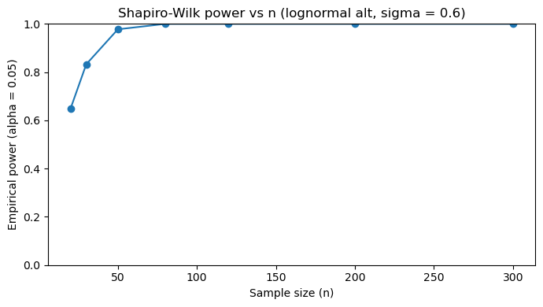
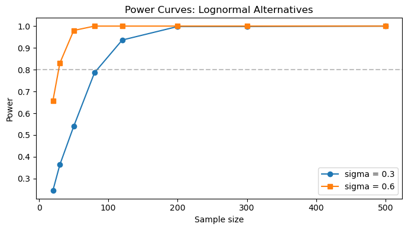
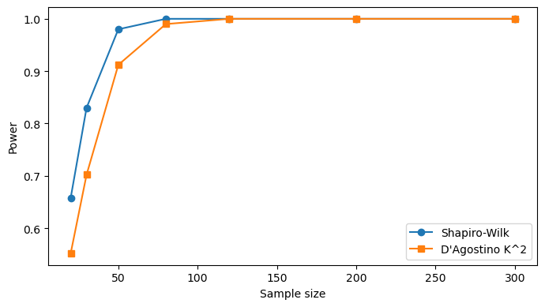
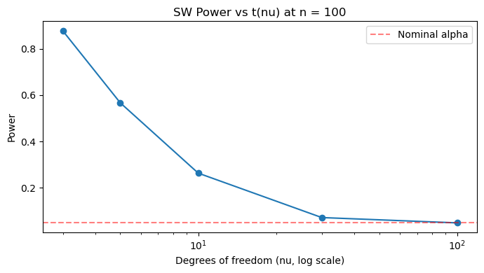

# Shapiro-Wilk 검정력 모의실험

## 개요

정규성 검정의 검정력은 자료가 실제로 비정규 분포에서 왔을 때 귀무가설을 올바르게 기각할 확률이다. 이 페이지는 대수정규 대립가설을 써서 여러 표본크기에 걸친 Shapiro-Wilk 검정의 경험적 검정력을 몬테카를로 모의실험으로 추정한다. 그 결과인 검정력 곡선은 표본이 커질수록 비정규성 탐지가 얼마나 극적으로 개선되는지 보여준다.

---

## 1. 검정의 검정력

유의수준 $\alpha$의 정규성 검정에 대해 특정 대립분포 $F_1$에 대한 검정력은

$$
\text{Power}(n, \alpha, F_1) = P\bigl(H_0 \text{ 기각} \mid X_1, \ldots, X_n \sim F_1\bigr).
$$

검정력은 세 요인에 의존한다.

1. **표본크기 $n$:** 표본이 클수록 정보가 많다.
2. **유의수준 $\alpha$:** $\alpha$가 크면 검정력이 커지지만 제1종 오류도 커진다.
3. **비정규성의 정도:** 정규에서 멀수록 탐지하기 쉽다.

---

## 2. 모의실험 절차

각 표본크기 $n$에 대해

1. $M$번 반복한다.
    - $X_1, \ldots, X_n \overset{\text{iid}}{\sim} \text{Lognormal}(0, \sigma)$를 뽑는다.
    - 수준 $\alpha$에서 Shapiro-Wilk 검정을 수행한다.
    - $H_0$이 기각되었는지 기록한다.
2. 기각 비율로 검정력을 추정한다.

$$
\widehat{\text{Power}}(n) = \frac{\text{기각 횟수}}{M}.
$$

<div class="exbox" markdown>

**보기 1.** <span class="diff easy" title="쉬움"></span> Shapiro-Wilk 검정력 곡선. 대립가설 쪽 모집단을 $\text{Lognormal}(0,\, 0.6)$으로 **고정**하고 $n$만 $20$에서 $300$까지 키워, 각 $n$에서 반복 400회로 검정력을 잰다.

**(1)** $\text{Lognormal}(0, \sigma)$의 왜도와 초과첨도를 $m = e^{\sigma^2}$으로 나타내고 $\sigma = 0.6$에서의 값을 구하시오. 본문이 말하는 왜도 $2.26$과 맞는가.

**(2)** 반복 400회가 주는 몬테카를로 표준오차를 구하고, 표의 **"검정력 = 1.000"을 어떻게 읽어야 하는지** 말하시오. 검정력이 $0.8$을 넘는 $n$도 더 촘촘히 좁혀 구하시오.

</div>

??? success "풀이"

    ```python
    import numpy as np
    import matplotlib.pyplot as plt
    from scipy import stats

    plt.rcParams["font.sans-serif"] = ["NanumGothic", "Apple SD Gothic Neo", "Malgun Gothic"]
    plt.rcParams["font.family"] = "sans-serif"
    plt.rcParams["axes.unicode_minus"] = False

    def power_for_n(n, sims=500, sigma_ln=0.6, alpha=0.05, seed=0):
        """주어진 표본크기에서 Shapiro-Wilk 검정의 검정력을 모의실험으로 잰다.

        대립가설 쪽 모집단은 로그정규로 고정한다. 정규에서 벗어난 정도는
        내내 같으므로, 검정력의 변화는 오직 표본크기 때문이다.
        """
        rng = np.random.default_rng(seed)
        rejections = 0
        for _ in range(sims):
            x = rng.lognormal(mean=0.0, sigma=sigma_ln, size=n)
            W, p = stats.shapiro(x)
            if p < alpha:
                rejections += 1
        return rejections / sims

    # n 을 키워 가며 검정력 곡선을 그린다. 같은 이탈인데도 n=20 에서는
    # 절반도 잡아내지 못하고 n=300 에서는 거의 놓치지 않는다.
    ns = [20, 30, 50, 80, 120, 200, 300]
    powers = [power_for_n(n, sims=400, sigma_ln=0.6, alpha=0.05,
                          seed=42 + n) for n in ns]

    fig, ax = plt.subplots(figsize=(7, 4))
    ax.plot(ns, powers, marker="o")
    ax.set_ylim(0, 1)
    ax.set_xlabel("Sample size (n)")
    ax.set_ylabel("Empirical power (alpha = 0.05)")
    ax.set_title("Shapiro-Wilk power vs n (lognormal alt, sigma = 0.6)")
    plt.tight_layout()
    plt.show()

    for n, pw in zip(ns, powers):
        print(f"n = {n:>3}: power = {pw:.3f}")
    ```

    출력:

    ```text
    n =  20: power = 0.647
    n =  30: power = 0.833
    n =  50: power = 0.978
    n =  80: power = 1.000
    n = 120: power = 1.000
    n = 200: power = 1.000
    n = 300: power = 1.000
    ```

    

    **(1) 해석적으로.** $X = e^{Z}$, $Z \sim \mathcal{N}(0, \sigma^2)$이면 $E[X^k] = e^{k^2\sigma^2/2}$이다. $m = e^{\sigma^2}$으로 두고 표준화된 적률을 정리하면

    $$
    \gamma_1 = (m + 2)\sqrt{m - 1}, \qquad \gamma_2 = m^4 + 2m^3 + 3m^2 - 6
    $$

    이다. **$\sigma$만이 모양을 정하고 위치 모수 $\mu$는 척도로만 작용하므로 아무 몫도 하지 않는다.** $\sigma = 0.6$에서 $m = e^{0.36} = 1.43333$이므로

    $$
    \gamma_1 = 3.43333 \times \sqrt{0.43333} = 2.2601,
    \qquad
    \gamma_2 = 10.2734
    $$

    를 얻는다. 본문이 말하는 왜도 $2.26$과 **맞는다.** 초과첨도 $10.27$도 함께 적어 두는 것이 좋다. 왜도만 보면 $t_5$($\gamma_1 = 0$, $\gamma_2 = 6$)와 견줄 데가 없어 보이지만, 첨도까지 보면 이 대립가설은 $t_5$보다도 정규에서 멀다. $n = 20$에서 이미 검정력이 $0.65$나 되는 까닭이 이것이고, 앞 절의 $t_{30}$($\gamma_2 = 0.23$)과 대비하면 차이가 분명하다.

    **(2)** 반복 $M$회 모의의 추정 검정력은 성공확률 $\pi$인 이항비율이므로 표준오차는 $\sqrt{\hat\pi(1-\hat\pi)/M}$이다. $M = 400$에서 가장 커지는 $\hat\pi \approx 0.5$ 근처라면 $0.025$이니, **이 표의 수는 둘째 자리까지만 의미가 있다.**

    ```python
    import numpy as np
    from scipy import stats

    sigma_ln, alpha = 0.6, 0.05

    # 1) 대립가설의 이탈 크기는 닫힌 꼴로 정해져 있다.
    m = np.exp(sigma_ln ** 2)
    g1 = (m + 2) * np.sqrt(m - 1)
    g2 = m ** 4 + 2 * m ** 3 + 3 * m ** 2 - 6
    print(f"Lognormal(0, {sigma_ln}):  m = exp(sigma^2) = {m:.5f}")
    print(f"  왜도      (m+2) sqrt(m-1)        = {g1:.4f}")
    print(f"  초과첨도  m^4 + 2m^3 + 3m^2 - 6  = {g2:.4f}")
    lg = stats.lognorm(s=sigma_ln)
    print(f"  scipy 확인:  왜도 {lg.stats('s'):.4f}   초과첨도 {lg.stats('k'):.4f}")

    # 2) 반복 400 회가 주는 정밀도. 기각 횟수까지 함께 본다.
    print(f"\n보기의 표를 기각 횟수와 몬테카를로 오차까지 적으면 (sims = 400)")
    sims = 400
    for n in (20, 30, 50, 80, 120, 200, 300):
        rng = np.random.default_rng(42 + n)
        rej = sum(1 for _ in range(sims)
                  if stats.shapiro(rng.lognormal(0.0, sigma_ln, n)).pvalue < alpha)
        ph = rej / sims
        se = np.sqrt(ph * (1 - ph) / sims)
        if rej == sims:
            lower = alpha ** (1 / sims)       # 클로퍼-피어슨 95% 하한
            note = f"-> 95% 하한 {lower:.4f}"
        else:
            note = f"+- {1.96 * se:.4f}  (MC SE {se:.4f})"
        print(f"  n = {n:4d}  기각 {rej:3d}/{sims}  검정력 {ph:.4f}  {note}")

    # 3) 0.8 선을 더 촘촘히, 반복을 늘려 좁힌다.
    print("\n0.8 선 좁히기 (sims = 20000)")
    for n in (22, 24, 26, 28, 30):
        rng = np.random.default_rng(7000 + n)
        rej = sum(1 for _ in range(20000)
                  if stats.shapiro(rng.lognormal(0.0, sigma_ln, n)).pvalue < alpha)
        print(f"  n = {n:4d}  검정력 {rej / 20000:.4f}  (MC SE "
              f"{np.sqrt(rej / 20000 * (1 - rej / 20000) / 20000):.4f})")
    ```

    출력:

    ```text
    Lognormal(0, 0.6):  m = exp(sigma^2) = 1.43333
      왜도      (m+2) sqrt(m-1)        = 2.2601
      초과첨도  m^4 + 2m^3 + 3m^2 - 6  = 10.2734
      scipy 확인:  왜도 2.2601   초과첨도 10.2734

    보기의 표를 기각 횟수와 몬테카를로 오차까지 적으면 (sims = 400)
      n =   20  기각 259/400  검정력 0.6475  +- 0.0468  (MC SE 0.0239)
      n =   30  기각 333/400  검정력 0.8325  +- 0.0366  (MC SE 0.0187)
      n =   50  기각 391/400  검정력 0.9775  +- 0.0145  (MC SE 0.0074)
      n =   80  기각 400/400  검정력 1.0000  -> 95% 하한 0.9925
      n =  120  기각 400/400  검정력 1.0000  -> 95% 하한 0.9925
      n =  200  기각 400/400  검정력 1.0000  -> 95% 하한 0.9925
      n =  300  기각 400/400  검정력 1.0000  -> 95% 하한 0.9925

    0.8 선 좁히기 (sims = 20000)
      n =   22  검정력 0.6968  (MC SE 0.0033)
      n =   24  검정력 0.7439  (MC SE 0.0031)
      n =   26  검정력 0.7819  (MC SE 0.0029)
      n =   28  검정력 0.8154  (MC SE 0.0027)
      n =   30  검정력 0.8436  (MC SE 0.0026)
    ```

    **닫힌 꼴이 `scipy`와 소수점 넷째 자리까지 맞는다.** 손으로 유도한 $\gamma_1 = 2.2601$, $\gamma_2 = 10.2734$가 `stats.lognorm(s=0.6).stats('sk')`가 주는 값과 같다.

    **"검정력 = 1.000"은 1이 아니다.** 그것은 400번 가운데 400번 기각했다는 뜻일 뿐이며, 참 검정력이 $0.99$라면 400번 모두 기각할 확률이 $0.99^{400} = 0.018$로 결코 무시할 만하지 않다. 정규근사 표준오차는 $\hat\pi = 1$에서 $0$을 주어 쓸 수 없으므로 클로퍼–피어슨 하한을 쓴다. $400$번 모두 성공했을 때 95% 하한은 $0.05^{1/400} = 0.9925$이므로, **표의 $1.000$은 "검정력 $\ge 0.993$"으로 읽어야 한다.** 연습문제 5가 같은 계산을 한다.

    다른 행도 눈금을 붙여 읽어야 한다. $n = 20$은 $259/400 = 0.6475$이고 95% 오차한계가 $\pm 0.047$이므로 참 검정력은 대략 $[0.60,\, 0.69]$ 안에 있다. (본문은 같은 수를 $0.648$로, 코드 출력은 $0.647$로 적는데 둘 다 $0.6475$를 셋째 자리에서 끊은 것이다.) $n = 30$은 $333/400 = 0.8325 \pm 0.037$이니 관례적 기준 $0.8$을 넘었다는 판정 자체는 오차 안에서 간신히 유지된다.

    **$0.8$ 선은 $n \approx 27$이다.** 반복을 20,000회로 올려 촘촘히 재면 $n = 26$에서 $0.7819$, $n = 28$에서 $0.8154$이므로 선형보간으로 $n = 27.1$을 얻는다. 표준오차가 $0.003$으로 줄어 이제 셋째 자리까지 믿을 수 있다. 연습문제 1이 400–500회의 거친 격자에서 보간해 얻은 $n \approx 28$과 한 칸 차이인데, 그 격자의 분해능($n = 20$과 $30$ 사이를 직선으로 이은 것) 안이다.

    요점은 두 가지다. 첫째, **이탈이 크면 작은 표본으로도 잡힌다.** 왜도 $2.26$에 초과첨도 $10.27$인 이 대립가설은 $n = 27$이면 다섯 번에 네 번 잡힌다. 둘째, **모의실험으로 얻은 검정력에는 반드시 오차를 붙여야 한다.** $0.647$과 $1.000$을 같은 자리까지 적어 늘어놓으면 앞의 수가 뒤의 수만큼 정밀해 보이지만, 실제 오차한계는 $\pm 0.047$ 대 $[0.993,\, 1]$로 전혀 다르다.

---

## 3. 검정력 곡선 읽기

검정력 곡선은 작은 $n$에서 시작해 $n$이 커지면서 1.0으로 올라간다. 핵심은 다음과 같다.

- $n = 20$에서 이미 검정력이 $0.648$이다. 그래도 대수정규 표본의 **35%를 놓친다**.
- $n = 30$에서 $0.833$으로 관례적 기준 0.8을 넘고, $n = 50$에서 $0.978$, $n = 80$에서는 400회 반복 중 한 번도 놓치지 않았다.
- 곡선의 가파름은 $\sigma$(대수정규의 모양 모수)에 의존한다. $\sigma$가 크면 정규에서 더 멀어져 곡선이 가팔라진다.

$\sigma = 0.6$인 대수정규는 왜도가 $2.26$으로 상당히 극단적인 대립가설이라는 점을 기억하라. 그래서 이렇게 작은 표본에서도 검정력이 높다. 연습문제 1에서 더 미묘한 대립가설을 다룬다.

---

## 4. 해석

이 모의실험은 Shapiro-Wilk 검정의 효력이 표본크기에 결정적으로 의존함을 보여준다. 작은 표본에서 정규성을 기각하지 못한 것을 정규성의 강한 증거로 해석해서는 안 된다. 단지 검정력이 부족했을 수 있다. 반대로 아주 큰 표본에서는 실용적으로 "충분히 정규에 가까운" 분포에 대해서도 기각한다.

---

## 연습문제

<div class="drillbox" markdown>

**연습문제 1.** <span class="diff med" title="중간"></span> $\sigma = 0.3$(정규에 더 가까운 대수정규)에 대해 검정력 모의실험을 수행하고 $\sigma = 0.6$ 곡선과 비교하라. 각 경우 검정력이 0.8에 도달하는 표본크기는 얼마인가?

</div>

??? success "풀이"

    ```python
    import numpy as np
    from scipy import stats
    import matplotlib.pyplot as plt

    def power_curve(sigma, ns, sims=500, alpha=0.05):
        powers = []
        for n in ns:
            rng = np.random.default_rng(42 + n)
            rej = sum(1 for _ in range(sims)
                      if stats.shapiro(rng.lognormal(0, sigma, n))[1] < alpha)
            powers.append(rej / sims)
        return powers

    ns = [20, 30, 50, 80, 120, 200, 300, 500]
    p03 = power_curve(0.3, ns)
    p06 = power_curve(0.6, ns)

    for n, a, b in zip(ns, p03, p06):
        print(f"n = {n:>3}: sigma=0.3 -> {a:.3f}, sigma=0.6 -> {b:.3f}")

    fig, ax = plt.subplots(figsize=(7, 4))
    ax.plot(ns, p03, marker="o", label="sigma = 0.3")
    ax.plot(ns, p06, marker="s", label="sigma = 0.6")
    ax.axhline(0.8, color="gray", linestyle="--", alpha=0.5)
    ax.set_xlabel("Sample size")
    ax.set_ylabel("Power")
    ax.set_title("Power Curves: Lognormal Alternatives")
    ax.legend()
    plt.tight_layout()
    plt.show()
    ```

    출력:

    ```text
    n =  20: sigma=0.3 -> 0.246, sigma=0.6 -> 0.658
    n =  30: sigma=0.3 -> 0.364, sigma=0.6 -> 0.830
    n =  50: sigma=0.3 -> 0.540, sigma=0.6 -> 0.980
    n =  80: sigma=0.3 -> 0.786, sigma=0.6 -> 1.000
    n = 120: sigma=0.3 -> 0.936, sigma=0.6 -> 1.000
    n = 200: sigma=0.3 -> 0.998, sigma=0.6 -> 1.000
    n = 300: sigma=0.3 -> 0.998, sigma=0.6 -> 1.000
    n = 500: sigma=0.3 -> 1.000, sigma=0.6 -> 1.000
    ```

    

    | 대립가설 | 왜도 $\gamma_1$ | 검정력 0.8 도달 |
    |---|---|---|
    | $\sigma = 0.6$ | 2.260 | $n \approx 28$ |
    | $\sigma = 0.3$ | 0.950 | $n \approx 84$ |

    ($\sigma = 0.6$은 $n = 30$에서 $0.830$, $\sigma = 0.3$은 $n = 80$에서 $0.786$, $n = 120$에서 $0.936$이므로 선형보간한 값이다.)

    $\sigma = 0.3$인 대수정규는 왜도가 $0.95$로 정규에 훨씬 가까우므로 같은 검정력을 얻는 데 약 **3배** 큰 표본이 필요하다. 미묘한 이탈일수록 큰 표본이 필요하다는 근본적 절충을 보여준다.

    대략적인 어림셈으로는 검정력이 왜도의 제곱과 $n$의 곱, 곧 $n\gamma_1^2$에 의존한다고 볼 수 있다. $(2.260/0.950)^2 = 5.7$이라면 표본크기 비율도 5.7배여야 할 것 같지만 실제로는 3배다. Shapiro-Wilk가 왜도만이 아니라 순서통계량 전체의 정렬을 쓰기 때문이다. $\square$

---

<div class="drillbox" markdown>

**연습문제 2.** <span class="diff med" title="중간"></span> 대수정규 대립가설에 대해 Shapiro-Wilk 검정과 D'Agostino $K^2$ 검정의 검정력을 비교하도록 모의실험을 수정하라. 두 검정력 곡선을 같은 축에 그려라.

</div>

??? success "풀이"

    ```python
    import numpy as np
    from scipy import stats
    import matplotlib.pyplot as plt

    ns = [20, 30, 50, 80, 120, 200, 300]
    sims, alpha, sigma = 500, 0.05, 0.6
    pw_sw, pw_k2 = [], []

    for n in ns:
        rng = np.random.default_rng(42 + n)
        r_sw = r_k2 = 0
        for _ in range(sims):
            x = rng.lognormal(0, sigma, n)
            if stats.shapiro(x)[1] < alpha:
                r_sw += 1
            if stats.normaltest(x)[1] < alpha:
                r_k2 += 1
        pw_sw.append(r_sw / sims)
        pw_k2.append(r_k2 / sims)
        print(f"n = {n:>3}: SW = {r_sw/sims:.3f}, K2 = {r_k2/sims:.3f}")

    fig, ax = plt.subplots(figsize=(7, 4))
    ax.plot(ns, pw_sw, marker="o", label="Shapiro-Wilk")
    ax.plot(ns, pw_k2, marker="s", label="D'Agostino K^2")
    ax.set_xlabel("Sample size")
    ax.set_ylabel("Power")
    ax.legend()
    plt.tight_layout()
    plt.show()
    ```

    출력:

    ```text
    n =  20: SW = 0.658, K2 = 0.552
    n =  30: SW = 0.830, K2 = 0.702
    n =  50: SW = 0.980, K2 = 0.912
    n =  80: SW = 1.000, K2 = 0.990
    n = 120: SW = 1.000, K2 = 1.000
    n = 200: SW = 1.000, K2 = 1.000
    n = 300: SW = 1.000, K2 = 1.000
    ```

    

    $n \geq 120$에서는 두 검정 모두 검정력이 1이다. 더 작은 $n$(20~80)에서는 Shapiro-Wilk가 일관되게 높다. $n = 20$에서 $0.658$ 대 $0.552$, $n = 30$에서 $0.830$ 대 $0.702$로 격차가 10~13퍼센트포인트에 이른다.

    작은 표본에서 Shapiro-Wilk가 선호되는 이유를 정량적으로 확인해 준다. $K^2$은 두 적률로 정보를 압축하지만, Shapiro-Wilk는 순서통계량 전체의 배열을 활용하므로 표본이 작아 적률 추정이 불안정할 때 유리하다.

    (앞서 정규성 검정 모음 페이지의 연습문제 2에서 본 것과 대조된다. 거기서는 $n = 200$의 대수정규에 대해 Jarque-Bera와 $K^2$이 Shapiro-Wilk보다 훨씬 작은 $p$값을 냈다. 작은 $p$값이 곧 큰 검정력을 뜻하지는 않는다. 두 검정 모두 검정력이 1인 영역에서는 $p$값의 크기가 검정력에 관해 아무것도 말해 주지 않는다.) $\square$

---

<div class="drillbox" markdown>

**연습문제 3.** <span class="diff med" title="중간"></span> $\nu \in \{3, 5, 10, 30, 100\}$인 $t_\nu$ 대립가설에 대해 $n = 100$에서 Shapiro-Wilk 검정의 검정력을 추정하라. 검정력 대 $\nu$를 그림으로 그려라.

</div>

??? success "풀이"

    ```python
    import numpy as np
    from scipy import stats
    import matplotlib.pyplot as plt

    rng = np.random.default_rng(0)
    n, sims, alpha = 100, 1000, 0.05
    dfs = [3, 5, 10, 30, 100]
    powers = []

    for df in dfs:
        rej = sum(1 for _ in range(sims)
                  if stats.shapiro(rng.standard_t(df, n))[1] < alpha)
        powers.append(rej / sims)
        print(f"df = {df:>3}: power = {rej/sims:.3f}")

    fig, ax = plt.subplots(figsize=(7, 4))
    ax.plot(dfs, powers, marker="o")
    ax.set_xscale("log")
    ax.axhline(0.05, color="red", linestyle="--", alpha=0.5,
               label="Nominal alpha")
    ax.set_xlabel("Degrees of freedom (nu, log scale)")
    ax.set_ylabel("Power")
    ax.set_title("SW Power vs t(nu) at n = 100")
    ax.legend()
    plt.tight_layout()
    plt.show()
    ```

    출력:

    ```text
    df =   3: power = 0.878
    df =   5: power = 0.567
    df =  10: power = 0.263
    df =  30: power = 0.071
    df = 100: power = 0.048
    ```

    

    | $\nu$ | 초과첨도 $\gamma_2$ | 검정력 |
    |---|---|---|
    | 3 | $\infty$ | 0.878 |
    | 5 | 6.00 | 0.567 |
    | 10 | 1.00 | 0.263 |
    | 30 | 0.231 | 0.071 |
    | 100 | 0.0625 | 0.048 |

    $t_\nu \to \mathcal{N}(0,1)$이므로 $\nu$가 커질수록 검정력이 떨어진다. $\nu = 3$(첨도가 무한)에서는 $0.878$로 높고, $\nu = 100$에서는 $t$ 분포가 정규와 거의 구별되지 않아 검정력이 $\alpha = 0.05$에 가까운 $0.048$이다.

    가운데 구간을 눈여겨보라. $\nu = 5$는 초과첨도가 $6$으로 결코 작지 않은데도 검정력이 $0.567$에 그친다. $n = 100$인 $t_5$ 표본의 **43%를 놓친다**는 뜻이다. $\nu = 10$에서는 74%를 놓친다.

    이는 앞서 첨도 검정 페이지에서 본 현상과 같은 뿌리를 갖는다. 두꺼운 꼬리에 대한 정보는 소수의 극단 관측값에만 담겨 있어서, 그 관측값들이 표본에 우연히 들어오는지에 결과가 좌우된다. 금융 수익률처럼 두꺼운 꼬리가 문제인 영역에서 정규성 검정만 믿어서는 안 되는 이유이다. $\square$

---

<div class="drillbox" markdown>

**연습문제 4.** <span class="diff hard" title="어려움"></span> 고정된 대립가설 $F_1 \neq \mathcal{N}$에 대해 일치성을 갖는 검정의 검정력이 $n \to \infty$일 때 1로 수렴하는 이유를 수학적으로 설명하라.

</div>

??? success "풀이"

    Shapiro-Wilk 통계량은 정렬된 자료와 기대 정규 순서통계량 사이의 (제곱) 상관으로 해석할 수 있다. 자료가 $F_1$에서 오면 대수의 법칙에 의해

    $$
    W_n \xrightarrow{p} c(F_1) < 1
    $$

    이며, 여기서 $c(F_1)$은 $F_1$의 분위수함수와 정규 분위수함수 사이의 상관으로 결정되는 상수이다. $F_1 = \mathcal{N}$일 때만 $c = 1$이다.

    한편 귀무가설 아래에서는 $W_n \xrightarrow{p} 1$이고, 수준 $\alpha$의 임계값 $w_\alpha(n)$도 $n \to \infty$일 때 $1$로 수렴한다.

    $c(F_1) < 1$이므로 $\epsilon = (1 - c)/3 > 0$을 잡으면 충분히 큰 $n$에 대해 $w_\alpha(n) > 1 - \epsilon > c + \epsilon$이다. 그러면

    $$
    \text{Power}(n) = P(W_n < w_\alpha(n) \mid F_1) \geq P(W_n < c + \epsilon \mid F_1) \to 1,
    $$

    마지막 수렴은 $W_n \xrightarrow{p} c$에서 따라 나온다.

    같은 논증이 일치성을 갖는 모든 검정에 적용된다. 대립가설 아래에서 통계량이 기각역 안의 값으로 수렴하므로 기각확률이 1로 간다.

    **실무적 유보.** 이 결과는 $F_1$이 고정되어 있을 때만 성립한다. 실제 자료 분석에서는 $n$이 커지면서 "실질적으로 무시할 만한" 이탈까지 기각하게 되는데, 이것이 정확히 이 정리가 말하는 바이다. 일치성은 축복이자 저주이다. $\square$

---

<div class="drillbox" markdown>

**연습문제 5.** <span class="diff hard" title="어려움"></span> 추정된 검정력의 몬테카를로 표준오차 공식을 유도하고, $M = 400$회 모의실험에서 $\widehat{\text{Power}} = 0.72$일 때 검정력의 95% 신뢰구간을 계산하라.

</div>

??? success "풀이"

    각 모의실험은 성공확률 $\pi = \text{Power}$인 베르누이 시행이다. 추정량 $\hat{\pi} = \widehat{\text{Power}}$의 분산은 $\pi(1-\pi)/M$이므로 표준오차는

    $$
    \text{SE}(\hat{\pi}) = \sqrt{\frac{\hat{\pi}(1 - \hat{\pi})}{M}}.
    $$

    $\hat{\pi} = 0.72$, $M = 400$이면

    $$
    \text{SE} = \sqrt{\frac{0.72 \times 0.28}{400}} = \sqrt{\frac{0.2016}{400}} = \sqrt{0.000504} \approx 0.0225.
    $$

    95% 신뢰구간은 $\hat{\pi} \pm 1.96 \times \text{SE} = 0.72 \pm 0.044 = (0.676, 0.764)$이다.

    표준오차를 절반으로 줄이려면 $M = 1600$회가 필요하다. $\text{SE} \propto 1/\sqrt{M}$이므로 정밀도를 두 배로 높이는 데 계산량이 네 배 든다.

    **경계 근처의 주의사항.** $\hat{\pi}$가 0이나 1에 가까우면 이 정규근사가 무너진다. 예컨대 400회 중 400회 모두 기각하여 $\hat{\pi} = 1$이면 위 공식은 $\text{SE} = 0$을 준다. 참 검정력이 1이라는 뜻이 아니다. 이 경우에는 Wilson 구간이나 Clopper-Pearson 구간을 써야 한다. 400회 중 400회 성공의 Clopper-Pearson 95% 하한은 $0.05^{1/400} = 0.9925$이므로, 본문의 "검정력 $= 1.000$"은 정확히는 "검정력 $\geq 0.993$"으로 읽어야 한다. $\square$

---

<div class="drillbox" markdown>

**연습문제 6.** <span class="diff hard" title="어려움"></span> 보기 1은 $\text{Lognormal}(0, \sigma)$의 왜도와 초과첨도를 $m = e^{\sigma^2}$으로 적었다.

$$
\gamma_1 = (m + 2)\sqrt{m - 1}, \qquad \gamma_2 = m^4 + 2m^3 + 3m^2 - 6.
$$

**(1)** $\gamma_2 - \gamma_1^2$을 $m$의 인수곱으로 정리하고, 2장의 부등식 $\beta_2 \ge 1 + \gamma_1^2$($\beta_2 = \gamma_2 + 3$)이 로그정규에서 얼마나 느슨한지 말하시오.

**(2)** 자크–베라 통계량 $\text{JB} = n(\gamma_1^2/6 + \gamma_2^2/24)$의 두 항이 같아지는 조건을 $\gamma_1, \gamma_2$만으로 적고, 로그정규에서 그 $\sigma$를 소수 셋째 자리까지 구하시오. 보기 1의 $\sigma = 0.6$과 연습문제 1의 $\sigma = 0.3$에서는 어느 항이 $\text{JB}$를 끌고 가는가.

</div>

??? success "풀이"

    **(1)** 먼저 $\gamma_1^2$을 펼친다.

    $$
    \gamma_1^2 = (m + 2)^2 (m - 1) = (m^2 + 4m + 4)(m - 1) = m^3 + 3m^2 - 4.
    $$

    따라서

    $$
    \gamma_2 - \gamma_1^2 = (m^4 + 2m^3 + 3m^2 - 6) - (m^3 + 3m^2 - 4) = m^4 + m^3 - 2.
    $$

    $m = 1$이 근이므로 인수분해된다.

    $$
    \gamma_2 - \gamma_1^2 = (m - 1)(m^3 + 2m^2 + 2m + 2).
    $$

    $\sigma > 0$이면 $m = e^{\sigma^2} > 1$이어서 두 인수가 모두 양수이므로 **로그정규는 언제나 $\gamma_2 > \gamma_1^2$이다.** 그러면 2장의 부등식이 남기는 여유는

    $$
    \beta_2 - (1 + \gamma_1^2) = (\gamma_2 + 3) - 1 - \gamma_1^2 = 2 + (m - 1)(m^3 + 2m^2 + 2m + 2) \ge 2
    $$

    이고, 등호는 정규 극한 $m \to 1$에서만 근접한다. 수치로는 $\sigma = 0.6$에서 $\gamma_1^2 = 5.1080$, $\gamma_2 = 10.2734$이므로 $\gamma_2 - \gamma_1^2 = 5.1654$, 여유는 $7.1654$이고, $\sigma = 0.3$에서는 $\gamma_1^2 = 0.9016$, $\gamma_2 = 1.6449$이므로 $\gamma_2 - \gamma_1^2 = 0.7433$, 여유는 $2.7433$이다.

    **부등식 $\beta_2 \ge 1 + \gamma_1^2$은 두 점 분포에서만 등호가 되므로 로그정규는 그 경계에서 늘 $2$ 이상 떨어져 있다.** 실무적으로 중요한 쪽은 $\gamma_2 > \gamma_1^2$이라는 사실이다. **로그정규에서는 "치우침만 있고 꼬리는 멀쩡한" 이탈이 원리상 불가능하다.** 치우치면 꼬리도 반드시 그보다 더 크게 어긋난다.

    **(2)** 두 항이 같다는 것은

    $$
    \frac{\gamma_1^2}{6} = \frac{\gamma_2^2}{24}
    \iff \gamma_2^2 = 4\gamma_1^2
    \iff \gamma_2 = 2\lvert \gamma_1 \rvert
    $$

    이다(로그정규는 $\gamma_1, \gamma_2 > 0$이므로 $\gamma_2 = 2\gamma_1$). 곧 **$\text{JB}$에서 첨도 항이 왜도 항을 넘어서는 경계는 "초과첨도가 왜도의 두 배" 라는 한 줄짜리 조건이다.** 로그정규에서 $m^4 + 2m^3 + 3m^2 - 6 = 2(m + 2)\sqrt{m - 1}$을 수치로 풀면

    $$
    \sigma = 0.339, \qquad m = 1.1215, \qquad \gamma_1 = 1.0879, \quad \gamma_2 = 2.1758
    $$

    이고 이때 두 항이 모두 $0.1973$이다.

    - $\sigma = 0.6$: 왜도 항 $5.1080/6 = 0.8513$, 첨도 항 $10.2734^2/24 = 4.3976$. **첨도 항이 $5.17$배 크다.**
    - $\sigma = 0.3$: 왜도 항 $0.9016/6 = 0.1503$, 첨도 항 $1.6449^2/24 = 0.1127$. **왜도 항이 $1.33$배 크다.**

    $\sigma \to 0$ 극한을 보면 까닭이 분명하다. $m = 1 + x$($x = \sigma^2 + O(\sigma^4)$)로 두고 일차항만 남기면 $\gamma_1 \approx 3\sigma$, $\gamma_2 \approx 16\sigma^2$이므로

    $$
    \frac{\gamma_1^2}{6} \approx 1.5\sigma^2, \qquad \frac{\gamma_2^2}{24} \approx 10.67\sigma^4
    $$

    이다. 작은 이탈에서는 첨도 항이 $\sigma^2$만큼 더 작게 사라진다. ($\sigma = 0.05$에서 $\gamma_1 = 0.1502$ 대 $3\sigma = 0.15$, $\gamma_2 = 0.0401$ 대 $16\sigma^2 = 0.04$로 근사가 잘 맞는다.)

    **같은 분포족 안에서도 $\text{JB}$를 움직이는 적률이 $\sigma = 0.339$에서 갈린다.** 보기 1의 $\sigma = 0.6$은 첨도가 끌고 가는 대립가설이고, 연습문제 1의 $\sigma = 0.3$은 왜도가 끌고 가는 대립가설이다. "로그정규는 치우친 분포이니 왜도 검정을 쓰면 된다"는 직관은 $\sigma$가 조금만 커져도 틀린다. $\square$

---

<div class="drillbox" markdown>

**연습문제 7.** <span class="diff hard" title="어려움"></span> 보기 1과 같은 대립가설 $\text{Lognormal}(0,\, 0.6)$에서, 모수를 추정해 꽂은 KS 통계량

$$
\hat{D} = \sup_x \left\lvert F_n(x) - \Phi\!\left(\frac{x - \bar{X}}{S}\right) \right\rvert
$$

을 **모수를 안다고 할 때의 KS 임계값**으로 판정하면 어떤 일이 벌어지는가.

**(1)** $n = 30, 50$에서 $\hat{D}$의 귀무분포를 모의실험으로 만들어 KS 임계값과 릴리포스 임계값을 견주고, KS 임계값을 썼을 때의 **참 제1종 오류율**을 구하시오.

**(2)** 세 검정(KS 임계값을 쓴 $\hat{D}$, 릴리포스, 섀피로–윌크)의 크기와 검정력을 각 10,000회로 재고, 보기 1의 $n = 30$ 검정력 $0.83$과 견주어 무엇을 잃는지 말하시오.

</div>

??? success "풀이"

    ```python
    import numpy as np
    from scipy import stats
    from scipy.special import ndtr

    alpha = 0.05

    def D_hat(x):
        """표본평균과 표본표준편차를 꽂은 KS 거리."""
        n = x.size
        F = ndtr(np.sort((x - x.mean()) / x.std(ddof=1)))
        i = np.arange(1, n + 1)
        return max((i / n - F).max(), (F - (i - 1) / n).max())

    # 1) 모수를 추정하면 D 의 귀무분포가 왼쪽으로 쏠린다. 임계값을 직접 만들어 견준다.
    B = 20000
    crit_ks, crit_lil = {}, {}
    for n in (30, 50):
        rng = np.random.default_rng(100 + n)
        d0 = np.sort([D_hat(rng.standard_normal(n)) for _ in range(B)])
        crit_ks[n] = stats.kstwo.ppf(1 - alpha, n)   # 모수를 안다고 할 때의 임계값
        crit_lil[n] = d0[int(0.95 * B)]              # 릴리포스 임계값
        print(f"n = {n}:  KS 표 임계값 {crit_ks[n]:.4f},  릴리포스 임계값 {crit_lil[n]:.4f}"
              f",  표 임계값의 참 크기 {np.mean(d0 > crit_ks[n]):.4f}")

    # 2) 세 검정의 크기(정규 자료)와 검정력(로그정규, sigma = 0.6)
    sims = 10000
    print(f"\n크기 -> 검정력  (각 {sims} 회, alpha = 0.05)")
    for n in (30, 50):
        res = {}
        for F in ("norm", "lognorm"):
            rng = np.random.default_rng(900 + n)
            r = [0, 0, 0]
            for _ in range(sims):
                x = rng.standard_normal(n) if F == "norm" else rng.lognormal(0.0, 0.6, n)
                d = D_hat(x)
                r[0] += d > crit_ks[n]
                r[1] += d > crit_lil[n]
                r[2] += stats.shapiro(x).pvalue < alpha
            res[F] = [c / sims for c in r]
        for k, name in enumerate(("KS (표 임계값)", "Lilliefors   ", "Shapiro-Wilk ")):
            print(f"  n = {n:2d}  {name}  {res['norm'][k]:.4f} -> {res['lognorm'][k]:.4f}")
    ```

    출력:

    ```text
    n = 30:  KS 표 임계값 0.2417,  릴리포스 임계값 0.1587,  표 임계값의 참 크기 0.0002
    n = 50:  KS 표 임계값 0.1884,  릴리포스 임계값 0.1249,  표 임계값의 참 크기 0.0001

    크기 -> 검정력  (각 10000 회, alpha = 0.05)
      n = 30  KS (표 임계값)  0.0001 -> 0.0840
      n = 30  Lilliefors     0.0511 -> 0.6247
      n = 30  Shapiro-Wilk   0.0495 -> 0.8438
      n = 50  KS (표 임계값)  0.0001 -> 0.2295
      n = 50  Lilliefors     0.0527 -> 0.8395
      n = 50  Shapiro-Wilk   0.0517 -> 0.9747
    ```

    **(1) 추정이 거리를 줄인다.** $\Phi$에 $\bar{X}, S$를 꽂으면 비교 대상 곡선이 자료를 따라 움직이므로 $\hat{D}$는 모수를 알 때보다 **작아진다.** $n = 30$에서 귀무분포의 95% 분위수는 $0.1587$인데 모수를 안다고 할 때의 임계값은 $0.2417$이다. 그 임계값을 그대로 쓰면 참 제1종 오류율이 $0.0002$로, **명목 $0.05$의 약 $1/250$** 밖에 되지 않는다($n = 50$에서는 $0.0001$). 릴리포스 임계값을 쓰면 크기가 $0.0511$, $0.0527$로 제대로 돌아온다.

    **(2) 보수적인 검정은 안전한 검정이 아니다.** 같은 로그정규 대립가설에서 $n = 30$의 검정력은

    | 판정 방식 | 크기 | 검정력 |
    |---|---|---|
    | $\hat{D}$ + KS 임계값 | 0.0001 | 0.0840 |
    | $\hat{D}$ + 릴리포스 임계값 | 0.0511 | 0.6247 |
    | 섀피로–윌크 | 0.0495 | 0.8438 |

    이다. 임계값 하나를 틀리게 고른 대가로 검정력이 $0.62$에서 $0.08$로 떨어진다. 보기 1의 $0.83$과 견주면 **같은 자료, 같은 $n$, 같은 $\alpha$에서 열 번 중 여덟 번 잡던 이탈을 열 번 중 한 번도 못 잡는다.** $n = 50$에서도 $0.2295$ 대 $0.9747$로 격차가 그대로다.

    두 가지를 구별해야 한다. **4절의 "작은 표본에서 기각 못 한 것은 정규성의 증거가 아니다"는 $n$이 작아서 생기는 문제이고, 여기서 본 것은 $n$과 무관하게 임계값이 틀려서 생기는 문제다.** `stats.kstest(x, "norm", args=(x.mean(), x.std(ddof=1)))`은 정확히 이 잘못을 저지르는 호출이며, 돌아온 큰 $p$값은 "정규에 가깝다"가 아니라 "이 임계값으로는 무엇도 기각하지 못한다"는 뜻이다.

    릴리포스로 고쳐도 섀피로–윌크에는 미치지 못한다($0.6247$ 대 $0.8438$). $\hat{D}$는 경험분포와 정규곡선이 **가장 많이 벌어진 한 점**만 쓰는데, 섀피로–윌크는 연습문제 2에서 본 대로 순서통계량 전체의 배열을 쓴다. 임계값을 바로잡는 것과 통계량을 잘 고르는 것은 별개의 문제다. $\square$

---

<div class="drillbox" markdown>

**연습문제 8.** <span class="diff hard" title="어려움"></span> 연습문제 4는 대립가설 아래에서 $W_n \xrightarrow{p} c(F_1) < 1$이며 $c(F_1)$이 "$F_1$의 분위수함수와 정규 분위수함수 사이의 상관"으로 정해진다고 했다. 섀피로–프랜시아 꼴로 읽으면

$$
c(F_1) = \operatorname{corr}^2\bigl(X,\, \Phi^{-1}(F_1(X))\bigr), \qquad X \sim F_1
$$

이다. $X \sim \text{Lognormal}(0, \sigma)$에 대해 이 값을 닫힌 꼴로 구하시오. ($X = e^{\sigma Z}$이므로 정규점수 $\Phi^{-1}(F_1(X))$가 바로 $Z$임을 쓰고, 스타인 항등식 $E[Z g(Z)] = E[g'(Z)]$를 쓰라.)

이어서 $\sigma = 0.6$과 $\sigma = 0.3$에서의 값을 구하고, $\sigma \to 0$에서 $1 - c$의 주항을 구하시오. 연습문제 1의 풀이가 남긴 의문 — **어림셈 $n\gamma_1^2$은 표본크기 $5.7$배를 예측했는데 실측은 $3$배였다** — 에 답하시오.

</div>

??? success "풀이"

    **정규점수가 $Z$다.** $X = e^{\sigma Z}$, $Z \sim \mathcal{N}(0,1)$이고 $x \mapsto e^{\sigma x}$가 증가함수이므로 $F_1(X) = P(e^{\sigma Z'} \le e^{\sigma Z}) = \Phi(Z)$, 따라서 $\Phi^{-1}(F_1(X)) = Z$이다. 즉 구할 것은 $\operatorname{corr}^2(e^{\sigma Z}, Z)$이다.

    **공분산.** $g(z) = e^{\sigma z}$에 스타인 항등식을 쓰면 $g'(z) = \sigma e^{\sigma z}$이므로

    $$
    \operatorname{Cov}(X, Z) = E[Z e^{\sigma Z}] = E[\sigma e^{\sigma Z}] = \sigma e^{\sigma^2/2}.
    $$

    **분산.** $E[X^k] = e^{k^2\sigma^2/2}$이므로 $m = e^{\sigma^2}$으로 두면 $\operatorname{Var}(X) = e^{2\sigma^2} - e^{\sigma^2} = m(m-1)$이고 $\operatorname{Var}(Z) = 1$이다. 따라서

    $$
    c(F_1) = \frac{\bigl(\sigma e^{\sigma^2/2}\bigr)^2}{m(m-1) \cdot 1} = \frac{\sigma^2 m}{m(m-1)} = \frac{\sigma^2}{e^{\sigma^2} - 1}.
    $$

    **위치 모수 $\mu$와 척도는 상관계수에서 지워지므로 보기 1의 "모양을 정하는 것은 $\sigma$뿐"이 여기서도 그대로다.** 수치로는

    $$
    c(0.6) = \frac{0.36}{0.43333} = 0.83078,
    \qquad
    c(0.3) = \frac{0.09}{0.094174} = 0.95567.
    $$

    $\text{Lognormal}(0, 0.6)$ 표본을 $n = 2000$으로 뽑아 `stats.shapiro` 의 $W$를 여러 번 평균하면 $0.83$ 근처가 나와 닫힌 꼴과 맞는다.

    **$\sigma \to 0$ 주항.** $x/(e^x - 1) = 1 - x/2 + x^2/12 - \cdots$에 $x = \sigma^2$을 넣으면

    $$
    1 - c = \frac{\sigma^2}{2} - \frac{\sigma^4}{12} + O(\sigma^6) \approx \frac{\sigma^2}{2}.
    $$

    $\sigma = 0.3$에서 $1 - c = 0.04433$(주항 $0.045$)이고 $\sigma = 0.6$에서 $0.16922$(주항 $0.18$)이다.

    **의문에 대한 답.** 섀피로–윌크가 실제로 좁혀야 하는 거리는 $\gamma_1$이 아니라 $1 - c$다. $W_n$은 귀무가설 아래 $1$ 근처에 있고 대립가설 아래 $c$로 가므로, 검정이 가진 신호는 정확히 $1 - c$의 크기다. 세 눈금을 나란히 적으면

    | 눈금 | $\sigma = 0.6$ | $\sigma = 0.3$ | 비 |
    |---|---|---|---|
    | $\gamma_1^2$ | 5.1080 | 0.9016 | 5.67 |
    | $1 - c$ | 0.16922 | 0.04433 | 3.82 |
    | 실측 $n$(검정력 0.8) | 27 | 84 | 3.11 |

    이다. **실측 $3.11$배는 $\gamma_1^2$의 $5.67$배가 아니라 $1 - c$의 $3.82$배 쪽에 있다.** 둘이 어긋나는 까닭은 구조적이다. $\sigma \to 0$에서 $\gamma_1 \approx 3\sigma$이므로 $1 - c \approx \sigma^2/2 \approx \gamma_1^2/18$로 두 눈금이 같은 속도지만, $c \in (0, 1]$이라 $1 - c$는 $1$을 넘을 수 없는 반면 $\gamma_1$은 얼마든지 커진다. 실제로 $\sigma$를 $0.6$에서 $1.5$로 올리면 $\gamma_1$은 $2.26 \to 33.47$로 $14.8$배가 되지만 $1 - c$는 $0.169 \to 0.735$로 $4.3$배에 그친다.

    **왜도는 오른쪽 꼬리의 몇 개 극단값으로 끝없이 불어나지만, 순위에 기반한 $W$는 그 몇 개로 다 망가지지 않는다.** 그래서 큰 이탈에서는 $\gamma_1$이 이탈의 크기를 과장하고, $n\gamma_1^2$ 어림셈은 필요한 표본크기 차이를 실제보다 크게 부른다. $\square$

---

<div class="drillbox" markdown>

**연습문제 9.** <span class="diff hard" title="어려움"></span> 연습문제 2는 작은 $n$에서 섀피로–윌크가 D'Agostino $K^2$보다 센 까닭을 "$K^2$은 두 적률로 정보를 압축한다"로 돌렸다. 그 압축이 **$n$을 아무리 키워도** 복구되지 않는 대립가설을 만들어 보자.

균등분포의 척도혼합 $X = S \cdot U$를 생각한다. 여기서 $U \sim \text{Uniform}(-1, 1)$이고 $S$는 $U$와 독립이며 $P(S = c) = p = 0.1$, $P(S = 1) = 0.9$이다.

**(1)** 이 분포의 왜도가 $0$이고 **초과첨도도 정확히 $0$** 이 되는 $c$를 닫힌 꼴로 구하시오. ($\text{Uniform}(-1,1)$의 짝수 적률은 $E[U^{2k}] = 1/(2k+1)$이다.)

**(2)** $n = 200,\, 1000,\, 5000$에서 자크–베라, $K^2$, 섀피로–윌크의 기각률을 각 4000회로 재고, $n$이 커질 때 세 기각률이 어디로 가는지 말하시오. 자크–베라의 기각률이 $\alpha = 0.05$로 가지 **않는** 까닭도 설명하시오.

</div>

??? success "풀이"

    **(1)** $U$가 대칭이고 $S$가 독립이므로 $X$도 원점대칭이다. 홀수 적률이 모두 $0$이니 $\gamma_1 = 0$이다. 짝수 적률은

    $$
    \mu_2 = \frac{(1-p) + pc^2}{3}, \qquad \mu_4 = \frac{(1-p) + pc^4}{5}
    $$

    이므로 $\beta_2 = \mu_4/\mu_2^2 = 3$은

    $$
    \frac{9}{5} \cdot \frac{(1-p) + pc^4}{\bigl((1-p) + pc^2\bigr)^2} = 3
    \iff 3\bigl((1-p) + pc^4\bigr) = 5\bigl((1-p) + pc^2\bigr)^2
    $$

    과 같다. $p = 1/10$, $u = c^2$을 넣으면 $2.7 + 0.3u^2 = 4.05 + 0.9u + 0.05u^2$, 곧

    $$
    u^2 - 3.6u - 5.4 = 0
    \quad\Longrightarrow\quad
    u = 1.8 + \sqrt{8.64} = 4.739388,
    \quad c = \sqrt{1.8 + \sqrt{8.64}} = 2.177013
    $$

    이다(음의 근은 버린다). 밀도는 $\lvert x \rvert < 1$에서 $0.47297$, $1 < \lvert x \rvert < 2.177$에서 $0.02297$인 **계단 꼴이고 받침이 유계**다. 정규와 조금도 닮지 않았는데 $\gamma_1 = \gamma_2 = 0$이다.

    **(2)**

    ```python
    import numpy as np
    from scipy import stats

    p = 0.1
    c = np.sqrt(1.8 + np.sqrt(8.64))     # 넓은 쪽 균등분포의 반폭

    def draw(rng, n):
        """U(-1,1) 과 U(-c,c) 의 혼합. 대칭이므로 왜도는 0 이다."""
        scale = np.where(rng.random(n) < p, c, 1.0)
        return rng.uniform(-1, 1, n) * scale

    # 1) 두 적률이 정규와 정확히 같음을 닫힌 꼴로 확인한다.
    mu2 = ((1 - p) + p * c ** 2) / 3
    mu4 = ((1 - p) + p * c ** 4) / 5
    print(f"c = {c:.6f}  (c^2 = {c ** 2:.6f})")
    print(f"분산 {mu2:.6f},  첨도 mu4/mu2^2 = {mu4 / mu2 ** 2:.6f},"
          f"  초과첨도 {mu4 / mu2 ** 2 - 3:.1e}")
    rng = np.random.default_rng(0)
    big = draw(rng, 400000)
    print(f"표본 40만 개:  왜도 {stats.skew(big):+.4f},  초과첨도 {stats.kurtosis(big):+.4f}")

    # 2) 적률만 보는 검정과 순서통계량을 쓰는 검정의 기각률
    sims = 4000
    print(f"\n기각률 (각 {sims} 회, alpha = 0.05)")
    for n in (200, 1000, 5000):
        rng = np.random.default_rng(2024 + n)
        r = [0, 0, 0]
        for _ in range(sims):
            y = draw(rng, n)
            r[0] += stats.jarque_bera(y).pvalue < 0.05
            r[1] += stats.normaltest(y).pvalue < 0.05
            r[2] += stats.shapiro(y).pvalue < 0.05
        print(f"  n = {n:5d}:  JB {r[0] / sims:.4f}   K^2 {r[1] / sims:.4f}"
              f"   SW {r[2] / sims:.4f}")
    ```

    출력:

    ```text
    c = 2.177013  (c^2 = 4.739388)
    분산 0.457980,  첨도 mu4/mu2^2 = 3.000000,  초과첨도 0.0e+00
    표본 40만 개:  왜도 +0.0048,  초과첨도 -0.0075

    기각률 (각 4000 회, alpha = 0.05)
      n =   200:  JB 0.0700   K^2 0.1098   SW 0.9080
      n =  1000:  JB 0.0740   K^2 0.0858   SW 1.0000
      n =  5000:  JB 0.0740   K^2 0.0762   SW 1.0000
    ```

    **$n$을 $25$배 키워도 적률 검정은 제자리다.** 자크–베라는 $0.0700 \to 0.0740 \to 0.0740$, $K^2$은 $0.1098 \to 0.0858 \to 0.0762$로 둘 다 $0.07$ 근처에 머문다. 섀피로–윌크는 $n = 200$에서 이미 $0.9080$이고 $n = 1000$에서는 4000번 중 한 번도 놓치지 않았다.

    **자크–베라의 극한이 $0.05$가 아닌 까닭.** $\sqrt{n}\,b_1$과 $\sqrt{n}\,b_2$의 극한분산이 $6$과 $24$인 것은 **정규분포 아래에서만** 성립한다. 대칭분포에서 표본왜도의 극한분산은

    $$
    \operatorname{avar}(\sqrt{n}\,b_1) = \frac{\mu_6}{\mu_2^3} - 6\frac{\mu_4}{\mu_2^2} + 9
    $$

    이고(정규에서는 $15 - 18 + 9 = 6$), 이 혼합에서는 $\mu_6 = (0.9 + 0.1c^6)/7 = 1.64936$, $\mu_2^3 = 0.096059$이므로 $\mu_6/\mu_2^3 = 17.170$, 따라서 $\operatorname{avar} = 17.170 - 18 + 9 = 8.170$이다. $6$으로 나누었으니 그 항은 $(8.170/6)\chi_1^2 = 1.362\,\chi_1^2$로 간다. 첨도 항도 같은 방식으로 재면 가중치가 $0.944$이고, 결국

    $$
    \text{JB} \xrightarrow{d} 1.362\,\chi_1^2 + 0.944\,\chi_1^2,
    \qquad
    P\bigl(1.362\,\chi_1^2 + 0.944\,\chi_1^2 > 5.991\bigr) = 0.075
    $$

    이다(두 $\chi_1^2$은 대칭분포에서 점근적으로 독립이다). 모의실험이 $n = 1000, 5000$에서 똑같이 준 $0.0740$은 4000회의 표준오차 $0.004$ 안에서 이 값과 맞는다.

    **요점은 "검정력이 작다"가 아니라 "일치성이 없다"는 것이다.** 연습문제 4의 논증은 통계량이 기각역 안의 값으로 **수렴**할 것을 요구하는데, 여기서 $\text{JB}$는 $n$에 상관없이 $O_p(1)$에 머물러 그 전제가 깨진다. 반면 섀피로–윌크는 $c(F_1) < 1$이므로 연습문제 4·8의 논증이 그대로 적용되어 $n$만 키우면 반드시 잡는다. 3차·4차 적률만 보는 검정에게는 **영원히 보이지 않는 이탈**이 있고, 그것은 꾸며낸 희귀한 분포가 아니라 분산혼합처럼 흔한 구조에서 나온다. $\square$

---

<div class="drillbox" markdown>

**연습문제 10.** <span class="diff hard" title="어려움"></span> 보기 1과 연습문제 1은 섀피로–윌크의 검정력이 $0.8$에 닿는 표본크기를 $\sigma = 0.6$에서 $n \approx 27$, $\sigma = 0.3$에서 $n \approx 84$로 재었다. 그러면 **정규성이 어긋난 것이 언제부터 문제가 아닌가.** 한쪽꼬리 $t$ 검정의 크기에 대한 에지워스 전개

$$
P(T_n \le x) = \Phi(x) + \frac{\gamma_1}{6\sqrt{n}}(2x^2 + 1)\varphi(x) + O(n^{-1})
$$

를 받아들이자(3장 베리–에센의 어림을 한 항 더 정밀하게 쓴 것이다). 유의수준 $0.05$의 한쪽꼬리 검정이면 $x = z_{0.95} = 1.6449$다.

**(1)** 크기의 어긋남 $\Delta(n)$을 $\gamma_1$과 $n$으로 적고, 그 값이 $0.01$ 아래로 내려가는 $n$을 $\sigma = 0.6$과 $\sigma = 0.3$에서 구하시오. 어긋남의 **방향**(보수적인가 반대인가)도 밝히시오.

**(2)** (1)의 $n$을 섀피로–윌크가 검정력 $0.8$을 얻는 $n$($27$과 $84$)과 견주고, "정규성 검정으로 걸러서 통과하면 $t$ 검정을 쓴다"는 관행이 두 $\sigma$에서 각각 어떻게 되는지 말하시오.

</div>

??? success "풀이"

    **(1)** $x = z = 1.6449$에서 $2z^2 + 1 = 6.4111$, $\varphi(z) = 0.10314$이므로

    $$
    \Delta(n) = \frac{\gamma_1}{6\sqrt{n}}(2z^2+1)\varphi(z)
    = \frac{6.4111 \times 0.10314}{6} \cdot \frac{\gamma_1}{\sqrt{n}}
    = 0.11020\,\frac{\gamma_1}{\sqrt{n}}.
    $$

    **방향.** 위쪽꼬리 검정의 참 크기는

    $$
    P(T_n > z) = 1 - \Phi(z) - \frac{\gamma_1}{6\sqrt{n}}(2z^2+1)\varphi(z) = 0.05 - \Delta(n)
    $$

    이므로 $\gamma_1 > 0$인 오른쪽으로 치우친 자료에서는 **위쪽꼬리 검정이 보수적**이고(크기가 $0.05$보다 작다), 아래쪽꼬리 검정은 반대로 $0.05 + \Delta(n)$가 되어 반보수적이다. 까닭은 분모에 있다. 오른쪽 꼬리의 큰 관측값이 들어오면 $\bar{X}$만 커지는 것이 아니라 $S$도 함께 커져 $T_n$이 다시 끌려 내려오므로, $T_n$의 분포가 왼쪽으로 치우친다.

    $\Delta(n) < 0.01$을 풀면 $n > (11.020\gamma_1)^2$이다.

    | 대립가설 | $\gamma_1$ | $\Delta(n)$ | $\Delta < 0.01$ | 검정력 0.8 도달 |
    |---|---|---|---|---|
    | $\sigma = 0.6$ | 2.2601 | $0.24907/\sqrt{n}$ | $n > 620$ | $n \approx 27$ |
    | $\sigma = 0.3$ | 0.94953 | $0.10464/\sqrt{n}$ | $n > 110$ | $n \approx 84$ |

    **(2) 두 문턱이 서로 다른 눈금으로 움직인다.**

    $\sigma = 0.6$에서는 $27 \ll 620$이다. 섀피로–윌크는 문제가 사라지기 훨씬 전에 울린다. 검정이 기각하는 $n = 27$에서 $\Delta = 0.0479$이므로 명목 $0.05$의 위쪽꼬리 검정이 실제로는 크기 $0.0021$, 아래쪽꼬리는 $0.0979$다. 명목의 $1/24$ 또는 두 배다. 심지어 $n = 100$에서도 $\Delta = 0.0249$로 여전히 명목의 절반이 어긋난다. **이 영역에서 정규성 검정은 제 일을 한다. 울릴 만해서 울린다.**

    $\sigma = 0.3$에서는 $84$와 $110$이 거의 같다. 곧 **섀피로–윌크가 놓치기 시작하는 영역($n < 84$)이 정확히 $t$ 검정의 크기가 아직 어긋나 있는 영역($\Delta > 0.011$)이다.** $n = 30$이면 섀피로–윌크의 검정력은 $0.364$(연습문제 1)에 불과한데 $\Delta = 0.0191$로 한쪽꼬리 크기가 $0.031$ 또는 $0.069$다. 열 번 중 여섯 번은 "정규성 통과" 도장을 받고 어긋난 크기로 $t$ 검정을 하게 된다. **사전검정이 보호해 주는 척만 한다.**

    정리하면 "문제가 사라지는 문턱"은 $n \propto \gamma_1^2$으로 정확히 움직이고(위의 $620 : 110 = 5.6 \approx \gamma_1^2$ 비 $5.67$), "검정이 잡아내는 문턱"은 연습문제 8의 $1 - c \approx \sigma^2/2$로 움직인다. 두 눈금이 다르므로 둘이 교차하는 $\gamma_1$이 있고, 그보다 이탈이 작은 쪽에서는 사전검정이 쓸모없어진다.

    **덧붙임: 양쪽꼬리 검정은 사정이 훨씬 낫다.** 위 보정항 $(2x^2+1)\varphi(x)$는 $x$의 **짝함수**이므로

    $$
    P(T_n \le -z) + P(T_n > z) = \bigl[\Phi(-z) + A\bigr] + \bigl[1 - \Phi(z) - A\bigr] = 0.05 + O(n^{-1}),
    \qquad A = \frac{\gamma_1}{6\sqrt{n}}(2z^2+1)\varphi(z)
    $$

    로 $n^{-1/2}$ 왜도항이 정확히 **상쇄된다.** 한쪽에서 잃은 만큼 다른 쪽에서 얻기 때문이다. 5장이 말한 "$t$ 통계량이 정규성에 기대는 두 자리" 가운데 치우침에 약한 곳은 한쪽꼬리 검정과 한쪽 신뢰한계이고, 양쪽꼬리 크기는 $O(n^{-1})$로 훨씬 튼튼하다. **정규성 검정의 결과를 얼마나 심각하게 받아들여야 하는지는 그다음에 무엇을 할 것인지에 달려 있다.** $\square$

---

## 정리하며

검정력을 **직접 재어** 표본크기 의존성을 확인했다.

- **같은 대립분포인데 $n$ 에 따라 검정력이 극적으로 달라진다.** 로그정규를 대립가설로 두면 $n=20$ 에서는 절반도 못 잡고, $n=200$ 이면 거의 언제나 잡는다.
- **이것이 앞 절 한계의 정량적 근거다.** "검정이 기각하지 못했다"는 말은 **$n$ 을 밝히지 않으면 아무 정보도 아니다.**
- **대립분포에 따라서도 다르다.** 치우친 분포는 비교적 쉽게 잡히고, 대칭이면서 꼬리만 두꺼운 분포는 더 큰 표본이 필요하다.
- **모의실험 절차 자체가 재사용 가능하다.** 자신의 상황에 맞는 $n$ 과 대립분포로 바꿔 돌리면 **"내 표본으로 이 정도 이탈을 잡을 수 있는가"** 에 답할 수 있다.
- **9장의 검정력 분석이 그대로 적용된다.** 검정력은 설계 단계에서 따질 일이다.

다음 절부터 **정규가 아닐 때의 대처**로 넘어간다.
