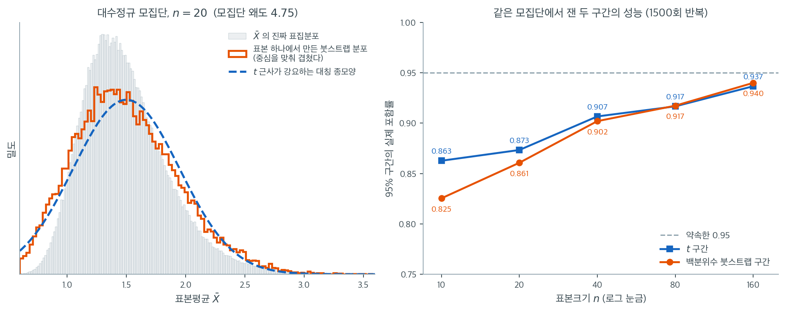
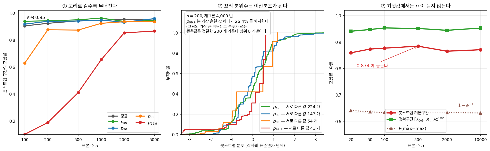

# 대안으로서의 붓스트랩

## 1. 비정규를 찾았다면 그다음은 무엇인가

소형주 펀드의 연간 수익률 관측값이 $12$ 개 있다. 자료에서 복원추출을 되풀이해 평균의 $95\%$ 구간을 만들면 $[1.48\%,\ 11.33\%]$ 이고, $t$ 구간은 $[0.52\%,\ 12.21\%]$ 로 더 넓다. 정규성 가정을 버리고 자료에게 직접 물었으니 이쪽이 더 믿을 만한가. 치우친 모집단에서 포함률을 재어 보면 $n = 10$ 에서 $t$ 구간이 $0.863$, 붓스트랩 구간이 $0.825$ 로 **붓스트랩 쪽이 오히려 나쁘다** — 모양에 적응하는 것과 정확해지는 것은 다른 일이다.

이 장의 앞 절들은 비정규성을 탐지하는 도구 — Q-Q 그림, Shapiro-Wilk 검정, 왜도와 첨도 측도 — 를 제공했다. 이런 진단이 자료가 정규분포에서 크게 벗어남을 드러내면, 표준적인 모수적 방법($t$ 분포에 기초한 신뢰구간, $\chi^2$나 $F$ 분포에 기대는 가설검정)이 표방하는 오류율을 더 이상 통제하지 못할 수 있다. 붓스트랩은 모집단 분포에 특정한 모수적 형태를 가정하지 않고 추론을 수행하는 길을 제공한다. 이론적 가정에서 표집분포를 유도하는 대신, 관측된 자료 자체에서 재표본추출하여 표집분포를 **추정**한다.

---

## 2. 붓스트랩의 원리

붓스트랩의 핵심 발상은 개념적으로 단순하다. 고전 통계학에서는 통계량 $T = T(X_1, X_2, \ldots, X_n)$의 변동을 이해하기 위해 미지의 모집단 분포 $F$에서 표본을 반복해서 뽑는다고 상상한다. 실제로 $F$에서 새 표본을 뽑을 수는 없으므로, 붓스트랩은 $F$ 자리에 경험분포함수 $\hat{F}_n$을 대신 놓는다. $\hat{F}_n$은 관측된 각 자료점에 확률 $1/n$을 부여한다.

$\hat{F}_n$에서 표본을 뽑는 것은 관측 자료에서 복원추출하는 것과 같다. 각 붓스트랩 표본 $X_1^*, X_2^*, \ldots, X_n^*$은 원래 표본과 크기가 같고 복원추출로 뽑히므로, 어떤 관측값은 여러 번 나타나고 어떤 것은 아예 나타나지 않을 수 있다.

### 복원추출로 B 벌을 다시 뽑는다

**비모수 붓스트랩**의 절차는 다음과 같다.

1. 관측된 표본 $\mathbf{x} = (x_1, x_2, \ldots, x_n)$에서 시작한다.
2. $b = 1, 2, \ldots, B$에 대해 이렇게 된다.
    - $\mathbf{x}$에서 복원추출로 $n$개의 값을 뽑아 붓스트랩 표본 $\mathbf{x}^{*b} = (x_1^{*b}, x_2^{*b}, \ldots, x_n^{*b})$을 만든다.
    - 붓스트랩 복제값 $\hat{\theta}^{*b} = T(\mathbf{x}^{*b})$을 계산한다.
3. 모음 $\{\hat{\theta}^{*1}, \hat{\theta}^{*2}, \ldots, \hat{\theta}^{*B}\}$이 $T$의 표집분포를 근사한다.

붓스트랩 복제 횟수 $B$는 표준오차 추정에는 보통 최소 1000, 신뢰구간 구성에는 최소 5000–10000을 쓴다.

---

## 3. 붓스트랩 신뢰구간

### 백분위수 방법

가장 단순한 붓스트랩 신뢰구간은 붓스트랩 분포의 $\alpha/2$ 분위수와 $1 - \alpha/2$ 분위수를 그대로 쓴다.

$$
\text{CI}_{1-\alpha} = \left[\hat{\theta}^*_{(\alpha/2)},\; \hat{\theta}^*_{(1-\alpha/2)}\right]
$$

95% 신뢰구간이면 $B$개 붓스트랩 복제값의 2.5번째와 97.5번째 백분위수이다.

!!! warning "백분위수 방법의 한계"

    백분위수 방법은 직관적이지만 붓스트랩 분포가 치우쳐 있거나 통계량이 편향되어 있으면 포함확률이 나쁠 수 있다. 변환에 불변이 아니어서 통계량의 단조변환이 포함확률을 바꿀 수 있다.

### BCa(편향보정 가속) 방법

**BCa 방법**은 붓스트랩 분포의 편향과 치우침을 모두 조정한다. 두 개의 보정 인자로 백분위수 끝점을 수정한다.

- **편향보정** $\hat{z}_0$: 붓스트랩 분포의 중앙값이 원래 추정값 $\hat{\theta}$에서 얼마나 떨어져 있는지를 잰다
- **가속** $\hat{a}$: 참 모수값에 따라 $\hat{\theta}$의 표준오차가 변하는 속도를 반영한다

조정된 백분위수는

$$
\alpha_1 = \Phi\!\left(\hat{z}_0 + \frac{\hat{z}_0 + z_{\alpha/2}}{1 - \hat{a}(\hat{z}_0 + z_{\alpha/2})}\right), \quad \alpha_2 = \Phi\!\left(\hat{z}_0 + \frac{\hat{z}_0 + z_{1-\alpha/2}}{1 - \hat{a}(\hat{z}_0 + z_{1-\alpha/2})}\right)
$$

여기서 $\Phi$는 표준정규 누적분포함수이고 $z_{\alpha/2}$는 표준정규 분위수이다. $\hat{z}_0 = 0$이고 $\hat{a} = 0$이면 BCa 방법은 백분위수 방법으로 환원된다. 실무에서 BCa 구간은 대체로 단순한 백분위수 방법보다 나은 포함확률을 제공한다.

<div class="exbox" markdown>

**보기 1.** <span class="diff easy" title="쉬움"></span> 소형주 펀드 수익률. 소형주 펀드의 연간 수익률(%) 관측값 12개를 생각하자.

</div>

??? success "풀이"
    $$
    \mathbf{x} = \{-8.2,\; 3.1,\; 15.7,\; 2.4,\; -1.5,\; 22.3,\; 6.8,\; -3.4,\; 11.2,\; 1.9,\; 18.6,\; 7.5\}
    $$

    표본평균은 $\bar{x} = 6.37\%$, 표본표준편차는 $s = 9.20$, 표본왜도는 $0.257$이다. 모집단 분포를 가정하지 않고 모평균의 95% 신뢰구간을 만들기 위해 붓스트랩을 적용한다.

    **1단계.** 크기 12인 붓스트랩 표본을 복원추출로 $B = 5000$개 뽑는다.

    **2단계.** 각 붓스트랩 표본의 평균을 계산하여 붓스트랩 분포 $\{\hat{\theta}^{*1}, \ldots, \hat{\theta}^{*5000}\}$을 만든다.

    **3단계.** 붓스트랩 평균들을 정렬하여 2.5번째와 97.5번째 백분위수를 뽑는다.

    아래 코드(난수 씨앗 42)를 실행하면 $\hat{\theta}^*_{(0.025)} = 1.48$, $\hat{\theta}^*_{(0.975)} = 11.33$이 나온다. 모평균 수익률의 95% 백분위수 붓스트랩 신뢰구간은 $[1.48\%,\; 11.33\%]$이다.

    비교를 위해 표준 $t$ 구간은

    $$
    \bar{x} \pm t_{0.025,\,11} \cdot \frac{s}{\sqrt{12}} = 6.37 \pm 2.201 \times \frac{9.20}{3.464} = 6.37 \pm 5.85
    $$

    곧 $[0.52\%,\; 12.21\%]$이다.

    !!! note "붓스트랩 구간이 좁은 이유는 치우침 때문이 아니다"
        붓스트랩 구간의 폭은 $9.84$, $t$ 구간의 폭은 $11.69$로 붓스트랩 쪽이 좁다. 그러나 그 이유를 "자료의 치우침을 반영했기 때문"으로 설명하는 것은 옳지 않다. 이 표본의 왜도는 $0.257$로 가볍고, 붓스트랩 평균의 분포는 왜도가 $0.07$로 사실상 대칭이다.

        진짜 이유는 평균에 대한 백분위수 붓스트랩이 분산을 $1/n$로 나눈 **편향된** 추정값으로 잡는다는 데 있다. 붓스트랩 표준오차 $2.50$은 $s/\sqrt{n} = 2.66$이 아니라 $s_{n}/\sqrt{n} = 8.81/3.464 = 2.54$에 대응한다. 표본이 작을수록 이 차이가 커지므로, 백분위수 붓스트랩 구간은 작은 표본에서 살짝 좁아지는 경향이 있다. 그래서 $n$이 작을 때는 BCa나 붓스트랩-t 구간이 권장된다.

---

## 4. 붓스트랩 분포는 무엇을 흉내 내는가

붓스트랩이 "표집분포를 추정한다"는 말은 추상적으로 들린다. 실제로 무엇이 일어나는지는 **진짜 표집분포를 볼 수 있는 인공 상황**을 만들어 보면 분명해진다. 아래 왼쪽 칸에서 모집단은 왜도 $4.75$인 대수정규분포이고 $n = 20$이다. 회색 히스토그램은 이 모집단에서 20만 번 표본을 뽑아 그린 $\bar{X}$의 진짜 표집분포다. 현실에서는 모집단을 모르므로 이 그림을 그릴 수 없다.



주황 계단은 **표본 하나**에서 복원추출로 만든 붓스트랩 분포다(중심을 맞춰 겹쳤다). 파란 파선은 같은 표본의 $t$ 근사, 곧 $N(\bar{X}, s^2/n)$이다. 회색 히스토그램이 오른쪽으로 길게 늘어진 비대칭 모양임에 주목하라. $n = 20$에서는 중심극한정리가 아직 일을 끝내지 못해 표집분포의 왜도가 $1.06$이나 된다. 파란 파선은 구조상 이 비대칭을 흉내 낼 수 없다. 좌우 대칭인 종 모양 말고는 그릴 수 있는 것이 없기 때문이다. 주황 계단은 표본 20개만으로도 오른쪽 꼬리가 더 길다는 사실을 잡아낸다. 이것이 "붓스트랩이 모양에 적응한다"는 말의 뜻이다.

그러나 적응한다고 해서 정확해지는 것은 아니다. 오른쪽 칸은 같은 모집단에서 두 구간의 실제 포함률을 1500번씩 재어 본 결과다. $n = 10$에서 $t$ 구간이 $0.863$, 백분위수 붓스트랩 구간이 $0.825$로 **붓스트랩 쪽이 오히려 나쁘다.** $n = 20$에서도 $0.873$ 대 $0.861$이다. 두 곡선이 만나는 것은 $n = 40$ 언저리이고, $n = 160$에서 $0.937$과 $0.940$으로 나란히 $0.95$에 다가간다.

왜 그런가. 앞의 보기에서 본 대로 백분위수 붓스트랩은 분산을 $1/n$로 나눈 편향된 형태로 잡으므로 구간이 조금 좁아지고, 게다가 작은 표본에서는 경험분포 $\hat{F}_n$이 모집단 $F$를 잘 흉내 내지 못한다. 관측값 10개로 만든 경험분포는 값 10개에 확률 $1/10$씩을 준 이산분포일 뿐이어서, 아직 보지 못한 꼬리를 알 도리가 없다.

정리하면 이렇다. **붓스트랩은 표집분포의 모양을 담을 수는 있지만 자료에 없는 정보를 만들어 내지는 못한다.** 작은 표본에서 정규성이 의심스럽다는 이유로 붓스트랩으로 갈아타는 것은 해결책이 아니며, 표본이 작다는 문제는 어떤 방법으로도 풀리지 않는다. 붓스트랩의 진가는 표본이 어느 정도 있으면서 관심 통계량이 중앙값·상관계수·분위수처럼 이론적 표집분포를 구하기 어려울 때 드러난다.

---

## 5. 붓스트랩이 통할 때

붓스트랩은 강력한 도구이지만 만능은 아니다. 그 타당성은 몇 가지 조건에 달려 있다.

- **표본의 대표성.** 붓스트랩은 관측된 자료에서 재표본추출하므로 원래 표본이 모집단을 대표해야 한다. 표본이 아주 작으면($n < 15$) 경험분포가 $F$를 잘 근사하지 못해 붓스트랩 구간을 믿을 수 없다.

- **통계량의 매끄러움.** 붓스트랩은 자료의 매끄러운 함수인 통계량(평균, 회귀계수, 상관계수)에서 잘 작동한다. 표본최댓값처럼 매끄럽지 않은 통계량에서는 표준 비모수 붓스트랩이 실패할 수 있다.

- **독립성.** 표준 붓스트랩은 관측값이 독립이라고 가정한다. 시계열이나 군집 자료에는 블록 붓스트랩이나 군집 붓스트랩을 써야 한다.

<div class="aibox" markdown>

**AI로 보는 통계학 1.** $p_{99.9}$ 옆에는 구간이 붙어 있지 않다

배포된 모형을 지켜보는 화면은 늘 같은 수들을 내건다 — 응답시간의 $p_{50}$, $p_{99}$, $p_{99.9}$. 그런데 그 수들에는 오차막대가 없다. 평균에는 붙이면서 꼬리 분위수에는 붙이지 않는다. 안 붙이는 것이 아니라 **못 붙인다**는 쪽이 사실에 가깝다. 위의 셋째 조건, 「매끄러움」이 그 까닭이다. 그리고 매끄러움은 있고 없고가 아니라 **정도**다.



평균에서 최댓값으로 가는 길목에 꼬리 분위수들이 늘어서 있다. 로그정규 자료에 백분위 붓스트랩 구간을 씌우고 포함률을 재면(명목 $0.95$), 그 길을 따라 **연속적으로** 무너진다(그림 ①).

| $n$ | 평균 | $p_{50}$ | $p_{90}$ | $p_{99}$ | $p_{99.9}$ |
|---|---|---|---|---|---|
| $100$ | $0.905$ | $0.939$ | $0.918$ | $0.630$ | $0.102$ |
| $500$ | $0.942$ | $0.950$ | $0.941$ | $0.874$ | $0.411$ |
| $2000$ | $0.953$ | $0.938$ | $0.932$ | $0.936$ | $0.853$ |
| $5000$ | $0.948$ | $0.945$ | $0.959$ | $0.936$ | $0.867$ |

$n = 100$ 에서 평균은 이미 $0.905$ 인데 $p_{99.9}$ 는 **$0.102$** 다. $95\%$ 라고 적힌 구간이 열 번에 아홉 번 빗나간다. 표본을 $50$ 배로 늘려 $n = 5000$ 으로 가도 $0.867$ 에 그친다.

까닭은 그림 ②에 있다. $n = 200$ 에서 재표본을 $4000$ 번 뽑아 각 분위수의 붓스트랩 분포를 그리면, $p_{50}$ 은 서로 다른 값 $224$ 개 위에 고르게 퍼져 거의 연속으로 보인다. $p_{99.9}$ 는 **$43$ 개뿐**이고 그중 한 값이 혼자 $26.4\%$ 를 차지한다. 그림에서 붉은 계단이 유독 큼직한 것이 그것이다. 더 나아가 그 분포가 올라앉은 관측값은 정렬한 $200$ 개 가운데 **상위 $8$ 개뿐**이다. 자료가 $200$ 개여도 $p_{99.9}$ 를 떠받치는 자료는 여덟 개다. 재표본을 아무리 많이 뽑아도 **없는 자료를 만들어 내지는 못한다.**

길 끝까지 가면 최댓값이다(그림 ③). 균등$(0,1)$ 에서 상한 $\theta = 1$ 을 재는 붓스트랩 기본구간의 포함률은 $n = 20$ 에서 $0.860$, $n = 10000$ 에서 $0.871$ 이다. **$n$ 을 $500$ 배 키우는 동안 $0.874$ 에 굳어 있다**(몬테카를로 표준오차 $0.004$). 같은 자리에서 정확구간 $[X_{(n)},\ X_{(n)}/\alpha^{1/n}]$ 은 $0.95$ 에 붙어 있다. 기계적인 까닭이 있다 — 재표본의 최댓값이 **원래 최댓값과 아예 같아져 버릴** 확률이

$$
P(\max{}^* = \max) = 1 - \left(1 - \frac{1}{n}\right)^{n} \longrightarrow 1 - e^{-1} = 0.632
$$

이다. 붓스트랩 분포가 한 점에 $63\%$ 짜리 덩어리를 갖는다는 뜻이고, 그 덩어리는 $n$ 이 커져도 녹지 않는다. 17.1절 [비모수 붓스트랩](../../ch17/bootstrap/nonparametric.md) 에서 이 $63.2\%$ 는 앙상블의 다양성을 재는 좋은 소식이었는데, 같은 수가 여기서는 구간을 망가뜨리는 나쁜 소식이 된다.

실무로 옮기면 세 가지다.

- **꼬리 분위수를 보고할 때는 그 수를 떠받치는 관측이 몇 개인지 함께 적는다.** $n = 200$ 의 $p_{99.9}$ 는 여덟 개짜리 수다.
- **$p_{99.9}$ 에 구간을 붙이려면 $n$ 이 최소 수천 개여야 한다.** 위 표에서 포함률이 $0.85$ 를 넘는 것은 $n = 2000$ 부터다.
- **최댓값·최고점수처럼 길 끝에 있는 양은 붓스트랩으로 다루지 않는다.** 정확구간이 있으면 그것을 쓰고, 없으면 극단값 이론 쪽으로 간다.

"정규성이 의심스러우면 붓스트랩"이라는 처방은 **분포 가정**을 치워 주었지 **자료의 양**을 치워 주지 않았다. 꼬리에는 자료가 적다는 사실이 그대로 남아 있고, 재표본추출은 그 사실을 바꾸지 못한다.

</div>

!!! tip "붓스트랩, 변수변환, 비모수 검정의 비교"

    정규성이 무너지면 세 가지 대안이 있다. (1) 자료를 변환해 근사적 정규성을 얻은 뒤 표준 방법을 적용한다. (2) 분포 가정을 두지 않는 비모수 검정을 쓴다. (3) 붓스트랩을 쓴다. 변수변환은 모수적 해석 가능성을 유지하지만 적절한 변환을 찾아야 한다. 비모수 검정은 로버스트하지만 (임의의 모수에 대한 신뢰구간 구성이 아니라) 가설검정에 국한되는 경우가 많다. 붓스트랩은 사실상 어떤 통계량에도 적용할 수 있는 가장 유연한 선택지이지만 중간 이상의 표본크기와 더 많은 계산을 요구한다.

<div class="exbox" markdown>

**보기 2.** <span class="diff easy" title="쉬움"></span> 평균의 붓스트랩 표준오차에는 닫힌 꼴이 있다. 보기 1의 수익률 12개에 $B = 5000$으로 백분위수 붓스트랩을 돌리면 표준오차 $2.50\%$, 95% 구간 $[1.48\%,\ 11.33\%]$가 나온다. $t$ 구간은 $[0.52\%,\ 12.21\%]$이다.

**(1)** 자료를 고정했을 때 $\operatorname{Var}^*(\bar X^*)$를 **해석적으로** 구하시오. 그 값은 $s/\sqrt{n} = 2.66$과 $s_{\hat F}/\sqrt{n} = 2.54$ 가운데 어느 것에 대응하는가. $B$를 키우면 모의실험이 그 값으로 가는지 확인하시오.

**(2)** 붓스트랩 구간의 폭 $9.84$가 $t$ 구간의 폭 $11.69$보다 좁다. 그 차이 $1.85$를 **세 조각으로 분해**하여 각각 얼마인지 수로 대시오. 이 차이를 "붓스트랩이 자료의 치우침을 반영했기 때문"으로 설명해도 되는가.

</div>

??? success "풀이"

    **(1) 해석적으로.** 자료 $\mathbf{x} = (x_1, \ldots, x_n)$을 **고정**하고 생각한다. 붓스트랩 추출은 경험분포 $\hat F_n$에서의 독립동일분포 추출이고, $\hat F_n$은 각 $x_i$에 확률 $1/n$을 준다. 그러므로 붓스트랩 한 점 $X^*$의 평균과 분산은

    $$
    \mathbb{E}^*[X^*] = \sum_{i=1}^n \frac{1}{n} x_i = \bar x, \qquad
    \operatorname{Var}^*(X^*) = \sum_{i=1}^n \frac{1}{n}(x_i - \bar x)^2 = s_{\hat F}^2
    $$

    이다. 여기서 $s_{\hat F}^2 = \frac{1}{n}\sum (x_i - \bar x)^2$으로, **$n-1$이 아니라 $n$으로 나눈** 것이다. $X_1^*, \ldots, X_n^*$이 독립이므로

    $$
    \operatorname{Var}^*(\bar X^*) = \frac{1}{n^2}\sum_{i=1}^n \operatorname{Var}^*(X_i^*) = \frac{s_{\hat F}^2}{n}
    $$

    곧 **평균의 붓스트랩 표준오차는 $s_{\hat F}/\sqrt{n}$이다.** 근사가 아니라 정확한 등식이다. $B$를 쓰는 모의실험은 이 값을 추정하는 수단일 뿐이고, $B \to \infty$에서 바로 이 값으로 간다.

    이 표본에서는 $s_{\hat F} = 8.8095$, $\sqrt{n} = 3.4641$이므로

    $$
    \frac{s_{\hat F}}{\sqrt{n}} = \frac{8.8095}{3.4641} = 2.5431
    $$

    이다. 그러므로 답은 **$s_{\hat F}/\sqrt{n} = 2.54$ 쪽**이다. $s/\sqrt{n} = 9.2012/3.4641 = 2.6562$가 아니다. 두 값의 비는 $\sqrt{(n-1)/n} = \sqrt{11/12} = 0.9574$로, $n$이 작을수록 벌어진다.

    **(2) 수치적으로.** 먼저 쪽에 실린 코드를 그대로 돌린다.

    ```python
    """표본평균의 붓스트랩 신뢰구간.

    치우친 자료에 비모수 붓스트랩을 적용하고, 정규성을 가정한 t 구간과
    견준다. 붓스트랩은 분포를 가정하지 않고 자료 자체를 모집단으로 삼아
    재표본을 뽑으므로, 정규성이 의심스러울 때 쓸 만한 대안이 된다.
    """

    import numpy as np

    # ===================================================================
    # 자료 — 수익률 12개. 표본이 작고 치우쳐 있어 정규성을 믿기 어렵다.
    # ===================================================================
    data = np.array([-8.2, 3.1, 15.7, 2.4, -1.5, 22.3,
                      6.8, -3.4, 11.2, 1.9, 18.6, 7.5])

    # ===================================================================
    # 붓스트랩 — 자료에서 복원추출로 같은 크기의 재표본을 5000번 만들고
    # 그때마다 평균을 기록한다. 그 5000개의 흩어짐이 곧 표본평균의
    # 표집분포에 대한 추정이다.
    # ===================================================================
    rng = np.random.default_rng(42)
    B = 5000
    n = len(data)

    bootstrap_means = np.array([
        np.mean(rng.choice(data, size=n, replace=True))
        for _ in range(B)
    ])

    # ===================================================================
    # 백분위 신뢰구간 — 재표본 평균들의 2.5·97.5 백분위점을 그대로 쓴다.
    # t 구간과 달리 좌우가 대칭일 까닭이 없어, 치우친 자료에서는 한쪽이
    # 더 길게 나온다. 그것이 오히려 자료를 제대로 담은 결과다.
    # ===================================================================
    ci_lower, ci_upper = np.percentile(bootstrap_means, [2.5, 97.5])

    if __name__ == "__main__":
        print(f"Sample mean: {np.mean(data):.2f}%")
        print(f"Bootstrap SE: {np.std(bootstrap_means, ddof=0):.2f}%")
        print(f"95% Percentile CI: [{ci_lower:.2f}%, {ci_upper:.2f}%]")
    ```

    출력:

    ```text
    Sample mean: 6.37%
    Bootstrap SE: 2.50%
    95% Percentile CI: [1.48%, 11.33%]
    ```

    이제 (1)의 이론값과 맞춰 보고, 구간 폭을 분해한다.

    ```python
    import numpy as np
    from scipy import stats

    data = np.array([-8.2, 3.1, 15.7, 2.4, -1.5, 22.3,
                      6.8, -3.4, 11.2, 1.9, 18.6, 7.5])
    n = len(data)
    s_hat = data.std(ddof=0)      # 1/n 로 나눈 것. 경험분포의 표준편차다.
    s = data.std(ddof=1)          # 1/(n-1) 로 나눈 보통의 표본표준편차

    print(f"이론  s_hat/sqrt(n) = {s_hat:.4f} / {np.sqrt(n):.4f} = {s_hat/np.sqrt(n):.4f}")
    print(f"대조  s/sqrt(n)     = {s:.4f} / {np.sqrt(n):.4f} = {s/np.sqrt(n):.4f}")

    # B 를 키우면 몬테카를로 추정이 이론값으로 간다.
    for B in [5_000, 50_000, 500_000]:
        rng = np.random.default_rng(42)
        idx = rng.integers(0, n, size=(B, n))
        boot = data[idx].mean(axis=1)
        print(f"B = {B:7d}  붓스트랩 SE = {boot.std(ddof=0):.4f}")

    # 구간 폭을 세 단계로 분해한다.
    t = stats.t.ppf(0.975, n - 1)
    z = stats.norm.ppf(0.975)
    print(f"t 구간 폭            = 2 x {t:.4f} x {s/np.sqrt(n):.4f} = {2*t*s/np.sqrt(n):.3f}")
    print(f"t 를 z 로 바꾸면     = 2 x {z:.4f} x {s/np.sqrt(n):.4f} = {2*z*s/np.sqrt(n):.3f}")
    print(f"s 를 s_hat 로 바꾸면 = 2 x {z:.4f} x {s_hat/np.sqrt(n):.4f} = {2*z*s_hat/np.sqrt(n):.3f}")
    ```

    출력:

    ```text
    이론  s_hat/sqrt(n) = 8.8095 / 3.4641 = 2.5431
    대조  s/sqrt(n)     = 9.2012 / 3.4641 = 2.6562
    B =    5000  붓스트랩 SE = 2.4994
    B =   50000  붓스트랩 SE = 2.5431
    B =  500000  붓스트랩 SE = 2.5396
    t 구간 폭            = 2 x 2.2010 x 2.6562 = 11.692
    t 를 z 로 바꾸면     = 2 x 1.9600 x 2.6562 = 10.412
    s 를 s_hat 로 바꾸면 = 2 x 1.9600 x 2.5431 = 9.969
    ```

    **(1)의 확인.** 유도한 값은 $2.5431$이고 $B = 5000$의 모의실험은 $2.4994$를 주었다. 차이가 $0.044$인데, 표준편차 추정의 몬테카를로 오차가 대략 $\mathrm{SE}/\sqrt{2B} = 2.543/100 = 0.025$이므로 $1.7$배쯤 벗어난 셈이다. 우연으로 설명되는 크기다. $B$를 열 배로 키우면 $2.5431$, 백 배로 키우면 $2.5396$(오차 척도 $0.0025$)이 되어 **이론값 주위를 맴돈다.** $B$를 아무리 키워도 $2.6562$ 쪽으로는 가지 않는다. 쪽에 적힌 $2.50\%$는 $s/\sqrt{n}$의 추정값이 아니라 $s_{\hat F}/\sqrt{n}$의 추정값이다.

    여기서 눈여겨볼 것은 **$B$가 지우는 오차와 $n$이 지우는 오차가 다른 것**이라는 점이다. $B$를 키우면 몬테카를로 잡음만 사라지고 $2.5431$이라는 값 자체는 꼼짝하지 않는다. 그 값은 자료 12개가 정해 놓은 것이다. 붓스트랩 복제를 백만 번 한다고 표본이 커지지는 않는다.

    **(2) 폭의 차이는 치우침에서 오지 않는다.** 분해하면 이렇다.

    | 단계 | 폭 | 줄어든 양 |
    |---|---|---|
    | $t$ 구간 $\bar x \pm t_{0.975,11}\, s/\sqrt{n}$ | $11.692$ | — |
    | 분위수를 $t_{0.975,11} = 2.2010$에서 $z_{0.975} = 1.9600$으로 | $10.412$ | $1.280$ |
    | 척도를 $s$에서 $s_{\hat F}$로 | $9.969$ | $0.443$ |
    | 실제 붓스트랩 백분위수 구간 | $9.842$ | $0.127$ |

    세 조각의 몫이 $1.280 : 0.443 : 0.127$이다. **가장 큰 조각은 $t$ 분위수를 잃은 것**이다. 백분위수 붓스트랩은 $n-1 = 11$이라는 자유도 보정을 아예 하지 않으므로, 꼬리가 두꺼운 $t_{11}$ 대신 정규 분위수에 해당하는 폭을 쓴다. 둘째 조각이 (1)에서 본 $\sqrt{11/12}$ 축소다. 남은 $0.127$은 붓스트랩 분포가 정규가 아닌 데서 오는 몫과 $B = 5000$의 몬테카를로 잡음이 섞인 것이다.

    **그러므로 "치우침을 반영했기 때문"이라는 설명은 옳지 않다.** 실제로 치우침은 거의 없다. 이 표본의 왜도는 $g_1 = 0.2569$(`scipy.stats.skew`의 기본값 `bias=True`)로 가볍고, 붓스트랩 평균 5000개의 왜도는 $g_1 = 0.0719$로 사실상 대칭이다. 구간의 좌우도 중심 $\bar x = 6.367$에서 왼쪽 $4.883$, 오른쪽 $4.958$로 **$1.5\%$밖에 차이 나지 않는다.** 치우침이 폭을 $1.85$나 줄일 수는 없다.

    쪽 앞의 경고 상자가 말하는 그대로다. 백분위수 붓스트랩이 작은 표본에서 좁아지는 것은 자료의 모양을 잘 담아서가 아니라 **자유도 보정과 분산 보정을 둘 다 빼먹어서**다. $n$이 작을 때 BCa나 붓스트랩-$t$를 권하는 이유가 여기 있다.

---

## 연습문제

<div class="drillbox" markdown>

**연습문제 1.** <span class="diff med" title="중간"></span>
정규성을 가정하지 않고 모평균의 신뢰구간을 구성하는 비모수 붓스트랩 절차를 기술하라.

</div>

??? success "풀이"

    1. 크기 $n$인 원래 표본에서 (각각 크기 $n$인) 붓스트랩 표본 $B$개를 복원추출로 뽑는다.
    2. 각 붓스트랩 표본 $b = 1, \dots, B$에 대해 $\bar{X}^*_b$(붓스트랩 표본평균)을 계산한다.
    3. $\bar{X}^*$의 붓스트랩 분포에서 신뢰구간을 만든다.
       - **백분위수 방법:** $B$개 붓스트랩 평균의 $\alpha/2$와 $1-\alpha/2$ 분위수를 쓴다.
       - **붓스트랩-t 방법:** 붓스트랩 t 통계량을 계산하고 그 분위수를 쓴다.
    4. 흔한 선택은 $B = 10{,}000$번의 붓스트랩 복제이다.

    정규성 가정이 필요 없다. $\bar{X}^*$의 붓스트랩 분포가 $\bar{X}$의 표집분포를 흉내 내므로 치우쳤거나 꼬리가 두꺼운 자료에서도 타당한 추론이 가능하다.

<div class="drillbox" markdown>

**연습문제 2.** <span class="diff med" title="중간"></span>
붓스트랩이 실패하거나 성능이 나쁜 경우는 언제인가? 두 조건을 들어라.

</div>

??? success "풀이"

    1. **작은 $n$에서의 극단 분위수:** 붓스트랩은 원래 표본의 범위를 벗어나는 값을 만들어 낼 수 없다. 작은 $n$에서 극단 분위수(예: 99번째 백분위수)를 추정하면 꼬리의 변동을 과소평가한다.

    2. **종속 자료:** 표준 비모수 붓스트랩은 관측값이 독립동일분포라고 가정한다. 자료가 종속이면(시계열, 공간 자료) 개별 관측값을 재표본추출하는 것이 종속 구조를 파괴하여 타당하지 않은 결과를 낸다. 블록 붓스트랩이나 정상 붓스트랩이 필요하다.

    추가로: (3) $n$이 매우 작을 때(경험분포가 모집단을 잘 근사하지 못한다), (4) 불규칙한 통계량(예: 표본최댓값, 붓스트랩 분포가 제대로 수렴하지 않는다).

<div class="drillbox" markdown>

**연습문제 3.** <span class="diff med" title="중간"></span>
자료가 오른쪽으로 치우쳤을 때 평균의 붓스트랩 신뢰구간과 t 구간을 비교하라. 어느 쪽의 포함확률이 더 나을 것으로 기대되는가?

</div>

??? success "풀이"
    중간 정도의 $n$을 갖는 오른쪽 치우침 자료에서는 붓스트랩 백분위수 구간의 포함확률이 더 나을 것으로 기대된다. 표집분포의 대칭성을 가정하지 않기 때문이다.

    $t$ 구간 $\bar{X} \pm t_{1-\alpha/2} s/\sqrt{n}$은 $\bar{X}$를 중심으로 대칭이지만, $\bar{X}$의 참 표집분포는 (자료에서 물려받아) 치우쳐 있다. 그래서 $t$ 구간은 한쪽을 과다 포함하고 다른 쪽을 과소 포함한다.

    붓스트랩 백분위수 구간은 이 비대칭을 자연스럽게 포착한다. $\bar{X}^*$의 붓스트랩 분포가 치우쳐 있으면 구간도 비대칭이 되어 참 표집분포에 더 잘 맞는다. 치우친 자료에서 최선의 성능을 원한다면 편향보정 가속(BCa) 붓스트랩 구간이 권장된다.

<div class="drillbox" markdown>

**연습문제 4.** <span class="diff med" title="중간"></span>
자료의 중앙값에 대한 95% 붓스트랩 신뢰구간을 계산하는 Python 코드를 작성하라.

</div>

??? success "풀이"
    ```python
    import numpy as np

    rng = np.random.default_rng(42)
    data = rng.exponential(scale=5, size=50)  # skewed data

    B = 10000
    boot_medians = np.array([
        np.median(rng.choice(data, size=len(data), replace=True))
        for _ in range(B)
    ])

    ci_lower = np.percentile(boot_medians, 2.5)
    ci_upper = np.percentile(boot_medians, 97.5)
    print(f"Sample median: {np.median(data):.3f}")
    print(f"95% Bootstrap CI: ({ci_lower:.3f}, {ci_upper:.3f})")
    ```

    출력:

    ```
    Sample median: 3.243
    95% Bootstrap CI: (1.831, 5.420)
    ```

    중앙값의 표집분포에는 간단한 닫힌 형태의 공식이 없지만, 붓스트랩은 평균일 때와 똑같은 절차로 구간을 준다. 백분위수 방법을 쓴 것이다. 이 구간은 정규성 가정 없이 타당하며, 반복문 안에서 계산하는 통계량만 바꾸면 어떤 통계량(평균, 중앙값, 상관 등)에도 쓸 수 있다.

<div class="drillbox" markdown>

**연습문제 5.** <span class="diff med" title="중간"></span>
보기 1 의 수익률 $n = 12$ 개를 고정하고, 붓스트랩 표본이 원래 관측값을 **빠뜨리는** 일을 센다.

**(1)** 붓스트랩 표본 하나에 특정 관측값(예: 최댓값 $22.3$)이 한 번도 나타나지 않을 확률을 구하고, $n \to \infty$ 에서의 극한을 구하시오.

**(2)** 붓스트랩 표본에 나타나는 **서로 다른** 관측값의 기대 개수를 구하시오.

**(3)** 붓스트랩 최댓값 $M^* = \max_i X_i^*$ 의 (자료를 고정했을 때의) 분포를 구하고, $x_{(12)} = 22.3$, $x_{(11)} = 18.6$, $x_{(10)} = 15.7$ 에 붙는 확률을 수로 대시오. 이 결과로 5 절의 **통계량의 매끄러움** 조건이 왜 필요한지 설명하시오.

</div>

??? success "풀이"

    **(1)** 붓스트랩 추출은 각 칸마다 독립으로 $n$ 개 값 가운데 하나를 고르는 일이다. 한 번의 추출이 지정한 값을 고르지 않을 확률이 $1 - 1/n$ 이고 $n$ 번 모두 그래야 하므로

    $$
    P^*(\text{그 값이 빠진다}) = \left(1 - \frac{1}{n}\right)^{\!n} = \left(\frac{11}{12}\right)^{\!12} = 0.3520
    $$

    이다. 극한은 $\lim_{n \to \infty}(1 - 1/n)^n = e^{-1} = 0.3679$ 이다. 표본이 커져도 이 확률은 $0$ 으로 가지 않고 $37\%$ 근처에 머문다.

    **(2)** $i$ 번째 관측값이 등장하는 사건의 지시함수를 $I_i$ 라 하면 $\mathbb{E}^*[I_i] = 1 - (1-1/n)^n = 0.6480$ 이고, 기대 개수는 지시함수의 합의 기댓값이므로

    $$
    \mathbb{E}^*\!\left[\sum_{i=1}^{12} I_i\right] = 12 \times 0.6480 = 7.776
    $$

    이다. 곧 붓스트랩 표본 하나는 평균 $7.78$ 개의 서로 다른 값만 쓰고 나머지 $4.22$ 개는 아예 보지 않는다. 극한 비율은 $1 - e^{-1} = 0.6321$ 이다.

    **(3)** $M^* \le x_{(k)}$ 이려면 $n$ 번의 추출이 모두 작은 쪽 $k$ 개 안에 떨어져야 하므로

    $$
    P^*\!\left(M^* \le x_{(k)}\right) = \left(\frac{k}{n}\right)^{\!n}, \qquad
    P^*\!\left(M^* = x_{(k)}\right) = \left(\frac{k}{n}\right)^{\!n} - \left(\frac{k-1}{n}\right)^{\!n}
    $$

    이다. $n = 12$ 에서

    | $x_{(k)}$ | 확률 |
    |---|---|
    | $22.3$ | $1 - (11/12)^{12} = 0.6480$ |
    | $18.6$ | $(11/12)^{12} - (10/12)^{12} = 0.3520 - 0.1122 = 0.2398$ |
    | $15.7$ | $(10/12)^{12} - (9/12)^{12} = 0.1122 - 0.0317 = 0.0805$ |

    이고, $22.3$ 보다 큰 값에는 확률 $0$ 이 붙는다.

    모집단 최댓값에 대한 백분위수 붓스트랩 구간은 그러므로 **전부 $22.3$ 이하**에 놓이고, 복제값의 $64.8\%$ 가 구간의 오른쪽 끝에 정확히 쌓인다. $n$ 을 키워도 이 덩어리는 $1 - e^{-1} = 0.6321$ 로 수렴할 뿐 사라지지 않는다. 반면 $F$ 가 연속이면 $\max X_i$ 의 참 표집분포는 연속이다. 붓스트랩 분포가 참 표집분포로 수렴하지 않는 것이다.

    평균에서는 이런 일이 없다. 관측값 하나가 빠지는 것이 $\bar X^*$ 를 $O(1/n)$ 만큼 흔들 뿐이어서, 빠짐의 효과가 $n$ 개에 걸쳐 평평하게 섞인다. 최댓값은 관측값 하나의 유무에 **불연속**으로 반응한다. 5 절의 매끄러움 조건은 바로 이 차이를 요구하는 것이다.

<div class="drillbox" markdown>

**연습문제 6.** <span class="diff hard" title="어려움"></span>
$B = 5000$ 개의 붓스트랩 복제값 가운데 $3000$ 개가 원래 추정값 $\hat{\theta}$ 보다 작았다고 하자. 신뢰수준은 $95\%$ 로 한다.

**(1)** 편향보정 인자는 $\hat{z}_0 = \Phi^{-1}\!\big(\#\{\hat\theta^{*b} < \hat\theta\}/B\big)$ 로 잡는다. $\hat{z}_0$ 를 구하시오.

**(2)** $\hat{a} = 0$ 일 때 3 절의 식으로 $\alpha_1, \alpha_2$ 를 구하고 백분위수 방법의 $(0.025,\ 0.975)$ 와 견주시오. 구간은 어느 쪽으로 움직이며, 붓스트랩 분포의 확률질량을 얼마나 덮는가.

**(3)** $\hat{a} = 0.05$ 로 바꾸면 $\alpha_1, \alpha_2$ 가 어떻게 되는가.

**(4)** $\hat{a} = 0$ 에서 식이 $\alpha_1 = \Phi(2\hat{z}_0 + z_{\alpha/2})$ 로 줄어든다. $\hat{z}_0$ 가 **두 번** 들어가는 까닭을 설명하시오.

</div>

??? success "풀이"

    **(1)** 비율이 $3000/5000 = 0.60$ 이므로

    $$
    \hat{z}_0 = \Phi^{-1}(0.60) = 0.2533
    $$

    이다. $\hat{z}_0 > 0$ 은 붓스트랩 분포의 중앙값이 $\hat\theta$ 보다 **아래**에 있다는 뜻이다.

    **(2)** $z_{0.025} = -1.9600$, $z_{0.975} = 1.9600$ 을 넣는다. $\hat a = 0$ 이면 분모가 $1$ 이므로

    $$
    \alpha_1 = \Phi\!\left(2\hat{z}_0 + z_{0.025}\right) = \Phi(0.5067 - 1.9600) = \Phi(-1.4533) = 0.0731
    $$

    $$
    \alpha_2 = \Phi\!\left(2\hat{z}_0 + z_{0.975}\right) = \Phi(0.5067 + 1.9600) = \Phi(2.4667) = 0.9932
    $$

    이다. 곧 $2.5$ 번째·$97.5$ 번째 백분위수 대신 **$7.31$ 번째와 $99.32$ 번째** 백분위수를 쓴다. 두 끝점이 모두 오른쪽으로 밀려 구간 전체가 위로 움직인다. 붓스트랩 분포의 중앙값이 $\hat\theta$ 보다 낮게 앉아 있으니, 그만큼 되밀어 주는 것이다.

    덮는 질량은 $\alpha_2 - \alpha_1 = 0.9932 - 0.0731 = 0.9201$ 이다. **BCa 구간은 붓스트랩 분포의 $95\%$ 가 아니라 $92.0\%$ 를 덮는 조각을 쓴다.** 백분위수 방법과 달리 "분포의 가운데 $95\%$" 라는 뜻이 아니다.

    **(3)** $\hat z_0 + z_{0.025} = -1.7066$ 이고 분모가 $1 - 0.05 \times (-1.7066) = 1.0853$ 이므로 몫은 $-1.5724$, 거기에 $\hat z_0$ 를 더하면 $-1.3191$ 이다. 같은 식을 위쪽에도 적용하면 $\hat z_0 + z_{0.975} = 2.2133$, 분모 $1 - 0.05 \times 2.2133 = 0.8893$, 몫 $2.4887$, 합 $2.7421$ 이다. 따라서

    $$
    \alpha_1 = \Phi(-1.3191) = 0.0936, \qquad \alpha_2 = \Phi(2.7421) = 0.9969
    $$

    이다. $\hat a > 0$ 은 분모를 위쪽에서는 작게($0.8893$), 아래쪽에서는 크게($1.0853$) 만들어 **위쪽 꼬리를 더 길게 잡아당긴다.** 표준오차가 $\theta$ 와 함께 커지는 상황을 반영하는 몫이다.

    **(4)** 어떤 단조 척도 $\phi$ 에서 $\hat\phi \sim N(\phi - z_0\tau,\ \tau^2)$ 라고 하자(중위편향이 $-z_0\tau$). 이때 $\phi$ 의 정확한 $1-\alpha$ 구간의 아래 끝은

    $$
    \hat\phi + z_0\tau + z_{\alpha/2}\,\tau
    $$

    이다. 한편 붓스트랩 분포는 같은 편향을 한 번 더 물려받아 $\hat\phi^* \sim N(\hat\phi - z_0\tau,\ \tau^2)$ 이므로 그 $\alpha_1$ 분위수는 $\hat\phi - z_0\tau + z_{\alpha_1}\tau$ 이다. 둘이 같아야 하니

    $$
    -z_0 + z_{\alpha_1} = z_0 + z_{\alpha/2} \quad\Longrightarrow\quad z_{\alpha_1} = 2z_0 + z_{\alpha/2}
    $$

    이다. **$z_0$ 하나는 $\hat\theta$ 자신의 중위편향을 지우고, 나머지 하나는 붓스트랩 분포의 중심이 이미 같은 만큼 치우쳐 있는 것을 지운다.** 같은 편향을 두 군데서 물었으니 두 번 빼는 것이다. $\hat z_0 = 0$ 이면 두 보정이 모두 사라져 백분위수 방법으로 돌아간다.

<div class="drillbox" markdown>

**연습문제 7.** <span class="diff hard" title="어려움"></span>
$B \to \infty$ 로 보내고 붓스트랩 분포를 정규로 근사하면, 평균에 대한 백분위수 붓스트랩 구간의 폭은 $2 z_{1-\alpha/2}\, s_{\hat F}/\sqrt{n}$ 이 된다.

**(1)** 이 폭과 $t$ 구간 폭의 비가

$$
\rho_n = \frac{z_{1-\alpha/2}}{t_{1-\alpha/2,\,n-1}}\sqrt{\frac{n-1}{n}}
$$

임을 보이시오.

**(2)** $\alpha = 0.05$, $n = 12,\ 30,\ 100$ 에서 $\rho_n$ 을 구하시오. ($t_{0.975,11} = 2.2010$, $t_{0.975,29} = 2.0452$, $t_{0.975,99} = 1.9842$, $z_{0.975} = 1.9600$)

**(3)** 보기 2 의 분해표 네 줄 가운데 $\rho_n$ 이 설명하는 것은 어디까지인가. 실제 폭 $9.842$ 가 예측 $9.969$ 보다 작았던 몫은 왜 $\rho_n$ 에 들어 있지 않은가.

**(4)** $\rho_n \to 1$ 이므로 폭 부족은 사라진다. 그런데 4 절에서 $n = 160$ 의 포함률은 $0.937$ 과 $0.940$ 으로 **둘 다** $0.95$ 에 못 미친다. $\rho_n$ 이 설명하지 못하는 것은 무엇인가.

</div>

??? success "풀이"

    **(1)** 두 폭을 나란히 쓴다.

    $$
    \text{폭}_t = 2\, t_{1-\alpha/2,\,n-1}\frac{s}{\sqrt{n}}, \qquad
    \text{폭}_{\text{boot}} = 2\, z_{1-\alpha/2}\frac{s_{\hat F}}{\sqrt{n}}
    $$

    보기 2 에서 본 대로 $s_{\hat F}^2 = \frac{1}{n}\sum(x_i - \bar x)^2 = \frac{n-1}{n}s^2$ 이므로 $s_{\hat F}/s = \sqrt{(n-1)/n}$ 이다. 따라서

    $$
    \rho_n = \frac{\text{폭}_{\text{boot}}}{\text{폭}_t}
    = \frac{z_{1-\alpha/2}}{t_{1-\alpha/2,\,n-1}} \cdot \frac{s_{\hat F}}{s}
    = \frac{z_{1-\alpha/2}}{t_{1-\alpha/2,\,n-1}}\sqrt{\frac{n-1}{n}}
    $$

    이다. 자료에 의존하는 $s$ 가 약분되어, **비는 $n$ 만으로 정해진다.** $\square$

    **(2)** 두 인자를 따로 적으면 이렇다.

    | $n$ | $z/t$ | $\sqrt{(n-1)/n}$ | $\rho_n$ | 폭 부족 |
    |---|---|---|---|---|
    | $12$ | $0.8905$ | $0.9574$ | $0.8526$ | $14.7\%$ |
    | $30$ | $0.9583$ | $0.9832$ | $0.9422$ | $5.8\%$ |
    | $100$ | $0.9878$ | $0.9950$ | $0.9828$ | $1.7\%$ |

    $n = 12$ 에서 $11.692 \times 0.8526 = 9.968$ 로, 보기 2 의 $9.969$ 와 맞는다.

    **(3)** $\rho_n$ 은 분해표의 **둘째·셋째 줄까지**다. $z/t = 0.8905$ 가 "분위수를 $t$ 에서 $z$ 로" 줄($11.692 \to 10.412$)이고, $\sqrt{11/12} = 0.9574$ 가 "척도를 $s$ 에서 $s_{\hat F}$ 로" 줄($10.412 \to 9.969$)이다.

    넷째 줄 $9.969 \to 9.842$ 는 $\rho_n$ 에 없다. $\rho_n$ 을 유도할 때 붓스트랩 분포를 **정규라고 근사**했기 때문이다. 실제 붓스트랩 분포는 자료 $12$ 개에 확률 $1/12$ 씩을 준 분포에서 나온 이산분포이고 왜도도 $0.0719$ 로 정확히 $0$ 은 아니다. 남은 $0.127$ 은 그 비정규성의 몫과 $B = 5000$ 의 몬테카를로 잡음이 섞인 것이며, $B$ 를 키워도 전부는 사라지지 않는다.

    **(4)** $\rho_n$ 은 **두 구간의 차이**만 설명한다. 둘이 함께 $0.95$ 에 못 미치는 것은 폭의 문제가 아니라 **표집분포가 아직 정규가 아니라는 문제**다. 모집단 왜도가 $4.75$ 이므로 3 장의 관계식으로 $\bar X$ 의 왜도는 $4.75/\sqrt{n}$ 이고, $n = 160$ 에서도 $4.75/\sqrt{160} = 0.375$ 가 남는다. 치우친 표집분포에서는 $\bar X$ 가 참 평균보다 작게 나오는 일이 더 흔해서 두 구간 모두 위쪽을 자주 놓친다.

    정리하면 **$\rho_n$ 은 $n$ 을 키우면 사라지는 방법의 흠이고, 왜도는 $n$ 을 키워야만 사라지는 자료의 흠이다.** 4 절이 "표본이 작다는 문제는 어떤 방법으로도 풀리지 않는다" 고 한 것이 뒤쪽이다.

<div class="drillbox" markdown>

**연습문제 8.** <span class="diff hard" title="어려움"></span>
4 절 오른쪽 칸의 포함률 비교를 직접 다시 재어 본다.

**(1)** 대수정규분포 $\mathrm{LN}(0, \sigma^2)$ 의 왜도는 $(e^{\sigma^2}+2)\sqrt{e^{\sigma^2}-1}$ 이다. $\sigma = 0.9$ 가 4 절의 왜도 $4.75$ 를 주는지 확인하고, 그것이 $n = 20$ 에서 표집분포 왜도 $1.06$ 과 맞는지 보이시오.

**(2)** 그 모집단에서 $n = 10,\ 20,\ 40,\ 80$ 에 대해 $t$ 구간과 백분위수 붓스트랩 구간($B = 1000$)의 실제 포함률과 평균 폭을 각각 $10{,}000$ 번 재는 코드를 쓰고 돌리시오. 폭의 비를 연습문제 7 의 $\rho_n$ 과 견주시오.

**(3)** 두 포함률의 격차와 $0.95$ 까지의 거리를 각각 무엇이 지배하는지 수로 설명하시오. 표집분포 왜도를 $0.2$ 아래로 내리려면 $n$ 이 얼마나 되어야 하는가.

</div>

??? success "풀이"

    **(1)** $e^{0.81} = 2.2479$ 이므로

    $$
    \gamma_1 = (2.2479 + 2)\sqrt{2.2479 - 1} = 4.2479 \times 1.1171 = 4.7453
    $$

    로 4 절의 $4.75$ 와 맞는다. 독립동일분포 합의 왜도는 $\gamma_1(\bar X) = \gamma_1(X)/\sqrt{n}$ 이므로 $n = 20$ 에서 $4.7453/\sqrt{20} = 1.0611$ 이고, 4 절이 적은 $1.06$ 과 맞는다.

    **(2)** 참 모평균이 $e^{\sigma^2/2}$ 로 알려져 있으므로 포함 여부를 판정할 수 있다.

    ```python
    """4절 오른쪽 칸의 포함률 비교를 직접 다시 재어 본다.

    모집단은 4절과 같은 대수정규분포(sigma = 0.9, 왜도 4.745)다. 참 모평균을
    알고 있으므로, t 구간과 백분위수 붓스트랩 구간이 그것을 덮는 비율을
    표본크기마다 10000 번씩 세어 볼 수 있다. 폭도 같이 재어 연습문제 7 의
    예측값 (z/t)*sqrt((n-1)/n) 과 견준다.
    """

    import numpy as np
    from scipy import stats

    # ===================================================================
    # 모집단 — 대수정규분포의 참 모평균은 exp(sigma^2/2) 로 알려져 있다.
    # 모집단을 아는 인공 상황이므로 포함 여부를 판정할 수 있다.
    # ===================================================================
    SIGMA = 0.9
    TRUE_MEAN = np.exp(SIGMA**2 / 2)
    REPS, B = 10_000, 1_000

    rng = np.random.default_rng(0)

    # ===================================================================
    # 한 반복마다 표본 하나를 뽑아 두 구간을 모두 만든다. 같은 표본에
    # 두 방법을 적용하므로 비교에 짝지음 효과가 있어 잡음이 작다.
    # ===================================================================
    if __name__ == "__main__":
        print(f"참 모평균 = {TRUE_MEAN:.4f}")
        for n in (10, 20, 40, 80):
            t_crit = stats.t.ppf(0.975, n - 1)
            hit_t = hit_b = 0
            width_t = width_b = 0.0

            for _ in range(REPS):
                x = rng.lognormal(0.0, SIGMA, size=n)
                m, s = x.mean(), x.std(ddof=1)
                lo, hi = m - t_crit * s / np.sqrt(n), m + t_crit * s / np.sqrt(n)
                hit_t += lo <= TRUE_MEAN <= hi
                width_t += hi - lo

                boot = x[rng.integers(0, n, size=(B, n))].mean(axis=1)
                b_lo, b_hi = np.percentile(boot, [2.5, 97.5])
                hit_b += b_lo <= TRUE_MEAN <= b_hi
                width_b += b_hi - b_lo

            pred = stats.norm.ppf(0.975) / t_crit * np.sqrt((n - 1) / n)
            print(f"n = {n:3d}  포함률 t = {hit_t / REPS:.3f}  붓스트랩 = {hit_b / REPS:.3f}"
                  f"   평균폭 {width_t / REPS:.3f} / {width_b / REPS:.3f}"
                  f"   폭의 비 {width_b / width_t:.3f} (예측 {pred:.3f})")
    ```

    출력:

    ```text
    참 모평균 = 1.4993
    n =  10  포함률 t = 0.855  붓스트랩 = 0.813   평균폭 1.981 / 1.574   폭의 비 0.795 (예측 0.822)
    n =  20  포함률 t = 0.889  붓스트랩 = 0.876   평균폭 1.403 / 1.252   폭의 비 0.893 (예측 0.913)
    n =  40  포함률 t = 0.903  붓스트랩 = 0.896   평균폭 0.987 / 0.931   폭의 비 0.943 (예측 0.957)
    n =  80  포함률 t = 0.921  붓스트랩 = 0.918   평균폭 0.712 / 0.690   폭의 비 0.968 (예측 0.979)
    ```

    4 절이 $1500$ 번으로 얻은 값($n = 10$ 에서 $0.863$ 대 $0.825$, $n = 20$ 에서 $0.873$ 대 $0.861$)과 몬테카를로 오차 안에서 일치한다. 반복이 $10{,}000$ 번이면 포함률의 표준오차가 $\sqrt{0.85 \times 0.15/10000} = 0.0036$ 이다.

    폭의 비는 네 경우 모두 $\rho_n$ 보다 조금 **더 작다**($0.795 < 0.822$, $0.893 < 0.913$, $0.943 < 0.957$, $0.968 < 0.979$). 연습문제 7 (3) 의 넷째 줄, 곧 붓스트랩 분포의 비정규성이 바로 이 몫이다. 모집단이 대수정규라 왜도가 크므로 보기 2 의 $1\%$ 보다 큰 $2{\sim}3\%$ 가 나온다.

    **(3)** 두 가지를 따로 보아야 한다.

    | $n$ | 붓스트랩 $-$ $t$ | $0.95 - $ $t$ 포함률 | $\gamma_1(\bar X) = 4.745/\sqrt{n}$ |
    |---|---|---|---|
    | $10$ | $-0.042$ | $0.095$ | $1.501$ |
    | $20$ | $-0.013$ | $0.061$ | $1.061$ |
    | $40$ | $-0.007$ | $0.047$ | $0.750$ |
    | $80$ | $-0.003$ | $0.029$ | $0.531$ |

    왼쪽 열의 격차는 $\rho_n$ 이 설명한다. $n = 10$ 에서 폭이 $20\%$ 모자라니 포함률도 $4.2$ 포인트 모자라고, $n = 80$ 에서 폭이 $3\%$ 모자라니 격차도 $0.3$ 포인트로 줄어든다. 두 곡선이 만나는 자리는 **방법의 흠이 사라지는 자리**다.

    가운데 열은 다르다. $n$ 을 $10$ 에서 $80$ 으로 여덟 배 키웠는데도 $t$ 구간조차 $0.921$ 에 머문다. 이것은 오른쪽 열의 왜도가 줄어드는 속도 $n^{-1/2}$ 에 묶여 있다. 왜도를 $0.2$ 아래로 내리려면

    $$
    \frac{4.745}{\sqrt{n}} < 0.2 \quad\Longrightarrow\quad n > \left(\frac{4.745}{0.2}\right)^{\!2} = 562.9
    $$

    곧 $n \ge 563$ 이 필요하다. **방법을 바꾸어 얻을 수 있는 것은 몇 포인트이고, 나머지는 표본크기만이 준다.**

<div class="drillbox" markdown>

**연습문제 9.** <span class="diff hard" title="어려움"></span>
통계량을 대입추정값 $T(\mathbf{x}) = s_{\hat F}^2 = \frac{1}{n}\sum_{i=1}^n (x_i - \bar x)^2$ 으로 잡는다. 붓스트랩 편향추정은 $\widehat{\mathrm{bias}} = \mathbb{E}^*[T(\mathbf{X}^*)] - T(\mathbf{x})$ 이고, 편향보정 추정값은 $T_{\mathrm{BC}} = T - \widehat{\mathrm{bias}}$ 이다.

**(1)** 자료를 고정했을 때 $\mathbb{E}^*[T(\mathbf{X}^*)]$ 를 해석적으로 구하시오.

**(2)** $\widehat{\mathrm{bias}}$ 와 $T_{\mathrm{BC}}$ 를 $s_{\hat F}^2$ 로 쓰시오. 이것이 불편추정량 $s^2$ 와 같은가. 보기 1 의 자료에서 두 값을 수로 대시오.

**(3)** $\mathbb{E}[T_{\mathrm{BC}}]$ 를 구하여, 붓스트랩 보정이 편향을 완전히 없애지는 못하지만 차수를 한 자리 낮춘다는 것을 보이시오. $n = 12$ 에서 보정 전후의 편향을 비교하시오.

</div>

??? success "풀이"

    **(1)** $X_1^*, \ldots, X_n^*$ 은 $\hat F_n$ 에서의 독립동일분포 추출이고 보기 2 에서 본 대로 $\mathbb{E}^*[X^*] = \bar x$, $\operatorname{Var}^*(X^*) = s_{\hat F}^2$ 이다. $T(\mathbf{X}^*) = \frac{1}{n}\sum (X_i^*)^2 - (\bar X^*)^2$ 으로 쓰고 항별로 기댓값을 취하면

    $$
    \mathbb{E}^*\!\left[\frac{1}{n}\sum_i (X_i^*)^2\right] = s_{\hat F}^2 + \bar x^2, \qquad
    \mathbb{E}^*\!\left[(\bar X^*)^2\right] = \frac{s_{\hat F}^2}{n} + \bar x^2
    $$

    이므로

    $$
    \mathbb{E}^*[T(\mathbf{X}^*)] = \left(s_{\hat F}^2 + \bar x^2\right) - \left(\frac{s_{\hat F}^2}{n} + \bar x^2\right) = \frac{n-1}{n}\, s_{\hat F}^2
    $$

    이다. 근사가 아니라 정확한 등식이다. **대입분산이 $1/n$ 만큼 작게 나온다는 사실이 붓스트랩 세계 안에서 그대로 재현된다.** 이것이 붓스트랩이 편향을 알아내는 방식이다.

    **(2)** 정의대로 넣으면

    $$
    \widehat{\mathrm{bias}} = \frac{n-1}{n}s_{\hat F}^2 - s_{\hat F}^2 = -\frac{s_{\hat F}^2}{n}, \qquad
    T_{\mathrm{BC}} = s_{\hat F}^2 + \frac{s_{\hat F}^2}{n} = \frac{n+1}{n}\,s_{\hat F}^2
    $$

    이다. 한편 불편추정량은 $s^2 = \frac{n}{n-1}s_{\hat F}^2$ 이다. $\frac{n+1}{n} \ne \frac{n}{n-1}$ 이므로 **둘은 같지 않다.** $n = 12$ 에서 $\frac{13}{12} = 1.0833$ 과 $\frac{12}{11} = 1.0909$ 로, 붓스트랩 보정이 조금 덜 밀어 준다.

    보기 1 의 자료에서는 $s_{\hat F}^2 = 8.8095^2 = 77.6072$ 이므로

    $$
    \widehat{\mathrm{bias}} = -\frac{77.6072}{12} = -6.4673, \qquad
    T_{\mathrm{BC}} = \frac{13}{12} \times 77.6072 = 84.0745
    $$

    이고 $s^2 = 9.2012^2 = 84.6624$ 이다. 차이는 $0.588$, 비는 $\frac{(n+1)(n-1)}{n^2} = \frac{143}{144} = 0.9931$ 이다.

    **(3)** 참 모집단에서의 기댓값을 취한다. $\mathbb{E}[s_{\hat F}^2] = \frac{n-1}{n}\sigma^2$ 이므로

    $$
    \mathbb{E}[T_{\mathrm{BC}}] = \frac{n+1}{n} \cdot \frac{n-1}{n}\sigma^2 = \frac{n^2-1}{n^2}\sigma^2 = \sigma^2 - \frac{\sigma^2}{n^2}
    $$

    이다. 보정 전의 편향이 $\mathbb{E}[T] - \sigma^2 = -\sigma^2/n$ 이었으니, 보정 뒤에는 $-\sigma^2/n^2$ 로 **차수가 $1/n$ 에서 $1/n^2$ 로 내려갔다.** $n = 12$ 에서 $-0.0833\sigma^2$ 가 $-0.00694\sigma^2$ 로, $12$ 배 작아진다.

    남은 편향이 $0$ 이 아닌 까닭은 분명하다. 참 편향함수는 $-\sigma^2/n$ 인데 붓스트랩은 $\sigma^2$ 자리에 $s_{\hat F}^2$ 를 꽂는다. 그 꽂아 넣은 값 자체가 $\frac{n-1}{n}$ 배로 작으므로, **편향추정도 같은 비율로 작게 나온다.** 붓스트랩이 쓰는 재료는 언제나 $\hat F_n$ 뿐이라는 4 절의 말이 여기서도 그대로 보인다. 그래도 한 자리를 지우는 것은 공짜로 얻는 이득이고, 연습문제 6 의 $\hat z_0$ 가 BCa 에서 하는 일도 종류가 같다.

<div class="drillbox" markdown>

**연습문제 10.** <span class="diff hard" title="어려움"></span>
$\hat\theta^{*1}, \ldots, \hat\theta^{*B}$ 가 있고 $g$ 는 엄격증가 연속함수라고 하자. $\psi = g(\theta)$ 에 대한 붓스트랩 추론은 복제값을 $\hat\psi^{*b} = g(\hat\theta^{*b})$ 로 바꾸어 수행한다.

**(1)** $\psi$ 의 백분위수 붓스트랩 구간이 $\theta$ 의 백분위수 붓스트랩 구간의 상 $\left[g(\hat\theta^*_{(\alpha/2)}),\, g(\hat\theta^*_{(1-\alpha/2)})\right]$ 와 **정확히** 같음을 보이시오. 이로부터 두 구간의 포함확률이 같음을 설명하시오.

**(2)** 표준오차 구간 $\hat\theta \pm z_{1-\alpha/2}\,\widehat{\mathrm{se}}$ 에서는 이것이 깨진다. 보기 1 의 $\bar x = 6.3667$, $\widehat{\mathrm{se}} = s_{\hat F}/\sqrt{n} = 2.5431$ 과 $g(t) = e^{t/10}$ 을 써서, 상을 취한 구간과 델타방법($\widehat{\mathrm{se}}_\psi = g'(\hat\theta)\,\widehat{\mathrm{se}}$)으로 직접 만든 구간을 수로 비교하시오.

**(3)** 3 절의 경고 상자는 백분위수 방법이 "변환에 불변이 아니어서 통계량의 단조변환이 포함확률을 바꿀 수 있다" 고 한다. (1) 과 (2) 를 견주어, 변환이 포함확률을 바꾸는 쪽은 어느 구간인지 판정하시오. 그러면 백분위수 방법의 진짜 약점은 무엇이며 BCa 는 그것을 어떻게 고치는가.

</div>

??? success "풀이"

    **(1)** $g$ 가 엄격증가이므로 $\hat\theta^{*a} < \hat\theta^{*b} \iff g(\hat\theta^{*a}) < g(\hat\theta^{*b})$ 이고, 복제값을 정렬한 **순서가 보존된다.** 따라서 $k$ 번째로 작은 $\hat\psi^{*}$ 는 $k$ 번째로 작은 $\hat\theta^*$ 의 상이다.

    $$
    \hat\psi^*_{(k)} = g\!\left(\hat\theta^*_{(k)}\right) \quad\Longrightarrow\quad
    \left[\hat\psi^*_{(\alpha/2)},\, \hat\psi^*_{(1-\alpha/2)}\right]
    = \left[g\!\left(\hat\theta^*_{(\alpha/2)}\right),\, g\!\left(\hat\theta^*_{(1-\alpha/2)}\right)\right]
    $$

    곧 **백분위수 구간은 단조변환에 대해 불변(공변)이다.** 더구나 $g$ 가 엄격증가이므로

    $$
    g\!\left(\hat\theta^*_{(\alpha/2)}\right) \le g(\theta) \le g\!\left(\hat\theta^*_{(1-\alpha/2)}\right)
    \iff \hat\theta^*_{(\alpha/2)} \le \theta \le \hat\theta^*_{(1-\alpha/2)}
    $$

    이다. 두 포함 사건이 **같은 사건**이므로 포함확률도 정확히 같다. $\square$

    **(2)** 먼저 $\theta$ 쪽 표준오차 구간을 만든다.

    $$
    6.3667 \pm 1.9600 \times 2.5431 = 6.3667 \pm 4.9844 = [1.3823,\; 11.3510]
    $$

    이것의 상은 $\left[e^{0.13823},\, e^{1.13510}\right] = [1.1482,\; 3.1115]$ 이다.

    이제 $\psi$ 쪽에서 직접 만든다. $\hat\psi = e^{0.63667} = 1.8902$ 이고 $g'(t) = e^{t/10}/10$ 이므로 $\widehat{\mathrm{se}}_\psi = 1.8902 \times 2.5431/10 = 0.4807$ 이다. 따라서

    $$
    1.8902 \pm 1.9600 \times 0.4807 = 1.8902 \pm 0.9422 = [0.9480,\; 2.8323]
    $$

    이다. 두 구간을 나란히 놓으면 이렇다.

    | 방법 | $\psi = e^{\theta/10}$ 의 95% 구간 |
    |---|---|
    | $\theta$ 구간의 상 | $[1.1482,\ 3.1115]$ |
    | $\psi$ 에서 직접 | $[0.9480,\ 2.8323]$ |

    두 끝점이 모두 다르고 아래쪽은 $21\%$ 나 어긋난다. **표준오차 구간은 어느 척도에서 만드느냐에 따라 답이 달라진다.** 참고로 보기 1 의 백분위수 구간 $[1.48,\ 11.33]$ 은 (1) 에 따라 $\left[e^{0.148},\, e^{1.133}\right] = [1.1595,\ 3.1050]$ 하나로 정해진다.

    **(3)** (1) 은 백분위수 구간이 단조변환에 불변이고 포함확률이 아예 바뀔 수 없음을 보였고, (2) 는 표준오차 구간이 변환에 따라 달라짐을 보였다. 그러므로 **변환이 포함확률을 바꾸는 쪽은 표준오차(정규근사) 구간이다.** 경고 상자의 둘째 문장은 백분위수 구간이 아니라 그쪽에 해당하는 이야기로 읽어야 한다. 변환 불변성은 오히려 백분위수 방법의 장점이다.

    백분위수 방법의 진짜 약점은 첫 문장이 말한 **포함확률**이고, 보기 2 와 연습문제 7 이 그것을 수로 보여 주었다. 자유도 보정을 하지 않아 $z/t$ 배로, 분산을 $1/n$ 로 나누어 $\sqrt{(n-1)/n}$ 배로 폭이 좁아지며, 추정값의 중위편향을 손대지 않는다.

    BCa 는 이 가운데 뒤의 둘을 고친다. $\hat z_0$ 가 중위편향을, $\hat a$ 가 척도의 변화를 보정하고(연습문제 6), 두 보정 모두 **백분위수 지표를 옮기는 방식**이어서 (1) 의 순서보존 논리가 그대로 살아 있다. 곧 **BCa 는 변환 불변성을 버리지 않고 포함확률만 고친다.** 이것이 작은 표본에서 BCa 를 권하는 까닭이다.

---

## 정리하며

부트스트랩은 **분포 가정 없이** 추론한다.

- **$F$ 자리에 $\hat F_n$ 을 넣는 것이 전부다.** 모집단에서 반복 표집한다는 상상을, **관측 자료에서 복원추출**하는 실제 계산으로 바꾼다.
- **글리벤코–칸텔리가 근거다.** $\hat F_n$ 이 $F$ 로 균등수렴하므로 그 위에서의 계산이 참 표집분포에 가까워진다.
- **변환과 달리 척도를 바꾸지 않는다.** 원래 단위로 답을 주므로 해석이 그대로 유지된다. **변환의 가장 큰 대가를 치르지 않는다.**
- **만능은 아니다.** 표본이 모집단을 대표하지 못하면 그 편향을 복제하고, 최댓값이나 꼬리 분위수처럼 극단에 의존하는 통계량에서는 실패한다.
- **17장에서 본격적으로 다룬다.** 여기서는 정규성 위반의 대처법으로서 자리를 잡는다.

다음 절 **[비모수 방법](nonparametric.md)**으로 넘어간다.
