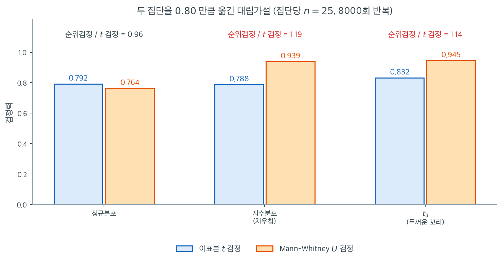

# 비모수 방법

척도가 $2$ 와 $3$ 인 두 지수분포에서 각각 $n = 100$ 을 뽑아 만–휘트니 $U$ 검정을 걸면 $U = 3411$, $p = 0.000104$ 가 나온다. 그러면 이 검정이 기각한 것은 「두 평균이 $2$ 대 $3$ 으로 다르다」인가. 아니다 — 검정이 실제로 보는 모수는 $\theta = P(X_1 > X_2)$ 이고, 이 자료에서 그 값은 $0.5$ 가 아닌 $0.4$ 다. **정규성을 버리면 가정만 버려지는 것이 아니라 재는 대상도 바뀐다.**

정규가 아닌 자료를 다루는 또 하나의 전략은 **비모수 방법**을 쓰는 것이다. 이 방법들은 자료에 특정 분포를 가정하지 않으며, 자료가 순서형이거나 정규성 가정이 위배될 때 흔히 쓰인다.

---

## 1. 흔한 비모수 검정

- **Mann-Whitney U 검정**: 독립인 두 집단을 비교하는 $t$ 검정의 비모수 대안.
- **Kruskal-Wallis 검정**: 셋 이상의 집단을 비교하는 분산분석의 비모수 대안.
- **Wilcoxon 부호순위 검정**: 대응하는 두 표본을 비교하는 비모수 검정.

<div class="exbox" markdown>

**보기 1.** <span class="diff easy" title="쉬움"></span> Mann-Whitney U 검정. 척도 $2$와 $3$인 두 지수분포에서 각각 $n = 100$을 뽑아 만–휘트니 $U$ 검정을 걸면 $U = 3411$, $p = 0.000104$가 나온다.

**(1)** 만–휘트니 검정이 재는 모수는 평균의 차가 아니라 $\theta = P(X_1 > X_2)$이다. 척도가 $s_1$, $s_2$인 두 지수분포에서 $\theta$를 **닫힌 꼴로 유도**하고, 그로부터 $\mathbb{E}[U]$를 구하시오.

**(2)** 관측된 $U = 3411$과 $p = 0.000104$를 (1)의 결과와 정규근사로 **재현**하시오. 또 이 자료의 효과 크기를 "두 평균이 $2$ 대 $3$으로 50% 차이난다"로 말하는 것과 "$\theta$가 $0.5$에서 $0.4$로 벗어났다"로 말하는 것 가운데, 검정이 실제로 보는 것은 어느 쪽인가.

</div>

??? success "풀이"

    **(1) 해석적으로.** 지수분포의 척도 $s$는 비율 $\lambda = 1/s$에 대응한다. $X \sim \text{Exp}(\lambda_1)$, $Y \sim \text{Exp}(\lambda_2)$가 독립이라 하고 $Y$로 조건을 걸어 적분한다. 지수분포의 생존함수가 $P(X > y) = e^{-\lambda_1 y}$이므로

    $$
    \theta = P(X > Y) = \int_0^\infty P(X > y)\, \lambda_2 e^{-\lambda_2 y}\, dy
    = \lambda_2 \int_0^\infty e^{-(\lambda_1 + \lambda_2) y}\, dy
    = \frac{\lambda_2}{\lambda_1 + \lambda_2}
    $$

    이다. 척도로 바꿔 쓰면 분자·분모에 $s_1 s_2$를 곱해

    $$
    \theta = \frac{1/s_2}{1/s_1 + 1/s_2} = \frac{s_1}{s_1 + s_2}
    $$

    을 얻는다. 기억하기 좋은 꼴이다. $s_1 = 2$, $s_2 = 3$이면

    $$
    \theta = \frac{2}{2+3} = \frac{2}{5} = 0.4
    $$

    이다. 이제 $U$로 넘어간다. 만–휘트니 통계량은 묶임이 없을 때 **큰 쪽 쌍의 개수**다.

    $$
    U_1 = \sum_{i=1}^{n_1}\sum_{j=1}^{n_2} \mathbf{1}\{X_i > Y_j\}
    $$

    기댓값은 선형성만으로 바로 나온다. 지시함수 $n_1 n_2$개가 각각 평균 $\theta$를 가지므로

    $$
    \mathbb{E}[U_1] = n_1 n_2\, \theta = 100 \times 100 \times 0.4 = 4000
    $$

    이다. **근사가 아니라 정확한 등식이다.** 지시함수들이 서로 독립이 아니지만(같은 $X_i$를 공유한다) 기댓값에는 영향이 없다. 분산을 구할 때라야 그 종속이 문제가 된다.

    귀무가설 $H_0 : \theta = 1/2$ 아래에서는 $\mathbb{E}[U_1] = n_1 n_2 / 2 = 5000$이고, 알려진 분산식으로

    $$
    \operatorname{SD}(U_1) = \sqrt{\frac{n_1 n_2 (n_1 + n_2 + 1)}{12}} = \sqrt{\frac{100 \times 100 \times 201}{12}} = \sqrt{167\,500} = 409.27
    $$

    이다.

    **(2) 수치적으로.** 먼저 쪽의 코드를 그대로 돌린다.

    ```python
    import numpy as np
    from scipy.stats import mannwhitneyu

    np.random.seed(0)

    # 두 지수분포. 정규와는 거리가 멀다.
    group1 = np.random.exponential(scale=2, size=100)
    group2 = np.random.exponential(scale=3, size=100)

    # Mann-Whitney U 는 t 검정의 비모수 대응이다. 값 대신 순위만 쓰므로
    # 정규성을 요구하지 않는다. 다만 귀무가설이 "두 평균이 같다"가 아니라
    # "두 분포의 위치가 같다"이므로, 결론을 말할 때 표현에 주의해야 한다.
    stat, p_value = mannwhitneyu(group1, group2)
    print(f"Mann-Whitney U Test: Statistic={stat}, p-value={p_value}")

    # 결과 해석
    alpha = 0.05
    if p_value > alpha:
        print("Fail to reject H_0: No significant difference between the groups.")
    else:
        print("Reject H_0: Significant difference between the groups.")
    ```

    출력:

    ```text
    Mann-Whitney U Test: Statistic=3411.0, p-value=0.00010388964489703351
    Reject H_0: Significant difference between the groups.
    ```

    이제 (1)의 값과 맞춰 본다.

    ```python
    import numpy as np
    from scipy import stats
    from scipy.stats import mannwhitneyu

    np.random.seed(0)
    group1 = np.random.exponential(scale=2, size=100)
    group2 = np.random.exponential(scale=3, size=100)
    n1 = n2 = 100
    U, p = mannwhitneyu(group1, group2)

    # theta = P(X1 > X2) 의 닫힌 꼴. 척도 s1, s2 이면 s1/(s1+s2) 다.
    theta = 2 / (2 + 3)
    print(f"이론  theta = s1/(s1+s2) = {theta:.4f}")
    print(f"이론  E[U] = n1 n2 theta = {n1 * n2 * theta:.1f}")

    # U 가 정말로 쌍의 개수인지 직접 세어 확인한다.
    pairs = (group1[:, None] > group2[None, :]).sum()
    print(f"직접 센 #(x > y) = {pairs}   scipy 의 U = {U:.1f}")
    print(f"표본비율 = {pairs / (n1 * n2):.4f}")

    # H0: theta = 1/2 아래의 정규근사. 연속성 보정을 넣는다.
    mu0 = n1 * n2 / 2
    sd0 = np.sqrt(n1 * n2 * (n1 + n2 + 1) / 12)
    z = (U - mu0 + 0.5) / sd0
    print(f"H0 아래  E[U] = {mu0:.1f},  SD = {sd0:.4f}")
    print(f"z = ({U:.1f} - {mu0:.1f} + 0.5) / {sd0:.4f} = {z:.4f}")
    print(f"양쪽 p = {2 * stats.norm.cdf(z):.8f}")
    print(f"scipy 의 p = {p:.8f}")

    print(f"표본중앙값 {np.median(group1):.4f}, {np.median(group2):.4f}  "
          f"(이론 {2*np.log(2):.4f}, {3*np.log(2):.4f})")
    print(f"표본평균   {group1.mean():.4f}, {group2.mean():.4f}  (이론 2, 3)")
    ```

    출력:

    ```text
    이론  theta = s1/(s1+s2) = 0.4000
    이론  E[U] = n1 n2 theta = 4000.0
    직접 센 #(x > y) = 3411   scipy 의 U = 3411.0
    표본비율 = 0.3411
    H0 아래  E[U] = 5000.0,  SD = 409.2676
    z = (3411.0 - 5000.0 + 0.5) / 409.2676 = -3.8813
    양쪽 p = 0.00010389
    scipy 의 p = 0.00010389
    표본중앙값 1.2603, 2.5687  (이론 1.3863, 2.0794)
    표본평균   1.8373, 3.1543  (이론 2, 3)
    ```

    **세 군데가 맞는다.**

    첫째, $U$가 쌍의 개수라는 해석이 **정확히** 맞는다. $X_i > Y_j$인 쌍을 직접 세면 $3411$개이고 SciPy의 $U$도 $3411.0$이다. 소수점이 없는 것은 묶임이 하나도 없다는 뜻이다(연속분포에서 뽑았으니 당연하다).

    둘째, 유도한 $\mathbb{E}[U] = 4000$에 대해 관측값은 $3411$이다. 표본비율로 보면 이론 $\theta = 0.4000$에 대해 $0.3411$이다. 차이가 작지 않은데, $U$의 대립가설 아래 표준편차가 $400$ 남짓이므로 $3411$은 $4000$에서 약 $1.5$ 표준편차 떨어진 자리다. 씨앗 0의 표본이 참값보다 조금 더 극단적으로 나온 것이고, 우연의 범위 안이다.

    셋째, $p$값이 **소수점 여덟째 자리까지 재현된다.** $z = (3411 - 5000 + 0.5)/409.2676 = -3.8813$에서 $2\Phi(-3.8813) = 0.00010389$이고 SciPy가 준 값도 $0.00010389$다. $+0.5$를 빼놓으면 $0.00010337$이 되어 다섯째 자리부터 어긋나므로, SciPy가 **연속성 보정을 넣은 정규근사**를 쓴다는 것까지 확인된다.

    **검정이 보는 것은 $\theta$ 쪽이다.** 두 말이 같은 자료를 가리키지만 검정이 재는 척도는 하나뿐이다.

    | 척도 | 귀무값 | 참값 | 벗어난 정도 |
    |---|---|---|---|
    | 평균의 비 | $1$ | $3/2 = 1.5$ | 50% |
    | $\theta = P(X_1 > X_2)$ | $0.5$ | $0.4$ | $0.1$ |

    만–휘트니는 값을 순위로 바꿔 버리므로 **"평균이 50% 크다"는 정보를 아예 보지 않는다.** 그것이 보는 것은 "무작위로 고른 $X_1$이 무작위로 고른 $X_2$보다 클 확률이 $0.4$"라는 사실뿐이다. 그래서 이 검정의 결론을 "두 평균이 다르다"로 옮겨 적으면 안 된다. 쪽의 주석이 경계하는 바가 이것이고, $\theta$가 모평균과 **단조로 이어지지 않는** 분포들을 만들 수 있기 때문에 단순한 번역이 통하지 않는다.

    실무적으로는 $\theta$가 오히려 보고하기 좋은 효과 크기다. 단위가 없고 "둘을 맞붙이면 어느 쪽이 이길 확률"이라는 뜻이 분명하다. 표본에서 $\hat\theta = U/(n_1 n_2) = 3411/10000 = 0.3411$로 바로 읽힌다. 평균의 차를 보고해야 하는 상황이라면 순위검정이 아니라 붓스트랩으로 가야 한다.

비모수 검정은 정규성 가정이 위배되거나 순서형 자료를 다룰 때 로버스트한 대안을 제공한다. 자료의 분포를 모르거나 정규가 아닌 상황에서 널리 쓰인다.

---

## 2. 순위검정은 무엇을 잃고 무엇을 얻는가

비모수 검정을 꺼리는 흔한 이유는 "값 대신 순위만 쓰니 정보를 버리는 것 아닌가"이다. 정보를 버리는 것은 맞다. 문제는 **얼마나** 버리는가이며, 그 답이 의외로 작다.

아래 그림은 세 가지 모집단에서 두 집단을 $0.80$만큼 옮긴 대립가설을 두고, 집단당 $n = 25$로 이표본 $t$ 검정과 Mann-Whitney $U$ 검정의 검정력을 8000번씩 재어 견준 것이다. 세 경우 모두 두 검정의 실제 유의수준은 $0.043$–$0.054$로 약속한 $0.05$ 근처에 있었으므로 공정한 비교다.



왼쪽 칸이 $t$ 검정에게 가장 유리한 상황이다. 모집단이 정확히 정규이므로 $t$ 검정이 최적이다. 그런데도 검정력 차이는 $0.792$ 대 $0.764$, 비로 따지면 $0.96$에 불과하다. 이론적으로 알려진 두 검정의 **점근 상대효율**이 $3/\pi = 0.955$인데, $n = 25$라는 작은 표본에서 이미 그 값에 거의 도달했다. 실무적으로 이 손실은 표본을 4% 남짓 늘리면 메워진다. 가장 불리한 판에서도 잃는 것이 그 정도다.

가운데와 오른쪽 칸에서 관계가 뒤집힌다. 지수분포에서는 $0.788$ 대 $0.939$로 순위검정이 $1.19$배 강하고, $t_3$에서는 $0.832$ 대 $0.945$로 $1.14$배 강하다. 이유는 다르다. 치우친 자료에서는 긴 꼬리가 $\bar{X}$를 끌고 다녀 신호 대비 잡음이 나빠지는데, 순위는 극단값을 그 순서만 인정하고 크기는 무시하므로 영향을 덜 받는다. 두꺼운 꼬리에서도 같은 이치로 $S$가 부풀어 $t$ 통계량이 눌리는 반면 순위는 그대로다.

이 비대칭한 손익 구조가 순위검정을 쓸 만하게 만든다. **정규성이 성립하면 4%쯤 잃고, 깨지면 15–20% 얻는다.** 물론 대가가 없지는 않다. 위 보기의 주석이 지적하듯 Mann-Whitney의 귀무가설은 "두 평균이 같다"가 아니라 "한 집단의 값이 다른 집단의 값보다 클 확률이 $1/2$이다"이므로, 모평균의 차이를 추정하거나 그에 대한 신뢰구간을 보고해야 하는 상황에는 그대로 쓸 수 없다. 검정만 필요한가, 아니면 모수의 추정값이 필요한가 — 이 물음이 순위검정과 붓스트랩 사이의 갈림길이다.


<div class="aibox" markdown>

**AI로 보는 통계학 1.** 순위검정은 중앙값을 검정하지 않는다

위 절이 마지막 문단에서 한 줄로 지나간 것을 수로 적어 둘 만하다. Mann-Whitney
$U$ 검정의 귀무가설은 「두 중앙값이 같다」가 **아니다.** 그것이 재는 것은

$$
P(X < Y) = \tfrac12
$$

이고, 이 둘은 **두 분포의 모양이 같을 때만** 같은 말이 된다. 그런데 실무에서는 이
검정을 「중앙값 검정」이라 부르는 일이 흔하고, 보고서에 중앙값 두 개를 나란히 적은
뒤 이 검정의 $p$ 값을 붙인다. 모양이 다르면 그 조합이 무엇을 말하는지 보자.

```python
import numpy as np
from scipy import stats

rng = np.random.default_rng(14)
n = 400
# 두 분포의 중앙값을 정확히 0 으로 맞춘다
#   A: 표준정규 (중앙값 0)
#   B: 지수(1) 에서 ln2 를 빼면 중앙값 0 (오른쪽으로 치우쳐 있다)
A = rng.normal(0, 1, n)
B = rng.exponential(1, n) - np.log(2)

# 참 P(A < B) 를 모의로 재어 둔다 (큰 표본)
a2, b2 = rng.normal(0, 1, 400000), rng.exponential(1, 400000) - np.log(2)
p_true = (a2 < b2).mean()

u, p = stats.mannwhitneyu(A, B, alternative="two-sided")
print(f"참 중앙값      A {0.0:+.4f}   B {0.0:+.4f}   (설계상 정확히 같다)")
print(f"표본 중앙값    A {np.median(A):+.4f}   B {np.median(B):+.4f}")
print(f"참 P(A < B)    {p_true:.4f}   (0.5 가 아니다)")
print(f"Mann-Whitney   U = {u:.1f}   p = {p:.3e}")
print(f"윌콕슨 순위합이 재는 것은 P(A < B) 이고 중앙값이 아니다")
print()
# n 을 늘리면 중앙값이 같은데도 기각률이 1 로 간다
for m in (50, 200, 800):
    rej = 0
    R = 2000
    for _ in range(R):
        a = rng.normal(0, 1, m)
        b = rng.exponential(1, m) - np.log(2)
        rej += stats.mannwhitneyu(a, b, alternative="two-sided")[1] < 0.05
    print(f"n = {m:4} 집단당   중앙값이 같은데 기각률 {rej / R:.3f}")
```

출력:

```
참 중앙값      A +0.0000   B +0.0000   (설계상 정확히 같다)
표본 중앙값    A +0.0365   B +0.0124
참 P(A < B)    0.5583   (0.5 가 아니다)
Mann-Whitney   U = 73573.0   p = 4.924e-02
윌콕슨 순위합이 재는 것은 P(A < B) 이고 중앙값이 아니다

n =   50 집단당   중앙값이 같은데 기각률 0.157
n =  200 집단당   중앙값이 같은데 기각률 0.510
n =  800 집단당   중앙값이 같은데 기각률 0.968
```

**두 분포의 중앙값은 설계상 정확히 $0$ 으로 같다.** 그런데 $P(A < B) = 0.558$ 이라서
검정은 기각할 거리를 찾아낸다. 아래 세 줄이 그 결론이다 — 자료를 모으면 모을수록
확실하게 기각하고, $n = 800$ 이면 **스물에 열아홉 번** 기각한다. 중앙값은 한 번도
달라진 적이 없다.

까닭은 치우침이다. $B$ 의 분포는 중앙값 오른쪽으로 길게 끌리므로, $A$ 와 하나씩 뽑아
견주면 $B$ 가 이기는 쌍이 조금 더 많다. 순위는 **쌍의 승패**만 보고 중앙값은 **한
지점**만 보므로, 둘이 다른 것을 재는 것이 당연하다.

그래서 이 검정을 쓰려면 **위치이동 가정**을 명시해야 한다 — 두 분포의 모양이 같고
평행이동만 다르다는 가정이다. 그 아래에서는 $P(X<Y) = \tfrac12$ 와 중앙값의 같음이
동치가 되고, 「중앙값 검정」이라 불러도 틀리지 않는다. 가정을 두지 않으면 결론은
「한쪽이 **확률적으로** 더 크다」까지이고, 중앙값을 정말 견주려면 중앙값 자체를 겨누는
검정이나 분위수 회귀로 가야 한다.

</div>

---

## 3. 요약: 정규가 아닌 자료 다루기

정규가 아닌 자료를 만났을 때 쓸 수 있는 전략은 여러 가지이다.

- **변수변환**은 자료를 정규에 더 가깝게 만들어 준다.
- **붓스트랩**은 모수적 가정에 기대지 않는 대안적 접근을 제공한다.
- **비모수 방법**은 가정이 위배될 때 전통적 모수 검정을 대신할 강력한 대안이다.

방법의 선택은 비정규성의 정도, 표본크기, 다루는 구체적인 연구 질문에 달려 있다. 실무에서는 이 접근들을 시각적·형식적 정규성 평가와 결합할 때 더 신뢰할 만한 통계 분석에 이를 수 있다.

---

## 연습문제

<div class="drillbox" markdown>

**연습문제 1.** <span class="diff med" title="중간"></span>
비모수 검정 세 가지를 들고 각각이 대체하는 모수적 검정을 서술하라. 어떤 가정이 완화되는가?

</div>

??? success "풀이"
    | 비모수 검정 | 대체 대상 | 완화되는 가정 |
    |---|---|---|
    | Wilcoxon 부호순위 검정 | 일표본 t 검정 | 자료의 정규성 |
    | Mann-Whitney U 검정 | 이표본 t 검정 | 두 집단 자료의 정규성 |
    | Kruskal-Wallis 검정 | 일원배치 분산분석 | 집단 내 정규성 |

    각 경우에 비모수 검정은 자료가 특정 분포를 따를 것을 요구하지 않는다. 실제 값 대신 자료의 순위를 쓰므로 이상점과 비정규성에 로버스트하다.

<div class="drillbox" markdown>

**연습문제 2.** <span class="diff med" title="중간"></span>
점근적 상대효율(ARE)의 개념을 설명하라. 정규성 아래에서 Wilcoxon 검정의 t 검정 대비 ARE가 $3/\pi \approx 0.955$라면 이는 무엇을 뜻하는가?

</div>

??? success "풀이"
    ARE는 같은 검정력을 얻는 데 두 검정이 필요로 하는 표본크기를 비교한다. ARE가 0.955라는 것은 정규성 아래에서 Wilcoxon 검정이 t 검정의 검정력을 따라잡으려면 대략 $n/0.955 \approx 1.047n$개의 관측값이 필요하다는 뜻이다.

    곧 자료가 진짜 정규일 때 Wilcoxon 검정은 t 검정에 비해 효율을 약 5%만 잃는다. 얻는 로버스트성에 비하면 작은 대가이다. 자료가 정규가 아니면(꼬리가 두껍거나 치우쳐 있으면) Wilcoxon 검정이 t 검정보다 훨씬 강력할 수 있다. 어떤 분포에서는 Wilcoxon의 t 검정 대비 ARE가 1을 넘는다(Wilcoxon이 더 효율적이다).

<div class="drillbox" markdown>

**연습문제 3.** <span class="diff med" title="중간"></span>
자료가 $\{1, 2, 3, 100\}$이다. 순위에 기초한 비모수 검정이 t 검정보다 적절한 이유를 설명하라.

</div>

??? success "풀이"
    값 100은 나머지 값들에 비해 심각한 이상점이다. t 검정통계량은 (100에 크게 영향받는) 평균과 (100 때문에 부풀려진) 표준편차를 쓰므로 둘 다 이 관측값 하나에 왜곡된다. 그렇게 나온 t 통계량과 p값은 믿을 수 없다.

    순위 기반 검정은 자료를 순위 $\{1, 2, 3, 4\}$로 바꾸므로 이상점은 그저 순위 4인 가장 큰 관측값일 뿐이다. 100이라는 극단적 크기는 무관해진다. 그래서 검정이 로버스트하다. 100을 10이나 10,000으로 바꿔도 순위와 검정 결과가 달라지지 않는다.

<div class="drillbox" markdown>

**연습문제 4.** <span class="diff med" title="중간"></span>
정규성이 의심스러워도 비모수 검정이 권장되지 않는 경우는 언제인가?

</div>

??? success "풀이"
    비모수 검정이 언제나 선호되는 것은 아니다.

    1. **표본이 클 때:** $n$이 크면 중심극한정리가 모수적 검정을 근사적으로 타당하게 만들고, 모수적 검정이 (순위가 아니라 실제 값을 쓰므로) 더 강력하다. 순위로 인한 효율 손실을 감수할 이유가 없다.
    2. **특별히 평균에 대한 추론일 때:** 비모수 검정(예: Mann-Whitney)은 평균 차이가 아니라 확률적 우위나 중앙값 차이를 검정한다. 연구 질문이 구체적으로 평균에 관한 것이라면 (필요하면 붓스트랩을 곁들인) t 검정이 더 적절하다.
    3. **복잡한 설계일 때:** 요인 분산분석, 회귀, 혼합모형에서는 비모수 대안이 제한적이거나 덜 발달해 있다. 로버스트한 모수적 방법(Welch 분산분석, 샌드위치 표준오차)이 대개 더 낫다.
    4. **동점이 많을 때:** 순위 기반 검정은 동점이 많으면(예: 범주가 적은 리커트 척도 자료) 검정력을 잃는다.

<div class="drillbox" markdown>

**연습문제 5.** <span class="diff med" title="중간"></span>
보기 1 에서 척도가 $s_1 = 2$, $s_2 = 3$ 인 두 지수분포에 대해 $\theta = P(X_1 > X_2) = s_1/(s_1+s_2) = 0.4$ 였다. 평균의 비를 $r = s_2/s_1 \ (r \ge 1)$ 이라 두자.

**(1)** $\theta$ 와 $\lvert \theta - 1/2 \rvert$ 를 $r$ 만의 식으로 쓰고, $r = 1,\ 1.5,\ 3,\ 10,\ 100$ 과 $r \to \infty$ 에 대해 $\theta$, $\lvert \theta - 1/2 \rvert$, 그리고 $n_1 = n_2 = 100$ 일 때의 $\mathbb{E}[U_1]$ 을 표로 적으시오.

**(2)** 보기 1 의 자료는 $r = 1.5$ 로 이탈이 $\lvert \theta - 1/2 \rvert = 0.1$ 이었다. 이 이탈을 두 배인 $0.2$ 로 만들려면 $r$ 을 얼마로 해야 하는가. 평균비는 몇 배가 되는가.

**(3)** $r \to \infty$ 로 보낼 때 $\mathbb{E}[U_1]$ 과 보기 1 의 연속성 보정 정규근사 $z$ 가 각각 어떤 값으로 다가가는지 구하고, "평균이 두 배 차이난다"와 "$\theta$ 가 두 배 벗어났다"가 같은 말이 아닌 까닭을 한 줄로 쓰시오.

</div>

??? success "풀이"
    **(1)** 분자·분모를 $s_1$ 으로 나누면

    $$
    \theta = \frac{s_1}{s_1 + s_2} = \frac{1}{1 + r}
    $$

    이고, $r \ge 1$ 이면 $\theta \le 1/2$ 이므로

    $$
    \left\lvert \theta - \frac12 \right\rvert = \frac12 - \frac{1}{1+r} = \frac{(1+r) - 2}{2(1+r)} = \frac{r-1}{2(r+1)}
    $$

    이다. $\mathbb{E}[U_1] = n_1 n_2 \theta = 10\,000/(1+r)$ 이다.

    | $r = s_2/s_1$ | $\theta$ | $\lvert \theta - 1/2 \rvert$ | $\mathbb{E}[U_1]$ |
    |---|---|---|---|
    | $1$ | $0.5$ | $0$ | $5000$ |
    | $1.5$ | $0.4$ | $0.1$ | $4000$ |
    | $3$ | $0.25$ | $0.25$ | $2500$ |
    | $10$ | $1/11 = 0.0909$ | $9/22 = 0.4091$ | $909.1$ |
    | $100$ | $1/101 = 0.0099$ | $99/202 = 0.4901$ | $99.0$ |
    | $\infty$ | $0$ | $0.5$ | $0$ |

    **(2)** $(r-1)/\{2(r+1)\} = 0.2$ 를 풀면 $r - 1 = 0.4r + 0.4$, 곧 $0.6r = 1.4$ 이므로

    $$
    r = \frac{7}{3} = 2.3333, \qquad \theta = \frac{1}{1 + 7/3} = \frac{3}{10} = 0.3
    $$

    이다. 평균비는 $1.5$ 에서 $2.3333$ 으로 **$1.56$ 배**만 커지면 된다. 효과크기를 두 배로 만드는 데 평균비를 두 배로 할 필요가 없다.

    **(3)** $r \to \infty$ 이면 $\theta \to 0$ 이므로 $\mathbb{E}[U_1] \to 0$ 이다. $U_1$ 이 쌍의 개수이므로 $0$ 은 **가능한 최솟값**이고, 더 내려갈 자리가 없다. 보기 1 의 $z$ 는

    $$
    z = \frac{U_1 - 5000 + 0.5}{409.2676} \;\longrightarrow\; \frac{0 - 5000 + 0.5}{409.2676} = -12.22
    $$

    에서 멈춘다. $n_1 = n_2 = 100$ 을 고정하면 평균비를 아무리 키워도 $z$ 의 기대값이 $-12.22$ 보다 극단으로 갈 수 없다.

    **해석.** 평균비는 $(1, \infty)$ 를 다 쓰지만 $\theta$ 는 $(0, 1/2]$ 안에 갇힌다. $1/(1+r)$ 이 포화하기 때문이다. 표에서 $r$ 을 $1.5 \to 3$ 으로 $2$ 배 키우면 이탈이 $0.1 \to 0.25$ 로 $2.5$ 배 늘지만, $10 \to 100$ 으로 $10$ 배 키우면 $0.4091 \to 0.4901$ 로 $1.2$ 배밖에 늘지 않는다. 그래서 "평균이 두 배"와 "$\theta$ 가 두 배"는 눈금이 다른 말이다.

<div class="drillbox" markdown>

**연습문제 6.** <span class="diff med" title="중간"></span>
집단당 $n$, 표준화한 이동 $\delta$ 에 대해 이표본 $t$ 검정의 검정력은

$$
1 - \beta \approx \Phi\!\left(\delta \sqrt{n/2} - t_{0.975,\,2n-2}\right)
$$

로 근사된다. 2절의 그림은 $\delta = 0.80$, $n = 25$ 인 자리다.

**(1)** 이 식으로 정규 모집단에서 $t$ 검정의 검정력을 구해 그림의 $0.792$ 와 견주시오. ($t_{0.975,\,48} = 2.0106$)

**(2)** ARE $= 3/\pi = 0.955$ 를 "순위검정의 표본 $n$ 은 $t$ 검정의 $0.955n$ 에 값한다"로 읽고, 같은 식에 $n$ 대신 $0.955 \times 25 = 23.9$ 를 꽂아 Mann-Whitney 의 검정력을 예측하여 그림의 $0.764$ 와 견주시오. ($t_{0.975,\,45.8} = 2.0132$)

**(3)** 그림에는 검정력의 비가 $0.96$ 으로 적혀 있고 ARE 는 $0.955$ 다. 두 수가 가까운 것이 ARE 의 뜻 때문인지 아니면 이 자리의 우연인지를, 같은 식으로 $n = 100$ 에서 두 검정력의 비를 계산해 판정하시오. ($t_{0.975,\,198} = 1.9720$, $t_{0.975,\,189} = 1.9726$)

</div>

??? success "풀이"
    **(1)** $\delta\sqrt{n/2} = 0.80 \times \sqrt{12.5} = 0.80 \times 3.5355 = 2.8284$ 이므로

    $$
    1 - \beta \approx \Phi(2.8284 - 2.0106) = \Phi(0.8178) = 0.7933
    $$

    이다. 그림의 $0.792$ 와 셋째 자리까지 맞는다. 근사식이 이 자리에서 잘 듣는다는 뜻이고, 그래서 (2)·(3) 에서도 쓸 수 있다.

    **(2)** $n_{\text{유효}} = 23.875$ 를 꽂으면 $0.80 \times \sqrt{11.9375} = 0.80 \times 3.4551 = 2.7641$ 이므로

    $$
    1 - \beta \approx \Phi(2.7641 - 2.0132) = \Phi(0.7509) = 0.7736
    $$

    이다. 그림은 $0.764$ 다. $0.010$ 어긋나는데, $8000$ 회 모의의 표준오차가 $\sqrt{0.764 \times 0.236/8000} = 0.0047$ 이므로 약 $2$ 표준오차 차이다. ARE 를 **표본크기로 환산**하는 읽기가 실제 모의와 맞아떨어진다.

    **(3)** $n = 100$ 에서 $t$ 검정은 $0.80\sqrt{50} = 5.6569$ 이므로

    $$
    1 - \beta \approx \Phi(5.6569 - 1.9720) = \Phi(3.6848) = 0.99989
    $$

    이고, 순위검정은 $n_{\text{유효}} = 95.5$ 로 $0.80\sqrt{47.75} = 5.5281$ 이므로

    $$
    1 - \beta \approx \Phi(5.5281 - 1.9726) = \Phi(3.5555) = 0.99981
    $$

    이다. 검정력의 비는 $0.99981/0.99989 = 0.9999$ 다. **우연이다.** 검정력은 $1$ 에 갇혀 있으므로 두 검정이 모두 강해지는 자리로 가면 비가 반드시 $1$ 로 간다. 반대로 검정력이 낮은 자리($n = 10$) 로 가면 비가 $0.95$ 쪽으로 내려간다. 즉 **검정력의 비는 $n$ 과 $\delta$ 에 따라 움직이는 양**이고 ARE 는 움직이지 않는 한 수다. ARE 는 검정력의 비가 아니라 **같은 검정력을 내는 표본크기의 비**이므로, ARE 를 검정력으로 옮기는 올바른 길은 (3) 처럼 비를 보는 것이 아니라 (2) 처럼 $n$ 을 환산하는 것이다. 그림의 $0.96$ 이 $0.955$ 와 닮아 보인 것은 $n = 25$, $\delta = 0.8$ 이 검정력 $0.8$ 근처라는 자리의 우연이다.

<div class="drillbox" markdown>

**연습문제 7.** <span class="diff hard" title="어려움"></span>
보기 1 의 풀이는 "$U = 3411.0$ 에 소수점이 없는 것은 묶임이 하나도 없다는 뜻"이라 했고, 연습문제 4 는 "동점이 많으면 순위검정이 검정력을 잃는다"고 했다. 묶임이 있을 때 만–휘트니가 재는 모수는 묶인 쌍을 반씩 나누어

$$
\theta^{*} = P(X > Y) + \tfrac{1}{2} P(X = Y)
$$

로 정의된다.

**(1)** 두 집단이 모두 $3$ 점 척도 $\{1, 2, 3\}$ 이고 집단 1 의 분포가 $(0.2, 0.3, 0.5)$, 집단 2 가 $(0.5, 0.3, 0.2)$ 다. $P(X > Y)$, $P(X = Y)$, $P(X < Y)$ 와 $\theta^{*}$ 를 구하시오.

**(2)** $\theta^{*} - \tfrac12 = \tfrac12 \{P(X > Y) - P(X < Y)\}$ 임을 보이고, 묶이지 않은 쌍만 보았을 때의 모수 $\theta_{\circ} = P(X > Y \mid X \ne Y)$ 에 대해

$$
\left\lvert \theta^{*} - \tfrac12 \right\rvert = \{1 - P(X = Y)\} \left\lvert \theta_{\circ} - \tfrac12 \right\rvert
$$

임을 보이시오. (1) 의 수로 양변을 확인하시오.

**(3)** 범주 안을 더 잘게 재어 묶임을 모두 풀 수 있게 되었다고 하자. 그때 $\theta = P(X > Y)$ 가 가질 수 있는 값의 상·하한을 (1) 의 수로 구하고, 묶임이 검정력을 잃게 하는 이치를 신호의 크기로 설명하시오.

</div>

??? success "풀이"
    **(1)** 집단 1 의 분포를 $p = (p_1, p_2, p_3)$, 집단 2 를 $q = (q_1, q_2, q_3)$ 라 쓰면

    $$
    P(X > Y) = p_2 q_1 + p_3 (q_1 + q_2) = 0.3 \times 0.5 + 0.5 \times 0.8 = 0.15 + 0.40 = 0.55
    $$

    $$
    P(X = Y) = p_1 q_1 + p_2 q_2 + p_3 q_3 = 0.10 + 0.09 + 0.10 = 0.29
    $$

    $$
    P(X < Y) = p_1 (q_2 + q_3) + p_2 q_3 = 0.2 \times 0.5 + 0.3 \times 0.2 = 0.10 + 0.06 = 0.16
    $$

    이다. 세 값의 합이 $0.55 + 0.29 + 0.16 = 1.00$ 으로 맞는다. 따라서

    $$
    \theta^{*} = 0.55 + \tfrac12 \times 0.29 = 0.55 + 0.145 = 0.695
    $$

    이다.

    **(2)** $P(>) + P(=) + P(<) = 1$ 의 양변에 $\tfrac12$ 를 곱해 $\tfrac12$ 를 대신 넣으면

    $$
    \theta^{*} - \tfrac12 = P(>) + \tfrac12 P(=) - \tfrac12 \{P(>) + P(=) + P(<)\} = \tfrac12 \{P(>) - P(<)\}
    $$

    이다. 한편 $\theta_{\circ} = P(>)/\{P(>) + P(<)\}$ 이고 $P(>) + P(<) = 1 - P(=)$ 이므로

    $$
    \theta_{\circ} - \tfrac12 = \frac{P(>) - \tfrac12\{P(>) + P(<)\}}{1 - P(=)} = \frac{\tfrac12\{P(>) - P(<)\}}{1 - P(=)} = \frac{\theta^{*} - \tfrac12}{1 - P(=)}
    $$

    이고, 양변에 $1 - P(=)$ 를 곱하고 절댓값을 취하면 주어진 등식이 된다. $\square$

    수로 확인하면 $\theta^{*} - \tfrac12 = 0.195$ 이고 $\tfrac12(0.55 - 0.16) = 0.195$ 로 맞는다. 또 $\theta_{\circ} = 0.55/0.71 = 0.7746$ 이므로 $0.71 \times (0.7746 - 0.5) = 0.71 \times 0.2746 = 0.195$ 로 양변이 맞는다.

    **(3)** 묶인 쌍의 비중은 $0.29$ 다. 그것이 모두 $X$ 쪽으로 풀리면 $\theta = 0.55 + 0.29 = 0.84$, 모두 $Y$ 쪽으로 풀리면 $\theta = 0.55$ 다. 곧

    $$
    0.55 \le \theta \le 0.84
    $$

    이고, 묶임 보정값 $\theta^{*} = 0.695$ 는 정확히 그 **중점**이다. 반씩 나눈다는 정의가 하는 일이 이것이다.

    여기서 손실이 보인다. 묶인 쌍은 어느 쪽도 이기지 못하고 **귀무값 $\tfrac12$ 에 묶여 있다.** 그래서 (2) 의 등식대로 신호 $\lvert \theta^{*} - \tfrac12 \rvert$ 가 $1 - P(=) = 0.71$ 배로 줄어든다($0.2746 \to 0.195$).

    분산도 줄지만 덜 줄어든다. 묶임 보정 분산은 묶임 덩어리의 크기를 $t_k$, $N = n_1 + n_2$ 라 할 때

    $$
    \operatorname{Var}(U_1) = \frac{n_1 n_2}{12}\left[(N+1) - \frac{\sum_k (t_k^3 - t_k)}{N(N-1)}\right]
    $$

    이다. $n_1 = n_2 = n$ 이면 범주별 도수가 $(0.7n,\ 0.6n,\ 0.7n)$ 이므로 $\sum_k t_k^3 \approx (0.343 + 0.216 + 0.343) n^3 = 0.902 n^3$ 이고 $N(N-1) \approx 4n^2$ 이라 대괄호가 $2n - 0.2255n = 1.7745n$ 이 된다. 묶임이 없을 때의 $2n$ 과 견주면 표준편차는 $\sqrt{1.7745/2} = 0.942$ 배다. 따라서

    $$
    \frac{z_{\text{묶임}}}{z_{\text{무묶임}}} \approx \frac{0.71}{0.942} = 0.754
    $$

    로, 같은 검정력을 얻으려면 표본을 $1/0.754^2 = 1.76$ 배 모아야 한다. 신호는 묶임 비율만큼 깎이는데 잡음은 그만큼 깎이지 않는다 — 이것이 리커트 척도 자료에서 순위검정이 약해지는 이치다.

<div class="drillbox" markdown>

**연습문제 8.** <span class="diff hard" title="어려움"></span>
"정리하며"는 만–휘트니가 두 분포의 **모양이 같다**고 가정하며 그래야 결과를 "중앙값의 차이"로 읽을 수 있다고 했다. 모양이 다르면 그 번역이 거짓이 된다는 것을 반례로 보이자.

$Y \sim U(0, 1)$ 이고, $X$ 는 확률 $1/2$ 로 $U(0.45,\, 0.50)$ 에서, 확률 $1/2$ 로 $U(0.50,\, 1)$ 에서 뽑는 혼합분포다.

**(1)** 두 분포의 중앙값이 모두 $0.5$ 임을 확인하시오.

**(2)** $X$ 의 값이 $[0,1]$ 안에 있음을 이용해 보기 1 의 조건부 적분으로 $\theta = P(X > Y) = \mathbb{E}[X]$ 임을 보이고, $\theta$ 를 계산하시오.

**(3)** $n_1 = n_2 = 100$ 에서 보기 1 의 귀무 정규근사(중심 $5000$, $\operatorname{SD} = 409.27$)로 $\mathbb{E}[U_1]$ 에 해당하는 $z$ 를 구하고, $\Phi(\lvert z \rvert - 1.96)$ 으로 기각 확률을 어림하시오. 이 자료에서 만–휘트니의 결론을 "중앙값이 다르다"로 옮기면 왜 거짓인가.

**(4)** 보기 1 의 두 지수분포는 왜 이런 반례가 될 수 없는가. $\theta$ 로부터 두 중앙값의 비를 복원해 보고, 쪽에 적힌 이론 중앙값 $1.3863$, $2.0794$ 와 맞는지 확인하시오.

</div>

??? success "풀이"
    **(1)** $X$ 의 분포함수는 $0.5$ 에서

    $$
    F_X(0.5) = \tfrac12 \times 1 + \tfrac12 \times 0 = \tfrac12
    $$

    이다(첫 성분은 $0.5$ 이하에 전부 들어가고 둘째 성분은 전부 밖에 있다). $F_X$ 가 $[0.45, 1]$ 에서 연속이고 증가하므로 중앙값은 유일하게 $0.5$ 다. $Y$ 는 $F_Y(0.5) = 0.5$ 로 중앙값이 $0.5$ 다. **두 중앙값이 글자 그대로 같다.**

    **(2)** 보기 1 과 같이 $X$ 로 조건을 걸어 적분한다. $Y \sim U(0,1)$ 이므로 $0 \le x \le 1$ 에서 $P(Y < x) = F_Y(x) = x$ 이고, $X$ 는 $[0.45, 1] \subset [0,1]$ 에만 값을 가지므로

    $$
    \theta = P(X > Y) = \int P(Y < x) f_X(x)\, dx = \int x f_X(x)\, dx = \mathbb{E}[X]
    $$

    이다. 균등분포의 평균은 양 끝의 중점이므로

    $$
    \mathbb{E}[X] = \tfrac12 \times \frac{0.45 + 0.50}{2} + \tfrac12 \times \frac{0.50 + 1}{2} = \tfrac12 \times 0.475 + \tfrac12 \times 0.75 = 0.6125
    $$

    곧 $\theta = 0.6125$ 다.

    **(3)** $\mathbb{E}[U_1] = n_1 n_2 \theta = 10\,000 \times 0.6125 = 6125$ 이므로

    $$
    z = \frac{6125 - 5000}{409.27} = 2.749, \qquad \Phi(2.749 - 1.96) = \Phi(0.789) = 0.785
    $$

    이다. 집단당 $100$ 이면 약 $79\%$ 의 확률로 기각한다(귀무 표준편차를 쓴 어림이다). **중앙값이 완전히 같은 두 분포를 만–휘트니가 거의 확실히 "다르다"고 판정한다.** 검정이 본 것은 중앙값이 아니라 $\theta = 0.6125$ 다. $X$ 는 $0.5$ 아래쪽 질량을 $[0.45, 0.50]$ 이라는 좁은 구간에 몰아 두었기 때문에, 무작위로 맞붙이면 중앙값이 같아도 $X$ 가 이길 확률이 $0.5$ 를 넘는다. 그러므로 결론은 "$\theta \ne 1/2$" 까지만 말할 수 있다. 참고로 $\mathbb{E}[X] = 0.6125 \ne 0.5 = \mathbb{E}[Y]$ 이므로 "위치가 다르다"는 느슨한 말은 틀리지 않지만, "중앙값이 다르다"로 옮기면 거짓이다.

    **(4)** 지수분포 둘은 **척도족**이라 모양이 같다. 보기 1 에서 $\theta = s_1/(s_1 + s_2)$ 였으므로 이를 뒤집으면

    $$
    \frac{s_2}{s_1} = \frac{1 - \theta}{\theta}
    $$

    이고, 중앙값이 $\text{med}_i = s_i \ln 2$ 로 척도에 비례하므로

    $$
    \frac{\text{med}_2}{\text{med}_1} = \frac{s_2}{s_1} = \frac{1 - \theta}{\theta} = \frac{0.6}{0.4} = 1.5
    $$

    이다. 쪽에 적힌 이론 중앙값으로 확인하면 $2.0794/1.3863 = 1.5$ 로 맞는다. 곧 모양이 같은 집안에서는 $\theta$ 가 중앙값의 비를 **하나로** 정하고, $\theta \ne 1/2$ 와 "중앙값이 다르다"가 동치가 된다. (3) 의 반례는 그 집안을 벗어났기 때문에 번역이 깨진 것이다.

<div class="drillbox" markdown>

**연습문제 9.** <span class="diff hard" title="어려움"></span>
2절의 그림을 만든 모의에서 세 모집단은 모두 표준편차가 $1$ 이도록 맞추어져 있고(지수는 척도 $1$, $t_3$ 는 $\sqrt{3}$ 으로 나눈 것), 둘째 집단만 $\delta = 0.80$ 만큼 평행이동했다. 그러므로 $t$ 검정이 보는 효과크기는 세 경우 모두 $d = 0.80$ 으로 **같고**, 실제로 $t$ 검정의 검정력은 $0.792$, $0.788$, $0.832$ 로 거의 같다. 그런데 순위검정의 검정력은 $0.764$, $0.939$, $0.945$ 로 크게 다르다. 순위검정이 보는 효과크기 $\theta$ 를 직접 계산해 그 까닭을 찾자.

**(1)** 정규: $X \sim N(0,1)$, $Y \sim N(\delta, 1)$ 이 독립이면 $\theta = P(X > Y) = \Phi(-\delta/\sqrt{2})$ 임을 보이고 $\delta = 0.80$ 에서 값을 구하시오.

**(2)** 지수: $X \sim \text{Exp}(1)$ 이고 $Y = \delta + \text{Exp}(1)$ 이면 보기 1 의 조건부 적분으로 $\theta = \tfrac12 e^{-\delta}$ 임을 보이고 값을 구하시오.

**(3)** 두 경우의 $\lvert \theta - 1/2 \rvert$ 를 견주시오. 이어서 $n_1 = n_2 = 25$ 에서 $\mathbb{E}[U_1]$ 과 귀무 정규근사의 $z$ 를 각각 구하고 $\Phi(\lvert z \rvert - 1.96)$ 으로 순위검정의 검정력을 예측하여 그림의 $0.764$, $0.939$ 와 견주시오. 예측이 조금씩 낮게 나오는 까닭도 쓰시오.

</div>

??? success "풀이"
    **(1)** $X$ 와 $Y$ 가 독립인 정규이므로 $X - Y \sim N(-\delta,\, 1 + 1) = N(-\delta, 2)$ 다. 따라서

    $$
    \theta = P(X - Y > 0) = P\!\left(Z > \frac{\delta}{\sqrt{2}}\right) = \Phi\!\left(-\frac{\delta}{\sqrt{2}}\right)
    $$

    이고, $\delta = 0.80$ 이면 $\delta/\sqrt{2} = 0.5657$ 이므로 $\theta = \Phi(-0.5657) = 0.2858$ 이다.

    **(2)** $Y = \delta + Y'$, $Y' \sim \text{Exp}(1)$ 로 쓰고 $Y'$ 로 조건을 걸어 적분한다. $P(X > \delta + y) = e^{-(\delta + y)}$ 이므로

    $$
    \theta = \int_0^\infty e^{-(\delta + y)} e^{-y}\, dy = e^{-\delta} \int_0^\infty e^{-2y}\, dy = \frac{e^{-\delta}}{2}
    $$

    이고, $\delta = 0.80$ 이면 $\theta = e^{-0.8}/2 = 0.4493/2 = 0.2247$ 이다.

    **(3)** 이탈을 견준다.

    | 모집단 | $\theta$ | $\lvert \theta - 1/2 \rvert$ |
    |---|---|---|
    | 정규 | $0.2858$ | $0.2142$ |
    | 지수 | $0.2247$ | $0.2753$ |

    같은 $d = 0.80$ 인데 순위검정이 보는 신호는 지수에서 $0.2753/0.2142 = 1.29$ 배 크다. 이제 검정력을 예측한다. $n_1 n_2 = 625$ 이고 귀무가설 아래

    $$
    \mathbb{E}[U_1] = \frac{625}{2} = 312.5, \qquad \operatorname{SD}(U_1) = \sqrt{\frac{25 \times 25 \times 51}{12}} = \sqrt{2656.25} = 51.54
    $$

    이다. 대립가설 아래의 중심은 $625\theta$ 이므로

    $$
    z_{\text{정규}} = \frac{625 \times 0.2858 - 312.5}{51.54} = \frac{178.6 - 312.5}{51.54} = -2.598
    $$

    $$
    z_{\text{지수}} = \frac{625 \times 0.2247 - 312.5}{51.54} = \frac{140.4 - 312.5}{51.54} = -3.339
    $$

    이고 검정력 예측은

    $$
    \Phi(2.598 - 1.96) = \Phi(0.638) = 0.738, \qquad \Phi(3.339 - 1.96) = \Phi(1.379) = 0.916
    $$

    이다. 그림의 $0.764$ 와 $0.939$ 에 각각 $0.03$ 미만으로 다가가고, 두 예측의 비 $0.916/0.738 = 1.24$ 가 그림에 적힌 $1.19$ 를 잘 잡는다.

    예측이 조금씩 낮은 데는 두 까닭이 있다. 첫째, 분모에 **귀무가설 아래의** 표준편차를 썼다. 두 분포가 실제로 벌어져 있으면 $U_1$ 이 $0$ 쪽으로 쏠려 분산이 줄어들므로 실제 산포는 $51.54$ 보다 작고 검정력은 더 높다. 둘째, $\Phi(\lvert z \rvert - 1.96)$ 은 반대쪽 꼬리에서 기각되는 몫을 버린 어림이다.

    **해석.** 표준편차를 $1$ 로 맞추어도 그 $1$ 을 만드는 방식이 다르다. 지수분포의 표준편차는 긴 오른쪽 꼬리가 만든 것이고, 질량 자체는 $0$ 근처에 몰려 있다. 그 몰린 자리를 $0.80$ 만큼 옮기면 두 표본의 순위가 깔끔하게 갈린다. 순위검정은 꼬리의 **크기**를 보지 않으므로 그 이득을 온전히 가져간다. 반면 $t$ 검정은 꼬리가 부풀린 표준편차로 이동을 나누므로 같은 이동이 묻힌다. 2절이 "긴 꼬리가 $\bar{X}$ 를 끌고 다녀 신호 대비 잡음이 나빠진다"고 한 말이 $\theta$ 의 수로 드러난 것이다.

<div class="drillbox" markdown>

**연습문제 10.** <span class="diff hard" title="어려움"></span>
ARE 가 "$n \to \infty$" 의 양이라는 사실이 연습문제 4 의 첫 항목과 부딪친다. 그 자리를 정리하자.

**(1)** 지수 모집단에서 이동 $\delta = 0.80$ 을 고정하고 $n$ 을 키우면 두 검정의 검정력이 모두 $1$ 로 가고, 따라서 검정력의 비도 $1$ 로 간다(연습문제 6(3)). 고정된 대립가설로는 두 검정의 효율을 견줄 수 없는 까닭을 이로써 설명하고, ARE 를 $\delta_n = c/\sqrt{n}$ 인 **국소대립**에서 정의하는 이유를 쓰시오.

**(2)** $n_1 = n_2 = n$ 이고 $\kappa = \lim_{\delta \to 0} \lvert \theta(\delta) - 1/2 \rvert / \delta$ 라 하자. 귀무 표준편차 $\operatorname{SD}(U_1) = \sqrt{n_1 n_2 (n_1 + n_2 + 1)/12}$ 를 써서 순위검정의 비중심모수가

$$
\frac{n^2 \lvert \theta(\delta_n) - 1/2 \rvert}{\operatorname{SD}(U_1)} \longrightarrow \sqrt{6}\, c\, \kappa
$$

임을 보이고, 같은 국소대립에서 $t$ 검정의 비중심모수가 $c/\sqrt{2}$ 임을 확인하시오.

**(3)** 연습문제 9 의 두 $\theta(\delta)$ 로 $\kappa$ 를 구하여, 정규에서는 ARE $= 3/\pi$ 가 되어 쪽의 값이 재현되고 지수 위치족에서는 ARE $= 3$ 이 됨을 보이시오.

**(4)** 연습문제 4 의 첫 항목은 "$n$ 이 크면 중심극한정리가 모수적 검정을 타당하게 만들고, 모수적 검정이 더 강력하다"고 했다. (3) 에 비추어 이 주장의 어디까지가 참인가. 또 그림의 $n = 25$ 에서 $t$ 검정이 순위검정의 검정력 $0.939$ 에 이르려면 집단당 $n$ 이 얼마여야 하는지 연습문제 6 의 식으로 구해($t_{0.975,\,76} = 1.9917$) ARE 가 약속하는 $1/3$ 과 견주시오.

</div>

??? success "풀이"
    **(1)** 검정력은 $[0,1]$ 에 갇힌 수다. $\delta$ 를 고정하고 $n$ 을 키우면 두 검정이 모두 $1$ 로 포화하므로 검정력의 비는 자동으로 $1$ 로 간다. 차이가 사라진 것이 아니라 **눈금이 포화한 것**이다. 두 검정의 효율 차이를 끝까지 보이게 하려면 $n$ 이 커지는 만큼 대립가설을 귀무가설로 끌어당겨 검정력을 중간값에 묶어 두어야 한다. 비중심모수가 $\delta \sqrt{n}$ 꼴이므로 그 눈금은 $\delta_n = c/\sqrt{n}$ 이다(3장의 $\sqrt{n}$ 눈금과 같은 자리다). 이렇게 두면 두 검정력이 모두 $0$ 과 $1$ 사이의 한 값으로 수렴하고, 둘의 격차가 극한에서도 남는다.

    **(2)** 먼저 표준편차다. $n_1 = n_2 = n$ 이면

    $$
    \operatorname{SD}(U_1) = \sqrt{\frac{n^2(2n+1)}{12}} = n^{3/2}\sqrt{\frac{2n+1}{12n}} \longrightarrow \frac{n^{3/2}}{\sqrt{6}}
    $$

    이다. 신호는 $\kappa$ 의 정의에서 $\lvert \theta(\delta_n) - 1/2 \rvert = \delta_n\{\kappa + o(1)\}$ 이므로

    $$
    n^2 \lvert \theta(\delta_n) - 1/2 \rvert = n^2 \cdot \frac{c}{\sqrt{n}}\{\kappa + o(1)\} = n^{3/2} c \{\kappa + o(1)\}
    $$

    이고, 둘을 나누면 $\sqrt{6}\, c\, \kappa$ 가 남는다. $t$ 검정 쪽은 $\sigma = 1$ 이므로 연습문제 6 의 식에서 비중심모수가

    $$
    \delta_n \sqrt{n/2} = \frac{c}{\sqrt{n}} \cdot \sqrt{\frac{n}{2}} = \frac{c}{\sqrt{2}}
    $$

    로, $n$ 과 무관한 상수다. 두 비중심모수의 비가 극한에서 살아남고, ARE 는 그 **비의 제곱**이다(비중심모수가 $\sqrt{n}$ 에 비례하므로 표본크기로 환산하면 제곱이 된다).

    **(3)** 정규는 $\theta(\delta) = \Phi(-\delta/\sqrt{2})$ 이므로

    $$
    \left\lvert \theta(\delta) - \tfrac12 \right\rvert = \Phi\!\left(\frac{\delta}{\sqrt{2}}\right) - \tfrac12 = \phi(0) \frac{\delta}{\sqrt{2}} + O(\delta^3), \qquad \kappa = \frac{1}{\sqrt{2}\sqrt{2\pi}} = \frac{1}{2\sqrt{\pi}} = 0.2821
    $$

    이고, 비는

    $$
    \frac{\sqrt{6}\,c/(2\sqrt{\pi})}{c/\sqrt{2}} = \frac{\sqrt{12}}{2\sqrt{\pi}} = \sqrt{\frac{3}{\pi}} = 0.9772
    \quad\Longrightarrow\quad \text{ARE} = \frac{3}{\pi} = 0.955
    $$

    로 쪽에 적힌 값이 그대로 나온다. 지수는 $\theta(\delta) = \tfrac12 e^{-\delta}$ 이므로

    $$
    \left\lvert \theta(\delta) - \tfrac12 \right\rvert = \frac{1 - e^{-\delta}}{2} = \frac{\delta}{2} + O(\delta^2), \qquad \kappa = \frac12
    $$

    이고

    $$
    \frac{\sqrt{6}\,c/2}{c/\sqrt{2}} = \frac{\sqrt{12}}{2} = \sqrt{3}
    \quad\Longrightarrow\quad \text{ARE} = 3
    $$

    이다. 알려진 일반식 $\text{ARE} = 12\sigma^2 \left(\int f^2\right)^2$ 로도 맞춰진다. 정규는 $\int f^2 = 1/(2\sqrt{\pi})$ 라 $12 \times 1/(4\pi) = 3/\pi$, $\text{Exp}(1)$ 은 $\int_0^\infty e^{-2x} dx = 1/2$ 라 $12 \times 1/4 = 3$ 이다.

    **(4)** **참인 절반:** 중심극한정리는 $t$ 검정의 **유의수준**을 회복시킨다. 지수처럼 치우친 모집단에서도 $n$ 이 커지면 실제 1종 오류율이 약속한 $0.05$ 로 돌아온다. 2절에서 세 경우의 실제 크기가 $0.043$–$0.054$ 였던 것이 그 증거다.

    **틀린 절반:** 중심극한정리는 **검정력의 우위**까지 돌려주지 않는다. ARE 는 $n \to \infty$ 의 양인데 지수 위치족에서 $3$ 이므로, 표본이 커질수록 순위검정의 우위는 사라지는 것이 아니라 오히려 **확정된다**. "$n$ 이 크면 모수적 검정이 더 강력하다"는 말은 모집단이 정규에 가까워 ARE 가 $1$ 보다 작을 때의 이야기다. 바르게 고치면 "$n$ 이 크면 $t$ 검정을 **쓸 수는 있다**"가 된다. 쓸 수 있다는 것과 더 낫다는 것은 다른 말이다.

    **수치:** $\Phi(x) = 0.939$ 를 주는 $x = 1.5464$ 이므로

    $$
    0.80\sqrt{n/2} = 1.5464 + 1.9917 = 3.5381, \qquad \sqrt{n/2} = 4.4226, \qquad n = 39.1
    $$

    이다. $t$ 검정은 집단당 약 $39$ 명이 필요하고 순위검정은 $25$ 명으로 같은 일을 한다. 표본크기 비는 $25/39.1 = 0.64$ 로, ARE 가 약속하는 $1/3$ 보다 훨씬 $1$ 에 가깝다. $\delta = 0.80$, $n = 25$ 는 국소대립과 거리가 멀기 때문이다(국소라면 $\delta \approx c/5$ 처럼 작아야 한다). ARE 는 극한의 약속이고, 유한표본에서는 그 약속의 일부만 실현된다 — 그림의 $1.19$ 배와 ARE 의 $3$ 배 사이의 거리가 바로 그 몫이다.

---

## 정리하며

비모수 방법은 **분포를 가정하지 않는** 세 번째 길이다.

| 모수적 | 비모수 대안 |
|---|---|
| 이표본 $t$ | 만–휘트니 $U$ |
| 분산분석 | 크러스컬–월리스 |
| 대응 $t$ | 윌콕슨 부호순위 |
| 피어슨 $r$ | 스피어만 $\rho$ |

- **순위로 바꾸는 것이 공통 수법이다.** 값 대신 순서만 쓰므로 이상치와 분포 모양에 강건하다.
- **가정이 없는 것은 아니다.** 만–휘트니는 두 분포의 **모양이 같다**고 가정하며, 그래야 결과를 "중앙값의 차이"로 읽을 수 있다.
- **검정력의 대가는 작다.** 정규 자료에서도 $t$ 검정 대비 점근효율이 $3/\pi\approx0.955$ 로, 손해가 $5\%$ 에 못 미친다. **비정규 자료에서는 오히려 앞선다.**
- **순서형 자료에는 이쪽이 옳다.** 2장에서 본 대로 순서형에 평균을 쓰면 부호화가 답을 바꾼다.
- **16장에서 자세히 다룬다.**

다음 절 **[$t$ 검정과 분산분석에서의 정규성](../applications/t_tests_anova.md)**으로 넘어간다. 두 검정이 요구하는 정규성의 **형태가 서로 다르다**는 데서 시작한다.
