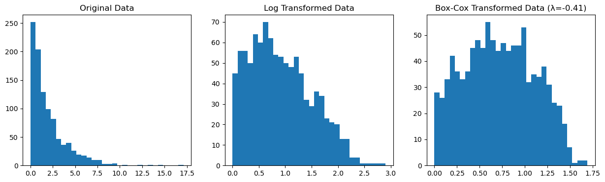
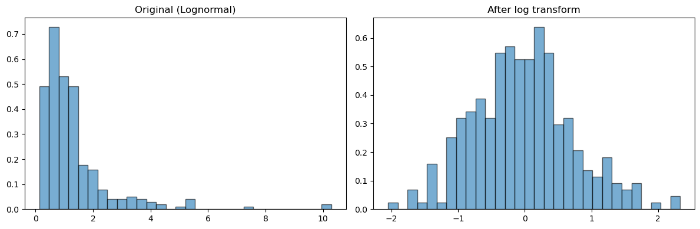
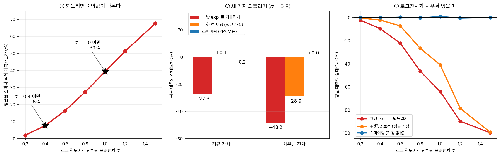
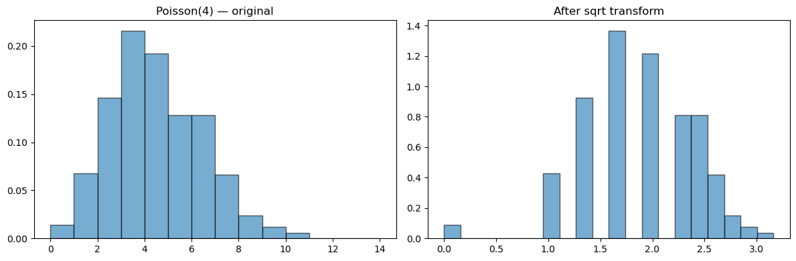

# 정규성을 얻기 위한 변수변환

지수분포의 왜도는 척도와 무관하게 **정확히 $2$** 다. 척도 $2$ 인 지수분포에서 $n = 1000$ 개를 뽑아 Box-Cox 변환을 걸면 그 왜도가 $0.07$ 까지 내려간다. 그러면 이 자료는 이제 정규라고 말할 수 있는가. 변환이 고쳐 주는 것과 고쳐 주지 못하는 것을 가르는 일이 이 쪽의 몫이다.

자료가 정규성에서 크게 벗어나면 정규성 가정에 기대는 통계 방법이 더 이상 적절하지 않을 수 있다. 흔한 대응 가운데 하나는 변환을 적용해 자료를 더 정규에 가깝게 만드는 것이다.

---

## 1. 왜 변환하는가

많은 통계 방법($t$ 검정, 분산분석, 선형회귀 등)이 오차의 정규성을 가정한다. 자료가 오른쪽으로 치우쳐 있거나 분산이 일정하지 않을 때 적절한 변환은

1. 분포를 대칭으로 만들고,
2. 분산을 안정시키며,
3. 정규분포로의 근사를 개선한다.

---

## 2. 흔한 변환

널리 쓰이는 변환은 다음과 같다.

**로그 변환**: 오른쪽으로 치우친 자료에 적합하다.

$$
X' = \log(X)
$$

**제곱근 변환**: 역시 오른쪽으로 치우친 자료에 쓰며, 특히 작은 값이 있을 때 유용하다.

$$
X' = \sqrt{X}
$$

**Box-Cox 변환**: 최적의 거듭제곱 모수 $\lambda$를 찾아 자료를 변환하는 더 유연한 변환이다.

$$
X' = \frac{X^\lambda - 1}{\lambda}, \quad \lambda \neq 0
$$

<div class="exbox" markdown>

**보기 1.** <span class="diff easy" title="쉬움"></span> 로그 변환과 Box-Cox 변환. 척도 $2$인 지수분포에서 $n = 1000$개를 뽑아 $\log(X+1)$과 $\text{Box-Cox}(X+1)$을 나란히 그린다.

**(1)** 지수분포의 왜도가 **척도와 무관하게 정확히 2**임을 보이시오. 이동 없이 $\log X$를 쓰면 왜도가 얼마가 되는지 닫힌 꼴로 구하시오.

**(2)** 코드는 로그와 Box-Cox 둘 다에 `+1`을 더한다. 이 이동 상수가 답을 얼마나 흔드는지 수로 보이시오.

**(3)** Box-Cox가 왜도를 $0.07$까지 떨어뜨렸다. 이 자료는 이제 정규라고 말할 수 있는가.

</div>

??? success "풀이"

    **(1) 해석적으로.** 왜도는 위치와 척도에 불변이므로 $X = sE$($E \sim \text{Exp}(1)$)라 쓰면 척도 $s$가 떨어져 나간다. $\text{Exp}(1)$의 적률은 $\mathbb{E}[E^k] = k!$이므로

    $$
    \mathbb{E}[E] = 1, \qquad \operatorname{Var}(E) = 2! - 1^2 = 1
    $$

    이고 3차 중심적률은

    $$
    \mathbb{E}[(E-1)^3] = \mathbb{E}[E^3] - 3\,\mathbb{E}[E]\,\mathbb{E}[E^2] + 2(\mathbb{E}[E])^3
    = 6 - 3 \times 1 \times 2 + 2 = 2
    $$

    이다. 따라서

    $$
    \gamma_1 = \frac{2}{1^{3/2}} = 2
    $$

    로 **정확히 2**이며, $s$가 들어오지 않는다.

    이동 없이 로그를 씌우면 어떻게 되는가. $\log X = \log s + \log E$이고 더해진 상수는 왜도를 바꾸지 않으므로 $\log E$만 보면 된다. 그 분포를 알아내기 위해 누적분포함수를 계산한다.

    $$
    P(-\log E \le t) = P(E \ge e^{-t}) = e^{-e^{-t}}
    $$

    오른쪽이 **표준 검벨분포**의 누적분포함수다. 곧 $-\log E$가 표준 검벨을 따르므로 $\log E$는 그것을 뒤집은 분포이고, 왜도의 부호도 뒤집힌다. 표준 검벨의 왜도가 $12\sqrt{6}\,\zeta(3)/\pi^3$이므로

    $$
    \gamma_1(\log X) = -\frac{12\sqrt{6}\,\zeta(3)}{\pi^3} = -1.1395
    $$

    이다. **이동 없는 로그는 과교정이다.** 왜도를 $+2$에서 0 으로 끌어내리는 것이 아니라 $-1.14$까지 밀어 보낸다. 절댓값이 절반 가까이 줄기는 하지만 부호가 뒤집힌다.

    **(2)–(3) 수치적으로.** 먼저 쪽의 코드를 그대로 돌린다.

    ```python
    import numpy as np
    import matplotlib.pyplot as plt
    from scipy.stats import boxcox

    np.random.seed(0)

    # 오른쪽으로 치우친 자료
    skewed_data = np.random.exponential(scale=2, size=1000)

    # 로그 변환. 1 을 더하는 것은 0 에 가까운 값에서 로그가 발산하는 것을
    # 막기 위해서다. 이 자료는 양수이지만 0 에 아주 가까운 값이 섞여 있다.
    log_transformed_data = np.log(skewed_data + 1)

    # Box-Cox 는 로그를 포함하는 변환들의 한 묶음이고, 그중 자료를 가장
    # 정규에 가깝게 만드는 lambda 를 스스로 고른다. lambda=0 이 곧 로그다.
    boxcox_transformed_data, best_lambda = boxcox(skewed_data + 1)

    # 셋을 나란히 놓고 어느 쪽이 더 대칭에 가까운지 본다.
    fig, axs = plt.subplots(1, 3, figsize=(15, 4))
    axs[0].hist(skewed_data, bins=30)
    axs[0].set_title('Original Data')

    axs[1].hist(log_transformed_data, bins=30)
    axs[1].set_title('Log Transformed Data')

    axs[2].hist(boxcox_transformed_data, bins=30)
    axs[2].set_title(f'Box-Cox Transformed Data (λ={best_lambda:.2f})')

    plt.show()
    ```

    

    그림은 치우침이 줄어드는 것을 보여 주지만 왜도도 첨도도 눈으로는 읽히지 않는다. 수로 재어야 한다.

    ```python
    import numpy as np
    from scipy import stats
    from scipy.optimize import brentq
    from scipy.special import zeta
    from scipy.stats import boxcox

    np.random.seed(0)
    x = np.random.exponential(scale=2, size=1000)
    n = len(x)

    print(f"이론 왜도(지수) = 2  (척도와 무관)")
    print(f"이론 왜도(log X) = -12 sqrt(6) zeta(3) / pi^3 = "
          f"{-12 * np.sqrt(6) * zeta(3) / np.pi ** 3:.4f}")

    # 쪽의 표는 scipy 기본값 bias=True, 곧 g1 이다. G1 도 함께 찍는다.
    y = np.log(x + 1)
    b, lam = boxcox(x + 1)
    print(f"Box-Cox lambda_hat = {lam:.4f}")
    print("                g1        G1      g2(초과)   shapiro p")
    for name, v in [("원자료", x), ("log(X+1)", y), ("BoxCox", b), ("log(X)", np.log(x))]:
        print(f"  {name:9s} {stats.skew(v):+8.4f}  {stats.skew(v, bias=False):+8.4f}  "
              f"{stats.kurtosis(v):+8.4f}   {stats.shapiro(v)[1]:.3g}")

    # 이동 상수 c 가 답을 얼마나 흔드는가.
    print("  이동 c    G1(log(X+c))")
    for c in [0.0, 0.25, 0.5, 1.0, 5.0, 20.0]:
        t = np.log(x + c) if c > 0 else np.log(x)
        print(f"  {c:6.2f}    {stats.skew(t, bias=False):+8.4f}")
    c0 = brentq(lambda c: stats.skew(np.log(x + c), bias=False), 0.01, 1.0)
    print(f"표본왜도를 0 으로 만드는 c = {c0:.4f}")

    SE = np.sqrt(6 * n * (n - 1) / ((n - 2) * (n + 1) * (n + 3)))
    print(f"정규 아래 SE(G1) = {SE:.4f}")
    print(f"  log(X+1): G1/SE = {stats.skew(y, bias=False) / SE:.3f}")
    print(f"  BoxCox  : G1/SE = {stats.skew(b, bias=False) / SE:.3f}")
    ```

    출력:

    ```text
    이론 왜도(지수) = 2  (척도와 무관)
    이론 왜도(log X) = -12 sqrt(6) zeta(3) / pi^3 = -1.1395
    Box-Cox lambda_hat = -0.4127
                    g1        G1      g2(초과)   shapiro p
      원자료        +2.0526   +2.0557   +6.4761   4.86e-33
      log(X+1)   +0.4914   +0.4921   -0.4931   8.47e-15
      BoxCox     +0.0747   +0.0748   -0.9237   3.33e-11
      log(X)     -1.0167   -1.0182   +1.9213   6.46e-18
      이동 c    G1(log(X+c))
        0.00     -1.0182
        0.25     -0.0049
        0.50     +0.2328
        1.00     +0.4921
        5.00     +1.1357
       20.00     +1.6261
    표본왜도를 0 으로 만드는 c = 0.2538
    정규 아래 SE(G1) = 0.0773
      log(X+1): G1/SE = 6.363
      BoxCox  : G1/SE = 0.967
    ```

    **(1)의 확인.** 원자료의 표본왜도는 $g_1 = 2.0526$으로 이론값 $2$를 잘 맞힌다. 이동 없는 $\log X$는 $G_1 = -1.0182$가 나왔는데 이론값은 $-1.1395$다. 차이 $0.12$가 커 보이지만, $n = 1000$에서 이 분포의 $G_1$은 표준편차가 $0.18$쯤이고 작은 표본에서 크기가 줄어드는 쪽으로 편향되므로 어긋남이 아니다. $n$을 $10^7$으로 키우면 $-1.1357$이 되어 이론값에 붙는다.

    !!! warning "어느 판본의 왜도인가"

        쪽의 표에 적힌 $2.0526$, $0.4914$, $0.0747$은 `scipy.stats.skew`의 **기본값 `bias=True`**가 주는 $g_1$이다. 보정판 $G_1$은 $2.0557$, $0.4921$, $0.0748$으로 셋째 자리에서 갈린다. 아래에서 $\mathrm{SE}$와 견줄 때는 그 $\mathrm{SE}$ 식이 **$G_1$의 것**이므로 $G_1$을 쓴다.

    **(2) 이동 상수가 답을 지배한다.** `+1` 은 코드 주석이 말하듯 0 에 가까운 값을 막으려는 장치이지만, 실제로는 **결과를 정하는 모수**로 작동한다.

    | $c$ | $G_1(\log(X+c))$ |
    |---|---|
    | $0$ | $-1.0182$ |
    | $0.25$ | $-0.0049$ |
    | $0.5$ | $+0.2328$ |
    | $1$ | $+0.4921$ |
    | $5$ | $+1.1357$ |
    | $20$ | $+1.6261$ |

    $c$를 $0$에서 $20$으로 옮기는 동안 왜도가 $-1.02$에서 $+1.63$까지 **연속으로 쓸고 지나간다.** $c$가 커지면 $\log(X+c) \approx \log c + X/c$로 거의 선형이 되어 원자료의 왜도 $2$로 돌아가므로 당연한 일이다. 곧 $c$는 "교정을 얼마나 할지"를 정하는 손잡이다.

    이 표본에서 왜도를 정확히 0 으로 만드는 값은 $c = 0.2538$이고, 코드가 고른 $c = 1$은 거기서 네 배 멀다. 그래서 $\log(X+1)$의 왜도 $0.4921$은 **$c$를 1 로 고른 결과**이지 로그변환의 성능이 아니다. 더 나쁜 것은 이 손잡이가 보고되지 않는다는 점이다. "로그변환을 했다"는 문장만 읽으면 $c$가 몇이었는지 알 수 없고, 다른 $c$로는 숫자가 재현되지 않는다. **이동 상수를 쓰면 반드시 그 값을 밝혀야 한다.**

    **(3) 아니다. 왜도가 0 에 가까워졌을 뿐 정규는 아니다.**

    왜도만 보면 Box-Cox가 훌륭하다. $2.05$에서 $0.075$로 27배 줄었고, $G_1/\mathrm{SE} = 0.967$이니 대칭성 자체는 나무랄 데가 없다($\log(X+1)$은 $6.363$으로 압도적으로 기각된다). 그런데 샤피로–윌크는

    $$
    p = 3.33 \times 10^{-11}
    $$

    으로 **정규성을 단호히 기각한다.** 원자료의 $4.86\times10^{-33}$보다는 나아졌지만 기각은 기각이다.

    까닭은 **첨도**다. 초과첨도 $g_2$를 보면 원자료 $+6.48$이 Box-Cox 뒤에 $-0.92$가 되었다. 부호를 건너 반대쪽으로 지나쳐 버린 것이고, 절댓값 $0.92$는 $n = 1000$에서 쉽게 잡히는 크기다. Box-Cox는 거듭제곱 하나로 꼬리를 누르는데, 지수분포의 오른쪽 꼬리를 정규만큼 눌러 놓으면 **왼쪽이 0 에서 잘려 평평해진다.** 변환된 자료는 종 모양이 아니라 어깨가 넓은 모양이다.

    더 근본적으로, **지수분포를 정규로 보내는 거듭제곱변환은 존재하지 않는다.** 로그정규는 로그 하나로 정확히 정규가 되지만(이 절의 「변환 시연」 쪽 보기 1) 지수분포에는 그런 짝이 없다. Box-Cox는 주어진 계열 안에서 **가장 덜 나쁜** $\lambda$를 고르는 것뿐이고, 가장 덜 나쁜 것이 좋다는 보장은 없다.

    그러므로 "이런 변환은 자료를 모수적 검정에 적합하게 해 준다"는 결론은 이 자료에서는 **성립하지 않는다.** 교훈은 **왜도 하나로 변환의 성공을 판정하지 말라**는 것이다. 왜도·첨도·정규성 검정을 함께 보아야 하고, 셋이 갈리면 그 자료는 변환으로 구제되지 않는 자료다. 이어지는 두 쪽의 붓스트랩과 비모수 방법이 그런 자료를 위해 있다.

---

## 3. 로그 변환

양수이면서 오른쪽으로 치우친 자료에는 로그 변환이 가장 먼저 시도할 도구이다. $X > 0$일 때

$$
Y = \ln X.
$$

$X \sim \text{Lognormal}(\mu, \sigma^2)$이면 $Y \sim \mathcal{N}(\mu, \sigma^2)$가 정확히 성립한다. 분포가 정확히 대수정규가 아니더라도 로그 변환은 왜도를 크게 줄이는 경우가 많다.

<div class="exbox" markdown>

**보기 2.** <span class="diff easy" title="쉬움"></span> 로그 변환 전후의 왜도. $X \sim \text{Lognormal}(0,\ 0.8^2)$에서 $n = 300$개를 뽑아 $Y = \ln X$를 만든다.

**(1)** $\text{Lognormal}(\mu, \sigma^2)$의 왜도를 **닫힌 꼴로 유도**하고 $\sigma = 0.8$에서의 값을 구하시오. 답이 $\mu$에 의존하는가. 로그를 씌운 뒤의 이론 왜도는 얼마인가.

**(2)** 변환 뒤의 표본왜도가 $G_1 = 0.2933$으로 나왔다. 이론값이 **정확히 0**인데도 이만큼 남았다. 정규성 아래의 $\mathrm{SE}(G_1)$을 구해 이 잔차가 우연으로 설명되는 크기인지 판정하시오. 같은 자료에 샤피로–윌크를 걸면 결론이 같은가.

</div>

??? success "풀이"

    **(1) 해석적으로.** $X = e^{\mu + \sigma Z}$, $Z \sim \mathcal{N}(0,1)$로 쓴다. 왜도는 위치와 척도에 불변이므로 $\mu$는 $e^\mu$라는 **곱하는 상수**로만 들어가고 답에서 떨어져 나간다. 따라서 $W = e^{\sigma Z}$만 보면 된다.

    적률생성함수를 쓰면 $\mathbb{E}[W^k] = \mathbb{E}[e^{k\sigma Z}] = e^{k^2\sigma^2/2}$이다. $w = e^{\sigma^2}$으로 줄여 쓰면

    $$
    \mathbb{E}[W] = w^{1/2}, \qquad \mathbb{E}[W^2] = w^{2}, \qquad \mathbb{E}[W^3] = w^{9/2}
    $$

    이다. 분산은

    $$
    \operatorname{Var}(W) = w^2 - w = w(w-1)
    $$

    이고, 3차 중심적률은

    $$
    \mathbb{E}[(W - \mathbb{E}W)^3] = \mathbb{E}[W^3] - 3\,\mathbb{E}[W]\,\mathbb{E}[W^2] + 2(\mathbb{E}W)^3
    = w^{9/2} - 3w^{5/2} + 2w^{3/2}
    = w^{3/2}\bigl(w^3 - 3w + 2\bigr)
    $$

    이다. 괄호를 인수분해하면 $w^3 - 3w + 2 = (w-1)(w^2 + w - 2) = (w-1)^2(w+2)$이므로

    $$
    \gamma_1 = \frac{w^{3/2}(w-1)^2(w+2)}{\bigl[w(w-1)\bigr]^{3/2}}
    = \frac{w^{3/2}(w-1)^2(w+2)}{w^{3/2}(w-1)^{3/2}}
    = (w+2)\sqrt{w-1}
    $$

    을 얻는다. **$\mu$는 들어오지 않는다.** $\sigma$ 하나가 로그정규의 모양을 다 정한다.

    $\sigma = 0.8$이면 $w = e^{0.64} = 1.896481$이므로

    $$
    \gamma_1 = (1.896481 + 2)\sqrt{0.896481} = 3.896481 \times 0.946826 = 3.6893
    $$

    이다. **로그를 씌운 뒤의 이론 왜도는 정확히 0이다.** 근사가 아니다. $\ln X = \mu + \sigma Z$가 그 자체로 $\mathcal{N}(\mu, \sigma^2)$이고, 정규분포의 왜도는 0이기 때문이다. 이것이 로그정규가 변환의 교과서적 예인 까닭이다. 변환이 "왜도를 줄인다"가 아니라 **없앤다.**

    **(2) 수치적으로.** 먼저 쪽의 코드를 그대로 돌린다.

    ```python
    import numpy as np
    from scipy import stats
    import matplotlib.pyplot as plt

    # 로그정규는 로그를 씌우면 정확히 정규가 되는 분포다. 변환이 왜 듣는지를
    # 보이기에 가장 깨끗한 예다.
    rng = np.random.default_rng(42)
    x = rng.lognormal(mean=0.0, sigma=0.8, size=300)
    y = np.log(x)

    fig, axes = plt.subplots(1, 2, figsize=(12, 4))
    axes[0].hist(x, bins=30, density=True, alpha=0.6, edgecolor="black")
    axes[0].set_title("Original (Lognormal)")
    axes[1].hist(y, bins=30, density=True, alpha=0.6, edgecolor="black")
    axes[1].set_title("After log transform")
    plt.tight_layout()
    plt.show()

    print(f"Before: skewness = {stats.skew(x, bias=False):.4f}")
    print(f"After:  skewness = {stats.skew(y, bias=False):.4f}")
    ```

    출력:

    ```text
    Before: skewness = 3.5432
    After:  skewness = 0.2933
    ```

    

    이제 남은 $0.2933$을 재어 본다.

    ```python
    import numpy as np
    from scipy import stats

    sigma = 0.8
    w = np.exp(sigma ** 2)
    print(f"w = exp(sigma^2) = {w:.6f}")
    print(f"이론 왜도 (w+2)sqrt(w-1) = {(w + 2) * np.sqrt(w - 1):.4f}")

    rng = np.random.default_rng(42)
    x = rng.lognormal(mean=0.0, sigma=sigma, size=300)
    y = np.log(x)
    n = len(x)

    # bias=False 가 G1, bias=True(기본값) 가 g1 이다. 아래 SE 는 G1 의 것이다.
    G1 = stats.skew(y, bias=False)
    g1 = stats.skew(y)
    SE = np.sqrt(6 * n * (n - 1) / ((n - 2) * (n + 1) * (n + 3)))
    print(f"변환 뒤  G1 = {G1:.4f}   g1 = {g1:.4f}")
    print(f"정규 아래 SE(G1) = {SE:.4f}   G1/SE = {G1 / SE:.4f}")
    print(f"skewtest:  z = {stats.skewtest(y)[0]:.4f}  p = {stats.skewtest(y)[1]:.4f}")
    print(f"shapiro :  W = {stats.shapiro(y)[0]:.4f}  p = {stats.shapiro(y)[1]:.4f}")
    print(f"변환 뒤 표본평균 {y.mean():.4f}, 표본표준편차 {y.std(ddof=1):.4f}  (이론 0, {sigma})")
    ```

    출력:

    ```text
    w = exp(sigma^2) = 1.896481
    이론 왜도 (w+2)sqrt(w-1) = 3.6893
    변환 뒤  G1 = 0.2933   g1 = 0.2918
    정규 아래 SE(G1) = 0.1407   G1/SE = 2.0842
    skewtest:  z = 2.0725  p = 0.0382
    shapiro :  W = 0.9927  p = 0.1515
    변환 뒤 표본평균 -0.0329, 표본표준편차 0.7442  (이론 0, 0.8)
    ```

    **(1)의 확인.** 유도한 이론 왜도 $3.6893$에 대해 표본값은 $G_1 = 3.5432$다. 차이 $0.146$은 $4\%$ 아래이고, 왜도가 큰 분포에서 $G_1$의 변동이 크다는 점을 생각하면 잘 맞는 편이다. 변환 뒤 표본평균 $-0.0329$와 표본표준편차 $0.7442$도 이론값 $0$과 $0.8$을 둘러싸고 있다.

    **(2) 우연으로 설명되는 크기이지만, 5% 수준에서는 기각된다.** $n = 300$에서

    $$
    \mathrm{SE}(G_1) = \sqrt{\frac{6n(n-1)}{(n-2)(n+1)(n+3)}}
    = \sqrt{\frac{6 \times 300 \times 299}{298 \times 301 \times 303}}
    = \sqrt{\frac{538200}{27\,178\,494}} = 0.1407
    $$

    이므로 $G_1/\mathrm{SE} = 0.2933/0.1407 = 2.084$다. `scipy.stats.skewtest`는 여기에 다고스티노 변환을 한 번 더 거쳐 $z = 2.0725$, $p = 0.0382$를 준다(둘이 조금 다른 것은 단순 $z$ 대신 변환된 통계량을 쓰기 때문이다). **$p = 0.038 < 0.05$이니 대칭성이 기각된다.**

    !!! warning "어느 판본의 왜도인가"

        위 $\mathrm{SE}$ 식은 **보정판 $G_1$의 것**이다. 쪽의 코드가 `bias=False`를 주었으므로 $G_1 = 0.2933$과 짝이 맞는다. `scipy.stats.skew`의 **기본값은 `bias=True`**여서 $g_1 = 0.2918$을 주는데, 이 값에 위 $\mathrm{SE}$를 그대로 쓰면 안 된다. 어느 판본인지 밝히지 않으면 수가 맞지 않는다.

    여기서 멈추면 이상한 결론에 이른다. **변환은 정확히 옳았다.** (1)에서 보았듯 $\ln X$는 근사적으로가 아니라 **정확히** 정규다. 그런데도 그 정규 자료의 왜도 검정이 5% 수준에서 기각한다. 이것은 변환의 결함이 아니라 **$H_0$이 참일 때 20번에 한 번 일어나는 일**이고, 씨앗 42가 그 한 번에 걸린 것이다.

    같은 자료에 샤피로–윌크를 걸면 $W = 0.9927$, $p = 0.1515$로 **기각하지 못한다.** 두 검정의 결론이 갈린다. 샤피로–윌크는 분포 전체의 모양을 보므로 왜도 하나에 몰린 신호를 희석하고, 왜도검정은 그 하나만 겨냥하므로 증폭한다. 어느 쪽이 "맞는"가를 묻는 것은 잘못된 질문이다. 참인 답을 아는 이 인공 상황에서는 **둘 다 틀렸다.** 샤피로–윌크가 우연히 옳은 결론에 닿았을 뿐이다.

    그러므로 $3.54 \to 0.29$를 "사실상 대칭이 되었다"고 읽는 것은 **크기에 대해서는 옳다.** 왜도가 12배 줄었고 남은 $0.29$는 이론값 0에서 두 표준오차 거리에 있는 표집잡음이다. 그러나 "그러므로 검정을 통과한다"로 이어서는 안 된다. **옳은 변환도 그 표본의 검정을 통과하지 못할 수 있다.**

---

## 4. 제곱근 변환

계수 자료나 아래로 0에 의해 유계인 자료에는 제곱근 변환

$$
Y = \sqrt{X}
$$

가 로그보다 온건한 교정이다. 분산이 평균과 같은 포아송 계수 자료에 자주 쓰이며, 제곱근이 분산을 근사적으로 안정시킨다.

!!! warning "제곱근 변환은 과교정할 수 있다"
    포아송 자료에서 제곱근 변환은 평균 $\lambda$가 작으면 왜도를 **음수 쪽으로 지나치게** 밀어붙인다. $\lambda = 4$일 때 원자료의 왜도는 $1/\sqrt{4} = 0.5$이지만 $\sqrt{X}$의 왜도는 $-0.636$으로 절댓값이 오히려 커진다. 연습문제 13에서 자세히 다룬다.

---

## 5. Box-Cox 변환

Box-Cox 계열은 로그 변환과 거듭제곱 변환을 모수 $\lambda$ 하나로 일반화한다.

$$
Y^{(\lambda)} =
\begin{cases}
\dfrac{X^\lambda - 1}{\lambda}, & \lambda \neq 0, \\[6pt]
\ln X, & \lambda = 0.
\end{cases}
$$

최적 $\lambda$는 최대가능도로 고른다. SciPy의 `stats.boxcox`는 변환된 자료와 적합된 $\lambda$를 반환한다.

<div class="exbox" markdown>

**보기 3.** <span class="diff easy" title="쉬움"></span> Box-Cox가 고르는 $\lambda$. 보기 2와 **같은 표본**($\text{Lognormal}(0,\ 0.8^2)$에서 $n = 300$, 씨앗 42)에 `stats.boxcox`를 걸면 $\hat\lambda = -0.1258$이 나온다. 참값은 $\lambda = 0$이다.

**(1)** $\hat\lambda = -0.1258$이 참값 $0$을 "잘 회복했다"고 말할 수 있는지 **가능도비 신뢰구간으로 판정**하시오. $\lambda = 0$을 가능도비검정으로 직접 검정하면 어떻게 되는가.

**(2)** 변환 뒤 표본왜도가 $-0.0018$로, 참값 $\lambda = 0$을 썼을 때의 $0.2933$(보기 2)보다 **0에 가깝다.** 참값보다 추정값이 더 좋아 보이는 까닭을 설명하시오.

</div>

??? success "풀이"

    **(1) 회복했다고 말하기 어렵다. 95% 구간이 0을 간신히 놓친다.**

    박스–콕스의 $\lambda$에는 닫힌 꼴 표준오차가 없으므로 **가능도비**로 구간을 만든다. 프로파일 로그가능도 $\ell(\lambda)$에 대해

    $$
    \bigl\{\lambda : 2\bigl[\ell(\hat\lambda) - \ell(\lambda)\bigr] \le \chi^2_{1,\,0.95}\bigr\}
    = \bigl\{\lambda : 2\bigl[\ell(\hat\lambda) - \ell(\lambda)\bigr] \le 3.8415\bigr\}
    $$

    가 95% 구간이다. `stats.boxcox`에 `alpha=0.05`를 주면 이 구간을 바로 돌려준다.

    ```python
    import numpy as np
    from scipy import stats

    rng = np.random.default_rng(42)
    x = rng.lognormal(mean=0.0, sigma=0.8, size=300)

    # alpha 를 주면 lambda 의 가능도비 신뢰구간을 함께 돌려준다.
    y_bc, lam, ci = stats.boxcox(x, alpha=0.05)
    print(f"lambda_hat = {lam:.4f}")
    print(f"95% 가능도비 신뢰구간 = [{ci[0]:.4f}, {ci[1]:.4f}]")
    print(f"0 이 구간 안에 있는가: {ci[0] < 0 < ci[1]}")

    # 가능도비 검정으로 lambda = 0 을 직접 검정한다.
    ll_hat = stats.boxcox_llf(lam, x)
    ll_0 = stats.boxcox_llf(0.0, x)
    LR = 2 * (ll_hat - ll_0)
    print(f"loglik(lambda_hat) = {ll_hat:.4f},  loglik(0) = {ll_0:.4f}")
    print(f"LR = {LR:.4f}   임계값 chi2(1, 0.95) = {stats.chi2.ppf(0.95, 1):.4f}")

    # lambda 를 바꿔 가며 왜도와 샤피로 p 를 본다.
    print("  lambda      G1     shapiro p   로그가능도")
    for L in [-0.2, -0.1258, -0.1, 0.0, 0.1]:
        t = stats.boxcox(x, lmbda=L)
        print(f"  {L:+7.4f}  {stats.skew(t, bias=False):+7.4f}   "
              f"{stats.shapiro(t)[1]:8.4f}   {stats.boxcox_llf(L, x):9.4f}")

    # 표본왜도를 정확히 0 으로 만드는 lambda 를 따로 찾는다.
    from scipy.optimize import brentq
    lam_sym = brentq(lambda L: stats.skew(stats.boxcox(x, lmbda=L), bias=False),
                     -0.5, 0.3)
    print(f"표본왜도를 0 으로 만드는 lambda = {lam_sym:.4f}")
    ```

    출력:

    ```text
    lambda_hat = -0.1258
    95% 가능도비 신뢰구간 = [-0.2496, -0.0035]
    0 이 구간 안에 있는가: False
    loglik(lambda_hat) = 101.0194,  loglik(0) = 98.9864
    LR = 4.0661   임계값 chi2(1, 0.95) = 3.8415
      lambda      G1     shapiro p   로그가능도
      -0.2000  -0.1713     0.6482    100.3258
      -0.1258  -0.0019     0.9284    101.0194
      -0.1000  +0.0577     0.8974    100.9348
      +0.0000  +0.2933     0.1515     98.9864
      +0.1000  +0.5384     0.0009     94.4061
    표본왜도를 0 으로 만드는 lambda = -0.1250
    ```

    95% 구간은 $[-0.2496,\ -0.0035]$이고 **$0$은 그 안에 없다.** 위쪽 끝이 $-0.0035$이니 $0.0035$ 차이로 벗어난 것이다. 가능도비검정도 같은 말을 한다. $2[\ell(\hat\lambda) - \ell(0)] = 2(101.0194 - 98.9864) = 4.0661$이 임계값 $3.8415$를 넘으므로 **$\lambda = 0$이 5% 수준에서 기각된다.**

    참값이 정확히 0인데 기각되었다. 보기 2에서 본 것과 **똑같은 일**이며, 우연이 아니라 같은 원인이다. 그 표본의 로그변환 자료에 오른쪽 치우침 $G_1 = 0.2933$이 표집잡음으로 남아 있었고, 약간 음수인 $\lambda$가 오른쪽 꼬리를 한 번 더 눌러 그 잡음을 지운다. 두 보기는 같은 흔들림을 서로 다른 창으로 본 것이다. $H_0$이 참일 때 20번에 한 번 일어나는 일이고 씨앗 42가 그 한 번이다.

    그래서 "$-0.126$이 0을 잘 회복했다"는 말은 **크기에 대해서만 옳다.** $0$과 $-0.126$의 차이는 실무적으로 무의미하고, 쪽 끝의 관례대로 $\hat\lambda$를 0으로 반올림해 해석 가능한 로그변환을 쓰는 것이 옳은 선택이다. 그러나 **"95% 구간이 0을 담는다"는 뜻으로 읽으면 틀린다.** 담지 않는다.

    **(2) 추정값이 참값보다 좋아 보이는 것은 과적합이다.** $\hat\lambda$는 바로 **이 표본의** 정규가능도를 최대로 만드는 값이다. 참값 $\lambda = 0$은 *모집단*에 대해 옳지만, 손에 든 표본 하나에 대해 가장 잘 맞는 값은 아니다. 표를 보면 차이가 분명하다.

    | $\lambda$ | $G_1$ | 샤피로 $p$ | 로그가능도 |
    |---|---|---|---|
    | $-0.1258 = \hat\lambda$ | $-0.0019$ | $0.9284$ | $101.0194$ |
    | $0$ (참값) | $+0.2933$ | $0.1515$ | $98.9864$ |

    $\hat\lambda$ 쪽이 왜도는 0에 $150$배 가깝고 샤피로 $p$는 6배 크다. **모든 지표에서 참값을 이긴다.** 그러나 이긴 상대는 모집단이 아니라 표본이다. 새 표본 300개를 뽑아 이 $\hat\lambda = -0.1258$을 그대로 쓰면 평균적으로 $\lambda = 0$보다 나쁠 것인데, $-0.1258$은 지난 표본의 잡음에 맞춰진 값이기 때문이다.

    표가 하나 더 보여 주는 것이 있다. 왜도를 정확히 0으로 만드는 $\lambda$는 $-0.1250$으로 $\hat\lambda = -0.1258$과 거의 같다. 이 표본에서는 **최대가능도가 고른 $\lambda$와 표본왜도를 지우는 $\lambda$가 사실상 일치한다.** 다만 이것은 이 표본에서 관측된 일치일 뿐 일반 법칙이 아니다. 박스–콕스는 왜도만 보는 것이 아니라 분포 전체의 정규가능도를 보기 때문이다.

    **교훈.** $\hat\lambda$를 고르고 나서 같은 자료에 정규성 검정을 걸면 $p$값이 낙관적으로 나온다. $\lambda$를 추정하는 데 자료를 이미 썼으므로 그 검정은 더 이상 명목 크기를 지키지 않는다. 14.5절 릴리포스 검정이 다루는 문제와 같은 구조다. **모수를 추정하고 나면 검정의 귀무분포가 달라진다.**

자료가 대수정규이므로 참 최적값은 $\lambda = 0$(로그 변환)이고, 최대가능도 추정값 $-0.126$은 표집변동 범위 안에서 이를 잘 회복한다. $\hat{\lambda} \approx 0$이면 Box-Cox는 로그로, $\hat{\lambda} \approx 0.5$이면 제곱근으로 환원된다.

---

## 6. 변환한 뒤에 정규성을 다시 확인한다

변환한 뒤에는 반드시 시각적 방법(히스토그램, Q-Q 그림)과 형식적 검정(Shapiro-Wilk, Anderson-Darling)을 모두 써서 정규성을 다시 확인하라. 예컨대 치우침은 없앴지만 이봉성을 만들어 낸 변환은 상황을 개선한 것이 아니다. 또한 변환된 척도에서 수행한 추론은 원래 척도로 해석하려면 역변환해야 한다는 점을 기억하라.

<div class="aibox" markdown>

**AI로 보는 통계학 1.** 되돌리면 다른 수가 나온다

바로 위의 마지막 문장이 「원래 척도로 해석하려면 역변환하라」고 말한다. 그 한 줄에
함정이 하나 들어 있다. **되돌린 값은 되돌리기 전에 추정하던 것과 다른 양이다.**

기계학습 쪽은 이 변환을 아주 자주 쓴다. 금액·조회수·대기시간처럼 꼬리가 긴 표적은
`log1p` 를 씌워 학습하고 `expm1` 로 되돌리는 것이 거의 기본 절차이고, 대회 지표로
쓰이는 RMSLE 도 같은 일을 손실함수 안에서 한다. 그런데 로그 척도의 평균을 되돌리면
나오는 것은 **조건부 평균이 아니라 조건부 중앙값**이다. 로그정규라면

$$
E[Y \mid x] = e^{\mu(x) + \sigma^2/2},
\qquad\text{되돌린 값} = e^{\mu(x)}
$$

이라 **$e^{\sigma^2/2}$ 배만큼 작다.** 이 쪽의 변환이 $\sigma$ 를 줄이려고 하는 것이
아니라 **모양**을 고치려는 것이므로, $\sigma$ 는 그대로 남아 있고 격차도 그대로 남는다.



- **①** 그 격차가 얼마인지는 $\sigma$ 하나가 정한다. 로그 척도의 잔차 표준편차가
  $0.4$ 면 $8\%$, $0.8$ 이면 $27\%$, $1.0$ 이면 **$39\%$** 를 적게 예측한다. 꼬리가
  긴 자료에서 $\sigma = 1$ 은 드문 값이 아니다. 「총 매출 예측이 실제보다 $39\%$ 작다」가
  모형 탓이 아니라 **되돌리는 방식 탓**일 수 있다는 뜻이다.
- **②** 실제로 돌려 보았다. $n = 20{,}000$ 에 $\sigma = 0.8$ 로 로그 척도에서 최소제곱을
  적합하고 되돌리니 평균 예측이 **$-27.3\%$** 다. $\hat\sigma^2/2$ 를 더해 보정하면
  $+0.1\%$ 로 거의 정확해진다.
- **③** 그런데 여기서 이 장의 주제가 되돌아온다. $\hat\sigma^2/2$ 보정은 **로그잔차가
  정규라는 가정** 위에 서 있다. 로그잔차를 치우치게 만들어 보면 그 보정이 무너진다 —
  $\sigma = 0.8$ 에서 $-28.9\%$ 로, 보정하지 않은 것과 별로 다르지 않다. $\sigma = 1.5$
  에서는 $-99\%$ 다.

③ 의 파란 선이 **두안의 스미어링**이다. $e^{\hat\mu(x)}$ 에 잔차의 평균적인 크기
$\frac1n\sum_i e^{\hat\varepsilon_i}$ 를 곱하는 것뿐인데, 잔차가 정규든 치우쳐 있든
어느 $\sigma$ 에서도 **$1\%$ 안**에 들어온다. 분포 모양을 가정하지 않고 **자료가 가진
잔차를 그대로 쓰기** 때문이다.

정리하면 변환에는 두 단계의 가정이 있다. 변환할 때는 **정규에 가깝게 만들려고** 하고,
되돌릴 때는 **정규라고 믿는다.** 이 쪽이 공들여 확인하는 것은 앞쪽인데, 수가 어긋나는
것은 주로 뒤쪽이다. 그리고 뒤쪽은 확인할 필요가 없다 — **가정하지 않는 방법이 있기
때문이다.**

_확인한 곳 — 바깥의 사실을 끌어오지 않았다. ①–③ 의 수는 모두 직접 계산한 값이고,
$E[Y] = e^{\mu+\sigma^2/2}$ 는 로그정규의 정의에서 바로 나온다. 스미어링 추정량
$e^{\hat\mu}\cdot\frac1n\sum e^{\hat\varepsilon_i}$ 은 두안(Duan, $1983$)이 제안한
것으로 널리 쓰이는 표준 보정이다_

</div>

---

## 연습문제

<div class="drillbox" markdown>

**연습문제 1.** <span class="diff med" title="중간"></span>
변수 $Y$가 모두 양수이고 오른쪽으로 치우친 분포를 갖는다. 로그 변환 $Y' = \log(Y)$를 적용하고 이것이 왜 치우침을 줄이는 경우가 많은지 설명하라.

</div>

??? success "풀이"
    로그함수는 오목하다. 큰 값을 작은 값보다 더 많이 압축한다. 오른쪽으로 치우친 자료에서는 긴 오른쪽 꼬리(큰 값)가 크게 압축되고 왼쪽(0 근처의 작은 값)은 늘어난다. 이것이 오른쪽 꼬리를 중심 쪽으로 끌어당겨 비대칭을 줄인다.

    형식적으로 $Y$가 대수정규분포를 따르면($\log Y \sim N(\mu, \sigma^2)$) 로그 변환이 완벽하게 정규인 자료를 만든다. 근사적으로 대수정규인 자료(소득, 주가, 생물학적 측정값에서 흔하다)에서도 로그 변환이 정규성을 크게 개선한다.

    주의: 로그 변환은 $Y \leq 0$에서 정의되지 않는다. 0이 있는 자료에는 작은 상수 $c$를 써서 $\log(Y + c)$를 쓴다.

<div class="drillbox" markdown>

**연습문제 2.** <span class="diff med" title="중간"></span>
Box-Cox 변환족은 $\lambda \neq 0$일 때 $Y^{(\lambda)} = (Y^\lambda - 1)/\lambda$, $\lambda = 0$일 때 $\log(Y)$이다. $\lambda = 1$, $\lambda = 0.5$, $\lambda = -1$은 각각 어떤 변환에 해당하는가?

</div>

??? success "풀이"

    - $\lambda = 1$: $Y^{(1)} = (Y - 1)/1 = Y - 1$ (선형 이동, 사실상 변환 없음).
    - $\lambda = 0.5$: $Y^{(0.5)} = (\sqrt{Y} - 1)/0.5 = 2(\sqrt{Y} - 1)$ (선형 재척도화를 제외하면 제곱근 변환).
    - $\lambda = 0$: $Y^{(0)} = \log(Y)$ (로그 변환).
    - $\lambda = -1$: $Y^{(-1)} = (1/Y - 1)/(-1) = 1 - 1/Y$ (선형 재척도화를 제외하면 역수 변환).

    최적 $\lambda$는 최대가능도로 고른다. 변환된 자료가 가장 정규에 가까워지는 $\lambda$를 찾는 것이다. Python에서는 보통 `scipy.stats.boxcox`로 수행한다.

<div class="drillbox" markdown>

**연습문제 3.** <span class="diff med" title="중간"></span>
오른쪽으로 치우친 자료에 로그 변환을 적용하면 회귀계수의 해석이 달라진다. 모형 $\log(Y) = \beta_0 + \beta_1 X + \varepsilon$에서 $\hat{\beta}_1$을 어떻게 해석하는지 설명하라.

</div>

??? success "풀이"
    로그–선형 모형에서 지수를 취하면 $Y = e^{\beta_0 + \beta_1 X + \varepsilon}$이다. $X$가 한 단위 늘면 $Y$의 기댓값에 $e^{\beta_1}$이 곱해진다.

    $$
    \frac{E[Y \mid X+1]}{E[Y \mid X]} \approx e^{\beta_1} \approx 1 + \beta_1 \quad (\beta_1\text{이 작을 때})
    $$

    따라서 $\beta_1$은 $X$가 한 단위 변할 때 $Y$의 비례적(백분율) 변화에 가깝다. 예를 들어 $\beta_1 = 0.05$이면 $X$가 1 늘 때 $Y$가 약 5% 늘어남과 연관된다.

    이 곱셈적 해석은 소득, 가격, 생물학적 성장 같은 여러 응용에서 자연스럽다.

<div class="drillbox" markdown>

**연습문제 4.** <span class="diff med" title="중간"></span>
정규성이 위배되어도 자료 변환이 권장되지 않는 상황을 두 가지 들어라.

</div>

??? success "풀이"

    1. **원래 척도가 과학적으로 의미 있을 때:** 연구 질문이 원래 단위의 차이에 관한 것이라면(예: "이 처치가 혈압을 최소 10 mmHg 낮추는가?") 자료를 변환하면 해석이 달라진다. 로그 척도의 10 차이는 10 mmHg가 아니다. 이럴 때는 원래 척도에서 타당한 방법(붓스트랩, 로버스트 방법)을 써야 한다.

    2. **변환이 해석을 어렵게 만들 때:** 0이 많은 변수(예: 의료비, 보험 청구)를 로그 변환하려면 임시방편적 조정($\log(Y+1)$)이 필요하고, 역변환한 추정값이 편향된다($\log Y$의 평균은 $Y$의 평균의 로그가 아니다). 이런 경우에는 일반화선형모형(감마 GLM, Tweedie 회귀)이 대개 더 낫다.

<div class="drillbox" markdown>

**연습문제 5.** <span class="diff med" title="중간"></span>
이 쪽의 Box-Cox 변환은 $X' = (X^\lambda - 1)/\lambda$ 이다. 왜 그냥 $X'' = X^\lambda$ 를 쓰지 않는지 따져 본다.

**(1)** $\lambda \to 0$ 에서 $(X^\lambda - 1)/\lambda \to \log X$ 임을 보이고, 이 성질이 연습문제 2 의 목록과 `boxcox` 가 하는 일에 왜 필요한지 말하시오.

**(2)** 보기 1 의 자료는 $\hat\lambda = -0.4127$ 을 골라 $G_1 = +0.0748$, $g_2 = -0.9237$, 샤피로–윌크 $p = 3.33 \times 10^{-11}$ 을 얻었다. 같은 $\hat\lambda$ 로 $X'' = (X+1)^{\hat\lambda}$ 를 썼다면 이 세 수가 각각 어떻게 되는가.

**(3)** $\lambda < 0$ 에서 두 꼴의 결정적인 차이를 하나 말하시오.

</div>

??? success "풀이"

    **(1)** $x^\lambda = e^{\lambda \log x} = 1 + \lambda \log x + \tfrac{\lambda^2}{2}(\log x)^2 + \cdots$ 이므로

    $$
    \frac{x^\lambda - 1}{\lambda} = \log x + \frac{\lambda}{2}(\log x)^2 + O(\lambda^2) \xrightarrow[\lambda \to 0]{} \log x
    $$

    이다. $\lambda = 0$ 을 로그로 **정의** 하면 족이 $\lambda$ 에 연속이 되고, 그래서 연습문제 2 의 $\lambda = 1$(변환 없음), $0.5$(제곱근), $0$(로그), $-1$(역수)이 끊김 없는 한 줄에 꿰인다. $X^\lambda$ 꼴로는 $\lambda \to 0$ 에서 $X^0 \equiv 1$ 이라 정보가 모두 사라져 로그가 족 안에 들어오지 못한다. `boxcox` 는 $\lambda$ 를 연속으로 훑으며 가능도를 최대화하는데, 그 가능도가 $\lambda = 0$ 에서 구멍이 나면 최적화가 성립하지 않는다.

    **(2)** 두 꼴은 아핀 관계 $X' = (X'' - 1)/\lambda$ 로 묶여 있고, $\hat\lambda = -0.4127 < 0$ 이므로 기울기 $1/\hat\lambda$ 가 **음수** 다. 곧 $X''$ 는 $X'$ 를 뒤집어 늘인 척도다.

    - 왜도는 3차(홀수) 중심적률을 쓰므로 부호가 뒤집힌다: $G_1 = -0.0748$.
    - 초과첨도는 4차(짝수)라 그대로다: $g_2 = -0.9237$.
    - 샤피로–윌크 $W = (\sum_i a_i x_{(i)})^2 / \sum_i (x_i - \bar{x})^2$ 는 위치·척도에 불변이고, 계수가 $a_{n+1-i} = -a_i$ 로 반대칭이어서 자료를 뒤집으면 순서와 부호가 함께 뒤집혀 분자가 그대로다. 그러므로 $p = 3.33 \times 10^{-11}$ 로 **똑같다.**

    정규성 판정에 관해서는 두 꼴이 같은 답을 준다. 달라지는 것은 왜도의 부호처럼 **방향** 을 가진 양이다.

    **(3)** $h_\lambda(x) = (x^\lambda - 1)/\lambda$ 는 $h_\lambda'(x) = x^{\lambda - 1} > 0$ 이라 **모든** $\lambda$ 에서 증가함수다. 반면 $x^\lambda$ 는 $\lambda < 0$ 에서 감소함수이므로 자료의 **순서가 뒤집힌다**: 가장 큰 관측값이 가장 작은 변환값이 되고, 분위수·중앙값·회귀계수의 부호가 모두 거꾸로 읽힌다. 「정리하며」가 역수변환에 "순서가 뒤집힌다" 고 적은 것, 연습문제 2 의 $\lambda = -1$ 이 $1/Y$ 가 아니라 $1 - 1/Y$ 인 것이 모두 이 때문이다. 곧 빼고 나누는 꼴은 멋이 아니라 **연속성과 순서 보존** 두 가지를 사는 값이다.

<div class="drillbox" markdown>

**연습문제 6.** <span class="diff med" title="중간"></span>
「정리하며」는 로그 척도의 평균을 되돌리면 평균이 아니라 **중앙값** 이 된다고 적었다. 보기 1 의 자료, 곧 척도 $s = 2$ 인 지수분포 $X = 2E$ 에서 이 말을 점검한다. 보기 1 의 $\mathbb{E}[E^k] = k!$ 은 $\mathbb{E}[E^t] = \Gamma(1+t)$ 로 넓혀 쓸 수 있고, $\Gamma'(1) = -\gamma$ 이다($\gamma = 0.5772$ 는 오일러–마스케로니 상수).

**(1)** $\exp(\mathbb{E}[\log X])$ 를 구하고 $\mathbb{E}[X]$ 와 견주시오.

**(2)** 그 값이 $X$ 의 중앙값과는 같은가. 같지 않다면 보기 1 의 풀이에 나온 수 가운데 어느 것이 그 까닭인가.

**(3)** (1) 에서 얻은 부등호의 방향이 지수분포라는 사실과 무관하게 늘 성립함을 보이시오.

</div>

??? success "풀이"

    **(1)** $\log X = \log 2 + \log E$ 이다. $\mathbb{E}[E^t] = \Gamma(1+t)$ 를 $t$ 로 미분하고 $t = 0$ 을 넣으면 $\mathbb{E}[E^t \log E]$ 가 $\mathbb{E}[\log E]$ 가 되므로

    $$
    \mathbb{E}[\log E] = \Gamma'(1) = -\gamma, \qquad \mathbb{E}[\log X] = \log 2 - \gamma = 0.6931 - 0.5772 = 0.1159
    $$

    이고, 되돌리면

    $$
    \exp(\mathbb{E}[\log X]) = 2e^{-\gamma} = 2 \times 0.5615 = 1.1229
    $$

    이다. $\mathbb{E}[X] = 2$ 이므로 되돌린 값은 평균의 $e^{-\gamma} = 56.1\%$, 곧 **43.9% 작다.** 이 양은 모집단의 기하평균이고, seed 0 의 같은 표본에서 재면 $1.1168$ 로 이론값에 붙는다.

    **(2)** 중앙값은 $s\log 2 = 2 \times 0.6931 = 1.3863$ 이므로 $1.1229$ 는 중앙값보다도 $19.0\%$ 작다. 까닭은 보기 1 풀이의

    $$
    \gamma_1(\log X) = -\frac{12\sqrt{6}\,\zeta(3)}{\pi^3} = -1.1395
    $$

    다. 단조변환은 중앙값을 보존하므로 $\operatorname{med}(X) = \exp(\operatorname{med}(\log X))$ 는 언제나 맞다. 그런데 우리가 되돌리는 것은 로그 척도의 **평균** 이고, 평균이 중앙값과 같으려면 로그 척도의 분포가 대칭이어야 한다. $\log X$ 는 왜도 $-1.1395$ 로 왼쪽으로 치우쳐 평균 $0.1159$ 가 중앙값 $\log(2\log 2) = 0.3266$ 보다 작고, 그 차이가 지수를 거쳐 $1.1229 < 1.3863$ 이 된다.

    곧 "역변환하면 중앙값" 은 **로그 척도가 정확히 정규일 때(로그정규)만** 참이다. 변환이 정규화에 실패한 이 자료에서 되돌린 값은 평균도 중앙값도 아니다.

    **(3)** 로그는 엄격히 오목하다(연습문제 1). 젠센 부등식으로 $\mathbb{E}[\log X] \le \log \mathbb{E}[X]$ 이고, 양변에 지수를 취하면

    $$
    \exp(\mathbb{E}[\log X]) \le \mathbb{E}[X]
    $$

    이다. $X$ 가 상수가 아니면 엄격한 부등호다. 기하평균 $\le$ 산술평균의 다른 얼굴이다. 해석: 로그 척도에서 평균을 내고 되돌리면 **반드시** 아래로 치우친 값이 나오므로, 알고 싶은 양이 원래 척도의 평균일 때는(연습문제 4 의 첫째 상황) 변환이 질문 자체를 바꾼다.

<div class="drillbox" markdown>

**연습문제 7.** <span class="diff hard" title="어려움"></span>
보기 1 의 풀이에서 이동 상수 $c$ 는 $G_1(\log(X+c))$ 를 $-1.0182$ 에서 $+1.6261$ 까지 연속으로 쓸고 지나갔고, 그 표본에서는 $c_0 = 0.2538$ 에서 정확히 0 을 지났다. 이 현상의 뼈대를 세 점만으로 드러낸다. 자료가 $0 < a < b < d$ 세 개뿐이라 하자.

**(1)** 세 점 표본의 표본왜도의 부호가 $\operatorname{sign}(a + d - 2b)$ 임을 보이시오.

**(2)** $\log(x+c)$ 의 표본왜도를 0 으로 만드는 $c$ 를 닫힌 꼴로 구하고, 그런 $c$ 가 많아도 하나임을 보이시오.

**(3)** 오른쪽으로 치우쳐 있는데도($a + d > 2b$) 그런 양수 $c$ 가 존재하지 않는 세 점을 하나 들고, 그 자료가 보기 1 의 자료와 무엇이 다른지 말하시오.

</div>

??? success "풀이"

    **(1)** 평균을 $m$, 편차를 $u = a - m$, $v = b - m$, $w = d - m$ 이라 하면 $u + v + w = 0$ 이다. 항등식

    $$
    u^3 + v^3 + w^3 - 3uvw = (u+v+w)(u^2+v^2+w^2-uv-vw-wu) = 0
    $$

    이므로 3차 중심적률 $\tfrac13(u^3+v^3+w^3) = uvw$ 의 부호가 곧 왜도의 부호다(분모 $s^3 > 0$). $u < 0$, $w > 0$ 이므로

    $$
    \operatorname{sign}(g_1) = \operatorname{sign}(uvw) = -\operatorname{sign}(v) = -\operatorname{sign}\!\left(b - \frac{a+b+d}{3}\right) = \operatorname{sign}(a+d-2b)
    $$

    이다. 세 점에서는 가운데 점이 양 끝의 **산술평균** 보다 왼쪽에 있으면 오른쪽 치우침이다.

    **(2)** (1) 을 변환된 세 점 $\log(a+c) < \log(b+c) < \log(d+c)$ 에 그대로 적용하면

    $$
    \operatorname{sign}(g_1) = \operatorname{sign}\!\left(\log\frac{(a+c)(d+c)}{(b+c)^2}\right) = \operatorname{sign}\big((a+c)(d+c) - (b+c)^2\big)
    $$

    이다. 괄호를 풀면 $c^2$ 이 지워진다.

    $$
    (a+c)(d+c) - (b+c)^2 = ad + (a+d)c - b^2 - 2bc = (a+d-2b)\,c - (b^2 - ad)
    $$

    $c$ 의 **일차함수** 다. 따라서 $a + d \neq 2b$ 이면 영점이 정확히 하나이고

    $$
    c = \frac{b^2 - ad}{a + d - 2b}
    $$

    이다. 일차함수라 부호가 한 번만 바뀌므로, 왜도가 $c$ 에 대해 한 방향으로만 단조롭게 움직인다는 것도 같이 나온다. 보기 1 의 표가 $c$ 를 키울 때 $-1.0182$ 에서 $+1.6261$ 로 쉬지 않고 올라간 것, 그리고 영점 $c_0 = 0.2538$ 이 하나뿐이었던 것이 이 구조다.

    **(3)** $\{a, b, d\} = \{1, 2, 10\}$ 을 보자. $a + d - 2b = 7 > 0$ 이라 오른쪽으로 치우쳐 있다. 그런데 $b^2 = 4 < ad = 10$ 이므로 공식은

    $$
    c = \frac{4 - 10}{7} = -0.857 < 0
    $$

    을 준다. 양수 해가 없다. 실제로 $c = 0$ 인 순수 로그에서도 $\log 1 + \log 10 - 2\log 2 = \log 2.5 > 0$ 이라 왜도가 여전히 양수($g_1 = +0.443$)이고, $c$ 를 키우면 원자료 쪽으로 더 커진다.

    차이는 가운데 점이 양 끝의 **기하평균** $\sqrt{ad}$ 의 어느 쪽에 있느냐다. $b < \sqrt{ad}$ 이면 로그조차 **미교정** 이라 양수 $c$ 로는 왜도를 0 까지 내릴 수 없다. 보기 1 의 지수 자료는 반대쪽이었다. 이동 없는 로그가 왜도를 $-1.0182$ 까지 **지나치게** 밀어 놓았기 때문에 $0$ 과 $\infty$ 사이에 영점 $c_0 = 0.2538$ 이 생겼다. 경계인 $b = \sqrt{ad}$, 곧 세 점이 등비수열이면 답이 $c = 0$ 이다. $\{1, 2, 4\}$ 의 로그 $0,\ 0.6931,\ 1.3863$ 은 등차가 되어 표본왜도가 정확히 0 이다.

    해석: $c$ 는 교정의 세기를 돌리는 손잡이지만 그 범위에 끝이 있다. $c \ge 0$ 으로는 "로그만큼" 보다 더 센 교정을 할 수 없으므로, 로그가 모자라는 자료는 이동 상수로 구제되지 않는다.

<div class="drillbox" markdown>

**연습문제 8.** <span class="diff hard" title="어려움"></span>
보기 1 의 풀이는 $n = 1000$ 에서

$$
\mathrm{SE}(G_1) = \sqrt{\frac{6n(n-1)}{(n-2)(n+1)(n+3)}} = 0.0773
$$

을 써서 $\log(X+1)$ 은 $G_1/\mathrm{SE} = 6.363$, Box-Cox 는 $0.967$ 을 얻었다. 왜도의 값은 그대로 두고 표본크기만 바꾼다. 유의수준 5%, 양측검정($\lvert z \rvert \ge 1.96$)으로 한다.

**(1)** $\log(X+1)$ 의 왜도 $G_1 = 0.4921$ 이 유의해지려면 $n$ 이 적어도 얼마여야 하는가. $\mathrm{SE}(G_1) \approx \sqrt{6/n}$ 으로 먼저 어림한 뒤 위의 정확한 식으로 확인하시오.

**(2)** Box-Cox 의 $G_1 = 0.0748$ 은 $n$ 이 얼마부터 유의해지는가.

**(3)** (1) 과 (2) 를 "이 변환은 성공했는가" 라는 물음에 대한 답으로 묶어 한 문단으로 쓰시오.

</div>

??? success "풀이"

    **(1)** 어림식으로

    $$
    \frac{\lvert G_1 \rvert}{\sqrt{6/n}} \ge 1.96 \iff n \ge 6\left(\frac{1.96}{G_1}\right)^2 = 6\left(\frac{1.96}{0.4921}\right)^2 = 95.2
    $$

    이다. 정확한 식으로 확인하면 $n = 92$ 에서 $\mathrm{SE} = 0.2513$, $z = 1.958$ 로 아슬아슬하게 못 넘고, $n = 93$ 에서 $\mathrm{SE} = 0.2500$, $z = 1.968$ 로 넘는다. 곧 **$n \ge 93$.** 거꾸로 읽으면 왜도가 $0.4921$ 인 자료라도 $n \le 92$ 면 "왜도가 0 과 다르다" 고 말할 수 없다.

    **(2)** 같은 계산을 $G_1 = 0.0748$ 로 한다. 어림식은 $n \ge 6(1.96/0.0748)^2 = 4119.6$ 을 주고, 정확한 식으로는 $n = 4116$ 에서 $z = 1.9598$, $n = 4117$ 에서 $z = 1.9601$ 이므로 **$n \ge 4117$.** $n$ 을 네 배 남짓 키우는 것만으로 $0.967$ 이 유의해진다.

    | 변환 | $G_1$ | $n = 1000$ 의 $z$ | 유의해지는 최소 $n$ |
    |---|---|---|---|
    | $\log(X+1)$ | $0.4921$ | $6.363$ | $93$ |
    | Box-Cox | $0.0748$ | $0.967$ | $4117$ |

    **(3)** 왜도의 **값** 은 표본크기와 무관한 자료의 성질인데, 왜도 검정의 **판정** 은 거의 전부 $n$ 이 정한다. $\mathrm{SE}$ 가 $\sqrt{6/n}$ 으로 줄기 때문에 같은 $G_1$ 이라도 $z$ 는 $\sqrt{n}$ 에 비례해 커진다. 그래서 $\log(X+1)$ 의 $0.4921$ 은 히스토그램에서 꼬리가 보일 만큼 심한 이탈인데도 $n \le 92$ 면 그대로 통과하고, Box-Cox 의 $0.0748$ 은 어떤 실용적 기준으로도 무해한 크기인데도 $n \ge 4117$ 이면 기각된다. 작은 표본은 변환의 실패를 못 잡고, 큰 표본은 변환의 성공마저 기각한다. 그러므로 "정규성 검정을 통과했다" 는 보고는 $n$ 을 밝히지 않으면 뜻이 없고, 판정은 $n$ 과 함께 자라는 $G_1/\mathrm{SE}$ 가 아니라 $G_1$ 자체의 크기 — 효과크기 — 로 내려야 한다. 보기 1 이 Box-Cox 를 두고 "왜도가 0 에 가까워졌을 뿐 정규는 아니다" 라고 한 결론도 이 눈으로 읽어야 한다. 그 자료가 샤피로–윌크에서 $p = 3.33 \times 10^{-11}$ 로 기각된 것은 남은 이탈이 실재한다는 사실과 $n = 1000$ 이라는 사실이 **함께** 만든 결과다.

<div class="drillbox" markdown>

**연습문제 9.** <span class="diff hard" title="어려움"></span>
보기 1 의 Box-Cox 결과는 $G_1 = 0.0748$, $g_2 = -0.9237$, 샤피로–윌크 $p = 3.33 \times 10^{-11}$ 이었다. 정규분포 아래 $n = 1000$ 에서 초과첨도의 표준오차를 $\mathrm{SE}(g_2) \approx \sqrt{24/n}$ 로 써도 된다.

**(1)** 왜도와 초과첨도 각각의 $z$ 값을 구하고, 두 적률만으로 정규성을 기각할 수 있는지 판정하시오.

**(2)** 두 $z$ 를 합친 $z_1^2 + z_2^2$ 이 자유도 2 의 카이제곱을 따른다고 보고 p 값을 구하시오. 샤피로–윌크의 $3.33 \times 10^{-11}$ 과 견주면 어느 쪽이 센가.

**(3)** 그 차이가 어디서 오는가. 보기 1 의 풀이가 변환된 자료의 **모양** 에 대해 한 말을 근거로 답하시오.

</div>

??? success "풀이"

    **(1)** $\mathrm{SE}(G_1) = 0.0773$ 이므로 $z_1 = 0.0748/0.0773 = 0.967$ 로 대칭성은 조금도 의심스럽지 않다. 첨도는

    $$
    \mathrm{SE}(g_2) = \sqrt{\frac{24}{1000}} = 0.1549, \qquad z_2 = \frac{-0.9237}{0.1549} = -5.962
    $$

    이고 양쪽 p 값이 $2.5 \times 10^{-9}$ 다. **초과첨도 하나만으로도 정규성은 기각된다.** 왜도를 보면 통과, 첨도를 보면 기각이니 두 수 가운데 하나만 골라 보고하면 결론이 뒤집힌다. 보기 1 이 왜도만으로 변환의 성공을 판정하지 말라고 한 까닭이 수로 드러난 자리다.

    **(2)** 두 $z$ 를 합치면

    $$
    z_1^2 + z_2^2 = 0.967^2 + 5.962^2 = 0.935 + 35.55 = 36.49
    $$

    이고, 자유도 2 의 카이제곱 생존함수가 $e^{-t/2}$ 라 손으로 계산된다.

    $$
    P(\chi^2_2 \ge 36.49) = e^{-18.25} = 1.2 \times 10^{-8}
    $$

    샤피로–윌크의 $3.33 \times 10^{-11}$ 은 이보다 약 $360$ 배 작다. **샤피로–윌크가 더 세다.**

    **(3)** 3차·4차 적률만 보는 검정은 그 두 수에 들어오지 않는 이탈을 보지 못한다. 보기 1 의 풀이는 Box-Cox 뒤의 자료가 "종 모양이 아니라 어깨가 넓은 모양" 이고, 그 까닭이 지수분포의 오른쪽 꼬리를 정규만큼 누르면 **왼쪽이 0 에서 잘려 평평해진다** 는 데 있다고 했다. 곧 남은 이탈의 정체는 왼쪽 끝이 절단된 모양, 다시 말해 분포 전체의 생김새다. 적률 둘은 이것을 "첨도가 음수" 라는 한 수로만 요약하지만, 샤피로–윌크는 정렬된 관측값 $x_{(1)} \le \cdots \le x_{(n)}$ 을 정규 순서통계량의 기대위치에 맞춰 보는 통계량이라 $\sum_i a_i x_{(i)}$ 에 **모든 분위수** 가 들어가고, 평평해진 왼쪽 끝을 그 자리에서 직접 본다.

    해석: 적률 검정은 미리 정해둔 두 방향으로만 보고, 적합도 검정은 분포 전체를 본다. 그래서 적률 검정이 통과시킨 자료가 정규라는 보장은 없다. 변환의 성공을 왜도 하나로 판정하는 것은 그 두 방향 가운데 하나만 보는 일이다.

<div class="drillbox" markdown>

**연습문제 10.** <span class="diff hard" title="어려움"></span>
보기 1 의 풀이는 "지수분포를 정규로 보내는 거듭제곱변환은 존재하지 않는다" 고 단언했다. 이것을 증명한다. $X$ 는 척도 $s$ 인 지수분포를 따르고, 변환은 $h_\lambda(x) = (x^\lambda - 1)/\lambda$ $(\lambda \neq 0)$, $h_0(x) = \log x$ 다.

**(1)** $\lambda > 0$ 과 $\lambda < 0$ 각각에서 $h_\lambda(X)$ 의 치역을 구하고, 그것만으로 $h_\lambda(X)$ 가 정규분포를 따를 수 없음을 보이시오.

**(2)** $\lambda = 0$ 인 경우를 처리해 증명을 완성하시오.

**(3)** (1) 의 논증은 지수분포의 어떤 성질을 썼는가. 그 성질을 공유하는 분포 전체에 대해 (1)–(2) 가 무엇을 말해 주는지, 그리고 「정리하며」의 박스–콕스 항목과 어떻게 맞물리는지 쓰시오.

</div>

??? success "풀이"

    **(1)** $X > 0$ 이고 $x \mapsto x^\lambda$ 는 $(0, \infty)$ 를 $(0, \infty)$ 로 보내는 전단사이므로 $X^\lambda$ 의 치역은 $(0, \infty)$ 다.

    - $\lambda > 0$ 이면 $1/\lambda > 0$ 이라 $h_\lambda(X) = (X^\lambda - 1)/\lambda > -1/\lambda$ 로 **아래로 유계** 다. 치역은 $(-1/\lambda, \infty)$.
    - $\lambda < 0$ 이면 $1/\lambda < 0$ 이라 부등호가 뒤집혀 $h_\lambda(X) < -1/\lambda = 1/\lvert \lambda \rvert$ 로 **위로 유계** 다. 치역은 $(-\infty, 1/\lvert \lambda \rvert)$.

    퇴화하지 않은 정규분포는 모든 실수에서 밀도가 양수이므로 임의의 $t$ 에 대해 $P(Z \le t) > 0$ 이고 $P(Z \ge t) > 0$ 이다. 그런데 $\lambda > 0$ 이면

    $$
    P\big(h_\lambda(X) \le -1/\lambda\big) = 0
    $$

    이고, $\lambda < 0$ 이면 $P(h_\lambda(X) \ge 1/\lvert \lambda \rvert) = 0$ 이다. 정규라면 두 확률이 모두 양수여야 하므로 모순이다. 따라서 $\lambda \neq 0$ 인 어떤 거듭제곱변환도 $X$ 를 정규로 만들지 못한다.

    **(2)** $\lambda = 0$ 에서는 $\log X$ 의 치역이 $\mathbb{R}$ 전체라 유계성 논증이 통하지 않는다. 대신 적률을 쓴다. 보기 1 의 풀이에서 $-\log E$ 가 표준 검벨분포를 따르므로

    $$
    \gamma_1(\log X) = -\frac{12\sqrt{6}\,\zeta(3)}{\pi^3} = -1.1395 \neq 0
    $$

    이다. 정규분포의 왜도는 0 이고 왜도는 위치·척도에 불변이므로, 척도 $s$ 가 무엇이든 $\log X$ 는 정규가 아니다. (1) 과 합치면 모든 $\lambda$ 에서 실패하므로 Box-Cox 족에는 지수분포를 정규로 보내는 원소가 없다. $\square$

    **(3)** (1) 이 쓴 것은 **지지집합이 한쪽으로 유계라는 사실** 하나, 곧 $X > 0$ 뿐이다. 지수분포의 다른 성질은 전혀 쓰지 않았다. 그러므로 (1) 은 양수 자료 전체로 그대로 번진다. **$\lambda \neq 0$ 인 Box-Cox 변환은 어떤 양수 분포도 정확히 정규로 만들지 못한다.** 남는 가능성은 $\lambda = 0$ 하나이고, $\log X$ 가 정규라는 것은 정의상 $X$ 가 로그정규라는 뜻이다. 결론은 **Box-Cox 족이 정확히 통하는 양수 분포는 로그정규 하나뿐** 이라는 것이다. 나머지 모든 자료에서 Box-Cox 가 하는 일은 보기 1 의 풀이가 말한 대로 "주어진 계열 안에서 가장 덜 나쁜 $\lambda$" 를 고르는 것이고, 가장 덜 나쁜 것이 좋다는 보장은 없다.

    「정리하며」가 박스–콕스를 **양수 자료에만** 쓸 수 있다고 적고 0 이나 음수가 섞이면 여–존슨으로 간다고 적은 것은 같은 유계성의 다른 면이다. 지지집합이 양의 반직선이라는 사실이 이 변환을 쓸 수 있는 자리를 정하고, 동시에 이 변환이 끝내 도달할 수 없는 곳도 정한다. 그래서 변환의 목표는 "정확한 정규" 가 아니라 "쓸 만큼 가까운 정규" 여야 하며, 그조차 안 되는 자료를 위해 다음 절의 붓스트랩과 비모수 방법이 있다.

---

<div class="drillbox" markdown>

**연습문제 11.** <span class="diff easy" title="쉬움"></span> $\text{Lognormal}(0, 0.6)$ 분포에서 관측값 $n = 400$개를 생성하라. 로그 변환을 적용하고 원자료와 변환 자료 모두에 Shapiro-Wilk 검정을 수행하라. $p$값을 비교하라.

</div>

??? success "풀이"

    ```python
    import numpy as np
    from scipy import stats

    rng = np.random.default_rng(0)
    x = rng.lognormal(0, 0.6, size=400)

    _, p_orig = stats.shapiro(x)
    _, p_log = stats.shapiro(np.log(x))

    print(f"Original:        p = {p_orig:.4g}")
    print(f"Log-transformed: p = {p_log:.4g}")
    ```

    출력:

    ```text
    Original:        p = 2.989e-20
    Log-transformed: p = 0.3173
    ```

    원자료는 $p \approx 3 \times 10^{-20}$으로 압도적으로 기각된다. 로그 변환 후에는 $p = 0.317$로 정규성에 반하는 증거가 없다. $\ln X \sim \mathcal{N}(0, 0.36)$이 정확히 성립하므로 당연한 결과이다.

    다만 $p = 0.317$은 "정규성에 반하는 증거가 없다"는 뜻이지 "1에 가까우니 완벽히 정규"라는 뜻이 아니다. $H_0$이 참이면 $p$값은 $\text{Uniform}(0,1)$을 따르므로 0.317은 전형적인 값이다. $\square$

---

<div class="drillbox" markdown>

**연습문제 12.** <span class="diff easy" title="쉬움"></span> $\text{Gamma}(2, 1)$ 분포에서 뽑은 관측값 $n = 300$개에 Box-Cox 변환을 적용하라. 최적 $\hat{\lambda}$와 변환 자료의 Shapiro-Wilk $p$값을 보고하라.

</div>

??? success "풀이"

    ```python
    import numpy as np
    from scipy import stats

    rng = np.random.default_rng(1)
    x = rng.gamma(shape=2.0, scale=1.0, size=300)

    y_bc, lam = stats.boxcox(x)
    _, p_bc = stats.shapiro(y_bc)

    print(f"Optimal lambda: {lam:.4f}")
    print(f"Shapiro-Wilk p-value after Box-Cox: {p_bc:.4f}")
    ```

    출력:

    ```text
    Optimal lambda: 0.3637
    Shapiro-Wilk p-value after Box-Cox: 0.7376
    ```

    Gamma(2,1)은 중간 정도로 오른쪽으로 치우쳐 있다(이론적 왜도 $2/\sqrt{2} = 1.414$). 최적 $\hat{\lambda} = 0.364$는 세제곱근($1/3$)과 제곱근($1/2$) 사이에 있고, 변환 후 Shapiro-Wilk $p$값은 $0.74$로 0.05를 크게 넘는다. Box-Cox가 자료를 성공적으로 정규화했음을 뜻한다. $\square$

---

<div class="drillbox" markdown>

**연습문제 13.** <span class="diff easy" title="쉬움"></span> Poisson($\lambda = 4$) 관측값 $n = 500$개를 생성하라. 제곱근 변환을 적용하고 변환 전후의 표본왜도를 비교하라. 히스토그램을 나란히 그려라.

</div>

??? success "풀이"

    ```python
    import numpy as np
    from scipy import stats
    import matplotlib.pyplot as plt

    rng = np.random.default_rng(2)
    x = rng.poisson(lam=4, size=500)
    y = np.sqrt(x)

    print(f"Original skewness: {stats.skew(x, bias=False):.4f}")
    print(f"Sqrt skewness:     {stats.skew(y, bias=False):.4f}")
    print(f"Var(sqrt(X)):      {y.var(ddof=1):.4f}")

    fig, axes = plt.subplots(1, 2, figsize=(12, 4))
    axes[0].hist(x, bins=range(15), density=True, alpha=0.6, edgecolor="black")
    axes[0].set_title("Poisson(4) — original")
    axes[1].hist(y, bins=20, density=True, alpha=0.6, edgecolor="black")
    axes[1].set_title("After sqrt transform")
    plt.tight_layout()
    plt.show()
    ```

    출력:

    ```text
    Original skewness: 0.4223
    Sqrt skewness:     -0.5880
    Var(sqrt(X)):      0.2823
    ```

    

    **여기서 제곱근 변환은 실패한다.** 원자료의 왜도 $+0.42$(이론값 $1/\sqrt{4} = 0.5$)가 변환 후 $-0.59$가 되었다. 부호가 뒤집혔을 뿐 아니라 절댓값도 커졌다. 제곱근이 왼쪽 꼬리를 지나치게 압축한 **과교정**이다.

    이유는 $\lambda = 4$가 작아서 $X = 0, 1$ 근처에 무시할 수 없는 확률질량이 있고, 그 구간에서 $\sqrt{\cdot}$의 기울기가 급격히 변하기 때문이다. $\lambda$가 커지면 문제가 사라진다.

    | $\lambda$ | 원자료 왜도 $1/\sqrt{\lambda}$ | $\sqrt{X}$의 왜도 | $\operatorname{Var}(\sqrt{X})$ |
    |---|---|---|---|
    | 4 | 0.500 | $-0.636$ | 0.306 |
    | 9 | 0.333 | $-0.218$ | 0.263 |
    | 25 | 0.200 | $-0.107$ | 0.254 |
    | 100 | 0.100 | $-0.051$ | 0.251 |

    분산 안정화 성질 $\operatorname{Var}(\sqrt{X}) \approx 1/4$는 $\lambda$와 무관하게 잘 성립한다($\lambda = 4$에서 0.306, $\lambda = 100$에서 0.251). 곧 제곱근 변환은 **분산 안정화에는 성공하지만 작은 $\lambda$에서 대칭화에는 실패한다**. 두 목적을 혼동하지 말아야 한다.

    작은 $\lambda$에서 대칭성이 필요하다면 Anscombe 변환 $2\sqrt{X + 3/8}$($\lambda = 4$에서 왜도 $-0.251$)이나 Wilson-Hilferty 계열의 $X^{2/3}$(왜도 $-0.117$)이 더 낫다. $\square$

---

<div class="drillbox" markdown>

**연습문제 14.** <span class="diff med" title="중간"></span> Box-Cox 변환이 $X > 0$을 요구하는 이유를 설명하라. 자료에 0이나 음수가 포함될 때 어떤 수정을 쓸 수 있는가?

</div>

??? success "풀이"

    Box-Cox 공식 $Y^{(\lambda)} = (X^\lambda - 1)/\lambda$는 $X$를 임의의 실수 거듭제곱 $\lambda$로 올린다. $X \leq 0$이면 (정수가 아닌 $\lambda$에 대해) $X^\lambda$가 정의되지 않거나 복소수가 된다.

    자료에 0이나 음수가 있을 때 흔한 수정은 **이동된** Box-Cox 변환이다. 모든 관측값에 대해 $X + c > 0$이 되도록 상수 $c > 0$을 골라 $X + c$에 Box-Cox를 적용한다. 대안으로 **Yeo-Johnson** 변환은 $X \geq 0$과 $X < 0$에 서로 다른 공식을 써서 음수 자료를 직접 다룰 수 있도록 Box-Cox를 확장한다. SciPy에서는 `stats.yeojohnson`으로 쓸 수 있다. $\square$

---

<div class="drillbox" markdown>

**연습문제 15.** <span class="diff hard" title="어려움"></span> $\lambda \to 0$인 극한을 취하여 $\lambda = 0$인 Box-Cox 변환이 $Y = \ln X$로 환원됨을 증명하라.

</div>

??? success "풀이"

    $\lambda \neq 0$에 대해

    $$
    Y^{(\lambda)} = \frac{X^\lambda - 1}{\lambda} = \frac{e^{\lambda \ln X} - 1}{\lambda}.
    $$

    L'Hôpital 규칙을 적용한다(또는 $e^{\lambda \ln X} = 1 + \lambda \ln X + O(\lambda^2)$로 전개한다).

    $$
    \lim_{\lambda \to 0} \frac{e^{\lambda \ln X} - 1}{\lambda} = \lim_{\lambda \to 0} \frac{(\ln X)\, e^{\lambda \ln X}}{1} = \ln X.
    $$

    따라서 $Y^{(0)} = \ln X$이다. 이 연속성 덕분에 Box-Cox 계열이 $\lambda = 0$에서 매끄럽게 이어지고, 최대가능도로 $\lambda$를 최적화할 때 로그 변환이 자연스러운 극한으로 포함된다. $\square$

---

<div class="drillbox" markdown>

**연습문제 16.** <span class="diff hard" title="어려움"></span> **역변환은 평균을 중앙값으로 바꾼다.** 쪽 끝 "되돌릴 때를 대비한다"에서 역변환을 하면 평균이 중앙값이 된다고 했다. 이것을 보기 2의 표본으로 직접 재어 본다. 보기 2($\text{Lognormal}(0,\ 0.8^2)$, $n = 300$, 씨앗 42)에서 로그 변환 뒤 표본평균은 $\bar y = -0.0329$, 표본표준편차는 $s_y = 0.7442$였다. 같은 표본의 원자료 표본평균은 $\bar x = 1.3038$이다. $t_{299,\,0.975} = 1.9679$를 쓰라.

**(1)** 로그 척도에서 $\mu$의 95% $t$ 구간을 구하고 양 끝에 $\exp$를 씌워라. 그렇게 얻은 구간은 **무엇에 대한** 95% 구간인가. 그 구간이 점추정값 $e^{\bar y}$를 중심으로 대칭이 아닌 까닭도 말하라.

**(2)** $e^{\bar y}$를 $\mathbb{E}[X]$의 추정값으로 쓰면 비율로 얼마나 아래로 치우치는가. $\sigma = 0.8$에서 그 비율을 구하고, 편의를 고친 추정값 $e^{\bar y + s_y^2/2}$를 계산해 $\bar x = 1.3038$과 참값 $\mathbb{E}[X]$와 나란히 놓아라.

</div>

??? success "풀이"

    **(1) $e^\mu$, 곧 $X$의 중앙값에 대한 구간이다. 평균에 대한 구간이 아니다.**

    $\mathrm{SE}(\bar y) = s_y/\sqrt{n} = 0.7442/\sqrt{300} = 0.7442/17.3205 = 0.042966$이므로 반폭은 $1.9679 \times 0.042966 = 0.084555$이고

    $$
    \mu \in \bigl(-0.0329 - 0.0846,\ -0.0329 + 0.0846\bigr) = (-0.1174,\ 0.0517)
    $$

    이다. $\exp$는 단조증가이므로 양 끝에 씌워도 포함확률이 보존된다. 따라서

    $$
    e^\mu \in \bigl(e^{-0.1174},\ e^{0.0517}\bigr) = (0.8892,\ 1.0530)
    $$

    이 95% 구간이다. 그런데 $\text{Lognormal}(\mu, \sigma^2)$의 중앙값은 $e^\mu$이고 평균은 $e^{\mu + \sigma^2/2}$다. 로그 척도에서 재던 $\mu$는 평균의 로그가 아니라 **중앙값의 로그**였으므로, 되돌린 구간도 중앙값을 겨냥한다. 참 중앙값 $e^0 = 1$이 $(0.8892,\ 1.0530)$ 안에 들어 있어 맞게 작동한다. 참 평균 $1.3771$은 구간 **밖**이며, 이것은 실패가 아니라 겨냥한 과녁이 다르다는 뜻이다.

    점추정값은 $e^{\bar y} = e^{-0.0329} = 0.9676$이고, 이것은 원자료의 **기하평균** $\bigl(\prod_i x_i\bigr)^{1/n}$과 같은 수다. 구간의 아래쪽 간격은 $0.9676 - 0.8892 = 0.0784$, 위쪽 간격은 $1.0530 - 0.9676 = 0.0854$로 대칭이 아니다. $\exp$가 **볼록**이라 로그 척도에서 같은 길이 $0.0846$이던 두 걸음이 위쪽에서 더 크게 늘어나기 때문이다. 이 비대칭은 흠이 아니라 이득이다. 구간이 $(0, \infty)$ 안에 머무는 것이 자동으로 보장되는데, 원래 척도에서 $\pm$ 로 만든 대칭 구간은 그것을 보장하지 못한다.

    **(2) 비율로 $e^{\sigma^2/2} = 1.3771$배, 곧 $27.4\%$ 낮다.**

    $e^{\bar y}$는 $n \to \infty$에서 $e^\mu$로 간다. 참 평균과의 비는

    $$
    \frac{\mathbb{E}[X]}{e^{\mu}} = \frac{e^{\mu + \sigma^2/2}}{e^{\mu}} = e^{\sigma^2/2} = e^{0.32} = 1.3771
    $$

    이다. 곧 $e^{\bar y}$는 평균의 $1/1.3771 = 0.7262$배를 겨냥하고 있어 $27.4\%$ 낮다. **이 치우침은 표본을 키워도 줄지 않는다.** $n$을 $300$에서 $3{,}000{,}000$으로 늘려도 $e^{\bar y}$는 $1.3771$이 아니라 $1$로 간다.

    고친 추정값은 $\sigma^2$ 자리에 $s_y^2$를 꽂는다. $s_y^2/2 = 0.7442^2/2 = 0.55386/2 = 0.27693$이므로

    $$
    e^{\bar y + s_y^2/2} = e^{-0.0329 + 0.27693} = e^{0.24403} = 1.2764
    $$

    이다. 네 수를 나란히 놓는다.

    | 값 | 수치 | 겨냥하는 모수 |
    |---|---|---|
    | $e^{\bar y}$ | $0.9676$ | 중앙값 $e^\mu = 1$ |
    | $e^{\bar y + s_y^2/2}$ | $1.2764$ | 평균 $e^{\mu + \sigma^2/2} = 1.3771$ |
    | $\bar x$ | $1.3038$ | 평균 $1.3771$ |
    | 참 평균 | $1.3771$ | — |

    교정판 $1.2764$가 참값 $1.3771$보다 아직 낮은 것은 **치우침이 남아서가 아니라 이 표본의 표집잡음** 때문이다. 지수 안을 보면 분명하다. $\bar y + s_y^2/2 = 0.24403$인데 참값은 $\mu + \sigma^2/2 = 0.32$다. 이 표본은 $\bar y = -0.0329 < 0$이고 $s_y = 0.7442 < 0.8$이어서 **두 입력이 모두 아래로 흔들렸고**, 둘 다 지수 안에 들어가므로 오차가 겹친다. 차이 $-0.076$이 $e^{-0.076} = 0.9268$배, 곧 $1.3771 \times 0.9268 = 1.2764$를 만든다. $\bar x = 1.3038$도 같은 방향이다. $\operatorname{Var}(X) = e^{0.64}(e^{0.64}-1) = 1.8965 \times 0.8965 = 1.7002$이므로 $\mathrm{SE}(\bar x) = \sqrt{1.7002/300} = 0.0753$이고, $1.3038$은 참값에서 약 $1$ 표준오차 아래다.

    **두 오차의 종류가 다르다는 것이 요점이다.** $e^{\bar y}$의 $27.4\%$는 $n$과 무관한 **체계적** 어긋남이고, $1.2764$ 대 $1.3771$의 $7\%$는 $n$이 커지면 사라지는 **표집** 오차다. 변환한 척도에서 추론하고 원래 척도로 보고할 때 밝혀야 하는 것이 바로 앞쪽이다. "로그를 되돌렸으니 평균의 추정값"이라고 쓰면 중앙값을 평균이라 부르는 것이 된다. $\square$

---

<div class="drillbox" markdown>

**연습문제 17.** <span class="diff hard" title="어려움"></span> **거듭제곱 변환은 포아송 왜도를 $(3q-2)$배 한다.** 연습문제 13은 $\text{Poisson}(\lambda)$에 $\sqrt{\cdot}$를 걸면 왜도가 $+1/\sqrt{\lambda}$에서 음수로 **지나쳐** 간다는 것을 수치로 보였고, 풀이 끝에서 $X^{2/3}$이 더 낫다고 했다. 두 사실을 하나의 유도로 묶어라.

$q > 0$에 대해 $Y = X^q$라 하고 $D = X - \lambda$로 두어 $Y$를 $\lambda$ 근방에서 **2차까지** 전개한다. 포아송의 중심적률은 $\mu_2 = \lambda$, $\mu_3 = \lambda$, $\mu_4 = \lambda + 3\lambda^2$이다.

**(1)** $\lambda \to \infty$의 최저차항에서

$$
\gamma_1(X^q) = \frac{3q - 2}{\sqrt{\lambda}} + O(\lambda^{-3/2})
$$

임을 보여라.

**(2)** $q = 1,\ \tfrac12,\ \tfrac23$을 넣어 세 결과를 읽어라. 연습문제 13의 표에 있는 정확한 값과 비교해 근사가 어디서 맞고 어디서 깨지는지 말하라. 특히 $\lambda = 4$에서 $\sqrt{X}$의 왜도가 $-0.636$으로 **절댓값이 오히려 커진** 현상이 이 근사로 설명되는가.

</div>

??? success "풀이"

    **(1)** $g(x) = x^q$라 하면 $g'(\lambda) = q\lambda^{q-1}$, $g''(\lambda) = q(q-1)\lambda^{q-2}$이다. 2차 전개는

    $$
    Y = g(\lambda + D) \approx g(\lambda) + g'(\lambda) D + \tfrac12 g''(\lambda) D^2
    $$

    이고, $\mathbb{E}[D] = 0$, $\mathbb{E}[D^2] = \lambda$이므로 $\mathbb{E}[Y] \approx g(\lambda) + \tfrac12 g'' \lambda$, 따라서

    $$
    Y - \mathbb{E}[Y] \approx g' D + \tfrac12 g''\bigl(D^2 - \lambda\bigr)
    $$

    이다. 이제 $\mu_4 - \lambda^2 = (\lambda + 3\lambda^2) - \lambda^2 = \lambda + 2\lambda^2$를 기억해 둔다.

    **분산.** 제곱해서 기댓값을 취하면

    $$
    \operatorname{Var}(Y) \approx g'^2 \lambda + g' g'' \mu_3 + \tfrac14 g''^2 \bigl(\mu_4 - \lambda^2\bigr)
    $$

    이다. 차수를 세면 첫 항은 $q^2 \lambda^{2q-1}$, 둘째 항은 $q^2(q-1)\lambda^{2q-2}$, 셋째 항은 $O(\lambda^{2q-2})$다. 곧

    $$
    \operatorname{Var}(Y) = q^2 \lambda^{2q-1}\bigl(1 + O(\lambda^{-1})\bigr)
    $$

    이고 $\bigl[\operatorname{Var}(Y)\bigr]^{3/2} = q^3 \lambda^{3q - 3/2}\bigl(1 + O(\lambda^{-1})\bigr)$이다.

    **3차 중심적률.** 세제곱해서 살아남는 최저차 항이 둘이다.

    $$
    \mathbb{E}\bigl[(Y - \mathbb{E}Y)^3\bigr] \approx g'^3 \mu_3 + 3 g'^2 \cdot \tfrac12 g'' \,\mathbb{E}\bigl[D^2(D^2 - \lambda)\bigr] = g'^3 \mu_3 + \tfrac32 g'^2 g'' \bigl(\mu_4 - \lambda^2\bigr)
    $$

    첫 항은 $q^3\lambda^{3q-3} \cdot \lambda = q^3 \lambda^{3q-2}$다. 둘째 항은

    $$
    \tfrac32 \cdot q^2\lambda^{2q-2} \cdot q(q-1)\lambda^{q-2} \cdot \bigl(\lambda + 2\lambda^2\bigr)
    = 3q^3(q-1)\lambda^{3q-2} + O(\lambda^{3q-3})
    $$

    이다. 둘을 더하면

    $$
    \mathbb{E}\bigl[(Y - \mathbb{E}Y)^3\bigr] = q^3 \lambda^{3q-2}\bigl[1 + 3(q-1)\bigr] + O(\lambda^{3q-3})
    = q^3 (3q-2)\,\lambda^{3q-2} + O(\lambda^{3q-3})
    $$

    이다. 전개에서 떨어뜨린 나머지 항들($g'g''^2$, $g''^3$, 그리고 3차 미분 $g'''$이 들어오는 항)은 모두 $O(\lambda^{3q-3})$이므로 최저차에 끼어들지 않는다. 나누면

    $$
    \gamma_1(X^q) = \frac{q^3(3q-2)\lambda^{3q-2}}{q^3 \lambda^{3q - 3/2}}\bigl(1 + O(\lambda^{-1})\bigr) = \frac{3q-2}{\sqrt{\lambda}} + O(\lambda^{-3/2})
    $$

    을 얻는다. $q$가 $q^3$으로 들어왔다가 그대로 약분되어 **$3q-2$라는 일차식 하나만 남는다.** $\square$

    **(2)** 세 값을 넣는다.

    - $q = 1$: $\gamma_1 = 1/\sqrt{\lambda}$. 포아송의 **정확한** 왜도와 같다. 전개가 올바르게 눈금을 맞추고 있다는 확인이다.
    - $q = 1/2$: $3q-2 = -1/2$이므로 $\gamma_1(\sqrt{X}) \approx -\dfrac{1}{2\sqrt{\lambda}}$. **부호가 뒤집히고 크기는 절반이 된다.** 제곱근 변환은 왜도를 0으로 데려가는 것이 아니라 0을 지나 반대쪽으로 **원래의 절반만큼** 보낸다. 연습문제 13이 본 과교정의 정체가 이것이다.
    - $q = 2/3$: $3q - 2 = 0$. 최저차항이 **사라진다.** 윌슨–힐퍼티의 $X^{2/3}$이 왜 나오는지가 여기서 설명된다. $2/3$은 세제곱근과 제곱근 사이의 임의의 값이 아니라 **$3q = 2$를 푼 유일한 지수**다.

    정확한 값과 나란히 놓는다(연습문제 13의 표를 넓힌 것이다).

    | $\lambda$ | $X$ ($q=1$) | $\sqrt{X}$ 정확 | 근사 $-1/(2\sqrt{\lambda})$ | $X^{2/3}$ 정확 |
    |---|---|---|---|---|
    | $4$ | $+0.5000$ | $-0.6357$ | $-0.2500$ | $-0.1169$ |
    | $9$ | $+0.3333$ | $-0.2179$ | $-0.1667$ | $-0.0182$ |
    | $25$ | $+0.2000$ | $-0.1070$ | $-0.1000$ | $-0.0028$ |
    | $100$ | $+0.1000$ | $-0.0508$ | $-0.0500$ | $-0.0003$ |

    $\lambda = 100$에서 $-0.0508$ 대 $-0.0500$으로 $1.6\%$ 차이, $\lambda = 25$에서 $7\%$, $\lambda = 9$에서 $31\%$다. 점근식은 $\lambda$가 커질수록 빠르게 맞아 들어간다. $X^{2/3}$ 열도 예측대로다. 최저차항이 0이고 $O(\lambda^{-3/2})$만 남으므로 $\sqrt{X}$보다 **훨씬 빨리** 0으로 간다($\lambda = 100$에서 $-0.0003$).

    **$\lambda = 4$에서는 근사가 깨지고, 그것이 중요하다.** 근사는 $-0.2500$이라고 말한다. 이 값은 원자료의 $+0.5$보다 절댓값이 **작으므로**, 점근식만 믿으면 "제곱근이 과교정은 하지만 그래도 개선은 한다"고 읽게 된다. 실제 값은 $-0.6357$로 절댓값이 **커졌다.** 곧 연습문제 13이 본 "실패"는 이 전개가 보지 못하는 현상이다.

    까닭은 전개의 전제가 무너졌기 때문이다. 전개는 $D = X - \lambda$가 $\lambda$에 비해 작아서 $g$를 2차 다항식으로 바꿔 놓아도 된다고 가정한다. $\lambda = 4$에서는 $\mathrm{SD}(X) = 2$가 평균 $4$의 절반이고, $P(X \le 1) = e^{-4}(1 + 4) = 5e^{-4} = 0.0916$만큼의 질량이 $\sqrt{\cdot}$의 기울기 $1/(2\sqrt{x})$가 치솟는 구간에 놓인다. $x = 0$ 근처에서 기울기가 발산하는 것은 어떤 유한 차수 다항식도 흉내 낼 수 없는 모양이다. **점근식은 왜도를 반대쪽으로 넘긴다는 방향을 옳게 알려 주지만, 작은 $\lambda$에서 얼마나 넘기는지는 알려 주지 못한다.** 연습문제 13이 $\lambda$별 표를 수치로 들고 있어야 했던 이유다. $\square$

---

<div class="drillbox" markdown>

**연습문제 18.** <span class="diff hard" title="어려움"></span> **추정한 $\lambda$로 변환한 뒤의 샤피로–윌크는 실제로 몇 %에서 기각하는가.** 보기 3의 교훈은 "$\lambda$를 추정하는 데 자료를 이미 썼으므로 그 검정은 더 이상 명목 크기를 지키지 않는다"였다. 말로 두지 말고 **재어라.**

$\text{Lognormal}(0,\ 0.8^2)$에서 $n = 300$을 뽑는다. 이 자료는 $\lambda = 0$에서 **정확히** 정규가 되므로 귀무가설이 참이고, 기각률이 그대로 검정의 실제 크기다. 두 절차를 $\alpha = 0.01,\ 0.05,\ 0.10$에서 비교한다.

- (가) 참값 $\lambda = 0$을 꽂고 $\ln x$에 샤피로–윌크.
- (나) 같은 자료로 $\hat\lambda$를 추정하고 `stats.boxcox(x)[0]`에 샤피로–윌크.

**(1)** (나)의 기각률이 명목 수준보다 **클 것 같은가 작을 것 같은가.** 먼저 답을 적어 두고 $R = 10000$회 모의실험으로 확인하라.

**(2)** (나)를 쓰면서 크기 $0.05$를 지키려면 임계 $p$값을 얼마로 바꿔야 하는가. 그 값을 모의실험에서 읽고, 보기 3의 $p = 0.9284$를 그 기준으로 다시 판정하라.

</div>

??? success "풀이"

    **(1) 작게 나온다.** $\hat\lambda$는 바로 이 표본의 정규가능도를 최대로 만드는 값이므로, 변환된 자료는 **참값 $\lambda = 0$을 썼을 때보다 더 정규처럼 보인다.** 보기 3이 이미 그 한 표본을 보여 주었다($\lambda = 0$에서 $p = 0.1515$, $\hat\lambda$에서 $p = 0.9284$). $W$가 커지는 쪽으로 밀리면 $p$가 커지고 기각이 줄어든다. 곧 검정이 **보수적**이 된다. 14.5절 릴리포스와 같은 구조다. 모수를 추정하면 귀무분포가 달라지는데, 추정하지 않았을 때의 임계값을 그대로 쓰면 수준이 어긋난다.

    ```python
    import numpy as np
    from scipy import stats

    # 자료가 정확히 로그정규이므로 lambda = 0 이 참값이고 ln x 는 정확히 정규다.
    # 곧 귀무가설이 참인 상황이며, 기각률은 검정의 실제 크기를 재는 것이다.
    rng = np.random.default_rng(0)
    R, n = 10000, 300
    p_true = np.empty(R)   # (가) 참값 lambda = 0 을 꽂는다
    p_hat = np.empty(R)    # (나) 같은 자료로 lambda 를 추정한다
    for r in range(R):
        x = rng.lognormal(mean=0.0, sigma=0.8, size=n)
        p_true[r] = stats.shapiro(np.log(x))[1]
        p_hat[r] = stats.shapiro(stats.boxcox(x)[0])[1]

    print(f"R = {R}, n = {n}")
    print("alpha   (가) lambda = 0   (나) lambda = hat")
    for a in [0.01, 0.05, 0.10]:
        print(f"{a:5.2f}   {(p_true < a).mean():13.4f}   {(p_hat < a).mean():15.4f}")
    print(f"p 값의 중앙값:   (가) {np.median(p_true):.4f}   (나) {np.median(p_hat):.4f}")
    q05 = np.quantile(p_hat, 0.05)
    print(f"(나) 의 p 분포 5% 분위수 = {q05:.4f}   그 임계값으로 센 기각률 = {(p_hat < q05).mean():.4f}")
    print(f"(나) 에서 p >= 0.9284 일 확률 = {(p_hat >= 0.9284).mean():.4f}")
    ```

    출력:

    ```text
    R = 10000, n = 300
    alpha   (가) lambda = 0   (나) lambda = hat
     0.01          0.0105            0.0008
     0.05          0.0515            0.0089
     0.10          0.0996            0.0254
    p 값의 중앙값:   (가) 0.5032   (나) 0.7056
    (나) 의 p 분포 5% 분위수 = 0.1602   그 임계값으로 센 기각률 = 0.0500
    (나) 에서 p >= 0.9284 일 확률 = 0.1533
    ```

    **(가)는 눈금이 맞는다.** $0.0105$, $0.0515$, $0.0996$이 각각 $0.01$, $0.05$, $0.10$과 모의오차 안에서 같다. $R = 10000$에서 기각률의 표준오차는 $\sqrt{0.05 \times 0.95/10000} = 0.0022$이므로 $0.0515$는 명목값에서 $0.7$ 표준오차 거리다. 이것은 두 가지를 동시에 확인해 준다. 샤피로–윌크의 $p$값이 정규자료에서 제대로 균등하고(중앙값 $0.5032$는 $\text{Uniform}(0,1)$의 중앙값 $0.5$), 로그정규에 로그를 씌운 자료가 정말로 정규라는 것이다.

    **(나)는 눈금이 어긋난다.** $\alpha = 0.05$에서 실제 크기가 $0.0089$다. 명목값의 **$18\%$**이고 $0.05$에서 약 $19$ 표준오차 떨어져 있으니 모의오차로 설명되지 않는다. $\alpha = 0.01$에서는 $0.0008$로 명목값의 $8\%$까지 내려간다. $p$값의 중앙값도 $0.5032$에서 $0.7056$으로 밀려 올라가 **더 이상 균등분포가 아니다.** 예측대로 보수적이다.

    여기서 "보수적이면 안전한 쪽이니 괜찮다"고 넘기면 안 된다. 크기를 $0.05$에서 $0.0089$로 잃는다는 것은 같은 만큼의 **검정력을 버린다**는 뜻이다. 자료가 어떤 $\lambda$로도 정규가 되지 않는 경우(연습문제 20처럼 이봉인 경우)를 이 절차는 둔하게 본다.

    **(2) 임계값을 $p < 0.05$에서 $p < 0.1602$로 올려야 한다.**

    $\hat\lambda$에 닫힌 꼴 귀무분포가 없으므로 모의실험이 준 분포를 직접 쓴다. (나)의 $p$값 분포의 $5\%$ 분위수가 $0.1602$이고, 그 값을 임계값으로 다시 세면 기각률이 정확히 $0.0500$이 된다(구성상 그렇게 되도록 고른 값이다). 모수적 붓스트랩으로 임계값을 되맞춘 것이며, 릴리포스 표가 KS에 대해 해 주는 일과 같다.

    이 기준으로 보기 3을 다시 본다. $p = 0.9284$는 $0.1602$보다 훨씬 크므로 **기각하지 못한다는 결론은 그대로다.** 그러나 그 수를 읽는 느낌은 달라져야 한다. 이 절차 아래에서 $p \ge 0.9284$가 나올 확률이 $0.1533$이다. 곧 $0.9284$는 귀무가설이 참일 때 **일곱 번에 한 번쯤 나오는 평범한 값**이고, "$p$가 $0.93$이니 아주 정규답다"는 읽기는 과장이다. 보기 3의 표에서 $\hat\lambda$ 쪽 샤피로 $p$가 참값 쪽의 6배였던 것도 같은 착시다. **추정한 $\lambda$로 변환한 자료의 $p$값은 $0.05$가 아니라 $0.16$을 기준으로 읽어야 한다.** $\square$

---

<div class="drillbox" markdown>

**연습문제 19.** <span class="diff hard" title="어려움"></span> **박스–콕스 가능도의 야코비안 항은 왜 있어야 하는가.** 보기 3의 코드가 쓴 `stats.boxcox_llf`는 무엇을 계산하는가. $Y^{(\lambda)}(X_i) \sim \mathcal{N}(\mu, \sigma^2)$라는 모형에서 $X$의 밀도에는 야코비안 $\lvert dy/dx \rvert = x^{\lambda-1}$이 곱해지고, $\mu$와 $\sigma^2$를 프로파일로 없애면 상수를 빼고

$$
\ell(\lambda) = -\frac{n}{2}\ln \hat\sigma^2_\lambda + (\lambda - 1)\sum_{i=1}^{n} \ln x_i, \qquad \hat\sigma^2_\lambda = \frac{1}{n}\sum_{i=1}^{n}\Bigl(y^{(\lambda)}_i - \overline{y^{(\lambda)}}\Bigr)^2
$$

가 남는다. 뒤의 항이 야코비안에서 온 것이다.

**(1)** 자료를 $x_i \mapsto c x_i$ ($c > 0$)로 바꾸면 $\ell(\lambda)$가 $\lambda$에 **의존하지 않는** 상수 $-n\ln c$만큼만 움직임을 보여라. 따라서 $\hat\lambda$는 측정 단위에 무관하다. (힌트: $Y^{(\lambda)}(cx) = c^\lambda Y^{(\lambda)}(x) + \dfrac{c^\lambda - 1}{\lambda}$.)

**(2)** 야코비안 항을 빼고 $Q(\lambda) = -\tfrac{n}{2}\ln\hat\sigma^2_\lambda$만 최대화한다고 하자. 곧 "변환 뒤 분산이 가장 작아지는 $\lambda$"를 고르는 것이다. 모든 $x_i > 1$이고 적어도 두 값이 서로 다를 때, $\lambda \to -\infty$에서 $Q(\lambda) \to +\infty$인 반면 $\ell(\lambda) \to -\infty$임을 보여라. 야코비안 항이 하는 일을 한 줄로 말하라.

</div>

??? success "풀이"

    **(1)** $\lambda \neq 0$에서 힌트의 식을 확인한다.

    $$
    Y^{(\lambda)}(cx) = \frac{(cx)^\lambda - 1}{\lambda} = \frac{c^\lambda x^\lambda - c^\lambda + c^\lambda - 1}{\lambda} = c^\lambda \cdot \frac{x^\lambda - 1}{\lambda} + \frac{c^\lambda - 1}{\lambda}
    $$

    곧 $cx$를 변환한 값은 $x$를 변환한 값의 **아핀 상**이고, 기울기가 $c^\lambda$, 절편이 $(c^\lambda-1)/\lambda$다. 표본분산은 절편에 영향받지 않고 기울기의 제곱만큼 커지므로

    $$
    \hat\sigma^2_\lambda(cx) = c^{2\lambda}\,\hat\sigma^2_\lambda(x)
    $$

    이다. 또 $\sum \ln (c x_i) = n \ln c + \sum \ln x_i$다. 둘을 넣으면

    $$
    \ell_{cx}(\lambda) = -\frac{n}{2}\Bigl[2\lambda \ln c + \ln\hat\sigma^2_\lambda(x)\Bigr] + (\lambda-1)\Bigl[n\ln c + \sum \ln x_i\Bigr]
    $$

    이고, 정리하면

    $$
    \ell_{cx}(\lambda) = \ell_x(\lambda) \underbrace{- n\lambda \ln c + n\lambda \ln c}_{=\,0} - n\ln c = \ell_x(\lambda) - n\ln c
    $$

    가 된다. **$\lambda$가 붙은 두 항이 정확히 맞비긴다.** 남은 $-n\ln c$는 $\lambda$와 무관한 상수이므로 최대점을 옮기지 못한다. 따라서 $\hat\lambda(cx) = \hat\lambda(x)$다.

    $\lambda = 0$에서도 따로 확인된다. $\ln(cx_i) = \ln c + \ln x_i$이니 분산은 그대로이고 야코비안 항은 $(0-1)\sum\ln(cx_i) = -\sum \ln x_i - n\ln c$가 되어, 역시 $-n\ln c$만 더해진다. 두 경우가 이어 붙는다.

    이 성질은 모형 선택 기준에 당연히 요구해야 하는 것이다. 보기 3의 $\hat\lambda = -0.1258$은 자료를 미터로 재든 센티미터로 재든 같은 값이어야 하고, 실제로 그렇다.

    **(2)** $t = -\lambda > 0$으로 두면

    $$
    y_i^{(-t)} = \frac{x_i^{-t} - 1}{-t} = \frac{1 - e^{-t \ln x_i}}{t}
    $$

    이고, 이것은 $x_i$에 대해 증가한다. $m = \min_i \ln x_i$, $M = \max_i \ln x_i$라 하자. 가정에서 $0 < m < M$이다. 표본의 범위는

    $$
    R_t = y^{(-t)}_{\max} - y^{(-t)}_{\min} = \frac{e^{-tm} - e^{-tM}}{t} = \frac{e^{-tm}}{t}\Bigl(1 - e^{-t(M-m)}\Bigr)
    $$

    이다. 범위가 $R$인 자료의 표본분산은 아래위로 갇힌다. 위로는 $\hat\sigma^2 \le R^2/4$이고(길이 $R$ 구간에 놓인 분포의 분산은 $R^2/4$ 이하다), 아래로는 양 끝값 가운데 적어도 하나가 평균에서 $R/2$ 이상 떨어져 있으므로 $\hat\sigma^2 \ge R^2/(4n)$이다. 로그를 씌우면

    $$
    -\frac{n}{2}\ln\hat\sigma^2_{-t} = -n \ln R_t + O(1) = n t m + n \ln t + O(1)
    $$

    을 얻는다($O(1)$은 $t$에 무관한 유계항이다. $1 - e^{-t(M-m)} \to 1$이므로 그 로그도 유계다). 그러므로

    $$
    Q(-t) = ntm + n\ln t + O(1) \longrightarrow +\infty \qquad (t \to \infty)
    $$

    이다. 야코비안 없는 기준에는 **최대점이 아예 없다.** $\lambda$를 음수로 멀리 보낼수록 좋아지기만 한다. 실제로 일어나는 일은 간단하다. $t$가 크면 모든 $x_i^{-t}$가 0으로 눌리고 $y_i \approx 1/t$가 되어 **자료 전체가 한 점으로 뭉개진다.** 분산이 0으로 가니 "변환 뒤 분산이 작다"는 기준은 만족하지만, 그런 자료가 정규라고 말하는 것은 아무 내용이 없다.

    야코비안 항을 되돌려 놓으면

    $$
    \ell(-t) = Q(-t) + (-t-1)\sum_i \ln x_i = ntm + n\ln t - (t+1)\,n\,\overline{\ln x} + O(1)
    $$

    $$
    = n t\bigl(m - \overline{\ln x}\bigr) + n\ln t + O(1)
    $$

    이다. 적어도 두 $x_i$가 다르므로 $m < \overline{\ln x}$이고, 따라서 $m - \overline{\ln x} < 0$이다. $t$에 **일차로** 음수인 항이 $n\ln t$를 압도하므로

    $$
    \ell(-t) \longrightarrow -\infty \qquad (t \to \infty)
    $$

    가 된다. 야코비안 항이 발산을 정확히 눌러서 가능도에 제대로 된 최대점을 돌려준다.

    **한 줄로.** 야코비안은 $\lambda$를 줄여 척도를 압축해 얻은 "작은 분산"에 압축한 만큼의 값을 물려서, 가능도가 변환된 척도가 아니라 **원래 척도의 밀도**를 비교하게 만든다. (1)과 (2)는 같은 사실의 두 얼굴이다. $Q$를 보면 단위를 바꿀 때 $Q_{cx}(\lambda) = Q_x(\lambda) - n\lambda \ln c$로 $\lambda$에 **기울어진** 항이 남아 최대점이 단위에 따라 움직이는데, 야코비안 항이 바로 그 기울기를 지우는 항이다. 단위에 무관해지는 것과 발산이 막히는 것이 같은 항에서 나온다. $\square$

---

<div class="drillbox" markdown>

**연습문제 20.** <span class="diff hard" title="어려움"></span> **왜도와 첨도가 둘 다 0인 이봉분포 만들기.** 6절은 "치우침은 없앴지만 이봉성을 만들어 낸 변환은 상황을 개선한 것이 아니다"라고 경고한다. 어떤 변환을 걸고 나서 표본왜도와 초과첨도만 재어 둘 다 0임을 확인했다면 안심해도 되는가. **반례를 만들어라.**

세 정규밀도의 혼합

$$
f(x) = \frac{1-p}{2}\,\phi_{a,\,s}(x) + \frac{1-p}{2}\,\phi_{-a,\,s}(x) + p\,\phi_{0,\,\tau}(x)
$$

를 쓴다. 여기서 $\phi_{m,v}$는 $\mathcal{N}(m, v^2)$의 밀도다. $p = 0.05$, $a = 1$, $s = 0.4$로 둔다.

**(1)** 이 분포의 왜도가 모든 $\tau$에서 정확히 0인 까닭을 말하고, 초과첨도까지 **정확히 0**으로 만드는 $\tau$를 구하라. ($\mu_2$와 $\mu_4$를 성분별로 모아 $\mu_4 = 3\mu_2^2$을 풀면 된다.)

**(2)** 그 $\tau$로 $n = 2000$을 뽑아 왜도검정·첨도검정·자크–베라와 샤피로–윌크·앤더슨–달링을 모두 걸어라. 어느 검정이 무엇을 보고 무엇을 못 보는지 설명하라. 2장의 부등식 $\beta_2 \ge 1 + \gamma_1^2$는 이 분포에 대해 무엇을 말해 주는가.

</div>

??? success "풀이"

    **(1) $\tau = 2.1935$.**

    **왜도.** $f(-x) = f(x)$다. 세 성분 가운데 두 개가 $\pm a$에 같은 무게로 놓이고 나머지 하나가 0을 중심으로 대칭이기 때문이다. 평균은 0이고, 대칭밀도의 **모든 홀수 중심적률이 0**이므로 $\mu_3 = 0$, 따라서 $\gamma_1 = 0$이 $\tau$와 무관하게 정확히 성립한다. $\tau$를 아무렇게 골라도 왜도검정은 할 말이 없다.

    **초과첨도.** $\mathcal{N}(m, v^2)$에 대해 $\mathbb{E}[X^2] = m^2 + v^2$, $\mathbb{E}[X^4] = m^4 + 6m^2v^2 + 3v^4$다. 평균이 0이므로 중심적률이 곧 적률이고, 성분별로 모으면 $u = \tau^2$으로 두어

    $$
    \mu_2 = (1-p)\bigl(a^2 + s^2\bigr) + p\,u = A + p\,u, \qquad A = 0.95 \times 1.16 = 1.10200
    $$

    $$
    \mu_4 = (1-p)\bigl(a^4 + 6a^2s^2 + 3s^4\bigr) + 3p\,u^2 = C + 3p\,u^2, \qquad C = 0.95 \times 2.0368 = 1.93496
    $$

    이다($a^4 + 6a^2s^2 + 3s^4 = 1 + 0.96 + 0.0768 = 2.0368$). 초과첨도 0은 $\mu_4 = 3\mu_2^2$이므로

    $$
    1.93496 + 0.15\,u^2 = 3\bigl(1.10200 + 0.05\,u\bigr)^2 = 3.643212 + 0.3306\,u + 0.0075\,u^2
    $$

    $$
    0.1425\,u^2 - 0.3306\,u - 1.708252 = 0
    $$

    이다. 판별식은 $0.3306^2 + 4 \times 0.1425 \times 1.708252 = 0.109296 + 0.973704 = 1.083000$이고 $\sqrt{1.083} = 1.040673$이므로 양의 근은

    $$
    u = \frac{0.3306 + 1.040673}{2 \times 0.1425} = \frac{1.371273}{0.285} = 4.8115, \qquad \tau = \sqrt{4.8115} = 2.1935
    $$

    다. 확인하면 $\mu_2 = 1.10200 + 0.05 \times 4.8115 = 1.3426$, $\mu_4 = 1.93496 + 0.15 \times 4.8115^2 = 5.4075$이고 $3\mu_2^2 = 5.4075$로 맞는다.

    **어떻게 가능한가.** $\pm 1$에 모인 두 좁은 봉우리만 있으면 분포가 평평해져 초과첨도가 음수가 된다(등가중 두 정규 혼합은 $-2a^4/(s^2+a^2)^2$로 **항상** 음수다). 거기에 넓게 퍼진 $\mathcal{N}(0, 2.1935^2)$를 $5\%$만 섞어 꼬리를 늘이면 첨도가 끌어올려진다. 두 효과가 정확히 맞비기는 $\tau$를 고른 것이다. 섞은 무게가 $5\%$뿐이니 가운데 골은 메워지지 않는다. 밀도를 재어 보면 $f(0) = 0.0507$, $f(1) = 0.4819$로 골이 봉우리의 $10.5\%$ 높이에 지나지 않아 **봉이 분명히 둘**이다.

    **(2)**

    ```python
    import numpy as np
    from scipy import stats
    import matplotlib.pyplot as plt
    plt.rcParams["font.sans-serif"] = ["NanumGothic", "Apple SD Gothic Neo", "Malgun Gothic"]
    plt.rcParams["font.family"] = "sans-serif"
    plt.rcParams["axes.unicode_minus"] = False

    # 좌우 대칭이라 왜도는 어떤 tau 에서도 0 이다. 초과첨도까지 0 으로 맞추는 tau 를 푼다.
    # mu2 = A + p*u,  mu4 = C + 3p*u^2  (u = tau^2) 를 mu4 = 3*mu2^2 에 넣는다.
    p, a, s = 0.05, 1.0, 0.4
    A = (1 - p) * (a**2 + s**2)
    C = (1 - p) * (a**4 + 6 * a**2 * s**2 + 3 * s**4)
    c2, c1, c0 = 3 * p**2 - 3 * p, 6 * A * p, 3 * A**2 - C
    u = (-c1 - np.sqrt(c1**2 - 4 * c2 * c0)) / (2 * c2)   # 양의 근
    tau = np.sqrt(u)
    mu2, mu4 = A + p * u, C + 3 * p * u**2
    print(f"A = {A:.5f}   C = {C:.5f}   u = tau^2 = {u:.4f}   tau = {tau:.4f}")
    print(f"mu2 = {mu2:.4f}   mu4 = {mu4:.4f}   3*mu2^2 = {3 * mu2**2:.4f}   초과첨도 = {mu4 / mu2**2 - 3:.1e}")

    def f(t):
        return ((1 - p) / 2 * stats.norm.pdf(t, a, s) + (1 - p) / 2 * stats.norm.pdf(t, -a, s)
                + p * stats.norm.pdf(t, 0.0, tau))

    print(f"밀도 f(0) = {f(0.0):.4f},  f(1) = {f(1.0):.4f},  f(0)/f(1) = {f(0.0) / f(1.0):.4f}")

    rng = np.random.default_rng(0)
    n = 2000
    which, z = rng.random(n), rng.standard_normal(n)
    x = np.where(which < p, tau * z,
                 np.where(which < p + (1 - p) / 2, a + s * z, -a + s * z))

    jb = stats.jarque_bera(x)
    sw = stats.shapiro(x)
    ad = stats.anderson(x, "norm")
    print(f"G1 = {stats.skew(x, bias=False):+.4f}   G2 = {stats.kurtosis(x, bias=False):+.4f}")
    print(f"skewtest      p = {stats.skewtest(x)[1]:.4f}")
    print(f"kurtosistest  p = {stats.kurtosistest(x)[1]:.4f}")
    print(f"jarque_bera   JB = {jb[0]:.4f}   p = {jb[1]:.4f}")
    print(f"shapiro       W = {sw[0]:.4f}   p = {sw[1]:.3e}")
    print(f"anderson      A^2 = {ad.statistic:.4f}   5% 임계값 = {ad.critical_values[2]:.4f}")

    edges = np.arange(-2.0, 2.01, 0.5)
    cnt, _ = np.histogram(x, bins=edges)
    for lo, hi, c in zip(edges[:-1], edges[1:], cnt):
        print(f"  [{lo:+4.1f}, {hi:+4.1f})  {c:4d}  {'#' * (c // 8)}")

    fig, axes = plt.subplots(1, 2, figsize=(12, 4))
    axes[0].hist(x, bins=60, density=True, alpha=0.6, edgecolor="black")
    axes[0].set_title("왜도 0, 초과첨도 0, 그런데 봉이 둘")
    stats.probplot(x, dist="norm", plot=axes[1])
    axes[1].set_title("Q-Q 그림")
    plt.tight_layout()
    plt.show()
    ```

    출력:

    ```text
    A = 1.10200   C = 1.93496   u = tau^2 = 4.8115   tau = 2.1935
    mu2 = 1.3426   mu4 = 5.4075   3*mu2^2 = 5.4075   초과첨도 = 4.4e-16
    밀도 f(0) = 0.0507,  f(1) = 0.4819,  f(0)/f(1) = 0.1052
    G1 = +0.0077   G2 = -0.0491
    skewtest      p = 0.8886
    kurtosistest  p = 0.6829
    jarque_bera   JB = 0.2449   p = 0.8847
    shapiro       W = 0.9396   p = 8.394e-28
    anderson      A^2 = 52.4738   5% 임계값 = 0.7850
      [-2.0, -1.5)    93  ###########
      [-1.5, -1.0)   405  ##################################################
      [-1.0, -0.5)   373  ##############################################
      [-0.5, +0.0)   106  #############
      [+0.0, +0.5)   104  #############
      [+0.5, +1.0)   387  ################################################
      [+1.0, +1.5)   361  #############################################
      [+1.5, +2.0)   112  ##############
    ```

    **적률을 보는 검정은 전부 통과시킨다.** $G_1 = +0.0077$, $G_2 = -0.0491$로 둘 다 0 근처고, 왜도검정 $p = 0.8886$, 첨도검정 $p = 0.6829$, 자크–베라 $JB = 0.2449$에 $p = 0.8847$이다. $n = 2000$인데도 세 검정이 모두 "정규성에 반하는 증거가 없다"고 말한다.

    **경험분포를 보는 검정은 압도적으로 기각한다.** 샤피로–윌크는 $W = 0.9396$, $p = 8.4 \times 10^{-28}$이고, 앤더슨–달링은 $A^2 = 52.47$로 $5\%$ 임계값 $0.785$의 **67배**다. 막대그림이 왜 그런지 보여 준다. $[-1.5, -1.0)$에 $405$개, $[0.5, 1.0)$에 $387$개가 쌓여 있는데 가운데 $[-0.5, 0.5)$ 두 칸에는 $106 + 104 = 210$개뿐이다. 정규라면 가운데가 가장 두꺼워야 할 자리가 가장 얇다. Q-Q 그림에서는 이것이 중앙부의 **평평한 계단**으로 나타난다.

    **까닭.** 자크–베라와 왜도·첨도 검정이 자료에서 읽는 것은 $(G_1, G_2)$ 두 수뿐이다. 분포를 그 두 수만으로 요약하면 무한히 많은 모양이 같은 요약을 갖고, 우리는 그 가운데 하나를 **설계해서** 집었다. 반면 샤피로–윌크와 앤더슨–달링은 순서통계량 전체를 정규분위수와 맞춰 보므로, 적률이 맞아도 **순서가 맞지 않으면** 잡아낸다. 가운데가 비어 있다는 사실은 적률 두 개에 거의 흔적을 남기지 않지만 경험분포함수에는 그대로 남는다.

    이것이 꼬리가 두꺼운 경우와 **다른** 종류의 이탈이라는 점도 중요하다. 여기서 4차 적률은 정규와 정확히 같다. 꼬리의 무게가 어긋난 것이 아니라 가운데의 모양이 어긋났고, 적률 검정은 바로 그것에 눈이 없다.

    **$\beta_2 \ge 1 + \gamma_1^2$는 아무 경고도 주지 못한다.** 이 분포는 $\gamma_1 = 0$, $\beta_2 = \mu_4/\mu_2^2 = 3$이므로 부등식은 $3 \ge 1$이 되어 여유 있게 성립한다. 2장의 부등식은 $(\gamma_1, \beta_2)$ 쌍이 **불가능한** 영역에 있는지만 걸러 준다. 가능한 영역 안에 있다는 것은 정규일 수 있다는 뜻이 아니고, 여기서는 정규와 **똑같은** 점 $(0, 3)$에 앉아 있으면서 정규가 아니다.

    **결론.** 변환 뒤에 왜도와 첨도가 0이 되었다는 것은 정규성의 **필요조건**을 확인한 것일 뿐 충분조건이 아니다. 6절이 히스토그램과 Q-Q 그림을 "반드시" 함께 보라고 한 것은 수사가 아니다. 적률 두 개로 짠 그물은 구멍이 있고, 그 구멍은 작정하면 통과할 수 있을 만큼 크다. $\square$
---

## 정리하며

변환은 **자료를 정규에 가깝게 만드는** 가장 직접적인 대처다.

- **로그는 오른쪽 치우침에 쓴다.** 곱셈적 구조를 덧셈적으로 바꾸므로 소득·가격·시간 자료에 잘 맞으며, 분산도 함께 안정된다.
- **제곱근은 계수 자료에 맞는다.** 포아송류에서 분산이 평균에 비례하므로 제곱근이 분산을 안정시킨다.
- **역수는 매우 강한 변환이다.** 극단적인 치우침에만 쓰며 순서가 뒤집힌다.
- **박스–콕스가 이들을 하나로 묶는다.** $\lambda$ 를 자료에서 추정하며 $\lambda=0$ 이 로그, $0.5$ 가 제곱근, $1$ 이 변환 없음이다. **양수 자료에만 쓸 수 있고**, 0 이나 음수가 있으면 여–존슨 변환으로 간다.
- **대가는 해석이다.** 로그 척도의 평균을 되돌리면 평균이 아니라 **중앙값**이 되며(4장), 계수의 뜻도 "배수 변화"로 바뀐다. **무엇을 얻고 무엇을 잃는지 따져야 한다.**

다음 절 **[붓스트랩](bootstrapping.md)**으로 넘어간다.
