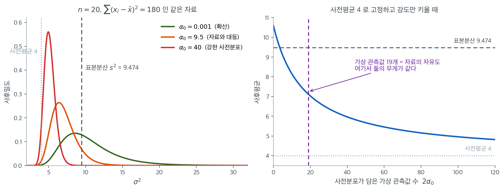
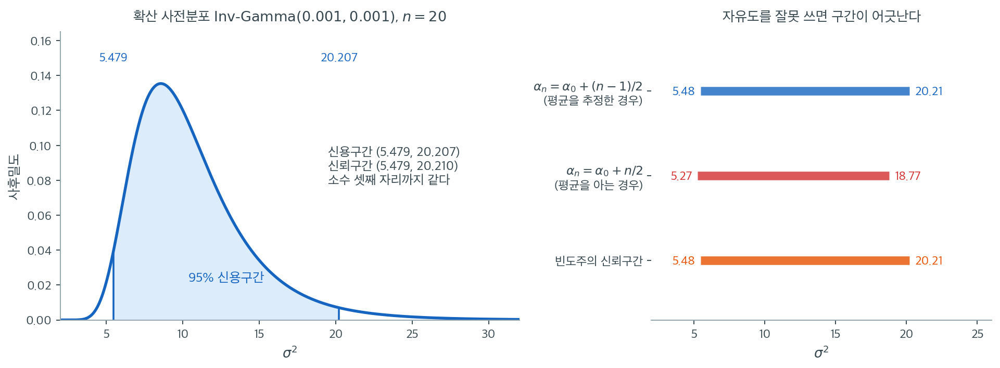

# Bayes 분산 검정

빈도주의 분산 검정은 표집분포와 $p$값에 기댄다. Bayes 접근은 근본적으로 다른 관점을 취한다. 모분산 $\sigma^2$을 사전분포를 갖는 확률변수로 취급하고, 관측 자료로 이 분포를 갱신한 뒤, 그 결과인 사후분포를 통해 추론한다. 이 틀은 $\sigma^2$에 대한 불확실성을 수량화하고 집단 간 분산을 비교하는 자연스러운 방법을 제공한다.

!!! note "사전분포가 처음이라면"

    이 쪽은 사전분포·사후분포·켤레 사전분포를 **이미 아는 것으로 보고** 분산 하나에 적용한다.
    그 틀 자체는 [6.3 베이즈 추정 ★](../../ch06/bayesian/prior_posterior.md)이 세운다 —
    모수에 분포를 주고 자료로 갱신한다는 발상, 켤레가 왜 편한지, MAP 가 무엇인지가 거기 있다.

---

## 1. 분산에 대한 켤레 사전분포

자료가 알려진 평균 $\mu$를 갖는 정규분포를 따를 때 분산 $\sigma^2$의 켤레 사전분포는 **역감마**분포이다.

$$
\sigma^2 \sim \text{Inv-Gamma}(\alpha_0, \beta_0)
$$

밀도는

$$
p(\sigma^2) = \frac{\beta_0^{\alpha_0}}{\Gamma(\alpha_0)} (\sigma^2)^{-\alpha_0 - 1} \exp\!\left(-\frac{\beta_0}{\sigma^2}\right), \quad \sigma^2 > 0
$$

초모수 $\alpha_0 > 0$과 $\beta_0 > 0$이 사전 믿음을 부호화한다.

- $\alpha_0$은 사전분포의 강도를 조절한다($\alpha_0$이 클수록 사전 믿음이 강하다)
- $\beta_0 / \alpha_0$은 $\sigma^2$의 사전 기댓값을 근사한다($\alpha_0$이 클 때)
- 사전평균은 $\alpha_0 > 1$일 때 $E[\sigma^2] = \beta_0 / (\alpha_0 - 1)$이다

흔히 쓰는 약정보 선택은 $\alpha_0 = \beta_0 = 0.01$(또는 $\alpha_0 = \beta_0 = 0.001$)이며, 자료가 지배하도록 하는 확산 사전분포를 만든다.

!!! note "$\alpha_0$을 "가상 관측값 수"로 읽기"
    사후 갱신식 $\alpha_n = \alpha_0 + (n-1)/2$을 보면 $\alpha_0$이 자유도의 절반 단위로 더해진다. 곧 **사전분포는 약 $2\alpha_0$개의 관측값에 해당하는 정보를 담는다.**

    $\alpha_0 = 0.01$이면 관측값 0.02개어치이므로 사실상 무정보이다. $\alpha_0 = 50$이면 관측값 100개어치이므로 $n = 100$인 자료와 대등한 영향력을 갖는다(연습문제 3 참조).

이 "가상 관측값" 해석이 말뿐이 아니라는 것을 그림으로 확인하자. 연습문제 1의 자료($n = 20$, $\sum(x_i-\bar{x})^2 = 180$, 곧 $s^2 = 9.474$)를 고정해 놓고 사전평균만 4로 두고 사전분포의 **강도** $\alpha_0$을 바꾼다.



왼쪽에서 초록($\alpha_0 = 0.001$)은 사실상 자료만으로 만든 사후분포다. 봉우리가 표본분산 $9.474$ 근처에 있다. 빨강($\alpha_0 = 40$)은 사전평균 4 쪽으로 완전히 끌려가 봉우리가 5 부근이고 폭도 훨씬 좁다. **같은 자료인데 사전분포만 바꾸어 결론이 두 배 가까이 달라졌다.**

오른쪽이 그 관계를 하나의 곡선으로 요약한다. 가로축이 $2\alpha_0$, 곧 사전분포가 담고 있다는 가상 관측값의 수다. $2\alpha_0 = 0$에서 사후평균은 표본분산 근처이고, $2\alpha_0$가 커질수록 사전평균 4로 단조롭게 내려간다.

주목할 곳은 보라색 세로선이다. $2\alpha_0 = 19$, 곧 자료의 자유도 $n - 1$과 같아지는 지점에서 사후평균이 $7.11$이다. 표본분산 $9.474$와 사전평균 $4$의 대략 중간이다. **사전분포와 자료가 정확히 같은 무게를 갖는 자리**이며, $\alpha_n = \alpha_0 + (n-1)/2$라는 갱신식이 문자 그대로 말하던 것이 이 그림이다.

실무적 함의는 두 가지다. 첫째, 사전분포를 고를 때 $\alpha_0$을 "얼마나 믿는가"가 아니라 **"관측값 몇 개어치를 보태는가"**로 바꿔 생각하면 판단이 훨씬 쉬워진다. 둘째, $n$이 작을수록 같은 $\alpha_0$의 영향력이 커진다. $n = 20$에서 $\alpha_0 = 10$은 자료를 압도하지만 $n = 500$에서는 거의 보이지 않는다.

---

## 2. 사후분포

$\mu$가 알려진 관측값 $X_1, \ldots, X_n \sim N(\mu, \sigma^2)$이 주어지면 $\sigma^2$의 사후분포도 역감마이다.

$$
\sigma^2 \mid X_1, \ldots, X_n \sim \text{Inv-Gamma}(\alpha_n, \beta_n)
$$

여기서

$$
\alpha_n = \alpha_0 + \frac{n}{2}, \qquad \beta_n = \beta_0 + \frac{1}{2}\sum_{i=1}^{n}(X_i - \mu)^2
$$

$\mu$를 모르는 (보통의) 경우에는 $\mu$를 $\bar{X}$로 바꾸고 자유도 $n - 1$을 쓴다.

$$
\alpha_n = \alpha_0 + \frac{n - 1}{2}, \qquad \beta_n = \beta_0 + \frac{(n-1)S^2}{2}
$$

!!! warning "두 공식을 섞지 말라"
    $\mu$를 아는 경우는 $\alpha_n = \alpha_0 + n/2$, 모르는 경우는 $\alpha_n = \alpha_0 + (n-1)/2$이다. $\beta_n$의 제곱합도 각각 $\sum(X_i-\mu)^2$과 $\sum(X_i-\bar X)^2 = (n-1)S^2$으로 다르다.

    실무에서는 거의 항상 $\mu$를 모르므로 두 번째 공식을 쓴다. $n$과 $n-1$을 혼동하면 $n$이 작을 때 결과가 눈에 띄게 달라진다.

이 켤레성 덕분에 사후분포가 닫힌 형태를 가지므로 계산이 간단하다.

---

## 3. Bayes 신용구간

$\sigma^2$의 $100(1-\alpha)\%$ 신용구간은 다음을 만족하는 구간 $[L, U]$이다.

$$
P(L \le \sigma^2 \le U \mid \text{자료}) = 1 - \alpha
$$

역감마 사후분포에서는 $\text{Inv-Gamma}(\alpha_n, \beta_n)$의 분위수로 신용구간을 얻는다.

!!! note "신용구간과 신뢰구간"
    Bayes 신용구간은 직접적인 확률 해석을 갖는다. 자료와 사전분포가 주어졌을 때 $\sigma^2$이 그 구간 안에 있을 확률이 $(1-\alpha)$이다. 빈도주의 신뢰구간은 그런 주장을 하지 않는다. 반복된 표본의 $(1-\alpha)$에서 절차가 $\sigma^2$을 포함한다는 뜻이다. 확산 사전분포에서는 두 구간이 수치적으로 비슷하다.

    연습문제 1에서 확산 사전분포를 쓰면 두 구간이 소수 셋째 자리까지 **일치**함을 확인한다.



왼쪽은 같은 자료($n = 20$, $\sum(x_i-\bar{x})^2 = 180$)에 $\text{Inv-Gamma}(0.001, 0.001)$을 쓴 사후분포다. 95% 신용구간이 $(5.479,\ 20.207)$이고 빈도주의 신뢰구간이 $(5.479,\ 20.210)$이다. **소수 셋째 자리까지 같다.** 우연이 아니라 확산 사전분포에서 사후분포 $\text{Inv-Gamma}(\alpha_0 + (n-1)/2,\ \beta_0 + (n-1)S^2/2)$가 $(n-1)S^2/\chi^2_{n-1}$의 분포와 사실상 같아지기 때문이다.

같은 숫자라고 해서 같은 말은 아니다. **신용구간은 "$\sigma^2$이 이 구간에 있을 확률이 0.95"라고 말하고, 신뢰구간은 "이 절차를 반복하면 95%가 참값을 덮는다"고 말한다.** 전자는 이 한 번의 자료에 대한 진술이고 후자는 절차의 장기 성질에 대한 진술이다. 숫자가 겹치는 것은 확산 사전분포라는 특수한 상황의 결과일 뿐이며, 사전분포가 정보를 담기 시작하면 두 구간은 곧바로 갈라진다.

오른쪽은 자유도를 잘못 썼을 때다. $\mu$를 모르는데도 $\alpha_n = \alpha_0 + n/2$를 쓰면 구간이 $(5.27,\ 18.77)$로 **위쪽이 눈에 띄게 짧아진다.** 자료가 주지 않은 정보 한 조각을 있다고 친 셈이라 불확실성이 과소평가된 것이다. $n$이 작을수록 이 차이가 커지므로, 평균을 자료에서 추정했다면 반드시 $(n-1)/2$를 써야 한다.

---

## 4. Bayes 가설검정

$H_0\colon \sigma^2 = \sigma_0^2$을 $H_1\colon \sigma^2 \neq \sigma_0^2$에 대해 검정하려면 Bayes 접근은 $H_0$의 사후확률을 계산하거나 **Bayes 인자**를 쓴다.

$$
\text{BF}_{01} = \frac{p(\text{자료} \mid H_0)}{p(\text{자료} \mid H_1)}
$$

여기서 $p(\text{자료} \mid H_0)$은 $H_0$ 아래의 주변가능도($\sigma^2$이 $\sigma_0^2$으로 고정)이고 $p(\text{자료} \mid H_1)$은 $\sigma^2$의 사전분포에 대해 가능도를 적분한 것이다.

두 분산을 비교하는 더 간단한 접근은 분산비의 사후분포를 쓰는 것이다. $\sigma_1^2$과 $\sigma_2^2$의 독립인 사후분포가 주어지면

$$
R = \frac{\sigma_1^2}{\sigma_2^2}
$$

를 계산한다. $R$의 $95\%$ 신용구간이 1을 포함하면 자료가 등분산과 일관된다.

---

## 5. 두 분산 비교

역감마 사후분포를 갖는 독립인 두 집단에 대해

$$
\sigma_1^2 \mid \text{자료}_1 \sim \text{Inv-Gamma}(\alpha_{n_1}, \beta_{n_1})
$$

$$
\sigma_2^2 \mid \text{자료}_2 \sim \text{Inv-Gamma}(\alpha_{n_2}, \beta_{n_2})
$$

비 $R = \sigma_1^2 / \sigma_2^2$은 사실 **닫힌 형태를 갖는다.** 독립인 두 역감마의 비는 척도변환된 $F$ 분포다:

$$
R = \frac{\sigma_1^2}{\sigma_2^2} \sim \frac{\beta_{n_1}\,\alpha_{n_2}}{\beta_{n_2}\,\alpha_{n_1}}\; F(2\alpha_{n_2},\, 2\alpha_{n_1})
$$

$\sigma^2 \sim \text{Inv-Gamma}(\alpha, \beta)$이면 $1/\sigma^2 \sim \text{Gamma}(\alpha, \text{rate}=\beta)$이고, 독립인 두 감마의 비가 $F$가 되는 표준 결과를 쓰면 바로 나온다. 그러므로 사후확률과 신뢰구간을 모의실험 없이 $F$ 분포함수로 바로 구할 수 있다.

그래도 몬테카를로 표집을 쓰는 이유는 **이 꼴이 켤레 사전분포에만 통하기** 때문이다. 사전분포를 바꾸거나 모수를 하나 더 넣으면 닫힌 꼴이 사라지지만 표집은 그대로 쓸 수 있다. 아래는 그 일반적인 방법이고, 닫힌 꼴은 그 결과를 검산하는 데 쓴다. 첫 사후분포에서 $\sigma_1^{2(b)}$을, 둘째에서 $\sigma_2^{2(b)}$을 뽑고 $b = 1, \ldots, B$에 대해 $R^{(b)} = \sigma_1^{2(b)} / \sigma_2^{2(b)}$을 계산한다.

$\sigma_1^2 > \sigma_2^2$일 사후확률은

$$
P(\sigma_1^2 > \sigma_2^2 \mid \text{자료}) \approx \frac{1}{B}\sum_{b=1}^{B} \mathbf{1}(R^{(b)} > 1)
$$

<div class="exbox" markdown>

**보기 1.** <span class="diff easy" title="쉬움"></span> 분산의 베이즈 추정. 관측값 $n = 20$개의 표본분산이 $S^2 = 15.3$이다. 약정보 사전분포 $\sigma^2 \sim \text{Inv-Gamma}(0.01, 0.01)$을 쓰면

</div>

??? success "풀이"
    $$
    \alpha_n = 0.01 + \frac{19}{2} = 9.51
    $$

    $$
    \beta_n = 0.01 + \frac{19 \times 15.3}{2} = 145.36
    $$

    사후분포는 $\sigma^2 \mid \text{자료} \sim \text{Inv-Gamma}(9.51, 145.36)$이다.

    사후평균은 $\beta_n / (\alpha_n - 1) = 145.36 / 8.51 = 17.08$로 표본분산 15.3보다 크다. 이 차이는 사전분포의 영향이 아니라(사전분포는 거의 무정보이다) **역감마분포가 오른쪽으로 치우쳐 있어서 평균이 최빈값보다 크기** 때문이다. 최빈값은 $\beta_n/(\alpha_n+1) = 145.36/10.51 = 13.83$이고 중앙값은 $15.84$이다.

<div class="exbox" markdown>

**보기 2.** <span class="diff easy" title="쉬움"></span> 분산의 사후분포와 신용구간. 보기 1 의 자료($n = 20$, $S^2 = 15.3$, $\text{Inv-Gamma}(0.01, 0.01)$)를 쓴다.

**(1)** 추축량 $2\beta_n/\sigma^2 \sim \chi^2_{2\alpha_n}$ 을 끌어내 신용구간을 적고, **확산 사전분포에서 그것이 빈도주의 신뢰구간과 거의 같아지는 까닭**을 밝히시오. 또 두 구간 모두 **상한/하한 비가 자료와 무관**함과 사후 최빈값/평균의 비가 $\dfrac{\alpha_n-1}{\alpha_n+1}$ 임을 보이시오.

**(2)** 두 집단의 비 $R = \sigma_1^2/\sigma_2^2$ 의 사후분포도 **닫힌 꼴로 적힌다**는 것을 보이고($\alpha$ 가 서로 달라도 된다), 몬테카를로 추정값이 그 닫힌 꼴과 맞는지 확인하시오.

</div>

??? success "풀이"

    **(1) 추축량을 꺼낸다.** $V \sim \text{Inv-Gamma}(\alpha, \beta)$ 이면 $1/V \sim \text{Gamma}(\alpha, \text{rate } \beta)$ 이고, 감마의 척도를 두 배로 늘리면 비율모수가 $1/2$ 이 되어

    $$
    \frac{2\beta}{V} \sim \text{Gamma}\!\left(\alpha, \text{rate } \tfrac12\right) = \chi^2_{2\alpha}
    $$

    이다. 사후분포에 적용하면 $2\beta_n/\sigma^2 \sim \chi^2_{2\alpha_n}$ 이고, 이 추축량을 뒤집으면 등꼬리 신용구간이

    $$
    \left(\frac{2\beta_n}{\chi^2_{0.975,\,2\alpha_n}},\;
    \frac{2\beta_n}{\chi^2_{0.025,\,2\alpha_n}}\right)
    $$

    로 적힌다.

    **빈도주의와 거의 같아지는 까닭.** $\mu$ 를 모르는 경우의 갱신식은 $\alpha_n = \alpha_0 + \frac{n-1}{2}$, $\beta_n = \beta_0 + \frac{(n-1)S^2}{2}$ 이므로

    $$
    2\alpha_n = 2\alpha_0 + (n-1), \qquad 2\beta_n = 2\beta_0 + (n-1)S^2
    $$

    이다. $\alpha_0 = \beta_0 \to 0$ 이면 $2\alpha_n \to n-1$, $2\beta_n \to (n-1)S^2$ 가 되어 위 구간이

    $$
    \left(\frac{(n-1)S^2}{\chi^2_{0.975,\,n-1}},\;
    \frac{(n-1)S^2}{\chi^2_{0.025,\,n-1}}\right)
    $$

    로, 곧 15.2절의 빈도주의 신뢰구간과 **글자 하나까지 같은 식**이 된다. 빈도주의는 $(n-1)S^2/\sigma^2 \sim \chi^2_{n-1}$ 을 표집분포로 읽고 베이즈는 같은 양을 사후분포로 읽는데, 확산 사전분포에서는 그 두 읽기가 **같은 수**를 준다. $\alpha_0 = \beta_0 = 0.01$ 은 $0$ 이 아니므로 완전히 같지는 않고, $2\alpha_n = 19.02$ 대 $19$, $2\beta_n = 290.72$ 대 $290.70$ 만큼 비껴 있다.

    **상한/하한 비는 자료와 무관하다.** 두 구간 모두

    $$
    \frac{U}{L} = \frac{\chi^2_{0.975,\,d}}{\chi^2_{0.025,\,d}}
    $$

    인데 분자의 $2\beta_n$ (또는 $(n-1)S^2$)이 약분되기 때문이다. **자료는 구간의 위치만 정하고 그 상대적 폭은 자유도가 혼자 정한다.** 8장이 다룬 사실이며, 여기서는 $d = 2\alpha_n$ 인지 $d = n-1$ 인지만 다르다.

    **최빈값과 평균의 비.** 역감마의 최빈값은 $\beta_n/(\alpha_n+1)$, 평균은 $\beta_n/(\alpha_n-1)$ 이므로 $\beta_n$ 이 약분되어

    $$
    \frac{\text{최빈값}}{\text{평균}} = \frac{\alpha_n - 1}{\alpha_n + 1} < 1
    $$

    이다. **자료와 무관하게 평균이 최빈값보다 크다.** $\alpha_n$ 이 작을수록, 곧 $n$ 이 작을수록 비가 1 에서 멀어진다. 중앙값은 그 사이에 놓이는데 이것은 닫힌 꼴이 없으므로 수치로 확인한다.

    **(2) 비의 사후분포도 닫힌 꼴이다.** (1)의 추축량을 두 집단에 쓰면 $\sigma_i^2 = 2\beta_{n_i}/W_i$, $W_i \sim \chi^2_{2\alpha_{n_i}}$ 이고 두 집단이 독립이므로

    $$
    R = \frac{\sigma_1^2}{\sigma_2^2}
    = \frac{\beta_{n_1}}{\beta_{n_2}}\cdot\frac{W_2}{W_1}
    = \frac{\beta_{n_1}}{\beta_{n_2}}\cdot\frac{\alpha_{n_2}}{\alpha_{n_1}}
    \cdot\frac{W_2/(2\alpha_{n_2})}{W_1/(2\alpha_{n_1})}
    $$

    이다. 맨 끝의 비는 정의상 $F(2\alpha_{n_2},\, 2\alpha_{n_1})$ 이므로

    $$
    R \;\sim\; \frac{\beta_{n_1}\alpha_{n_2}}{\beta_{n_2}\alpha_{n_1}}\;
    F\bigl(2\alpha_{n_2},\, 2\alpha_{n_1}\bigr)
    $$

    가 된다. **두 집단의 $\alpha$ 가 달라도 성립한다.** 자유도만 비대칭으로 들어갈 뿐이다. 그러므로 신용구간과 $P(R>1)$ 도 손으로 적힌다.

    $$
    P(R > 1) = P\!\left(F(2\alpha_{n_2}, 2\alpha_{n_1}) > \frac{\beta_{n_2}\alpha_{n_1}}{\beta_{n_1}\alpha_{n_2}}\right)
    $$

    몬테카를로는 이 값을 $1/\sqrt B$ 만큼 흐려 돌려줄 뿐이다. 아래에서 그것을 확인한다.

    ```python
    import numpy as np
    from scipy import stats

    # 자료 요약값만 있으면 된다.
    n = 20
    s_squared = 15.3

    # 거의 정보를 주지 않는 사전분포. 값이 작을수록 사후분포가 자료에 맡겨진다.
    alpha_0, beta_0 = 0.01, 0.01

    # 역감마는 정규분포 분산의 켤레사전분포이므로 사후분포도 역감마다.
    # 평균을 모르는 경우라 자유도가 n-1 로 들어간다.
    alpha_n = alpha_0 + (n - 1) / 2
    beta_n = beta_0 + (n - 1) * s_squared / 2

    # 역감마는 오른쪽으로 치우쳐 있어 평균·최빈값·중앙값이 모두 다르다.
    # 어느 것을 점추정값으로 쓸지는 손실함수에 달렸다.
    print(f"Posterior: Inv-Gamma({alpha_n}, {beta_n:.2f})")
    print(f"Posterior mean:   {beta_n / (alpha_n - 1):.4f}")
    print(f"Posterior mode:   {beta_n / (alpha_n + 1):.4f}")
    print(f"Posterior median: {stats.invgamma.median(a=alpha_n, scale=beta_n):.4f}")

    # 95% 신용구간: 사후분포의 2.5·97.5 백분위점
    ci_lower = stats.invgamma.ppf(0.025, a=alpha_n, scale=beta_n)
    ci_upper = stats.invgamma.ppf(0.975, a=alpha_n, scale=beta_n)
    print(f"95% credible interval: ({ci_lower:.4f}, {ci_upper:.4f})")

    # 빈도주의 신뢰구간과 견준다. 사전분포가 거의 무정보이므로 두 구간이
    # 거의 겹친다. 다만 읽는 법이 다르다 — 신용구간은 "모수가 이 안에 있을
    # 확률이 95%"라고 그대로 말할 수 있다.
    fl = (n - 1) * s_squared / stats.chi2.ppf(0.975, n - 1)
    fu = (n - 1) * s_squared / stats.chi2.ppf(0.025, n - 1)
    print(f"95% confidence interval: ({fl:.4f}, {fu:.4f})")

    # 두 분산을 견주는 일은 베이즈 쪽에서 특히 간단하다. 두 사후분포에서
    # 뽑아 나누기만 하면 비의 사후분포가 나온다.
    rng = np.random.default_rng(42)
    alpha_n1, beta_n1 = 9.51, 145.36   # 집단 1 의 사후 모수
    alpha_n2, beta_n2 = 12.01, 120.10  # 집단 2 의 사후 모수

    sigma1_samples = stats.invgamma.rvs(a=alpha_n1, scale=beta_n1,
                                        size=10000, random_state=rng)
    sigma2_samples = stats.invgamma.rvs(a=alpha_n2, scale=beta_n2,
                                        size=10000, random_state=rng)

    ratio = sigma1_samples / sigma2_samples
    print(f"P(sigma1^2 > sigma2^2 | data) = {np.mean(ratio > 1):.3f}")
    print(f"95% credible interval for ratio: "
          f"({np.percentile(ratio, 2.5):.3f}, {np.percentile(ratio, 97.5):.3f})")

    # === (1) 추축량 2 beta_n / sigma^2 ~ chi2(2 alpha_n) 인가 ===
    print(f"\n--- (1) 추축량과 두 구간 ---")
    print(f"2 a_n = {2 * alpha_n:.2f}   (무정보 극한 n-1 = {n - 1})")
    print(f"2 b_n = {2 * beta_n:.2f}  (무정보 극한 (n-1)s^2 = {(n - 1) * s_squared:.2f})")
    piv = 2 * beta_n / stats.chi2(2 * alpha_n).ppf([0.975, 0.025])
    print(f"역감마 분위수로    : ({ci_lower:.6f}, {ci_upper:.6f})")
    print(f"2b_n/chi2(2a_n) 로 : ({piv[0]:.6f}, {piv[1]:.6f})")
    print(f"상한/하한  신용 {ci_upper / ci_lower:.6f}   신뢰 {fu / fl:.6f}")
    print(f"  chi2 분위수 비 (자료와 무관)")
    print(f"    d = 2a_n = {2 * alpha_n:.2f}: "
          f"{stats.chi2(2 * alpha_n).ppf(0.975) / stats.chi2(2 * alpha_n).ppf(0.025):.6f}")
    print(f"    d = n-1  = {n - 1}   : "
          f"{stats.chi2(n - 1).ppf(0.975) / stats.chi2(n - 1).ppf(0.025):.6f}")
    print(f"최빈값/평균 = (a_n-1)/(a_n+1) = {(alpha_n - 1) / (alpha_n + 1):.6f}"
          f"   실제 {(beta_n / (alpha_n + 1)) / (beta_n / (alpha_n - 1)):.6f}")

    # === (2) 비의 사후분포는 척도를 바꾼 F 분포다 ===
    print(f"\n--- (2) 비의 닫힌 꼴 ---")
    sc = (beta_n1 / beta_n2) * (alpha_n2 / alpha_n1)
    Fd = stats.f(2 * alpha_n2, 2 * alpha_n1)
    print(f"R ~ (b1/b2)(a2/a1) x F(2a2, 2a1) = {sc:.6f} x F({2 * alpha_n2:.2f}, {2 * alpha_n1:.2f})")
    print("                 닫힌 꼴    모의 1만개       표준오차")
    for name, closed, mc, se in (
            ("q(0.025)", sc * Fd.ppf(0.025), np.percentile(ratio, 2.5),
             np.sqrt(0.025 * 0.975 / 10000) / (Fd.pdf(Fd.ppf(0.025)) / sc)),
            ("median  ", sc * Fd.ppf(0.5), np.median(ratio),
             np.sqrt(0.25 / 10000) / (Fd.pdf(Fd.ppf(0.5)) / sc)),
            ("q(0.975)", sc * Fd.ppf(0.975), np.percentile(ratio, 97.5),
             np.sqrt(0.975 * 0.025 / 10000) / (Fd.pdf(Fd.ppf(0.975)) / sc)),
            ("P(R>1)  ", Fd.sf(1 / sc), np.mean(ratio > 1),
             np.sqrt(Fd.sf(1 / sc) * Fd.cdf(1 / sc) / 10000)),
            ("mean    ", (beta_n1 / (alpha_n1 - 1)) * (alpha_n2 / beta_n2), ratio.mean(),
             ratio.std(ddof=1) / 100)):
        print(f"  {name}   {closed:10.6f}  {mc:12.6f}   +-{se:.5f}  ({abs(closed - mc) / se:.2f} SE)")

    ks = stats.kstest(ratio / sc, Fd.cdf)
    print(f"KS: 모의표본을 {sc:.4f} 로 나눈 것이 F({2 * alpha_n2:.2f},{2 * alpha_n1:.2f}) 인가")
    print(f"  KS = {ks.statistic:.6f},  p = {ks.pvalue:.4f}")
    ```

    출력:

    ```text
    Posterior: Inv-Gamma(9.51, 145.36)
    Posterior mean:   17.0811
    Posterior mode:   13.8306
    Posterior median: 15.8365
    95% credible interval: (8.8422, 32.5915)
    95% confidence interval: (8.8487, 32.6390)
    P(sigma1^2 > sigma2^2 | data) = 0.835
    95% credible interval for ratio: (0.644, 3.674)

    --- (1) 추축량과 두 구간 ---
    2 a_n = 19.02   (무정보 극한 n-1 = 19)
    2 b_n = 290.72  (무정보 극한 (n-1)s^2 = 290.70)
    역감마 분위수로    : (8.842184, 32.591487)
    2b_n/chi2(2a_n) 로 : (8.842184, 32.591487)
    상한/하한  신용 3.685909   신뢰 3.688572
      chi2 분위수 비 (자료와 무관)
        d = 2a_n = 19.02: 3.685909
        d = n-1  = 19   : 3.688572
    최빈값/평균 = (a_n-1)/(a_n+1) = 0.809705   실제 0.809705

    --- (2) 비의 닫힌 꼴 ---
    R ~ (b1/b2)(a2/a1) x F(2a2, 2a1) = 1.528496 x F(24.02, 19.02)
                     닫힌 꼴    모의 1만개       표준오차
      q(0.025)     0.652027      0.644370   +-0.00774  (0.99 SE)
      median       1.539898      1.530933   +-0.00848  (1.06 SE)
      q(0.975)     3.746550      3.674472   +-0.04754  (1.52 SE)
      P(R>1)       0.838272      0.835000   +-0.00368  (0.89 SE)
      mean         1.708108      1.699165   +-0.00804  (1.11 SE)
    KS: 모의표본을 1.5285 로 나눈 것이 F(24.02,19.02) 인가
      KS = 0.007850,  p = 0.5660
    ```

    **추축량이 정확히 맞는다.** 역감마 분위수로 잡은 신용구간 $(8.842184,\, 32.591487)$ 과 $2\beta_n/\chi^2_{2\alpha_n}$ 로 잡은 것이 소수점 여섯째 자리까지 같다.

    **두 구간이 사실상 일치한다.** 신용 $(8.8422,\, 32.5915)$, 신뢰 $(8.8487,\, 32.6390)$ 으로 상대차가 $0.07\%$ 와 $0.15\%$ 다. (1)이 예측한 대로 $2\alpha_n = 19.02$ 가 $n-1 = 19$ 와 거의 같고 $2\beta_n = 290.72$ 가 $(n-1)S^2 = 290.70$ 과 거의 같기 때문이다. **같은 식에 거의 같은 수를 넣었으니 거의 같은 답이 나온 것**이고, 사전분포가 정보를 담기 시작하면 이 일치는 즉시 깨진다.

    **상한/하한 비가 자료와 무관하다.** 신용 $3.685909$, 신뢰 $3.688572$ 이고, 각각 $\chi^2_{0.975,d}/\chi^2_{0.025,d}$ 를 $d = 19.02$ 와 $d = 19$ 에서 잰 값과 **소수점 여섯째 자리까지 같다**. $S^2 = 15.3$ 을 어떤 값으로 바꾸어도 이 비는 그대로다.

    **최빈값/평균이 공식과 정확히 같다.** $(\alpha_n-1)/(\alpha_n+1) = 0.809705$ 와 실제 비가 자리 하나까지 일치한다. 그리고 세 요약값의 순서가 최빈값 $13.8306$ < 중앙값 $15.8365$ < 평균 $17.0811$ 로, 중앙값이 과연 사이에 놓인다. 표본분산 $15.3$ 은 중앙값 바로 아래에 있다. **$n = 20$ 에서도 평균과 최빈값이 $24\%$ 벌어진다.** 한 숫자로 보고해야 한다면 중앙값이다.

    **(2)의 닫힌 꼴도 맞는다.** $R \sim 1.528496 \times F(24.02,\, 19.02)$ 가 예측한 다섯 값이 모의실험과 각각 $0.89$–$1.52$ 표준오차 안에서 맞는다. 다섯이 모두 같은 방향으로 조금 작은 것은 한 표본에서 계산한 양들이라 서로 상관되어 있기 때문이고, 분포가 정말 일치하는지는 콜모고로프–스미르노프 검정이 답한다. 모의표본을 $1.5285$ 로 나눈 것이 $F(24.02, 19.02)$ 와 구별되지 않는다($\text{KS} = 0.00785$, $p = 0.5660$). **비의 사후분포는 몬테카를로 없이 적을 수 있다.**

    **판정.** $P(R>1) = 0.8383$ 이고 $95\%$ 신용구간 $(0.652,\, 3.747)$ 이 1 을 담는다. 집단 1 의 분산이 더 클 사후확률이 $0.84$ 지만 구간이 $5.7$ 배에 걸쳐 있어 확정하기에는 부족하다.

---

## 6. 장점과 한계

**장점:**

- $\sigma^2$에 대한 직접적인 확률 진술(신용구간이 직관적으로 해석된다)
- 분야 지식에서 오는 사전정보를 반영할 수 있다
- 점근근사에 의존하지 않는다
- 사후표집으로 여러 분산을 비교하는 자연스러운 틀

**한계:**

- 사전분포를 지정해야 하며 그 선택이 논쟁적일 수 있다
- 켤레 분석이 정규성을 가정한다. 비정규 자료에는 더 복잡한 모형이 필요하다
- 모형이 복잡해지면 계산 비용이 늘어난다(MCMC로 다룰 수 있기는 하다)

**정규성 가정에 대한 유의.** 마지막 한계가 특히 중요하다. 켤레 역감마 분석은 정규 가능도에 기반하므로 **비정규성에 대한 취약성이 Bartlett 검정과 본질적으로 같다.** "Bayes 방법이므로 가정에서 자유롭다"는 오해를 경계해야 한다. 자료가 두꺼운 꼬리를 갖는다면 $t$ 가능도를 쓰는 모형으로 확장해야 하며, 그러면 켤레성이 깨져 MCMC가 필요하다.

---

## 연습문제

<div class="drillbox" markdown>

**연습문제 1.** <span class="diff med" title="중간"></span>
무정보 사전분포 $\sigma^2 \sim \text{Inv-Gamma}(0.001, 0.001)$과 $\sum(x_i - \bar{x})^2 = 180$인 $n = 20$ 표본에 대해 사후분포와 $\sigma^2$의 95% 신용구간을 구하라.

</div>

??? success "풀이"
    $\mu$를 모르므로 $\alpha_n = \alpha_0 + (n-1)/2$를 쓴다.

    $$
    \alpha_n = 0.001 + \frac{19}{2} = 9.501, \qquad \beta_n = 0.001 + \frac{180}{2} = 90.001.
    $$

    사후분포는 $\text{Inv-Gamma}(9.501, 90.001)$이다.

    !!! warning "$n/2$가 아니라 $(n-1)/2$이다"
        평균을 자료에서 추정했으므로 자유도가 $n-1 = 19$이고 $\alpha_0$에 더해지는 값은 $9.5$이다. $n/2 = 10$을 쓰면 $\alpha_n = 10.001$이 되어 아래의 모든 결과가 달라진다(신용구간이 $(5.27, 18.77)$이 되어 빈도주의 구간과 어긋난다).

    사후평균은 $\beta_n/(\alpha_n - 1) = 90.001/8.501 = 10.587$이다. 표본분산 $s^2 = 180/19 = 9.474$보다 큰데, 이는 역감마분포의 오른쪽 치우침 때문이다.

    ```python
    from scipy import stats

    alpha_n, beta_n = 0.001 + 19 / 2, 0.001 + 180 / 2
    print(f"Posterior: Inv-Gamma({alpha_n}, {beta_n})")
    print(f"mean = {beta_n / (alpha_n - 1):.4f}, s^2 = {180 / 19:.4f}")
    print(f"95% credible: ({stats.invgamma.ppf(0.025, a=alpha_n, scale=beta_n):.4f}, "
          f"{stats.invgamma.ppf(0.975, a=alpha_n, scale=beta_n):.4f})")
    print(f"95% confidence: ({180 / stats.chi2.ppf(0.975, 19):.4f}, "
          f"{180 / stats.chi2.ppf(0.025, 19):.4f})")
    ```

    출력:

    ```text
    Posterior: Inv-Gamma(9.501, 90.001)
    mean = 10.5871, s^2 = 9.4737
    95% credible: (5.4787, 20.2071)
    95% confidence: (5.4791, 20.2099)
    ```

    **95% 신용구간은 $(5.479, 20.207)$이다.**

    빈도주의 신뢰구간 $(5.479, 20.210)$과 소수 셋째 자리까지 일치한다. 우연이 아니다. $\alpha_0, \beta_0 \to 0$일 때 역감마 사후분포가 $2\beta_n/\sigma^2 \sim \chi^2_{2\alpha_n}$을 만족하는데, $2\alpha_n \to n-1 = 19$이고 $2\beta_n \to (n-1)s^2 = 180$이므로 정확히 빈도주의 추축량 $(n-1)S^2/\sigma^2 \sim \chi^2_{n-1}$과 같아진다.

    **곧 무정보 사전분포를 쓴 Bayes 분석은 빈도주의 결과와 수치적으로 동일하다.** 차이는 오직 해석에 있다. $\square$

<div class="drillbox" markdown>

**연습문제 2.** <span class="diff med" title="중간"></span>
분산에 대한 Bayes 신용구간과 빈도주의 신뢰구간을 비교하라. 핵심적인 철학적 차이는 무엇인가?

</div>

??? success "풀이"
    **빈도주의 신뢰구간:** $P(L < \sigma^2 < U) = 0.95$는 실험을 여러 번 반복하면 계산된 구간의 95%가 참 $\sigma^2$을 포함한다는 뜻이다. 모수는 고정이고 구간이 확률변수이다.

    **Bayes 신용구간:** $P(L < \sigma^2 < U \mid \text{자료}) = 0.95$는 관측 자료와 사전분포가 주어졌을 때 $\sigma^2$이 이 구간에 있을 사후확률이 95%라는 뜻이다. (자료가 주어지면) 구간이 고정이고 모수가 확률변수로 취급된다.

    무정보 사전분포와 큰 $n$에서 두 구간은 수치적으로 비슷하며, 연습문제 1에서 보았듯 아예 일치할 수도 있다.

    **핵심 차이는 "확률"이라는 말의 대상이다.** 빈도주의에서 확률은 절차의 장기적 성질이고, Bayes에서는 모수에 대한 믿음의 정도이다.

    **왜 이 구분이 실무적으로 중요한가.** 흔한 오해는 빈도주의 95% CI를 두고 "$\sigma^2$이 이 구간에 있을 확률이 95%"라고 말하는 것이다. 빈도주의 틀에서 $\sigma^2$은 상수이므로 이 진술은 무의미하다(확률이 0 또는 1이다). Bayes 신용구간에서만 그 진술이 정당하다.

    구간이 수치적으로 같더라도 이 해석의 차이는 남는다. 연습문제 1처럼 두 구간이 완전히 일치하는 경우, 그 구간에 어느 해석을 붙일지는 사전분포를 인정하느냐에 달려 있다. $\square$

<div class="drillbox" markdown>

**연습문제 3.** <span class="diff med" title="중간"></span>
작은 표본에서 사전분포의 선택이 Bayes 분산 검정에 어떤 영향을 주는가? 강한 정보 사전분포로 예시하라.

</div>

??? success "풀이"
    강한 정보 사전분포 $\sigma^2 \sim \text{Inv-Gamma}(50, 500)$을 생각하자. 사전평균은 $500/49 = 10.20$이고 10 근처에 촘촘하다.

    ```python
    from scipy import stats

    alpha_0, beta_0 = 50, 500
    print(f"Prior mean: {beta_0 / (alpha_0 - 1):.3f}")
    for n, s2 in [(5, 25), (20, 25), (100, 25), (1000, 25)]:
        an = alpha_0 + (n - 1) / 2
        bn = beta_0 + (n - 1) * s2 / 2
        lo = stats.invgamma.ppf(0.025, a=an, scale=bn)
        hi = stats.invgamma.ppf(0.975, a=an, scale=bn)
        print(f"n = {n:>4}: posterior mean = {bn / (an - 1):6.3f}, "
              f"95% CrI = ({lo:6.3f}, {hi:6.3f})")
    ```

    출력:

    ```text
    Prior mean: 10.204
    n =    5: posterior mean = 10.784, 95% CrI = ( 8.202, 14.162)
    n =   20: posterior mean = 12.607, 95% CrI = ( 9.763, 16.262)
    n =  100: posterior mean = 17.640, 95% CrI = (14.482, 21.474)
    n = 1000: posterior mean = 23.678, 95% CrI = (21.777, 25.743)
    ```

    자료는 모두 $s^2 = 25$를 시사하는데도 사후평균이 다음과 같이 이동한다.

    | $n$ | 사후평균 | 사전평균(10.2)과 자료(25) 사이의 위치 |
    |---|---|---|
    | 5 | 10.78 | 사실상 사전분포 |
    | 20 | 12.61 | 사전분포 쪽 16% |
    | 100 | 17.64 | 중간 (50%) |
    | 1000 | 23.68 | 자료 쪽 91% |

    !!! warning "$n = 100$으로도 사전분포를 이기지 못한다"
        "$n = 100$이면 자료가 사전분포를 압도한다"는 서술은 이 사전분포에 대해 **틀리다**. 사후평균 $17.64$는 사전평균 $10.2$와 자료 $25$의 거의 정확한 중간이다.

        이유는 본문의 "가상 관측값" 해석으로 설명된다. $\alpha_0 = 50$은 자유도 $2\alpha_0 = 100$, 곧 **관측값 약 101개어치**의 정보를 담는다. $n = 100$인 자료의 자유도는 99이므로 사전분포와 자료가 대등하다.

        자료가 사전분포를 압도하려면 $n - 1 \gg 2\alpha_0 = 100$, 곧 $n \gg 100$이어야 한다. 표에서 $n = 1000$이 되어야 자료 쪽으로 91% 이동한다.

    **실무 지침.** 작은 표본에서는 사전분포 민감도 분석이 필수적이다. 여러 사전분포(정보, 약정보, 무정보) 아래에서 사후분포를 계산하여 결론이 바뀌는지 확인하라. 그리고 사전분포를 고를 때는 $\alpha_0$이 몇 개의 가상 관측값에 해당하는지 늘 확인하여, 자신이 실제로 가진 사전 지식의 양에 맞추어야 한다. $\square$

<div class="drillbox" markdown>

**연습문제 4.** <span class="diff med" title="중간"></span>
Bayes 인자로 분산에 대한 두 가설 $H_0: \sigma^2 = \sigma_0^2$과 $H_1: \sigma^2 \neq \sigma_0^2$을 비교하는 방법을 기술하라.

</div>

??? success "풀이"
    Bayes 인자 $BF_{01}$은 주변가능도의 비이다.

    $$
    BF_{01} = \frac{P(\text{자료} \mid H_0)}{P(\text{자료} \mid H_1)}
    $$

    $H_0$ 아래에서 $\sigma^2$이 $\sigma_0^2$으로 고정되므로 주변가능도는 $\sigma_0^2$에서 평가한 가능도이다. $H_1$ 아래에서는 $\sigma^2$의 사전분포에 대해 가능도를 적분한다.

    $$
    P(\text{자료} \mid H_1) = \int_0^\infty L(\sigma^2)\, p(\sigma^2)\, d\sigma^2.
    $$

    정규 가능도와 역감마 사전분포에서는 이 적분이 닫힌 형태로 계산된다.

    $BF_{01} > 1$이면 $H_0$에 유리하고 $BF_{01} < 1$이면 $H_1$에 유리하다. 흔한 해석 기준은 $BF > 10$이면 강한 증거, $BF > 100$이면 결정적 증거이다. $p$값과 달리 Bayes 인자는 귀무가설에 **반대하는** 증거뿐 아니라 **찬성하는** 증거도 제공할 수 있다.

    !!! warning "Bayes 인자는 사전분포에 민감하다"
        $H_1$ 아래의 주변가능도가 사전분포 $p(\sigma^2)$에 대한 적분이므로 **사전분포의 선택이 $BF$에 직접 영향을 준다.** 특히 사전분포를 넓게(확산되게) 만들수록 $H_1$의 주변가능도가 작아져 $BF_{01}$이 커진다. 곧 무정보 사전분포를 쓰려는 시도가 자동으로 $H_0$에 유리하게 작용한다.

        이를 **Lindley 역설** 또는 Jeffreys-Lindley 역설이라 한다. 극단적으로 $\beta_0 \to 0$, $\alpha_0 \to 0$인 부적절 사전분포에서는 $BF$가 정의되지 않는다.

        신용구간이 사전분포에 둔감한 것과 대조적이다. 연습문제 1에서 무정보 사전분포의 신용구간이 빈도주의 구간과 일치했지만, 같은 사전분포로 Bayes 인자를 계산하면 무의미한 값이 나온다.

        **실무 지침.** Bayes 인자를 쓸 때는 반드시 (1) 적절한(proper) 사전분포를 쓰고, (2) 그 사전분포를 정당화하며, (3) 사전분포를 바꿔 가며 $BF$의 안정성을 확인해야 한다. 분산 비교에서는 Bayes 인자보다 **분산비의 사후분포와 신용구간**을 보고하는 편이 사전분포 의존성이 훨씬 낮아 안전하다. $\square$

<div class="drillbox" markdown>

**연습문제 5.** <span class="diff med" title="중간"></span>
1 절의 "사전분포는 약 $2\alpha_0$ 개의 관측값에 해당하는 정보를 담는다"는 읽기를 **사후평균에 대해 정확하게** 만들어 보자. $\mu$ 를 모르는 경우의 갱신식을 쓴다.

**(1)** 사후평균이 사전평균 $\beta_0/(\alpha_0-1)$ 과 표본분산 $S^2$ 의 가중평균임을 보이고, 자료에 붙는 무게 $w$ 를 $n$ 과 $\alpha_0$ 으로 적으시오.

**(2)** 사전분포와 자료가 **정확히 반반**이 되는 조건을 구하고, 연습문제 3 의 $\alpha_0 = 50$ 에 대해 그 $n$ 을 구하시오. 연습문제 3 의 경고 상자는 "$n = 100$ 에서 대등하다"고 했는데, 정확한 답과 몇 개 어긋나는가?

**(3)** 연습문제 3 의 표에 적힌 "사전분포 쪽 16%", "중간(50%)", "자료 쪽 91%" 가 (1)의 $w$ 와 같은 수인지 확인하시오.

**(4)** 같은 계산을 사후평균 대신 사후 **최빈값**으로 하면 사전분포는 관측값 몇 개어치인가?

</div>

??? success "풀이"
    **(1) 사후평균은 정확한 가중평균이다.** 갱신식 $\alpha_n = \alpha_0 + \frac{n-1}{2}$, $\beta_n = \beta_0 + \frac{(n-1)S^2}{2}$ 를 사후평균 공식에 넣으면

    $$
    E[\sigma^2 \mid \text{자료}] = \frac{\beta_n}{\alpha_n - 1}
    = \frac{\beta_0 + \frac{n-1}{2}S^2}{(\alpha_0 - 1) + \frac{n-1}{2}}
    $$

    이다. $a = \alpha_0 - 1$, $m = \frac{n-1}{2}$ 로 줄여 쓰고 분자의 $\beta_0$ 을 $a \cdot (\beta_0/a)$ 로 고쳐 쓰면

    $$
    E[\sigma^2 \mid \text{자료}] = \frac{a\cdot\frac{\beta_0}{a} + m\,S^2}{a + m}
    = (1-w)\,\frac{\beta_0}{\alpha_0 - 1} + w\,S^2,
    \qquad w = \frac{m}{a+m}
    $$

    가 되어 **사전평균과 표본분산의 가중평균**이다. 무게를 풀어 쓰면

    $$
    w = \frac{n-1}{2(\alpha_0 - 1) + (n-1)}
    $$

    이다. 분모를 읽는 법이 핵심이다. 자료가 자유도 $n-1$ 을 들고 오는데 사전분포가 **자유도 $2(\alpha_0-1)$ 을 들고 와서 나란히 놓인다.**

    **(2) 반반이 되는 자리.** $w = 1/2$ 는 $n - 1 = 2(\alpha_0 - 1)$, 곧

    $$
    n = 2\alpha_0 - 1
    $$

    일 때다. $\alpha_0 = 50$ 이면 $n = 99$ 이다. 경고 상자는 $2\alpha_0 = 100$ 과 자유도 $99$ 를 견주어 $n = 100$ 을 대등한 자리로 읽었는데, 정확한 답은 $n = 99$ 이므로 **관측값 한 개만큼 어긋난다.** 어긋남의 근원은 사후평균이 $\alpha_n$ 이 아니라 $\alpha_n - 1$ 로 나눈다는 데 있다. 사전분포는 모양모수에는 $2\alpha_0$ 어치로 들어가지만 **평균에는 $2\alpha_0 - 2$ 어치로** 들어간다. $\alpha_0$ 이 클 때 $2$ 의 차이는 무시할 만하니 본문의 읽기는 선행항으로서 옳다.

    **(3) 표의 백분율은 바로 $w$ 다.** $\alpha_0 = 50$, $\beta_0 = 500$ 이므로 사전평균은 $500/49 = 10.204$ 이고 자료는 모두 $S^2 = 25$ 다.

    | $n$ | $w = \dfrac{n-1}{98 + (n-1)}$ | $(1-w)(10.204) + w(25)$ | 연습문제 3 의 출력 |
    |---|---|---|---|
    | 5 | $4/102 = 0.0392$ | 10.784 | 10.784 |
    | 20 | $19/117 = 0.1624$ | 12.607 | 12.607 |
    | 100 | $99/197 = 0.5025$ | 17.640 | 17.640 |
    | 1000 | $999/1097 = 0.9107$ | 23.678 | 23.678 |

    네 줄이 모두 맞는다. 표의 "16%", "50%", "91%" 는 **어림이 아니라 $w$ 그 자체**였다. $n = 100$ 의 $w = 0.5025$ 가 정확히 절반보다 조금 큰 것도 (2)의 답($n = 99$ 에서 반반)과 맞아떨어진다.

    **(4) 최빈값으로 재면 $2\alpha_0 + 2$ 어치다.** 최빈값은 $\beta_n/(\alpha_n+1)$ 이므로 같은 계산에서 $a = \alpha_0 - 1$ 자리에 $\alpha_0 + 1$ 이 온다.

    $$
    \text{최빈값} = (1-w')\frac{\beta_0}{\alpha_0+1} + w' S^2,
    \qquad w' = \frac{n-1}{2(\alpha_0+1) + (n-1)}
    $$

    $\alpha_0 = 50$ 이면 사전분포가 관측값 $102$ 개어치다. 정리하면 **어느 요약값을 묻느냐에 따라 사전분포의 무게가 $2\alpha_0 - 2$, $2\alpha_0$, $2\alpha_0 + 2$ 로 조금씩 달라진다.** 선행항은 모두 $2\alpha_0$ 이므로 1 절의 읽기는 안전하지만, $\alpha_0$ 이 작을 때는 그 $\pm 2$ 가 전부가 된다.

    **덧붙임: $\alpha_0 < 1$ 이면 가중평균이 아니다.** 보기 1 의 $\alpha_0 = 0.01$ 에서 $w = 19/(2(0.01-1)+19) = 19/17.02 = 1.1163 > 1$ 이고 사전평균 $\beta_0/(\alpha_0-1) = -0.0101$ 은 음수다(사전평균이 존재하지 않는다). 그래도 대수적으로는 $1.1163 \times 15.3 + (-0.1163)\times(-0.0101) = 17.081$ 로 보기 1 의 사후평균 $17.0811$ 을 정확히 준다. **무게가 1 을 넘는다는 것은 사후평균이 $S^2$ 를 지나쳐 바깥으로 나간다는 뜻**이고, 이것이 보기 1 에서 사후평균 $17.08$ 이 표본분산 $15.3$ 보다 큰 이유를 수로 적은 것이다. 가중평균 해석은 $\alpha_0 > 1$ 에서만 쓸 수 있다. $\square$

<div class="drillbox" markdown>

**연습문제 6.** <span class="diff med" title="중간"></span>
보기 2 는 등꼬리 신용구간의 상한/하한 비가 자료와 무관함을 보였다. 그 사실을 정밀도 계획에 쓴다.

**(1)** $\alpha_0, \beta_0$ 이 **무정보가 아니어도** $U/L$ 가 자료와 무관하고 $\beta_0$ 과도 무관하며, 오직 $2\alpha_n = 2\alpha_0 + n - 1$ 만의 함수임을 보이시오.

**(2)** $\sigma^2$ 의 95% 신용구간이 $U/L \le 1.5$ 가 되려면 자유도가 얼마나 필요한가? $\chi^2_{p,d} \approx d + z_p\sqrt{2d}$ 로 어림한 값을 먼저 구하고(일반 비 $r$ 에 대한 식으로 적으시오), 정확한 답 $2\alpha_n = 188$ 과 견주시오. 확산 사전분포라면 $n$ 은 얼마인가?

**(3)** 표본은 $n = 20$ 으로 묶여 있다고 하자. 같은 정밀도를 사전분포로 사려면 $\alpha_0$ 이 얼마여야 하며, 그것은 연습문제 5 의 셈으로 관측값 몇 개어치를 **가정**하는 것인가?

**(4)** $\sigma^2$ 대신 $\sigma$ 의 구간으로 말하면 $n = 20$ 에서 몇 배에 걸쳐 있는가? $\sigma$ 가 1.5 배 안에 들어오게 하려면 $n$ 이 얼마여야 하는가($\chi^2_{0.975,48}/\chi^2_{0.025,48} = 2.2443$ 을 쓰시오)?

</div>

??? success "풀이"
    **(1) $\beta_n$ 이 약분된다.** 보기 2 의 추축량 $2\beta_n/\sigma^2 \sim \chi^2_{2\alpha_n}$ 에서 구간이

    $$
    L = \frac{2\beta_n}{\chi^2_{0.975,\,2\alpha_n}}, \qquad
    U = \frac{2\beta_n}{\chi^2_{0.025,\,2\alpha_n}}
    $$

    이므로

    $$
    \frac{U}{L} = \frac{\chi^2_{0.975,\,2\alpha_n}}{\chi^2_{0.025,\,2\alpha_n}},
    \qquad 2\alpha_n = 2\alpha_0 + n - 1
    $$

    이다. $2\beta_n = 2\beta_0 + (n-1)S^2$ 는 두 끝에 **똑같이 곱해져** 사라진다. 그래서 자료 $S^2$ 도, 사전분포의 **위치**를 정하는 $\beta_0$ 도 상대적 폭에 전혀 영향을 주지 못한다. 상대적 폭을 움직이는 것은 사전분포의 **강도** $\alpha_0$ 과 표본크기 $n$ 뿐이며, 둘은 $2\alpha_0 + n - 1$ 이라는 하나의 수로만 들어온다. 보기 2 는 이것을 확산 사전분포에서 보았지만 결론은 모든 켤레 사전분포에 통한다.

    **(2) 필요한 자유도.** $d = 2\alpha_n$ 이라 하고 $\chi^2_{p,d} \approx d + z_p\sqrt{2d}$ 를 넣으면

    $$
    \frac{U}{L} \approx \frac{d + z\sqrt{2d}}{d - z\sqrt{2d}}
    = \frac{1 + z\sqrt{2/d}}{1 - z\sqrt{2/d}}, \qquad z = 1.96
    $$

    이다. 이것을 $r$ 로 두고 $x = z\sqrt{2/d}$ 에 대해 풀면 $x = \dfrac{r-1}{r+1}$ 이므로

    $$
    d \approx 2z^2\left(\frac{r+1}{r-1}\right)^2
    $$

    이다. $r = 1.5$ 에서 $x = 0.2$, $d \approx 2(1.96)^2(5)^2 = 192.1$ 로 정확한 답 $188$ 을 약 $2\%$ 넘겨 잡는다($d = 187$ 에서 $U/L = 1.5015$, $d = 188$ 에서 $1.4999$ 이다). 확산 사전분포에서는 $2\alpha_n \to n-1$ 이므로 $n - 1 \ge 188$, 곧 **$n \ge 189$** 가 필요하다. 평균을 $\pm 10\%$ 안에 잡는 데 드는 표본과 비교하면 터무니없이 큰 수이며, **분산은 원래 재기 어려운 양**이라는 사실이 식 하나로 드러난다.

    **(3) 사전분포로 사는 정밀도.** $n = 20$ 에서 $2\alpha_0 + 19 \ge 188$ 이려면 $\alpha_0 \ge 84.5$ 다. 연습문제 5 의 셈으로 이것은 사후평균에 대해 $2(\alpha_0-1) = 167$ 개의 가상 관측값을 보태는 것이고, 실제 자료 19 자유도의 **아홉 배**다. 연습문제 3 이 보인 대로 그만한 사전분포는 사후분포를 거의 혼자 정하므로, 이것은 정밀도를 사는 것이 아니라 **정밀도를 가정하는 것**이다. $U/L$ 가 좁아진 것은 자료가 좋아져서가 아니다.

    **(4) $\sigma$ 의 구간.** $\sigma$ 의 구간은 $\sigma^2$ 구간의 제곱근이므로 비도 제곱근이 되어 $n = 20$ 에서

    $$
    \sqrt{\frac{U}{L}} = \sqrt{3.6886} = 1.9206
    $$

    배다. 표준편차조차 거의 두 배에 걸쳐 있다. $\sigma$ 가 $1.5$ 배 안에 들어오려면 $U/L \le 1.5^2 = 2.25$ 가 필요하고, $\chi^2_{0.975,48}/\chi^2_{0.025,48} = 2.2443 \le 2.25$ 이므로 $2\alpha_n = 48$, 확산 사전분포에서 **$n = 49$** 면 된다.

    **해석.** 같은 "1.5 배"를 요구해도 $\sigma^2$ 로 말하면 $n = 189$ 가, $\sigma$ 로 말하면 $n = 49$ 가 필요하다. 척도를 어느 쪽으로 보고하느냐가 필요한 표본크기를 네 배 가까이 바꾸므로, 정밀도 목표는 **어느 척도에서인지를 반드시 함께 적어야** 한다. $\square$

<div class="drillbox" markdown>

**연습문제 7.** <span class="diff hard" title="어려움"></span>
연습문제 4 의 경고("$\beta_0 \to 0$, $\alpha_0 \to 0$ 인 부적절 사전분포에서는 $BF$ 가 정의되지 않는다")를 수로 정확하게 만들자. 다루기 쉽도록 $\mu$ 를 **안다고** 하고 $SS = \sum_{i=1}^n (x_i - \mu)^2$ 으로 쓴다. $H_0\colon \sigma^2 = \sigma_0^2$, $H_1$ 아래의 사전분포는 $\text{Inv-Gamma}(\alpha_0, \beta_0)$ 이다.

**(1)** $BF_{01}$ 의 닫힌 꼴을 유도하시오.

**(2)** $\alpha_0 = \beta_0 = \varepsilon \to 0$ 일 때 $BF_{01} \approx C/\varepsilon$ 임을 보이고 $C$ 를 적으시오.

**(3)** $n = 20$, $SS = 306$(곧 $\hat\sigma^2 = 15.3$), $H_0\colon \sigma^2 = 8$ 에서 $\varepsilon = 1,\ 0.1,\ 0.01,\ 0.001,\ 10^{-4}$ 의 $BF_{01}$ 값은 차례로 $1.47,\ 1.42,\ 9.56,\ 90.02,\ 893.0$ 이다. 같은 자료의 양측 카이제곱 분산검정 $p$ 값을 구해 견주고, 무엇이 역설인지 적으시오.

**(4)** 같은 극한에서 연습문제 1 의 신용구간은 멀쩡했다. 한쪽은 발산하고 한쪽은 수렴하는 **비대칭의 근원**을 한 줄로 짚으시오.

</div>

??? success "풀이"
    **(1) 두 주변가능도.** $H_0$ 아래에서는 $\sigma^2$ 이 고정이므로 적분할 것이 없다.

    $$
    p(\text{자료} \mid H_0) = (2\pi\sigma_0^2)^{-n/2}\exp\!\left(-\frac{SS}{2\sigma_0^2}\right)
    $$

    $H_1$ 아래에서는 가능도에 사전밀도를 곱해 적분한다. 피적분함수가

    $$
    (2\pi)^{-n/2}\frac{\beta_0^{\alpha_0}}{\Gamma(\alpha_0)}\,
    (\sigma^2)^{-(\alpha_0 + n/2) - 1}
    \exp\!\left(-\frac{\beta_0 + SS/2}{\sigma^2}\right)
    $$

    인데 이것은 $\text{Inv-Gamma}(\alpha_0 + n/2,\ \beta_0 + SS/2)$ 의 핵이다. 그 분포의 정규화상수 $\Gamma(\alpha)/\beta^{\alpha}$ 를 곱해 주면

    $$
    p(\text{자료} \mid H_1) = (2\pi)^{-n/2}\,
    \frac{\beta_0^{\alpha_0}}{\Gamma(\alpha_0)}\cdot
    \frac{\Gamma(\alpha_0 + n/2)}{(\beta_0 + SS/2)^{\alpha_0 + n/2}}
    $$

    이고 $(2\pi)^{-n/2}$ 가 약분되어

    $$
    BF_{01} = \frac{\Gamma(\alpha_0)}{\beta_0^{\alpha_0}}\cdot
    \frac{(\beta_0 + SS/2)^{\alpha_0 + n/2}}{\Gamma(\alpha_0 + n/2)}\cdot
    (\sigma_0^2)^{-n/2}\exp\!\left(-\frac{SS}{2\sigma_0^2}\right)
    $$

    이다. 켤레성 덕분에 Bayes 인자까지 닫힌 꼴로 적힌다.

    **(2) 확산 극한에서의 발산.** $\alpha_0 = \beta_0 = \varepsilon$ 을 넣고 $\varepsilon \to 0$ 을 본다. $\Gamma(\varepsilon) = \Gamma(1+\varepsilon)/\varepsilon \sim 1/\varepsilon$ 이고 $\varepsilon^{-\varepsilon} = e^{-\varepsilon\ln\varepsilon} \to 1$ 이며 $(\varepsilon + SS/2)^{\varepsilon + n/2} \to (SS/2)^{n/2}$, $\Gamma(\varepsilon + n/2)\to\Gamma(n/2)$ 이므로

    $$
    BF_{01} \approx \frac{C}{\varepsilon}, \qquad
    C = \frac{(SS/2)^{n/2}}{\Gamma(n/2)}\,(\sigma_0^2)^{-n/2}
    \exp\!\left(-\frac{SS}{2\sigma_0^2}\right)
    $$

    이다. $C$ 는 자료와 $\sigma_0^2$ 만으로 정해지는 **유한한** 양이므로 $BF_{01}$ 은 $1/\varepsilon$ 의 속도로 발산한다. 주어진 수로 확인하면 $n = 20$, $SS = 306$, $\sigma_0^2 = 8$ 에서 $\Gamma(10) = 9! = 362880$ 이고

    $$
    C = \frac{153^{10}}{362880}\cdot 8^{-10} e^{-19.125}
    = \frac{(153/8)^{10}e^{-19.125}}{362880} = 0.0892
    $$

    이다. $\varepsilon = 0.001$ 에서 $C/\varepsilon = 89.2$ 로 정확한 값 $90.02$ 와 $1\%$ 안에서 맞고, $\varepsilon = 10^{-4}$ 에서 $892$ 로 $893.0$ 과 맞는다. $\varepsilon = 1$ 과 $0.1$ 에서 값이 거의 같은 것은 그 구간에서 $\Gamma(\varepsilon)$ 의 증가와 나머지 인자의 감소가 거의 상쇄되기 때문이며, $1/\varepsilon$ 법칙은 $\varepsilon \ll 1$ 에서야 드러난다.

    **(3) 역설.** $\mu$ 를 알므로 검정통계량은 $SS/\sigma_0^2 \sim \chi^2_n$ 이고

    $$
    \frac{306}{8} = 38.25, \qquad d = 20
    $$

    이다. 양측 $p$ 값은 $2\min\{P(\chi^2_{20} \ge 38.25),\ P(\chi^2_{20} \le 38.25)\} = 2(0.008253) = 0.0165$ 이므로 **빈도주의는 5% 에서 $H_0$ 을 기각한다.** 그런데 같은 자료에서 "무정보"를 노린 $\varepsilon = 0.001$ 의 Bayes 인자는 $BF_{01} = 90$, 곧 $H_0$ 에 $90:1$ 로 **유리한 강한 증거**를 말한다. $\varepsilon$ 을 열 배 더 줄이면 증거는 열 배 더 강해져 $893$ 이 된다. 반면 적절한 사전분포 $\text{Inv-Gamma}(1,1)$ 에서는 $BF_{01} = 1.47$ 로 사실상 아무 말도 하지 않는다.

    **곧 결론이 "증거 없음"에서 "결정적 증거"까지 자료가 아니라 $\varepsilon$ 하나로 움직인다.** 이것이 Jeffreys–Lindley 역설이고, "$BF$ 가 정의되지 않는다"는 경고의 정확한 내용은 **극한이 존재하지 않는다**는 것이다. 무정보 Bayes 인자라는 물건은 없다.

    **(4) 비대칭의 근원.** 사후분포는 **정규화된** 양이라 사전밀도의 상수 $\beta_0^{\alpha_0}/\Gamma(\alpha_0)$ 이 Bayes 정리의 분자와 분모에서 약분된다. 그래서 $p(\sigma^2)\propto 1/\sigma^2$ 처럼 적분이 발산하는 사전분포로도 멀쩡한 사후분포가 나오고(연습문제 1), 신용구간이 빈도주의 구간으로 수렴한다. 그러나 Bayes 인자는 **주변가능도의 비**이고 주변가능도는 그 상수를 그대로 품고 있다. $\varepsilon \to 0$ 에서 $\beta_0^{\alpha_0}/\Gamma(\alpha_0) \to 0$ 이므로 $p(\text{자료}\mid H_1) \to 0$ 이 되어 비가 터진다.

    **한 줄로.** 구간추정은 사전분포의 정규화상수를 약분해 버리므로 부적절 사전분포를 견디지만, 모형 비교는 그 상수를 증거로 읽으므로 견디지 못한다. 연습문제 4 가 "분산 비교에서는 $BF$ 보다 분산비의 사후 신용구간을 보고하라"고 한 까닭이 바로 이 비대칭이다. $\square$

<div class="drillbox" markdown>

**연습문제 8.** <span class="diff hard" title="어려움"></span>
6 절은 "켤레 역감마 분석이 정규 가능도에 기반하므로 **비정규성에 대한 취약성이 Bartlett 검정과 본질적으로 같다**"고 적었다. 확산 사전분포 $\text{Inv-Gamma}(0.001, 0.001)$ 의 95% 신용구간이 실제로 $\sigma^2$ 을 덮는 비율을 재어 그 문장을 수로 만들자.

**(1)** 연습문제 1 이 보인 대로 확산 사전분포의 신용구간은 빈도주의 구간과 같은 식이다. 큰 $d$ 에서 $\chi^2_{p,d}\approx d(1 + z_p\sqrt{2/d})$ 이고 5 장의 $\operatorname{Var}(S^2)\approx \sigma^4(\beta_2-1)/n$ 임을 써서, 이 구간의 피복확률이 $n\to\infty$ 에서

$$
2\Phi\!\left(1.96\sqrt{\frac{2}{\beta_2 - 1}}\right) - 1
$$

로 감을 보이시오. 지수분포($\beta_2 = 9$)에서 그 값은 얼마인가?

**(2)** 정규·균일·$t(5)$·지수·대수정규 자료에서 $n = 20, 100, 500$ 의 피복확률을 모의로 재고 (1)의 극한과 견주시오.

**(3)** 표를 읽고 답하시오. 표본을 늘리면 문제가 완화되는가? 첨도가 3 보다 **작은** 분포에서는 무슨 일이 생기는가? 이 결과는 "베이즈라서 분포 가정에서 자유롭다"는 주장에 대해 무엇을 말하는가?

</div>

??? success "풀이"
    **(1) 구간은 첨도가 3 이라고 믿는다.** 확산 사전분포에서 구간은 $\bigl((n-1)S^2/\chi^2_{0.975,n-1},\ (n-1)S^2/\chi^2_{0.025,n-1}\bigr)$ 이고, $d = n-1$ 이 클 때 $\chi^2_{p,d}\approx d(1+z_p\sqrt{2/d})$ 를 넣으면

    $$
    \frac{dS^2}{d(1 + z\sqrt{2/d})} \approx S^2\left(1 - z\sqrt{\frac{2}{d}}\right),
    \qquad
    \frac{dS^2}{d(1 - z\sqrt{2/d})} \approx S^2\left(1 + z\sqrt{\frac{2}{d}}\right)
    $$

    이므로 구간은 사실상 $S^2 \pm z\,\sigma^2\sqrt{2/n}$ 이다. 곧 이 구간은 **$S^2$ 의 표준오차가 $\sigma^2\sqrt{2/n}$ 이라고 믿고** 폭을 정한다. 그런데 5 장이 준 참값은 $\operatorname{sd}(S^2) \approx \sigma^2\sqrt{(\beta_2-1)/n}$ 이다. $S^2$ 이 점근적으로 정규이므로 피복확률은

    $$
    P\left(\lvert S^2 - \sigma^2\rvert \le z\sigma^2\sqrt{2/n}\right)
    \to P\!\left(\lvert Z\rvert \le z\sqrt{\frac{2}{\beta_2-1}}\right)
    = 2\Phi\!\left(z\sqrt{\frac{2}{\beta_2-1}}\right) - 1
    $$

    로 간다. 정규분포는 $\beta_2 = 3$ 이라 제곱근이 $1$ 이 되어 $0.95$ 를 정확히 회복한다. 지수분포는 $\beta_2 = 9$ 라 $\sqrt{2/8} = 0.5$ 이므로

    $$
    2\Phi(0.98) - 1 = 2(0.83646) - 1 = 0.6729
    $$

    이다. **명목 95% 가 실제로는 67% 다.** 첨도가 모든 것을 정하고, 구간의 폭이 참 표준오차의 절반이라는 것이 그 전부다.

    **(2) 모의실험.**

    ```python
    import numpy as np
    from scipy import stats

    rng = np.random.default_rng(0)
    B = 20000
    alpha_0 = beta_0 = 0.001

    # (이름, 표본추출, 참 분산, 첨도 beta_2)
    settings = [
        ("normal   ", lambda s: rng.standard_normal(s),   1.0,    3.0),
        ("uniform  ", lambda s: rng.uniform(0, 1, s),      1 / 12, 1.8),
        ("t(5)     ", lambda s: rng.standard_t(5, s),      5 / 3,  9.0),
        ("exp      ", lambda s: rng.exponential(1.0, s),   1.0,    9.0),
        ("lognormal", lambda s: rng.lognormal(0, 1, s),    np.e * (np.e - 1),
         np.exp(4) + 2 * np.exp(3) + 3 * np.exp(2) - 3),
    ]
    ns = [20, 100, 500]

    print("명목 95% 신용구간이 실제로 sigma^2 을 덮는 비율 (B = 20000)")
    print(f"{'dist':<10}{'beta_2':>9}{'limit':>8}" + "".join(f"{'n=' + str(n):>9}" for n in ns))
    for name, draw, var, b2 in settings:
        # 구간은 sd(S^2) = sigma^2 sqrt(2/(n-1)) 를 가정하는데 참값은 sigma^2 sqrt((beta_2-1)/n) 이다.
        # 둘의 비가 sqrt(2/(beta_2-1)) 이므로 n -> inf 에서 피복확률은 아래 값으로 간다.
        limit = 2 * stats.norm.cdf(stats.norm.ppf(0.975) * np.sqrt(2 / (b2 - 1))) - 1
        row = f"{name:<10}{b2:>9.2f}{limit:>8.4f}"
        for n in ns:
            x = draw((B, n))
            s2 = x.var(axis=1, ddof=1)
            a_n = alpha_0 + (n - 1) / 2
            b_n = beta_0 + (n - 1) * s2 / 2
            # Inv-Gamma 의 척도모수는 분위수에 그대로 곱해진다.
            lo = b_n * stats.invgamma.ppf(0.025, a=a_n)
            hi = b_n * stats.invgamma.ppf(0.975, a=a_n)
            row += f"{np.mean((lo <= var) & (var <= hi)):>9.4f}"
        print(row)
    ```

    출력:

    ```text
    명목 95% 신용구간이 실제로 sigma^2 을 덮는 비율 (B = 20000)
    dist         beta_2   limit     n=20    n=100    n=500
    normal         3.00  0.9500   0.9500   0.9501   0.9486
    uniform        1.80  0.9981   0.9964   0.9979   0.9972
    t(5)           9.00  0.6729   0.8453   0.7903   0.7460
    exp            9.00  0.6729   0.7336   0.7003   0.6767
    lognormal    113.94  0.2058   0.4298   0.3437   0.2947
    ```

    **(3) 세 가지 읽기.**

    **표본을 늘려도 낫지 않는다. 나빠진다.** 지수분포에서 $0.7336 \to 0.7003 \to 0.6767$ 로 내려가며 (1)이 예측한 $0.6729$ 에 다가가고, $t(5)$ 는 $0.8453 \to 0.7903 \to 0.7460$, 대수정규는 $0.4298 \to 0.3437 \to 0.2947$ 로 같은 길을 간다. 작은 $n$ 에서 피복확률이 그나마 높은 것은 $S^2$ 의 표집분포가 아직 오른쪽으로 길게 늘어져 구간이 우연히 넓게 잡히는 일이 많기 때문인데, $n$ 이 커지면 그 운이 사라지고 **잘못된 표준오차가 점점 더 정확하게 적용된다.** 중심극한정리의 보호를 받는 평균의 $t$ 검정과 정반대다.

    **첨도가 작으면 반대로 보수적이 된다.** 균일분포($\beta_2 = 1.8$)의 피복확률은 $0.997$ 로 명목보다 **높다.** 구간이 쓸데없이 넓은 것이므로 추정으로는 안전하지만 검정으로 쓰면 검정력을 잃는다. 첨도가 3 에서 어느 쪽으로 벗어나든 명목값은 지켜지지 않고, 방향만 반대가 된다.

    **"베이즈라서 안전하다"는 틀렸다.** 연습문제 1 이 보인 대로 확산 사전분포의 신용구간은 빈도주의 카이제곱 구간과 **같은 수**다. 같은 수이므로 빈도주의적 성질도 같을 수밖에 없고, 위 표는 그 사실을 네 자리까지 보여 준다. 고쳐야 할 것은 사전분포가 아니라 **가능도**다. $\alpha_0, \beta_0$ 을 어떻게 고르든 정규 가능도를 쓰는 한 $\beta_2 = 3$ 이라는 가정은 그대로 남는다. 6 절이 "$t$ 가능도로 확장해야 하며 그러면 켤레성이 깨진다"고 적은 이유다. $\square$

<div class="drillbox" markdown>

**연습문제 9.** <span class="diff hard" title="어려움"></span>
5 절의 닫힌 꼴 $R \sim \dfrac{\beta_{n_1}\alpha_{n_2}}{\beta_{n_2}\alpha_{n_1}}\,F(2\alpha_{n_2}, 2\alpha_{n_1})$ 에서 두 집단에 모두 확산 사전분포 $\alpha_0 = \beta_0 \to 0$ 을 쓴다고 하자.

**(1)** 척도가 $S_1^2/S_2^2$ 로, 자유도가 $(n_2 - 1,\ n_1 - 1)$ 로 줄어듦을 보이시오. 이 자유도 순서를 $S_1^2/S_2^2$ 의 표집분포와 비교하시오.

**(2)** $P(\sigma_1^2 > \sigma_2^2 \mid \text{자료}) = 1 - p_{\text{단측}}$ 임을 보이시오. 여기서 $p_{\text{단측}}$ 은 $H_1\colon \sigma_1^2 > \sigma_2^2$ 에 대한 $F$ 검정의 단측 $p$ 값이다($F(d_1,d_2)^{-1}\sim F(d_2,d_1)$ 을 쓰시오).

**(3)** $R$ 의 95% 신용구간이 분산비의 빈도주의 95% 신뢰구간과 **같은 식**임을 보이시오.

**(4)** 보기 2 의 두 집단은 $n_1 = 20$, $S_1^2 = 15.3$ 과 $n_2 = 25$, $S_2^2 = 10$ 에 $\alpha_0 = \beta_0 = 0.01$ 을 쓴 것이다. 완전 확산 극한에서 $P(R>1)$ 과 신용구간을 적고, 보기 2 의 $P(R>1) = 0.838272$ 와 $(0.652,\ 3.747)$ 과 견주시오. $P(F(19,24)\ge 1.53) = 0.161286$, $F_{0.975,(19,24)} = 2.345154$, $F_{0.025,(19,24)} = 0.407777$ 을 쓰시오.

**(5)** 이 등식이 15 장의 중심 긴장에 대해 말하는 것은 무엇인가? 특히 $F$ 검정의 "정규성 두 겹" 의존과 관련해 적으시오.

</div>

??? success "풀이"
    **(1) 척도와 자유도.** $\alpha_0 = \beta_0 \to 0$ 에서 $\alpha_{n_i} \to (n_i-1)/2$, $\beta_{n_i} \to (n_i-1)S_i^2/2$ 이므로 척도는

    $$
    \frac{\beta_{n_1}\alpha_{n_2}}{\beta_{n_2}\alpha_{n_1}}
    = \frac{(n_1-1)S_1^2/2}{(n_2-1)S_2^2/2}\cdot
    \frac{(n_2-1)/2}{(n_1-1)/2}
    = \frac{S_1^2}{S_2^2}
    $$

    로 **표본분산의 비 그 자체**가 되고 자유도는 $(2\alpha_{n_2}, 2\alpha_{n_1}) = (n_2-1,\ n_1-1)$ 이 된다. 곧

    $$
    R \mid \text{자료} \;\sim\; \frac{S_1^2}{S_2^2}\,F(n_2-1,\ n_1-1)
    $$

    이다. 5 장의 분산비 정리가 준 표집분포 $S_1^2/S_2^2 \sim (\sigma_1^2/\sigma_2^2)F(n_1-1, n_2-1)$ 과 견주면 **자유도의 순서가 뒤바뀌어 있다.** 당연하다. 전자는 $S^2$ 를 고정하고 $\sigma^2$ 를 흩뿌리는 분포이고 후자는 $\sigma^2$ 를 고정하고 $S^2$ 를 흩뿌리는 분포이니, 비를 뒤집은 꼴이라 자유도도 뒤집힌다.

    **(2) 사후확률은 $1$ 에서 단측 $p$ 값을 뺀 것이다.** $F_{\text{obs}} = S_1^2/S_2^2$ 로 두면

    $$
    P(R > 1 \mid \text{자료})
    = P\!\left(F(n_2-1, n_1-1) > \frac{1}{F_{\text{obs}}}\right)
    $$

    이다. $W \sim F(n_2-1, n_1-1)$ 이면 $1/W \sim F(n_1-1, n_2-1)$ 이고, $W > 1/F_{\text{obs}} \iff 1/W < F_{\text{obs}}$ 이므로

    $$
    P(R>1\mid\text{자료}) = P\bigl(F(n_1-1, n_2-1) < F_{\text{obs}}\bigr)
    = 1 - P\bigl(F(n_1-1,n_2-1) \ge F_{\text{obs}}\bigr)
    = 1 - p_{\text{단측}}
    $$

    이다. **베이즈 사후확률과 빈도주의 단측 $p$ 값이 같은 수의 앞뒷면**이다.

    **(3) 두 구간도 같은 식이다.** 신용구간은 $\bigl(F_{\text{obs}}F_{0.025,(n_2-1,n_1-1)},\ F_{\text{obs}}F_{0.975,(n_2-1,n_1-1)}\bigr)$ 이다. $F$ 분위수의 역수 관계 $F_{p,(d_2,d_1)} = 1/F_{1-p,(d_1,d_2)}$ 를 쓰면 이것은

    $$
    \left(\frac{F_{\text{obs}}}{F_{0.975,(n_1-1,\,n_2-1)}},\;
    \frac{F_{\text{obs}}}{F_{0.025,(n_1-1,\,n_2-1)}}\right)
    $$

    이고, 이는 15 장 $F$ 검정 절에서 $\sigma_1^2/\sigma_2^2$ 에 대해 유도한 빈도주의 신뢰구간과 **글자 하나까지 같다.**

    **(4) 수로 확인.** $F_{\text{obs}} = 15.3/10 = 1.53$ 이므로 (2)에서

    $$
    P(R>1\mid\text{자료}) = 1 - 0.161286 = 0.838714
    $$

    이고 (3)에서

    $$
    \left(\frac{1.53}{2.345154},\ \frac{1.53}{0.407777}\right) = (0.6524,\ 3.7521)
    $$

    이다. 보기 2 의 값은 $P(R>1) = 0.838272$ 와 $(0.652,\ 3.747)$ 로, 사후확률이 $4.4\times10^{-4}$ 만 비껴 있다. 어긋남의 출처는 보기 2 가 완전 확산이 아닌 $\alpha_0 = \beta_0 = 0.01$ 을 쓰고 $\beta_{n_2}$ 를 $120.10$ 으로 둔 것뿐이다. **보기 2 의 몬테카를로 1 만 개가 애써 구한 수는 $F$ 분포표 한 줄이었다.**

    **(5) 15 장의 긴장과의 관계.** 확산 사전분포의 베이즈 분산비 추론은 $F$ 검정과 **다른 방법이 아니라 같은 수에 다른 말을 붙인 것**이다. 그렇다면 성질도 물려받는다. $F$ 검정의 정규성 의존은 두 겹이다. $(n_i-1)S_i^2/\sigma_i^2 \sim \chi^2_{n_i-1}$ 가 정규성에서만 성립하고(5 장 표본분산 정리), 비는 그것을 분자와 분모에 **두 번** 쓴다. 베이즈로 옮겨 적어도 그 두 겹은 사라지지 않고, 사전분포를 더 확산시키는 것은 오히려 $F$ 검정과 **정확히** 같아지는 방향이다.

    따라서 "분산비의 사후확률을 보고한다"는 선택은 사전분포 의존성 문제(연습문제 7)에서는 안전하지만 **정규성 문제에서는 조금도 안전하지 않다.** 베이즈가 바꾸는 것은 그 수에 붙이는 확률 진술뿐이다. 연습문제 10 에서 이 결론을 1 종 오류율로 재어 확인한다. $\square$

<div class="drillbox" markdown>

**연습문제 10.** <span class="diff hard" title="어려움"></span>
연습문제 9 가 등식을 증명했으니 그 대가를 재자. $H_0\colon \sigma_1^2 = \sigma_2^2$ 이 **참인** 자료를 정규분포와 지수분포에서 $n = 20, 100$ 으로 만들고 네 판정의 실제 1 종 오류율을 비교하는 모의실험을 하시오.

- 베이즈 규칙: 확산 사전분포에서 $R$ 의 95% 신용구간이 1 을 빼면 "분산이 다르다"고 본다(5 절의 닫힌 꼴로 계산하여 몬테카를로 표집을 피한다)
- 양측 $F$ 검정, Levene($\lvert x - \bar x\rvert$), Brown–Forsythe($\lvert x - \text{중앙값}\rvert$)

그리고 답하시오. **(a)** 베이즈 열과 $F$ 열은 왜 소수 넷째 자리까지 같은가? **(b)** 지수분포에서 $n$ 을 20 에서 100 으로 늘리면 베이즈 규칙의 오류율은 어떻게 되는가? **(c)** 정규분포에서 Brown–Forsythe 는 무엇을 내주고 무엇을 얻고 있는가?

</div>

??? success "풀이"
    Levene 과 Brown–Forsythe 는 $z_{ij} = \lvert x_{ij} - c_i \rvert$ 에 대한 일원분산분석 $F$ 이므로($c_i$ 가 평균이면 Levene, 중앙값이면 Brown–Forsythe) 두 집단일 때는 손으로 벡터화할 수 있다. 2 만 번을 `scipy` 로 돌리면 80 초가 걸리지만 벡터로는 2 초면 끝나므로, 한 번만 `scipy` 와 맞춰 보고 벡터 계산을 쓴다.

    ```python
    import numpy as np
    from scipy import stats

    rng = np.random.default_rng(1)
    B = 20000

    def bayes_crl_reject(s1, s2, n):
        """확산 사전분포에서 비 R 의 95% 신용구간이 1 을 뺄 때 True.
        5 절의 닫힌 꼴 R ~ (b1/b2)(a2/a1) F(2a2, 2a1) 을 쓰므로 표집이 필요 없다."""
        a1 = a2 = (n - 1) / 2
        b1, b2 = (n - 1) * s1 / 2, (n - 1) * s2 / 2
        sc = (b1 / b2) * (a2 / a1)
        p_post = stats.f.sf(1 / sc, 2 * a2, 2 * a1)        # P(R > 1 | 자료)
        return (p_post > 0.975) | (p_post < 0.025)

    def levene_p(x1, x2, center):
        """|x - center| 에 대한 일원분산분석 F. center='mean' 이면 Levene,
        'median' 이면 Brown-Forsythe 다. 행마다 한 번씩 벡터로 계산한다."""
        f = np.mean if center == "mean" else np.median
        z1 = np.abs(x1 - f(x1, axis=1, keepdims=True))
        z2 = np.abs(x2 - f(x2, axis=1, keepdims=True))
        n = x1.shape[1]
        m1, m2 = z1.mean(axis=1), z2.mean(axis=1)
        m = (m1 + m2) / 2
        ssb = n * ((m1 - m) ** 2 + (m2 - m) ** 2)
        ssw = ((z1 - m1[:, None]) ** 2).sum(axis=1) + ((z2 - m2[:, None]) ** 2).sum(axis=1)
        return stats.f.sf(ssb / (ssw / (2 * n - 2)), 1, 2 * n - 2)

    # 손으로 쓴 벡터 계산이 scipy 와 같은지 한 번 확인한다.
    chk1, chk2 = rng.standard_normal((1, 12)), rng.exponential(1.0, (1, 12))
    print("검산 Levene : 손계산 %.10f  scipy %.10f"
          % (levene_p(chk1, chk2, "mean")[0],
             stats.levene(chk1[0], chk2[0], center="mean").pvalue))
    print("검산 B-F    : 손계산 %.10f  scipy %.10f"
          % (levene_p(chk1, chk2, "median")[0],
             stats.levene(chk1[0], chk2[0], center="median").pvalue))

    draws = {"normal": lambda s: rng.standard_normal(s),
             "exp   ": lambda s: rng.exponential(1.0, s)}

    print("\nH0: sigma1^2 = sigma2^2 이 참일 때 명목 5% 판정의 실제 1종 오류율 (B = 20000)")
    print(f"{'dist':<8}{'n':>5}{'Bayes CrI':>11}{'F test':>9}{'Levene':>9}{'B-F':>9}")
    for name, draw in draws.items():
        for n in (20, 100):
            x1, x2 = draw((B, n)), draw((B, n))
            s1, s2 = x1.var(axis=1, ddof=1), x2.var(axis=1, ddof=1)
            bay = bayes_crl_reject(s1, s2, n).mean()
            F = s1 / s2
            pf = 2 * np.minimum(stats.f.sf(F, n - 1, n - 1), stats.f.cdf(F, n - 1, n - 1))
            print(f"{name:<8}{n:>5}{bay:>11.4f}{(pf < 0.05).mean():>9.4f}"
                  f"{(levene_p(x1, x2, 'mean') < 0.05).mean():>9.4f}"
                  f"{(levene_p(x1, x2, 'median') < 0.05).mean():>9.4f}")
    ```

    출력:

    ```text
    검산 Levene : 손계산 0.2125092686  scipy 0.2125092686
    검산 B-F    : 손계산 0.2841599400  scipy 0.2841599400

    H0: sigma1^2 = sigma2^2 이 참일 때 명목 5% 판정의 실제 1종 오류율 (B = 20000)
    dist        n  Bayes CrI   F test   Levene      B-F
    normal     20     0.0516   0.0516   0.0541   0.0393
    normal    100     0.0493   0.0493   0.0488   0.0459
    exp        20     0.2636   0.2636   0.1449   0.0491
    exp       100     0.3065   0.3065   0.1313   0.0479
    ```

    **(a) 두 열은 가까운 것이 아니라 같은 사건을 센다.** 연습문제 9 에서 확산 사전분포의 $R$ 의 신용구간이 분산비의 빈도주의 신뢰구간과 같은 식이었다. 신뢰구간이 1 을 빼는 것은 양측 $F$ 검정이 5% 에서 기각하는 것과 같은 사건이므로, 두 판정은 **모든 반복에서 한 글자도 다르지 않게 일치한다.** 네 줄이 모두 $0.0516 = 0.0516$, $0.0493 = 0.0493$, $0.2636 = 0.2636$, $0.3065 = 0.3065$ 인 것은 모의실험이 잘 맞았다는 뜻이 아니라 **같은 계산을 두 번 적은 결과**다.

    **(b) 표본을 늘리면 더 나빠진다.** 지수분포에서 $0.2636 \to 0.3065$ 로 **올라간다.** 연습문제 8 과 같은 이유다. 판정의 임계값은 첨도가 3 이라고 가정하는데 지수분포는 $\beta_2 = 9$ 이고, $n$ 이 커지면 그 잘못된 가정이 점근적으로 더 정확하게 적용되어 명목 5% 가 31% 로 굳는다. 사전분포를 더 확산시켜 봐도 (a)에 따라 $F$ 검정으로 수렴할 뿐이니 **이 길로는 고칠 수 없다.**

    **(c) Brown–Forsythe 는 정규분포에서 검정력을 내주고 크기를 산다.** 정규분포 $n = 20$ 에서 B–F 의 오류율은 $0.0393$ 으로 명목 $0.05$ 에 못 미친다(보수적이며, 그만큼 참으로 분산이 다를 때 잡아낼 힘을 잃는다). $n = 100$ 에서 $0.0459$ 로 회복한다. 그 대가로 지수분포에서 $0.0491$, $0.0479$ 로 **명목 수준을 지킨다.** 평균을 중심으로 쓰는 Levene 은 같은 자리에서 $0.1449$, $0.1313$ 으로 여전히 세 배 가까이 넘치는데, 치우친 분포에서는 $\bar x$ 가 꼬리에 끌려가 $\lvert x - \bar x\rvert$ 가 꼬리 쪽에서 부풀기 때문이다. **중심을 중앙값으로 바꾸는 한 수**가 그 고리를 끊는다.

    **정리.** 6 절의 경고가 숫자로 확인되었다. 켤레 베이즈 분산비 추론은 비정규성 앞에서 $F$ 검정과 **정확히 같은 정도로** 약하다. 자료의 정규성을 믿을 수 없다면 고를 것은 사전분포가 아니라 **검정**이며, 이 표에서 그 답은 Brown–Forsythe 다. $\square$

---

## 정리하며

베이즈는 $\sigma^2$ 을 **확률변수로** 다룬다.

- **역감마가 켤레 사전분포다.** 정규 가능도와 짝을 이루어 사후분포도 역감마가 되며, 6장에서 본 켤레족의 성질 그대로다.
- **$p$ 값 대신 사후분포 전체를 얻는다.** 신용구간과 $P(\sigma_1^2>\sigma_2^2\mid\text{자료})$ 같은 직접적인 확률 진술이 가능하다. **빈도주의로는 할 수 없는 말이다.**
- **분산비의 사후분포를 그릴 수 있다.** 두 집단을 비교할 때 비의 분포를 직접 얻어 $1$ 이 어디쯤 놓이는지 본다.
- **사전분포가 소표본에서 결과를 좌우한다.** 무정보 사전분포를 쓰더라도 그 선택이 결론에 미치는 영향을 민감도 분석으로 확인해야 한다.
- **여전히 정규 가능도를 가정한다.** 베이즈라고 분포 가정이 없는 것이 아니며, 이 점을 오해하기 쉽다.

다음 절 **가능도비 검정**으로 넘어간다.
