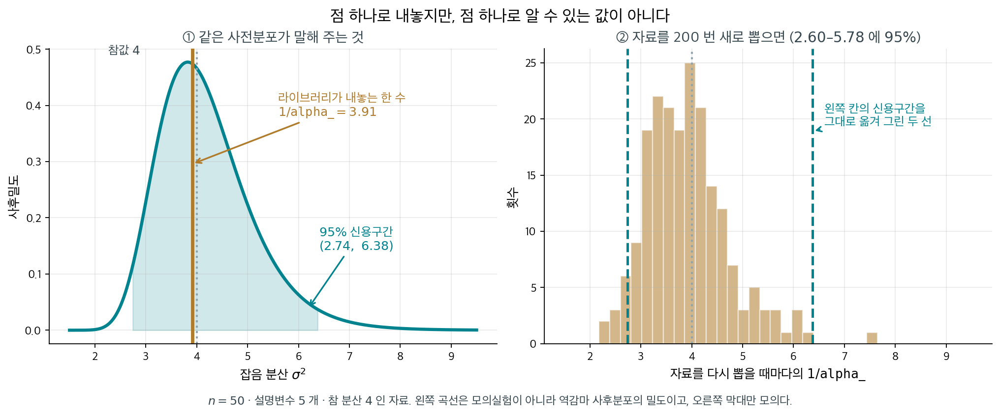
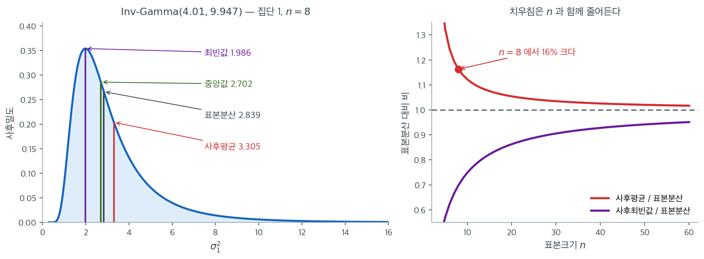
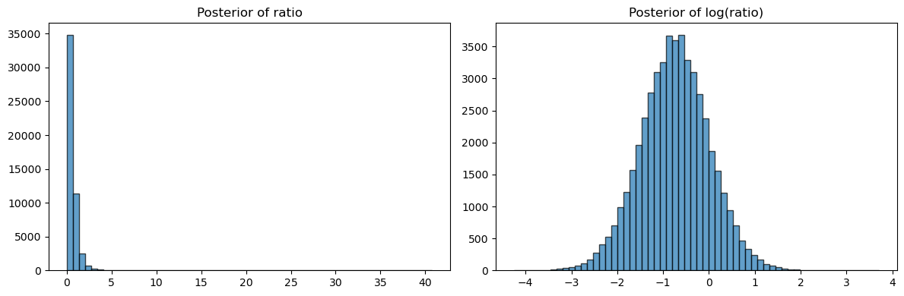

# Bayes 분산 검정

빈도주의 분산 검정은 표집분포와 $p$값에 기댄다. Bayes 접근은 근본적으로 다른 관점을 취한다. 모분산 $\sigma^2$을 사전분포를 갖는 확률변수로 취급하고, 관측 자료로 이 분포를 갱신한 뒤, 그 결과인 사후분포를 통해 추론한다. 이 틀은 $\sigma^2$에 대한 불확실성을 수량화하고 집단 간 분산을 비교하는 자연스러운 방법을 제공한다.

!!! note "사전분포가 처음이라면"

    이 쪽은 사전분포·사후분포·켤레 사전분포를 **이미 아는 것으로 보고** 분산 하나에 적용한다.
    그 틀 자체는 [6.3 베이즈 추정 ★](../../ch06/bayesian/prior_posterior.md)이 세운다 —
    모수에 분포를 주고 자료로 갱신한다는 발상, 켤레가 왜 편한지, MAP 가 무엇인지가 거기 있다.

---

## 1. 분산에 대한 켤레 사전분포

자료가 알려진 평균 $\mu$를 갖는 정규분포를 따를 때 분산 $\sigma^2$의 켤레 사전분포는 **역감마**분포이다.

$$
\sigma^2 \sim \text{Inv-Gamma}(\alpha_0, \beta_0)
$$

밀도는

$$
p(\sigma^2) = \frac{\beta_0^{\alpha_0}}{\Gamma(\alpha_0)} (\sigma^2)^{-\alpha_0 - 1} \exp\!\left(-\frac{\beta_0}{\sigma^2}\right), \quad \sigma^2 > 0
$$

초모수 $\alpha_0 > 0$과 $\beta_0 > 0$이 사전 믿음을 부호화한다.

- $\alpha_0$은 사전분포의 강도를 조절한다($\alpha_0$이 클수록 사전 믿음이 강하다)
- $\beta_0 / \alpha_0$은 $\sigma^2$의 사전 기댓값을 근사한다($\alpha_0$이 클 때)
- 사전평균은 $\alpha_0 > 1$일 때 $E[\sigma^2] = \beta_0 / (\alpha_0 - 1)$이다

흔히 쓰는 약정보 선택은 $\alpha_0 = \beta_0 = 0.01$(또는 $\alpha_0 = \beta_0 = 0.001$)이며, 자료가 지배하도록 하는 확산 사전분포를 만든다.

!!! note "$\alpha_0$을 "가상 관측값 수"로 읽기"
    사후 갱신식 $\alpha_n = \alpha_0 + (n-1)/2$을 보면 $\alpha_0$이 자유도의 절반 단위로 더해진다. 곧 **사전분포는 약 $2\alpha_0$개의 관측값에 해당하는 정보를 담는다.**

    $\alpha_0 = 0.01$이면 관측값 0.02개어치이므로 사실상 무정보이다. $\alpha_0 = 50$이면 관측값 100개어치이므로 $n = 100$인 자료와 대등한 영향력을 갖는다(연습문제 3 참조).

이 "가상 관측값" 해석이 말뿐이 아니라는 것을 그림으로 확인하자. 연습문제 1의 자료($n = 20$, $\sum(x_i-\bar{x})^2 = 180$, 곧 $s^2 = 9.474$)를 고정해 놓고 사전평균만 4로 두고 사전분포의 **강도** $\alpha_0$을 바꾼다.


왼쪽에서 초록($\alpha_0 = 0.001$)은 사실상 자료만으로 만든 사후분포다. 봉우리가 표본분산 $9.474$ 근처에 있다. 빨강($\alpha_0 = 40$)은 사전평균 4 쪽으로 완전히 끌려가 봉우리가 5 부근이고 폭도 훨씬 좁다. **같은 자료인데 사전분포만 바꾸어 결론이 두 배 가까이 달라졌다.**

오른쪽이 그 관계를 하나의 곡선으로 요약한다. 가로축이 $2\alpha_0$, 곧 사전분포가 담고 있다는 가상 관측값의 수다. $2\alpha_0 = 0$에서 사후평균은 표본분산 근처이고, $2\alpha_0$가 커질수록 사전평균 4로 단조롭게 내려간다.

주목할 곳은 보라색 세로선이다. $2\alpha_0 = 19$, 곧 자료의 자유도 $n - 1$과 같아지는 지점에서 사후평균이 $7.11$이다. 표본분산 $9.474$와 사전평균 $4$의 대략 중간이다. **사전분포와 자료가 정확히 같은 무게를 갖는 자리**이며, $\alpha_n = \alpha_0 + (n-1)/2$라는 갱신식이 문자 그대로 말하던 것이 이 그림이다.

실무적 함의는 두 가지다. 첫째, 사전분포를 고를 때 $\alpha_0$을 "얼마나 믿는가"가 아니라 **"관측값 몇 개어치를 보태는가"**로 바꿔 생각하면 판단이 훨씬 쉬워진다. 둘째, $n$이 작을수록 같은 $\alpha_0$의 영향력이 커진다. $n = 20$에서 $\alpha_0 = 10$은 자료를 압도하지만 $n = 500$에서는 거의 보이지 않는다.

---

## 2. 사후분포

$\mu$가 알려진 관측값 $X_1, \ldots, X_n \sim N(\mu, \sigma^2)$이 주어지면 $\sigma^2$의 사후분포도 역감마이다.

$$
\sigma^2 \mid X_1, \ldots, X_n \sim \text{Inv-Gamma}(\alpha_n, \beta_n)
$$

여기서

$$
\alpha_n = \alpha_0 + \frac{n}{2}, \qquad \beta_n = \beta_0 + \frac{1}{2}\sum_{i=1}^{n}(X_i - \mu)^2
$$

$\mu$를 모르는 (보통의) 경우에는 $\mu$를 $\bar{X}$로 바꾸고 자유도 $n - 1$을 쓴다.

$$
\alpha_n = \alpha_0 + \frac{n - 1}{2}, \qquad \beta_n = \beta_0 + \frac{(n-1)S^2}{2}
$$

!!! warning "두 공식을 섞지 말라"
    $\mu$를 아는 경우는 $\alpha_n = \alpha_0 + n/2$, 모르는 경우는 $\alpha_n = \alpha_0 + (n-1)/2$이다. $\beta_n$의 제곱합도 각각 $\sum(X_i-\mu)^2$과 $\sum(X_i-\bar X)^2 = (n-1)S^2$으로 다르다.

    실무에서는 거의 항상 $\mu$를 모르므로 두 번째 공식을 쓴다. $n$과 $n-1$을 혼동하면 $n$이 작을 때 결과가 눈에 띄게 달라진다.

이 켤레성 덕분에 사후분포가 닫힌 형태를 가지므로 계산이 간단하다.

---

## 3. Bayes 신용구간

$\sigma^2$의 $100(1-\alpha)\%$ 신용구간은 다음을 만족하는 구간 $[L, U]$이다.

$$
P(L \le \sigma^2 \le U \mid \text{자료}) = 1 - \alpha
$$

역감마 사후분포에서는 $\text{Inv-Gamma}(\alpha_n, \beta_n)$의 분위수로 신용구간을 얻는다.

!!! note "신용구간과 신뢰구간"
    Bayes 신용구간은 직접적인 확률 해석을 갖는다. 자료와 사전분포가 주어졌을 때 $\sigma^2$이 그 구간 안에 있을 확률이 $(1-\alpha)$이다. 빈도주의 신뢰구간은 그런 주장을 하지 않는다. 반복된 표본의 $(1-\alpha)$에서 절차가 $\sigma^2$을 포함한다는 뜻이다. 확산 사전분포에서는 두 구간이 수치적으로 비슷하다.

    연습문제 1에서 확산 사전분포를 쓰면 두 구간이 소수 셋째 자리까지 **일치**함을 확인한다.


왼쪽은 같은 자료($n = 20$, $\sum(x_i-\bar{x})^2 = 180$)에 $\text{Inv-Gamma}(0.001, 0.001)$을 쓴 사후분포다. 95% 신용구간이 $(5.479,\ 20.207)$이고 빈도주의 신뢰구간이 $(5.479,\ 20.210)$이다. **소수 셋째 자리까지 같다.** 우연이 아니라 확산 사전분포에서 사후분포 $\text{Inv-Gamma}(\alpha_0 + (n-1)/2,\ \beta_0 + (n-1)S^2/2)$가 $(n-1)S^2/\chi^2_{n-1}$의 분포와 사실상 같아지기 때문이다.

같은 숫자라고 해서 같은 말은 아니다. **신용구간은 "$\sigma^2$이 이 구간에 있을 확률이 0.95"라고 말하고, 신뢰구간은 "이 절차를 반복하면 95%가 참값을 덮는다"고 말한다.** 전자는 이 한 번의 자료에 대한 진술이고 후자는 절차의 장기 성질에 대한 진술이다. 숫자가 겹치는 것은 확산 사전분포라는 특수한 상황의 결과일 뿐이며, 사전분포가 정보를 담기 시작하면 두 구간은 곧바로 갈라진다.

오른쪽은 자유도를 잘못 썼을 때다. $\mu$를 모르는데도 $\alpha_n = \alpha_0 + n/2$를 쓰면 구간이 $(5.27,\ 18.77)$로 **위쪽이 눈에 띄게 짧아진다.** 자료가 주지 않은 정보 한 조각을 있다고 친 셈이라 불확실성이 과소평가된 것이다. $n$이 작을수록 이 차이가 커지므로, 평균을 자료에서 추정했다면 반드시 $(n-1)/2$를 써야 한다.

---

<div class="aibox" markdown>

**AI로 보는 통계학 1.** 사전분포는 인자로 받아 놓고 사후분포는 돌려주지 않는다

절 $1$ 의 $\sigma^2 \sim \text{Inv-Gamma}(\alpha_0, \beta_0)$ 은 교과서 안에만 있는
식이 아니다. 널리 쓰이는 회귀 추정기 하나를 열어 보면 그 두 수가 **인자 이름으로**
들어 있다.

```python
from sklearn.linear_model import BayesianRidge
BayesianRidge(alpha_1=1e-6, alpha_2=1e-6,     # 잡음 정밀도에 걸린 감마 사전분포
              lambda_1=1e-6, lambda_2=1e-6)   # 계수 정밀도에 걸린 감마 사전분포
```

문서는 `alpha_1` 을 「`alpha` 에 대한 감마 사전분포의 모양 모수」, `alpha_2` 를 그
「비율 모수」라 적어 두었고, 여기서 `alpha` 는 **잡음의 정밀도** $1/\sigma^2$ 다.
정밀도가 $\text{Gamma}(\alpha_0, \beta_0)$ 이면 분산은 $\text{Inv-Gamma}(\alpha_0,
\beta_0)$ 이므로 — 이 쪽의 절 $1$ 이 적은 그 식이다 — 두 인자는 $(\alpha_0, \beta_0)$
**바로 그것이다.** 기본값 $10^{-6}$ 을 절 $1$ 의 「관측값 $2\alpha_0$ 개어치」로 읽으면
$0.000002$ 개어치, 곧 무정보다.

적합이 끝나면 `alpha_` 한 수가 남고, 사람들은 $1/\mathtt{alpha\_}$ 를 「모형이 배운
잡음 분산」이라 부르며 보고서에 적는다.

```python
import numpy as np
from scipy import stats
from sklearn.linear_model import BayesianRidge

rng = np.random.default_rng(15)
n, p = 50, 5                                   # 참 잡음분산은 4 로 둔다
X = rng.normal(size=(n, p))
y = X @ np.array([2.0, -1.5, 1.0, 0.0, 0.5]) + rng.normal(0, 2.0, n)

br = BayesianRidge().fit(X, y)                 # 기본 사전분포 네 개 모두 1e-6
Xd = np.c_[np.ones(n), X]
r = y - Xd @ np.linalg.lstsq(Xd, y, rcond=None)[0]
rss, df = r @ r, n - p - 1
an, bn = 1e-6 + df / 2, 1e-6 + rss / 2         # 절 2 의 갱신식 그대로
lo, hi = stats.invgamma.ppf([0.025, 0.975], a=an, scale=bn)

# 한글은 고정폭에서 두 칸을 차지하므로 자리맞춤은 공백을 직접 적는다
print(f"1/alpha_        = {1 / br.alpha_:.3f}")
print(f"RSS/(n-p-1)     = {rss / df:.3f}")
print(f"사후평균        = {bn / (an - 1):.3f}")
print(f"95% 신용구간    = ({lo:.3f}, {hi:.3f})")
```

출력:

```
1/alpha_        = 3.912
RSS/(n-p-1)     = 3.996
사후평균        = 4.187
95% 신용구간    = (2.739, 6.377)
```

앞의 세 수는 서로 가깝다. 무정보 사전분포에서는 그래야 맞다 — 절 $3$ 이 말한 그대로
사후분포가 자료만으로 만들어진다. **문제는 라이브러리가 멈추는 자리다.** 사전분포를
인자 넷으로 받아 놓고 내놓는 것은 점 하나뿐이고, 그 점이 얼마나 흔들리는지는 말하지
않는다. 절 $2$ 의 갱신식과 절 $3$ 의 분위수, 코드 두 줄이면 나오는 구간이
$(2.74,\ 6.38)$ 이다. **위쪽이 아래쪽의 $2.3$ 배다.**

<figure markdown>
{ width="960" }
  <figcaption markdown>오른쪽 막대에 겹쳐 그린 점선 둘이 왼쪽 칸의 신용구간 $(2.74,\ 6.38)$ 이다.</figcaption>
</figure>

오른쪽 칸이 그 구간을 적어야 할 까닭이다. 같은 설정으로 자료를 $200$ 번 새로 뽑아
$1/\mathtt{alpha\_}$ 를 다시 재면 $95\%$ 가 $2.60$ 과 $5.78$ 사이에 떨어진다. **한 벌의
자료에서 얻은 신용구간과 거의 같은 폭이다.** 곧 「배운 잡음 분산 $3.91$」은 다음 자료에서
$3$ 이 될 수도 $5.5$ 가 될 수도 있는 수이고, 소수 둘째 자리까지 적어 둘 이유가 없다.

쓸 때 걸리는 곳이 둘이다.

- **`alpha_` 는 사후평균이 아니다.** 주변가능도를 최대화해 얻은 점이고, 계수에 걸린
  축소가 잔차를 키우면 그만큼 함께 끌려간다. 여기서는 축소가 약해 $3.912$ 가 최소제곱의
  불편추정 $3.996$ 에 붙었지만, 설명변수가 많아 축소가 세지면 둘이 갈라진다.
- **`alpha_1`, `alpha_2` 는 정규화 세기처럼 생겼지만 분산에 대한 믿음이다.** 절 $1$ 의
  셈으로 $\alpha_0 = 25$ 는 관측값 $50$ 개어치이고, 잡음분산이 $1$ 쯤이라는 그 사전분포를
  $n = 50$ 인 이 자료에 주면 사후평균이 $4.19$ 에서 $2.46$ 으로 내려간다. 자료의 절반을
  손으로 적어 넣는 일인데, 격자탐색의 한 칸처럼 보인다.

그리고 이 모든 것은 **잡음이 정규이고 분산이 모든 점에서 같다**는 가정 위에서만 뜻이
있다. 그 가정이 깨지면 $1/\mathtt{alpha\_}$ 는 그저 평균적인 잡음이고, 정작 봐야 할 것은
15.7절 [회귀에서의 분산 검정](../applications/regression_variance.md)이 보는 쪽이다.

</div>

---

## 4. Bayes 가설검정

$H_0\colon \sigma^2 = \sigma_0^2$을 $H_1\colon \sigma^2 \neq \sigma_0^2$에 대해 검정하려면 Bayes 접근은 $H_0$의 사후확률을 계산하거나 **Bayes 인자**를 쓴다.

$$
\text{BF}_{01} = \frac{p(\text{자료} \mid H_0)}{p(\text{자료} \mid H_1)}
$$

여기서 $p(\text{자료} \mid H_0)$은 $H_0$ 아래의 주변가능도($\sigma^2$이 $\sigma_0^2$으로 고정)이고 $p(\text{자료} \mid H_1)$은 $\sigma^2$의 사전분포에 대해 가능도를 적분한 것이다.

두 분산을 비교하는 더 간단한 접근은 분산비의 사후분포를 쓰는 것이다. $\sigma_1^2$과 $\sigma_2^2$의 독립인 사후분포가 주어지면

$$
R = \frac{\sigma_1^2}{\sigma_2^2}
$$

를 계산한다. $R$의 $95\%$ 신용구간이 1을 포함하면 자료가 등분산과 일관된다.

---

## 5. 두 분산 비교

역감마 사후분포를 갖는 독립인 두 집단에 대해

$$
\sigma_1^2 \mid \text{자료}_1 \sim \text{Inv-Gamma}(\alpha_{n_1}, \beta_{n_1})
$$

$$
\sigma_2^2 \mid \text{자료}_2 \sim \text{Inv-Gamma}(\alpha_{n_2}, \beta_{n_2})
$$

비 $R = \sigma_1^2 / \sigma_2^2$은 사실 **닫힌 형태를 갖는다.** 독립인 두 역감마의 비는 척도변환된 $F$ 분포다:

$$
R = \frac{\sigma_1^2}{\sigma_2^2} \sim \frac{\beta_{n_1}\,\alpha_{n_2}}{\beta_{n_2}\,\alpha_{n_1}}\; F(2\alpha_{n_2},\, 2\alpha_{n_1})
$$

$\sigma^2 \sim \text{Inv-Gamma}(\alpha, \beta)$이면 $1/\sigma^2 \sim \text{Gamma}(\alpha, \text{rate}=\beta)$이고, 독립인 두 감마의 비가 $F$가 되는 표준 결과를 쓰면 바로 나온다. 그러므로 사후확률과 신뢰구간을 모의실험 없이 $F$ 분포함수로 바로 구할 수 있다.

그래도 몬테카를로 표집을 쓰는 이유는 **이 꼴이 켤레 사전분포에만 통하기** 때문이다. 사전분포를 바꾸거나 모수를 하나 더 넣으면 닫힌 꼴이 사라지지만 표집은 그대로 쓸 수 있다. 아래는 그 일반적인 방법이고, 닫힌 꼴은 그 결과를 검산하는 데 쓴다. 첫 사후분포에서 $\sigma_1^{2(b)}$을, 둘째에서 $\sigma_2^{2(b)}$을 뽑고 $b = 1, \ldots, B$에 대해 $R^{(b)} = \sigma_1^{2(b)} / \sigma_2^{2(b)}$을 계산한다.

$\sigma_1^2 > \sigma_2^2$일 사후확률은

$$
P(\sigma_1^2 > \sigma_2^2 \mid \text{자료}) \approx \frac{1}{B}\sum_{b=1}^{B} \mathbf{1}(R^{(b)} > 1)
$$

<div class="exbox" markdown>

**보기 1.** <span class="diff easy" title="쉬움"></span> 분산의 베이즈 추정. 관측값 $n = 20$개의 표본분산이 $S^2 = 15.3$이다. 약정보 사전분포 $\sigma^2 \sim \text{Inv-Gamma}(0.01, 0.01)$을 쓰면

</div>

??? success "풀이"
    $$
    \alpha_n = 0.01 + \frac{19}{2} = 9.51
    $$

    $$
    \beta_n = 0.01 + \frac{19 \times 15.3}{2} = 145.36
    $$

    사후분포는 $\sigma^2 \mid \text{자료} \sim \text{Inv-Gamma}(9.51, 145.36)$이다.

    사후평균은 $\beta_n / (\alpha_n - 1) = 145.36 / 8.51 = 17.08$로 표본분산 15.3보다 크다. 이 차이는 사전분포의 영향이 아니라(사전분포는 거의 무정보이다) **역감마분포가 오른쪽으로 치우쳐 있어서 평균이 최빈값보다 크기** 때문이다. 최빈값은 $\beta_n/(\alpha_n+1) = 145.36/10.51 = 13.83$이고 중앙값은 $15.84$이다.

<div class="exbox" markdown>

**보기 2.** <span class="diff easy" title="쉬움"></span> 분산의 사후분포와 신용구간. 보기 1 의 자료($n = 20$, $S^2 = 15.3$, $\text{Inv-Gamma}(0.01, 0.01)$)를 쓴다.

**(1)** 추축량 $2\beta_n/\sigma^2 \sim \chi^2_{2\alpha_n}$ 을 끌어내 신용구간을 적고, **확산 사전분포에서 그것이 빈도주의 신뢰구간과 거의 같아지는 까닭**을 밝히시오. 또 두 구간 모두 **상한/하한 비가 자료와 무관**함과 사후 최빈값/평균의 비가 $\dfrac{\alpha_n-1}{\alpha_n+1}$ 임을 보이시오.

**(2)** 두 집단의 비 $R = \sigma_1^2/\sigma_2^2$ 의 사후분포도 **닫힌 꼴로 적힌다**는 것을 보이고($\alpha$ 가 서로 달라도 된다), 몬테카를로 추정값이 그 닫힌 꼴과 맞는지 확인하시오.

</div>

??? success "풀이"

    **(1) 추축량을 꺼낸다.** $V \sim \text{Inv-Gamma}(\alpha, \beta)$ 이면 $1/V \sim \text{Gamma}(\alpha, \text{rate } \beta)$ 이고, 감마의 척도를 두 배로 늘리면 비율모수가 $1/2$ 이 되어

    $$
    \frac{2\beta}{V} \sim \text{Gamma}\!\left(\alpha, \text{rate } \tfrac12\right) = \chi^2_{2\alpha}
    $$

    이다. 사후분포에 적용하면 $2\beta_n/\sigma^2 \sim \chi^2_{2\alpha_n}$ 이고, 이 추축량을 뒤집으면 등꼬리 신용구간이

    $$
    \left(\frac{2\beta_n}{\chi^2_{0.975,\,2\alpha_n}},\;
    \frac{2\beta_n}{\chi^2_{0.025,\,2\alpha_n}}\right)
    $$

    로 적힌다.

    **빈도주의와 거의 같아지는 까닭.** $\mu$ 를 모르는 경우의 갱신식은 $\alpha_n = \alpha_0 + \frac{n-1}{2}$, $\beta_n = \beta_0 + \frac{(n-1)S^2}{2}$ 이므로

    $$
    2\alpha_n = 2\alpha_0 + (n-1), \qquad 2\beta_n = 2\beta_0 + (n-1)S^2
    $$

    이다. $\alpha_0 = \beta_0 \to 0$ 이면 $2\alpha_n \to n-1$, $2\beta_n \to (n-1)S^2$ 가 되어 위 구간이

    $$
    \left(\frac{(n-1)S^2}{\chi^2_{0.975,\,n-1}},\;
    \frac{(n-1)S^2}{\chi^2_{0.025,\,n-1}}\right)
    $$

    로, 곧 15.2절의 빈도주의 신뢰구간과 **글자 하나까지 같은 식**이 된다. 빈도주의는 $(n-1)S^2/\sigma^2 \sim \chi^2_{n-1}$ 을 표집분포로 읽고 베이즈는 같은 양을 사후분포로 읽는데, 확산 사전분포에서는 그 두 읽기가 **같은 수**를 준다. $\alpha_0 = \beta_0 = 0.01$ 은 $0$ 이 아니므로 완전히 같지는 않고, $2\alpha_n = 19.02$ 대 $19$, $2\beta_n = 290.72$ 대 $290.70$ 만큼 비껴 있다.

    **상한/하한 비는 자료와 무관하다.** 두 구간 모두

    $$
    \frac{U}{L} = \frac{\chi^2_{0.975,\,d}}{\chi^2_{0.025,\,d}}
    $$

    인데 분자의 $2\beta_n$ (또는 $(n-1)S^2$)이 약분되기 때문이다. **자료는 구간의 위치만 정하고 그 상대적 폭은 자유도가 혼자 정한다.** 8장이 다룬 사실이며, 여기서는 $d = 2\alpha_n$ 인지 $d = n-1$ 인지만 다르다.

    **최빈값과 평균의 비.** 역감마의 최빈값은 $\beta_n/(\alpha_n+1)$, 평균은 $\beta_n/(\alpha_n-1)$ 이므로 $\beta_n$ 이 약분되어

    $$
    \frac{\text{최빈값}}{\text{평균}} = \frac{\alpha_n - 1}{\alpha_n + 1} < 1
    $$

    이다. **자료와 무관하게 평균이 최빈값보다 크다.** $\alpha_n$ 이 작을수록, 곧 $n$ 이 작을수록 비가 1 에서 멀어진다. 중앙값은 그 사이에 놓이는데 이것은 닫힌 꼴이 없으므로 수치로 확인한다.

    **(2) 비의 사후분포도 닫힌 꼴이다.** (1)의 추축량을 두 집단에 쓰면 $\sigma_i^2 = 2\beta_{n_i}/W_i$, $W_i \sim \chi^2_{2\alpha_{n_i}}$ 이고 두 집단이 독립이므로

    $$
    R = \frac{\sigma_1^2}{\sigma_2^2}
    = \frac{\beta_{n_1}}{\beta_{n_2}}\cdot\frac{W_2}{W_1}
    = \frac{\beta_{n_1}}{\beta_{n_2}}\cdot\frac{\alpha_{n_2}}{\alpha_{n_1}}
    \cdot\frac{W_2/(2\alpha_{n_2})}{W_1/(2\alpha_{n_1})}
    $$

    이다. 맨 끝의 비는 정의상 $F(2\alpha_{n_2},\, 2\alpha_{n_1})$ 이므로

    $$
    R \;\sim\; \frac{\beta_{n_1}\alpha_{n_2}}{\beta_{n_2}\alpha_{n_1}}\;
    F\bigl(2\alpha_{n_2},\, 2\alpha_{n_1}\bigr)
    $$

    가 된다. **두 집단의 $\alpha$ 가 달라도 성립한다.** 자유도만 비대칭으로 들어갈 뿐이다. 그러므로 신용구간과 $P(R>1)$ 도 손으로 적힌다.

    $$
    P(R > 1) = P\!\left(F(2\alpha_{n_2}, 2\alpha_{n_1}) > \frac{\beta_{n_2}\alpha_{n_1}}{\beta_{n_1}\alpha_{n_2}}\right)
    $$

    몬테카를로는 이 값을 $1/\sqrt B$ 만큼 흐려 돌려줄 뿐이다. 아래에서 그것을 확인한다.

    ```python
    import numpy as np
    from scipy import stats

    # 자료 요약값만 있으면 된다.
    n = 20
    s_squared = 15.3

    # 거의 정보를 주지 않는 사전분포. 값이 작을수록 사후분포가 자료에 맡겨진다.
    alpha_0, beta_0 = 0.01, 0.01

    # 역감마는 정규분포 분산의 켤레사전분포이므로 사후분포도 역감마다.
    # 평균을 모르는 경우라 자유도가 n-1 로 들어간다.
    alpha_n = alpha_0 + (n - 1) / 2
    beta_n = beta_0 + (n - 1) * s_squared / 2

    # 역감마는 오른쪽으로 치우쳐 있어 평균·최빈값·중앙값이 모두 다르다.
    # 어느 것을 점추정값으로 쓸지는 손실함수에 달렸다.
    print(f"Posterior: Inv-Gamma({alpha_n}, {beta_n:.2f})")
    print(f"Posterior mean:   {beta_n / (alpha_n - 1):.4f}")
    print(f"Posterior mode:   {beta_n / (alpha_n + 1):.4f}")
    print(f"Posterior median: {stats.invgamma.median(a=alpha_n, scale=beta_n):.4f}")

    # 95% 신용구간: 사후분포의 2.5·97.5 백분위점
    ci_lower = stats.invgamma.ppf(0.025, a=alpha_n, scale=beta_n)
    ci_upper = stats.invgamma.ppf(0.975, a=alpha_n, scale=beta_n)
    print(f"95% credible interval: ({ci_lower:.4f}, {ci_upper:.4f})")

    # 빈도주의 신뢰구간과 견준다. 사전분포가 거의 무정보이므로 두 구간이
    # 거의 겹친다. 다만 읽는 법이 다르다 — 신용구간은 "모수가 이 안에 있을
    # 확률이 95%"라고 그대로 말할 수 있다.
    fl = (n - 1) * s_squared / stats.chi2.ppf(0.975, n - 1)
    fu = (n - 1) * s_squared / stats.chi2.ppf(0.025, n - 1)
    print(f"95% confidence interval: ({fl:.4f}, {fu:.4f})")

    # 두 분산을 견주는 일은 베이즈 쪽에서 특히 간단하다. 두 사후분포에서
    # 뽑아 나누기만 하면 비의 사후분포가 나온다.
    rng = np.random.default_rng(42)
    alpha_n1, beta_n1 = 9.51, 145.36   # 집단 1 의 사후 모수
    alpha_n2, beta_n2 = 12.01, 120.10  # 집단 2 의 사후 모수

    sigma1_samples = stats.invgamma.rvs(a=alpha_n1, scale=beta_n1,
                                        size=10000, random_state=rng)
    sigma2_samples = stats.invgamma.rvs(a=alpha_n2, scale=beta_n2,
                                        size=10000, random_state=rng)

    ratio = sigma1_samples / sigma2_samples
    print(f"P(sigma1^2 > sigma2^2 | data) = {np.mean(ratio > 1):.3f}")
    print(f"95% credible interval for ratio: "
          f"({np.percentile(ratio, 2.5):.3f}, {np.percentile(ratio, 97.5):.3f})")

    # === (1) 추축량 2 beta_n / sigma^2 ~ chi2(2 alpha_n) 인가 ===
    print(f"\n--- (1) 추축량과 두 구간 ---")
    print(f"2 a_n = {2 * alpha_n:.2f}   (무정보 극한 n-1 = {n - 1})")
    print(f"2 b_n = {2 * beta_n:.2f}  (무정보 극한 (n-1)s^2 = {(n - 1) * s_squared:.2f})")
    piv = 2 * beta_n / stats.chi2(2 * alpha_n).ppf([0.975, 0.025])
    print(f"역감마 분위수로    : ({ci_lower:.6f}, {ci_upper:.6f})")
    print(f"2b_n/chi2(2a_n) 로 : ({piv[0]:.6f}, {piv[1]:.6f})")
    print(f"상한/하한  신용 {ci_upper / ci_lower:.6f}   신뢰 {fu / fl:.6f}")
    print(f"  chi2 분위수 비 (자료와 무관)")
    print(f"    d = 2a_n = {2 * alpha_n:.2f}: "
          f"{stats.chi2(2 * alpha_n).ppf(0.975) / stats.chi2(2 * alpha_n).ppf(0.025):.6f}")
    print(f"    d = n-1  = {n - 1}   : "
          f"{stats.chi2(n - 1).ppf(0.975) / stats.chi2(n - 1).ppf(0.025):.6f}")
    print(f"최빈값/평균 = (a_n-1)/(a_n+1) = {(alpha_n - 1) / (alpha_n + 1):.6f}"
          f"   실제 {(beta_n / (alpha_n + 1)) / (beta_n / (alpha_n - 1)):.6f}")

    # === (2) 비의 사후분포는 척도를 바꾼 F 분포다 ===
    print(f"\n--- (2) 비의 닫힌 꼴 ---")
    sc = (beta_n1 / beta_n2) * (alpha_n2 / alpha_n1)
    Fd = stats.f(2 * alpha_n2, 2 * alpha_n1)
    print(f"R ~ (b1/b2)(a2/a1) x F(2a2, 2a1) = {sc:.6f} x F({2 * alpha_n2:.2f}, {2 * alpha_n1:.2f})")
    print("                 닫힌 꼴    모의 1만개       표준오차")
    for name, closed, mc, se in (
            ("q(0.025)", sc * Fd.ppf(0.025), np.percentile(ratio, 2.5),
             np.sqrt(0.025 * 0.975 / 10000) / (Fd.pdf(Fd.ppf(0.025)) / sc)),
            ("median  ", sc * Fd.ppf(0.5), np.median(ratio),
             np.sqrt(0.25 / 10000) / (Fd.pdf(Fd.ppf(0.5)) / sc)),
            ("q(0.975)", sc * Fd.ppf(0.975), np.percentile(ratio, 97.5),
             np.sqrt(0.975 * 0.025 / 10000) / (Fd.pdf(Fd.ppf(0.975)) / sc)),
            ("P(R>1)  ", Fd.sf(1 / sc), np.mean(ratio > 1),
             np.sqrt(Fd.sf(1 / sc) * Fd.cdf(1 / sc) / 10000)),
            ("mean    ", (beta_n1 / (alpha_n1 - 1)) * (alpha_n2 / beta_n2), ratio.mean(),
             ratio.std(ddof=1) / 100)):
        print(f"  {name}   {closed:10.6f}  {mc:12.6f}   +-{se:.5f}  ({abs(closed - mc) / se:.2f} SE)")

    ks = stats.kstest(ratio / sc, Fd.cdf)
    print(f"KS: 모의표본을 {sc:.4f} 로 나눈 것이 F({2 * alpha_n2:.2f},{2 * alpha_n1:.2f}) 인가")
    print(f"  KS = {ks.statistic:.6f},  p = {ks.pvalue:.4f}")
    ```

    출력:

    ```text
    Posterior: Inv-Gamma(9.51, 145.36)
    Posterior mean:   17.0811
    Posterior mode:   13.8306
    Posterior median: 15.8365
    95% credible interval: (8.8422, 32.5915)
    95% confidence interval: (8.8487, 32.6390)
    P(sigma1^2 > sigma2^2 | data) = 0.835
    95% credible interval for ratio: (0.644, 3.674)

    --- (1) 추축량과 두 구간 ---
    2 a_n = 19.02   (무정보 극한 n-1 = 19)
    2 b_n = 290.72  (무정보 극한 (n-1)s^2 = 290.70)
    역감마 분위수로    : (8.842184, 32.591487)
    2b_n/chi2(2a_n) 로 : (8.842184, 32.591487)
    상한/하한  신용 3.685909   신뢰 3.688572
      chi2 분위수 비 (자료와 무관)
        d = 2a_n = 19.02: 3.685909
        d = n-1  = 19   : 3.688572
    최빈값/평균 = (a_n-1)/(a_n+1) = 0.809705   실제 0.809705

    --- (2) 비의 닫힌 꼴 ---
    R ~ (b1/b2)(a2/a1) x F(2a2, 2a1) = 1.528496 x F(24.02, 19.02)
                     닫힌 꼴    모의 1만개       표준오차
      q(0.025)     0.652027      0.644370   +-0.00774  (0.99 SE)
      median       1.539898      1.530933   +-0.00848  (1.06 SE)
      q(0.975)     3.746550      3.674472   +-0.04754  (1.52 SE)
      P(R>1)       0.838272      0.835000   +-0.00368  (0.89 SE)
      mean         1.708108      1.699165   +-0.00804  (1.11 SE)
    KS: 모의표본을 1.5285 로 나눈 것이 F(24.02,19.02) 인가
      KS = 0.007850,  p = 0.5660
    ```

    **추축량이 정확히 맞는다.** 역감마 분위수로 잡은 신용구간 $(8.842184,\, 32.591487)$ 과 $2\beta_n/\chi^2_{2\alpha_n}$ 로 잡은 것이 소수점 여섯째 자리까지 같다.

    **두 구간이 사실상 일치한다.** 신용 $(8.8422,\, 32.5915)$, 신뢰 $(8.8487,\, 32.6390)$ 으로 상대차가 $0.07\%$ 와 $0.15\%$ 다. (1)이 예측한 대로 $2\alpha_n = 19.02$ 가 $n-1 = 19$ 와 거의 같고 $2\beta_n = 290.72$ 가 $(n-1)S^2 = 290.70$ 과 거의 같기 때문이다. **같은 식에 거의 같은 수를 넣었으니 거의 같은 답이 나온 것**이고, 사전분포가 정보를 담기 시작하면 이 일치는 즉시 깨진다.

    **상한/하한 비가 자료와 무관하다.** 신용 $3.685909$, 신뢰 $3.688572$ 이고, 각각 $\chi^2_{0.975,d}/\chi^2_{0.025,d}$ 를 $d = 19.02$ 와 $d = 19$ 에서 잰 값과 **소수점 여섯째 자리까지 같다**. $S^2 = 15.3$ 을 어떤 값으로 바꾸어도 이 비는 그대로다.

    **최빈값/평균이 공식과 정확히 같다.** $(\alpha_n-1)/(\alpha_n+1) = 0.809705$ 와 실제 비가 자리 하나까지 일치한다. 그리고 세 요약값의 순서가 최빈값 $13.8306$ < 중앙값 $15.8365$ < 평균 $17.0811$ 로, 중앙값이 과연 사이에 놓인다. 표본분산 $15.3$ 은 중앙값 바로 아래에 있다. **$n = 20$ 에서도 평균과 최빈값이 $24\%$ 벌어진다.** 한 숫자로 보고해야 한다면 중앙값이다.

    **(2)의 닫힌 꼴도 맞는다.** $R \sim 1.528496 \times F(24.02,\, 19.02)$ 가 예측한 다섯 값이 모의실험과 각각 $0.89$–$1.52$ 표준오차 안에서 맞는다. 다섯이 모두 같은 방향으로 조금 작은 것은 한 표본에서 계산한 양들이라 서로 상관되어 있기 때문이고, 분포가 정말 일치하는지는 콜모고로프–스미르노프 검정이 답한다. 모의표본을 $1.5285$ 로 나눈 것이 $F(24.02, 19.02)$ 와 구별되지 않는다($\text{KS} = 0.00785$, $p = 0.5660$). **비의 사후분포는 몬테카를로 없이 적을 수 있다.**

    **판정.** $P(R>1) = 0.8383$ 이고 $95\%$ 신용구간 $(0.652,\, 3.747)$ 이 1 을 담는다. 집단 1 의 분산이 더 클 사후확률이 $0.84$ 지만 구간이 $5.7$ 배에 걸쳐 있어 확정하기에는 부족하다.

---

## 6. 장점과 한계

**장점:**

- $\sigma^2$에 대한 직접적인 확률 진술(신용구간이 직관적으로 해석된다)
- 분야 지식에서 오는 사전정보를 반영할 수 있다
- 점근근사에 의존하지 않는다
- 사후표집으로 여러 분산을 비교하는 자연스러운 틀

**한계:**

- 사전분포를 지정해야 하며 그 선택이 논쟁적일 수 있다
- 켤레 분석이 정규성을 가정한다. 비정규 자료에는 더 복잡한 모형이 필요하다
- 모형이 복잡해지면 계산 비용이 늘어난다(MCMC로 다룰 수 있기는 하다)

**정규성 가정에 대한 유의.** 마지막 한계가 특히 중요하다. 켤레 역감마 분석은 정규 가능도에 기반하므로 **비정규성에 대한 취약성이 Bartlett 검정과 본질적으로 같다.** "Bayes 방법이므로 가정에서 자유롭다"는 오해를 경계해야 한다. 자료가 두꺼운 꼬리를 갖는다면 $t$ 가능도를 쓰는 모형으로 확장해야 하며, 그러면 켤레성이 깨져 MCMC가 필요하다.

---

## 7. 사전분포를 바꾸면 결론이 바뀐다

절 $2$ 의 갱신식과 절 $5$ 의 두 분산 비교를 코드로 옮긴다. 켤레 사전분포에서는
사후분포가 닫힌 꼴이므로 MCMC 가 필요 없고 **직접 뽑기**로 끝난다. 그 대신
확인할 것이 생긴다 — 뽑은 표본의 요약값이 닫힌 꼴과 맞는지, 그리고 사후분포가
치우쳐 있을 때 최빈값·중앙값·평균 가운데 무엇을 보고해야 하는지다.

### 정규-역감마 모형

각 집단 $i$에 대해 자료를 $x_{ij} \mid \mu_i, \sigma_i^2 \sim \mathcal{N}(\mu_i, \sigma_i^2)$로 모형화하고 켤레 사전분포를 둔다.

$$
\mu_i \mid \sigma_i^2 \sim \mathcal{N}\!\left(m_0,\; \frac{\sigma_i^2}{\kappa_0}\right), \qquad \sigma_i^2 \sim \text{Inv-Gamma}(\alpha_0, \beta_0)
$$

여기서 $m_0$, $\kappa_0$, $\alpha_0$, $\beta_0$은 초모수이다. 모호한 사전분포($\kappa_0 \approx 0$, $\alpha_0 \approx 0$, $\beta_0 \approx 0$)에서는 사후분포를 자료가 지배한다.

---

### 사후 갱신식

표본평균 $\bar{x}$와 편차제곱합 $S = \sum_{j=1}^{n}(x_j - \bar{x})^2$을 갖는 $n$개 관측값이 주어지면 사후 모수는

$$
\kappa_n = \kappa_0 + n, \qquad m_n = \frac{\kappa_0 m_0 + n \bar{x}}{\kappa_n}
$$

$$
\alpha_n = \alpha_0 + \frac{n}{2}, \qquad \beta_n = \beta_0 + \frac{1}{2}\left(S + \frac{\kappa_0 n}{\kappa_n}(\bar{x} - m_0)^2\right)
$$

분산의 주변 사후분포는

$$
\sigma_i^2 \mid \mathbf{x}_i \sim \text{Inv-Gamma}(\alpha_n,\, \beta_n)
$$

!!! note "$n/2$인가 $(n-1)/2$인가"
    여기서 $\alpha_n = \alpha_0 + n/2$인 것이 15.6절 [Bayes 분산 검정](./bayesian_variance.md)의 $\alpha_n = \alpha_0 + (n-1)/2$와 다르다. **두 모형이 다르기 때문이다.**

    - **15.6절**은 $\mu$에 사전분포를 두지 않고 $\bar{x}$로 대체한 뒤 자유도 $n-1$을 쓴다. 이 경우 무정보 극한에서 빈도주의 결과와 정확히 일치한다.
    - **여기**는 $\mu \mid \sigma^2 \sim \mathcal{N}(m_0, \sigma^2/\kappa_0)$이라는 결합 켤레 사전분포를 둔다. $\mu$를 적분해 내면 $\alpha_n = \alpha_0 + n/2$가 된다.

    $\kappa_0 \to 0$인 극한은 사전분포 $p(\mu, \sigma^2) \propto (\sigma^2)^{-\alpha_0 - 3/2}$에 해당하며, 표준적인 Jeffreys 사전분포 $p(\mu,\sigma^2) \propto 1/\sigma^2$과 다르다. 그래서 **신용구간이 빈도주의 신뢰구간보다 약간 좁게 나온다.**

    아래 보기에서 $\sigma_1^2$의 95% 신용구간은 $(1.133, 9.085)$인데 빈도주의 신뢰구간은 $(1.241, 11.761)$이다. 로그 척도 폭으로 $2.082$ 대 $2.249$로 **7% 좁다**. $n = 8$처럼 작은 표본에서 이 차이가 눈에 띈다.

    빈도주의 결과와 일치시키려면 $\alpha_0 = -1/2$로 두어 $\alpha_n = (n-1)/2$가 되게 하면 된다(부적절 사전분포이지만 사후분포는 적절하다).

<div class="exbox" markdown>

**보기 3.** <span class="diff easy" title="쉬움"></span> 사후분포에서 분산 뽑는 함수. 위의 갱신식을 그대로 옮기고, 기본 초모수를 $\kappa_0 = 10^{-6}$, $\alpha_0 = \beta_0 = 10^{-2}$ 로 두어 거의 정보를 주지 않는 사전분포를 쓴다.

**(1)** 이 기본값에서 사후분포가 **거의** $\text{Inv-Gamma}(n/2,\, S/2)$ 임을 보이고, 그 극한에서 추축량이 $S/\sigma^2 \sim \chi^2_n$ 이 됨을 보이시오. 빈도주의는 같은 자리에 $\chi^2_{n-1}$ 을 쓴다. 신용구간이 신뢰구간보다 **좁은** 까닭이 이것임을 밝히시오.

**(2)** `x1` 에 함수를 적용해 사전분포의 기여가 실제로 얼마나 작은지 수로 보이고, 신용구간과 신뢰구간의 로그 폭을 견주시오. $\alpha_0 = -1/2$ 로 두면 둘이 정확히 같아지는지 확인하시오.

</div>

??? success "풀이"

    **(1) 기본값에서 사전분포는 거의 사라진다.** 사후 초모수는

    $$
    \alpha_n = \alpha_0 + \frac n2, \qquad
    \beta_n = \beta_0 + \frac12\left(S + \frac{\kappa_0 n}{\kappa_0 + n}(\bar x - m_0)^2\right)
    $$

    이다. $\kappa_0 = 10^{-6}$ 이므로 $\dfrac{\kappa_0 n}{\kappa_0 + n} \approx \kappa_0 = 10^{-6}$ 이고, 평균 항은 $\tfrac12 \cdot 10^{-6}(\bar x - m_0)^2$ 로 $\bar x$ 가 10 남짓일 때 $10^{-4}$ 수준이다. $\alpha_0 = \beta_0 = 10^{-2}$ 도 작다. 그러므로

    $$
    \alpha_n \approx \frac n2, \qquad \beta_n \approx \frac S2
    $$

    이고, 사후분포는 **거의** $\text{Inv-Gamma}(n/2,\, S/2)$ 다.

    **추축량을 꺼내면 자유도가 드러난다.** $V \sim \text{Inv-Gamma}(a, b)$ 이면 $1/V \sim \text{Gamma}(a, \text{rate } b)$ 이고 척도를 두 배로 바꾸면 $2b/V \sim \text{Gamma}(a, \text{rate } \tfrac12) = \chi^2_{2a}$ 이므로

    $$
    \frac{2\beta_n}{\sigma^2} \;\sim\; \chi^2_{2\alpha_n}
    $$

    이다. 무정보 극한 $\alpha_n = n/2$, $\beta_n = S/2$ 를 넣으면

    $$
    \frac{S}{\sigma^2} \;\sim\; \chi^2_{n}
    $$

    이 된다. **빈도주의는 같은 $S$ 를 놓고 $S/\sigma^2 \sim \chi^2_{n-1}$ 을 쓴다.** 15.2절이 유도한 $(n-1)S^2/\sigma^2 \sim \chi^2_{n-1}$ 이 그것이고, $S = (n-1)s^2$ 이니 같은 양이다. **같은 자료에 자유도만 하나 다른 두 분포를 들이대는 것**이다.

    자유도가 하나 큰 쪽이 상대적으로 좁다. 구간의 꼴이 양쪽 모두

    $$
    \left(\frac{S}{\chi^2_{0.975,\,d}},\; \frac{S}{\chi^2_{0.025,\,d}}\right)
    $$

    이므로 **상한과 하한의 비가 $\chi^2_{0.975,d}/\chi^2_{0.025,d}$ 로 자료와 무관**하고($S$ 가 약분된다 — 8장이 다룬 사실이다), 이 비는 $d$ 가 커질수록 작아진다. 그래서 $d = n$ 쪽이 $d = n-1$ 쪽보다 좁다. 로그 척도의 폭이 바로 이 비의 로그다.

    까닭은 모형이 다른 데 있다. 이 쪽의 사전분포는 $\mu \mid \sigma^2 \sim \mathcal N(m_0, \sigma^2/\kappa_0)$ 라는 **결합** 켤레 사전분포이고, $\kappa_0 \to 0$ 극한은 $p(\mu,\sigma^2) \propto (\sigma^2)^{-\alpha_0-3/2}$ 에 해당해 표준 제프리스 사전분포 $1/\sigma^2$ 와 다르다. $(\sigma^2)^{-1/2}$ 하나가 더 붙어 있고, 그것이 자유도 하나로 나타난다. **빈도주의와 맞추려면** $\alpha_n = (n-1)/2$ 가 되게 $\alpha_0 = -1/2$ 로 두면 된다(부적절 사전분포이지만 사후분포는 적절하다).

    **(2) 수치적으로.** `x1` 에 함수를 적용한다.

    ```python
    import numpy as np
    from scipy.stats import invgamma

    def posterior_params(x, m0=0.0, k0=1e-6, a0=1e-2, b0=1e-2):
        """정규-역감마 켤레모형의 사후 모수를 구한다.

        기본값은 거의 정보를 주지 않는 사전분포다(k0, a0, b0 가 모두 작다).
        이러면 사후분포가 자료에 거의 전적으로 맡겨진다.
        """
        x = np.asarray(x, dtype=float)
        n = x.size
        xbar = x.mean()
        S = np.sum((x - xbar)**2)
        k_n = k0 + n
        m_n = (k0 * m0 + n * xbar) / k_n
        a_n = a0 + n / 2.0
        b_n = b0 + 0.5 * (S + (k0 * n / k_n) * (xbar - m0)**2)
        return m_n, k_n, a_n, b_n

    def draw_posterior_sigma2(x, n_draws=10000, rng=None):
        """분산의 사후분포에서 표본을 뽑는다.

        평균을 적분해 없앤 sigma^2 의 주변 사후분포가 역감마가 된다.
        그래서 MCMC 없이 바로 뽑을 수 있다.
        """
        if rng is None:
            rng = np.random.default_rng()
        m_n, k_n, a_n, b_n = posterior_params(x)
        sig2 = invgamma(a=a_n, scale=b_n).rvs(size=n_draws, random_state=rng)
        return sig2

    # === 사전분포의 기여가 얼마나 작은가 ===
    from scipy.stats import chi2

    x1 = np.array([12, 15, 14, 10, 13, 14, 12, 11], dtype=float)
    n = x1.size
    S = np.sum((x1 - x1.mean()) ** 2)
    m_n, k_n, a_n, b_n = posterior_params(x1)

    print(f"n = {n},  xbar = {x1.mean():.4f},  S = {S:.4f},  s^2 = {x1.var(ddof=1):.4f}")
    print(f"a_n = {a_n:.4f}   (무정보 극한 n/2 = {n / 2:.4f})")
    print(f"b_n = {b_n:.6f}   (무정보 극한 S/2 = {S / 2:.6f})")
    print(f"  b0 가 더한 것        = {1e-2:.6f}")
    print(f"  평균 항이 더한 것    = {0.5 * (1e-6 * n / k_n) * x1.mean() ** 2:.3e}")
    print(f"  둘을 합쳐 b_n 의 {100 * (b_n - S / 2) / b_n:.4f} %")

    # === 추축량: 2 b_n / sigma^2 ~ chi2(2 a_n) 인가 ===
    lo, hi = invgamma(a=a_n, scale=b_n).ppf([0.025, 0.975])
    piv = 2 * b_n / chi2(2 * a_n).ppf([0.975, 0.025])
    print(f"\n역감마 분위수로  : ({lo:.6f}, {hi:.6f})")
    print(f"2b_n/chi2(2a_n) 로: ({piv[0]:.6f}, {piv[1]:.6f})")

    # === 신용구간 대 빈도주의 신뢰구간 ===
    f_lo, f_hi = S / chi2(n - 1).ppf([0.975, 0.025])
    print(f"\n95% 신용구간      = ({lo:.3f}, {hi:.3f})      상한/하한 = {hi / lo:.4f}")
    print(f"95% 신뢰구간      = ({f_lo:.3f}, {f_hi:.3f})     상한/하한 = {f_hi / f_lo:.4f}")
    print(f"로그 폭           = {np.log(hi / lo):.4f} 대 {np.log(f_hi / f_lo):.4f}"
          f"   -> {100 * (1 - np.log(hi / lo) / np.log(f_hi / f_lo)):.1f} % 좁다")
    print(f"자유도 비교: 2a_n = {2 * a_n:.2f}  대  n-1 = {n - 1}")
    print(f"chi2 분위수 비 (자료와 무관): {chi2(2 * a_n).ppf(0.975) / chi2(2 * a_n).ppf(0.025):.4f}"
          f"  대  {chi2(n - 1).ppf(0.975) / chi2(n - 1).ppf(0.025):.4f}")

    # === a0 = -1/2 로 두면 빈도주의와 정확히 같아진다 ===
    g_lo, g_hi = invgamma(a=(n - 1) / 2, scale=S / 2).ppf([0.025, 0.975])
    print(f"\na0 = -1/2 (a_n = (n-1)/2) 신용구간 = ({g_lo:.6f}, {g_hi:.6f})")
    print(f"빈도주의 신뢰구간                  = ({f_lo:.6f}, {f_hi:.6f})")
    print(f"차 = {abs(g_lo - f_lo):.3e}, {abs(g_hi - f_hi):.3e}")

    # === 함수가 제대로 도는지 ===
    rng = np.random.default_rng(0)
    d = draw_posterior_sigma2(x1, n_draws=200_000, rng=rng)
    print(f"\n사후표본 20 만 개:  평균 {d.mean():.4f} (닫힌 꼴 {b_n / (a_n - 1):.4f}),  "
          f"중앙값 {np.median(d):.4f} (닫힌 꼴 {invgamma(a=a_n, scale=b_n).ppf(0.5):.4f})")
    ```

    출력:

    ```text
    n = 8,  xbar = 12.6250,  S = 19.8750,  s^2 = 2.8393
    a_n = 4.0100   (무정보 극한 n/2 = 4.0000)
    b_n = 9.947580   (무정보 극한 S/2 = 9.937500)
      b0 가 더한 것        = 0.010000
      평균 항이 더한 것    = 7.970e-05
      둘을 합쳐 b_n 의 0.1013 %

    역감마 분위수로  : (1.132684, 9.085126)
    2b_n/chi2(2a_n) 로: (1.132684, 9.085126)

    95% 신용구간      = (1.133, 9.085)      상한/하한 = 8.0209
    95% 신뢰구간      = (1.241, 11.761)     상한/하한 = 9.4757
    로그 폭           = 2.0820 대 2.2487   -> 7.4 % 좁다
    자유도 비교: 2a_n = 8.02  대  n-1 = 7
    chi2 분위수 비 (자료와 무관): 8.0209  대  9.4757

    a0 = -1/2 (a_n = (n-1)/2) 신용구간 = (1.241197, 11.761265)
    빈도주의 신뢰구간                  = (1.241197, 11.761265)
    차 = 0.000e+00, 0.000e+00

    사후표본 20 만 개:  평균 3.2993 (닫힌 꼴 3.3048),  중앙값 2.6953 (닫힌 꼴 2.7016)
    ```

    **사전분포의 기여는 $0.1\%$ 다.** $\beta_n = 9.947580$ 가운데 $S/2 = 9.937500$ 이 자료 몫이고, $\beta_0 = 0.01$ 과 평균 항 $7.97\times10^{-5}$ 를 합친 $0.0101$ 이 사전분포 몫이다. $\alpha_n$ 도 $4.0100$ 으로 $n/2 = 4$ 에 거의 같다. **"무정보"라는 말이 수로 확인된다.**

    **추축량이 정확히 맞는다.** 역감마 분위수로 잡은 구간 $(1.132684,\, 9.085126)$ 과 $2\beta_n/\chi^2_{2\alpha_n}$ 로 잡은 구간이 소수점 여섯째 자리까지 같다. (1)의 $2\beta_n/\sigma^2 \sim \chi^2_{2\alpha_n}$ 이 확인된 것이다.

    **자유도 하나가 $7.4\%$ 의 폭 차이를 만든다.** 신용구간의 상한/하한 비가 $8.0209$, 신뢰구간은 $9.4757$ 이고 둘 다 $\chi^2$ 분위수의 비라 **자료와 무관**하다. 로그 폭이 $2.0820$ 대 $2.2487$ 로 신용구간이 $7.4\%$ 좁다. 자유도가 $8.02$ 대 $7$ 이니 $15\%$ 더 많은 "정보"를 쓴 셈이고, 그 정보는 자료에서 온 것이 아니라 $\kappa_0 \to 0$ 극한이 숨겨 들여온 $(\sigma^2)^{-1/2}$ 에서 왔다.

    **$\alpha_0 = -1/2$ 가 그 어긋남을 정확히 지운다.** $\alpha_n = (n-1)/2 = 3.5$ 로 두면 신용구간이 $(1.241197,\, 11.761265)$ 로 빈도주의 신뢰구간과 **차가 정확히 $0$** 이다. 자유도 하나가 두 접근을 가르는 전부였다는 뜻이다.

    마지막 줄은 함수가 제대로 도는지 본 것이다. 사후표본 20 만 개의 평균 $3.2993$ 과 중앙값 $2.6953$ 이 닫힌 꼴 $\beta_n/(\alpha_n-1) = 3.3048$ 과 $2.7016$ 에 맞는다.

### 두 집단의 분산비를 뽑기

$\sigma_1^2$과 $\sigma_2^2$을 비교하려면 각 사후분포에서 독립적으로 뽑아 비를 만든다.

$$
\rho = \frac{\sigma_1^2}{\sigma_2^2}
$$

$\rho$의 95% 신용구간이 1을 제외하면 분산이 다르다는 증거가 된다.

<div class="exbox" markdown>

**보기 4.** <span class="diff easy" title="쉬움"></span> 두 분산비의 사후분포. 집단당 $n = 8$ 인 두 표본의 사후분포에서 각각 2 만 개를 뽑아 비 $\rho = \sigma_1^2/\sigma_2^2$ 를 만든다.

**(1)** 두 집단의 $\alpha_n$ 이 같으면 $\rho$ 의 사후분포가 $\dfrac{\beta_{n,1}}{\beta_{n,2}} F(2\alpha_n, 2\alpha_n)$ 임을 보이시오. 그것으로 사후중앙값·사후평균·신용구간·$P(\rho>1)$ 을 닫힌 꼴로 적고, **사후중앙값이 표본분산의 비와 거의 같은** 까닭을 밝히시오.

**(2)** 모의실험이 그 닫힌 꼴을 재현하는지 확인하고, $P(\rho>1)$ 을 $F$ 검정의 단측 $p$ 값과 견주시오. 사후평균과 사후중앙값이 어긋나는 크기는 얼마인가.

</div>

??? success "풀이"

    **(1) 비의 사후분포는 척도를 바꾼 F 분포다.** 보기 3 에서 $2\beta_{n,i}/\sigma_i^2 \sim \chi^2_{2\alpha_{n,i}}$ 임을 보았다. 두 집단이 독립이고 $\alpha_{n,1} = \alpha_{n,2} = \alpha_n$ 이면 $\sigma_i^2 = 2\beta_{n,i}/W_i$, $W_i \sim \chi^2_{2\alpha_n}$ 이므로

    $$
    \rho = \frac{\sigma_1^2}{\sigma_2^2}
    = \frac{\beta_{n,1}}{\beta_{n,2}}\cdot\frac{W_2}{W_1}
    = \frac{\beta_{n,1}}{\beta_{n,2}}\cdot\frac{W_2/(2\alpha_n)}{W_1/(2\alpha_n)}
    \;\sim\; \frac{\beta_{n,1}}{\beta_{n,2}}\, F(2\alpha_n,\, 2\alpha_n)
    $$

    이다. 두 자유도가 같은 F 분포는 역수에 대해 닫혀 있어 중앙값이 정확히 1 이므로

    $$
    \operatorname{median}(\rho) = \frac{\beta_{n,1}}{\beta_{n,2}},
    \qquad
    \text{신용구간} = \frac{\beta_{n,1}}{\beta_{n,2}}\Bigl[F_{0.025},\; F_{0.975}\Bigr],
    \qquad
    P(\rho > 1) = P\!\left(F > \frac{\beta_{n,2}}{\beta_{n,1}}\right)
    $$

    이다. 사후평균은 독립성과 $E[1/V] = \alpha/\beta$ (역감마의 역수가 감마이므로)에서

    $$
    E[\rho] = E[\sigma_1^2]\,E\!\left[\frac{1}{\sigma_2^2}\right]
    = \frac{\beta_{n,1}}{\alpha_n - 1}\cdot\frac{\alpha_n}{\beta_{n,2}}
    = \frac{\alpha_n}{\alpha_n - 1}\cdot\frac{\beta_{n,1}}{\beta_{n,2}}
    $$

    가 된다. **평균이 중앙값의 $\dfrac{\alpha_n}{\alpha_n-1}$ 배**라는 깔끔한 꼴이다. $\alpha_n = 4.01$ 이면 $4.01/3.01 = 1.3322$ 배다. 이 배율이 1 이 아닌 것이 곧 사후분포의 치우침이며, $n$ 이 작을수록 커진다.

    **중앙값이 표본분산의 비와 거의 같은 까닭.** 보기 3 에서 본 대로 무정보 기본값에서 $\beta_{n,i} \approx S_i/2$ 이므로

    $$
    \operatorname{median}(\rho) = \frac{\beta_{n,1}}{\beta_{n,2}} \approx \frac{S_1/2}{S_2/2}
    = \frac{S_1}{S_2} = \frac{(n-1)s_1^2}{(n-1)s_2^2} = \frac{s_1^2}{s_2^2}
    $$

    다. 두 집단의 $n$ 이 같아 $n-1$ 이 약분되고, 사전분포의 $\beta_0$ 는 분자와 분모에 똑같이 더해지므로 비에 거의 영향을 주지 않는다. **사후중앙값은 자료가 주는 비를 거의 그대로 돌려준다.** 보고해야 할 것이 "비가 얼마인가"라면 평균이 아니라 중앙값이다.

    **(2) 수치적으로.** 아래 코드는 보기 3 의 `posterior_params` 와 `draw_posterior_sigma2` 를 그대로 이어받는다.

    ```python
    x1 = np.array([12, 15, 14, 10, 13, 14, 12, 11], dtype=float)
    x2 = np.array([22, 25, 20, 18, 24, 23, 19, 21], dtype=float)

    # 두 집단의 사후표본을 각각 뽑아 나눈다. 이 비의 분포가 곧 분산비의
    # 사후분포다. 빈도주의 F 검정이 p-값 하나를 주는 자리에서, 베이즈 쪽은
    # "비가 1 보다 클 확률"을 그대로 셈할 수 있다.
    rng = np.random.default_rng(0)
    s1 = draw_posterior_sigma2(x1, n_draws=20000, rng=rng)
    s2 = draw_posterior_sigma2(x2, n_draws=20000, rng=rng)
    ratio = s1 / s2

    print(f"Sample variances:           {np.var(x1, ddof=1):.4f}, "
          f"{np.var(x2, ddof=1):.4f}")
    print(f"Posterior mean of sigma1^2: {s1.mean():.3f}")
    print(f"Posterior mean of sigma2^2: {s2.mean():.3f}")
    print(f"Posterior mean of ratio:    {ratio.mean():.3f}")
    print(f"95% credible interval:      ({np.percentile(ratio, 2.5):.3f}, "
          f"{np.percentile(ratio, 97.5):.3f})")
    print(f"P(sigma1^2 > sigma2^2):     {np.mean(ratio > 1.0):.4f}")

    # === 닫힌 꼴과 맞춰 본다 ===
    from scipy.stats import f as f_dist

    _, _, a1, b1 = posterior_params(x1)
    _, _, a2, b2 = posterior_params(x2)
    assert a1 == a2, "두 집단의 a_n 이 같아야 F 로 적힌다"
    Fd = f_dist(2 * a1, 2 * a2)
    sc = b1 / b2

    print(f"\na_n = {a1:.4f} (두 집단 공통),  b_n = {b1:.6f}, {b2:.6f}")
    print(f"rho ~ (b1/b2) x F(2a,2a) = {sc:.6f} x F({2 * a1:.2f},{2 * a2:.2f})")
    print("                닫힌 꼴    모의 2만개")
    for name, closed, mc in (
            ("median    ", sc * Fd.ppf(0.5), np.median(ratio)),
            ("mean      ", (b1 / (a1 - 1)) * (a2 / b2), ratio.mean()),
            ("q(0.025)  ", sc * Fd.ppf(0.025), np.percentile(ratio, 2.5)),
            ("q(0.975)  ", sc * Fd.ppf(0.975), np.percentile(ratio, 97.5)),
            ("P(rho>1)  ", Fd.sf(b2 / b1), np.mean(ratio > 1))):
        print(f"  {name}  {closed:10.6f}  {mc:12.6f}")

    print(f"\n표본분산의 비 s1^2/s2^2 = {np.var(x1, ddof=1) / np.var(x2, ddof=1):.6f}")
    print(f"사후중앙값 b1/b2        = {sc:.6f}   (차 {abs(sc - np.var(x1, ddof=1) / np.var(x2, ddof=1)):.2e})")
    print(f"평균/중앙값 = {((b1 / (a1 - 1)) * (a2 / b2)) / sc:.4f} 배")

    # === 빈도주의 F 검정과 견준다 ===
    n = x1.size
    Fs = np.var(x1, ddof=1) / np.var(x2, ddof=1)
    p_two = 2 * min(f_dist(n - 1, n - 1).cdf(Fs), f_dist(n - 1, n - 1).sf(Fs))
    fl, fh = Fs / f_dist(n - 1, n - 1).ppf([0.975, 0.025])
    print(f"\nF 검정: F = {Fs:.4f}, 양측 p = {p_two:.4f}, 단측(하단) p = {p_two / 2:.4f}")
    print(f"  P(rho > 1) = {Fd.sf(b2 / b1):.4f}  <- 단측 p 와 견주라")
    print(f"빈도주의 신뢰구간 = ({fl:.6f}, {fh:.6f})   로그 폭 {np.log(fh / fl):.4f}")
    print(f"베이즈 신용구간   = ({sc * Fd.ppf(0.025):.6f}, {sc * Fd.ppf(0.975):.6f})"
          f"   로그 폭 {np.log(Fd.ppf(0.975) / Fd.ppf(0.025)):.4f}")
    print(f"  -> {100 * (1 - np.log(Fd.ppf(0.975) / Fd.ppf(0.025)) / np.log(fh / fl)):.1f} % 좁다")
    ```

    출력:

    ```text
    Sample variances:           2.8393, 6.0000
    Posterior mean of sigma1^2: 3.317
    Posterior mean of sigma2^2: 6.956
    Posterior mean of ratio:    0.634
    95% credible interval:      (0.106, 2.074)
    P(sigma1^2 > sigma2^2):     0.1573

    a_n = 4.0100 (두 집단 공통),  b_n = 9.947580, 21.010231
    rho ~ (b1/b2) x F(2a,2a) = 0.473464 x F(8.02,8.02)
                    닫힌 꼴    모의 2만개
      median        0.473464      0.477285
      mean          0.630760      0.633695
      q(0.025)      0.107025      0.106483
      q(0.975)      2.094531      2.073990
      P(rho>1)      0.155034      0.157350

    표본분산의 비 s1^2/s2^2 = 0.473214
    사후중앙값 b1/b2        = 0.473464   (차 2.49e-04)
    평균/중앙값 = 1.3322 배

    F 검정: F = 0.4732, 양측 p = 0.3448, 단측(하단) p = 0.1724
      P(rho > 1) = 0.1550  <- 단측 p 와 견주라
    빈도주의 신뢰구간 = (0.094739, 2.363662)   로그 폭 3.2168
    베이즈 신용구간   = (0.107025, 2.094531)   로그 폭 2.9740
      -> 7.5 % 좁다
    ```

    **닫힌 꼴과 모의실험이 맞는다.** 중앙값 $0.473464$ 대 $0.477285$, 평균 $0.630760$ 대 $0.633695$, $P(\rho>1)$ $0.155034$ 대 $0.157350$ 이다. 꼬리 분위수는 $0.107025$ 대 $0.106483$ 과 $2.094531$ 대 $2.073990$ 인데, 2 만 개로 $97.5\%$ 분위수를 재면 표준오차가 $\sqrt{0.975 \cdot 0.025/20000}\,/\,f(x_{0.975}) = 0.032$ 이므로 $0.021$ 차이는 그 안이다. 아래쪽 분위수의 표준오차는 $0.0017$ 이고 차는 $0.0005$ 다. $P(\rho>1)$ 의 표준오차는 $0.0026$ 이고 차는 $0.0023$ 이다. **모두 몬테카를로 오차로 설명된다.**

    **중앙값이 표본분산의 비와 사실상 같다.** $s_1^2/s_2^2 = 0.473214$, 사후중앙값 $\beta_{n,1}/\beta_{n,2} = 0.473464$ 로 차가 $2.5\times10^{-4}$ 다. (1)에서 $\beta_0$ 가 분자와 분모에 똑같이 더해져 약분된다고 한 것이 확인되었다.

    **평균과 중앙값은 $1.3322$ 배 어긋난다.** (1)이 예측한 $\alpha_n/(\alpha_n-1) = 4.01/3.01 = 1.3322$ 와 소수점 넷째 자리까지 같다. 쪽에서 보고한 "사후평균 $0.634$"는 $\rho$ 의 대표값이 아니라 꼬리까지 포함한 무게중심이며, 자료가 말하는 비는 $0.473$ 이다. **$n = 8$ 에서 어느 요약값을 쓰느냐가 $33\%$ 를 가른다.**

    **판정은 같다.** 신용구간 $(0.107,\, 2.095)$ 가 1 을 담으므로 등분산과 일관되고, $F$ 검정도 양측 $p = 0.3448$ 로 기각하지 못한다. $P(\rho>1) = 0.1550$ 이 $F$ 검정의 단측 $p$ 값 $0.1724$ 와 가까운 것도 우연이 아니다(연습문제 3 과 같은 대응이다). 둘의 차 $0.017$ 은 자유도 $8.02$ 대 $7$ 에서 온다. 신용구간이 신뢰구간보다 로그 폭으로 $7.5\%$ 좁은 것도 같은 까닭이며, 보기 3 에서 한 집단에 대해 본 $7.4\%$ 와 같은 현상이다.

    $P(\sigma_1^2 > \sigma_2^2 \mid \text{자료}) = 0.155$ 이니 집단 1 의 분산이 더 작을 사후확률이 $0.845$ 다. 방향은 뚜렷하지만 확정하기에는 부족하다.

!!! warning "사후평균이 표본분산보다 크다"
    표본분산은 $2.839$와 $6.000$인데 사후평균은 $3.317$과 $6.956$이다. 각각 17%와 16% 크다.

    사전분포의 영향이 아니라 **역감마분포가 오른쪽으로 치우쳐 있어서** 평균이 최빈값보다 크기 때문이다. 사후 최빈값은 $\beta_n/(\alpha_n+1) = 9.948/5.01 = 1.986$, 중앙값은 $2.702$로 오히려 표본분산보다 작다.

    **분산의 사후분포를 요약할 때는 평균보다 중앙값이나 최빈값이 나을 때가 많다.** 특히 $n$이 작으면 사후평균이 크게 위로 치우친다.



왼쪽이 집단 1의 사후분포 $\text{Inv-Gamma}(4.01,\ 9.947)$이다. 네 개의 세로선이 같은 분포를 요약하는 네 가지 숫자인데 **순서가 최빈값 $1.986$ < 중앙값 $2.702$ < 표본분산 $2.839$ < 사후평균 $3.305$**이다. 어느 것을 "그 분산"이라고 부르느냐에 따라 보고하는 값이 1.7배까지 달라진다.

원인은 오른쪽 꼬리다. 역감마분포는 $\sigma^2$이 클 가능성을 완전히 배제하지 않으므로 꼬리가 길게 늘어지고, 평균은 그 꼬리에 끌려 올라간다. $n = 8$에서 $\alpha_n = 4.01$이니 꼬리가 특히 두껍다. **분포가 치우쳐 있을 때 평균은 "대표값"이 아니라 "꼬리까지 포함한 무게중심"이다.**

오른쪽이 이 현상의 크기를 표본크기의 함수로 보여 준다. 사후평균/표본분산 비가 $n = 8$에서 $1.16$, 곧 16% 크다. $n = 20$에서 $1.05$, $n = 60$에서 $1.02$로 빠르게 1에 다가간다. 반대로 최빈값은 아래쪽에서 1에 접근한다. **$n$이 30을 넘으면 어느 요약값을 쓰든 실질적 차이가 없지만, $n$이 10 남짓이면 선택이 결과를 바꾼다.**

실무 권고는 분명하다. 작은 표본에서 분산의 사후분포를 한 숫자로 보고해야 한다면 **중앙값**을 쓰라. 평균처럼 꼬리에 끌리지 않고 최빈값처럼 사전분포의 형태에 민감하지도 않다. 더 나은 선택은 물론 한 숫자로 줄이지 않고 신용구간을 함께 보고하는 것이다.

### 읽는 법

- 각 $\sigma_i^2$의 사후분포가 자료와 사전분포가 주어졌을 때 집단분산에 대한 모든 정보를 요약한다.
- 사후확률 $P(\sigma_1^2 > \sigma_2^2 \mid \text{자료})$는 고정된 유의수준 없이 관심 질문에 직접 답한다.
- 모호한 사전분포에서 Bayes 신용구간이 빈도주의 신뢰구간을 근사하지만 해석이 다르다. 신용구간은 "참 모수가 이 구간에 있을 확률이 95%"라고 말한다(모형과 사전분포가 주어졌을 때).

!!! danger "이 방법도 정규성을 가정한다"
    "고전적 $F$ 검정과 달리 이 접근은 검정 절차 자체에서 정규성을 가정하지 않는다"는 서술을 볼 수 있으나 **오해를 부른다.**

    가능도가 $x_{ij} \sim \mathcal{N}(\mu_i, \sigma_i^2)$이므로 **정규성 가정이 모형의 핵심에 들어 있다.** 자료가 비정규이면 사후분포 자체가 잘못 설정되며, 그 취약성은 Bartlett 검정이나 $F$ 검정과 본질적으로 같다.

    Bayes 접근이 얻는 것은 (1) 확률적 해석과 (2) 사전정보의 반영이지, 분포 가정으로부터의 자유가 아니다.

    비정규 자료에 로버스트한 Bayes 분석을 하려면 가능도를 $t$ 분포로 바꾸거나 비모수 사전분포(디리클레 과정 등)를 써야 하며, 그러면 켤레성이 깨져 MCMC가 필요하다.

---


---

<div class="exbox" markdown>

**보기 5.** <span class="diff easy" title="쉬움"></span> 사전분포를 바꾸면 결론이 바뀐다 — 그리고 MCMC 는 무엇을 더해 주는가. 집단당 $n = 5$ 인 두 표본 $[10,12,14,16,18]$ 과 $[22,24,26,30,40]$ 에 $\mu_i$ 는 평평하게, $\sigma_i^2 \sim \text{InvGamma}(2,1)$ 을 주고 분산비 $\rho = \sigma_1^2/\sigma_2^2$ 를 본다.

**(1)** 보기 4 가 구한 닫힌 꼴에 이 자료의 수를 넣어 사후중앙값과 $95\%$ 신용구간과 $P(\rho>1)$ 을 구하시오. 이어서 사전분포를 제프리스 $\pi(\mu,\sigma^2) \propto 1/\sigma^2$ 로 바꾸면 결론이 어떻게 달라지는가. 두 구간 가운데 하나만 $1$ 을 담는다.

**(2)** 같은 모형을 PyMC 로 적으시오. **MCMC 를 돌리기 전에 이미 알 수 있는 것**은 무엇인가.

</div>

??? success "풀이"

    **(1) 수치적으로.** 아래 코드는 `pymc` 없이 돌아간다. MCMC 가 돌려줄 사후표본을 닫힌 꼴에서 직접 뽑기 때문이다.

    ```python
    import numpy as np
    import scipy.stats as stats

    sample1 = np.array([10, 12, 14, 16, 18], dtype=float)
    sample2 = np.array([22, 24, 26, 30, 40], dtype=float)
    n = len(sample1)

    # === 사후 초모수. 평평한 mu 를 적분해 내면 자유도가 하나 줄어 (n-1)/2 가 붙는다 ===
    a0, b0 = 2.0, 1.0                       # 코드가 준 InverseGamma(2, 1)
    SS1 = ((sample1 - sample1.mean()) ** 2).sum()
    SS2 = ((sample2 - sample2.mean()) ** 2).sum()
    a = a0 + (n - 1) / 2
    b1, b2 = b0 + SS1 / 2, b0 + SS2 / 2

    print(f"s1^2 = {sample1.var(ddof=1):.2f},  SS1 = {SS1:.1f}")
    print(f"s2^2 = {sample2.var(ddof=1):.2f},  SS2 = {SS2:.1f}")
    print(f"사후:  var1 ~ IG({a:.0f}, {b1:.1f}),   var2 ~ IG({a:.0f}, {b2:.1f})")
    print(f"사후평균:  var1 = {b1 / (a - 1):.4f},  var2 = {b2 / (a - 1):.4f}")

    # === ratio ~ (b1/b2) * F(2a, 2a) ===
    Fd = stats.f(2 * a, 2 * a)
    scale = b1 / b2
    print(f"\nratio ~ ({b1:.1f}/{b2:.1f}) x F({2 * a:.0f},{2 * a:.0f}) = {scale:.6f} x F(8,8)")
    print(f"F(8,8) 의 중앙값 = {Fd.ppf(0.5):.6f}   (자유도가 같으므로 정확히 1)")
    print(f"닫힌 꼴  사후중앙값   = {scale * Fd.ppf(0.5):.6f}")
    lo, hi = scale * Fd.ppf([0.025, 0.975])
    print(f"닫힌 꼴  95% 신용구간 = ({lo:.6f}, {hi:.6f})")
    print(f"닫힌 꼴  P(ratio > 1) = sf(F(8,8); {b2 / b1:.6f}) = {Fd.sf(b2 / b1):.6f}")

    # === MCMC 가 돌려줄 사후표본을 닫힌 꼴에서 직접 뽑아 본다 ===
    rng = np.random.default_rng(42)
    v1 = stats.invgamma(a, scale=b1).rvs(40_000, random_state=rng)
    v2 = stats.invgamma(a, scale=b2).rvs(40_000, random_state=rng)
    r = v1 / v2
    print(f"\n사후표본 4만 개")
    print(f"  mean(var1) = {v1.mean():.4f},  mean(var2) = {v2.mean():.4f}")
    print(f"  median(ratio) = {np.median(r):.6f}")
    print(f"  95% 구간 = ({np.percentile(r, 2.5):.6f}, {np.percentile(r, 97.5):.6f})")
    print(f"  P(ratio > 1) = {np.mean(r > 1):.6f}")

    # === 제프리스 사전분포로 바꾸면 ===
    aJ, bJ1, bJ2 = (n - 1) / 2, SS1 / 2, SS2 / 2
    FJ = stats.f(2 * aJ, 2 * aJ)
    loJ, hiJ = (bJ1 / bJ2) * FJ.ppf([0.025, 0.975])
    print(f"\n제프리스 1/sigma^2:  ratio ~ {bJ1 / bJ2:.6f} x F({2 * aJ:.0f},{2 * aJ:.0f})")
    print(f"  95% 신용구간 = ({loJ:.6f}, {hiJ:.6f})")
    print(f"  P(ratio > 1) = {FJ.sf(bJ2 / bJ1):.6f}")

    # 빈도주의 F 신뢰구간과 맞춰 본다.
    ratio_hat = sample1.var(ddof=1) / sample2.var(ddof=1)
    fl, fh = ratio_hat / stats.f(n - 1, n - 1).ppf([0.975, 0.025])
    print(f"\n빈도주의 F 신뢰구간 = ({fl:.6f}, {fh:.6f})")
    print(f"  제프리스 신용구간과의 차 = {abs(fl - loJ):.3e}, {abs(fh - hiJ):.3e}")
    print(f"  상한/하한 비 = {fh / fl:.4f} = F_0.975(4,4)^2 = "
          f"{stats.f(n - 1, n - 1).ppf(0.975) ** 2:.4f}  (자료와 무관)")

    # === mu ~ N(0, 100) 이 평평한 mu 와 얼마나 다른가. 격자적분으로 직접 센다 ===
    def marginal_quantiles(x, kappa, qs=(0.025, 0.5, 0.975)):
        """mu ~ N(0, kappa^2) 를 적분해 낸 sigma^2 의 사후 분위수."""
        nn, xb = len(x), x.mean()
        ss = ((x - xb) ** 2).sum()
        g = np.exp(np.linspace(np.log(0.2), np.log(4000), 400_001))
        logp = (stats.invgamma(a0, scale=b0).logpdf(g)
                - (nn - 1) / 2 * np.log(g) - ss / (2 * g)
                + stats.norm(0, np.sqrt(g / nn + kappa**2)).logpdf(xb))
        logp -= logp.max()
        w = np.exp(logp) * np.gradient(g)
        cdf = np.cumsum(w)
        return np.interp(qs, cdf / cdf[-1], g)

    print("\nmu ~ N(0,100) 과 평평한 mu 의 사후 분위수 (2.5%, 50%, 97.5%)")
    for name, x, bb in (("var1", sample1, b1), ("var2", sample2, b2)):
        num = marginal_quantiles(x, 100.0)
        cls = stats.invgamma(a, scale=bb).ppf([0.025, 0.5, 0.975])
        rel = np.max(np.abs(num - cls) / cls)
        print(f"  {name}  N(0,100): {np.round(num, 4)}")
        print(f"        평평한 mu: {np.round(cls, 4)}   상대차 최대 {rel:.1e}")
    ```

    출력:

    ```text
    s1^2 = 10.00,  SS1 = 40.0
    s2^2 = 50.80,  SS2 = 203.2
    사후:  var1 ~ IG(4, 21.0),   var2 ~ IG(4, 102.6)
    사후평균:  var1 = 7.0000,  var2 = 34.2000

    ratio ~ (21.0/102.6) x F(8,8) = 0.204678 x F(8,8)
    F(8,8) 의 중앙값 = 1.000000   (자유도가 같으므로 정확히 1)
    닫힌 꼴  사후중앙값   = 0.204678
    닫힌 꼴  95% 신용구간 = (0.046169, 0.907392)
    닫힌 꼴  P(ratio > 1) = sf(F(8,8); 4.885714) = 0.018875

    사후표본 4만 개
      mean(var1) = 7.0178,  mean(var2) = 34.2010
      median(ratio) = 0.204302
      95% 구간 = (0.046330, 0.911002)
      P(ratio > 1) = 0.019650

    제프리스 1/sigma^2:  ratio ~ 0.196850 x F(4,4)
      95% 신용구간 = (0.020496, 1.890655)
      P(ratio > 1) = 0.072256

    빈도주의 F 신뢰구간 = (0.020496, 1.890655)
      제프리스 신용구간과의 차 = 0.000e+00, 2.220e-16
      상한/하한 비 = 92.2470 = F_0.975(4,4)^2 = 92.2470  (자료와 무관)

    mu ~ N(0,100) 과 평평한 mu 의 사후 분위수 (2.5%, 50%, 97.5%)
      var1  N(0,100): [ 2.3952  5.7187 19.267 ]
            평평한 mu: [ 2.3953  5.7189 19.2684]   상대차 최대 7.5e-05
      var2  N(0,100): [11.702  27.938  94.1118]
            평평한 mu: [11.7026 27.9407 94.1401]   상대차 최대 3.0e-04
    ```

    **닫힌 꼴과 사후표본이 맞는다.** 중앙값 $0.204678$ 대 $0.204302$, $95\%$ 구간 $(0.046169,\, 0.907392)$ 대 $(0.046330,\, 0.911002)$, $P(\rho>1)$ $0.018875$ 대 $0.019650$ 이다. 4만 개 표본에서 $P(\rho>1) \approx 0.019$ 의 몬테카를로 표준오차가 $\sqrt{0.019 \cdot 0.981/40000} = 0.00068$ 이니 $0.0008$ 차이는 그 안이다. 사후평균 $7.0178$, $34.2010$ 도 닫힌 꼴 $b_i/(a-1) = 7.0000$, $34.2000$ 과 맞는다.

    **$\mu \sim N(0, 100^2)$ 은 사실상 평평하다.** 격자적분으로 센 사후 분위수가 평평한 $\mu$ 의 닫힌 꼴과 상대차 $3\times10^{-4}$ 이하로 맞는다. $\mu$ 의 사전 정밀도 $1/100^2 = 10^{-4}$ 가 자료의 정밀도 $n/\sigma^2 \approx 0.5$ 에 비해 무시할 만하기 때문이다. **그러므로 (1)의 닫힌 꼴은 위 PyMC 모형의 답을 네 자리까지 그대로 준다.**

    **제프리스 사전분포에서는 빈도주의와 정확히 같아진다.** $a_0, b_0 \to 0$ 이면 $a = (n-1)/2 = 2$, $b_i = SS_i/2$ 이고

    $$
    \rho \sim \frac{SS_1}{SS_2}F(4,4) = \frac{s_1^2}{s_2^2}F(n-1,n-1)
    $$

    이 되는데, 이것을 뒤집으면 $F$ 검정의 신뢰구간 공식 $\left(\dfrac{s_1^2/s_2^2}{F_{0.975}},\, \dfrac{s_1^2/s_2^2}{F_{0.025}}\right)$ 와 같다. 두 자유도가 같아 $F_{0.025} = 1/F_{0.975}$ 이기 때문이다. 코드가 그 일치를 확인한다. **차가 $0$ 과 $2.2\times10^{-16}$, 곧 기계 정밀도다.** 8장이 다룬 대로 상한/하한 비 $92.2470 = F_{0.975}(4,4)^2$ 이 자료와 무관하다는 것도 여기서 다시 보인다.

    **MCMC 를 돌리기 전에 알 수 있는 것.** 전부다. 이 모형에는 켤레성이 있어 사후분포가 $F(8,8)$ 의 척도변환이고, 그래서 중앙값·신용구간·$P(\rho>1)$ 이 모두 손으로 적힌다. **MCMC 는 이 값들을 몬테카를로 오차만큼 흐려 돌려줄 뿐이다.** 15.6절 [Bayes 분산 검정](bayesian_variance.md)이 이 닫힌 꼴을 쓴다.

    **그리고 불편한 사실 하나.** $\text{InvGamma}(2,1)$ 사전분포에서는 $95\%$ 신용구간 $(0.0462,\, 0.9074)$ 가 **$1$ 을 담지 않는다.** 제프리스에서는 $(0.0205,\, 1.8907)$ 로 담는다. $P(\rho>1)$ 도 $0.0189$ 대 $0.0723$ 이다. **사전분포를 바꾸니 결론이 뒤집혔다.** 까닭은 자유도에 있다. $a_0 = 2$ 는 사후 자유도를 $2a = 8$ 로 만드는데 자료가 주는 것은 $n - 1 = 4$ 뿐이므로, **이 사전분포가 자료만큼의 정보를 더 넣은 것**이다. 중심은 거의 그대로($0.2047$ 대 $0.1969$) 두면서 분포만 좁혔고, 이미 $1$ 에서 비껴 있던 중심이 그 좁아짐 덕에 "유의"해졌다.

    제프리스 구간이 $1$ 을 담는다는 것은 위에서 본 등가성에 따라 **$F$ 검정도 기각하지 못한다**는 뜻이다. 집단당 $n = 5$ 라는 사실은 어느 쪽에서도 변하지 않았다. **$n = 5$ 에서 베이즈가 더 단호한 답을 주었다면 그 단호함은 자료에서 온 것이 아니다.** 그래서 이 절의 해석이 베이즈 인자보다 신용구간을 권하고, 사전분포를 바꿔 보기를 권한다.

    **(2) 같은 일을 MCMC 로.** 켤레성이 있어 여기서는 쓸 필요가 없지만, $t$ 가능도처럼 켤레성이 깨지는 모형으로 옮겨 갈 때 쓰는 틀이 이것이다.

    ```python
    # 출력 없음: pymc 가 이 책의 환경에 없다. 맞춰 볼 값은 아래 쪽지에 있다.
    import numpy as np
    import pymc as pm

    # 두 집단의 자료
    sample1 = np.array([10, 12, 14, 16, 18])
    sample2 = np.array([22, 24, 26, 30, 40])

    with pm.Model() as model:
        # 평균에도 사전분포를 준다. 관심사가 분산이라고 평균을 0 으로 못박으면
        # 그 잘못이 분산 추정으로 흘러들어 간다.
        mu1 = pm.Normal('mu1', mu=0, sigma=100)
        mu2 = pm.Normal('mu2', mu=0, sigma=100)

        # 역감마는 정규분포 분산의 켤레사전분포다. 사후분포도 역감마로 남는다.
        var1 = pm.InverseGamma('var1', alpha=2, beta=1)
        var2 = pm.InverseGamma('var2', alpha=2, beta=1)

        # pm.Normal 은 분산이 아니라 표준편차를 받는다. 여기서 제곱근을
        # 빠뜨리는 것이 아주 흔한 실수다.
        pm.Normal('obs1', mu=mu1, sigma=pm.math.sqrt(var1), observed=sample1)
        pm.Normal('obs2', mu=mu2, sigma=pm.math.sqrt(var2), observed=sample2)

        # 비를 유도량으로 두면 사후표본에서 그대로 분포를 얻는다. "분산비가
        # 1 보다 클 확률"처럼 빈도주의 검정으로는 말할 수 없는 것을 말할 수 있다.
        pm.Deterministic('ratio', var1 / var2)

        trace = pm.sample(2000, tune=1000, random_seed=42)

    print(pm.summary(trace, var_names=['var1', 'var2', 'ratio']))
    ```

    !!! note "이 블록은 별도 설치가 필요하다"
        `pymc`는 이 책의 다른 보기에 쓰이지 않으므로 기본 환경에 들어 있지 않다. `pip install pymc`로 설치해야 한다(설치하면 `numpy`·`scipy`가 함께 올라가므로 별도 가상환경을 권한다).

        위 코드는 이미 `random_seed=42`로 씨앗을 고정해 두었으므로, **같은 환경에서는 실행할 때마다 같은 사후표본이 나온다.** 다만 `pymc`·`pytensor` 버전이나 체인 수·코어 수가 달라지면 사후요약의 소수점 아래 자리가 달라질 수 있다. 여기에 고정된 출력을 싣지 않은 이유는 이 책의 환경에 `pymc`가 없어 실행 결과를 확보하지 못했기 때문이다. 맞춰 볼 값은 위 닫힌 꼴이 준 `var1` 평균 $7.00$, `var2` 평균 $34.20$, `ratio` 의 $95\%$ 구간 $(0.046,\, 0.907)$ 이다.

    !!! warning "흔한 두 가지 모형 설정 오류"
        **(1) 분산과 표준편차의 혼동.** `pm.Normal`의 `sigma` 인자는 **표준편차**를 받는다. 역감마 사전분포는 **분산**에 대한 켤레 사전분포이므로, 그 변수를 그대로 `sigma=`에 넘기면 안 된다. 위 코드처럼 `pm.math.sqrt()`를 취하거나, 아예 표준편차에 직접 사전분포(예: HalfNormal, HalfCauchy)를 두어야 한다.

        **(2) 평균을 0으로 고정.** `mu=0`으로 두면 자료의 평균이 0이 아닐 때 모형이 심각하게 잘못 설정된다. 위 보기에서 집단 1의 평균은 14, 집단 2의 평균은 28.4이다. `mu=0`이면 모형이 이 편차를 모두 "분산"으로 설명하려 하므로 $\sigma^2$이 엄청나게 과대추정된다.

        분산을 비교하려면 각 집단의 평균을 **자유모수로 두고 함께 추정**해야 한다. (1)에서 평평한 $\mu$ 를 적분해 낸 것이 바로 그 일이며, 그 결과 자유도가 $n$ 이 아니라 $n-1$ 이 되었다.


---

---

## 연습문제

<div class="drillbox" markdown>

**연습문제 1.** <span class="diff med" title="중간"></span>
무정보 사전분포 $\sigma^2 \sim \text{Inv-Gamma}(0.001, 0.001)$과 $\sum(x_i - \bar{x})^2 = 180$인 $n = 20$ 표본에 대해 사후분포와 $\sigma^2$의 95% 신용구간을 구하라.

</div>

??? success "풀이"
    $\mu$를 모르므로 $\alpha_n = \alpha_0 + (n-1)/2$를 쓴다.

    $$
    \alpha_n = 0.001 + \frac{19}{2} = 9.501, \qquad \beta_n = 0.001 + \frac{180}{2} = 90.001.
    $$

    사후분포는 $\text{Inv-Gamma}(9.501, 90.001)$이다.

    !!! warning "$n/2$가 아니라 $(n-1)/2$이다"
        평균을 자료에서 추정했으므로 자유도가 $n-1 = 19$이고 $\alpha_0$에 더해지는 값은 $9.5$이다. $n/2 = 10$을 쓰면 $\alpha_n = 10.001$이 되어 아래의 모든 결과가 달라진다(신용구간이 $(5.27, 18.77)$이 되어 빈도주의 구간과 어긋난다).

    사후평균은 $\beta_n/(\alpha_n - 1) = 90.001/8.501 = 10.587$이다. 표본분산 $s^2 = 180/19 = 9.474$보다 큰데, 이는 역감마분포의 오른쪽 치우침 때문이다.

    ```python
    from scipy import stats

    alpha_n, beta_n = 0.001 + 19 / 2, 0.001 + 180 / 2
    print(f"Posterior: Inv-Gamma({alpha_n}, {beta_n})")
    print(f"mean = {beta_n / (alpha_n - 1):.4f}, s^2 = {180 / 19:.4f}")
    print(f"95% credible: ({stats.invgamma.ppf(0.025, a=alpha_n, scale=beta_n):.4f}, "
          f"{stats.invgamma.ppf(0.975, a=alpha_n, scale=beta_n):.4f})")
    print(f"95% confidence: ({180 / stats.chi2.ppf(0.975, 19):.4f}, "
          f"{180 / stats.chi2.ppf(0.025, 19):.4f})")
    ```

    출력:

    ```text
    Posterior: Inv-Gamma(9.501, 90.001)
    mean = 10.5871, s^2 = 9.4737
    95% credible: (5.4787, 20.2071)
    95% confidence: (5.4791, 20.2099)
    ```

    **95% 신용구간은 $(5.479, 20.207)$이다.**

    빈도주의 신뢰구간 $(5.479, 20.210)$과 소수 셋째 자리까지 일치한다. 우연이 아니다. $\alpha_0, \beta_0 \to 0$일 때 역감마 사후분포가 $2\beta_n/\sigma^2 \sim \chi^2_{2\alpha_n}$을 만족하는데, $2\alpha_n \to n-1 = 19$이고 $2\beta_n \to (n-1)s^2 = 180$이므로 정확히 빈도주의 추축량 $(n-1)S^2/\sigma^2 \sim \chi^2_{n-1}$과 같아진다.

    **곧 무정보 사전분포를 쓴 Bayes 분석은 빈도주의 결과와 수치적으로 동일하다.** 차이는 오직 해석에 있다. $\square$

<div class="drillbox" markdown>

**연습문제 2.** <span class="diff med" title="중간"></span>
분산에 대한 Bayes 신용구간과 빈도주의 신뢰구간을 비교하라. 핵심적인 철학적 차이는 무엇인가?

</div>

??? success "풀이"
    **빈도주의 신뢰구간:** $P(L < \sigma^2 < U) = 0.95$는 실험을 여러 번 반복하면 계산된 구간의 95%가 참 $\sigma^2$을 포함한다는 뜻이다. 모수는 고정이고 구간이 확률변수이다.

    **Bayes 신용구간:** $P(L < \sigma^2 < U \mid \text{자료}) = 0.95$는 관측 자료와 사전분포가 주어졌을 때 $\sigma^2$이 이 구간에 있을 사후확률이 95%라는 뜻이다. (자료가 주어지면) 구간이 고정이고 모수가 확률변수로 취급된다.

    무정보 사전분포와 큰 $n$에서 두 구간은 수치적으로 비슷하며, 연습문제 1에서 보았듯 아예 일치할 수도 있다.

    **핵심 차이는 "확률"이라는 말의 대상이다.** 빈도주의에서 확률은 절차의 장기적 성질이고, Bayes에서는 모수에 대한 믿음의 정도이다.

    **왜 이 구분이 실무적으로 중요한가.** 흔한 오해는 빈도주의 95% CI를 두고 "$\sigma^2$이 이 구간에 있을 확률이 95%"라고 말하는 것이다. 빈도주의 틀에서 $\sigma^2$은 상수이므로 이 진술은 무의미하다(확률이 0 또는 1이다). Bayes 신용구간에서만 그 진술이 정당하다.

    구간이 수치적으로 같더라도 이 해석의 차이는 남는다. 연습문제 1처럼 두 구간이 완전히 일치하는 경우, 그 구간에 어느 해석을 붙일지는 사전분포를 인정하느냐에 달려 있다. $\square$

<div class="drillbox" markdown>

**연습문제 3.** <span class="diff med" title="중간"></span>
작은 표본에서 사전분포의 선택이 Bayes 분산 검정에 어떤 영향을 주는가? 강한 정보 사전분포로 예시하라.

</div>

??? success "풀이"
    강한 정보 사전분포 $\sigma^2 \sim \text{Inv-Gamma}(50, 500)$을 생각하자. 사전평균은 $500/49 = 10.20$이고 10 근처에 촘촘하다.

    ```python
    from scipy import stats

    alpha_0, beta_0 = 50, 500
    print(f"Prior mean: {beta_0 / (alpha_0 - 1):.3f}")
    for n, s2 in [(5, 25), (20, 25), (100, 25), (1000, 25)]:
        an = alpha_0 + (n - 1) / 2
        bn = beta_0 + (n - 1) * s2 / 2
        lo = stats.invgamma.ppf(0.025, a=an, scale=bn)
        hi = stats.invgamma.ppf(0.975, a=an, scale=bn)
        print(f"n = {n:>4}: posterior mean = {bn / (an - 1):6.3f}, "
              f"95% CrI = ({lo:6.3f}, {hi:6.3f})")
    ```

    출력:

    ```text
    Prior mean: 10.204
    n =    5: posterior mean = 10.784, 95% CrI = ( 8.202, 14.162)
    n =   20: posterior mean = 12.607, 95% CrI = ( 9.763, 16.262)
    n =  100: posterior mean = 17.640, 95% CrI = (14.482, 21.474)
    n = 1000: posterior mean = 23.678, 95% CrI = (21.777, 25.743)
    ```

    자료는 모두 $s^2 = 25$를 시사하는데도 사후평균이 다음과 같이 이동한다.

    | $n$ | 사후평균 | 사전평균(10.2)과 자료(25) 사이의 위치 |
    |---|---|---|
    | 5 | 10.78 | 사실상 사전분포 |
    | 20 | 12.61 | 사전분포 쪽 16% |
    | 100 | 17.64 | 중간 (50%) |
    | 1000 | 23.68 | 자료 쪽 91% |

    !!! warning "$n = 100$으로도 사전분포를 이기지 못한다"
        "$n = 100$이면 자료가 사전분포를 압도한다"는 서술은 이 사전분포에 대해 **틀리다**. 사후평균 $17.64$는 사전평균 $10.2$와 자료 $25$의 거의 정확한 중간이다.

        이유는 본문의 "가상 관측값" 해석으로 설명된다. $\alpha_0 = 50$은 자유도 $2\alpha_0 = 100$, 곧 **관측값 약 101개어치**의 정보를 담는다. $n = 100$인 자료의 자유도는 99이므로 사전분포와 자료가 대등하다.

        자료가 사전분포를 압도하려면 $n - 1 \gg 2\alpha_0 = 100$, 곧 $n \gg 100$이어야 한다. 표에서 $n = 1000$이 되어야 자료 쪽으로 91% 이동한다.

    **실무 지침.** 작은 표본에서는 사전분포 민감도 분석이 필수적이다. 여러 사전분포(정보, 약정보, 무정보) 아래에서 사후분포를 계산하여 결론이 바뀌는지 확인하라. 그리고 사전분포를 고를 때는 $\alpha_0$이 몇 개의 가상 관측값에 해당하는지 늘 확인하여, 자신이 실제로 가진 사전 지식의 양에 맞추어야 한다. $\square$

<div class="drillbox" markdown>

**연습문제 4.** <span class="diff med" title="중간"></span>
Bayes 인자로 분산에 대한 두 가설 $H_0: \sigma^2 = \sigma_0^2$과 $H_1: \sigma^2 \neq \sigma_0^2$을 비교하는 방법을 기술하라.

</div>

??? success "풀이"
    Bayes 인자 $BF_{01}$은 주변가능도의 비이다.

    $$
    BF_{01} = \frac{P(\text{자료} \mid H_0)}{P(\text{자료} \mid H_1)}
    $$

    $H_0$ 아래에서 $\sigma^2$이 $\sigma_0^2$으로 고정되므로 주변가능도는 $\sigma_0^2$에서 평가한 가능도이다. $H_1$ 아래에서는 $\sigma^2$의 사전분포에 대해 가능도를 적분한다.

    $$
    P(\text{자료} \mid H_1) = \int_0^\infty L(\sigma^2)\, p(\sigma^2)\, d\sigma^2.
    $$

    정규 가능도와 역감마 사전분포에서는 이 적분이 닫힌 형태로 계산된다.

    $BF_{01} > 1$이면 $H_0$에 유리하고 $BF_{01} < 1$이면 $H_1$에 유리하다. 흔한 해석 기준은 $BF > 10$이면 강한 증거, $BF > 100$이면 결정적 증거이다. $p$값과 달리 Bayes 인자는 귀무가설에 **반대하는** 증거뿐 아니라 **찬성하는** 증거도 제공할 수 있다.

    !!! warning "Bayes 인자는 사전분포에 민감하다"
        $H_1$ 아래의 주변가능도가 사전분포 $p(\sigma^2)$에 대한 적분이므로 **사전분포의 선택이 $BF$에 직접 영향을 준다.** 특히 사전분포를 넓게(확산되게) 만들수록 $H_1$의 주변가능도가 작아져 $BF_{01}$이 커진다. 곧 무정보 사전분포를 쓰려는 시도가 자동으로 $H_0$에 유리하게 작용한다.

        이를 **Lindley 역설** 또는 Jeffreys-Lindley 역설이라 한다. 극단적으로 $\beta_0 \to 0$, $\alpha_0 \to 0$인 부적절 사전분포에서는 $BF$가 정의되지 않는다.

        신용구간이 사전분포에 둔감한 것과 대조적이다. 연습문제 1에서 무정보 사전분포의 신용구간이 빈도주의 구간과 일치했지만, 같은 사전분포로 Bayes 인자를 계산하면 무의미한 값이 나온다.

        **실무 지침.** Bayes 인자를 쓸 때는 반드시 (1) 적절한(proper) 사전분포를 쓰고, (2) 그 사전분포를 정당화하며, (3) 사전분포를 바꿔 가며 $BF$의 안정성을 확인해야 한다. 분산 비교에서는 Bayes 인자보다 **분산비의 사후분포와 신용구간**을 보고하는 편이 사전분포 의존성이 훨씬 낮아 안전하다. $\square$

<div class="drillbox" markdown>

**연습문제 5.** <span class="diff med" title="중간"></span>
1 절의 "사전분포는 약 $2\alpha_0$ 개의 관측값에 해당하는 정보를 담는다"는 읽기를 **사후평균에 대해 정확하게** 만들어 보자. $\mu$ 를 모르는 경우의 갱신식을 쓴다.

**(1)** 사후평균이 사전평균 $\beta_0/(\alpha_0-1)$ 과 표본분산 $S^2$ 의 가중평균임을 보이고, 자료에 붙는 무게 $w$ 를 $n$ 과 $\alpha_0$ 으로 적으시오.

**(2)** 사전분포와 자료가 **정확히 반반**이 되는 조건을 구하고, 연습문제 3 의 $\alpha_0 = 50$ 에 대해 그 $n$ 을 구하시오. 연습문제 3 의 경고 상자는 "$n = 100$ 에서 대등하다"고 했는데, 정확한 답과 몇 개 어긋나는가?

**(3)** 연습문제 3 의 표에 적힌 "사전분포 쪽 16%", "중간(50%)", "자료 쪽 91%" 가 (1)의 $w$ 와 같은 수인지 확인하시오.

**(4)** 같은 계산을 사후평균 대신 사후 **최빈값**으로 하면 사전분포는 관측값 몇 개어치인가?

</div>

??? success "풀이"
    **(1) 사후평균은 정확한 가중평균이다.** 갱신식 $\alpha_n = \alpha_0 + \frac{n-1}{2}$, $\beta_n = \beta_0 + \frac{(n-1)S^2}{2}$ 를 사후평균 공식에 넣으면

    $$
    E[\sigma^2 \mid \text{자료}] = \frac{\beta_n}{\alpha_n - 1}
    = \frac{\beta_0 + \frac{n-1}{2}S^2}{(\alpha_0 - 1) + \frac{n-1}{2}}
    $$

    이다. $a = \alpha_0 - 1$, $m = \frac{n-1}{2}$ 로 줄여 쓰고 분자의 $\beta_0$ 을 $a \cdot (\beta_0/a)$ 로 고쳐 쓰면

    $$
    E[\sigma^2 \mid \text{자료}] = \frac{a\cdot\frac{\beta_0}{a} + m\,S^2}{a + m}
    = (1-w)\,\frac{\beta_0}{\alpha_0 - 1} + w\,S^2,
    \qquad w = \frac{m}{a+m}
    $$

    가 되어 **사전평균과 표본분산의 가중평균**이다. 무게를 풀어 쓰면

    $$
    w = \frac{n-1}{2(\alpha_0 - 1) + (n-1)}
    $$

    이다. 분모를 읽는 법이 핵심이다. 자료가 자유도 $n-1$ 을 들고 오는데 사전분포가 **자유도 $2(\alpha_0-1)$ 을 들고 와서 나란히 놓인다.**

    **(2) 반반이 되는 자리.** $w = 1/2$ 는 $n - 1 = 2(\alpha_0 - 1)$, 곧

    $$
    n = 2\alpha_0 - 1
    $$

    일 때다. $\alpha_0 = 50$ 이면 $n = 99$ 이다. 경고 상자는 $2\alpha_0 = 100$ 과 자유도 $99$ 를 견주어 $n = 100$ 을 대등한 자리로 읽었는데, 정확한 답은 $n = 99$ 이므로 **관측값 한 개만큼 어긋난다.** 어긋남의 근원은 사후평균이 $\alpha_n$ 이 아니라 $\alpha_n - 1$ 로 나눈다는 데 있다. 사전분포는 모양모수에는 $2\alpha_0$ 어치로 들어가지만 **평균에는 $2\alpha_0 - 2$ 어치로** 들어간다. $\alpha_0$ 이 클 때 $2$ 의 차이는 무시할 만하니 본문의 읽기는 선행항으로서 옳다.

    **(3) 표의 백분율은 바로 $w$ 다.** $\alpha_0 = 50$, $\beta_0 = 500$ 이므로 사전평균은 $500/49 = 10.204$ 이고 자료는 모두 $S^2 = 25$ 다.

    | $n$ | $w = \dfrac{n-1}{98 + (n-1)}$ | $(1-w)(10.204) + w(25)$ | 연습문제 3 의 출력 |
    |---|---|---|---|
    | 5 | $4/102 = 0.0392$ | 10.784 | 10.784 |
    | 20 | $19/117 = 0.1624$ | 12.607 | 12.607 |
    | 100 | $99/197 = 0.5025$ | 17.640 | 17.640 |
    | 1000 | $999/1097 = 0.9107$ | 23.678 | 23.678 |

    네 줄이 모두 맞는다. 표의 "16%", "50%", "91%" 는 **어림이 아니라 $w$ 그 자체**였다. $n = 100$ 의 $w = 0.5025$ 가 정확히 절반보다 조금 큰 것도 (2)의 답($n = 99$ 에서 반반)과 맞아떨어진다.

    **(4) 최빈값으로 재면 $2\alpha_0 + 2$ 어치다.** 최빈값은 $\beta_n/(\alpha_n+1)$ 이므로 같은 계산에서 $a = \alpha_0 - 1$ 자리에 $\alpha_0 + 1$ 이 온다.

    $$
    \text{최빈값} = (1-w')\frac{\beta_0}{\alpha_0+1} + w' S^2,
    \qquad w' = \frac{n-1}{2(\alpha_0+1) + (n-1)}
    $$

    $\alpha_0 = 50$ 이면 사전분포가 관측값 $102$ 개어치다. 정리하면 **어느 요약값을 묻느냐에 따라 사전분포의 무게가 $2\alpha_0 - 2$, $2\alpha_0$, $2\alpha_0 + 2$ 로 조금씩 달라진다.** 선행항은 모두 $2\alpha_0$ 이므로 1 절의 읽기는 안전하지만, $\alpha_0$ 이 작을 때는 그 $\pm 2$ 가 전부가 된다.

    **덧붙임: $\alpha_0 < 1$ 이면 가중평균이 아니다.** 보기 1 의 $\alpha_0 = 0.01$ 에서 $w = 19/(2(0.01-1)+19) = 19/17.02 = 1.1163 > 1$ 이고 사전평균 $\beta_0/(\alpha_0-1) = -0.0101$ 은 음수다(사전평균이 존재하지 않는다). 그래도 대수적으로는 $1.1163 \times 15.3 + (-0.1163)\times(-0.0101) = 17.081$ 로 보기 1 의 사후평균 $17.0811$ 을 정확히 준다. **무게가 1 을 넘는다는 것은 사후평균이 $S^2$ 를 지나쳐 바깥으로 나간다는 뜻**이고, 이것이 보기 1 에서 사후평균 $17.08$ 이 표본분산 $15.3$ 보다 큰 이유를 수로 적은 것이다. 가중평균 해석은 $\alpha_0 > 1$ 에서만 쓸 수 있다. $\square$

<div class="drillbox" markdown>

**연습문제 6.** <span class="diff med" title="중간"></span>
보기 2 는 등꼬리 신용구간의 상한/하한 비가 자료와 무관함을 보였다. 그 사실을 정밀도 계획에 쓴다.

**(1)** $\alpha_0, \beta_0$ 이 **무정보가 아니어도** $U/L$ 가 자료와 무관하고 $\beta_0$ 과도 무관하며, 오직 $2\alpha_n = 2\alpha_0 + n - 1$ 만의 함수임을 보이시오.

**(2)** $\sigma^2$ 의 95% 신용구간이 $U/L \le 1.5$ 가 되려면 자유도가 얼마나 필요한가? $\chi^2_{p,d} \approx d + z_p\sqrt{2d}$ 로 어림한 값을 먼저 구하고(일반 비 $r$ 에 대한 식으로 적으시오), 정확한 답 $2\alpha_n = 188$ 과 견주시오. 확산 사전분포라면 $n$ 은 얼마인가?

**(3)** 표본은 $n = 20$ 으로 묶여 있다고 하자. 같은 정밀도를 사전분포로 사려면 $\alpha_0$ 이 얼마여야 하며, 그것은 연습문제 5 의 셈으로 관측값 몇 개어치를 **가정**하는 것인가?

**(4)** $\sigma^2$ 대신 $\sigma$ 의 구간으로 말하면 $n = 20$ 에서 몇 배에 걸쳐 있는가? $\sigma$ 가 1.5 배 안에 들어오게 하려면 $n$ 이 얼마여야 하는가($\chi^2_{0.975,48}/\chi^2_{0.025,48} = 2.2443$ 을 쓰시오)?

</div>

??? success "풀이"
    **(1) $\beta_n$ 이 약분된다.** 보기 2 의 추축량 $2\beta_n/\sigma^2 \sim \chi^2_{2\alpha_n}$ 에서 구간이

    $$
    L = \frac{2\beta_n}{\chi^2_{0.975,\,2\alpha_n}}, \qquad
    U = \frac{2\beta_n}{\chi^2_{0.025,\,2\alpha_n}}
    $$

    이므로

    $$
    \frac{U}{L} = \frac{\chi^2_{0.975,\,2\alpha_n}}{\chi^2_{0.025,\,2\alpha_n}},
    \qquad 2\alpha_n = 2\alpha_0 + n - 1
    $$

    이다. $2\beta_n = 2\beta_0 + (n-1)S^2$ 는 두 끝에 **똑같이 곱해져** 사라진다. 그래서 자료 $S^2$ 도, 사전분포의 **위치**를 정하는 $\beta_0$ 도 상대적 폭에 전혀 영향을 주지 못한다. 상대적 폭을 움직이는 것은 사전분포의 **강도** $\alpha_0$ 과 표본크기 $n$ 뿐이며, 둘은 $2\alpha_0 + n - 1$ 이라는 하나의 수로만 들어온다. 보기 2 는 이것을 확산 사전분포에서 보았지만 결론은 모든 켤레 사전분포에 통한다.

    **(2) 필요한 자유도.** $d = 2\alpha_n$ 이라 하고 $\chi^2_{p,d} \approx d + z_p\sqrt{2d}$ 를 넣으면

    $$
    \frac{U}{L} \approx \frac{d + z\sqrt{2d}}{d - z\sqrt{2d}}
    = \frac{1 + z\sqrt{2/d}}{1 - z\sqrt{2/d}}, \qquad z = 1.96
    $$

    이다. 이것을 $r$ 로 두고 $x = z\sqrt{2/d}$ 에 대해 풀면 $x = \dfrac{r-1}{r+1}$ 이므로

    $$
    d \approx 2z^2\left(\frac{r+1}{r-1}\right)^2
    $$

    이다. $r = 1.5$ 에서 $x = 0.2$, $d \approx 2(1.96)^2(5)^2 = 192.1$ 로 정확한 답 $188$ 을 약 $2\%$ 넘겨 잡는다($d = 187$ 에서 $U/L = 1.5015$, $d = 188$ 에서 $1.4999$ 이다). 확산 사전분포에서는 $2\alpha_n \to n-1$ 이므로 $n - 1 \ge 188$, 곧 **$n \ge 189$** 가 필요하다. 평균을 $\pm 10\%$ 안에 잡는 데 드는 표본과 비교하면 터무니없이 큰 수이며, **분산은 원래 재기 어려운 양**이라는 사실이 식 하나로 드러난다.

    **(3) 사전분포로 사는 정밀도.** $n = 20$ 에서 $2\alpha_0 + 19 \ge 188$ 이려면 $\alpha_0 \ge 84.5$ 다. 연습문제 5 의 셈으로 이것은 사후평균에 대해 $2(\alpha_0-1) = 167$ 개의 가상 관측값을 보태는 것이고, 실제 자료 19 자유도의 **아홉 배**다. 연습문제 3 이 보인 대로 그만한 사전분포는 사후분포를 거의 혼자 정하므로, 이것은 정밀도를 사는 것이 아니라 **정밀도를 가정하는 것**이다. $U/L$ 가 좁아진 것은 자료가 좋아져서가 아니다.

    **(4) $\sigma$ 의 구간.** $\sigma$ 의 구간은 $\sigma^2$ 구간의 제곱근이므로 비도 제곱근이 되어 $n = 20$ 에서

    $$
    \sqrt{\frac{U}{L}} = \sqrt{3.6886} = 1.9206
    $$

    배다. 표준편차조차 거의 두 배에 걸쳐 있다. $\sigma$ 가 $1.5$ 배 안에 들어오려면 $U/L \le 1.5^2 = 2.25$ 가 필요하고, $\chi^2_{0.975,48}/\chi^2_{0.025,48} = 2.2443 \le 2.25$ 이므로 $2\alpha_n = 48$, 확산 사전분포에서 **$n = 49$** 면 된다.

    **해석.** 같은 "1.5 배"를 요구해도 $\sigma^2$ 로 말하면 $n = 189$ 가, $\sigma$ 로 말하면 $n = 49$ 가 필요하다. 척도를 어느 쪽으로 보고하느냐가 필요한 표본크기를 네 배 가까이 바꾸므로, 정밀도 목표는 **어느 척도에서인지를 반드시 함께 적어야** 한다. $\square$

<div class="drillbox" markdown>

**연습문제 7.** <span class="diff hard" title="어려움"></span>
연습문제 4 의 경고("$\beta_0 \to 0$, $\alpha_0 \to 0$ 인 부적절 사전분포에서는 $BF$ 가 정의되지 않는다")를 수로 정확하게 만들자. 다루기 쉽도록 $\mu$ 를 **안다고** 하고 $SS = \sum_{i=1}^n (x_i - \mu)^2$ 으로 쓴다. $H_0\colon \sigma^2 = \sigma_0^2$, $H_1$ 아래의 사전분포는 $\text{Inv-Gamma}(\alpha_0, \beta_0)$ 이다.

**(1)** $BF_{01}$ 의 닫힌 꼴을 유도하시오.

**(2)** $\alpha_0 = \beta_0 = \varepsilon \to 0$ 일 때 $BF_{01} \approx C/\varepsilon$ 임을 보이고 $C$ 를 적으시오.

**(3)** $n = 20$, $SS = 306$(곧 $\hat\sigma^2 = 15.3$), $H_0\colon \sigma^2 = 8$ 에서 $\varepsilon = 1,\ 0.1,\ 0.01,\ 0.001,\ 10^{-4}$ 의 $BF_{01}$ 값은 차례로 $1.47,\ 1.42,\ 9.56,\ 90.02,\ 893.0$ 이다. 같은 자료의 양측 카이제곱 분산검정 $p$ 값을 구해 견주고, 무엇이 역설인지 적으시오.

**(4)** 같은 극한에서 연습문제 1 의 신용구간은 멀쩡했다. 한쪽은 발산하고 한쪽은 수렴하는 **비대칭의 근원**을 한 줄로 짚으시오.

</div>

??? success "풀이"
    **(1) 두 주변가능도.** $H_0$ 아래에서는 $\sigma^2$ 이 고정이므로 적분할 것이 없다.

    $$
    p(\text{자료} \mid H_0) = (2\pi\sigma_0^2)^{-n/2}\exp\!\left(-\frac{SS}{2\sigma_0^2}\right)
    $$

    $H_1$ 아래에서는 가능도에 사전밀도를 곱해 적분한다. 피적분함수가

    $$
    (2\pi)^{-n/2}\frac{\beta_0^{\alpha_0}}{\Gamma(\alpha_0)}\,
    (\sigma^2)^{-(\alpha_0 + n/2) - 1}
    \exp\!\left(-\frac{\beta_0 + SS/2}{\sigma^2}\right)
    $$

    인데 이것은 $\text{Inv-Gamma}(\alpha_0 + n/2,\ \beta_0 + SS/2)$ 의 핵이다. 그 분포의 정규화상수 $\Gamma(\alpha)/\beta^{\alpha}$ 를 곱해 주면

    $$
    p(\text{자료} \mid H_1) = (2\pi)^{-n/2}\,
    \frac{\beta_0^{\alpha_0}}{\Gamma(\alpha_0)}\cdot
    \frac{\Gamma(\alpha_0 + n/2)}{(\beta_0 + SS/2)^{\alpha_0 + n/2}}
    $$

    이고 $(2\pi)^{-n/2}$ 가 약분되어

    $$
    BF_{01} = \frac{\Gamma(\alpha_0)}{\beta_0^{\alpha_0}}\cdot
    \frac{(\beta_0 + SS/2)^{\alpha_0 + n/2}}{\Gamma(\alpha_0 + n/2)}\cdot
    (\sigma_0^2)^{-n/2}\exp\!\left(-\frac{SS}{2\sigma_0^2}\right)
    $$

    이다. 켤레성 덕분에 Bayes 인자까지 닫힌 꼴로 적힌다.

    **(2) 확산 극한에서의 발산.** $\alpha_0 = \beta_0 = \varepsilon$ 을 넣고 $\varepsilon \to 0$ 을 본다. $\Gamma(\varepsilon) = \Gamma(1+\varepsilon)/\varepsilon \sim 1/\varepsilon$ 이고 $\varepsilon^{-\varepsilon} = e^{-\varepsilon\ln\varepsilon} \to 1$ 이며 $(\varepsilon + SS/2)^{\varepsilon + n/2} \to (SS/2)^{n/2}$, $\Gamma(\varepsilon + n/2)\to\Gamma(n/2)$ 이므로

    $$
    BF_{01} \approx \frac{C}{\varepsilon}, \qquad
    C = \frac{(SS/2)^{n/2}}{\Gamma(n/2)}\,(\sigma_0^2)^{-n/2}
    \exp\!\left(-\frac{SS}{2\sigma_0^2}\right)
    $$

    이다. $C$ 는 자료와 $\sigma_0^2$ 만으로 정해지는 **유한한** 양이므로 $BF_{01}$ 은 $1/\varepsilon$ 의 속도로 발산한다. 주어진 수로 확인하면 $n = 20$, $SS = 306$, $\sigma_0^2 = 8$ 에서 $\Gamma(10) = 9! = 362880$ 이고

    $$
    C = \frac{153^{10}}{362880}\cdot 8^{-10} e^{-19.125}
    = \frac{(153/8)^{10}e^{-19.125}}{362880} = 0.0892
    $$

    이다. $\varepsilon = 0.001$ 에서 $C/\varepsilon = 89.2$ 로 정확한 값 $90.02$ 와 $1\%$ 안에서 맞고, $\varepsilon = 10^{-4}$ 에서 $892$ 로 $893.0$ 과 맞는다. $\varepsilon = 1$ 과 $0.1$ 에서 값이 거의 같은 것은 그 구간에서 $\Gamma(\varepsilon)$ 의 증가와 나머지 인자의 감소가 거의 상쇄되기 때문이며, $1/\varepsilon$ 법칙은 $\varepsilon \ll 1$ 에서야 드러난다.

    **(3) 역설.** $\mu$ 를 알므로 검정통계량은 $SS/\sigma_0^2 \sim \chi^2_n$ 이고

    $$
    \frac{306}{8} = 38.25, \qquad d = 20
    $$

    이다. 양측 $p$ 값은 $2\min\{P(\chi^2_{20} \ge 38.25),\ P(\chi^2_{20} \le 38.25)\} = 2(0.008253) = 0.0165$ 이므로 **빈도주의는 5% 에서 $H_0$ 을 기각한다.** 그런데 같은 자료에서 "무정보"를 노린 $\varepsilon = 0.001$ 의 Bayes 인자는 $BF_{01} = 90$, 곧 $H_0$ 에 $90:1$ 로 **유리한 강한 증거**를 말한다. $\varepsilon$ 을 열 배 더 줄이면 증거는 열 배 더 강해져 $893$ 이 된다. 반면 적절한 사전분포 $\text{Inv-Gamma}(1,1)$ 에서는 $BF_{01} = 1.47$ 로 사실상 아무 말도 하지 않는다.

    **곧 결론이 "증거 없음"에서 "결정적 증거"까지 자료가 아니라 $\varepsilon$ 하나로 움직인다.** 이것이 Jeffreys–Lindley 역설이고, "$BF$ 가 정의되지 않는다"는 경고의 정확한 내용은 **극한이 존재하지 않는다**는 것이다. 무정보 Bayes 인자라는 물건은 없다.

    **(4) 비대칭의 근원.** 사후분포는 **정규화된** 양이라 사전밀도의 상수 $\beta_0^{\alpha_0}/\Gamma(\alpha_0)$ 이 Bayes 정리의 분자와 분모에서 약분된다. 그래서 $p(\sigma^2)\propto 1/\sigma^2$ 처럼 적분이 발산하는 사전분포로도 멀쩡한 사후분포가 나오고(연습문제 1), 신용구간이 빈도주의 구간으로 수렴한다. 그러나 Bayes 인자는 **주변가능도의 비**이고 주변가능도는 그 상수를 그대로 품고 있다. $\varepsilon \to 0$ 에서 $\beta_0^{\alpha_0}/\Gamma(\alpha_0) \to 0$ 이므로 $p(\text{자료}\mid H_1) \to 0$ 이 되어 비가 터진다.

    **한 줄로.** 구간추정은 사전분포의 정규화상수를 약분해 버리므로 부적절 사전분포를 견디지만, 모형 비교는 그 상수를 증거로 읽으므로 견디지 못한다. 연습문제 4 가 "분산 비교에서는 $BF$ 보다 분산비의 사후 신용구간을 보고하라"고 한 까닭이 바로 이 비대칭이다. $\square$

<div class="drillbox" markdown>

**연습문제 8.** <span class="diff hard" title="어려움"></span>
6 절은 "켤레 역감마 분석이 정규 가능도에 기반하므로 **비정규성에 대한 취약성이 Bartlett 검정과 본질적으로 같다**"고 적었다. 확산 사전분포 $\text{Inv-Gamma}(0.001, 0.001)$ 의 95% 신용구간이 실제로 $\sigma^2$ 을 덮는 비율을 재어 그 문장을 수로 만들자.

**(1)** 연습문제 1 이 보인 대로 확산 사전분포의 신용구간은 빈도주의 구간과 같은 식이다. 큰 $d$ 에서 $\chi^2_{p,d}\approx d(1 + z_p\sqrt{2/d})$ 이고 5 장의 $\operatorname{Var}(S^2)\approx \sigma^4(\beta_2-1)/n$ 임을 써서, 이 구간의 피복확률이 $n\to\infty$ 에서

$$
2\Phi\!\left(1.96\sqrt{\frac{2}{\beta_2 - 1}}\right) - 1
$$

로 감을 보이시오. 지수분포($\beta_2 = 9$)에서 그 값은 얼마인가?

**(2)** 정규·균일·$t(5)$·지수·대수정규 자료에서 $n = 20, 100, 500$ 의 피복확률을 모의로 재고 (1)의 극한과 견주시오.

**(3)** 표를 읽고 답하시오. 표본을 늘리면 문제가 완화되는가? 첨도가 3 보다 **작은** 분포에서는 무슨 일이 생기는가? 이 결과는 "베이즈라서 분포 가정에서 자유롭다"는 주장에 대해 무엇을 말하는가?

</div>

??? success "풀이"
    **(1) 구간은 첨도가 3 이라고 믿는다.** 확산 사전분포에서 구간은 $\bigl((n-1)S^2/\chi^2_{0.975,n-1},\ (n-1)S^2/\chi^2_{0.025,n-1}\bigr)$ 이고, $d = n-1$ 이 클 때 $\chi^2_{p,d}\approx d(1+z_p\sqrt{2/d})$ 를 넣으면

    $$
    \frac{dS^2}{d(1 + z\sqrt{2/d})} \approx S^2\left(1 - z\sqrt{\frac{2}{d}}\right),
    \qquad
    \frac{dS^2}{d(1 - z\sqrt{2/d})} \approx S^2\left(1 + z\sqrt{\frac{2}{d}}\right)
    $$

    이므로 구간은 사실상 $S^2 \pm z\,\sigma^2\sqrt{2/n}$ 이다. 곧 이 구간은 **$S^2$ 의 표준오차가 $\sigma^2\sqrt{2/n}$ 이라고 믿고** 폭을 정한다. 그런데 5 장이 준 참값은 $\operatorname{sd}(S^2) \approx \sigma^2\sqrt{(\beta_2-1)/n}$ 이다. $S^2$ 이 점근적으로 정규이므로 피복확률은

    $$
    P\left(\lvert S^2 - \sigma^2\rvert \le z\sigma^2\sqrt{2/n}\right)
    \to P\!\left(\lvert Z\rvert \le z\sqrt{\frac{2}{\beta_2-1}}\right)
    = 2\Phi\!\left(z\sqrt{\frac{2}{\beta_2-1}}\right) - 1
    $$

    로 간다. 정규분포는 $\beta_2 = 3$ 이라 제곱근이 $1$ 이 되어 $0.95$ 를 정확히 회복한다. 지수분포는 $\beta_2 = 9$ 라 $\sqrt{2/8} = 0.5$ 이므로

    $$
    2\Phi(0.98) - 1 = 2(0.83646) - 1 = 0.6729
    $$

    이다. **명목 95% 가 실제로는 67% 다.** 첨도가 모든 것을 정하고, 구간의 폭이 참 표준오차의 절반이라는 것이 그 전부다.

    **(2) 모의실험.**

    ```python
    import numpy as np
    from scipy import stats

    rng = np.random.default_rng(0)
    B = 20000
    alpha_0 = beta_0 = 0.001

    # (이름, 표본추출, 참 분산, 첨도 beta_2)
    settings = [
        ("normal   ", lambda s: rng.standard_normal(s),   1.0,    3.0),
        ("uniform  ", lambda s: rng.uniform(0, 1, s),      1 / 12, 1.8),
        ("t(5)     ", lambda s: rng.standard_t(5, s),      5 / 3,  9.0),
        ("exp      ", lambda s: rng.exponential(1.0, s),   1.0,    9.0),
        ("lognormal", lambda s: rng.lognormal(0, 1, s),    np.e * (np.e - 1),
         np.exp(4) + 2 * np.exp(3) + 3 * np.exp(2) - 3),
    ]
    ns = [20, 100, 500]

    print("명목 95% 신용구간이 실제로 sigma^2 을 덮는 비율 (B = 20000)")
    print(f"{'dist':<10}{'beta_2':>9}{'limit':>8}" + "".join(f"{'n=' + str(n):>9}" for n in ns))
    for name, draw, var, b2 in settings:
        # 구간은 sd(S^2) = sigma^2 sqrt(2/(n-1)) 를 가정하는데 참값은 sigma^2 sqrt((beta_2-1)/n) 이다.
        # 둘의 비가 sqrt(2/(beta_2-1)) 이므로 n -> inf 에서 피복확률은 아래 값으로 간다.
        limit = 2 * stats.norm.cdf(stats.norm.ppf(0.975) * np.sqrt(2 / (b2 - 1))) - 1
        row = f"{name:<10}{b2:>9.2f}{limit:>8.4f}"
        for n in ns:
            x = draw((B, n))
            s2 = x.var(axis=1, ddof=1)
            a_n = alpha_0 + (n - 1) / 2
            b_n = beta_0 + (n - 1) * s2 / 2
            # Inv-Gamma 의 척도모수는 분위수에 그대로 곱해진다.
            lo = b_n * stats.invgamma.ppf(0.025, a=a_n)
            hi = b_n * stats.invgamma.ppf(0.975, a=a_n)
            row += f"{np.mean((lo <= var) & (var <= hi)):>9.4f}"
        print(row)
    ```

    출력:

    ```text
    명목 95% 신용구간이 실제로 sigma^2 을 덮는 비율 (B = 20000)
    dist         beta_2   limit     n=20    n=100    n=500
    normal         3.00  0.9500   0.9500   0.9501   0.9486
    uniform        1.80  0.9981   0.9964   0.9979   0.9972
    t(5)           9.00  0.6729   0.8453   0.7903   0.7460
    exp            9.00  0.6729   0.7336   0.7003   0.6767
    lognormal    113.94  0.2058   0.4298   0.3437   0.2947
    ```

    **(3) 세 가지 읽기.**

    **표본을 늘려도 낫지 않는다. 나빠진다.** 지수분포에서 $0.7336 \to 0.7003 \to 0.6767$ 로 내려가며 (1)이 예측한 $0.6729$ 에 다가가고, $t(5)$ 는 $0.8453 \to 0.7903 \to 0.7460$, 대수정규는 $0.4298 \to 0.3437 \to 0.2947$ 로 같은 길을 간다. 작은 $n$ 에서 피복확률이 그나마 높은 것은 $S^2$ 의 표집분포가 아직 오른쪽으로 길게 늘어져 구간이 우연히 넓게 잡히는 일이 많기 때문인데, $n$ 이 커지면 그 운이 사라지고 **잘못된 표준오차가 점점 더 정확하게 적용된다.** 중심극한정리의 보호를 받는 평균의 $t$ 검정과 정반대다.

    **첨도가 작으면 반대로 보수적이 된다.** 균일분포($\beta_2 = 1.8$)의 피복확률은 $0.997$ 로 명목보다 **높다.** 구간이 쓸데없이 넓은 것이므로 추정으로는 안전하지만 검정으로 쓰면 검정력을 잃는다. 첨도가 3 에서 어느 쪽으로 벗어나든 명목값은 지켜지지 않고, 방향만 반대가 된다.

    **"베이즈라서 안전하다"는 틀렸다.** 연습문제 1 이 보인 대로 확산 사전분포의 신용구간은 빈도주의 카이제곱 구간과 **같은 수**다. 같은 수이므로 빈도주의적 성질도 같을 수밖에 없고, 위 표는 그 사실을 네 자리까지 보여 준다. 고쳐야 할 것은 사전분포가 아니라 **가능도**다. $\alpha_0, \beta_0$ 을 어떻게 고르든 정규 가능도를 쓰는 한 $\beta_2 = 3$ 이라는 가정은 그대로 남는다. 6 절이 "$t$ 가능도로 확장해야 하며 그러면 켤레성이 깨진다"고 적은 이유다. $\square$

<div class="drillbox" markdown>

**연습문제 9.** <span class="diff hard" title="어려움"></span>
5 절의 닫힌 꼴 $R \sim \dfrac{\beta_{n_1}\alpha_{n_2}}{\beta_{n_2}\alpha_{n_1}}\,F(2\alpha_{n_2}, 2\alpha_{n_1})$ 에서 두 집단에 모두 확산 사전분포 $\alpha_0 = \beta_0 \to 0$ 을 쓴다고 하자.

**(1)** 척도가 $S_1^2/S_2^2$ 로, 자유도가 $(n_2 - 1,\ n_1 - 1)$ 로 줄어듦을 보이시오. 이 자유도 순서를 $S_1^2/S_2^2$ 의 표집분포와 비교하시오.

**(2)** $P(\sigma_1^2 > \sigma_2^2 \mid \text{자료}) = 1 - p_{\text{단측}}$ 임을 보이시오. 여기서 $p_{\text{단측}}$ 은 $H_1\colon \sigma_1^2 > \sigma_2^2$ 에 대한 $F$ 검정의 단측 $p$ 값이다($F(d_1,d_2)^{-1}\sim F(d_2,d_1)$ 을 쓰시오).

**(3)** $R$ 의 95% 신용구간이 분산비의 빈도주의 95% 신뢰구간과 **같은 식**임을 보이시오.

**(4)** 보기 2 의 두 집단은 $n_1 = 20$, $S_1^2 = 15.3$ 과 $n_2 = 25$, $S_2^2 = 10$ 에 $\alpha_0 = \beta_0 = 0.01$ 을 쓴 것이다. 완전 확산 극한에서 $P(R>1)$ 과 신용구간을 적고, 보기 2 의 $P(R>1) = 0.838272$ 와 $(0.652,\ 3.747)$ 과 견주시오. $P(F(19,24)\ge 1.53) = 0.161286$, $F_{0.975,(19,24)} = 2.345154$, $F_{0.025,(19,24)} = 0.407777$ 을 쓰시오.

**(5)** 이 등식이 15 장의 중심 긴장에 대해 말하는 것은 무엇인가? 특히 $F$ 검정의 "정규성 두 겹" 의존과 관련해 적으시오.

</div>

??? success "풀이"
    **(1) 척도와 자유도.** $\alpha_0 = \beta_0 \to 0$ 에서 $\alpha_{n_i} \to (n_i-1)/2$, $\beta_{n_i} \to (n_i-1)S_i^2/2$ 이므로 척도는

    $$
    \frac{\beta_{n_1}\alpha_{n_2}}{\beta_{n_2}\alpha_{n_1}}
    = \frac{(n_1-1)S_1^2/2}{(n_2-1)S_2^2/2}\cdot
    \frac{(n_2-1)/2}{(n_1-1)/2}
    = \frac{S_1^2}{S_2^2}
    $$

    로 **표본분산의 비 그 자체**가 되고 자유도는 $(2\alpha_{n_2}, 2\alpha_{n_1}) = (n_2-1,\ n_1-1)$ 이 된다. 곧

    $$
    R \mid \text{자료} \;\sim\; \frac{S_1^2}{S_2^2}\,F(n_2-1,\ n_1-1)
    $$

    이다. 5 장의 분산비 정리가 준 표집분포 $S_1^2/S_2^2 \sim (\sigma_1^2/\sigma_2^2)F(n_1-1, n_2-1)$ 과 견주면 **자유도의 순서가 뒤바뀌어 있다.** 당연하다. 전자는 $S^2$ 를 고정하고 $\sigma^2$ 를 흩뿌리는 분포이고 후자는 $\sigma^2$ 를 고정하고 $S^2$ 를 흩뿌리는 분포이니, 비를 뒤집은 꼴이라 자유도도 뒤집힌다.

    **(2) 사후확률은 $1$ 에서 단측 $p$ 값을 뺀 것이다.** $F_{\text{obs}} = S_1^2/S_2^2$ 로 두면

    $$
    P(R > 1 \mid \text{자료})
    = P\!\left(F(n_2-1, n_1-1) > \frac{1}{F_{\text{obs}}}\right)
    $$

    이다. $W \sim F(n_2-1, n_1-1)$ 이면 $1/W \sim F(n_1-1, n_2-1)$ 이고, $W > 1/F_{\text{obs}} \iff 1/W < F_{\text{obs}}$ 이므로

    $$
    P(R>1\mid\text{자료}) = P\bigl(F(n_1-1, n_2-1) < F_{\text{obs}}\bigr)
    = 1 - P\bigl(F(n_1-1,n_2-1) \ge F_{\text{obs}}\bigr)
    = 1 - p_{\text{단측}}
    $$

    이다. **베이즈 사후확률과 빈도주의 단측 $p$ 값이 같은 수의 앞뒷면**이다.

    **(3) 두 구간도 같은 식이다.** 신용구간은 $\bigl(F_{\text{obs}}F_{0.025,(n_2-1,n_1-1)},\ F_{\text{obs}}F_{0.975,(n_2-1,n_1-1)}\bigr)$ 이다. $F$ 분위수의 역수 관계 $F_{p,(d_2,d_1)} = 1/F_{1-p,(d_1,d_2)}$ 를 쓰면 이것은

    $$
    \left(\frac{F_{\text{obs}}}{F_{0.975,(n_1-1,\,n_2-1)}},\;
    \frac{F_{\text{obs}}}{F_{0.025,(n_1-1,\,n_2-1)}}\right)
    $$

    이고, 이는 15 장 $F$ 검정 절에서 $\sigma_1^2/\sigma_2^2$ 에 대해 유도한 빈도주의 신뢰구간과 **글자 하나까지 같다.**

    **(4) 수로 확인.** $F_{\text{obs}} = 15.3/10 = 1.53$ 이므로 (2)에서

    $$
    P(R>1\mid\text{자료}) = 1 - 0.161286 = 0.838714
    $$

    이고 (3)에서

    $$
    \left(\frac{1.53}{2.345154},\ \frac{1.53}{0.407777}\right) = (0.6524,\ 3.7521)
    $$

    이다. 보기 2 의 값은 $P(R>1) = 0.838272$ 와 $(0.652,\ 3.747)$ 로, 사후확률이 $4.4\times10^{-4}$ 만 비껴 있다. 어긋남의 출처는 보기 2 가 완전 확산이 아닌 $\alpha_0 = \beta_0 = 0.01$ 을 쓰고 $\beta_{n_2}$ 를 $120.10$ 으로 둔 것뿐이다. **보기 2 의 몬테카를로 1 만 개가 애써 구한 수는 $F$ 분포표 한 줄이었다.**

    **(5) 15 장의 긴장과의 관계.** 확산 사전분포의 베이즈 분산비 추론은 $F$ 검정과 **다른 방법이 아니라 같은 수에 다른 말을 붙인 것**이다. 그렇다면 성질도 물려받는다. $F$ 검정의 정규성 의존은 두 겹이다. $(n_i-1)S_i^2/\sigma_i^2 \sim \chi^2_{n_i-1}$ 가 정규성에서만 성립하고(5 장 표본분산 정리), 비는 그것을 분자와 분모에 **두 번** 쓴다. 베이즈로 옮겨 적어도 그 두 겹은 사라지지 않고, 사전분포를 더 확산시키는 것은 오히려 $F$ 검정과 **정확히** 같아지는 방향이다.

    따라서 "분산비의 사후확률을 보고한다"는 선택은 사전분포 의존성 문제(연습문제 7)에서는 안전하지만 **정규성 문제에서는 조금도 안전하지 않다.** 베이즈가 바꾸는 것은 그 수에 붙이는 확률 진술뿐이다. 연습문제 10 에서 이 결론을 1 종 오류율로 재어 확인한다. $\square$

<div class="drillbox" markdown>

**연습문제 10.** <span class="diff hard" title="어려움"></span>
연습문제 9 가 등식을 증명했으니 그 대가를 재자. $H_0\colon \sigma_1^2 = \sigma_2^2$ 이 **참인** 자료를 정규분포와 지수분포에서 $n = 20, 100$ 으로 만들고 네 판정의 실제 1 종 오류율을 비교하는 모의실험을 하시오.

- 베이즈 규칙: 확산 사전분포에서 $R$ 의 95% 신용구간이 1 을 빼면 "분산이 다르다"고 본다(5 절의 닫힌 꼴로 계산하여 몬테카를로 표집을 피한다)
- 양측 $F$ 검정, Levene($\lvert x - \bar x\rvert$), Brown–Forsythe($\lvert x - \text{중앙값}\rvert$)

그리고 답하시오. **(a)** 베이즈 열과 $F$ 열은 왜 소수 넷째 자리까지 같은가? **(b)** 지수분포에서 $n$ 을 20 에서 100 으로 늘리면 베이즈 규칙의 오류율은 어떻게 되는가? **(c)** 정규분포에서 Brown–Forsythe 는 무엇을 내주고 무엇을 얻고 있는가?

</div>

??? success "풀이"
    Levene 과 Brown–Forsythe 는 $z_{ij} = \lvert x_{ij} - c_i \rvert$ 에 대한 일원분산분석 $F$ 이므로($c_i$ 가 평균이면 Levene, 중앙값이면 Brown–Forsythe) 두 집단일 때는 손으로 벡터화할 수 있다. 2 만 번을 `scipy` 로 돌리면 80 초가 걸리지만 벡터로는 2 초면 끝나므로, 한 번만 `scipy` 와 맞춰 보고 벡터 계산을 쓴다.

    ```python
    import numpy as np
    from scipy import stats

    rng = np.random.default_rng(1)
    B = 20000

    def bayes_crl_reject(s1, s2, n):
        """확산 사전분포에서 비 R 의 95% 신용구간이 1 을 뺄 때 True.
        5 절의 닫힌 꼴 R ~ (b1/b2)(a2/a1) F(2a2, 2a1) 을 쓰므로 표집이 필요 없다."""
        a1 = a2 = (n - 1) / 2
        b1, b2 = (n - 1) * s1 / 2, (n - 1) * s2 / 2
        sc = (b1 / b2) * (a2 / a1)
        p_post = stats.f.sf(1 / sc, 2 * a2, 2 * a1)        # P(R > 1 | 자료)
        return (p_post > 0.975) | (p_post < 0.025)

    def levene_p(x1, x2, center):
        """|x - center| 에 대한 일원분산분석 F. center='mean' 이면 Levene,
        'median' 이면 Brown-Forsythe 다. 행마다 한 번씩 벡터로 계산한다."""
        f = np.mean if center == "mean" else np.median
        z1 = np.abs(x1 - f(x1, axis=1, keepdims=True))
        z2 = np.abs(x2 - f(x2, axis=1, keepdims=True))
        n = x1.shape[1]
        m1, m2 = z1.mean(axis=1), z2.mean(axis=1)
        m = (m1 + m2) / 2
        ssb = n * ((m1 - m) ** 2 + (m2 - m) ** 2)
        ssw = ((z1 - m1[:, None]) ** 2).sum(axis=1) + ((z2 - m2[:, None]) ** 2).sum(axis=1)
        return stats.f.sf(ssb / (ssw / (2 * n - 2)), 1, 2 * n - 2)

    # 손으로 쓴 벡터 계산이 scipy 와 같은지 한 번 확인한다.
    chk1, chk2 = rng.standard_normal((1, 12)), rng.exponential(1.0, (1, 12))
    print("검산 Levene : 손계산 %.10f  scipy %.10f"
          % (levene_p(chk1, chk2, "mean")[0],
             stats.levene(chk1[0], chk2[0], center="mean").pvalue))
    print("검산 B-F    : 손계산 %.10f  scipy %.10f"
          % (levene_p(chk1, chk2, "median")[0],
             stats.levene(chk1[0], chk2[0], center="median").pvalue))

    draws = {"normal": lambda s: rng.standard_normal(s),
             "exp   ": lambda s: rng.exponential(1.0, s)}

    print("\nH0: sigma1^2 = sigma2^2 이 참일 때 명목 5% 판정의 실제 1종 오류율 (B = 20000)")
    print(f"{'dist':<8}{'n':>5}{'Bayes CrI':>11}{'F test':>9}{'Levene':>9}{'B-F':>9}")
    for name, draw in draws.items():
        for n in (20, 100):
            x1, x2 = draw((B, n)), draw((B, n))
            s1, s2 = x1.var(axis=1, ddof=1), x2.var(axis=1, ddof=1)
            bay = bayes_crl_reject(s1, s2, n).mean()
            F = s1 / s2
            pf = 2 * np.minimum(stats.f.sf(F, n - 1, n - 1), stats.f.cdf(F, n - 1, n - 1))
            print(f"{name:<8}{n:>5}{bay:>11.4f}{(pf < 0.05).mean():>9.4f}"
                  f"{(levene_p(x1, x2, 'mean') < 0.05).mean():>9.4f}"
                  f"{(levene_p(x1, x2, 'median') < 0.05).mean():>9.4f}")
    ```

    출력:

    ```text
    검산 Levene : 손계산 0.2125092686  scipy 0.2125092686
    검산 B-F    : 손계산 0.2841599400  scipy 0.2841599400

    H0: sigma1^2 = sigma2^2 이 참일 때 명목 5% 판정의 실제 1종 오류율 (B = 20000)
    dist        n  Bayes CrI   F test   Levene      B-F
    normal     20     0.0516   0.0516   0.0541   0.0393
    normal    100     0.0493   0.0493   0.0488   0.0459
    exp        20     0.2636   0.2636   0.1449   0.0491
    exp       100     0.3065   0.3065   0.1313   0.0479
    ```

    **(a) 두 열은 가까운 것이 아니라 같은 사건을 센다.** 연습문제 9 에서 확산 사전분포의 $R$ 의 신용구간이 분산비의 빈도주의 신뢰구간과 같은 식이었다. 신뢰구간이 1 을 빼는 것은 양측 $F$ 검정이 5% 에서 기각하는 것과 같은 사건이므로, 두 판정은 **모든 반복에서 한 글자도 다르지 않게 일치한다.** 네 줄이 모두 $0.0516 = 0.0516$, $0.0493 = 0.0493$, $0.2636 = 0.2636$, $0.3065 = 0.3065$ 인 것은 모의실험이 잘 맞았다는 뜻이 아니라 **같은 계산을 두 번 적은 결과**다.

    **(b) 표본을 늘리면 더 나빠진다.** 지수분포에서 $0.2636 \to 0.3065$ 로 **올라간다.** 연습문제 8 과 같은 이유다. 판정의 임계값은 첨도가 3 이라고 가정하는데 지수분포는 $\beta_2 = 9$ 이고, $n$ 이 커지면 그 잘못된 가정이 점근적으로 더 정확하게 적용되어 명목 5% 가 31% 로 굳는다. 사전분포를 더 확산시켜 봐도 (a)에 따라 $F$ 검정으로 수렴할 뿐이니 **이 길로는 고칠 수 없다.**

    **(c) Brown–Forsythe 는 정규분포에서 검정력을 내주고 크기를 산다.** 정규분포 $n = 20$ 에서 B–F 의 오류율은 $0.0393$ 으로 명목 $0.05$ 에 못 미친다(보수적이며, 그만큼 참으로 분산이 다를 때 잡아낼 힘을 잃는다). $n = 100$ 에서 $0.0459$ 로 회복한다. 그 대가로 지수분포에서 $0.0491$, $0.0479$ 로 **명목 수준을 지킨다.** 평균을 중심으로 쓰는 Levene 은 같은 자리에서 $0.1449$, $0.1313$ 으로 여전히 세 배 가까이 넘치는데, 치우친 분포에서는 $\bar x$ 가 꼬리에 끌려가 $\lvert x - \bar x\rvert$ 가 꼬리 쪽에서 부풀기 때문이다. **중심을 중앙값으로 바꾸는 한 수**가 그 고리를 끊는다.

    **정리.** 6 절의 경고가 숫자로 확인되었다. 켤레 베이즈 분산비 추론은 비정규성 앞에서 $F$ 검정과 **정확히 같은 정도로** 약하다. 자료의 정규성을 믿을 수 없다면 고를 것은 사전분포가 아니라 **검정**이며, 이 표에서 그 답은 Brown–Forsythe 다. $\square$

<div class="drillbox" markdown>

**연습문제 11.** <span class="diff med" title="중간"></span> 역감마 사전분포 $\sigma^2 \sim \text{Inv-Gamma}(\alpha_0, \beta_0)$과 정규 가능도에서 출발하여 위의 사후 모수 $\alpha_n$과 $\beta_n$을 유도하라. 켤레 갱신의 각 단계를 보여라.

</div>

??? success "풀이"

    $\mu$가 알려진 $\mathcal{N}(\mu, \sigma^2)$에서 나온 $n$개 관측값의 가능도는

    $$
    L(\sigma^2) \propto (\sigma^2)^{-n/2} \exp\!\left(-\frac{S}{2\sigma^2}\right)
    $$

    여기서 $S = \sum(x_j - \mu)^2$이다. 역감마 사전분포의 밀도는

    $$
    p(\sigma^2) \propto (\sigma^2)^{-\alpha_0 - 1} \exp\!\left(-\frac{\beta_0}{\sigma^2}\right)
    $$

    곱하면

    $$
    p(\sigma^2 \mid \mathbf{x}) \propto (\sigma^2)^{-(\alpha_0 + n/2) - 1} \exp\!\left(-\frac{\beta_0 + S/2}{\sigma^2}\right)
    $$

    이는 $\text{Inv-Gamma}(\alpha_0 + n/2,\; \beta_0 + S/2)$ 밀도의 핵이다.

    **$\mu$를 모를 때.** 결합 정규-역감마 사전분포를 쓰면 $\mu$를 적분해 낼 때 추가 항이 나타난다.

    $$
    \int \exp\!\left(-\frac{n(\bar x - \mu)^2 + \kappa_0(\mu - m_0)^2}{2\sigma^2}\right) d\mu
    $$

    지수부의 이차식을 $\mu$에 대해 완전제곱으로 정리하면

    $$
    n(\bar x - \mu)^2 + \kappa_0(\mu - m_0)^2 = \kappa_n(\mu - m_n)^2 + \frac{\kappa_0 n}{\kappa_n}(\bar{x} - m_0)^2
    $$

    이고, $\mu$에 대해 적분하면 첫 항이 $\sqrt{2\pi\sigma^2/\kappa_n}$을 낳고(이것이 $\sigma^2$의 지수를 $1/2$만큼 바꾼다) 두 번째 항이 $\beta_n$에 더해진다. 그 결과

    $$
    \beta_n = \beta_0 + \frac{1}{2}\left(S + \frac{\kappa_0 n}{\kappa_n}(\bar{x} - m_0)^2\right)
    $$

    이고 $\alpha_n = \alpha_0 + n/2$이다. 여기서 $S$가 $\bar{x}$에 대한 편차제곱합으로 바뀐다는 점에 주의하라. $\square$


<div class="drillbox" markdown>

**연습문제 12.** <span class="diff med" title="중간"></span> 정보 사전분포를 쓰도록 코드를 수정하라. $\alpha_0 = 3$, $\beta_0 = 10$으로 두면 사전분포가 $\sigma^2 = 5$ 근처를 중심으로 한다. 모호한 사전분포로 얻은 신용구간과 비교하라. 표본크기가 작을 때 정보 사전분포가 결과에 어떤 영향을 주는가?

</div>

??? success "풀이"

    ```python
    import numpy as np
    from scipy.stats import invgamma

    def posterior_params(x, m0=0.0, k0=1e-6, a0=1e-2, b0=1e-2):
        x = np.asarray(x, dtype=float)
        n = x.size
        xbar = x.mean()
        S = np.sum((x - xbar)**2)
        k_n = k0 + n
        a_n = a0 + n / 2.0
        b_n = b0 + 0.5 * (S + (k0 * n / k_n) * (xbar - m0)**2)
        return a_n, b_n

    x1 = np.array([12, 15, 14, 10, 13, 14, 12, 11], dtype=float)
    rng = np.random.default_rng(0)

    a_v, b_v = posterior_params(x1, a0=1e-2, b0=1e-2)      # vague
    draws_v = invgamma(a=a_v, scale=b_v).rvs(20000, random_state=rng)

    a_i, b_i = posterior_params(x1, a0=3, b0=10)           # informative
    draws_i = invgamma(a=a_i, scale=b_i).rvs(20000, random_state=rng)

    print(f"Vague:       a={a_v:.2f}, b={b_v:.2f}, mean={draws_v.mean():.2f}, "
          f"CI=({np.percentile(draws_v,2.5):.2f}, {np.percentile(draws_v,97.5):.2f})")
    print(f"Informative: a={a_i:.2f}, b={b_i:.2f}, mean={draws_i.mean():.2f}, "
          f"CI=({np.percentile(draws_i,2.5):.2f}, {np.percentile(draws_i,97.5):.2f})")
    ```

    출력:

    ```text
    Vague:       a=4.01, b=9.95, mean=3.32, CI=(1.13, 9.11)
    Informative: a=7.00, b=19.94, mean=3.32, CI=(1.53, 7.09)
    ```

    !!! note "평균은 거의 그대로이고 구간만 좁아졌다"
        정보 사전분포가 사후평균을 $\sigma^2 = 5$ 쪽으로 끌어당길 것으로 예상되지만, 두 사후평균이 모두 $3.32$로 사실상 같다.

        우연이 아니라 역감마분포의 구조 때문이다. 사후평균은 $\beta_n/(\alpha_n-1)$인데, 정보 사전분포가 $\alpha_n$을 $4.01 \to 7.00$으로, $\beta_n$을 $9.95 \to 19.94$로 **비슷한 비율로** 키웠다. $19.94/6 = 3.32$와 $9.95/3.01 = 3.31$이 우연히 일치한 것이다.

        분명하게 바뀐 것은 **구간의 폭**이다. $(1.13, 9.11)$에서 $(1.53, 7.09)$로, 로그 척도 폭이 $2.087$에서 $1.533$으로 **27% 좁아졌다**. 정보 사전분포가 추가한 정보가 불확실성을 줄인 것이다.

    $\alpha_0 = 3$은 관측값 약 $2\alpha_0 = 6$개어치의 정보에 해당하므로, $n = 8$인 자료와 대등한 영향력을 갖는다. 그래서 구간이 눈에 띄게 좁아진다.

    $n$이 커지면 사전분포의 영향이 줄어들고 두 사후분포가 수렴한다. $n = 100$이면 $\alpha_n$이 $50.01$ 대 $53$으로 6% 차이에 불과하다. $\square$


<div class="drillbox" markdown>

**연습문제 13.** <span class="diff med" title="중간"></span> $\mathcal{N}(0, 4)$에서 $n_1 = 30$개, $\mathcal{N}(0, 9)$에서 $n_2 = 30$개를 생성하라. 분산비 $\rho = \sigma_1^2 / \sigma_2^2$의 사후분포를 계산하고 $P(\rho < 1 \mid \text{자료})$를 구하라. 고전적 $F$ 검정의 $p$값과 비교하라.

</div>

??? success "풀이"

    ```python
    import numpy as np
    from scipy.stats import invgamma, f as f_dist

    def posterior_params(x, m0=0.0, k0=1e-6, a0=1e-2, b0=1e-2):
        n = x.size
        xbar = x.mean()
        S = np.sum((x - xbar)**2)
        k_n = k0 + n
        a_n = a0 + n / 2.0
        b_n = b0 + 0.5 * (S + (k0 * n / k_n) * (xbar - m0)**2)
        return a_n, b_n

    rng = np.random.default_rng(42)
    x1 = rng.normal(0, 2, 30)     # sd = 2, so variance = 4
    x2 = rng.normal(0, 3, 30)     # sd = 3, so variance = 9

    print(f"sample variances: {np.var(x1, ddof=1):.3f}, "
          f"{np.var(x2, ddof=1):.3f} (true: 4, 9)")

    a1, b1 = posterior_params(x1)
    a2, b2 = posterior_params(x2)
    s1 = invgamma(a=a1, scale=b1).rvs(50000, random_state=rng)
    s2 = invgamma(a=a2, scale=b2).rvs(50000, random_state=rng)
    ratio = s1 / s2

    print(f"P(rho < 1 | data) = {np.mean(ratio < 1):.4f}")

    F_stat = np.var(x1, ddof=1) / np.var(x2, ddof=1)
    p_val = 2 * min(f_dist.cdf(F_stat, 29, 29), f_dist.sf(F_stat, 29, 29))
    print(f"F-test: F = {F_stat:.4f}, p = {p_val:.4f}")
    ```

    출력:

    ```text
    sample variances: 2.413, 5.828 (true: 4, 9)
    P(rho < 1 | data) = 0.9908
    F-test: F = 0.4141, p = 0.0205
    ```

    두 접근이 같은 방향의 결론을 준다. 사후확률 $P(\rho < 1) = 0.991$이 높고 $F$ 검정의 $p$값 $0.021$이 작다.

    **두 수치의 관계.** 양측 $p$값 $0.0205$의 절반인 단측 $p$값이 $0.0103$이고, $1 - 0.9908 = 0.0092$와 매우 가깝다. **우연이 아니다.** 무정보 사전분포에서 Bayes 사후확률과 빈도주의 단측 $p$값이 수치적으로 일치하는 것이 위치-척도 모수에 대한 일반적 성질이다.

    작은 차이($0.0092$ 대 $0.0103$)는 앞서 논한 $n/2$ 대 $(n-1)/2$ 자유도 차이에서 온다.

    **해석은 다르다.** $p = 0.021$은 "등분산이 참이라면 이만큼 극단적인 자료가 나올 확률이 2.1%"이고, $P(\rho < 1) = 0.991$은 "이 자료를 보았을 때 $\sigma_1^2 < \sigma_2^2$일 확률이 99.1%"이다. 후자가 대체로 사람들이 알고 싶어 하는 것이며, $p$값을 이렇게 해석하는 흔한 오류의 근원이기도 하다. $\square$


<div class="drillbox" markdown>

**연습문제 14.** <span class="diff med" title="중간"></span> Bayes 접근이 분산비 자체보다 그 로그($\log(\sigma_1^2/\sigma_2^2)$)로 요약하는 이유를 설명하라. 사후표본 50,000개를 뽑아 $\rho$와 $\log(\rho)$의 히스토그램을 그려라. 어느 쪽이 대칭에 가까운가?

</div>

??? success "풀이"

    ```python
    import numpy as np
    from scipy.stats import invgamma, skew
    import matplotlib.pyplot as plt

    def posterior_params(x, m0=0.0, k0=1e-6, a0=1e-2, b0=1e-2):
        n = x.size; xbar = x.mean(); S = np.sum((x - xbar)**2)
        k_n = k0 + n
        a_n = a0 + n / 2.0
        b_n = b0 + 0.5 * (S + (k0 * n / k_n) * (xbar - m0)**2)
        return a_n, b_n

    x1 = np.array([12, 15, 14, 10, 13, 14, 12, 11], dtype=float)
    x2 = np.array([22, 25, 20, 18, 24, 23, 19, 21], dtype=float)
    rng = np.random.default_rng(0)

    a1, b1 = posterior_params(x1)
    a2, b2 = posterior_params(x2)
    s1 = invgamma(a=a1, scale=b1).rvs(50000, random_state=rng)
    s2 = invgamma(a=a2, scale=b2).rvs(50000, random_state=rng)
    ratio = s1 / s2

    print(f"skewness of ratio:     {skew(ratio):.3f}")
    print(f"skewness of log ratio: {skew(np.log(ratio)):.3f}")

    fig, axes = plt.subplots(1, 2, figsize=(12, 4))
    axes[0].hist(ratio, bins=60, edgecolor='k', alpha=0.7)
    axes[0].set_title("Posterior of ratio")
    axes[1].hist(np.log(ratio), bins=60, edgecolor='k', alpha=0.7)
    axes[1].set_title("Posterior of log(ratio)")
    plt.tight_layout()
    plt.show()
    ```

    출력:

    ```text
    skewness of ratio:     9.518
    skewness of log ratio: -0.017
    ```

    

    **차이가 극적이다.** 비의 왜도가 $9.52$인데 로그를 취하면 $-0.017$로 사실상 완벽히 대칭이 된다.

    비 $\rho = \sigma_1^2/\sigma_2^2$은 아래로 0에 의해 유계이고 오른쪽 꼬리가 무겁다. 로그 변환은 $(0, \infty)$를 $(-\infty, \infty)$로 보내 훨씬 대칭에 가까운 분포를 만든다.

    **왜 정확히 대칭이 되는가.** $\sigma_1^2$과 $\sigma_2^2$이 독립인 역감마이므로 $\rho$는 척도가 조정된 $F$ 분포를 따르고, $\log \rho$는 Fisher의 $z$ 분포를 따른다. $\alpha_1 = \alpha_2$(여기서 둘 다 $4.01$)이면 $\log\rho$의 분포가 그 중심을 기준으로 **정확히 대칭**이다. 15.3절 [F 분포와 자유도](../f_test/f_distribution_details.md) 연습문제 4에서 확인한 역수 성질과 같은 사실이다.

    대칭 분포는 평균과 신용구간으로 요약하기 쉽고, 로그 척도의 백분위 구간은 상대적 관점에서 더 균형 잡힌 구간으로 되돌아간다.

    (다만 15.6절 [붓스트랩 분산 검정](bootstrap_variance.md) 절 $8$ 에서 논했듯, **백분위 구간 자체는 단조변환에 불변**이므로 신용구간의 끝점은 어느 척도에서 계산하든 같다. 로그가 도움이 되는 것은 시각화, 정규근사, 사후 요약통계량의 해석에서다.) $\square$


<div class="drillbox" markdown>

**연습문제 15.** <span class="diff med" title="중간"></span> Bayes 분산 검정과 고전적 $F$ 검정이 실질적으로 다른 결론을 낼 상황을 기술하라. 표본크기, 사전분포의 정보량, 정규성 이탈의 역할을 고려하라.

</div>

??? success "풀이"

    두 접근이 가장 크게 갈리는 상황은 다음과 같다.

    **1. 작은 표본 + 정보 사전분포.** $n$이 매우 작고(집단당 5 정도) 연구자가 등분산을 지지하는 강한 사전정보를 갖고 있으면, 표본분산이 중간 정도로 달라도 $\rho$의 사후분포가 1 근처에 집중된다. $F$ 검정은 사전정보를 무시하고 잡음이 섞인 표본추정값만으로 기각 여부를 정한다.

    연습문제 12에서 $n = 8$, $\alpha_0 = 3$인 사전분포가 신용구간을 27% 좁혔음을 보았다. $n = 5$이면 효과가 더 크다.

    **2. 비정규 자료.** $F$ 검정은 정규성 이탈에 매우 민감하다. 꼬리가 두꺼우면 표본분산이 부풀려져 제1종 오류가 커진다.

    **그러나 여기 제시한 Bayes 모형도 가능도에서 정규성을 가정하므로 같은 오설정을 겪는다.** 위 경고 상자에서 지적한 대로이다. 이것이 두 방법이 **다르게** 반응하는 경우가 아니라 **똑같이** 실패하는 경우이다.

    Bayes 틀이 유리해지는 지점은 로버스트 가능도(스튜던트 $t$ 등)로 확장할 수 있다는 것이며, 그러면 이상점을 우아하게 처리한다. 하지만 그것은 다른 모형이지 위 코드가 아니다.

    **3. 단측 질문.** Bayes 접근은 $P(\sigma_1^2 > \sigma_2^2)$에 자연스럽게 답하지만, $F$ 검정은 보통 양측으로 설정되며 단측 대립가설에는 명시적 수정이 필요하다. 질문이 방향성을 가질 때 사후확률이 더 직접적이고 해석하기 쉬운 답을 준다.

    연습문제 13에서 $P(\rho < 1) = 0.991$이 단측 $p$값 $0.010$과 수치적으로 대응했음을 보았다. **무정보 사전분포에서는 두 수치가 사실상 같으므로 이 항목의 차이는 계산이 아니라 해석에 있다.**

    **4. 결정이론적 활용.** Bayes 사후분포는 손실함수와 결합하여 최적 결정을 내리는 데 쓸 수 있다. 예컨대 "$\rho > 1.5$이면 공정을 조정한다"는 결정 규칙에 대해 $P(\rho > 1.5 \mid \text{자료})$를 직접 계산할 수 있다. $F$ 검정은 $H_0: \rho = 1$이라는 점가설만 다루므로 이런 질문에 직접 답하지 못한다.

    **요약.** 무정보 사전분포와 정규 자료에서는 두 방법이 수치적으로 거의 같다. 차이가 나는 것은 (1) 사전정보가 있을 때, (2) 관심 질문이 점가설이 아닐 때이며, (3) 비정규성은 **두 방법 모두의 문제**이지 한쪽의 장점이 아니다. $\square$


<div class="drillbox" markdown>

**연습문제 16.** <span class="diff med" title="중간"></span> 경고 상자는 사후평균이 표본분산보다 "각각 17%와 16% 크다"고 하고, 그림은 네 요약값의 순서가 **최빈값 $1.986$ < 중앙값 $2.702$ < 표본분산 $2.839$ < 사후평균 $3.305$** 라고 한다. 무정보 극한($\alpha_n = n/2$, $\beta_n = S/2$)에서 이 네 수를 모두 $S$ 와 $n$ 만으로 적고 다음에 답하라.

**(1)** 사후평균과 사후최빈값을 $s^2$ 으로 나눈 값을 $n$ 만의 함수로 적고 $n = 8$ 에서 값을 구하시오. 그림 오른쪽의 "$n = 8$ 에서 $1.16$, $n = 20$ 에서 $1.05$, $n = 60$ 에서 $1.02$"가 맞는지 확인하시오. 두 집단의 $n$ 이 똑같이 8 인데 경고 상자는 왜 "17%와 16%"라고 다르게 적었는가.

**(2)** $\chi^2_n$ 의 중앙값이 $n - \tfrac23$ 에 가깝다는 사실을 써서, 그림이 보인 네 수의 순서가 **모든 $n$ 에서** 성립함을 보이시오.

**(3)** 사후평균이 $s^2$ 의 $1\%$ 안에 들어오려면 $n$ 이 얼마여야 하는가. 최빈값은 어떤가. 쪽은 "$n$ 이 30 을 넘으면 어느 요약값을 쓰든 실질적 차이가 없다"고 하는데, 그 말이 세 요약값 모두에 대해 옳은지 판정하시오.

**(4)** $n \le 2$ 이면 무엇이 무너지는가.

</div>

??? success "풀이"

    무정보 극한에서 $\sigma^2 \mid \mathbf x \sim \text{Inv-Gamma}(n/2,\, S/2)$ 이므로

    $$
    \text{최빈값} = \frac{\beta_n}{\alpha_n + 1} = \frac{S}{n+2}, \qquad
    \text{사후평균} = \frac{\beta_n}{\alpha_n - 1} = \frac{S}{n-2}
    $$

    이고, 보기 3 의 추축량 $S/\sigma^2 \sim \chi^2_n$ 에서 $\sigma^2 = S/W$ 가 $W$ 의 감소함수이므로 중앙값은 중앙값으로 옮겨 간다.

    $$
    \text{중앙값} = \frac{S}{\operatorname{med}(\chi^2_n)}, \qquad
    s^2 = \frac{S}{n-1}
    $$

    **네 수가 모두 $S$ 를 분자로 갖고 분모만 다르다.** $n = 8$, $S = 19.875$ 를 넣으면 $19.875/10 = 1.9875$, $19.875/7.3441 = 2.7062$, $19.875/7 = 2.8393$, $19.875/6 = 3.3125$ 이고 그림의 $1.986$, $2.702$, $2.839$, $3.305$ 와 맞는다(차이는 $\beta_0 = 0.01$ 몫이다).

    **(1) 비는 $S$ 가 약분되어 $n$ 만의 함수다.**

    $$
    \frac{\text{사후평균}}{s^2} = \frac{n-1}{n-2}, \qquad
    \frac{\text{최빈값}}{s^2} = \frac{n-1}{n+2}
    $$

    $n = 8$ 이면 $7/6 = 1.1667$ 과 $7/10 = 0.7000$ 이다. 평균은 $16.7\%$ 위, 최빈값은 $30\%$ 아래다.

    쪽의 기본 사전분포($\alpha_0 = 10^{-2}$)까지 넣으면 분모가 $2\alpha_n - 2 = n - 1.98$ 이 되어

    $$
    \frac{\text{사후평균}}{s^2} \approx \frac{n-1}{n-1.98}
    $$

    이고, $n = 8, 20, 60$ 에서 $7/6.02 = 1.1628$, $19/18.02 = 1.0544$, $59/58.02 = 1.0169$ 다. **그림의 $1.16$, $1.05$, $1.02$ 가 그대로 나온다.** ($n=20$ 을 무정보 극한값 $1.0556$ 으로 읽으면 $1.06$ 이 되므로, 그림은 사전분포를 넣은 쪽이다.)

    **"17%와 16%"는 몬테카를로 오차다.** 두 집단 모두 $n = 8$ 이므로 비의 참값은 같아야 한다. 실제로 닫힌 꼴은 집단 1 이 $3.304844/2.839286 = 1.1640$, 집단 2 가 $6.980143/6 = 1.1634$ 로 **둘 다 $16.4\%$** 다. 경고 상자의 $3.317$ 과 $6.956$ 은 2 만 개 사후표본의 평균이고, 그것으로 재면 $1.1683$ 과 $1.1593$ 이 되어 $17\%$ 와 $16\%$ 로 갈린다. **없는 차이를 본 것이다.**

    **(2) 분모의 크기 순서가 전부다.** 네 수가 $S/(\text{분모})$ 꼴이므로 분모가 작을수록 값이 크다. 분모는

    $$
    n - 2 \;<\; n-1 \;<\; \operatorname{med}(\chi^2_n) \;<\; n+2
    $$

    이다. 가운데 부등식이 핵심인데, 윌슨–힐퍼티 근사 $\operatorname{med}(\chi^2_n) \approx n\left(1 - \tfrac{2}{9n}\right)^3 = n - \tfrac23 + O(n^{-1})$ 에서 $\operatorname{med}(\chi^2_n) \approx n - \tfrac23 > n-1$ 임을 읽는다($n = 8$ 에서 참값 $7.3441$, 근사 $7.3333$ 으로 둘 다 $7$ 보다 크다). 또 $\chi^2_n$ 의 중앙값은 평균 $n$ 보다 작으므로 $\operatorname{med}(\chi^2_n) < n < n+2$ 다. 역수를 취해 순서를 뒤집으면

    $$
    \frac{S}{n+2} \;<\; \frac{S}{\operatorname{med}(\chi^2_n)} \;<\; \frac{S}{n-1} \;<\; \frac{S}{n-2}
    $$

    곧 **최빈값 < 중앙값 < 표본분산 < 사후평균**이 모든 $n$ 에서 성립한다. 그림의 순서는 $n = 8$ 의 우연이 아니다. $\square$

    **(3) 평균은 $n \ge 102$, 최빈값은 $n \ge 298$.** $\dfrac{n-1}{n-2} \le 1.01$ 은 $n - 1 \le 1.01n - 2.02$, 곧 $n \ge 102$ 와 같고, $\dfrac{n-1}{n+2} \ge 0.99$ 는 $0.01n \ge 2.98$, 곧 $n \ge 298$ 과 같다. **최빈값이 세 배 느리게 수렴한다.**

    $n = 30$ 에서 세 요약값의 편차를 재면

    | 요약값 | $\text{값}/s^2$ | 편차 |
    |---|---|---|
    | 사후평균 | $29/28 = 1.0357$ | $+3.6\%$ |
    | 중앙값 | $29/29.336 = 0.9885$ | $-1.1\%$ |
    | 최빈값 | $29/32 = 0.9063$ | $-9.4\%$ |

    이다. **쪽의 말은 평균과 중앙값에만 옳다.** 최빈값은 $n = 30$ 에서도 아직 $9.4\%$ 낮다. 쪽이 권한 "중앙값을 쓰라"는 결론은 오히려 강화된다. 중앙값은 $n = 8$ 에서도 $-4.7\%$ 로 세 요약값 가운데 가장 작게 틀린다.

    **(4) $n = 2$ 면 사후평균이 존재하지 않는다.** $\alpha_n = n/2 = 1$ 이라 $\beta_n/(\alpha_n - 1)$ 의 분모가 0 이 되고, 역감마분포의 평균은 $\alpha > 1$ 에서만 유한하다. $n = 1$ 이면 $S = 0$ 이어서 $\beta_n = \beta_0$ 만 남고 사후분포가 사전분포로 되돌아간다. 중앙값과 최빈값은 두 경우 모두 유한하다.

    **세 요약값 가운데 존재 조건을 갖는 것은 평균뿐이다.** 치우친 분포에서 평균을 대표값으로 쓰지 말라는 쪽의 권고가, 극단으로 보내면 "그 값이 아예 없다"는 데까지 간다.


<div class="drillbox" markdown>

**연습문제 17.** <span class="diff med" title="중간"></span> 보기 4 는 $P(\rho > 1) = 0.1550$ 이 $F$ 검정의 단측 $p$ 값 $0.1724$ 와 "가깝다"고 하고, 연습문제 13 은 $1 - P(\rho < 1) = 0.0092$ 가 단측 $p$ 값 $0.0103$ 과 "매우 가깝다"고 한다. **두 번 다 베이즈 쪽이 더 작다.** 이것이 우연이 아님을 보이자. $n_1 = n_2 = n$ 이고 무정보 극한이라 한다.

**(1)** $P(\rho > 1 \mid \mathbf x) = P\bigl(F(n,n) < F_{\text{obs}}\bigr)$ 임을 보이시오. 여기서 $F_{\text{obs}} = s_1^2/s_2^2$ 이다.

**(2)** 빈도주의 단측 $p$ 값이 **같은 식에서 자유도만 $n-1$ 인 것**임을 적고, 두 수가 모든 자료에서 정확히 같아지는 사전분포를 말하시오.

**(3)** 왜 베이즈 쪽이 항상 더 작은가. 자유도를 키우면 $F(d,d)$ 가 어디로 가는지로 설명하고, 보기 4 와 연습문제 13 의 수로 확인하시오.

</div>

??? success "풀이"

    **(1) 비의 사후분포를 꼬리에서 읽는다.** 무정보 극한에서 $2\alpha_n = n$, $2\beta_{n,i} = S_i$ 이므로 보기 3 의 추축량이 $\sigma_i^2 = S_i/W_i$, $W_i \sim \chi^2_n$ (독립)을 준다. 따라서

    $$
    \rho = \frac{\sigma_1^2}{\sigma_2^2} = \frac{S_1}{S_2}\cdot\frac{W_2}{W_1},
    \qquad \frac{W_2}{W_1} = \frac{W_2/n}{W_1/n} \sim F(n,n)
    $$

    이고 $P(\rho > 1) = P\bigl(F > S_2/S_1\bigr)$, $F \sim F(n,n)$ 이다. 여기서 $W_2/W_1$ 과 $W_1/W_2$ 가 **같은 분포**를 가지므로($W_1, W_2$ 가 동일분포 독립이다) 임의의 $c > 0$ 에 대해 $P(F > c) = P(1/F > c) = P(F < 1/c)$ 다. 그러므로

    $$
    P(\rho > 1 \mid \mathbf x) = P\!\left(F(n,n) < \frac{S_1}{S_2}\right) = P\bigl(F(n,n) < F_{\text{obs}}\bigr)
    $$

    이다. 마지막 등식은 $n_1 = n_2$ 라서 $S_1/S_2 = (n-1)s_1^2/\{(n-1)s_2^2\} = F_{\text{obs}}$ 이기 때문이다. $\square$

    **(2) 빈도주의는 자유도만 하나 적다.** $F_{\text{obs}} < 1$ 쪽의 단측 $p$ 값은 정의상

    $$
    p_{\text{단측}} = P\bigl(F(n-1,\,n-1) \le F_{\text{obs}}\bigr)
    $$

    이다. (1)의 결과와 **글자 하나 차이 없이 같은 함수**이고 자유도만 $n$ 대 $n-1$ 이다. 보기 3 이 본 대로 $2\alpha_n = n - 1$ 이 되게 하려면 $\alpha_0 = -1/2$ 로 두면 되고($\beta_0 = 0$, $\kappa_0 = 0$ 과 함께), 그러면 두 수가 **자료와 무관하게 항등적으로 같아진다**. 연습문제 13 이 "일반적 성질"이라고 부른 일치가 이 항등식이다.

    **(3) 자유도가 커지면 $F(d,d)$ 가 1 로 모인다.** $W_1/d, W_2/d \to 1$ (확률수렴)이므로 $F(d,d) \to 1$ 이고, 분포가 1 쪽으로 좁아지면 1 에서 떨어진 고정점 $F_{\text{obs}}$ 아래의 확률은 **$d$ 가 커질수록 작아진다.** 자유도가 $n-1$ 에서 $n$ 으로 하나 늘어난 베이즈 쪽이 더 작은 꼬리확률을 내놓는 것이 그래서 필연이다.

    | 자료 | $F_{\text{obs}}$ | $P(F(n,n) < F_{\text{obs}})$ | 단측 $p = P(F(n{-}1,n{-}1) < F_{\text{obs}})$ | 비 |
    |---|---|---|---|---|
    | 보기 4 ($n=8$) | $0.473214$ | $0.155188$ | $0.172386$ | $0.900$ |
    | 연습문제 13 ($n=30$) | $0.414089$ | $0.009195$ | $0.010241$ | $0.898$ |

    가운데 열의 $0.155188$ 은 쪽이 보고한 사후확률 $0.155034$ 와 $1.5\times10^{-4}$ 만 다르고(차이는 $\beta_0 = 0.01$ 몫이다), $0.009195$ 는 연습문제 13 의 $1 - 0.990814 = 0.009186$ 과 맞는다. **두 자료 모두 베이즈 쪽이 약 $10\%$ 작다.**

    기본 사전분포는 자료가 말하는 것보다 **언제나 조금 더 센 증거**를 보고한다. 보기 3 이 본 "신용구간이 $7.4\%$ 좁다"와 같은 자유도 하나이고, 연습문제 19 가 그 대가를 포함률로 잰다.


<div class="drillbox" markdown>

**연습문제 18.** <span class="diff hard" title="어려움"></span> 노트 상자는 세 가지를 주장한다. ① $\kappa_0 \to 0$ 극한이 사전분포 $p(\mu, \sigma^2) \propto (\sigma^2)^{-\alpha_0 - 3/2}$ 에 해당한다. ② 그것은 제프리스 사전분포 $1/\sigma^2$ 과 다르다. ③ $\alpha_0 = -1/2$ 로 두면 빈도주의와 맞는다. **셋이 하나의 계산임을 보이자.**

**(1)** 결합 사전분포를 $\mu$ 와 $\sigma^2$ 의 함수로 적고 $\kappa_0 \to 0$, $\beta_0 \to 0$ 극한을 취해 ①을 확인하시오. 지수부가 1 로 가는데도 $(\sigma^2)^{-1/2}$ 가 남는 까닭을 밝히시오.

**(2)** $\alpha_0 = -1/2$ 가 정확히 $p(\mu,\sigma^2) \propto 1/\sigma^2$ 임을 확인하고, **그 사전분포에서 출발해** $\mu$ 를 적분해 내어 $\sigma^2 \mid \mathbf x \sim \text{Inv-Gamma}\bigl(\tfrac{n-1}{2},\, \tfrac S2\bigr)$, 곧 $S/\sigma^2 \sim \chi^2_{n-1}$ 을 유도하시오.

**(3)** 사전분포에 붙은 $(\sigma^2)^{-1/2}$ 하나가 왜 자유도 하나와 같은가. "편차제곱합에 0 을 더하는 관측값 한 개"라는 말로 설명하고, 보기 3 의 "$15\%$ 더 많은 정보"가 그것임을 밝히시오.

</div>

??? success "풀이"

    **(1) 조건부 사전분포의 정규화상수가 범인이다.** $\mu \mid \sigma^2 \sim \mathcal N(m_0, \sigma^2/\kappa_0)$ 과 $\sigma^2 \sim \text{Inv-Gamma}(\alpha_0,\beta_0)$ 을 곱하면

    $$
    p(\mu,\sigma^2) = \sqrt{\frac{\kappa_0}{2\pi\sigma^2}}\,
    \exp\!\left(-\frac{\kappa_0(\mu-m_0)^2}{2\sigma^2}\right)
    \cdot \frac{\beta_0^{\alpha_0}}{\Gamma(\alpha_0)}(\sigma^2)^{-\alpha_0-1}
    \exp\!\left(-\frac{\beta_0}{\sigma^2}\right)
    $$

    이다. $\sigma^2$ 의 거듭제곱을 모으면

    $$
    p(\mu,\sigma^2) \;\propto\; \sqrt{\kappa_0}\;(\sigma^2)^{-\alpha_0 - 3/2}
    \exp\!\left(-\frac{\kappa_0(\mu-m_0)^2 + 2\beta_0}{2\sigma^2}\right)
    $$

    이고, $\kappa_0 \to 0$ 과 $\beta_0 \to 0$ 에서 지수부의 분자가 0 으로 가 지수함수가 1 이 된다. $\sqrt{\kappa_0}$ 는 $(\mu,\sigma^2)$ 에 의존하지 않는 상수라 비례관계에서 지워진다(그 대가로 사전분포가 부적절해진다). 남는 것은

    $$
    p(\mu,\sigma^2) \;\propto\; (\sigma^2)^{-\alpha_0 - 3/2}
    $$

    로 노트 상자의 ①과 같다.

    **$(\sigma^2)^{-1/2}$ 가 남는 까닭.** 그것은 지수부에서 온 것이 아니라 $\mathcal N(m_0, \sigma^2/\kappa_0)$ 의 **정규화상수** $\sqrt{\kappa_0/(2\pi\sigma^2)}$ 에서 왔다. 켤레성을 얻으려고 $\mu$ 의 사전분산을 $\sigma^2/\kappa_0$ 으로 **$\sigma^2$ 에 묶어** 둔 탓에 정규화상수가 $\sigma^2$ 에 의존한다. $\kappa_0 \to 0$ 은 $\mu$ 의 사전분포를 평평하게 만들 뿐이고, 묶어 둔 흔적인 $(\sigma^2)^{-1/2}$ 는 지우지 못한다. 보기 3 의 풀이가 "$\kappa_0 \to 0$ 극한이 숨겨 들여온 $(\sigma^2)^{-1/2}$"라고 부른 것이 이 인수다.

    **(2) $\alpha_0 = -1/2$ 가 바로 제프리스다.** $-\alpha_0 - 3/2 = \tfrac12 - \tfrac32 = -1$ 이므로

    $$
    p(\mu,\sigma^2) \;\propto\; (\sigma^2)^{-1} = \frac{1}{\sigma^2}
    $$

    이고, 이것이 정규 위치–척도 모형의 표준 제프리스 사전분포($(\mu, \log\sigma)$ 에 평평한 분포)다. **②와 ③이 같은 말이었다.** 이 사전분포로 갱신하면

    $$
    p(\mu,\sigma^2\mid\mathbf x) \;\propto\; \frac{1}{\sigma^2}\,(\sigma^2)^{-n/2}
    \exp\!\left(-\frac{S + n(\bar x - \mu)^2}{2\sigma^2}\right)
    $$

    이고($\sum(x_j-\mu)^2 = S + n(\bar x - \mu)^2$ 을 썼다), $\mu$ 에 대해 적분하면

    $$
    \int_{-\infty}^{\infty}\exp\!\left(-\frac{n(\bar x-\mu)^2}{2\sigma^2}\right)d\mu
    = \sqrt{\frac{2\pi\sigma^2}{n}} \;\propto\; (\sigma^2)^{1/2}
    $$

    이므로

    $$
    p(\sigma^2\mid\mathbf x) \;\propto\; (\sigma^2)^{-n/2 - 1 + 1/2}
    \exp\!\left(-\frac{S}{2\sigma^2}\right)
    = (\sigma^2)^{-\frac{n-1}{2}-1}\exp\!\left(-\frac{S}{2\sigma^2}\right)
    $$

    곧 $\sigma^2 \mid \mathbf x \sim \text{Inv-Gamma}\bigl(\tfrac{n-1}2, \tfrac S2\bigr)$ 다. 보기 3 의 추축량 $2\beta_n/\sigma^2 \sim \chi^2_{2\alpha_n}$ 에 $2\alpha_n = n-1$, $2\beta_n = S$ 를 넣으면

    $$
    \frac{S}{\sigma^2} \sim \chi^2_{n-1}
    $$

    으로 15.2절의 빈도주의 추축량과 **완전히 같다.** $\square$

    **(3) $(\sigma^2)^{-1/2}$ 는 제곱합을 늘리지 않는 관측값 한 개다.** 가능도에서 관측값 하나가 하는 일은

    $$
    (\sigma^2)^{-1/2}\exp\!\left(-\frac{(x_j-\mu)^2}{2\sigma^2}\right)
    $$

    두 몫이다. $(\sigma^2)^{-1/2}$ 는 $\alpha_n$ 을 $\tfrac12$ 올리고(자유도 $2\alpha_n$ 을 1 올리고), 지수부는 $\beta_n$ 에 $\tfrac12(x_j - \mu)^2$ 을 더한다. 그런데 (1)에서 남은 사전분포의 $(\sigma^2)^{-1/2}$ 에는 **지수부가 딸려 있지 않다.** 그러므로 그것은 $x_j = \bar x$ 에 정확히 놓인 가짜 관측값 하나와 대수적으로 같다. 자유도는 1 늘지만 편차제곱합 $S$ 는 조금도 늘지 않는다.

    **분모는 그대로인데 자유도만 커지므로 사후분포가 자료가 허락한 것보다 좁아진다.** 보기 3 에서 자유도가 $8.02$ 대 $7$ 로 $8.02/7 = 1.146$, 곧 $15\%$ 많았던 것이 이 가짜 관측값 하나다. 그 결과가 로그 폭 $7.4\%$ 의 축소이고, 연습문제 19 가 그것을 포함률의 손실로 환산한다. 켤레성이라는 편리함에는 자유도 하나의 값이 매겨져 있다.


<div class="drillbox" markdown>

**연습문제 19.** <span class="diff hard" title="어려움"></span> 경고 상자는 "그 취약성은 Bartlett 검정이나 $F$ 검정과 본질적으로 같다"고 말만 한다. **수로 재자.** $n = 8$ 이고 참 분산이 모두 1 인 모집단에서 자료를 뽑아 쪽의 기본 사전분포로 $95\%$ 신용구간을 만들고, 그 구간이 참 분산을 담는 비율(빈도주의 포함률)을 센다.

**(1)** 정규자료에서도 포함률이 명목 $95\%$ 에 못 미칠 것을 **닫힌 꼴로** 예측하시오. (구간은 자유도 $2\alpha_n$ 으로 만들었지만 $S/\sigma^2$ 의 실제 분포는 $\chi^2_{n-1}$ 이다.)

**(2)** 첨도 $\beta_2$ 가 $1.8$(균일), $3$(정규), $9$(지수)인 세 모집단에서 5 만 번 모의해 포함률과 양쪽으로 빠지는 비율을 재시오.

**(3)** $\alpha_0 = -1/2$ 로 바꾸면 어느 줄이 고쳐지고 어느 줄이 안 고쳐지는가. 그 답이 경고 상자의 주장과 어떻게 맞물리는지 쓰시오.

</div>

??? success "풀이"

    **(1) 자유도 둘을 맞바꾼 확률이다.** 신용구간은 보기 3 의 추축량으로

    $$
    \left(\frac{2\beta_n}{\chi^2_{0.975,\,2\alpha_n}},\; \frac{2\beta_n}{\chi^2_{0.025,\,2\alpha_n}}\right)
    $$

    이고 무정보 극한에서 $2\beta_n \approx S$ 다. 이 구간이 참값 $\sigma^2$ 을 담는다는 것은

    $$
    \chi^2_{0.025,\,2\alpha_n} \;<\; \frac{S}{\sigma^2} \;<\; \chi^2_{0.975,\,2\alpha_n}
    $$

    과 같다. 그런데 정규자료에서 $S/\sigma^2$ 의 **실제** 분포는 $\chi^2_{n-1}$ 이다. 그러므로

    $$
    \text{포함률} = F_{n-1}\bigl(\chi^2_{0.975,\,2\alpha_n}\bigr) - F_{n-1}\bigl(\chi^2_{0.025,\,2\alpha_n}\bigr)
    $$

    이고, $2\alpha_n = n-1$ 이면 정의상 정확히 $0.95$, $2\alpha_n = n$ 이면 그보다 작다. **구간을 만들 때 쓴 자유도와 자료가 실제로 갖는 자유도가 어긋난 만큼이 손실이다.**

    **(2)–(3) 수로.**

    ```python
    import numpy as np
    from scipy.stats import chi2

    def coverage(x, sig2, a0, b0=1e-2, k0=1e-6, m0=0.0):
        """95% 신용구간이 참 분산을 담는 비율과 양쪽으로 빠지는 비율.

        구간은 보기 3 의 추축량 2 b_n / sigma^2 ~ chi2(2 a_n) 으로 만든다.
        자료를 B x n 행렬로 받아 한 번에 B 개의 구간을 만든다.
        """
        n = x.shape[1]
        xbar = x.mean(axis=1)
        S = ((x - xbar[:, None]) ** 2).sum(axis=1)
        a_n = a0 + n / 2.0
        b_n = b0 + 0.5 * (S + (k0 * n / (k0 + n)) * (xbar - m0) ** 2)
        lo = 2 * b_n / chi2(2 * a_n).ppf(0.975)
        hi = 2 * b_n / chi2(2 * a_n).ppf(0.025)
        return np.mean((lo < sig2) & (sig2 < hi)), np.mean(sig2 <= lo), np.mean(sig2 >= hi)

    rng = np.random.default_rng(0)
    n, B = 8, 50_000

    # 참 분산이 모두 1 이고 첨도만 다른 세 모집단
    cases = [
        ("정규  (b2=3.0)", rng.normal(5.0, 1.0, (B, n)), 1.0),
        ("균일  (b2=1.8)", rng.uniform(0.0, np.sqrt(12.0), (B, n)), 1.0),
        ("지수  (b2=9.0)", rng.exponential(1.0, (B, n)), 1.0),
    ]

    print(f"n = {n}, 반복 {B:,} 회, 명목 95% 신용구간의 실제 포함률")
    for tag, a0 in (("a0 = 1e-2 (쪽의 기본값)", 1e-2), ("a0 = -1/2 (제프리스)", -0.5)):
        print(f"\n[{tag}]   자유도 2a_n = {2 * (a0 + n / 2.0):.2f}")
        print("                   포함률   참값<하한   참값>상한")
        for name, x, s2 in cases:
            c, d, u = coverage(x, s2, a0=a0)
            print(f"  {name}    {c:.4f}     {d:.4f}      {u:.4f}")

    # 정규자료면 포함률이 닫힌 꼴로도 나온다: S/sigma^2 ~ chi2(n-1) 이므로
    print()
    for a0 in (1e-2, -0.5):
        d = 2 * (a0 + n / 2.0)
        exact = chi2(n - 1).cdf(chi2(d).ppf(0.975)) - chi2(n - 1).cdf(chi2(d).ppf(0.025))
        print(f"정규 닫힌 꼴: 자유도 {d:.2f} 로 만든 구간을 chi2({n - 1}) 로 재면 {exact:.4f}")
    ```

    출력:

    ```text
    n = 8, 반복 50,000 회, 명목 95% 신용구간의 실제 포함률

    [a0 = 1e-2 (쪽의 기본값)]   자유도 2a_n = 8.02
                       포함률   참값<하한   참값>상한
      정규  (b2=3.0)    0.9361     0.0146      0.0493
      균일  (b2=1.8)    0.9794     0.0000      0.0205
      지수  (b2=9.0)    0.7365     0.0694      0.1941

    [a0 = -1/2 (제프리스)]   자유도 2a_n = 7.00
                       포함률   참값<하한   참값>상한
      정규  (b2=3.0)    0.9507     0.0256      0.0237
      균일  (b2=1.8)    0.9909     0.0005      0.0086
      지수  (b2=9.0)    0.7858     0.0857      0.1285

    정규 닫힌 꼴: 자유도 8.02 로 만든 구간을 chi2(7) 로 재면 0.9345
    정규 닫힌 꼴: 자유도 7.00 로 만든 구간을 chi2(7) 로 재면 0.9500
    ```

    **정규자료: 닫힌 꼴이 맞는다.** 모의값 $0.9361$ 이 예측값 $0.9345$ 와 맞고(5 만 번의 표준오차는 $0.0011$ 이다), $\alpha_0 = -1/2$ 로 바꾸면 $0.9507$ 로 명목값 $0.9500$ 을 정확히 회복한다. 자유도 하나가 포함률 $1.6$ 퍼센트포인트다. 빠지는 방향도 한쪽으로 쏠려 있다($0.0146$ 대 $0.0493$). 자유도를 키우면 $\chi^2$ 분위수가 둘 다 커지고 구간의 양 끝이 둘 다 **내려가므로**, 구간이 참값 아래에 놓이는 일이 더 흔해지기 때문이다. 제프리스로 고치면 $0.0256$ 대 $0.0237$ 로 균형이 맞는다.

    **첨도가 방향을 정한다.** 균일분포($\beta_2 = 1.8 < 3$)에서는 포함률이 $0.9794$ 로 명목값을 **넘는다.** $\operatorname{Var}(S^2)$ 이 4 차 적률에 달려 있으므로 첨도가 3 보다 작으면 $S$ 가 $\chi^2_{n-1}$ 이론보다 덜 흔들리고, 그만큼 구간이 필요 이상으로 넓어진다. 보수적이지만 낭비다.

    지수분포($\beta_2 = 9$)에서는 반대로 무너진다. **$95\%$ 라고 적힌 구간이 실제로는 $73.7\%$ 만 담는다.** 빠지는 확률 $0.2635$ 가 명목 $0.05$ 의 $5.3$ 배이고, 그 가운데 $0.1941$ 은 참 분산이 **상한보다 위**에 있는 경우다. 치우친 자료에서는 대부분의 표본이 작은 $S$ 를 주고 드물게 큰 $S$ 를 주므로, 구간이 보통 너무 낮게 놓인다.

    **자유도 수정은 정규성을 사 주지 못한다.** $\alpha_0 = -1/2$ 는 정규자료의 $0.9345$ 를 $0.9500$ 으로 **정확히** 고치지만, 지수자료는 $0.7365$ 에서 $0.7858$ 로 올려 놓을 뿐 여전히 $16$ 퍼센트포인트가 모자란다. 자유도 하나는 **모형 안의 산수**이고 첨도가 틀어 놓는 것은 **모형 자체**다. 경고 상자가 "Bayes 접근이 얻는 것은 확률적 해석과 사전정보의 반영이지 분포 가정으로부터의 자유가 아니다"라고 한 말이 이 표의 마지막 줄이다. 로버스트하게 하려면 가능도를 바꾸어야 하고, 그러면 켤레성이 깨진다.


<div class="drillbox" markdown>

**연습문제 20.** <span class="diff hard" title="어려움"></span> 보기 4 의 코드에는 `assert a1 == a2, "두 집단의 a_n 이 같아야 F 로 적힌다"` 가 있다. **그 가정을 깨 보자.** $n_1 = 8$, $n_2 = 40$ 으로 두고 $d_i = 2\alpha_{n,i}$ 라 쓴다.

**(1)** $\alpha_{n,1} \ne \alpha_{n,2}$ 일 때 $\rho$ 의 사후분포가 $\dfrac{\beta_{n,1}}{\beta_{n,2}}\cdot\dfrac{d_2}{d_1}\,F(d_2, d_1)$ 임을 보이고, 보기 4 의 꼴이 그 특수한 경우임을 확인하시오.

**(2)** 보기 4 의 "사후중앙값 $=$ 표본분산의 비"가 깨짐을 보이시오. 제프리스 사전분포($\alpha_0 = -1/2$, $\beta_0 = 0$, $\kappa_0 = 0$)에서는 보정인수가 정확히 $F(n_2-1,\, n_1-1)$ 의 중앙값임을 보이고 그 값을 구하시오.

**(3)** 모의로 (1)의 닫힌 꼴을 확인하고, 제프리스 신용구간이 빈도주의 신뢰구간과 정확히 같은지 확인하시오.

**(4)** 두 집단의 번호를 맞바꾸면 보정인수가 어떻게 되는가. $n_1 = n_2$ 일 때만 문제가 사라지는 까닭을 밝히시오.

</div>

??? success "풀이"

    **(1) 자유도가 다르면 비례상수가 하나 더 붙는다.** 보기 3 의 추축량에서 $\sigma_i^2 = 2\beta_{n,i}/W_i$, $W_i \sim \chi^2_{d_i}$ 이고 두 집단이 독립이므로

    $$
    \rho = \frac{\sigma_1^2}{\sigma_2^2}
    = \frac{\beta_{n,1}}{\beta_{n,2}}\cdot\frac{W_2}{W_1}
    = \frac{\beta_{n,1}}{\beta_{n,2}}\cdot\frac{d_2}{d_1}\cdot\frac{W_2/d_2}{W_1/d_1}
    \;\sim\; \frac{\beta_{n,1}}{\beta_{n,2}}\cdot\frac{d_2}{d_1}\,F(d_2,\,d_1)
    $$

    이다. **분자 자유도가 $d_2$ 이고 분모 자유도가 $d_1$ 로 뒤바뀌어 들어가는 것**에 주의한다. $d_1 = d_2$ 면 $d_2/d_1 = 1$ 이라 보기 4 의 $\dfrac{\beta_{n,1}}{\beta_{n,2}}F(2\alpha_n, 2\alpha_n)$ 로 돌아간다. 보기 4 의 `assert` 는 이 비례상수를 잊지 않으려는 안전장치였다.

    **(2) 제프리스에서는 보정인수가 F 의 중앙값 그 자체다.** $\alpha_0 = -1/2$, $\beta_0 = 0$, $\kappa_0 = 0$ 이면 $d_i = n_i - 1$ 이고 $\beta_{n,i} = S_i/2 = (n_i-1)s_i^2/2$ 이므로

    $$
    \frac{\beta_{n,1}}{\beta_{n,2}}\cdot\frac{d_2}{d_1}
    = \frac{(n_1-1)s_1^2}{(n_2-1)s_2^2}\cdot\frac{n_2-1}{n_1-1}
    = \frac{s_1^2}{s_2^2}
    $$

    로 깔끔하게 약분되어

    $$
    \rho \mid \mathbf x \;\sim\; \frac{s_1^2}{s_2^2}\,F(n_2-1,\, n_1-1),
    \qquad
    \operatorname{median}(\rho) = \frac{s_1^2}{s_2^2}\cdot\operatorname{med}F(n_2-1,\,n_1-1)
    $$

    가 된다. $n_1 = 8$, $n_2 = 40$ 이면 $\operatorname{med}F(39,7) = 1.084166$ 이므로 **사후중앙값이 표본분산의 비를 $8.4\%$ 과대평가한다.** 보기 4 에서 둘이 같았던 것은 $d_1 = d_2$ 라서 $F(d,d)$ 가 역수에 닫혀 있고 그 중앙값이 정확히 1 이었기 때문이다.

    쪽의 기본 사전분포($\alpha_0 = 10^{-2}$)에서는 $d_i \approx n_i$ 라서 보정인수가

    $$
    \frac{n_1-1}{n_2-1}\cdot\frac{n_2}{n_1}\cdot\operatorname{med}F(n_2,\,n_1)
    \approx \frac{7}{39}\cdot\frac{40.02}{8.02}\cdot 1.070881 = 0.9591
    $$

    로 이번에는 $4\%$ **과소**평가가 된다. $\beta_{n,1}/\beta_{n,2}$ 의 $(n_i-1)$ 과 $d_2/d_1$ 의 $n_i$ 가 더는 약분되지 않기 때문이다.

    **(3)–(4) 수로.**

    ```python
    import numpy as np
    from scipy.stats import invgamma, f as f_dist

    def post(x, m0=0.0, k0=1e-6, a0=1e-2, b0=1e-2):
        n = x.size
        xbar = x.mean()
        S = ((x - xbar) ** 2).sum()
        return a0 + n / 2.0, b0 + 0.5 * (S + (k0 * n / (k0 + n)) * (xbar - m0) ** 2)

    rng = np.random.default_rng(0)
    n1, n2 = 8, 40
    y1 = rng.normal(10.0, 2.0, n1)
    y2 = rng.normal(10.0, 2.0, n2)          # 참 분산이 같다 -> rho = 1
    v1, v2 = y1.var(ddof=1), y2.var(ddof=1)
    Fobs = v1 / v2
    print(f"n1 = {n1}, n2 = {n2}   s1^2 = {v1:.6f}, s2^2 = {v2:.6f}, s1^2/s2^2 = {Fobs:.6f}")

    for tag, kw in (("기본 (a0=1e-2)", dict(a0=1e-2)),
                    ("제프리스 (a0=-1/2, b0=0, k0=0)", dict(a0=-0.5, b0=0.0, k0=0.0))):
        a1, b1 = post(y1, **kw)
        a2, b2 = post(y2, **kw)
        d1, d2 = 2 * a1, 2 * a2
        F = f_dist(d2, d1)
        sc = (b1 / b2) * (d2 / d1)
        g = np.random.default_rng(7)
        r = invgamma(a=a1, scale=b1).rvs(1_000_000, random_state=g) / \
            invgamma(a=a2, scale=b2).rvs(1_000_000, random_state=g)
        print(f"\n[{tag}]  d1 = {d1:.2f}, d2 = {d2:.2f}")
        print(f"  rho ~ {sc:.6f} x F({d2:.2f}, {d1:.2f}),   F 의 중앙값 = {F.ppf(0.5):.6f}")
        print("            닫힌 꼴      모의 100만개")
        for nm, c, m in (("중앙값  ", sc * F.ppf(0.5), np.median(r)),
                         ("q(0.025)", sc * F.ppf(0.025), np.percentile(r, 2.5)),
                         ("q(0.975)", sc * F.ppf(0.975), np.percentile(r, 97.5))):
            print(f"  {nm}  {c:10.6f}  {m:14.6f}")
        print(f"  사후중앙값 / (s1^2/s2^2) = {sc * F.ppf(0.5) / Fobs:.6f}")

    # 제프리스 신용구간과 빈도주의 신뢰구간
    fl = Fobs / f_dist(n1 - 1, n2 - 1).ppf(0.975)
    fh = Fobs / f_dist(n1 - 1, n2 - 1).ppf(0.025)
    jl = Fobs * f_dist(n2 - 1, n1 - 1).ppf(0.025)
    jh = Fobs * f_dist(n2 - 1, n1 - 1).ppf(0.975)
    print(f"\n빈도주의 신뢰구간 = ({fl:.6f}, {fh:.6f})")
    print(f"제프리스 신용구간 = ({jl:.6f}, {jh:.6f})   차 = {abs(jl - fl):.2e}, {abs(jh - fh):.2e}")

    # 번호를 맞바꾸면 보정인수가 뒤집힌다
    print(f"\n보정인수: 1->2 일 때 med F({n2-1},{n1-1}) = {f_dist(n2-1, n1-1).ppf(0.5):.6f}, "
          f"2->1 일 때 med F({n1-1},{n2-1}) = {f_dist(n1-1, n2-1).ppf(0.5):.6f}")
    print(f"n1 = n2 = 8 이면 med F(7,7) = {f_dist(7, 7).ppf(0.5):.6f}")
    ```

    출력:

    ```text
    n1 = 8, n2 = 40   s1^2 = 1.416158, s2^2 = 3.475742, s1^2/s2^2 = 0.407440

    [기본 (a0=1e-2)]  d1 = 8.02, d2 = 40.02
      rho ~ 0.365608 x F(40.02, 8.02),   F 의 중앙값 = 1.070881
                닫힌 꼴      모의 100만개
      중앙값      0.391523        0.391514
      q(0.025)    0.144681        0.144940
      q(0.975)    1.400980        1.395410
      사후중앙값 / (s1^2/s2^2) = 0.960933

    [제프리스 (a0=-1/2, b0=0, k0=0)]  d1 = 7.00, d2 = 39.00
      rho ~ 0.407440 x F(39.00, 7.00),   F 의 중앙값 = 1.084166
                닫힌 꼴      모의 100만개
      중앙값      0.441733        0.441729
      q(0.025)    0.154744        0.155064
      q(0.975)    1.757301        1.748523
      사후중앙값 / (s1^2/s2^2) = 1.084166

    빈도주의 신뢰구간 = (0.154744, 1.757301)
    제프리스 신용구간 = (0.154744, 1.757301)   차 = 0.00e+00, 4.44e-16

    보정인수: 1->2 일 때 med F(39,7) = 1.084166, 2->1 일 때 med F(7,39) = 0.922368
    n1 = n2 = 8 이면 med F(7,7) = 1.000000
    ```

    **닫힌 꼴이 맞는다.** 중앙값은 두 사전분포 모두 소수 다섯째 자리까지 모의값과 같고($0.391523$ 대 $0.391514$, $0.441733$ 대 $0.441729$), 아래 꼬리 분위수도 넷째 자리에서 맞는다. 위 꼬리만 $1.757301$ 대 $1.748523$ 으로 상대오차 $0.5\%$ 가 나는데, 분모 자유도가 7 인 $F$ 의 오른쪽 꼬리는 밀도가 $0.04$ 밖에 안 되어(표본분위수의 표준오차가 $0.004$) 몬테카를로가 가장 느리게 수렴하는 자리다.

    **"사후중앙값 = 표본분산의 비"가 양쪽으로 깨진다.** 기본 사전분포에서 $0.960933$, 제프리스에서 $1.084166$ 이다. (2)에서 손으로 계산한 $0.9591$ 과 $1.084166$ 이 그대로 나왔다(앞의 작은 차는 $\beta_0 = 0.01$ 몫이다). **집단 크기가 다르면 사후중앙값은 자료가 주는 비를 그대로 돌려주지 않는다.**

    **제프리스 신용구간은 빈도주의 신뢰구간과 정확히 같다.** $(0.154744,\, 1.757301)$ 이 차 $0$ 과 $4\times10^{-16}$ 으로 일치한다. $1/F_{0.975}(n_1-1, n_2-1) = F_{0.025}(n_2-1, n_1-1)$ 이라는 $F$ 분포의 역수 성질 때문이고, **집단 크기가 달라도 성립한다.** 보기 4 가 본 "$7.5\%$ 좁다"는 어긋남은 크기가 달라서가 아니라 $\alpha_0$ 가 $-1/2$ 가 아니어서 생긴 것이다.

    **(4) 번호를 맞바꾸면 보정인수가 뒤집힌다.** 같은 공식을 $1/\rho$ 에 쓰면 보정인수가 $\operatorname{med}F(n_1-1, n_2-1) = \operatorname{med}F(7,39) = 0.922368 = 1/1.084166$ 이 된다. 즉 **어느 집단을 "1 번"이라고 부르느냐에 따라 사후중앙값이 비를 $8.4\%$ 과대평가하거나 $7.8\%$ 과소평가한다.** 중앙값은 단조변환에 옮겨 가므로 모순은 없지만, 라벨이 보고값을 바꾼다는 것은 그 요약값이 이 상황에서 좋지 않다는 뜻이다. $n_1 = n_2$ 일 때만 문제가 사라지는데, 그때는 $d_1 = d_2$ 라서 $F(d,d)$ 가 역수에 닫혀 있고 중앙값이 정확히 $\operatorname{med}F(7,7) = 1$ 이기 때문이다. 자기역수성이 라벨 대칭성을 보장한다.

    **쪽의 두 결론은 크기가 같다는 우연에 기대고 있었다.** 집단 크기가 다르면 보고할 것은 한 숫자가 아니라 신용구간 전체이고, 사전분포는 $\alpha_0 = -1/2$ 로 두어야 빈도주의와 어긋나지 않는다.


---

<div class="drillbox" markdown>

**연습문제 21.** <span class="diff hard" title="어려움"></span>
보기 2 에서 $\text{InvGamma}(2,1)$ 사전분포는 $\rho \sim 0.204678 \cdot F(8,8)$ 과 $95\%$ 신용구간 $(0.0462,\, 0.9074)$ 를, 제프리스 사전분포는 $\rho \sim 0.196850 \cdot F(4,4)$ 과 $(0.0205,\, 1.8907)$ 을 주었다. 앞은 $1$ 을 담지 않고 뒤는 담는다.

**(1)** $\sigma_i^2 \sim \text{InvGamma}(a_0, b_0)$, 평평한 $\mu_i$, $n_1 = n_2 = n$ 에서 $\rho$ 의 $95\%$ 신용구간의 **상한/하한 비**가 $F_{0.975}(2a, 2a)^2$ ($a = a_0 + \frac{n-1}{2}$) 이어서 **자료와 완전히 무관**함을 보이시오. 두 사전분포에서 그 비를 수로 구하시오.

**(2)** 그 비만 놓고 보면 $\text{InvGamma}(2,1)$ 분석은 표본크기가 얼마인 제프리스 분석과 같은가. 또 이 사전분포가 분포의 **중심** $b_1/b_2$ 는 거의 건드리지 않으면서 **폭**만 그만큼 줄인 까닭을 $b_0$ 와 $SS_i$ 의 크기로 설명하시오.

</div>

??? success "풀이"
    **(1)** 보기 2 가 얻은 대로 $\rho \mid \mathbf{x} \sim \frac{b_1}{b_2} F(2a, 2a)$ 이므로 신용구간은

    $$
    \left(\frac{b_1}{b_2}F_{0.025}(2a,2a),\; \frac{b_1}{b_2}F_{0.975}(2a,2a)\right)
    $$

    이고 상한을 하한으로 나누면 **$b_1/b_2$ 가 약분된다.** 두 자유도가 같은 F 분포는 $1/F(2a,2a) \overset{d}{=} F(2a,2a)$ 이므로 $F_{0.025} = 1/F_{0.975}$ 이고, 따라서

    $$
    \frac{\text{상한}}{\text{하한}} = \frac{F_{0.975}(2a,2a)}{F_{0.025}(2a,2a)} = F_{0.975}(2a,2a)^2
    $$

    이다. 자료는 $b_1/b_2$ 로만 들어오고 그것이 사라졌으니 **구간의 폭(비로 재서)은 표본크기와 사전분포의 $a_0$ 만으로 정해진다.** 수로는 제프리스가 $2a = n - 1 = 4$ 이므로

    $$
    F_{0.975}(4,4)^2 = 9.60453^2 = 92.2470,
    $$

    $\text{InvGamma}(2,1)$ 은 $2a = 2 \cdot 2 + 4 = 8$ 이므로 $F_{0.975}(8,8)^2 = 4.43326^2 = 19.6538$ 이다. 보기 2 의 출력에 적힌 $92.2470$ 과 맞고, 두 구간을 직접 나누어도 $1.8907/0.0205 = 92.2$, $0.9074/0.0462 = 19.6$ 이다. **사전분포가 구간의 span 을 $4.69$ 배 줄였다.** 덧붙여 여기 쓰인 $F_{0.975}(4,4) = 9.60$ 은 15.3절에서 "$n = 5$ 면 분산비가 $9.60$ 배는 되어야 F 검정이 기각한다"고 한 그 분위수와 같은 수다. $\square$

    **(2) 사전분포가 자료를 네 개분 보탰다.** 제프리스 분석의 자유도는 $2a = n-1$ 이므로 $19.6538$ 을 얻으려면 $n - 1 = 8$, 곧 **집단당 $n = 9$** 가 필요하다. 우리에게 있는 것은 $n = 5$ 다. 일반적으로 $\text{InvGamma}(a_0,b_0)$ 는 사후 자유도를 $2a = 2a_0 + (n-1)$ 로 만들므로 **사전분포의 몫은 $2a_0$ 개의 자유도**이고, $a_0 = 2$ 는 $4$ 개, 곧 자료가 준 $n - 1 = 4$ 와 **똑같은 양**이다.

    중심이 움직이지 않는 까닭은 척도모수 쪽에 있다. 사후 척도는 $b_i = b_0 + SS_i/2$ 이고 이 자료에서 $SS_1/2 = 20$, $SS_2/2 = 101.6$ 인데 $b_0 = 1$ 뿐이다. 그래서

    $$
    \frac{b_1}{b_2} = \frac{1 + 20}{1 + 101.6} = \frac{21}{102.6} = 0.204678
    \quad\text{대}\quad
    \frac{SS_1}{SS_2} = \frac{40}{203.2} = 0.196850
    $$

    으로 $4\%$ 밖에 다르지 않다. **역감마 사전분포에서 위치를 정하는 것은 $b_0$ 이고 폭을 정하는 것은 $a_0$ 다.** $b_0 = 1$ 은 자료에 비해 무시할 만하니 "약한 사전분포"처럼 보이지만, $a_0 = 2$ 는 자유도를 두 배로 만드니 전혀 약하지 않다. 사전분포의 세기를 $b_0$ 만 보고 판단하면 이 함정에 빠진다.

    그리고 이것이 보기 2 의 결론이 뒤집힌 기제 전부다. 중심 $0.2047$ 은 이미 $1$ 보다 작았고, 구간의 span 이 $92$ 배에서 $19.7$ 배로 줄자 상한이 $1.89$ 에서 $0.91$ 로 내려와 $1$ 을 놓쳤다. **자료는 한 점도 바뀌지 않았다.** 유의성은 있는 정보 네 개에 없는 정보 네 개를 보태 만든 것이다.

---

## 정리하며

베이즈는 $\sigma^2$ 을 **확률변수로** 다룬다.

- **역감마가 켤레 사전분포다.** 정규 가능도와 짝을 이루어 사후분포도 역감마가 되며, 6장에서 본 켤레족의 성질 그대로다.
- **$p$ 값 대신 사후분포 전체를 얻는다.** 신용구간과 $P(\sigma_1^2>\sigma_2^2\mid\text{자료})$ 같은 직접적인 확률 진술이 가능하다. **빈도주의로는 할 수 없는 말이다.**
- **분산비의 사후분포를 그릴 수 있다.** 두 집단을 비교할 때 비의 분포를 직접 얻어 $1$ 이 어디쯤 놓이는지 본다.
- **사전분포가 소표본에서 결과를 좌우한다.** 무정보 사전분포를 쓰더라도 그 선택이 결론에 미치는 영향을 민감도 분석으로 확인해야 한다.
- **여전히 정규 가능도를 가정한다.** 베이즈라고 분포 가정이 없는 것이 아니며, 이 점을 오해하기 쉽다.

다음 절 **가능도비 검정**으로 넘어간다.

