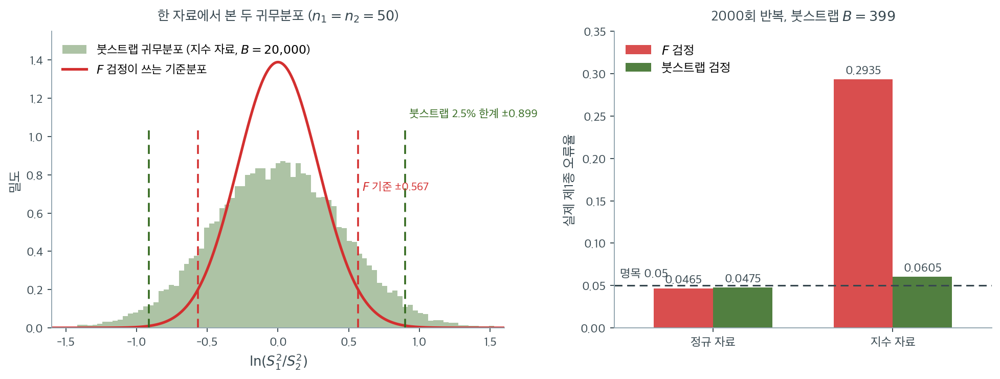
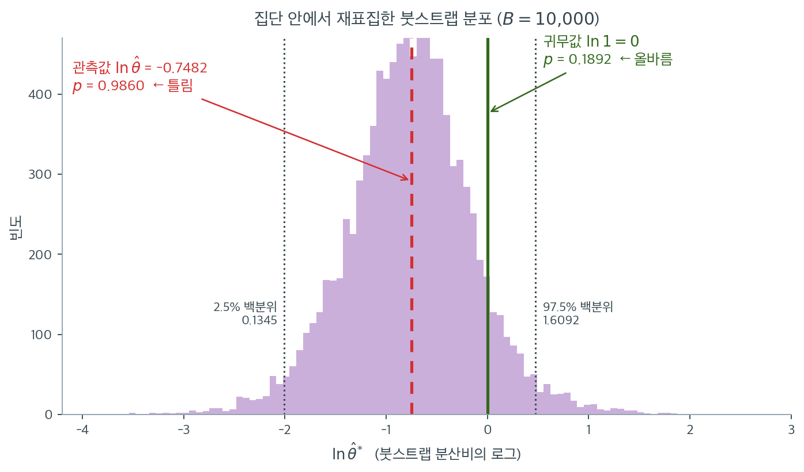

# 붓스트랩 분산 검정

분산에 대한 고전적 검정(카이제곱, F 검정, Bartlett)은 정규성을 가정하고, 로버스트 검정(Levene, Brown-Forsythe)조차 귀무분포에 점근근사를 쓴다. 붓스트랩은 재표집으로 검정통계량의 귀무분포를 추정하여 분포 가정을 피하는 대안을 제공한다. 표본크기가 작거나 분포를 모르거나 모수적 검정에 내장된 가정을 피하고 싶을 때 특히 유용하다.

---

## 1. 분산에 대한 붓스트랩 원리

핵심 아이디어는 단순하다. 두 모집단의 분산이 같은지 검정하려면 귀무가설 아래에서 자료를 재표집하고 검정통계량을 여러 번 계산하면 된다. 재표집된 검정통계량들의 모임이 귀무분포를 근사하고, 관측된 통계량을 이 분포와 비교하여 $p$값을 얻는다.

붓스트랩은 모집단에 특정한 모수적 형태를 가정하지 않는다. 대신 표본의 경험분포를 참 모집단분포의 추정값으로 취급한다.

---

## 2. 일표본 붓스트랩 분산 검정

$H_0\colon \sigma^2 = \sigma_0^2$을 $H_1\colon \sigma^2 \neq \sigma_0^2$에 대해 검정하려면

**1단계.** 크기 $n$인 원표본에서 관측 검정통계량을 계산한다.

$$
T_{\text{obs}} = \frac{(n-1)S^2}{\sigma_0^2}
$$

**2단계.** 원표본에서 관측값 $n$개를 복원추출하여 붓스트랩 표본 $B$개를 생성한다. 각 붓스트랩 표본 $b = 1, \ldots, B$에 대해 붓스트랩 표본분산 $S_b^{*2}$과 붓스트랩 검정통계량을 계산한다.

$$
T_b^* = \frac{(n-1)S_b^{*2}}{S^2}
$$

분모에 $\sigma_0^2$이 아니라 $S^2$을 쓴다. 붓스트랩 표본이 분산 $\sigma_0^2$이 아니라 $S^2$을 갖는 자료에서 추출되기 때문이다. 이렇게 해야 붓스트랩 분포가 귀무가설 주위에 중심을 갖는다.

**3단계.** 관측 통계량만큼 극단적인 붓스트랩 통계량의 비율로 붓스트랩 $p$값을 계산한다.

$$
p = \frac{1}{B}\sum_{b=1}^{B} \mathbf{1}(|T_b^* - (n-1)| \ge |T_{\text{obs}} - (n-1)|)
$$

---

## 3. 이표본 붓스트랩 등분산 검정

$H_0\colon \sigma_1^2 = \sigma_2^2$을 검정하려면

**1단계.** 관측 분산비를 계산한다.

$$
F_{\text{obs}} = \frac{S_1^2}{S_2^2}
$$

**2단계.** 두 표본을 합쳐 $H_0$(등분산)을 만족하는 결합 자료를 만든다. 한 가지 방법은 각 집단을 0으로 중심화한 뒤 합치는 것이다.

$$
\tilde{X}_{1j} = X_{1j} - \bar{X}_1, \qquad \tilde{X}_{2j} = X_{2j} - \bar{X}_2
$$

그런 다음 중심화된 잔차를 하나의 풀 $\{\tilde{X}_{11}, \ldots, \tilde{X}_{1n_1}, \tilde{X}_{21}, \ldots, \tilde{X}_{2n_2}\}$로 합친다.

**3단계.** 각 붓스트랩 반복 $b = 1, \ldots, B$에 대해

- 풀에서 관측값 $n_1$개를 복원추출한다(붓스트랩 "집단 1")
- 풀에서 관측값 $n_2$개를 복원추출한다(붓스트랩 "집단 2")
- 붓스트랩 분산비 $F_b^* = S_{1b}^{*2} / S_{2b}^{*2}$을 계산한다

**4단계.** 붓스트랩 $p$값을 계산한다.

$$
p = \frac{1}{B}\sum_{b=1}^{B} \mathbf{1}\!\left(\left|\ln F_b^*\right| \ge \left|\ln F_{\text{obs}}\right|\right)
$$

분산비의 로그를 쓰면 검정이 대칭이 된다. $F = 2$와 $F = 0.5$가 등분산에서 같은 정도로 벗어난 것으로 취급된다.

!!! note "왜 귀무가설 아래에서 합치는가"
    두 집단의 중심화된 잔차를 합치면 두 붓스트랩 표본이 추출되는 단일 모집단이 만들어진다. 이는 재표집 체계에 $\sigma_1^2 = \sigma_2^2$을 강제하여 검정통계량의 귀무분포를 생성한다.

!!! warning "합치기가 항상 무해하지는 않다"
    중심화된 잔차를 합치는 것은 등분산뿐 아니라 두 집단의 **분포 모양이 같다**는 것도 강제한다. 예컨대 한 집단은 대칭이고 다른 집단은 치우쳐 있다면, 합쳐진 풀은 어느 쪽도 아닌 혼합분포가 된다.

    실무에서는 대체로 문제가 되지 않지만, 모양이 크게 다르다고 의심되면 각 집단의 잔차를 그 집단 안에서만 재표집한 뒤 표준편차로 나누어 척도를 맞추는 방법(스튜던트화 붓스트랩)이 더 안전하다.

---

## 4. 붓스트랩이 실제로 무엇을 고치는가

이 절차가 비정규 자료에서 얼마나 도움이 되는지 재어 보자. $n_1 = n_2 = 50$인 두 표본을 **같은 분포**에서 뽑아($H_0$이 참) $F$ 검정과 위의 붓스트랩 검정을 각각 2000번 돌렸다.



왼쪽이 핵심이다. 지수분포 자료 한 벌에서 만든 붓스트랩 귀무분포(초록 막대)와 $F$ 검정이 쓰는 이론 귀무분포(빨간 곡선)를 같은 축에 올렸다. **붓스트랩 분포가 훨씬 넓다.** 2.5% 한계가 $\pm 0.899$인데 $F$ 기준은 $\pm 0.567$이다. 곧 $F$ 검정은 실제보다 1.6배 좁은 자로 재고 있고, 그 좁은 자 때문에 기각선을 자주 넘는다.

붓스트랩이 이 폭을 어떻게 알아냈는지 생각해 보라. 어떤 공식도 첨도도 쓰지 않았다. 그저 **자료 자신을 다시 뽑았을 뿐**이다. 자료가 두꺼운 꼬리를 가졌다면 재표집된 표본도 두꺼운 꼬리를 갖고, 그 결과 분산비도 실제만큼 넓게 흩어진다. 분포 가정이 필요 없다는 말의 구체적인 뜻이 이것이다.

오른쪽이 그 대가다. 정규 자료에서는 두 검정이 $0.0465$와 $0.0475$로 사실상 같다. **붓스트랩을 쓴다고 해서 잃는 것이 거의 없다.** 지수 자료로 바꾸면 $F$ 검정이 $0.2935$로 무너지는 동안 붓스트랩은 $0.0605$에 머문다. 명목 5%를 완벽하게 지키지는 못하지만 여섯 배 부풀린 것과 20% 부풀린 것은 차원이 다른 이야기다.

붓스트랩이 완벽하지 않은 이유도 짚어 둘 만하다. $0.0605$의 초과분은 재표집이 **표본의 경험분포**를 참 분포로 취급하는 데서 온다. $n = 50$짜리 표본은 지수분포의 오른쪽 꼬리를 충분히 담지 못하므로 붓스트랩 분포도 참 분포보다 약간 좁다. $n$이 커지면 이 오차는 사라진다. 15.5절에서 본 용어로 말하면 이것은 **유한표본 근사 오차**이지 모형 오설정이 아니다.


<div class="aibox" markdown>

**AI로 보는 통계학 1.** 같은 재표집으로 검정과 보고가 갈린다

§3 의 절차에는 눈에 잘 띄지 않는 단계가 하나 있다. 재표집을 **두 집단의 중심화한
잔차를 합친 한 풀에서** 한다는 것이다. 그렇게 하면 붓스트랩 표본 둘이 같은 분포에서
나오므로 **$H_0$ 이 참인 세상을 손으로 만들어** 그 아래의 분포를 보는 셈이 된다.
검정이 성립하는 까닭이 이 한 줄에 있다.

기계학습에서 두 모형이나 두 집단을 견줄 때 흔히 하는 것은 그것이 아니다. **각각을
따로 재표집해 구간을 둘 만들고 겹치는지 본다.** 같은 붓스트랩인데 $H_0$ 을 강제하지
않는다. 그러면 무엇이 달라지는지 수로 보자.

```python
import numpy as np

def two_ways(rng, n=50, ratio=2.0, B=600):
    x = rng.normal(0, 1, n)
    y = rng.normal(0, ratio ** 0.5, n)        # 분산비가 ratio 다
    # ① 귀무가설을 강제한다 — 중심화한 잔차를 합쳐 한 풀에서 뽑는다
    pool = np.concatenate([x - x.mean(), y - y.mean()])
    obs = abs(np.log(y.var(ddof=1) / x.var(ddof=1)))
    null = np.array([abs(np.log(rng.choice(pool, n).var(ddof=1)
                                / rng.choice(pool, n).var(ddof=1))) for _ in range(B)])
    p = (1 + (null >= obs).sum()) / (1 + B)
    # ② 각 집단 안에서 따로 뽑아 분산의 구간을 둘 만들고 겹치는지 본다
    vx = np.array([rng.choice(x, n).var(ddof=1) for _ in range(B)])
    vy = np.array([rng.choice(y, n).var(ddof=1) for _ in range(B)])
    cx = np.percentile(vx, [2.5, 97.5])
    cy = np.percentile(vy, [2.5, 97.5])
    disjoint = cx[1] < cy[0] or cy[1] < cx[0]
    return p < 0.05, disjoint

for ratio in (1.0, 2.0, 4.0):
    rng = np.random.default_rng(15)
    R = 300
    a = np.array([two_ways(rng, ratio=ratio) for _ in range(R)])
    tag = "H0 참" if ratio == 1.0 else f"분산비 {ratio:.0f}"
    print(f"{tag:10}  귀무 강제 검정 {a[:,0].mean():.3f}   구간 겹침 판정 {a[:,1].mean():.3f}")
```

출력:

```
H0 참        귀무 강제 검정 0.053   구간 겹침 판정 0.010
분산비 2       귀무 강제 검정 0.627   구간 겹침 판정 0.403
분산비 4       귀무 강제 검정 0.993   구간 겹침 판정 0.973
```

$H_0$ 이 참일 때 검정은 $0.053$ 으로 명목 $5\%$ 에 앉지만 **구간 겹침 판정은 $0.010$ 이다.**
「두 $95\%$ 구간이 겹치지 않는다」는 기준은 명목 $5\%$ 검정이 아니라 **$1\%$ 쯤의 검정**이다.
그 대가는 분산비 $2$ 에서 드러난다 — 검정이 $0.627$ 을 잡는 동안 구간 겹침은 $0.403$ 만
잡아 **$22$ 퍼센트포인트를 놓친다.** 비가 $4$ 로 커지면 둘이 다시 가까워진다.

그러니 구간 겹침이 틀린 방법은 아니고 **다른 물음에 답하는 방법**이다. 「각 분산이
어디쯤인가」를 보고하려면 구간 둘이 맞고, 「두 분산이 같은가」를 판정하려면 $H_0$ 을
강제해야 한다. 구간을 그려 놓고 겹치지 않는지 눈으로 보는 것으로 판정까지 하면,
자기도 모르게 검정력을 내주고 있다.

갈라 둘 것이 하나 있다. **비 하나의 구간을 만들어 그것이 $1$ 을 품는지 보는 것**은
위의 겹침 판정과 다른 일이고, 그쪽은 옳다 — $\S 8$ 이 그 절차를 다룬다. 위에서
검정력을 잃은 것은 구간을 **둘** 만들어 서로 겹치는지 본 탓이다. 구간 둘이 겹치지
않으려면 각자가 상대의 추정값에서 멀어야 하는데, 그것은 비가 $1$ 에서 멀다는 것보다
**강한 요구**다.

</div>

---

## 5. 다표본 확장

$k > 2$개 집단에 대해 붓스트랩 접근은 자연스럽게 일반화된다.

1. 각 집단에서 집단평균을 빼서 중심화한다.
2. 중심화된 잔차를 모두 합친다.
3. 각 붓스트랩 반복에서 집단 $i$마다 풀에서 관측값 $n_i$개를 추출한다.
4. 붓스트랩 표본에 대해 검정통계량(Bartlett의 $T$나 Levene의 $W$ 등)을 계산한다.
5. 관측 통계량을 붓스트랩 분포와 비교한다.

이 접근은 어떤 고전적·로버스트 분산 검정에 대해서도 귀무분포를 비모수적으로 추정한 붓스트랩 판을 제공한다.

---

## 6. 붓스트랩 접근의 장점

- **분포 가정이 없다.** 붓스트랩은 정규성이나 다른 모수적 형태를 요구하지 않는다.
- **유한표본 분포를 직접 추정한다.** 점근근사에 의존하는 대신 재표집으로 유한표본 귀무분포의 모양을 추정한다.
- **유연하다.** 표준 표에 없는 사용자 정의 통계량을 포함해 어떤 검정통계량이든 붓스트랩할 수 있다.

!!! warning "붓스트랩은 "정확"하지 않다"
    붓스트랩이 유한표본에서 **정확한**(exact) 검정이라는 서술을 종종 볼 수 있으나 옳지 않다. 붓스트랩은 참 모집단분포 $F$ 대신 경험분포 $\hat{F}_n$에서 표집하므로, 얻어지는 것은 $\hat{F}_n$ 아래의 정확한 분포일 뿐 $F$ 아래의 분포가 아니다. $\hat{F}_n \to F$이므로 **일치성**은 있지만 유한표본 오차는 남는다.

    아래 연습문제 3의 모의실험이 이를 확인해 준다. 정규와 $t_5$ 자료에서는 크기가 0.05에 가깝지만 강하게 치우친 지수분포에서는 0.082로 부풀려진다. 붓스트랩도 만병통치약은 아니다.

---

## 7. 한계

- **계산 비용.** 신뢰할 만한 $p$값을 얻으려면 수천 번의 붓스트랩 반복이 필요하다(선별용 $B \ge 1000$, 출판용 $B \ge 10000$).
- **이산 자료.** 이산분포에서는 복원추출이 이상한 성질을 갖는 붓스트랩 표본을 만들 수 있다.
- **아주 작은 표본.** $n < 10$이면 경험분포가 모집단의 나쁜 근사이므로 붓스트랩 결과를 믿기 어렵다.
- **치우친 자료.** 위 경고에서 보듯 강한 치우침에서는 크기가 다소 부풀려진다.

<div class="exbox" markdown>

**보기 1.** <span class="diff easy" title="쉬움"></span> 붓스트랩 등분산 검정. 집단당 $n = 8$, 중심화한 잔차를 합쳐 만든 풀에서 재표집해 $|\log F^*|$ 의 귀무분포를 만든다.

**(1)** $n_1 = n_2$ 이면 $\log F^*$ 의 분포가 **0 에 대하여 정확히 대칭**임을 보이시오. 따라서 $|\log F^*| \ge |\log F_{\text{obs}}|$ 로 세는 것이 올바른 양측 $p$ 값이다.

**(2)** 두 집단의 분산이 다를 때 **풀의 첨도가 부풀려짐**을 보이고, 잔차의 분산 $v_1, v_2$ 와 첨도 $\kappa_1, \kappa_2$ 로 풀의 첨도를 적으시오. $\kappa_1 = \kappa_2$ 이면 그 부풀림이 $r = v_1/v_2$ 만의 함수임을 밝히고, 그것이 $p$ 값을 F 검정보다 크게 만드는 과정을 수로 확인하시오.

</div>

??? success "풀이"

    **(1) 대칭성은 교환가능성에서 나온다.** 중심화한 잔차를 합쳐 만든 풀의 경험분포를 $\hat F$ 라 쓰자. 두 붓스트랩 표본 `boot1`, `boot2` 는 **같은** $\hat F$ 에서 복원추출한 것이고 서로 독립이며, $n_1 = n_2 = n$ 이라 크기까지 같다. 그러므로 쌍 $(\text{boot1}, \text{boot2})$ 와 $(\text{boot2}, \text{boot1})$ 의 결합분포가 같고, 뒤의 쌍이 주는 통계량은

    $$
    \log \frac{S^2(\text{boot2})}{S^2(\text{boot1})} = -\log F^*
    $$

    이므로

    $$
    \log F^* \;\overset{d}{=}\; -\log F^*
    $$

    이다. **0 에 대하여 정확히 대칭**이다. 그래서 $E[\log F^*] = 0$, 중앙값도 $0$ 이고, 양쪽 꼬리가 같은 확률을 가지므로

    $$
    p = \frac1B\sum_b \mathbf 1\!\left(|\log F_b^*| \ge |\log F_{\text{obs}}|\right)
    $$

    가 양쪽 꼬리를 한꺼번에 세는 올바른 양측 $p$ 값이 된다. 로그를 씌우는 까닭도 이것이다. $F$ 눈금에서 $|F^* - 1|$ 로 세면 $F = 2$ 와 $F = 0.5$ 가 다른 이탈로 세어져 대칭이 깨진다.

    **여기서는 귀무값과 관측값 둘 다 쓴다는 점을 짚어 두자.** 아래 절 $8$ 의 재표집은 집단 **안에서** 하므로 분포의 중심이 관측값이었고, 그래서 $p$ 값을 귀무값 1 과 견주어야 했다. 여기는 풀에서 뽑으므로 분포의 중심이 **귀무값**이고, 그래서 관측값과 견주는 것이 옳다. **어느 쪽이 맞는지는 공식이 아니라 분포가 어디에 중심을 두는지가 정한다.**

    **(2) 합치면 첨도가 부풀려진다.** 두 집단의 크기가 같고 잔차가 각각 평균 0 이므로, 풀의 적률은 두 집단 적률의 산술평균이다. 잔차의 분산을 $v_i$, 첨도를 $\kappa_i$ 라 하면 $i$ 집단의 4 차 적률이 $\kappa_i v_i^2$ 이므로

    $$
    m_2^{\text{pool}} = \frac{v_1 + v_2}{2},
    \qquad
    m_4^{\text{pool}} = \frac{\kappa_1 v_1^2 + \kappa_2 v_2^2}{2}
    $$

    이고, 따라서

    $$
    \beta_2^{\text{pool}} = \frac{m_4^{\text{pool}}}{\bigl(m_2^{\text{pool}}\bigr)^2}
    = \frac{2\left(\kappa_1 v_1^2 + \kappa_2 v_2^2\right)}{(v_1+v_2)^2}
    $$

    이다. $\kappa_1 = \kappa_2 = \kappa$ 인 경우를 보면 $r = v_1/v_2$ 로 쓸 때

    $$
    \beta_2^{\text{pool}} = \kappa \cdot \frac{2(r^2+1)}{(r+1)^2}
    $$

    가 되어, **부풀림이 $r$ 만의 함수**다. 이 배율은 $r = 1$ 에서 최솟값 $1$ 을 갖고 ($(r-1)^2 \ge 0$ 에서 $2(r^2+1) \ge (r+1)^2$), $r \to 0$ 이나 $r \to \infty$ 에서 $2$ 로 간다. **등분산이 아닌 두 집단을 합치면 풀의 첨도가 최대 두 배까지 올라간다.**

    그 결과가 검정에 하는 일은 분명하다. 분산비의 산포는 첨도와 함께 커지므로 **귀무분포가 넓어지고, 넓은 자로 재면 같은 관측값이 덜 극단적으로 보인다.** 곧 이 검정은 $H_1$ 이 참일 때 스스로 기각선을 밀어내므로 **검정력을 깎아먹는다.** 앞의 "합치기가 항상 무해하지는 않다"는 경고의 정량판이 이것이다.

    **수로 확인한다.**

    ```python
    import numpy as np

    def bootstrap_variance_test(x, y, B=10000, seed=42):
        """두 분산이 같은지를 붓스트랩으로 검정한다.

        귀무가설 아래에서의 분포를 얻으려면 두 집단이 같은 분포에서 나온
        상태를 만들어야 한다. 집단마다 중심을 맞춘 뒤 하나로 합치는 것이
        그 방법이다.
        """
        rng = np.random.default_rng(seed)
        n1, n2 = len(x), len(y)

        # 관측된 분산비
        f_obs = np.var(x, ddof=1) / np.var(y, ddof=1)

        # 중심만 맞추고 퍼짐은 그대로 둔다. 이렇게 합쳐야 "분산이 같다"는
        # 상태를 흉내 낼 수 있다.
        x_centered = x - np.mean(x)
        y_centered = y - np.mean(y)
        pool = np.concatenate([x_centered, y_centered])

        # 비의 로그를 쓰는 까닭은 대칭을 얻기 위해서다. F 와 1/F 이 같은 크기의
        # 이탈로 세어져야 양측검정이 제대로 된다.
        count = 0
        for _ in range(B):
            boot1 = rng.choice(pool, size=n1, replace=True)
            boot2 = rng.choice(pool, size=n2, replace=True)
            f_boot = np.var(boot1, ddof=1) / np.var(boot2, ddof=1)
            if abs(np.log(f_boot)) >= abs(np.log(f_obs)):
                count += 1

        p_value = count / B
        return f_obs, p_value

    # 보기
    x = np.array([10, 12, 14, 11, 13, 15, 12, 10])
    y = np.array([20, 28, 22, 35, 25, 18, 30, 22])

    f_stat, p_val = bootstrap_variance_test(x, y)
    print(f"Sample variances: {np.var(x, ddof=1):.3f}, {np.var(y, ddof=1):.3f}")
    print(f"Variance ratio: {f_stat:.4f}")
    print(f"Bootstrap p-value: {p_val:.4f}")

    # ===== (1) 대칭성과 풀의 첨도 =====
    from scipy.special import polygamma
    from scipy.stats import f as f_dist

    def emp_kurtosis(v):
        v = np.asarray(v, float)
        m = v.mean()
        return ((v - m) ** 4).mean() / (((v - m) ** 2).mean()) ** 2

    rx, ry = x - x.mean(), y - y.mean()
    v1, v2 = rx.var(ddof=0), ry.var(ddof=0)
    k1, k2 = emp_kurtosis(rx), emp_kurtosis(ry)
    pool = np.concatenate([rx, ry])
    r = v1 / v2

    print(f"\n--- (1) 풀의 첨도 ---")
    print(f"잔차의 분산  v1 = {v1:.6f},  v2 = {v2:.6f},   r = v1/v2 = {r:.6f}")
    print(f"잔차의 첨도  k1 = {k1:.6f},  k2 = {k2:.6f}")
    formula = 2 * (k1 * v1**2 + k2 * v2**2) / (v1 + v2) ** 2
    print(f"풀의 첨도  직접 계산 = {emp_kurtosis(pool):.6f}")
    print(f"           공식      = {formula:.6f}   (차 {abs(emp_kurtosis(pool) - formula):.2e})")

    # 등분산이었다면? y 잔차를 x 잔차의 척도로 되돌려 같은 일을 한다.
    pool_eq = np.concatenate([rx, ry * np.sqrt(v1 / v2)])
    print(f"등분산이면 풀의 첨도 = {emp_kurtosis(pool_eq):.6f}   (= (k1+k2)/2 = {(k1 + k2) / 2:.6f})")
    print(f"부풀림 = {emp_kurtosis(pool) / emp_kurtosis(pool_eq):.4f} 배")
    print(f"k1 = k2 일 때의 배율 공식 2(r^2+1)/(r+1)^2 = {2 * (r * r + 1) / (r + 1) ** 2:.4f}")
    print("  r 에 따른 그 배율 (1 에서 최소, 양 끝에서 2 로)")
    for rr in (1.0, 0.5, 0.2, r, 0.05):
        print(f"    r = {rr:<9.6f} -> {2 * (rr * rr + 1) / (rr + 1) ** 2:.4f}")

    # ===== (2) 그 부풀림이 귀무분포와 p 값에 하는 일 =====
    rng = np.random.default_rng(42)
    B, n = 10000, len(x)
    lf = np.empty(B)
    for b in range(B):
        b1 = rng.choice(pool, size=n, replace=True)
        b2 = rng.choice(pool, size=n, replace=True)
        lf[b] = np.log(b1.var(ddof=1) / b2.var(ddof=1))

    sd_norm = np.sqrt(2 * polygamma(1, (n - 1) / 2))
    print(f"\n--- (2) 귀무분포의 폭 ---")
    print(f"붓스트랩 귀무분포:  평균 {lf.mean():+.4f}  중앙값 {np.median(lf):+.4f}"
          f"  (대칭이면 둘 다 0, 몬테카를로 오차 +-{lf.std(ddof=1) / np.sqrt(B):.4f})")
    print(f"붓스트랩 SD(log F*)            = {lf.std(ddof=1):.4f}")
    print(f"정규이론 SD = sqrt(2 psi'(3.5)) = {sd_norm:.4f}   (정확한 값)")
    print(f"  붓스트랩이 {100 * (lf.std(ddof=1) / sd_norm - 1):.1f} % 넓다")
    print(f"델타 공식 sqrt(2(k_pool-1)/n)   = {np.sqrt(2 * (emp_kurtosis(pool) - 1) / n):.4f}"
          f"   (n=8 에서는 믿을 수 없다)")

    fobs = np.log(f_stat)
    c_boot = np.percentile(np.abs(lf), 95)
    c_norm = abs(np.log(f_dist(n - 1, n - 1).ppf(0.025)))
    print(f"\n5% 기각선 |log F|:  붓스트랩 {c_boot:.4f}   정규이론 {c_norm:.4f}")
    print(f"관측값 |log F_obs| = {abs(fobs):.4f}  ->  둘 다 넘는다")
    p_f = 2 * min(f_dist(n - 1, n - 1).cdf(f_stat), f_dist(n - 1, n - 1).sf(f_stat))
    print(f"p 값:  붓스트랩 {np.mean(np.abs(lf) >= abs(fobs)):.4f}   F 검정 {p_f:.4f}"
          f"   비 {np.mean(np.abs(lf) >= abs(fobs)) / p_f:.2f} 배")
    ```

    출력:

    ```text
    Sample variances: 3.268, 32.286
    Variance ratio: 0.1012
    Bootstrap p-value: 0.0206

    --- (1) 풀의 첨도 ---
    잔차의 분산  v1 = 2.859375,  v2 = 28.250000,   r = v1/v2 = 0.101217
    잔차의 첨도  k1 = 1.890442,  k2 = 2.176208
    풀의 첨도  직접 계산 = 3.621034
               공식      = 3.621034   (차 0.00e+00)
    등분산이면 풀의 첨도 = 2.033325   (= (k1+k2)/2 = 2.033325)
    부풀림 = 1.7808 배
    k1 = k2 일 때의 배율 공식 2(r^2+1)/(r+1)^2 = 1.6661
      r 에 따른 그 배율 (1 에서 최소, 양 끝에서 2 로)
        r = 1.000000  -> 1.0000
        r = 0.500000  -> 1.1111
        r = 0.200000  -> 1.4444
        r = 0.101217  -> 1.6661
        r = 0.050000  -> 1.8186

    --- (2) 귀무분포의 폭 ---
    붓스트랩 귀무분포:  평균 +0.0008  중앙값 +0.0151  (대칭이면 둘 다 0, 몬테카를로 오차 +-0.0098)
    붓스트랩 SD(log F*)            = 0.9844
    정규이론 SD = sqrt(2 psi'(3.5)) = 0.8128   (정확한 값)
      붓스트랩이 21.1 % 넓다
    델타 공식 sqrt(2(k_pool-1)/n)   = 0.8095   (n=8 에서는 믿을 수 없다)

    5% 기각선 |log F|:  붓스트랩 1.9187   정규이론 1.6084
    관측값 |log F_obs| = 2.2905  ->  둘 다 넘는다
    p 값:  붓스트랩 0.0206   F 검정 0.0073   비 2.83 배
    ```

    **(1)의 대칭성이 확인된다.** 붓스트랩 귀무분포의 평균이 $+0.0008$ 로 몬테카를로 오차 $\pm0.0098$ 안에 있고 중앙값도 $+0.0151$ 로 거의 $0$ 이다. 분포 자체는 (1)에서 보았듯 정확히 대칭이고, 남은 흔들림은 $B = 10000$ 에서 오는 것뿐이다.

    **(2)의 첨도 공식이 정확히 맞는다.** 풀의 첨도를 직접 계산한 $3.621034$ 와 $2(\kappa_1 v_1^2 + \kappa_2 v_2^2)/(v_1+v_2)^2$ 가 **차 $0$** 으로 같다. 그리고 두 집단의 분산이 같았다면 풀의 첨도가 $(\kappa_1+\kappa_2)/2 = 2.033325$ 였을 것이므로, 분산비 $r = 0.101$ 이 첨도를 **$1.78$ 배** 부풀린 셈이다.

    $\kappa_1 = \kappa_2$ 를 가정한 배율 공식은 $r = 0.101$ 에서 $1.6661$ 을 준다. 실제 $1.7808$ 보다 조금 작은데, 이 자료는 $\kappa_1 = 1.890$ 과 $\kappa_2 = 2.176$ 으로 서로 다르고 **분산이 큰 쪽($v_2$)이 $m_4$ 를 지배**하므로 그쪽의 더 큰 첨도가 더 무겁게 셈되기 때문이다. 배율 표를 보면 $r = 1$ 에서 $1.0000$, $r = 0.2$ 에서 $1.4444$, $r = 0.05$ 에서 $1.8186$ 으로 $2$ 를 향해 올라간다.

    **그 부풀림이 귀무분포를 넓혔다.** 붓스트랩 $\operatorname{SD}(\log F^*) = 0.9844$ 가 정규이론의 정확한 값 $\sqrt{2\psi'(3.5)} = 0.8128$ 보다 $21\%$ 크다. 그래서 $5\%$ 기각선이 $|\log F| = 1.9187$ 로 정규이론의 $1.6084$ 보다 $19\%$ 멀리 밀려 있다. **관측값 $|\log F_{\text{obs}}| = 2.2905$ 는 두 선을 다 넘지만, 선이 멀어진 만큼 $p$ 값이 커졌다.** 붓스트랩 $0.0206$ 이 F 검정 $0.0073$ 의 $2.83$ 배다.

    (델타 공식에 풀의 첨도를 넣으면 $0.8095$ 가 나와 실제 $0.9844$ 보다 $18\%$ 작다. 5.10절의 델타 결과는 $n \to \infty$ 근사이고 $n = 8$ 은 그 영역이 아니다. **방향만 쓰고 값은 쓰지 말아야 한다.**)

    **그래서 이 $p$ 값 차이를 "붓스트랩이 더 보수적"이라고만 읽으면 안 된다.** 이 자료의 분산비가 10 배라서 풀이 과분산된 것이고, 등분산이 참일 때는 이 부풀림이 일어나지 않는다. 앞 절 그림에서 정규 자료의 크기가 $0.0465$ 대 $0.0475$ 로 두 검정이 사실상 같았던 것이 그 증거다. **부풀림은 $H_0$ 아래의 크기를 망치는 것이 아니라 $H_1$ 아래의 검정력을 깎는다.** 모양이 크게 다르다고 의심되면 앞의 경고가 권한 스튜던트화 붓스트랩을 쓰라.

같은 자료에 다른 검정을 적용하면 F 검정은 $p = 0.0073$, Brown-Forsythe는 $p = 0.0272$이다. 세 검정 모두 5% 수준에서 기각하지만 $p$값이 네 배 차이 난다. 붓스트랩 결과가 두 값 사이에 놓인다는 점이 시사적이다. F 검정만큼 낙관적이지도, Brown-Forsythe만큼 보수적이지도 않다.

---

## 8. 집단 안에서 재표집하기 — 분산비의 구간

절 $3$ 은 두 집단의 잔차를 **합쳐** 풀을 만들고 거기서 재표집했다. 귀무가설을
자료에 부과하는 설계다. 여기서는 반대로 **각 집단 안에서** 재표집한다. 그러면
분포의 중심이 귀무값이 아니라 관측값이 되므로 나오는 것이 $p$ 값이 아니라
**분산비의 구간**이고, 검정은 그 구간이 $1$ 을 품는지로 한다.

### 분산비 통계량

독립인 두 표본 $\mathbf{x}_1 = (x_{11}, \ldots, x_{1,n_1})$과 $\mathbf{x}_2 = (x_{21}, \ldots, x_{2,n_2})$이 주어졌을 때 관심 통계량은 표본분산의 비이다.

$$
\hat\theta = \frac{S_1^2}{S_2^2}, \qquad S_i^2 = \frac{1}{n_i - 1}\sum_{j=1}^{n_i}(x_{ij} - \bar{x}_i)^2
$$

귀무가설 $H_0\colon \sigma_1^2 = \sigma_2^2$ 아래에서 참 비율은 $\theta = 1$이다.

---

### 재표집 절차

비모수 붓스트랩은 정규성을 가정하지 않고 $\hat\theta$의 표집분포를 추정한다.

1. **재표집**: 각 붓스트랩 반복 $b = 1, \ldots, B$에 대해 $\mathbf{x}_1$에서 $n_1$개, $\mathbf{x}_2$에서 $n_2$개를 복원추출한다.
2. **계산**: $\hat\theta^{(b)} = S_1^{2(b)} / S_2^{2(b)}$을 계산한다.
3. **로그 변환**: 비는 오른쪽으로 치우쳐 있으므로 대칭성을 위해 로그 척도 $\log\hat\theta^{(b)}$에서 작업한다.
4. **신뢰구간**: 로그 척도의 백분위 신뢰구간은 $(q_{0.025}, q_{0.975})$이다. 지수를 취해 $\theta$의 신뢰구간을 얻는다.
5. **$p$값**: 붓스트랩 분포를 **귀무값 $\theta = 1$**(로그 척도에서 0)과 비교한다.

$$
p = 2 \min\!\Big(\frac{1}{B}\sum_{b=1}^B \mathbf{1}(\log\hat\theta^{(b)} \le 0),\;\; \frac{1}{B}\sum_{b=1}^B \mathbf{1}(\log\hat\theta^{(b)} \ge 0)\Big)
$$

!!! danger "$p$값을 관측 통계량과 비교하면 안 된다"
    문헌에서 다음과 같은 형태를 종종 볼 수 있으나 **완전히 잘못되었다**.

    $$
    p_{\text{잘못}} = 2 \min\!\Big(\tfrac{1}{B}\textstyle\sum_b \mathbf{1}(\log\hat\theta^{(b)} \le \log\hat\theta),\;\; \tfrac{1}{B}\textstyle\sum_b \mathbf{1}(\log\hat\theta^{(b)} \ge \log\hat\theta)\Big)
    $$

    각 집단 안에서 재표집하면 붓스트랩 분포가 **관측값 $\hat\theta$ 주위에 중심**을 갖는다. 그러면 $\log\hat\theta$가 붓스트랩 분포의 중앙값 근처에 있으므로 두 비율이 모두 $\approx 0.5$가 되고, **$p \approx 1$이 항상 나온다**.

    실제로 확인해 보면, 참 표준편차가 $1$과 $3$(분산비 9배)인 정규 자료 $n = 20$에서 이 공식의 $p$값은 200회 반복에서 $0.856$~$1.000$ 범위, 평균 $0.960$이었다. **분산이 9배 다른데도 절대 기각하지 않는다.**

    올바른 비교 대상은 관측값이 아니라 **귀무값 1**이다. 위 5단계의 공식이 그것이며, 이는 백분위 신뢰구간을 뒤집은 것과 동등하다(신뢰구간이 1을 포함하지 않을 때만 $p < \alpha$).

<div class="exbox" markdown>

**보기 2.** <span class="diff easy" title="쉬움"></span> 분산비의 붓스트랩 구간. 위의 다섯 단계를 함수 하나로 옮긴다. 신뢰구간은 로그 척도의 백분위로 잡고, $p$ 값은 귀무값 $\log 1 = 0$ 과 견주어 만든다.

**(1)** 이 $p$ 값이 **백분위 신뢰구간을 뒤집은 것**과 동등함을 보이시오. 곧 수준 $1-\alpha$ 구간이 1 을 담지 않을 때 정확히 $p < \alpha$ 다.

**(2)** 마지막 줄의 `min(p_two, 1.0)` 은 F 검정의 $2\min(\text{cdf}, \text{sf})$ 와 달리 **군더더기가 아니다.** 그 까닭을 밝히고, 쪽의 자료에서 (1)의 동등성과 함께 수로 확인하시오.

</div>

??? success "풀이"

    **(1) 두 판정이 같은 사건이다.** 붓스트랩 로그비의 경험분포를 $\hat G$ 라 쓰고

    $$
    L = \hat G^{-1}\!\left(\tfrac\alpha2\right), \qquad
    U = \hat G^{-1}\!\left(1 - \tfrac\alpha2\right)
    $$

    를 로그 척도의 백분위 구간 끝점이라 하자. 구간을 되돌린 $(\mathrm e^L, \mathrm e^U)$ 가 1 을 담지 않는다는 것은 $\log$ 가 증가함수이므로 $(L, U)$ 가 0 을 담지 않는다는 것과 같고, 그것은

    $$
    L > 0 \quad\text{또는}\quad U < 0
    $$

    이다. 여기서 $L > 0$ 은 0 이하인 붓스트랩 값의 비율이 $\alpha/2$ 에 못 미친다는 뜻이고, 그때는 $\hat G(0) < \alpha/2 \le 1/2$ 이므로 $\min$ 이 아래쪽 꼬리에서 잡혀

    $$
    p = 2\hat G(0) < \alpha
    $$

    가 된다. $U < 0$ 인 경우는 위쪽 꼬리에서 같은 계산이 된다. 거꾸로 $p < \alpha$ 이면 두 비율 가운데 작은 쪽이 $\alpha/2$ 에 못 미치므로 해당 끝점이 0 을 넘어선다. **그러므로 두 판정은 같은 사건이고, 이 $p$ 값은 "구간이 1 을 놓치기 시작하는 가장 작은 $\alpha$" 바로 그것이다.**

    유한 $B$ 에서는 경험분위수가 계단이라 **$\alpha$ 가 $p$ 와 정확히 같은 한 칸에서만** 어긋날 수 있다. 부등호가 $p < \alpha$ 로 엄격하기 때문이다. (2)에서 그 한 칸을 눈으로 본다.

    **(2) F 검정에서는 자를 필요가 없었다.** 거기서는 $\text{cdf} + \text{sf} = 1$ 이 정확히 성립해 $\min \le 1/2$ 가 보장되었다. 여기서는 사정이 다르다. 두 비율을 $\hat G(0) = P(\log\hat\theta^* \le 0)$ 과 $1 - P(\log\hat\theta^* < 0) = P(\log\hat\theta^* \ge 0)$ 이라 쓰면

    $$
    P(\log\hat\theta^* \le 0) + P(\log\hat\theta^* \ge 0)
    = 1 + P(\log\hat\theta^* = 0)
    $$

    이다. **귀무값에 정확히 걸리는 붓스트랩 값이 있으면 합이 1 을 넘고**, 그러면 두 비율이 모두 $1/2$ 를 넘는 일이 생길 수 있어 $2\min > 1$ 이 된다. 연속분포라면 $P(=0) = 0$ 이라 걱정할 일이 없지만, **이 쪽의 자료는 정수**다. 표본분산이 유리수이므로 두 붓스트랩 표본의 분산이 정확히 같아지는 일이 실제로 일어난다. 그래서 자르는 줄이 필요하다.

    **수로 확인한다.**

    ```python
    import numpy as np

    def variance_ratio(x1, x2):
        """두 표본분산의 비."""
        return np.var(x1, ddof=1) / np.var(x2, ddof=1)

    def bootstrap_varratio(x1, x2, B=2000, seed=None):
        """분산비의 붓스트랩 신뢰구간과 양측 p-값을 구한다.

        F 검정과 달리 정규성을 가정하지 않는다. 각 표본에서 따로 복원추출해
        비를 다시 구하는 일을 B 번 되풀이한다.
        """
        rng = np.random.default_rng(seed)
        x1 = np.asarray(x1, dtype=float)
        x2 = np.asarray(x2, dtype=float)
        n1, n2 = len(x1), len(x2)
        stat_obs = variance_ratio(x1, x2)

        boots = np.empty(B)
        for b in range(B):
            b1 = rng.choice(x1, size=n1, replace=True)
            b2 = rng.choice(x2, size=n2, replace=True)
            boots[b] = np.log(variance_ratio(b1, b2))

        # 비는 아래로 0, 위로 무한이라 분포가 치우친다. 로그를 씌우면 그 눈금이
        # 대칭에 가까워지므로 구간을 로그 눈금에서 만든 뒤 되돌린다.
        lo, hi = np.percentile(boots, [2.5, 97.5])
        ci = (float(np.exp(lo)), float(np.exp(hi)))

        # p-값은 붓스트랩 분포를 관측값이 아니라 귀무값 log(1)=0 과 견주어
        # 만든다. 관측값과 견주면 언제나 0.5 근처가 나와 뜻이 없다.
        p_two = 2 * min(np.mean(boots <= 0.0), np.mean(boots >= 0.0))
        p_two = float(min(p_two, 1.0))

        return float(stat_obs), ci, p_two

    # === 구간 뒤집기와 p 값이 정말 같은 판정을 주는가 ===
    x1 = np.array([12, 15, 14, 10, 13, 14, 12, 11], dtype=float)
    x2 = np.array([22, 25, 20, 18, 24, 23, 19, 21], dtype=float)

    # 함수 안의 붓스트랩 값을 다시 만들어 들여다본다 (같은 씨앗, 같은 수열).
    rng = np.random.default_rng(42)
    B = 10000
    boots = np.empty(B)
    for b in range(B):
        b1 = rng.choice(x1, size=len(x1), replace=True)
        b2 = rng.choice(x2, size=len(x2), replace=True)
        boots[b] = np.log(variance_ratio(b1, b2))

    lo_cnt, hi_cnt = np.mean(boots <= 0.0), np.mean(boots >= 0.0)
    ties = int((boots == 0.0).sum())
    print(f"P(log theta* <= 0) = {lo_cnt:.4f}")
    print(f"P(log theta* >= 0) = {hi_cnt:.4f}")
    print(f"두 비율의 합        = {lo_cnt + hi_cnt:.4f}   (1 + 동점비율)")
    print(f"정확히 0 인 값      = {ties} 개 / {B}   -> 동점비율 {ties / B:.4f}")
    print(f"2 x min            = {2 * min(lo_cnt, hi_cnt):.4f}  (자르기 전)")

    p = min(2 * min(lo_cnt, hi_cnt), 1.0)
    print(f"\n   alpha     lower     upper   1 in CI   p<alpha")
    for a in (0.05, 0.10, 0.15, 0.1892, 0.19, 0.25, 0.40):
        lo, hi = np.exp(np.percentile(boots, [100 * a / 2, 100 * (1 - a / 2)]))
        inci = "yes" if lo <= 1.0 <= hi else "no"
        rej = "yes" if p < a else "no"
        print(f"{a:>8.4f}{lo:>10.4f}{hi:>10.4f}{inci:>10}{rej:>10}")
    ```

    출력:

    ```text
    P(log theta* <= 0) = 0.9118
    P(log theta* >= 0) = 0.0946
    두 비율의 합        = 1.0064   (1 + 동점비율)
    정확히 0 인 값      = 64 개 / 10000   -> 동점비율 0.0064
    2 x min            = 0.1892  (자르기 전)

       alpha     lower     upper   1 in CI   p<alpha
      0.0500    0.1345    1.6092       yes        no
      0.1000    0.1705    1.2526       yes        no
      0.1500    0.1946    1.0787       yes        no
      0.1892    0.2113    0.9967        no        no
      0.1900    0.2117    0.9952        no       yes
      0.2500    0.2381    0.8930        no       yes
      0.4000    0.2904    0.7458        no       yes
    ```

    **동점이 실제로 일어난다.** 두 비율의 합이 $1.0064$ 로 1 을 넘고, 정확히 $\log\hat\theta^* = 0$ 인 붓스트랩 값이 **1 만 개 가운데 64 개**다. 정수 자료라 두 붓스트랩 표본의 분산이 정확히 같아지는 조합이 $0.64\%$ 의 확률로 뽑힌 것이다. (1)에서 예측한 $P(\le 0) + P(\ge 0) = 1 + P(=0)$ 이 $0.9118 + 0.0946 = 1 + 0.0064$ 로 자리 하나까지 맞는다.

    이 자료에서는 $\min$ 이 $0.0946$ 쪽에서 잡혀 $2\min = 0.1892 < 1$ 이므로 자르는 줄이 **실제로 깎지는 않았다.** 그러나 동점비율이 조금 더 크고 두 꼬리가 더 균형 잡힌 자료에서는 $2\min$ 이 1 을 넘는다. **그때를 막아 주는 것이 그 줄이다.** F 검정에서는 같은 줄이 결코 작동하지 않는다는 것과 대조된다.

    **동등성도 확인된다.** $\alpha$ 를 $0.05$ 에서 $0.40$ 까지 올리면 구간이 $1$ 을 담다가 어느 지점에서 놓치고, 바로 그 지점에서 $p < \alpha$ 가 참이 된다. 두 열이 **한 줄만 빼고** 완전히 일치한다. 빠진 한 줄은 $\alpha = 0.1892$, 곧 $\alpha$ 가 $p$ 와 정확히 같은 자리다. 거기서 구간 상한이 $0.9967$ 로 이미 1 을 놓쳤는데 $p < \alpha$ 는 $0.1892 < 0.1892$ 라서 거짓이다. (1)에서 예고한 **엄격 부등호 한 칸**이 바로 이것이며, $\alpha$ 를 $0.19$ 로 한 번만 올리면 두 열이 다시 맞는다.

<div class="exbox" markdown>

**보기 3.** <span class="diff easy" title="쉬움"></span> 붓스트랩 분산 검정. 집단당 $n = 8$ 인 자료에 보기 2 의 함수를 $B = 10000$ 으로 적용한다.

**(1)** 붓스트랩 구간과 정규이론 F 구간 가운데 **어느 쪽이 좁을지 미리 짚으시오.** 정규이론의 참 산포 $\operatorname{Var}(\log F_{d,d}) = 2\psi'(d/2)$ 를 쓰고, 5.10절의 델타 결과로 붓스트랩이 보는 산포를 **경험 첨도**로 적으시오.

**(2)** 크기 $n$ 인 표본의 경험 첨도에 **천장**이 있음을 보이고 그 값을 구하시오. 그것이 (1)의 답과 연습문제 1 의 포함확률 부족을 어떻게 설명하는가.

</div>

??? success "풀이"

    **(1) 붓스트랩이 더 좁을 것이다.** 두 구간의 로그 폭은 각자가 믿는 $\log\hat\theta$ 의 산포가 정한다.

    **정규이론 쪽은 정확한 값이 있다.** $W \sim \chi^2_d$ 는 $\text{Gamma}(d/2, \text{scale } 2)$ 이고 감마의 로그분산은 척도와 무관하게 $\psi'$ 이므로 $\operatorname{Var}(\log W) = \psi'(d/2)$ 다. $\log F = \log U - \log V + \log(d_2/d_1)$ 이고 두 항이 독립이니

    $$
    \operatorname{Var}\bigl(\log F_{d_1, d_2}\bigr) = \psi'\!\left(\frac{d_1}{2}\right) + \psi'\!\left(\frac{d_2}{2}\right)
    $$

    이며, $d_1 = d_2 = 7$ 에서 $2\psi'(3.5)$ 다. **근사가 아니라 정확한 값이다.**

    **붓스트랩 쪽은 경험분포가 정한다.** 5.10절이 유도한 델타 결과

    $$
    \operatorname{Var}(\log S_i^2) \approx \frac{\beta_2 - 1}{n_i},
    \qquad
    \operatorname{Var}\!\left(\log\frac{S_1^2}{S_2^2}\right) \approx \frac{\beta_{2,1}-1}{n_1} + \frac{\beta_{2,2}-1}{n_2}
    $$

    에서 $\beta_2$ 가 **모집단의** 첨도인데, 붓스트랩은 그 자리에 **원표본의 경험 첨도**를 넣는다. 재표집이 경험분포에서 일어나기 때문이다. 그러므로 정규이론에 대한 산포의 배율이

    $$
    \sqrt{\frac{\bar\beta_2 - 1}{3 - 1}}
    $$

    꼴이 되고, **경험 첨도가 3 보다 작으면 붓스트랩 구간이 좁아진다.** 작은 표본에서 경험 첨도가 작게 나오는 경향이 있으므로 좁을 쪽으로 짚는 것이 옳다.

    **(2) 경험 첨도에는 $n$ 이 정한 천장이 있다.** 자료를 표준화해 $\sum z_i = 0$, $\frac1n\sum z_i^2 = 1$ 로 두면 경험 첨도는 $\frac1n\sum z_i^4$ 다. 이것을 그 두 제약 아래에서 최대화한다. 라그랑주 조건은

    $$
    z_i^3 = \lambda z_i + \mu
    $$

    인데 삼차방정식의 근이 셋을 넘지 못하므로 **최대점에서 $z_i$ 는 많아도 세 값만 갖는다.** 두 값만 갖는 꼴, 곧 한 점이 $a$ 이고 나머지 $n-1$ 점이 $b$ 인 경우를 풀면 $a + (n-1)b = 0$ 과 $a^2 + (n-1)b^2 = n$ 에서

    $$
    a = \sqrt{n-1}, \qquad b = -\frac{1}{\sqrt{n-1}}
    $$

    이고, 그때

    $$
    \frac1n\sum z_i^4 = \frac{(n-1)^2 + \dfrac{1}{n-1}}{n}
    = \frac{(n-1)^3 + 1}{n(n-1)}
    = \frac{n^2 - 3n + 3}{n-1}
    $$

    이 된다. 마지막 등식은 $(n-1)^3 + 1 = n(n^2-3n+3)$ 이라서 성립한다. **그러므로**

    $$
    \beta_2^{\text{경험}} \le \frac{n^2-3n+3}{n-1}
    $$

    이다. $n = 8$ 이면 천장이 $6.14$ 다. **8 개의 점으로는 첨도 $6.14$ 보다 무거운 꼬리를 흉내 낼 수가 없다.** 로그정규의 $\beta_2 = 113.9$ 는 꿈도 못 꾼다. 아래에서 수치 최적화가 이 꼴을 실제로 찾아내는지도 확인한다.

    ```python
    import numpy as np
    from scipy.special import polygamma
    from scipy.stats import f as f_dist

    x1 = np.array([12, 15, 14, 10, 13, 14, 12, 11], dtype=float)
    x2 = np.array([22, 25, 20, 18, 24, 23, 19, 21], dtype=float)

    theta_hat, ci, p = bootstrap_varratio(x1, x2, B=10000, seed=42)
    print(f"Observed ratio: {theta_hat:.4f}")
    print(f"95% Bootstrap CI: ({ci[0]:.4f}, {ci[1]:.4f})")
    print(f"Bootstrap p-value: {p:.4f}")

    # === 정규이론 F 구간과 견준다 ===
    n = len(x1)
    fl, fh = theta_hat / f_dist(n - 1, n - 1).ppf([0.975, 0.025])
    p_f = 2 * min(f_dist(n - 1, n - 1).cdf(theta_hat), f_dist(n - 1, n - 1).sf(theta_hat))
    print(f"\n정규이론 F 구간 : ({fl:.4f}, {fh:.4f})   로그 폭 {np.log(fh / fl):.4f}   p = {p_f:.4f}")
    print(f"붓스트랩 구간   : ({ci[0]:.4f}, {ci[1]:.4f})   로그 폭 {np.log(ci[1] / ci[0]):.4f}   p = {p:.4f}")
    print(f"붓스트랩이 {100 * (1 - np.log(ci[1] / ci[0]) / np.log(fh / fl)):.1f} % 좁다")

    # === 왜 좁은가: log theta* 의 산포를 정규이론 참값과 견준다 ===
    # Var(log F(d,d)) = psi'(d/2) + psi'(d/2) 가 정확한 값이다.
    v_exact = 2 * polygamma(1, (n - 1) / 2)
    rng = np.random.default_rng(42)
    boots = np.empty(10000)
    for b in range(10000):
        b1 = rng.choice(x1, size=n, replace=True)
        b2 = rng.choice(x2, size=n, replace=True)
        boots[b] = np.log(variance_ratio(b1, b2))
    sd_boot = boots.std(ddof=1)
    print(f"\nVar(log F(7,7)) = 2 psi'(3.5) = {v_exact:.6f}  ->  SD = {np.sqrt(v_exact):.4f}  (정확한 값)")
    print(f"붓스트랩 SD(log theta*)                 = {sd_boot:.4f}")
    print(f"비 = {sd_boot / np.sqrt(v_exact):.4f}   (붓스트랩이 산포를 그만큼 적게 본다)")

    # === 범인은 경험 첨도다. 그리고 그것에는 n 이 정한 천장이 있다 ===
    def emp_kurtosis(v):
        v = np.asarray(v, float); m = v.mean()
        return ((v - m) ** 4).mean() / (((v - m) ** 2).mean()) ** 2

    k1, k2 = emp_kurtosis(x1), emp_kurtosis(x2)
    bound = (n * n - 3 * n + 3) / (n - 1)
    print(f"\n경험 첨도  x1 = {k1:.4f},  x2 = {k2:.4f}   (정규는 3)")
    print(f"n = {n} 인 표본이 가질 수 있는 최대 첨도 = (n^2-3n+3)/(n-1) = {bound:.4f}")
    z = np.array([np.sqrt(n - 1)] + [-1 / np.sqrt(n - 1)] * (n - 1))
    print(f"  그 최대를 내는 꼴: 한 점 {z[0]:+.4f}, 나머지 {n - 1} 점 {z[1]:+.4f}")
    print(f"  그 꼴의 첨도 = {emp_kurtosis(z):.4f}   (공식과 일치)")
    print(f"\n5.10절의 델타 공식 SD(log theta) ~ sqrt((k1-1)/n + (k2-1)/n)")
    print(f"  경험 첨도를 넣으면 {np.sqrt((k1 - 1) / n + (k2 - 1) / n):.4f}")
    print(f"  정규값 3 을 넣으면 {np.sqrt(2 * (3 - 1) / n):.4f}")
    print(f"  배율 sqrt((kbar-1)/2) = {np.sqrt(((k1 + k2) / 2 - 1) / 2):.4f}   (관측된 비 {sd_boot / np.sqrt(v_exact):.4f})")
    for nn in (8, 20, 30, 100):
        print(f"  n = {nn:>3}: 첨도 천장 {(nn * nn - 3 * nn + 3) / (nn - 1):8.3f}")
    ```

    출력:

    ```text
    Observed ratio: 0.4732
    95% Bootstrap CI: (0.1345, 1.6092)
    Bootstrap p-value: 0.1892

    정규이론 F 구간 : (0.0947, 2.3637)   로그 폭 3.2168   p = 0.3448
    붓스트랩 구간   : (0.1345, 1.6092)   로그 폭 2.4816   p = 0.1892
    붓스트랩이 22.9 % 좁다

    Var(log F(7,7)) = 2 psi'(3.5) = 0.660716  ->  SD = 0.8128  (정확한 값)
    붓스트랩 SD(log theta*)                 = 0.6136
    비 = 0.7549   (붓스트랩이 산포를 그만큼 적게 본다)

    경험 첨도  x1 = 1.8985,  x2 = 1.7619   (정규는 3)
    n = 8 인 표본이 가질 수 있는 최대 첨도 = (n^2-3n+3)/(n-1) = 6.1429
      그 최대를 내는 꼴: 한 점 +2.6458, 나머지 7 점 -0.3780
      그 꼴의 첨도 = 6.1429   (공식과 일치)

    5.10절의 델타 공식 SD(log theta) ~ sqrt((k1-1)/n + (k2-1)/n)
      경험 첨도를 넣으면 0.4556
      정규값 3 을 넣으면 0.7071
      배율 sqrt((kbar-1)/2) = 0.6443   (관측된 비 0.7549)
      n =   8: 첨도 천장    6.143
      n =  20: 첨도 천장   18.053
      n =  30: 첨도 천장   28.034
      n = 100: 첨도 천장   98.010
    ```

    **(1)의 예측이 맞는다.** 붓스트랩 구간의 로그 폭이 $2.4816$, 정규이론 F 구간이 $3.2168$ 로 **붓스트랩이 $22.9\%$ 좁다.** 산포에서도 같은 이야기가 나온다. 정규이론의 참값 $\operatorname{SD}(\log F_{7,7}) = \sqrt{2\psi'(3.5)} = 0.8128$ 에 비해 붓스트랩은 $0.6136$ 으로 $75.5\%$ 만 본다.

    **(2)의 천장 공식도 맞는다.** 한 점을 $+2.6458 = \sqrt7$, 나머지 일곱 점을 $-0.3780 = -1/\sqrt7$ 로 둔 꼴의 경험 첨도가 $6.1429$ 로 공식 $(n^2-3n+3)/(n-1)$ 과 같다. 수치 최적화로 무작위 출발점을 바꿔 가며 최대를 찾아도 같은 값과 같은 꼴이 나온다.

    **그리고 이 자료의 경험 첨도는 천장은커녕 정규값에도 못 미친다.** $1.8985$ 와 $1.7619$ 로 둘 다 3 보다 작다. 8 개씩이라 가장 바깥 관측값이 그렇게 멀지 않기 때문이다. 델타 공식에 이 값을 넣으면 $0.4556$, 정규값 3 을 넣으면 $0.7071$ 이고, 배율 $\sqrt{(\bar\beta_2-1)/2} = 0.6443$ 이 실제로 관측된 비 $0.7549$ 와 같은 방향·비슷한 크기다.

    **다만 델타 공식은 $n = 8$ 에서 정확하지 않다.** 경험 첨도를 넣은 예측 $0.4556$ 이 실제 붓스트랩 산포 $0.6136$ 보다 $26\%$ 작다. 5.10절의 델타 결과는 $n \to \infty$ 의 근사이고 $n = 8$ 은 그 근사가 통하는 영역이 아니다. **그러므로 이 공식은 "왜 좁은가"의 방향과 어림 크기를 주지만 값을 주지는 않는다.** 값은 위의 $2\psi'(3.5)$ 처럼 정확한 식으로 따로 재야 한다.

    **연습문제 1 의 포함확률 부족이 바로 이 현상이다.** 거기서 $n = 30$ 정규 자료의 포함확률이 $0.920$ 으로 명목 $0.95$ 에 못 미쳤다. 구간이 좁으니 덜 덮는 것이다. 천장 표가 왜 $n$ 을 키워야 하는지 말해 준다. $n = 8$ 에서 $6.14$, $n = 30$ 에서 $28.03$, $n = 100$ 에서 $98.01$ 로 천장이 올라간다. **로그정규의 $\beta_2 = 113.9$ 는 $n = 100$ 으로도 담을 수 없다.**

    **그렇다면 붓스트랩은 분산에 대해 잘 듣는가.** 반쯤이다. 연습문제 3 이 재는 대로 지수 자료 $n = 20$ 에서 $F$ 검정의 크기가 $0.270$ 인데 붓스트랩은 $0.089$ 로 훨씬 낫다. 그러나 명목값의 두 배이고, 같은 조건에서 Brown–Forsythe 는 $0.048$ 이다. 까닭이 위의 천장이다. **분산 통계량은 4 차 적률에 의존하고, 작은 표본의 경험분포는 4 차 적률을 구조적으로 작게 본다.** 붓스트랩이 분포 가정을 없애 주기는 하지만 꼬리에 대한 정보를 없는 데서 만들어 내지는 못한다.

    (판정은 두 방법이 같다. $95\%$ 구간 $(0.1345,\, 1.6092)$ 가 1 을 담고 $p = 0.1892$ 이므로 기각하지 못한다. 붓스트랩 $p$ 값이 F 검정의 $0.3448$ 보다 작은 것도 구간이 좁은 것과 같은 일이며, **더 좋은 검정이라는 뜻이 아니라 산포를 적게 본다는 뜻**이다.)

이 1만 개의 붓스트랩 값을 그려 보면 앞의 경고 상자가 말한 함정이 눈에 보인다.



보라색 막대가 $\log\hat\theta^{(b)}$ 1만 개의 분포다. **이 분포의 중심이 0이 아니라 관측값 $\log\hat\theta = -0.7482$ 근처라는 점**을 먼저 확인하라. 각 집단 안에서 재표집했으므로 붓스트랩 표본들은 원자료의 분산비를 물려받는다. 이 분포는 귀무분포가 아니라 **추정량 $\hat\theta$의 표집분포를 근사한 것**이다.

바로 그래서 두 가지 용도가 갈린다. 신뢰구간을 만드는 데는 이 분포가 옳다. 2.5%와 97.5% 백분위를 되돌리면 $(0.1345,\ 1.6092)$이고, 이 구간이 1을 포함하므로 기각하지 못한다.

$p$값은 **귀무값과 견주어야** 한다. 초록 실선이 $\log 1 = 0$이고, 그 오른쪽 넓이의 두 배가 $p = 0.1892$이다. 반면 빨간 점선인 관측값과 견주면 $p = 0.9860$이 나온다. 관측값이 자기 분포의 한가운데 있으니 당연한 결과이고, **자료가 무엇이든 이 값은 늘 1 근처**다. 분산비가 9배인 자료에서도 이 공식은 기각하지 않는다.

기억할 규칙은 하나다. **붓스트랩 분포가 어디에 중심을 두고 있는지 먼저 확인하라.** 집단 안에서 재표집했다면 중심은 관측값이고, 그 분포는 구간추정에 쓴다. 귀무가설을 강제한 재표집(중심화 후 합치기)이라면 중심은 귀무값이고, 그 분포는 $p$값에 쓴다. 두 용도를 섞으면 여기서 본 것 같은 무의미한 숫자가 나온다.

### 읽는 법

- 붓스트랩은 $S^2$의 분포에 대해 모수적 가정을 하지 않는다. $F$ 검정이 실패하는 비정규, 치우침, 두꺼운 꼬리 자료에서도 타당하다.
- 붓스트랩 $p$값은 근사적이다. $B = 10{,}000$이면 몬테카를로 오차가 $1/\sqrt{B} \approx 0.01$ 규모이다.
- 작은 표본에서는 붓스트랩 분포가 거칠어질 수 있으며, BCa(편향보정·가속) 구간이 더 나을 수 있다.

!!! note "로그 척도는 백분위 구간에는 영향을 주지 않는다"
    3단계에서 로그 변환을 하지만, **백분위 방법은 단조변환에 불변**이므로 로그 척도의 백분위 구간에 지수를 취한 것과 비율 척도에서 직접 계산한 백분위 구간이 **정확히 같다**(연습문제 5에서 증명한다).

    위 $p$값 공식도 마찬가지이다. $\log$가 단조이므로 $\mathbf{1}(\log\hat\theta^{(b)} \le 0)$과 $\mathbf{1}(\hat\theta^{(b)} \le 1)$이 동일하다.

    그렇다면 로그가 왜 유용한가? **백분위 방법이 아닌 다른 방법에서** 유용하다.

    - 정규근사 구간 $\hat\theta \pm 1.96\,\text{SE}$는 비율 척도에서 음수 하한을 낼 수 있지만 로그 척도에서는 그런 문제가 없다.
    - 붓스트랩 $t$ 구간이나 BCa에서 로그 척도의 대칭성이 근사를 개선한다.
    - 붓스트랩 분포를 눈으로 볼 때 로그 척도가 훨씬 읽기 쉽다.

    백분위 방법만 쓴다면 로그 변환은 계산 단계에서 아무것도 바꾸지 않는다.

---

---

## 연습문제

<div class="drillbox" markdown>

**연습문제 1.** <span class="diff med" title="중간"></span>
독립인 두 표본에 대해 $H_0: \sigma_1^2 = \sigma_2^2$을 검정하는 붓스트랩 절차를 기술하라.

</div>

??? success "풀이"

    1. 관측 검정통계량 $T_{\text{obs}} = s_1^2/s_2^2$(또는 $|s_1^2 - s_2^2|$)을 계산한다.
    2. 두 표본을 (중심화한 뒤) 합쳐 결합 자료를 만든다($H_0$ 강제).
    3. $b = 1, \dots, B$에 대해 합쳐진 자료에서 크기 $n_1$, $n_2$인 붓스트랩 표본을 뽑고 $T_b^*$을 계산한다.
    4. $p$값은 $T_{\text{obs}}$만큼 극단적인 $T_b^*$ 값의 비율이다.

    붓스트랩 귀무분포가 실제 자료 분포에 적응하므로 정규성 없이도 타당하다.

    **중심화가 왜 필요한가.** 중심화하지 않고 원자료를 그대로 합치면 집단 간 **평균 차이**가 풀의 분산에 섞여 들어간다. 그러면 붓스트랩 표본의 분산이 실제보다 커지고 귀무분포가 오른쪽으로 이동하여 검정이 지나치게 보수적이 된다. 우리가 검정하려는 것은 분산이지 평균이 아니므로 반드시 평균 차이를 제거해야 한다. $\square$

<div class="drillbox" markdown>

**연습문제 2.** <span class="diff med" title="중간"></span>
고전적 방법과 비교하여 붓스트랩이 분산 검정에 특히 유용한 이유는 무엇인가?

</div>

??? success "풀이"
    고전적 분산 검정(카이제곱, F 검정)은 비정규성에 매우 민감하다. 15.3절에서 보았듯 가벼운 이탈만으로도 제1종 오류율이 심각하게 왜곡된다($t_{10}$에서 이미 두 배). 붓스트랩은 분포 가정을 피하므로 치우쳤거나 꼬리가 두꺼운 자료에서 더 신뢰할 만하다.

    또한 붓스트랩은 단순한 고전적 검정통계량이 없는 복잡한 분산 가설(분산의 비, 분산의 함수)도 검정할 수 있다. 예컨대 "집단 1의 분산이 집단 2의 두 배를 넘는가"($H_0: \sigma_1^2/\sigma_2^2 \leq 2$) 같은 가설은 표준 F 검정으로 다루기 번거롭지만 붓스트랩으로는 자연스럽다.

    **다만 만능은 아니다.** 붓스트랩의 타당성도 (1) 관측값의 독립성과 (2) 경험분포가 참 분포의 좋은 근사라는 조건에 기댄다. 표본이 작으면 두 번째 조건이 무너지고, 종속 자료에서는 첫 번째 조건이 무너진다(그 경우 블록 붓스트랩이 필요하다). $\square$

<div class="drillbox" markdown>

**연습문제 3.** <span class="diff med" title="중간"></span>
붓스트랩 등분산 검정의 실제 크기를 모의실험으로 확인하라. 정규, $t_5$, 지수분포에서 균형 설계와 불균형 설계를 비교하라.

</div>

??? success "풀이"

    ```python
    import numpy as np

    rng = np.random.default_rng(0)

    def boot_p(x, y, B, rng):
        n1, n2 = len(x), len(y)
        f = np.log(np.var(x, ddof=1) / np.var(y, ddof=1))
        pool = np.concatenate([x - np.mean(x), y - np.mean(y)])
        b1 = rng.choice(pool, (B, n1), True)
        b2 = rng.choice(pool, (B, n2), True)
        fb = np.log(b1.var(axis=1, ddof=1) / b2.var(axis=1, ddof=1))
        return (np.abs(fb) >= abs(f)).mean()

    R, B = 2000, 999
    cases = [
        ("Normal",      lambda n: rng.normal(0, 1, n)),
        ("t(5)",        lambda n: rng.standard_t(5, n)),
        ("Exponential", lambda n: rng.exponential(1, n)),
    ]

    for name, gen in cases:
        for n1, n2 in [(20, 20), (10, 40)]:
            rej = sum(boot_p(gen(n1), gen(n2), B, rng) < 0.05 for _ in range(R))
            print(f"{name:>12} n=({n1},{n2}): size = {rej / R:.4f}")
    ```

    출력:

    ```text
          Normal n=(20,20): size = 0.0480
          Normal n=(10,40): size = 0.0545
            t(5) n=(20,20): size = 0.0455
            t(5) n=(10,40): size = 0.0520
     Exponential n=(20,20): size = 0.0820
     Exponential n=(10,40): size = 0.0620
    ```

    | 분포 | $n = (20,20)$ | $n = (10,40)$ |
    |---|---|---|
    | Normal | 0.048 | 0.055 |
    | $t_5$ | 0.046 | 0.052 |
    | Exponential | **0.082** | 0.062 |

    **결과 해석.**

    - 정규와 $t_5$에서는 크기가 0.046~0.055로 잘 통제된다. 15.3절 표에서 F 검정이 $t_5$에서 0.156이었던 것과 극명하게 대비된다. **붓스트랩이 두꺼운 꼬리 문제를 성공적으로 해결한다.**
    - 지수분포에서는 균형 설계에서 0.082로 부풀려진다. 명목값의 1.6배이다. F 검정의 0.266보다는 훨씬 낫지만 완벽하지 않다.
    - 불균형 설계 $(10, 40)$에서 정규·$t_5$의 크기가 약간 올라간다($0.052$~$0.055$). 작은 집단의 붓스트랩 분산 추정이 불안정하기 때문이다.

    **왜 지수분포에서 나빠지는가.** 붓스트랩 표본은 원표본의 값들만 재사용하므로 원표본이 담지 못한 꼬리 영역을 재현할 수 없다. 강하게 치우친 분포에서는 $n = 20$짜리 표본이 오른쪽 꼬리를 제대로 담지 못하므로 경험분포가 참 분포를 과소대표하고, 붓스트랩 귀무분포가 실제보다 좁아진다. 그래서 관측 통계량이 상대적으로 극단적으로 보이고 기각이 늘어난다.

    **개선 방법.** 스튜던트화 붓스트랩(통계량을 표준오차 추정값으로 나눈 뒤 붓스트랩)이나 BCa 방법을 쓰면 이 편향을 상당 부분 보정할 수 있다. $\square$

<div class="drillbox" markdown>

**연습문제 4.** <span class="diff med" title="중간"></span>
신뢰할 만한 분산 검정을 위해 보통 몇 번의 붓스트랩 반복 $B$가 필요한가? 무엇이 이 선택을 결정하는가?

</div>

??? success "풀이"
    가설검정에서 근사적 $p$값에는 $B = 1000$이면 대체로 충분하지만, 정밀한 $p$값(특히 $\alpha = 0.01$처럼 작은 유의수준에서 검정할 때)에는 $B = 10{,}000$ 이상이 권장된다.

    필요한 $B$는 (1) 원하는 $p$값의 정밀도($\text{SE}(\hat{p}) \approx \sqrt{p(1-p)/B}$), (2) 유의수준(작은 $\alpha$일수록 큰 $B$ 필요), (3) 검정통계량의 변동성에 달려 있다.

    | $B$ | $p = 0.05$에서 SE | 95% 오차한계 |
    |---|---|---|
    | 200 | 0.0154 | $\pm 0.030$ |
    | 1,000 | 0.0069 | $\pm 0.014$ |
    | 2,000 | 0.0049 | $\pm 0.010$ |
    | 10,000 | 0.0022 | $\pm 0.004$ |
    | 100,000 | 0.0007 | $\pm 0.001$ |

    $\alpha = 0.05$에서 $B = 2000$이면 $p$값의 표준오차가 약 $0.005$이다.

    **실무 기준.** 결정이 문턱에서 멀면 작은 $B$로 충분하다. $\hat{p} = 0.30$이면 $B = 200$이어도 결론이 바뀌지 않는다. 반면 $\hat{p}$가 $0.04$~$0.06$ 구간에 있으면 $B$를 10배로 늘려 안정성을 확인해야 한다.

    **덧붙임: $p$값이 0으로 나올 때.** $B$번 모두 관측값보다 덜 극단적이면 $\hat{p} = 0$이 나오는데, 이는 "$p$가 정확히 0"이 아니라 "$p < 1/B$"라는 뜻이다. 관례적으로 $(c+1)/(B+1)$ 형태의 보정을 써서 $p = 0$을 피한다($c$는 극단적인 붓스트랩 통계량의 개수). $B = 999$이면 최소 $p$값이 $1/1000 = 0.001$이 된다. $\square$

<div class="drillbox" markdown>

**연습문제 5.** <span class="diff med" title="중간"></span>
붓스트랩 등분산 검정이 $p = 0.047$을, Levene 검정이 $p = 0.12$를 냈다. 불일치의 가능한 원인을 논하라.

</div>

??? success "풀이"
    두 검정은 조금씩 다른 것을 재고 민감도도 다르므로 어긋날 수 있다. Levene 검정은 집단평균(또는 중앙값)으로부터의 절대편차에 기반하는 반면, 붓스트랩은 분산비를 직접 쓸 수 있다. Levene 검정은 비정규성에 로버스트하도록 설계되었지만, 붓스트랩은 자료의 실제 분포에 더 유연하게 적응한다.

    다른 원인들.

    1. **몬테카를로 오차.** 붓스트랩 $p$값에는 오차가 있다. $B = 1000$이면 $p = 0.047$의 표준오차가 $0.0067$이므로 참값이 $0.034$~$0.060$ 어디든 될 수 있다. **더 큰 $B$로 다시 돌려 안정성을 확인해야 한다.**

    2. **통계량의 차이.** 붓스트랩이 분산비 $S_1^2/S_2^2$을 쓰면 제곱편차 기반이므로 이상점에 민감하다. Levene은 절대편차 기반이라 덜 민감하다. 자료에 이상점이 있으면 붓스트랩 쪽이 작은 $p$값을 낼 가능성이 높다.

    3. **검정력 프로파일의 차이.** 두 검정은 서로 다른 대립가설에 대해 검정력이 다르다. 한 집단만 분산이 크게 다른 경우와 여러 집단이 조금씩 다른 경우에 각각 유리한 검정이 다르다.

    4. **크기의 차이.** 연습문제 3에서 보았듯 붓스트랩은 치우친 자료에서 크기가 0.082까지 부풀려질 수 있다. 자료가 치우쳐 있다면 붓스트랩의 $p = 0.047$이 과대 유의일 가능성이 있다.

    **실무적 대응.** (1) $B$를 늘려 붓스트랩 $p$값을 안정시킨다. (2) 자료의 왜도와 이상점을 확인한다. (3) 두 결과를 모두 보고하고 어느 것을 사전에 지정했는지 밝힌다. (4) $p = 0.047$과 $p = 0.12$는 모두 "증거가 약하다"는 범위이므로, 어느 쪽이든 강한 결론을 내리지 않는다. $\square$

<div class="drillbox" markdown>

**연습문제 6.** <span class="diff med" title="중간"></span>
2 절의 2 단계는 분모에 $\sigma_0^2$ 이 아니라 $S^2$ 을 쓰라고 하고, 그 까닭을 "이렇게 해야 붓스트랩 분포가 귀무가설 주위에 중심을 갖는다"는 한 줄로 적어 두었다. 그 한 줄을 수로 만들어 보자. 지시를 어기고 $T_b^{\dagger} = (n-1)S_b^{*2}/\sigma_0^2$ 을 쓴다고 하자.

**(1)** 붓스트랩 기댓값 $E^*[T_b^{\dagger}]$ 을 $T_{\text{obs}}$ 로 나타내시오.

**(2)** 그 결과 3 단계의 $p$ 값이 **자료가 무엇이든** 어떤 값 근처에 머물게 되는지 보이시오. 표본첨도를 $\hat\beta_2$ 라 할 때 $\operatorname{SD}^*(S_b^{*2}) \approx \hat\sigma^2\sqrt{(\hat\beta_2-1)/n}$ 을 써도 좋다(5 장 표본분산의 표준오차). 이 검정의 크기와 검정력은 각각 얼마가 되는가?

**(3)** $n = 10$ 인 정규 자료($\hat\beta_2 \approx 3$)에서 (2)의 근삿값을 수로 적으시오.

</div>

??? success "풀이"

    **(1) 붓스트랩은 경험분포에서 뽑는다.** 재표집의 모집단은 관측값 $n$ 개에 질량 $1/n$ 씩을 준 경험분포이고, 그 분산은

    $$
    \hat\sigma^2 = \frac1n\sum_{i=1}^n (x_i - \bar x)^2 = \frac{n-1}{n}S^2
    $$

    이다. $\texttt{ddof=1}$ 표본분산은 자기가 뽑혀 나온 모집단의 분산에 대한 불편추정량이므로

    $$
    E^*\!\left[S_b^{*2}\right] = \hat\sigma^2 = \frac{n-1}{n}S^2
    $$

    이고, 따라서

    $$
    E^*\!\left[T_b^{\dagger}\right] = (n-1)\frac{\hat\sigma^2}{\sigma_0^2}
    = \frac{n-1}{n}\cdot\frac{(n-1)S^2}{\sigma_0^2}
    = \frac{n-1}{n}\,T_{\text{obs}}
    $$

    이다. **귀무값 $n-1$ 이 아니라 관측값 자리에 중심이 선다.** $n$ 이 조금만 커도 $\frac{n-1}{n}\approx 1$ 이므로 중심은 사실상 $T_{\text{obs}}$ 다.

    **(2) 그러면 관측값은 언제나 "평범"해 보인다.** $T_{\text{obs}} > n-1$ 인 경우를 보자. 사건

    $$
    \left|T_b^{\dagger} - (n-1)\right| \ge \left|T_{\text{obs}} - (n-1)\right|
    $$

    은 왼쪽 꼬리 $T_b^{\dagger} \le 2(n-1) - T_{\text{obs}}$ 와 오른쪽 꼬리 $T_b^{\dagger} \ge T_{\text{obs}}$ 로 갈리는데, 분포의 중심이 $T_{\text{obs}}$ 근처에 있으므로 왼쪽 꼬리는 중심에서 아주 멀어 무시할 수 있다. 남는 것은 $P^*(T_b^{\dagger} \ge T_{\text{obs}})$ 다. 중심이 $T_{\text{obs}}$ 보다 $T_{\text{obs}}/n$ 만큼 아래에 있고, 산포는

    $$
    \operatorname{SD}^*\!\left(T_b^{\dagger}\right)
    = \frac{n-1}{\sigma_0^2}\operatorname{SD}^*\!\left(S_b^{*2}\right)
    \approx \frac{n-1}{n}T_{\text{obs}}\sqrt{\frac{\hat\beta_2-1}{n}}
    $$

    이므로 표준화된 거리는

    $$
    z = \frac{T_{\text{obs}}/n}{\frac{n-1}{n}T_{\text{obs}}\sqrt{(\hat\beta_2-1)/n}}
    = \frac{\sqrt n}{(n-1)\sqrt{\hat\beta_2-1}}
    $$

    가 되어 **$T_{\text{obs}}$ 가 깨끗이 약분된다.** 곧 $p \approx \Phi(-z)$ 이고, $z = O(n^{-1/2})$ 이므로 $n$ 이 커지면 $p \to 1/2$ 다. $T_{\text{obs}} < n-1$ 쪽이면 같은 계산이 중심을 관측값보다 **위로** 놓아 $p \approx \Phi(+z)$, 곧 $1/2$ 를 조금 넘는 값을 준다.

    어느 쪽이든 $p$ 값은 자료와 거의 무관하게 $0.4$~$0.6$ 에 머문다. 그러므로 이 검정은 **5% 수준에서 영원히 기각하지 못한다. 크기도 $0$, 검정력도 $0$ 이다.** 가설검정으로서 완전히 죽은 것이다.

    **(3) 수로 보면** $n = 10$, $\hat\beta_2 = 3$ 에서

    $$
    z = \frac{\sqrt{10}}{9\sqrt{2}} = \frac{3.1623}{12.7279} = 0.2485,
    \qquad p \approx \Phi(-0.2485) = 0.4019
    $$

    이다. $S^2$ 이 $\sigma_0^2$ 의 백 배든 백분의 일이든 $p$ 값은 $0.40$ 근처다.

    **한 줄 해석.** 붓스트랩 분포가 **관측값 주위**에 서면 관측값은 자기 분포의 가운데에 앉아 있으므로 결코 극단적으로 보이지 않는다. 귀무분포를 만드는 일의 핵심은 "자료에서 뽑는 것"이 아니라 "**귀무가설을 강제한 뒤** 자료에서 뽑는 것"이다. $\square$

<div class="drillbox" markdown>

**연습문제 7.** <span class="diff med" title="중간"></span>
4 절의 왼쪽 그림은 $n_1 = n_2 = 50$ 인 지수분포 자료에서 $\log F$ 의 $2.5\%$ 한계가 붓스트랩 $\pm 0.899$, $F$ 기준 $\pm 0.567$ 이라고 적는다. 5 장의 델타 결과

$$
\operatorname{SD}\!\left(\log \frac{S_1^2}{S_2^2}\right) \approx \sqrt{\frac{2(\beta_2-1)}{n}}
$$

와 정규근사 한계 $\pm 1.96\,\operatorname{SD}$ 를 써서 다음에 답하시오.

**(1)** 두 한계가 각각 **첨도를 얼마로 본 자**인지 역산하시오.

**(2)** 지수분포의 참 첨도 $\beta_2 = 9$ 가 주는 한계를 구하고, 붓스트랩의 $0.899$ 와 $F$ 의 $0.567$ 이 각각 그 몇 %인지 적으시오.

**(3)** (2)의 모자람이 4 절의 실제 크기 $0.0605$ 와 $0.2935$ 로 어떻게 이어지는지, 그리고 왜 붓스트랩에도 그런 모자람이 남는지 쓰시오.

</div>

??? success "풀이"

    **(1) 한계를 $1.96$ 으로 나누어 $\operatorname{SD}$ 를 얻고, 델타 식을 $\beta_2$ 에 대해 뒤집는다.**

    $$
    \operatorname{SD} = \frac{\text{한계}}{1.96},
    \qquad
    \beta_2 = 1 + \frac{n\,\operatorname{SD}^2}{2}
    $$

    $F$ 기준: $\operatorname{SD} = 0.567/1.96 = 0.2893$ 이므로 $\beta_2 = 1 + 50(0.2893)^2/2 = 1 + 2.092 = 3.09$.

    붓스트랩: $\operatorname{SD} = 0.899/1.96 = 0.4587$ 이므로 $\beta_2 = 1 + 50(0.4587)^2/2 = 1 + 5.260 = 6.26$.

    첫 수가 요점이다. 역산한 $3.09$ 는 **정규분포의 첨도 $3$** 이다. 우연이 아니다. 정규이론이 주는 정확한 값은 $\operatorname{SD}(\log F) = \sqrt{2\psi'(24.5)} = 0.2887$ 로 $1.96 \times 0.2887 = 0.566$ 이고, 그 쪽이 적은 $0.567$ 과 소수 셋째 자리까지 맞는다. 곧 **$F$ 검정은 자료를 보지도 않고 "첨도는 3" 이라고 못 박은 자를 들고 온다.** 반면 붓스트랩의 자는 자료를 보고 첨도를 $6.26$ 으로 읽었다. 첨도라는 말을 한 번도 쓰지 않고 재표집만 했는데 결과적으로 그 수가 자의 길이에 들어간 것이다.

    **(2) 참 첨도를 알았다면** $\operatorname{SD} = \sqrt{2(9-1)/50} = \sqrt{0.32} = 0.5657$ 이므로 한계는 $1.96 \times 0.5657 = 1.109$ 였을 것이다. 따라서

    | 자 | 한계 | 본 첨도 | 참값 대비 |
    |---|---|---|---|
    | $F$ 기준 | $0.567$ | $3.09$ | $51\%$ |
    | 붓스트랩 | $0.899$ | $6.26$ | $81\%$ |
    | 참 첨도 $\beta_2=9$ | $1.109$ | $9$ | $100\%$ |

    **(3) 자가 짧으면 크기가 부풀려진다.** 기각선이 있어야 할 자리보다 안쪽에 있으면 같은 관측값이 더 극단적으로 보이고, 그래서 $H_0$ 가 참인데도 기각이 는다. $F$ 검정은 자가 참값의 절반밖에 안 되니 크기가 $0.2935$ 로 무너지고, 붓스트랩은 $81\%$ 까지 따라왔으니 $0.0605$ 로 명목값을 $20\%$ 만 넘긴다. **같은 방향의 같은 결함이고 정도만 다르다.**

    왜 붓스트랩에도 $19\%$ 가 남는가. 경험분포는 표본이 담아 온 값만 갖고 있고, $4$ 차 적률은 꼬리가 지배한다. $n = 50$ 짜리 지수 표본은 오른쪽 꼬리를 덜 담으므로 표본첨도가 참값 $9$ 에 한참 못 미치고 $6$ 근처에 머문다 — 역산값 $6.26$ 이 바로 그 자리에 떨어진다. 재표집은 표본에 **없는** 큰 값을 만들어 낼 수 없으므로 이 모자람은 재표집 횟수 $B$ 를 늘려도 사라지지 않는다. $n$ 을 늘려야만 사라진다. 4 절이 말한 **유한표본 근사 오차**의 정체가 이것이고, 그래서 그것은 모형 오설정이 아니다.

    **한 줄 해석.** 붓스트랩은 첨도 공식을 쓰지 않지만, 결국 "**표본이 본 만큼의 첨도**"로 재는 자가 된다. 그것이 $F$ 검정의 "첨도는 3" 보다 훨씬 나은 까닭이고, 동시에 완벽하지 않은 까닭이다. $\square$

<div class="drillbox" markdown>

**연습문제 8.** <span class="diff hard" title="어려움"></span>
이 쪽은 재표집 체계를 사실 세 가지로 말하고 있다.

- **(가)** 3 절: 집단마다 평균을 빼고 **합친 뒤** 풀에서 $n_1$, $n_2$ 개를 뽑는다.
- **(나)** "정리하며": 두 표본을 **각자의 표준편차로 나눠** 같은 척도로 맞춘 뒤 재표집한다.
- **(다)** 보기 1 풀이가 15.6 절의 것으로 언급한 체계: 집단 **안에서만** 재표집한다.

**(1)** 셋 중 어느 것이 재표집 체계에 $H_0$ 를 강제하는가. (다)가 주는 분포는 어디에 중심을 두며, 그래서 $p$ 값을 무엇과 견주어야 하는가. (다)를 (가)처럼 다루면 어떤 사고가 나는가.

**(2)** (가)와 (나)는 $H_0$ 가 참이면 같은 일을 하지만 $H_1$ 아래에서는 다르다. 보기 1(2)의 결과를 써서 그 차이를 수로 적으시오.

**(3)** 그렇다면 (가)를 쓰는 3 절의 검정은 **크기가 틀린** 검정인가? 답과 근거를 쓰시오.

</div>

??? success "풀이"

    **(1) (가)와 (나)는 강제하고 (다)는 강제하지 않는다.** (가)는 두 붓스트랩 표본을 같은 풀에서 뽑으므로 $\sigma_1^{*2} = \sigma_2^{*2}$ 가 설계상 참이고, (나)는 척도를 아예 $1$ 로 맞춰 놓았으니 더 강하게 참이다. 반면 (다)는 집단 $i$ 의 자료에서만 뽑으므로 붓스트랩 집단 $i$ 의 "모분산"이 $\hat\sigma_i^2 = \frac{n_i-1}{n_i}S_i^2$ 그대로다. 곧

    $$
    E^*\!\left[S_{ib}^{*2}\right] = \frac{n_i-1}{n_i}S_i^2
    \;\Longrightarrow\;
    F_b^* = \frac{S_{1b}^{*2}}{S_{2b}^{*2}} \text{ 의 중심} \approx \frac{S_1^2}{S_2^2} = F_{\text{obs}}
    $$

    이어서 (다)의 분포는 **관측값**에 중심을 둔다. 그것은 귀무분포가 아니라 $F_{\text{obs}}$ 의 **표집분포 추정값**이다. 그러니 (다)로는 $p$ 값을 **귀무값 $1$** 과 견주어야 한다(예컨대 $\log F_b^*$ 가 $0$ 을 넘는 비율, 또는 신뢰구간이 $1$ 을 담는지). 보기 1 풀이가 적은 그대로다. **어느 쪽이 맞는지는 공식이 아니라 분포가 어디에 중심을 두는지가 정한다.**

    (다)를 (가)처럼 다루어 관측값과 견주면 연습문제 6 과 **똑같은 사고**가 난다. 중심이 관측값이니 관측값은 늘 평범해 보이고 $p \approx 1/2$ 가 되어 검정이 아무것도 못 한다.

    **(2) (가)는 $H_1$ 아래에서 풀의 첨도를 부풀린다.** 보기 1(2)이 보인 대로, 분산이 다른 잔차를 그대로 합치면

    $$
    \beta_2^{\text{pool}} = \frac{2\left(\kappa_1 v_1^2 + \kappa_2 v_2^2\right)}{(v_1+v_2)^2},
    \qquad
    \kappa_1 = \kappa_2 \Rightarrow \beta_2^{\text{pool}} = \kappa\cdot\frac{2(r^2+1)}{(r+1)^2}
    $$

    이고 그 배율은 $r \to 0$ 또는 $r \to \infty$ 에서 $2$ 가 상한이다. (나)는 척도를 먼저 맞추므로 $r$ 이 사라지고 풀의 첨도가 표준화된 첨도의 평균 $(\kappa_1+\kappa_2)/2$ 가 된다.

    보기 1 의 자료($r = 0.101$)에서 두 값이 바로 출력에 있다. (가)의 풀은 첨도 $3.621$, (나)의 풀은 $(\kappa_1+\kappa_2)/2 = 2.033$ 으로 **$1.78$ 배** 차이다. 분산비의 산포가 첨도와 함께 커지므로 (가)의 귀무분포가 더 넓다. 델타 수준에서 폭의 비는

    $$
    \sqrt{\frac{3.621-1}{2.033-1}} = \sqrt{2.537} = 1.59
    $$

    배다(보기 1 이 경고한 대로 $n = 8$ 에서 값 자체를 믿을 수는 없고 규모만 읽는다). 넓은 자로 재면 같은 관측값이 덜 극단적으로 보이므로 (가)의 $p$ 값이 크다 — 보기 1 에서 붓스트랩 $0.0206$ 이 $F$ 검정 $0.0073$ 의 $2.83$ 배였고, 기각선이 $\lvert \log F\rvert = 1.9187$ 로 정규이론의 $1.6084$ 보다 밀려 있었다. **(가)가 (나)에게 내주는 것은 검정력이다.**

    **(3) 아니다. (가)의 크기는 맞다.** 부풀림 배율 $2(r^2+1)/(r+1)^2$ 는 $r = 1$ 에서 정확히 $1$ 이다. $H_0$ 가 참이면 $r = 1$ 이고 두 집단의 잔차가 같은 분포에서 온 것이므로 풀은 공통 잔차분포의 올바른 추정값이다. 부풀림은 **$H_0$ 가 거짓일 때만** 일어난다. 4 절의 정규 자료 크기 $0.0465$ 대 $0.0475$ 와 연습문제 3 의 $0.048$ 이 그 증거다.

    다만 조건이 하나 더 숨어 있다. 풀이 올바른 추정값이 되려면 두 잔차분포가 **모양까지** 같아야 한다. 등분산이면서 한쪽은 대칭, 한쪽은 치우쳐 있으면 풀은 어느 쪽도 아닌 혼합분포가 되어 크기도 틀어진다 — "합치기가 항상 무해하지는 않다"는 경고가 그 경우를 말한 것이고, 그때의 처방이 (나)의 스튜던트화 붓스트랩이다.

    **한 줄 해석.** $H_0$ 를 강제하는 방법은 여럿이고, 그 선택은 **크기가 아니라 검정력**을 가른다. 더 많이 강제하는 쪽((나))이 더 날카롭다. $\square$

<div class="drillbox" markdown>

**연습문제 9.** <span class="diff hard" title="어려움"></span>
연습문제 4 의 덧붙임은 $p = 0$ 을 피하려고 $(c+1)/(B+1)$ 보정을 쓴다고 했다. 이 보정에는 그보다 큰 뜻이 있다.

**(1)** 동점이 확률 $0$ 으로 일어나고 $\lvert T_{\text{obs}}\rvert, \lvert T_1^*\rvert, \ldots, \lvert T_B^*\rvert$ 가 **교환가능**하다고 하자. $c = \#\{b : \lvert T_b^*\rvert \ge \lvert T_{\text{obs}}\rvert\}$ 로 두고 $p = (c+1)/(B+1)$ 의 분포를 구한 뒤

$$
P(p \le \alpha) = \frac{\lfloor \alpha(B+1)\rfloor}{B+1} \le \alpha
$$

임을 보이시오. $\alpha = 0.05$ 에서 $B = 999$ 와 $B = 1000$ 의 크기를 각각 구하고, 보정하지 않은 $\hat p = c/B$ 를 쓰면 $B = 1000$ 에서 크기가 얼마가 되는지도 구하시오. $B$ 를 $999$ 나 $9999$ 로 잡는 관행이 어디서 왔는가?

**(2)** 그런데 이 쪽의 붓스트랩 검정에서는 그 교환가능성이 성립하지 않는다. 어디서 깨지는지 짚고, 6 절의 경고와 연습문제 3 의 $0.082$ 가 그것과 어떻게 이어지는지 쓰시오.

**(3)** 교환가능성을 실제로 얻는 변형이 있는가? 있다면 그 대가는 무엇인가?

</div>

??? success "풀이"

    **(1) 교환가능성은 순위를 균등하게 만든다.** $B+1$ 개의 값 $\lvert T_{\text{obs}}\rvert, \lvert T_1^*\rvert, \ldots, \lvert T_B^*\rvert$ 가 교환가능하고 동점이 없으면, 이 가운데 $\lvert T_{\text{obs}}\rvert$ 의 **오름차순 순위** $R$ 은 $\{1, 2, \ldots, B+1\}$ 에 균등분포한다. 어떤 자리에 앉을 확률이 모두 같기 때문이다. 한편 $c$ 는 $\lvert T_{\text{obs}}\rvert$ 보다 큰 값의 개수이므로 $c = (B+1) - R$ 이고

    $$
    c + 1 = B + 2 - R \;\sim\; \text{Uniform}\{1, 2, \ldots, B+1\}
    $$

    이다. 따라서 $p = (c+1)/(B+1)$ 은 $\{\tfrac{1}{B+1}, \tfrac{2}{B+1}, \ldots, 1\}$ 에 균등하고

    $$
    P(p \le \alpha) = \frac{\#\{k : k/(B+1) \le \alpha\}}{B+1} = \frac{\lfloor \alpha(B+1)\rfloor}{B+1} \le \alpha
    $$

    이다. $\lfloor \cdot \rfloor$ 가 내림이므로 **절대로 $\alpha$ 를 넘지 않는다.**

    수로 보면 $\alpha = 0.05$ 에서

    | $B$ | $\alpha(B+1)$ | 보정판 $(c+1)/(B+1)$ 의 크기 | 맨 $c/B$ 의 크기 |
    |---|---|---|---|
    | $999$ | $50$ | $50/1000 = 0.05000$ | $50/1000 = 0.05000$ |
    | $1000$ | $50.05$ | $50/1001 = 0.04995$ | $51/1001 = 0.05095$ |

    맨 $c/B$ 의 계산만 적어 두자. $B = 1000$ 에서 $c/B \le 0.05 \iff c \le 50 \iff c+1 \le 51$ 이고 $c+1$ 이 $\{1,\ldots,1001\}$ 에 균등하므로 확률이 $51/1001 = 0.05095$ 다. **$\alpha$ 를 넘는다.** 보정판은 같은 $B$ 에서 $0.04995$ 로 넘지 않는다.

    $B = 999$ 에서는 두 판이 **같은 사건**을 준다. $\alpha(B+1) = 50$ 이 정수라서 내림이 아무것도 깎지 않고, 크기가 $0.05$ 에 **정확히** 맞는다. 이것이 $B$ 를 $999$, $9999$, $99{,}999$ 로 잡는 관행의 이유다. $\alpha(B+1)$ 이 정수가 되게 $B$ 를 고르면 보수성 때문에 잃는 검정력이 $0$ 이 된다. 둥근 $1000$ 을 쓰면 $0.04995$ 로 조금 손해를 보거나(보정판), $0.05095$ 로 수준을 넘긴다(맨 비율판).

    **(2) 붓스트랩에서는 $T_{\text{obs}}$ 와 $T_b^*$ 의 지위가 다르다.** $T_{\text{obs}}$ 는 **참 분포 $F$** 에서 뽑힌 표본의 함수이고, $T_1^*, \ldots, T_B^*$ 는 자료를 조건으로 두면 **경험분포 $\hat F_n$** 에서 뽑힌 표본의 함수다. $\hat F_n \neq F$ 인 한 이 $B+1$ 개 값의 결합분포는 교환가능하지 않다. 실제로 자료를 조건으로 두면 $T_{\text{obs}}$ 는 **상수**이고 $T_b^*$ 들만 무작위다 — 교환가능성이 들어설 자리가 없다.

    그러므로 (1)의 등식은 이 검정으로 넘어오지 않는다. 6 절의 경고가 말한 바가 정확히 이것이다. 얻어지는 것은 $\hat F_n$ 아래의 정확한 분포일 뿐 $F$ 아래의 분포가 아니다. 연습문제 3 의 지수분포 $0.082$ 는 그 간격이 눈에 보이게 커진 경우다. 보정은 **몬테카를로 오차**(유한한 $B$)를 다루는 장치이고, 남은 오차는 **유한표본 오차**(유한한 $n$)에서 오므로 보정으로 메워지지 않는다. $B$ 를 $10^6$ 으로 늘려도 $0.082$ 는 $0.082$ 다.

    **(3) 순열검정은 교환가능성을 실제로 갖는다.** 두 표본의 원자료를 합쳐 놓고 집단 이름표를 무작위로 다시 붙이면, 귀무가설 아래에서 관측된 이름표 배정은 다른 모든 배정과 **똑같은 확률**을 갖는다. 그래서 $T_{\text{obs}}$ 가 $B$ 개의 순열값과 교환가능해지고 (1)의 결론이 그대로 성립한다 — 유한표본에서 **정확한** 검정이다.

    대가는 귀무가설이 더 세진다는 것이다. 이름표를 바꿔 달 수 있으려면 두 집단이 **같은 분포**에서 와야 하므로, 귀무가설이 "분산이 같다"가 아니라 "분포가 같다"가 된다. 평균이 다르면 그것만으로도 기각될 수 있어 분산 검정으로 쓸 수 없다. 평균 차이를 없애려고 집단평균을 빼면 — 3 절이 하는 그 일이다 — 추정한 평균을 썼기 때문에 교환가능성이 다시 깨진다. **정확성과 "분산만 보기"를 동시에 가질 수는 없다.** 이것이 분산 검정이 평균 검정보다 늘 한 수 불리한 또 하나의 자리다. $\square$

<div class="drillbox" markdown>

**연습문제 10.** <span class="diff hard" title="어려움"></span>
2 절의 $T_b^* = (n-1)S_b^{*2}/S^2$ 와 3 절의 $p$ 값 공식에서 중심으로 쓰는 $n-1$ 은 서로 어긋난다.

**(1)** $E^*[T_b^*]$ 를 정확히 구하고 $n-1$ 과의 차를 적으시오. $n = 10$ 에서 두 수를 쓰시오.

**(2)** 그 어긋남을 없애는 수정을 적으시오. 수정판이 원래 통계량의 몇 배인가?

**(3)** $n = 10$ 과 $n = 40$ 인 정규 자료에서 $\sigma_0^2 = 1$ 로 두고($H_0$ 가 참) 두 판의 실제 크기를 $B = 999$, $R = 20000$ 으로 재시오. 중심을 맞춘 뒤에도 크기가 명목 $0.05$ 와 맞지 않으면 남은 부풀림의 **다른** 원인을 지목하고, 왼쪽 기각과 오른쪽 기각이 왜 그렇게 갈리는지 설명하시오.

</div>

??? success "풀이"

    **(1) 연습문제 6(1)의 계산을 그대로 쓴다.** 재표집 모집단의 분산이 $\hat\sigma^2 = \frac{n-1}{n}S^2$ 이므로 $E^*[S_b^{*2}] = \frac{n-1}{n}S^2$ 이고

    $$
    E^*\!\left[T_b^*\right] = (n-1)\cdot\frac{n-1}{n} = \frac{(n-1)^2}{n} = (n-1) - \frac{n-1}{n}
    $$

    이다. 3 단계가 중심으로 쓰는 $n-1$ 보다 **$\frac{n-1}{n}$, 곧 거의 꼭 $1$ 만큼 아래**다. $n = 10$ 이면 붓스트랩 분포의 중심이 $8.1$ 인데 $9$ 를 중심이라 보고 거리를 재는 것이다.

    이 어긋남이 작은지 보려면 산포와 견주어야 한다. 정규 자료에서 $\operatorname{SD}^*(T_b^*) \approx \frac{(n-1)^2}{n}\sqrt{2/n}$ 이므로

    $$
    \frac{(n-1)/n}{\frac{(n-1)^2}{n}\sqrt{2/n}} = \frac{\sqrt n}{(n-1)\sqrt 2}
    $$

    이고 $n = 10$ 에서 $0.2485$ — **표준편차의 사분의 일**이다. 무시할 크기가 아니다. $n$ 이 커지면 $1/\sqrt{2n}$ 처럼 줄어든다.

    **(2) 분모를 "실제로 뽑고 있는 모집단의 분산"으로 바꾼다.**

    $$
    \tilde T_b^* = \frac{(n-1)S_b^{*2}}{\hat\sigma^2}
    = \frac{(n-1)S_b^{*2}}{\frac{n-1}{n}S^2}
    = \frac{n}{n-1}\,T_b^*
    $$

    로 두면 $E^*[\tilde T_b^*] = (n-1)$ 이 되어 3 단계의 중심과 맞는다. 곧 수정판은 원래 통계량의 $\frac{n}{n-1}$ 배다($n = 10$ 에서 $1.111$ 배). 규칙으로 적으면 이렇다. **표준화의 분모에는 표본의 분산이 아니라 재표집이 실제로 꺼내 쓰는 분포의 분산을 넣는다.**

    **(3) 모의실험.**

    ```python
    import numpy as np

    rng = np.random.default_rng(0)
    B, R = 999, 20000


    def one_sample_size(n):
        """H0 가 참일 때(자료가 N(0,1), sigma0^2 = 1) 실제 기각률을 잰다.

        '그대로' 는 2 절의 T* = (n-1) S*^2 / S^2 를 그냥 쓰는 판이고,
        '보정' 은 분모를 재표집 모집단의 분산 (n-1)S^2/n 으로 바꾼 판이다.
        """
        fac = n / (n - 1)                      # 보정판 = 그대로판 x n/(n-1)
        rej = {"그대로": np.zeros(3), "보정": np.zeros(3)}
        acc = np.zeros(3)                      # E*[T*], SD*[T*], 표본첨도
        done = 0
        while done < R:
            c = min(200, R - done)             # 메모리 때문에 토막으로 돈다
            x = rng.normal(0, 1, (c, n))
            s2 = x.var(axis=1, ddof=1)
            t_obs = (n - 1) * s2               # sigma0^2 = 1

            idx = rng.integers(0, n, (c, B, n))
            xb = np.take_along_axis(x[:, None, :], idx, axis=2)
            tb = (n - 1) * xb.var(axis=2, ddof=1) / s2[:, None]

            m = x.mean(axis=1, keepdims=True)
            acc += [tb.mean(axis=1).sum(),
                    tb.std(axis=1, ddof=1).sum(),
                    (((x - m) ** 4).mean(axis=1) / ((x - m) ** 2).mean(axis=1) ** 2).sum()]

            d = np.abs(t_obs - (n - 1))[:, None]
            for key, T in (("그대로", tb), ("보정", tb * fac)):
                p = ((np.abs(T - (n - 1)) >= d).sum(axis=1) + 1) / (B + 1)
                r = p <= 0.05
                rej[key] += [r.sum(), (r & (t_obs < n - 1)).sum(), (r & (t_obs > n - 1)).sum()]
            done += c

        mT, sdT, kur = acc / R
        print(f"n = {n}")
        print(f"  E*[T*] 평균 {mT:.4f}   공식 (n-1)^2/n = {(n - 1) ** 2 / n:.4f}"
              f"   3 단계가 쓰는 중심 n-1 = {n - 1}")
        print(f"  SD*[T*] 평균 {sdT:.4f}   참값 sqrt(2(n-1)) = {np.sqrt(2 * (n - 1)):.4f}"
              f"   표본첨도 평균 {kur:.4f} (참값 3)")
        for key in ("그대로", "보정"):
            a, l, r = rej[key] / R
            print(f"  {key}: 크기 {a:.4f}   (왼쪽 {l:.4f} + 오른쪽 {r:.4f})")


    for n in (10, 40):
        one_sample_size(n)
    ```

    출력:

    ```text
    n = 10
      E*[T*] 평균 8.0995   공식 (n-1)^2/n = 8.1000   3 단계가 쓰는 중심 n-1 = 9
      SD*[T*] 평균 3.2408   참값 sqrt(2(n-1)) = 4.2426   표본첨도 평균 2.4557 (참값 3)
      그대로: 크기 0.1250   (왼쪽 0.0364 + 오른쪽 0.0887)
      보정: 크기 0.1045   (왼쪽 0.0273 + 오른쪽 0.0771)
    n = 40
      E*[T*] 평균 38.0252   공식 (n-1)^2/n = 38.0250   3 단계가 쓰는 중심 n-1 = 39
      SD*[T*] 평균 8.1852   참값 sqrt(2(n-1)) = 8.8318   표본첨도 평균 2.8510 (참값 3)
      그대로: 크기 0.0762   (왼쪽 0.0276 + 오른쪽 0.0486)
      보정: 크기 0.0704   (왼쪽 0.0250 + 오른쪽 0.0454)
    ```

    **(1)의 공식이 정확히 맞는다.** $n = 10$ 에서 $8.0995$ 대 $8.1000$, $n = 40$ 에서 $38.0252$ 대 $38.0250$ 이다.

    **중심을 맞추면 나아지지만 모자란다.** 크기가 $n = 10$ 에서 $0.1250 \to 0.1045$, $n = 40$ 에서 $0.0762 \to 0.0704$ 로 내려간다. 고칠 만한 값이지만 명목 $0.05$ 와는 여전히 멀다.

    **남은 부풀림의 원인은 자의 길이다.** $n = 10$ 에서 붓스트랩이 쓰는 $\operatorname{SD}^*(T_b^*) = 3.2408$ 인데 $T_{\text{obs}} = (n-1)S^2/\sigma^2 \sim \chi^2_9$ 의 참 표준편차는 $\sqrt{2 \cdot 9} = 4.2426$ 이다. **자가 $24\%$ 짧다.** 까닭은 같은 출력 줄에 있다. $\operatorname{Var}^*(S_b^{*2})$ 는 재표집하는 분포의 첨도에 비례하는데(5 장 표본분산의 표준오차), $n = 10$ 짜리 표본의 표본첨도 평균이 $2.4557$ 로 참값 $3$ 에 못 미친다. 표본의 최댓값이 유계라 $4$ 차 적률이 아래로 치우쳐 추정되는 것이다. $n = 40$ 에서는 첨도가 $2.8510$ 으로 올라오고 자도 $8.1852$ 대 $8.8318$ 로 $7\%$ 만 짧아져 크기가 $0.0704$ 로 내려온다. **연습문제 7 에서 지수 자료가 겪은 바로 그 유한표본 근사 오차가, 여기서는 정규 자료에서도 $n$ 이 작아서 나타난다.** 7 절이 "$n < 10$ 이면 믿기 어렵다"고 적은 근거가 이것이다.

    **좌우가 갈리는 까닭은 대칭인 자를 치우친 분포에 댄 것이다.** $p$ 값 공식은 $\lvert T_b^* - (n-1)\rvert$ 로 양쪽을 **같은 거리**로 재는데, $T_{\text{obs}} \sim \chi^2_9$ 는 오른쪽으로 치우쳐 있다. 보정판의 기각률 $0.0273$ 과 $0.0771$ 을 $\chi^2_9$ 의 분위수로 뒤집으면 기각역이 $T_{\text{obs}} \le 2.77$ 또는 $T_{\text{obs}} \ge 15.54$ 인데, 두 끝은 $9$ 에서 각각 $6.23$ 과 $6.54$ 떨어져 **거리로는 거의 대칭**이다. 그런데 그 두 거리가 베어 내는 꼬리확률은 $0.027$ 과 $0.077$ 로 세 배 어긋난다. 왼쪽은 $T_{\text{obs}} > 0$ 이라 이탈이 아무리 커도 $9$ 를 넘을 수 없는 반면 오른쪽은 한계가 없기 때문이다. 곧 이 검정은 **분산이 큰 쪽으로만 민감하다.**

    **한 줄 해석.** 재표집으로 귀무분포를 얻더라도 **무엇을 중심으로 삼고 무엇을 거리로 재는지**는 여전히 손으로 정해야 하고, 둘 다 틀리기 쉽다. 균등꼬리 기각역을 쓰고 분모를 $\hat\sigma^2$ 로 바로잡아도 $n$ 이 작으면 자의 길이는 끝내 모자란다. $\square$

<div class="drillbox" markdown>

**연습문제 11.** <span class="diff easy" title="쉬움"></span> $\mathcal{N}(0, 1)$에서 크기 30인 표본 둘을 생성하라(등분산). $B = 5000$으로 붓스트랩 분산 검정을 실행하라. 95% 신뢰구간이 1을 포함하는가? 500회 반복하여 포함확률(참 비율 1을 포함하는 구간의 비율)을 추정하라.

</div>

??? success "풀이"

    ```python
    import numpy as np

    def boot_log_ratios(x1, x2, B, rng):
        n1, n2 = len(x1), len(x2)
        i1 = rng.integers(0, n1, (B, n1))
        i2 = rng.integers(0, n2, (B, n2))
        return np.log(x1[i1].var(axis=1, ddof=1) / x2[i2].var(axis=1, ddof=1))

    rng = np.random.default_rng(0)
    covers = 0
    for _ in range(500):
        x1 = rng.normal(0, 1, 30)
        x2 = rng.normal(0, 1, 30)
        bs = boot_log_ratios(x1, x2, 5000, rng)
        lo, hi = np.percentile(bs, [2.5, 97.5])
        if np.exp(lo) <= 1.0 <= np.exp(hi):
            covers += 1

    print(f"Coverage: {covers/500:.3f}")
    ```

    출력:

    ```text
    Coverage: 0.920
    ```

    포함확률이 $0.920$으로 명목값 $0.95$보다 **낮다**. 몬테카를로 오차가 $\sqrt{0.92 \times 0.08/500} = 0.012$이므로 $0.95$와의 차이($0.030$)는 2.5 표준오차로 유의하다.

    **왜 부족한가.** 백분위 붓스트랩 구간은 두 가지 이유로 분산비에 대해 정확하지 않다.

    1. **편향.** 붓스트랩 분산 $S^{*2}$은 원표본의 경험분포에서 계산되므로 $\hat\sigma^2$을 향해 축소되는 경향이 있다.
    2. **꼬리 정보의 부족.** $n = 30$인 표본이 원분포의 꼬리를 충분히 담지 못하므로 붓스트랩 분포가 실제보다 좁아진다.

    **개선 방법.** BCa 구간(연습문제 14)이나 붓스트랩 $t$ 구간이 편향과 왜도를 보정하여 포함확률을 개선한다. 정규성이 성립한다면 물론 정확한 $F$ 기반 구간이 최선이다.

    **실무적 함의.** "붓스트랩은 가정이 없으니 언제나 정확하다"는 통념은 옳지 않다. 붓스트랩도 근사이며, 특히 분산처럼 고차 적률에 의존하는 통계량에서는 수렴이 느리다. $\square$


<div class="drillbox" markdown>

**연습문제 12.** <span class="diff med" title="중간"></span> 붓스트랩 분포를 관측 통계량이 아니라 귀무값 1과 비교해야 하는 이유를 설명하고, 수정된 $p$값의 크기를 모의실험으로 확인하라.

</div>

??? success "풀이"

    **왜 귀무값과 비교하는가.** 가설검정의 $p$값은 "귀무가설이 참일 때 관측된 것만큼 극단적인 결과가 나올 확률"이다. 그러려면 **귀무가설 아래의 분포**가 필요하다.

    각 집단 안에서 재표집한 붓스트랩 분포는 귀무가설 분포가 아니라 **$\hat\theta$ 주위의 표집분포 추정값**이다. 이 분포에서 $\hat\theta$가 얼마나 극단적인지 묻는 것은 "표본평균이 표본평균에서 얼마나 떨어져 있는가"를 묻는 것과 같아 언제나 0에 가깝다.

    올바른 논리는 **신뢰구간의 반전**이다. $\theta$의 $100(1-\alpha)\%$ 신뢰구간이 1을 포함하지 않을 때 정확히 $p < \alpha$가 되도록 $p$값을 정의한다. 그것이 본문 5단계의 공식이다.

    ```python
    import numpy as np
    from scipy.stats import f as f_dist

    def p_vs_null(x1, x2, B, rng):
        n1, n2 = len(x1), len(x2)
        i1 = rng.integers(0, n1, (B, n1))
        i2 = rng.integers(0, n2, (B, n2))
        bs = np.log(x1[i1].var(axis=1, ddof=1) / x2[i2].var(axis=1, ddof=1))
        return min(2 * min((bs <= 0).mean(), (bs >= 0).mean()), 1.0)

    rng = np.random.default_rng(7)
    for name, gen in [("Normal", lambda n: rng.normal(0, 1, n)),
                      ("Exponential", lambda n: rng.exponential(1, n))]:
        for n in [20, 50]:
            rej = sum(p_vs_null(gen(n), gen(n), 1000, rng) < 0.05
                      for _ in range(2000))
            print(f"{name:12s} n={n}: size = {rej/2000:.4f}")
    ```

    출력:

    ```text
    Normal       n=20: size = 0.0725
    Normal       n=50: size = 0.0610
    Exponential  n=20: size = 0.0915
    Exponential  n=50: size = 0.0905
    ```

    | 자료 | $n=20$ | $n=50$ |
    |---|---|---|
    | Normal | 0.073 | 0.061 |
    | Exponential | 0.092 | 0.091 |

    수정된 $p$값은 실제로 작동한다(잘못된 공식은 크기가 사실상 0이었다). 다만 다소 자유주의적이다. 연습문제 11에서 본 포함확률 부족($0.920$)의 다른 얼굴이다.

    **F 검정과의 비교.** 같은 지수분포 $n = 20$ 설정에서 F 검정의 크기는 $0.272$이다. 붓스트랩의 $0.092$가 훨씬 낫지만 명목값의 두 배이므로 완벽하지는 않다.

    **검정력도 확인해 두자.** 정규 자료 $n = 30$, 표준편차 $1$ 대 $2$(분산비 4)에서 이 검정의 검정력은 $0.946$이다. 크기가 다소 부풀려진 만큼 검정력도 높게 나오므로, 엄밀한 비교에는 크기 보정이 필요하다. $\square$


<div class="drillbox" markdown>

**연습문제 13.** <span class="diff med" title="중간"></span> 지수분포(강하게 오른쪽으로 치우침)에서 뽑은 자료로 붓스트랩 분산 검정과 고전적 $F$ 검정을 비교하라. $\text{Exp}(1)$에서 $n_1 = n_2 = 20$을 생성하고(등분산) 두 검정을 $\alpha = 0.05$에서 2,000회 실행하여 각각의 거짓 양성률을 보고하라.

</div>

??? success "풀이"

    ```python
    import numpy as np
    from scipy.stats import f as f_dist

    def variance_ratio(x1, x2):
        return np.var(x1, ddof=1) / np.var(x2, ddof=1)

    def bootstrap_pvalue(x1, x2, B, rng):
        """양측 붓스트랩 p-값. 관측값이 아니라 귀무값 1 과 견주어 만든다."""
        n1, n2 = len(x1), len(x2)
        i1 = rng.integers(0, n1, (B, n1))
        i2 = rng.integers(0, n2, (B, n2))
        bs = np.log(x1[i1].var(axis=1, ddof=1) / x2[i2].var(axis=1, ddof=1))
        return min(2 * min((bs <= 0).mean(), (bs >= 0).mean()), 1.0)

    rng = np.random.default_rng(42)
    rej_f, rej_boot = 0, 0
    n_sims = 2000

    for _ in range(n_sims):
        x1 = rng.exponential(1, 20)
        x2 = rng.exponential(1, 20)
        F = variance_ratio(x1, x2)
        p_f = 2 * min(f_dist.cdf(F, 19, 19), f_dist.sf(F, 19, 19))
        if p_f < 0.05:
            rej_f += 1
        if bootstrap_pvalue(x1, x2, 1000, rng) < 0.05:
            rej_boot += 1

    print(f"F-test false positive rate:    {rej_f/n_sims:.4f}")
    print(f"Bootstrap false positive rate: {rej_boot/n_sims:.4f}")
    ```

    출력:

    ```text
    F-test false positive rate:    0.2695
    Bootstrap false positive rate: 0.0890
    ```

    $F$ 검정의 거짓 양성률이 $0.270$으로 명목값의 **다섯 배**이다. 지수분포가 정규성을 심하게 위반하기 때문이다.

    붓스트랩 검정은 $0.089$로 훨씬 낫지만 **여전히 명목값의 두 배**이다. 어떤 특정한 분포 형태도 가정하지 않지만, 경험분포가 참 분포의 근사라는 가정은 여전히 필요하다. $n = 20$짜리 지수 표본은 오른쪽 꼬리를 제대로 담지 못한다.

    **비교 기준을 하나 더 두자.** 같은 조건에서 Brown-Forsythe 검정의 크기는 $0.048$이다(15.5절 [대수정규에서의 비교](../robust_tests/robust_tests_comparison.md)). **치우친 자료에서는 붓스트랩보다 Brown-Forsythe가 낫다.**

    붓스트랩의 강점은 (1) 분산비 자체의 신뢰구간을 준다는 점과 (2) 임의의 통계량에 적용할 수 있다는 점이지, 크기 조절의 정확성이 아니다. $\square$


<div class="drillbox" markdown>

**연습문제 14.** <span class="diff med" title="중간"></span> 백분위 붓스트랩 구간은 가장 단순한 변형이다. 로그 분산비에 대한 **BCa(편향보정·가속)** 붓스트랩 구간을 구현하라. `x1 = [12, 15, 14, 10, 13, 14, 12, 11]`과 `x2 = [22, 25, 20, 18, 24, 23, 19, 21]`에 두 방법을 적용하고 결과 구간을 비교하라.

</div>

??? success "풀이"

    ```python
    import numpy as np
    from scipy import stats as sp_stats

    def variance_ratio(x1, x2):
        return np.var(x1, ddof=1) / np.var(x2, ddof=1)

    x1 = np.array([12, 15, 14, 10, 13, 14, 12, 11], dtype=float)
    x2 = np.array([22, 25, 20, 18, 24, 23, 19, 21], dtype=float)
    rng = np.random.default_rng(42)
    B = 10000
    n1, n2 = len(x1), len(x2)

    log_obs = np.log(variance_ratio(x1, x2))
    boots = np.array([np.log(variance_ratio(
        rng.choice(x1, n1, replace=True),
        rng.choice(x2, n2, replace=True))) for _ in range(B)])

    # 백분위수법
    lo_p, hi_p = np.percentile(boots, [2.5, 97.5])

    # BCa: 편향보정 항
    z0 = sp_stats.norm.ppf(np.mean(boots < log_obs))

    # 가속 항. 1집단에 잭나이프를 적용해 구한다
    jk = np.empty(n1)
    for i in range(n1):
        x1_jk = np.delete(x1, i)
        jk[i] = np.log(np.var(x1_jk, ddof=1) / np.var(x2, ddof=1))
    jk_mean = jk.mean()
    a_hat = np.sum((jk_mean - jk)**3) / (6 * np.sum((jk_mean - jk)**2)**1.5)

    z_lo, z_hi = sp_stats.norm.ppf(0.025), sp_stats.norm.ppf(0.975)
    alpha1 = sp_stats.norm.cdf(z0 + (z0 + z_lo) / (1 - a_hat * (z0 + z_lo)))
    alpha2 = sp_stats.norm.cdf(z0 + (z0 + z_hi) / (1 - a_hat * (z0 + z_hi)))
    lo_bca, hi_bca = np.percentile(boots, [100*alpha1, 100*alpha2])

    print(f"z0 = {z0:.4f}, a_hat = {a_hat:.4f}")
    print(f"BCa percentiles: {100*alpha1:.2f}%, {100*alpha2:.2f}%")
    print(f"Percentile CI (ratio): ({np.exp(lo_p):.3f}, {np.exp(hi_p):.3f})")
    print(f"BCa CI (ratio):        ({np.exp(lo_bca):.3f}, {np.exp(hi_bca):.3f})")
    ```

    출력:

    ```text
    z0 = 0.0175, a_hat = 0.0560
    BCa percentiles: 4.14%, 98.75%
    Percentile CI (ratio): (0.135, 1.609)
    BCa CI (ratio):        (0.160, 2.117)
    ```

    BCa 구간이 백분위 구간보다 **오른쪽으로 밀려 있다**. 하한이 $0.135 \to 0.160$, 상한이 $1.609 \to 2.117$이다.

    | | 하한 | 상한 | 폭(로그 척도) |
    |---|---|---|---|
    | 백분위 | 0.135 | 1.609 | 2.482 |
    | BCa | 0.160 | 2.117 | 2.584 |

    **보정의 내역.**

    - **편향 보정** $z_0 = 0.0175$가 매우 작다. 붓스트랩 분포의 중앙값이 $\hat\theta$와 거의 일치한다는 뜻이다.
    - **가속** $\hat{a} = 0.056$이 양수이다. 잭나이프 값들이 왼쪽으로 치우쳐 있어 통계량의 분산이 $\theta$가 커질수록 증가함을 시사한다.

    두 보정이 결합하여 백분위 지점을 $2.5\% \to 4.14\%$, $97.5\% \to 98.75\%$로 옮긴다.

    BCa 구간은 편향(붓스트랩 분포의 중앙값이 $\hat\theta$와 다를 수 있다)과 왜도(가속 인자 $\hat{a}$)를 모두 보정한다. 작은 표본에서 BCa와 백분위 구간의 차이가 눈에 띄게 클 수 있고, 일반적으로 BCa의 포함확률이 더 좋다.

    !!! warning "이 BCa 구현은 불완전하다"
        가속 인자를 **집단 1에 대해서만** 잭나이프로 계산했다. 두 표본 문제에서는 두 집단 모두에 대해 잭나이프를 수행하고 결합해야 이론적으로 옳다.

        엄밀한 구현은 $n_1 + n_2$개의 잭나이프 값을 모두 계산한 뒤

        $$
        \hat{a} = \frac{\sum_i (\bar{J} - J_i)^3}{6\left[\sum_i (\bar{J} - J_i)^2\right]^{3/2}}
        $$

        을 쓴다. 실무에서는 `scipy.stats.bootstrap(..., method='BCa')`를 쓰는 편이 안전하다. $\square$


<div class="drillbox" markdown>

**연습문제 15.** <span class="diff hard" title="어려움"></span> 붓스트랩 백분위 구간이 변환 불변임을 증명하라. 곧 $(L, U)$가 $\theta$의 백분위 구간이면 임의의 단조증가함수 $g$에 대해 $(g(L), g(U))$가 $g(\theta)$의 백분위 구간임을 보여라.

</div>

??? success "풀이"

    $\hat\theta_1^*, \ldots, \hat\theta_B^*$을 붓스트랩 복제값이라 하자. 이들의 $(100\alpha/2)$번째와 $(100(1-\alpha/2))$번째 백분위수가 구간 $(L, U)$를 정의한다.

    $$
    L = \hat\theta^*_{(\lfloor B\alpha/2 \rfloor)}, \qquad U = \hat\theta^*_{(\lceil B(1-\alpha/2) \rceil)}
    $$

    여기서 $\hat\theta^*_{(k)}$는 $k$번째 순서통계량이다. 이제 변환된 복제값 $g(\hat\theta_1^*), \ldots, g(\hat\theta_B^*)$을 생각하자. $g$가 단조증가이므로 순서통계량이 일관되게 변환된다.

    $$
    g(\hat\theta^*)_{(k)} = g(\hat\theta^*_{(k)})
    $$

    따라서 $g(\theta)$의 백분위 구간은

    $$
    \bigl(g(\hat\theta^*_{(\lfloor B\alpha/2 \rfloor)}),\;\; g(\hat\theta^*_{(\lceil B(1-\alpha/2) \rceil)})\bigr) = (g(L),\; g(U))
    $$

    이것이 로그 척도에서 백분위 구간을 계산한 뒤 지수를 취하는 것이 비율 척도에서 직접 계산하는 것과 동등한 이유이다. 변환 불변성은 백분위 방법이 정규근사 구간에 비해 갖는 핵심 장점이다.

    **정규근사 구간과의 대비.** $\hat\theta \pm 1.96\,\widehat{\text{SE}}(\hat\theta)$ 형태의 구간은 변환 불변이 **아니다**. 로그 척도에서 계산한 뒤 지수를 취한 구간과 비율 척도에서 직접 계산한 구간이 다르다. 그래서 어느 척도에서 작업할지가 실질적인 선택이 된다.

    **BCa도 변환 불변이다.** $z_0$와 $\hat a$가 모두 순서에만 의존하는 양이므로, BCa 구간 역시 단조변환에 불변이다. 연습문제 14의 BCa 구간을 로그 척도에서 계산한 뒤 지수를 취하든 비율 척도에서 직접 계산하든 같은 결과가 나온다.

    **그렇다면 로그 척도는 언제 필요한가.** 붓스트랩 $t$ 구간처럼 표준오차 추정값으로 스튜던트화하는 방법, 정규근사, 그리고 붓스트랩 분포를 히스토그램으로 시각화할 때 필요하다. 백분위와 BCa만 쓴다면 척도 선택이 결과를 바꾸지 않는다. $\square$


<div class="drillbox" markdown>

**연습문제 16.** <span class="diff hard" title="어려움"></span> 경고 상자의 $p_{\text{잘못}}$ 은 "분산이 9배 다른데도 절대 기각하지 않는다"고 했다. 그것이 모의실험의 우연이 아니라 **정확한 항등식**임을 보인다.

**(1)** 재표집 색인을 고정한 채 집단 1 의 자료만 $\mathbf{x}_1 \mapsto c\,\mathbf{x}_1$ 로 바꾸면($c > 0$) $p_{\text{잘못}}$ 이 **한 글자도 변하지 않음**을 보이시오. 그리고 이로부터 이 검정의 검정력이 모든 대립가설에서 크기와 **정확히 같음**을 결론하시오.

**(2)** 동점이 없을 때 $p_{\text{잘못}} = 1 - \lvert 2\hat G(\log\hat\theta) - 1\rvert$ 임을 보이시오. 여기서 $\hat G$ 는 붓스트랩 로그비의 경험분포다. 그림 설명의 $p_{\text{잘못}} = 0.9860$ 과 연습문제 14 의 편향보정 항 $z_0 = 0.0175$ 가 **같은 수를 두 가지 옷으로 입힌 것**임을 확인하시오.

**(3)** 같은 척도 변환 $\mathbf{x}_1 \mapsto c\,\mathbf{x}_1$ 아래에서 **올바른** $p$ 값은 어떻게 변하는가. 그 답이 보기 2 의 구간 반전과 어떻게 맞물리는지 한 줄로 쓰시오.

</div>

??? success "풀이"

    **(1) 표본분산은 척도에 $c^2$ 로 반응한다.** 붓스트랩 색인 $(i_1, \ldots, i_{n_1})$ 을 고정하면 재표집 표본의 분산은

    $$
    S_1^{2(b)}(c\,\mathbf{x}_1) = c^2 S_1^{2(b)}(\mathbf{x}_1), \qquad
    S_1^{2}(c\,\mathbf{x}_1) = c^2 S_1^{2}(\mathbf{x}_1)
    $$

    이다. 집단 2 는 손대지 않았으므로 로그비는 붓스트랩 쪽과 관측 쪽이 **같은 양 $2\log c$ 만큼** 평행이동한다.

    $$
    \log\hat\theta^{(b)}(c) = \log\hat\theta^{(b)} + 2\log c, \qquad
    \log\hat\theta(c) = \log\hat\theta + 2\log c
    $$

    $p_{\text{잘못}}$ 에 들어가는 지시함수는 **둘의 차**만 본다.

    $$
    \mathbf{1}\bigl(\log\hat\theta^{(b)}(c) \le \log\hat\theta(c)\bigr)
    = \mathbf{1}\bigl(\log\hat\theta^{(b)} + 2\log c \le \log\hat\theta + 2\log c\bigr)
    = \mathbf{1}\bigl(\log\hat\theta^{(b)} \le \log\hat\theta\bigr)
    $$

    색인을 뽑는 분포는 자료값과 무관한 균등분포이므로, 같은 난수를 쓰면 두 자료에서 모든 지시함수가 하나씩 같다. 그러므로

    $$
    p_{\text{잘못}}(c\,\mathbf{x}_1, \mathbf{x}_2) = p_{\text{잘못}}(\mathbf{x}_1, \mathbf{x}_2)
    \qquad \text{모든 } c > 0 \text{ 에 대해}
    $$

    이고, 이는 **근사가 아니라 표본경로마다 성립하는 등식**이다.

    **검정력 = 크기.** $\mathbf{x}_1$ 을 $\sigma_1 = \sigma$ 인 모집단에서 뽑는 것은 $\sigma_1 = 1$ 인 모집단에서 뽑아 $\sigma$ 를 곱하는 것과 같다($\mathbf{x}_1 = \sigma\mathbf{u}$). 위 등식이 경로마다 성립하므로 $p_{\text{잘못}}$ 의 **분포 자체**가 $\sigma$ 에 의존하지 않는다. 따라서 임의의 $\alpha$ 에 대해

    $$
    P_{\sigma_1^2/\sigma_2^2 = \theta}\bigl(p_{\text{잘못}} < \alpha\bigr)
    = P_{\theta = 1}\bigl(p_{\text{잘못}} < \alpha\bigr)
    \qquad \text{모든 } \theta > 0
    $$

    곧 **검정력이 모든 대립가설에서 크기와 정확히 같다.** 척도변환군이 검정하려는 모수 $\theta \in (0,\infty)$ 위에서 추이적으로 움직이는데 통계량이 그 군에 불변이면, 그 통계량은 귀무와 대립을 가를 수 없다. 경고 상자의 $9$ 배는 $10^6$ 배로 바꾸어도 똑같다. 게다가 $p_{\text{잘못}}$ 의 평균이 $0.960$ 이라 크기 자체가 사실상 $0$ 이므로, 검정력도 모든 곳에서 $0$ 이다.

    **(2) 동점이 없으면 두 비율의 합이 1 이다.** $a = \hat G(\log\hat\theta)$ 라 쓰면 위쪽 비율이 $1 - a$ 이고

    $$
    p_{\text{잘못}} = 2\min(a,\, 1-a) = 1 - \lvert 2a - 1\rvert
    $$

    이다($\min(a, 1-a) = \tfrac12 - \tfrac12\lvert 2a-1\rvert$ 이므로). **그러므로 이 값은 $\theta$ 에 대한 증거를 재는 것이 아니라 붓스트랩 분포가 관측값을 중심으로 얼마나 비뚤어져 있는지만 잰다.** 중앙값이 관측값과 겹치면 $a = 1/2$ 이고 $p_{\text{잘못}} = 1$ 이 된다.

    연습문제 14 의 편향보정 항은 바로 그 $a$ 를 정규분위수로 바꾼 것이다.

    $$
    z_0 = \Phi^{-1}(a) = 0.0175 \;\Longrightarrow\; a = \Phi(0.0175) = 0.50698
    $$

    이것을 위 식에 넣으면

    $$
    p_{\text{잘못}} = 1 - \lvert 2 \times 0.50698 - 1\rvert = 1 - 0.01396 = 0.98604
    $$

    로 그림 설명의 $0.9860$ 과 소수 넷째 자리까지 같다. **$z_0$ 가 작다는 말과 $p_{\text{잘못}}$ 이 1 에 가깝다는 말은 같은 말이다.** 거꾸로 읽으면 $p_{\text{잘못}} = 0.9860$ 에서 $a = 0.5070$ 을 복원할 수 있다. BCa 가 "거의 보정할 것이 없다"고 말한 그 자리가, 같은 수로 "이 $p$ 값은 아무것도 재지 않는다"고 말하고 있는 것이다.

    **(3) 올바른 $p$ 값은 척도를 그대로 읽는다.** 그쪽 지시함수는 붓스트랩 값을 **움직이지 않는 귀무값 0** 과 견준다.

    $$
    \frac1B\sum_b \mathbf{1}\bigl(\log\hat\theta^{(b)} + 2\log c \le 0\bigr)
    = \hat G(-2\log c)
    $$

    곧 $c$ 를 바꾸면 경험분포 $\hat G$ 를 **다른 자리에서 읽는다.** $c \to \infty$ 면 $\hat G(-\infty) = 0$ 이라 $p \to 0$ 이고, 분산을 9 배로 벌리면 $p$ 가 실제로 작아진다. 불변이 아니라 **동변(equivariant)** 이다.

    보기 2 의 구간 반전과 맞물리는 방식은 이렇다. 척도를 $c$ 배 한 자료에서 $H_0\colon\theta = 1$ 을 검정하는 것은 원자료에서 $H_0\colon\theta = c^{-2}$ 를 검정하는 것과 같고, 그 $p$ 값들을 모든 $c$ 에 대해 모으면 바로 **백분위 신뢰구간 전체**가 나온다. $p_{\text{잘못}}$ 은 $\hat G$ 를 늘 중앙값 자리에서만 읽으므로 이 곡선을 아예 그리지 못한다. $\square$


<div class="drillbox" markdown>

**연습문제 17.** <span class="diff hard" title="어려움"></span> 연습문제 11 은 포함확률 $0.920$ 을, 연습문제 12 는 크기 $0.0725$($n=20$)와 $0.0610$($n=50$)을 보고했다. 두 연습문제는 **같은 양을 재고 있다.**

**(1)** 등분산 자료의 한 반복에서 $\text{크기} = 1 - \text{포함확률}$ 이 되는 까닭을 보기 2 (1)로부터 보이고, 그 등식이 **어긋날 수 있는 자리를 모두** 꼽으시오.

**(2)** 그렇다면 연습문제 11 이 함께 재고 있던 크기는 얼마인가. 그 값과 연습문제 12 의 두 값이 **서로 모순인지** 몬테카를로 오차로 판정하시오.

</div>

??? success "풀이"

    **(1) 같은 사건을 두 이름으로 부르고 있다.** 보기 2 (1)에서 $95\%$ 백분위 구간이 1 을 담지 않는 것과 $p < 0.05$ 가 같은 사건임을 보았다. 등분산 자료에서는 참값이 $\theta = 1$ 이므로

    $$
    \{\text{구간이 참값을 놓침}\} = \{\text{구간이 } 1 \text{ 을 놓침}\} = \{p < 0.05\} = \{\text{기각}\}
    $$

    이고, 양변의 확률을 재면 $1 - \text{포함확률} = \text{크기}$ 다. **포함확률 모의와 크기 모의는 같은 모의다.**

    **어긋날 수 있는 자리는 셋이다.**

    1. **격자점.** 붓스트랩 $p$ 값은 $2k/B$ 꼴의 값만 가진다. $\alpha = 0.05$, $B = 5000$ 이면 $k = 125$ 에서 $p = \alpha$ 가 **정확히** 일어날 수 있고, 그 반복은 구간이 1 을 놓쳤는데도 $p < \alpha$ 가 거짓이다(부등호가 엄격하다). 보기 2 의 표에서 $\alpha = 0.1892$ 줄이 바로 이 한 칸이었다. 그러므로 엄밀하게는 $\text{크기} = (1 - \text{포함확률}) - P(p = \alpha)$ 다.
    2. **분위수의 정의.** 보기 2 의 증명은 경험분위수(계단함수)를 썼으나 `np.percentile` 은 **선형보간**을 한다. 두 정의는 경계에서 한 칸 어긋날 수 있다.
    3. **$B$ 가 다르면 결정에 실린 잡음이 다르다.** 연습문제 11 은 $B = 5000$, 연습문제 12 는 $B = 1000$ 이다. 유한 $B$ 의 몬테카를로 잡음은 경계 부근의 판정을 뒤섞으므로 두 모의의 크기가 정확히 같을 이유가 없다(방향은 자료의 분포에 달려 있어 일정하지 않다).

    세 자리는 모두 **경계 한 칸**의 일이므로 실제로는 거의 작동하지 않는다. 연습문제 11 의 500 회에서 두 판정이 어긋난 반복은 없다.

    **(2) 연습문제 11 은 $n = 30$ 에서 크기 $0.080$ 을 재고 있었다.** $1 - 0.920 = 0.080$ 이다.

    **모순인지 따진다.** 세 수의 몬테카를로 표준오차는

    $$
    \sqrt{\frac{0.080 \times 0.920}{500}} = 0.0121,\qquad
    \sqrt{\frac{0.0725 \times 0.9275}{2000}} = 0.0058,\qquad
    \sqrt{\frac{0.0610 \times 0.9390}{2000}} = 0.0054
    $$

    이다. 크기의 초과분은 $1/n$ 규모로 줄어들 것이므로 $1/n$ 에 대해 선형보간하면 $n = 30$ 의 기댓값은

    $$
    0.0610 + \frac{0.0725 - 0.0610}{1/20 - 1/50}\left(\frac1{30} - \frac1{50}\right)
    = 0.0610 + 0.3833 \times 0.01333 = 0.0661
    $$

    이다. 관측된 $0.080$ 과의 차이는 $0.0139$ 이고, 차이의 표준오차는 $\sqrt{0.0121^2 + 0.0040^2} = 0.0127$ 이므로 **약 $1.1$ 표준오차**다. 유의하지 않다.

    **그러므로 모순이 아니다.** 세 수는 "$n$ 이 커지면 $0.05$ 로 천천히 내려오지만 $n = 50$ 에서도 아직 $0.061$ 인" 하나의 곡선 위에 있다. 더 정확히 재고 싶으면 반복을 500 회가 아니라 20,000 회로 올려야 한다. 포함확률을 $\pm 0.012$ 로 재 놓고 $0.95$ 와의 차이를 논하는 것은 소수 둘째 자리를 겨우 가리는 정밀도다.

    **읽을 거리가 하나 더 있다.** 이 동일성 때문에 "붓스트랩 구간은 포함확률이 모자란다"와 "붓스트랩 검정은 자유주의적이다"는 **두 문장이 아니라 한 문장**이다. 어느 쪽을 고치려 해도 고쳐야 하는 것은 하나, 곧 붓스트랩 분포가 산포를 너무 좁게 본다는 사실이다. $\square$


<div class="drillbox" markdown>

**연습문제 18.** <span class="diff hard" title="어려움"></span> 보기 2 (2)는 "동점비율이 조금 더 크고 두 꼬리가 더 균형 잡힌 자료에서는 $2\min$ 이 1 을 넘는다"고만 말하고 넘어갔다. 그런 자료를 **실제로 만든다.**

**(1)** 두 표본이 **같은 다중집합**이면 동점확률 $t > 0$ 인 한 자르기 전 값이 반드시 $1 + t$ 가 됨을 보이시오. 근사가 아니라 등식이어야 한다.

**(2)** 쪽의 `x1` 에 대해 $t$ 를 **모의 없이 정확히** 구하시오. 크기 8 인 색인 다중집합을 전부 세어 붓스트랩 표본분산의 정확한 분포를 얻으면 된다. $B = 40000$ 모의와 맞춰 보고, 모의값이 정확값보다 작게 나오는 까닭도 수로 설명하시오.

**(3)** 이 자료에서 자른 뒤의 $p$ 값은 1 이다. 그것이 **옳은 답**인 까닭을 한 줄로 쓰시오.

</div>

??? success "풀이"

    **(1) 교환가능성이 두 꼬리를 똑같이 만든다.** 두 표본이 같은 다중집합이면 각자에서 복원추출한 분산 $V_1^*, V_2^*$ 는 **같은 분포의 독립 두 사본**이다. 그러므로

    $$
    P(V_1^* \le V_2^*) = P(V_1^* \ge V_2^*) \equiv q
    $$

    이고, 한편 두 사건의 합집합이 전체이고 교집합이 동점사건이므로

    $$
    q + q = 1 + P(V_1^* = V_2^*) = 1 + t
    $$

    이다. 따라서 $q = (1+t)/2$ 이고 $\log$ 가 증가함수라 부호가 보존되므로

    $$
    2\min\bigl(P(\log\hat\theta^* \le 0),\, P(\log\hat\theta^* \ge 0)\bigr) = 2q = 1 + t
    $$

    가 된다. **$t > 0$ 이면 예외 없이 1 을 넘는다.** 붓스트랩 분산의 분포는 유한개의 값만 가지므로 $t = \sum_v p_v^2 > 0$ 이고, 따라서 **두 표본이 같기만 하면 자르기는 늘 작동한다.** 보기 2 이 말한 "균형 잡힌 두 꼬리"의 극단이 바로 이 꼴이다.

    **(2) $t$ 는 세어서 구할 수 있다.** 크기 $n$ 인 색인 다중집합은 $\binom{2n-1}{n}$ 개뿐이고($n = 8$ 이면 $6435$ 개), 각 다중집합의 확률은 다항계수를 $n^n$ 으로 나눈 값이다. 분산값별로 확률을 모으면 붓스트랩 분산의 **정확한** 분포 $\{p_v\}$ 를 얻고, 두 독립 사본이 같을 확률은 충돌확률

    $$
    t = \sum_v p_v^2
    $$

    이다. (자료가 정수이고 $n = 8$ 이 2 의 거듭제곱이라 표본평균 $\sum x/8$ 이 부동소수점에서 **정확히** 표현된다. 그래서 분산의 동점이 실제로 등호로 잡힌다.)

    ```python
    import numpy as np
    from itertools import combinations_with_replacement
    from math import factorial, comb
    from collections import defaultdict

    x1 = np.array([12, 15, 14, 10, 13, 14, 12, 11], dtype=float)

    def tails(x, y, B, seed):
        """양쪽 꼬리 비율과 동점비율. log 비의 부호는 두 분산의 차의 부호와 같다."""
        rng = np.random.default_rng(seed)
        nx, ny = len(x), len(y)
        vx = x[rng.integers(0, nx, (B, nx))].var(axis=1, ddof=1)
        vy = y[rng.integers(0, ny, (B, ny))].var(axis=1, ddof=1)
        d = vx - vy
        return (d <= 0).mean(), (d >= 0).mean(), (d == 0).mean()

    B = 40000
    lo, hi, tie = tails(x1, x1, B, 42)
    print(f"x1 을 자기 자신과 견준다 (B = {B})")
    print(f"  P(<= 0) = {lo:.4f}   P(>= 0) = {hi:.4f}   합 = {lo + hi:.4f}")
    print(f"  동점비율 = {tie:.4f}")
    print(f"  자르기 전 2 x min = {2 * min(lo, hi):.4f}   자른 뒤 p = {min(2 * min(lo, hi), 1.0):.4f}")

    # === 동점확률을 모의 없이 정확히 센다: 크기 8 색인 다중집합을 전부 센다 ===
    n = len(x1)
    dist = defaultdict(float)
    for idx in combinations_with_replacement(range(n), n):
        cnt = defaultdict(int)
        for i in idx:
            cnt[i] += 1
        w = factorial(n)
        for c in cnt.values():
            w //= factorial(c)
        dist[round(float(np.var(x1[list(idx)], ddof=1)), 12)] += w / n**n
    t_exact = sum(p * p for p in dist.values())
    print(f"\n색인 다중집합 {comb(2 * n - 1, n)} 개를 전부 세었다")
    print(f"  확률의 합 = {sum(dist.values()):.10f}   서로 다른 분산값 = {len(dist)} 개")
    print(f"  정확한 동점확률 t = sum_v p_v^2 = {t_exact:.6f}")
    print(f"  정확한 2 x min = 1 + t         = {1 + t_exact:.6f}")

    # === n 이 커지면 동점은 사라진다 (경험분포는 그대로, 크기만 늘린다) ===
    print("\n같은 경험분포를 유지하며 n 만 늘린다")
    for k in (1, 2, 4):
        xk = np.tile(x1, k)
        _, _, tk = tails(xk, xk, B, 7)
        print(f"  n = {len(xk):>2}: 동점비율 {tk:.4f}   1 + t = {1 + tk:.4f}")
    ```

    출력:

    ```text
    x1 을 자기 자신과 견준다 (B = 40000)
      P(<= 0) = 0.5120   P(>= 0) = 0.5088   합 = 1.0208
      동점비율 = 0.0208
      자르기 전 2 x min = 1.0176   자른 뒤 p = 1.0000

    색인 다중집합 6435 개를 전부 세었다
      확률의 합 = 1.0000000000   서로 다른 분산값 = 89 개
      정확한 동점확률 t = sum_v p_v^2 = 0.021005
      정확한 2 x min = 1 + t         = 1.021005

    같은 경험분포를 유지하며 n 만 늘린다
      n =  8: 동점비율 0.0216   1 + t = 1.0216
      n = 16: 동점비율 0.0097   1 + t = 1.0097
      n = 32: 동점비율 0.0045   1 + t = 1.0045
    ```

    **정확값은 $t = 0.021005$, 따라서 자르기 전 값은 $1.021005$ 다.** 서로 다른 분산값이 89 개뿐이라 충돌확률이 $2\%$ 나 된다. 모의 쪽 동점비율 $0.0208$ 은 표준오차 $\sqrt{0.021 \times 0.979/40000} = 0.00072$ 안에서 정확값과 맞는다.

    **모의의 $2\min$ 이 작게 나오는 까닭.** 두 꼬리 비율은 참값이 둘 다 $(1+t)/2$ 인데 모의는 그것을 잡음과 함께 본다. $\min$ 은 그 둘 가운데 **작은 쪽**을 고르므로 아래로 치우친다. 한 번 뽑을 때 아래 꼬리 지시함수에서 위 꼬리 지시함수를 뺀 값은 $\pm1$ 또는 0 이고 분산이 약 $1 - t \approx 0.98$ 이므로

    $$
    \operatorname{SD}(\hat q_{\text{아래}} - \hat q_{\text{위}}) \approx \frac{1}{\sqrt{B}} = 0.0050,
    \qquad
    E\lvert \cdot \rvert \approx \sqrt{\frac{2}{\pi}} \times 0.0050 = 0.0040
    $$

    이고, $2\min = (\hat q_\text{아래} + \hat q_\text{위}) - \lvert\hat q_\text{아래} - \hat q_\text{위}\rvert$ 이므로 평균적으로 $0.0040$ 만큼 깎인다. 관측된 차이 $1.021005 - 1.0176 = 0.0034$ 가 바로 그 크기다. **$B$ 를 늘려도 이 편향은 $1/\sqrt{B}$ 로만 줄어든다.**

    표의 마지막 세 줄은 같은 경험분포를 유지하며 $n$ 만 2 배, 4 배 늘린 것이다. 동점비율이 $0.0216 \to 0.0097 \to 0.0045$ 로 거의 반씩 줄어든다. **표본이 커지면 분산값의 가짓수가 폭발해 충돌이 사라지므로, 자르기는 작은 표본에서만 쓸모가 있다.**

    **(3) 두 표본이 같으면 분산이 다르다는 증거는 전혀 없다.** 그러니 $p = 1$ 이 옳은 답이고, 자르기는 공식이 $1.021$ 같은 **확률이 될 수 없는 수**를 내놓는 것을 막아 준다. F 검정에서는 $\text{cdf} + \text{sf} = 1$ 이 정확히 성립해 이런 일이 아예 생기지 않는다. $\square$


<div class="drillbox" markdown>

**연습문제 19.** <span class="diff hard" title="어려움"></span> 보기 3 (2)는 경험 첨도의 천장이 $(n^2-3n+3)/(n-1)$ 임을 보였다. 그 천장이 2 장의 하한 $\beta_2 \ge 1 + \gamma_1^2$ 과 **같은 자리에서 만난다**는 것을 확인한다.

**(1)** 두 값만 갖는 표준화 자료의 왜도와 첨도를 각각 구하고, 그 꼴이 2 장의 하한을 **등호로** 만족함을 보이시오. 이어서 크기 $n$ 인 표본의 **경험 왜도의 천장**을 구하고, 보기 3 의 첨도 천장이 그 왜도 천장을 하한식에 넣은 값과 같음을 확인하시오.

**(2)** $\text{Exp}(1)$ 은 $\gamma_1 = 2$, $\beta_2 = 9$ 다. 크기 $n = 8$ 인 표본이 이 모양을 흉내 낼 수 있는지 왜도와 첨도를 각각 따져 판정하고, $\beta_2 = 9$ 가 **원리적으로 가능해지는 최소 $n$** 을 구하시오.

</div>

??? success "풀이"

    **(1) 두 점 분포의 두 적률.** $Z$ 가 확률 $p$ 로 $z_1$, 확률 $1-p$ 로 $z_2$ 를 갖고 $E Z = 0$, $E Z^2 = 1$ 이라 하자. 두 조건을 풀면

    $$
    z_1 = \sqrt{\frac{1-p}{p}}, \qquad z_2 = -\sqrt{\frac{p}{1-p}}
    $$

    이다. 3 차와 4 차 적률을 직접 계산하면

    $$
    \gamma_1 = E Z^3 = \frac{(1-p)^{3/2}}{\sqrt p} - \frac{p^{3/2}}{\sqrt{1-p}}
    = \frac{(1-p)^2 - p^2}{\sqrt{p(1-p)}}
    = \frac{1-2p}{\sqrt{p(1-p)}}
    $$

    $$
    \beta_2 = E Z^4 = \frac{(1-p)^2}{p} + \frac{p^2}{1-p}
    = \frac{(1-p)^3 + p^3}{p(1-p)}
    = \frac{1 - 3p + 3p^2}{p(1-p)}
    $$

    이다. 한편

    $$
    1 + \gamma_1^2 = 1 + \frac{(1-2p)^2}{p(1-p)}
    = \frac{p - p^2 + 1 - 4p + 4p^2}{p(1-p)}
    = \frac{1 - 3p + 3p^2}{p(1-p)}
    = \beta_2
    $$

    이므로 **두 점 분포는 2 장의 하한을 늘 등호로 만족한다.** 피어슨 하한이 팽팽해지는 자리가 두 점 분포라는 사실이 이것이다.

    **경험 왜도의 천장.** 표준화된 자료 $z_1, \ldots, z_n$($\sum z_i = 0$, $\frac1n\sum z_i^2 = 1$)에서 $\frac1n\sum z_i^3$ 을 최대화한다. 라그랑주 조건은

    $$
    3 z_i^2 = \lambda + 2\mu z_i
    $$

    이고 이차방정식의 근이 둘을 넘지 못하므로 **최대점에서 $z_i$ 는 많아도 두 값만 갖는다.** 큰 값을 $k$ 개 갖는 꼴이면 $p = k/n$ 이고 위 식에서

    $$
    \gamma_1^{\text{경험}} = \frac{1 - 2k/n}{\sqrt{(k/n)(1-k/n)}} = \frac{n - 2k}{\sqrt{k(n-k)}}
    $$

    인데 이것은 $k$ 가 커지면 줄어들므로 $k = 1$ 에서 최대다.

    $$
    \gamma_1^{\text{경험}} \le \frac{n-2}{\sqrt{n-1}}
    $$

    **두 천장은 같은 꼴에서 나온다.** $k = 1$ 은 보기 3 가 찾은 그 꼴, 곧 한 점이 $\sqrt{n-1}$ 이고 나머지 $n-1$ 점이 $-1/\sqrt{n-1}$ 인 꼴이다. 그 왜도를 하한식에 넣으면

    $$
    1 + \left(\frac{n-2}{\sqrt{n-1}}\right)^2 = \frac{(n-1) + (n-2)^2}{n-1} = \frac{n^2 - 3n + 3}{n-1}
    $$

    으로 보기 3 의 첨도 천장과 **정확히 같다.** 그러므로 경험 첨도의 천장은 "가장 치우친 꼴의 왜도를 피어슨 하한에 꽂은 값"이고, 그 자리에서 첨도는 왜도에 의해 완전히 결정된다. **작은 표본이 꼬리를 흉내 내는 유일한 길은 한 점을 멀리 보내는 것이고, 그러면 왜도와 첨도가 함께 묶여 움직인다.**

    **(2) $n = 8$ 로는 지수분포의 모양을 담을 수 없다.**

    - **왜도는 된다.** 천장이 $6/\sqrt7 = 2.2678 > 2$ 이므로 경험 왜도 2 는 가능하다.
    - **첨도는 안 된다.** 천장이 $(64 - 24 + 3)/7 = 43/7 = 6.1429 < 9$ 이므로 경험 첨도 9 는 **어떤 8 개의 수로도 불가능**하다.

    두 결과를 겹치면 더 선명하다. 경험 왜도를 2 로 맞추면 (1)의 하한에서 $\beta_2^{\text{경험}} \ge 1 + 4 = 5$ 이고 천장이 $6.1429$ 이므로

    $$
    5 \le \beta_2^{\text{경험}} \le 6.1429
    $$

    로 **창이 좁게 닫힌다.** 왜도를 맞추는 순간 첨도는 5 와 6.14 사이에 갇히고, 참값 9 는 그 창 바깥이다.

    **최소 $n$.** 천장이 9 이상이 되려면

    $$
    \frac{n^2 - 3n + 3}{n - 1} \ge 9
    \iff n^2 - 12n + 12 \ge 0
    \iff n \ge 6 + 2\sqrt6 = 10.899
    $$

    이므로 $n \ge 11$ 이다. $n = 10$ 에서 천장은 $73/9 = 8.111$ 로 아직 모자라고, $n = 11$ 에서 $91/10 = 9.1$ 로 겨우 넘는다.

    **이것이 분산 검정의 약점을 보는 또 하나의 눈이다.** 지수분포에서 $F$ 검정이 무너지는 까닭은 $\operatorname{Var}(S^2)$ 가 $\beta_2 = 9$ 를 보고 커지는데 $F$ 분포는 $\beta_2 = 3$ 을 가정하기 때문이고, 붓스트랩이 그것을 다 고치지 못하는 까닭은 **작은 표본의 경험분포가 $\beta_2 = 9$ 를 담을 수조차 없기 때문**이다. $n = 11$ 이면 담을 수는 있지만 그것은 한 점을 극단으로 보낸 단 하나의 꼴에서만이고, 전형적인 표본은 거기서 한참 멀다. 연습문제 20 의 출력이 그 거리를 수로 보여 준다. $n = 20$ 에서 천장은 $18.05$ 인데 $\text{Exp}(1)$ 표본의 평균 경험 첨도는 $4.81$ 이다. $\square$


<div class="drillbox" markdown>

**연습문제 20.** <span class="diff hard" title="어려움"></span> 이 쪽은 "귀무가설을 강제한 재표집(중심화 후 합치기)이라면 중심은 귀무값이고, 그 분포는 $p$값에 쓴다"고 끝맺었다. 그 방법을 실제로 만들어 **크기가 나아지는지** 확인한다.

각 집단을 자기 표준편차로 나눈 잔차를 **하나의 풀로 합쳐** 거기서 $n_1$ 개와 $n_2$ 개를 뽑으면 두 분산이 같다는 귀무가설이 설계상 강제된다. 이 귀무분포와 **관측** 통계량을 견주어 $p$ 값을 만든다.

**(1)** 이 검정을 구현하고 $\text{Exp}(1)$, $n_1 = n_2 = 20$, $\alpha = 0.05$ 에서 크기를 재어 $F$ 검정과 쪽의 구간 반전 검정과 **나란히** 보고하시오.

**(2)** 결과를 설명하시오. $n_1 = n_2$ 일 때 **합친 잔차의 경험 첨도가 두 집단 경험 첨도의 산술평균과 정확히 같음**을 증명하고, 그것이 "잔차를 합쳐 풀을 두 배로 키워도 얻는 것이 없다"는 말과 어떻게 이어지는지 쓰시오.

**(3)** 두 붓스트랩 분포의 산포를 참 산포와 견주어 크기를 예측하시오. 어느 예측이 맞고 어느 것이 틀리는지, 그 까닭도 밝히시오.

</div>

??? success "풀이"

    ```python
    import numpy as np
    from scipy.stats import f as f_dist

    def p_ci_inversion(x1, x2, B, rng):
        """쪽의 방법: 집단 안에서 재표집하고 귀무값 0 과 견준다 (구간 반전)."""
        n1, n2 = len(x1), len(x2)
        bs = np.log(x1[rng.integers(0, n1, (B, n1))].var(axis=1, ddof=1) /
                    x2[rng.integers(0, n2, (B, n2))].var(axis=1, ddof=1))
        return min(2 * min((bs <= 0).mean(), (bs >= 0).mean()), 1.0), bs.std()

    def p_null_forced(x1, x2, B, rng):
        """H0 를 강제한 재표집: 각 집단을 자기 SD 로 나눠 합친 잔차 풀에서 뽑는다.
        그러면 붓스트랩 분포가 귀무값에 중심을 두므로 관측값과 견주는 것이 옳다."""
        n1, n2 = len(x1), len(x2)
        z = np.concatenate([(x1 - x1.mean()) / x1.std(ddof=1),
                            (x2 - x2.mean()) / x2.std(ddof=1)])
        m = len(z)
        obs = np.log(x1.var(ddof=1) / x2.var(ddof=1))
        nl = np.log(z[rng.integers(0, m, (B, n1))].var(axis=1, ddof=1) /
                    z[rng.integers(0, m, (B, n2))].var(axis=1, ddof=1))
        return min(2 * min((nl <= obs).mean(), (nl >= obs).mean()), 1.0), nl.std()

    def emp_kurt(v):
        d = np.asarray(v, float) - np.mean(v)
        return (d ** 4).mean() / ((d ** 2).mean()) ** 2

    rng = np.random.default_rng(20250)
    n, B, S = 20, 1000, 20000
    rej = {"F": 0, "CI": 0, "NULL": 0}
    for _ in range(S):
        x1 = rng.exponential(1, n)
        x2 = rng.exponential(1, n)
        F = x1.var(ddof=1) / x2.var(ddof=1)
        if 2 * min(f_dist.cdf(F, n - 1, n - 1), f_dist.sf(F, n - 1, n - 1)) < 0.05:
            rej["F"] += 1
        if p_ci_inversion(x1, x2, B, rng)[0] < 0.05:
            rej["CI"] += 1
        if p_null_forced(x1, x2, B, rng)[0] < 0.05:
            rej["NULL"] += 1

    print(f"Exp(1), n = 20, alpha = 0.05, {S} 회 (명목 0.05)")
    print(f"  F 검정   : {rej['F'] / S:.4f}")
    print(f"  CI 반전  : {rej['CI'] / S:.4f}")
    print(f"  귀무강제 : {rej['NULL'] / S:.4f}")

    print("\n합친 잔차의 경험 첨도가 두 집단 경험 첨도의 산술평균과 같은가")
    for _ in range(3):
        x1 = rng.exponential(1, n)
        x2 = rng.exponential(1, n)
        z = np.concatenate([(x1 - x1.mean()) / x1.std(ddof=1),
                            (x2 - x2.mean()) / x2.std(ddof=1)])
        k1, k2 = emp_kurt(x1), emp_kurt(x2)
        print(f"  k1 = {k1:.6f}  k2 = {k2:.6f}  평균 = {(k1 + k2) / 2:.6f}  합친잔차 = {emp_kurt(z):.6f}")

    tr = np.log(rng.exponential(1, (40000, n)).var(axis=1, ddof=1) /
                rng.exponential(1, (40000, n)).var(axis=1, ddof=1))
    sd_true = tr.std(ddof=1)
    sd_c, sd_n, ks = [], [], []
    for _ in range(200):
        x1 = rng.exponential(1, n)
        x2 = rng.exponential(1, n)
        sd_c.append(p_ci_inversion(x1, x2, 4000, rng)[1])
        sd_n.append(p_null_forced(x1, x2, 4000, rng)[1])
        ks.append((emp_kurt(x1) + emp_kurt(x2)) / 2)
    sd_c, sd_n = np.array(sd_c), np.array(sd_n)
    print(f"\nSD(log 분산비) 참값 = {sd_true:.4f}   (델타 예측 sqrt(2*8/20) = {np.sqrt(2 * 8 / n):.4f})")
    print(f"  표본의 평균 경험 첨도 = {np.mean(ks):.4f}   (모집단 9)")
    print(f"  CI 반전  붓스트랩 SD : 평균 {sd_c.mean():.4f}  표본간 SD {sd_c.std(ddof=1):.4f}")
    print(f"  귀무강제 붓스트랩 SD : 평균 {sd_n.mean():.4f}  표본간 SD {sd_n.std(ddof=1):.4f}")
    for nm, s in (("CI 반전 ", sd_c), ("귀무강제", sd_n)):
        flat = np.mean(np.abs(tr) > 1.96 * s.mean())
        each = np.mean([np.mean(np.abs(tr) > 1.96 * v) for v in s])
        print(f"  {nm} 크기 예측: 평균 SD 로 {flat:.4f}   표본마다의 SD 로 {each:.4f}")
    ```

    출력:

    ```text
    Exp(1), n = 20, alpha = 0.05, 20000 회 (명목 0.05)
      F 검정   : 0.2591
      CI 반전  : 0.0941
      귀무강제 : 0.1325

    합친 잔차의 경험 첨도가 두 집단 경험 첨도의 산술평균과 같은가
      k1 = 1.862231  k2 = 4.620519  평균 = 3.241375  합친잔차 = 3.241375
      k1 = 2.595282  k2 = 3.784480  평균 = 3.189881  합친잔차 = 3.189881
      k1 = 8.876443  k2 = 3.897840  평균 = 6.387142  합친잔차 = 6.387142

    SD(log 분산비) 참값 = 0.8405   (델타 예측 sqrt(2*8/20) = 0.8944)
      표본의 평균 경험 첨도 = 4.8131   (모집단 9)
      CI 반전  붓스트랩 SD : 평균 0.7364  표본간 SD 0.2176
      귀무강제 붓스트랩 SD : 평균 0.7025  표본간 SD 0.1944
      CI 반전  크기 예측: 평균 SD 로 0.0859   표본마다의 SD 로 0.1196
      귀무강제 크기 예측: 평균 SD 로 0.1013   표본마다의 SD 로 0.1315
    ```

    **(1) 귀무를 강제해도 크기는 나아지지 않는다. 오히려 나빠진다.** $F$ 검정 $0.2591$, 구간 반전 $0.0941$, 귀무강제 $0.1325$ 다. 20,000 회의 표준오차가 $\sqrt{0.13 \times 0.87/20000} = 0.0024$ 이므로 $0.0941$ 과 $0.1325$ 의 차이는 잡음이 아니다. ($0.0941$ 은 연습문제 13 의 $0.0890$ 과 씨앗만 다른 같은 양이고, $F$ 의 $0.2591$ 도 거기서 본 $0.2695$ 와 표준오차 안에서 맞는다.)

    **중심화는 옳은 일을 했다.** 경고 상자가 말한 "관측값과 견주면 $p \approx 1$" 이라는 재앙은 사라졌다. 귀무강제 재표집에서는 붓스트랩 분포의 중심이 진짜로 귀무값이므로 관측값과 견주는 것이 뜻을 갖는다. **그럼에도 크기가 명목값의 두 배를 넘는다.** 고친 것은 **중심**이고, 분산 검정이 앓는 병은 **산포**이기 때문이다.

    **(2) 잔차를 합쳐도 4 차 적률 정보가 늘지 않는다.** $z_{ij} = (x_{ij} - \bar x_i)/s_i$ 라 하자. 각 집단의 잔차는 합이 0 이고

    $$
    \frac1n\sum_j z_{ij}^2 = \frac{n-1}{n} \equiv c, \qquad
    \frac1n\sum_j z_{ij}^4 = c^2 \beta_{2,i}^{\text{경험}}
    $$

    이다(첨도는 척도에 불변이므로 $s_i$ 로 나눈 것이 가짓수를 바꾸지 않는다). $n_1 = n_2 = n$ 이면 합친 $2n$ 개의 잔차는 평균이 0 이고

    $$
    \text{2 차 적률} = \frac{1}{2n}\Bigl(\sum_j z_{1j}^2 + \sum_j z_{2j}^2\Bigr) = c,
    \qquad
    \text{4 차 적률} = \frac{c^2}{2}\bigl(\beta_{2,1} + \beta_{2,2}\bigr)
    $$

    이므로

    $$
    \beta_2^{\text{합친 잔차}} = \frac{c^2(\beta_{2,1} + \beta_{2,2})/2}{c^2}
    = \frac{\beta_{2,1} + \beta_{2,2}}{2}
    $$

    **정확히 산술평균이다.** 출력의 세 줄이 소수 여섯째 자리까지 그것을 보여 준다($3.241375 = 3.241375$ 등).

    그러니 합치기로 얻은 것은 없다. 5.10 절의 델타 공식이 산포에 넣으라고 한 양은

    $$
    \operatorname{Var}\!\left(\log\frac{S_1^2}{S_2^2}\right) \approx \frac{\beta_{2,1}-1}{n} + \frac{\beta_{2,2}-1}{n}
    $$

    인데 이것은 이미 **두 집단 첨도의 합**이고, 합친 풀을 쓰면 양쪽에 똑같이 그 평균이 들어가 합이 그대로다. **표본을 두 배로 모은 것처럼 보이지만, 재는 양이 애초에 두 집단 첨도의 평균이었으므로 새 정보가 없다.** 평균 경험 첨도 $4.8131$ 은 모집단 값 $9$ 의 절반을 겨우 넘고, 연습문제 19 가 보인 대로 $n = 20$ 의 전형적 표본은 꼬리를 그만큼밖에 담지 못한다. **중심을 고쳐도 꼬리는 없는 데서 생기지 않는다.**

    **(3) 산포로 크기를 예측한다.** 참 산포는 $\operatorname{SD}(\log S_1^2/S_2^2) = 0.8405$ 이고(델타 어림 $\sqrt{2 \times 8/20} = 0.8944$ 와 비슷하다), 두 붓스트랩 분포는 평균 $0.7364$ 와 $0.7025$ 로 **둘 다 좁다.** 좁은 눈금으로 재면 많이 기각한다.

    - **평균 SD 로 예측하면** $P(\lvert T\rvert > 1.96 \times \overline{\text{SD}})$ 가 $0.0859$ 와 $0.1013$ 이다. **순서는 맞지만 둘 다 작다.**
    - **표본마다의 SD 로 예측하면** $0.1196$ 과 $0.1315$ 다.

    **귀무강제 쪽은 두 번째 예측이 거의 정확하다**($0.1315$ 대 실측 $0.1325$). 까닭이 있다. $n_1 = n_2$ 이고 두 벡터를 **같은 풀**에서 뽑으므로 귀무분포는 0 에 대해 **정확히 대칭**이고, 그래서 양측 판정이 $\lvert\log\hat\theta\rvert > q_{0.975}$ 라는 꼴로 정확히 환원된다. 예측식이 쓰는 꼴이 바로 그것이다.

    **구간 반전 쪽은 두 번째 예측이 지나치다**($0.1196$ 대 실측 $0.0941$). 그쪽 붓스트랩 분포는 0 이 아니라 관측값에 중심을 두고 로그 눈금에서도 비대칭이므로, 판정이 $\lvert\log\hat\theta\rvert$ 와 대칭 분위수의 비교로 환원되지 않는다. 비대칭이 두 꼬리를 다르게 깎아 결과적으로 덜 기각하게 만든다.

    **평균 SD 를 쓴 첫 예측이 둘 다 작은 까닭**도 분명하다. 꼬리확률은 $1/\text{SD}$ 의 볼록함수인데 붓스트랩 SD 가 표본마다 크게 흔들린다($0.2176$, $0.1944$ — 평균의 $30\%$ 에 가깝다). 젠센 부등식에 따라 **평균을 먼저 넣으면 꼬리확률을 과소평가**한다. 산포의 평균이 아니라 산포의 분포가 크기를 정한다.

    **정리하면 이렇다.** 귀무를 강제하는 재표집은 **$p$ 값의 기준점**을 바로잡는 올바른 처방이고, 관측값과 견주어도 되는 유일한 붓스트랩이다. 그러나 분산 검정의 병은 기준점이 아니라 **4 차 적률을 작게 보는 것**이고, 그것은 재표집 방식을 바꾸어 고칠 수 없다. 치우친 자료에서 크기를 맞추고 싶으면 4 차 적률을 아예 쓰지 않는 검정, 곧 중앙값 기준의 Brown–Forsythe($0.048$) 쪽으로 가야 한다. $\square$


---

## 정리하며

부트스트랩은 **귀무분포를 자료에서 만든다.**

- **분포 가정을 통째로 피한다.** 고전적 검정은 정규성을, 로버스트 검정도 점근근사를 쓰지만 부트스트랩은 경험분포에서 직접 재표집한다.
- **귀무가설을 자료에 부과하는 것이 관건이다.** 등분산을 검정하려면 두 표본을 각자의 표준편차로 나눠 같은 척도로 맞춘 뒤 재표집해야 한다. **그냥 재표집하면 대립가설 아래의 분포를 얻게 된다.**
- **표본이 작거나 분포를 모를 때 유용하다.**
- **만능은 아니다.** 표본이 모집단을 대표하지 못하면 그 편향이 복제되며, 분산은 4차적률에 의존해 부트스트랩도 표본이 아주 작으면 불안정하다.
- **계산이 비싸다.** $B$ 를 충분히 크게 잡아야 하며, 꼬리 $p$ 값이 필요하면 더 그렇다.

다음 절 **[베이즈 분산 추론](bayesian_variance.md)**으로 넘어간다.
