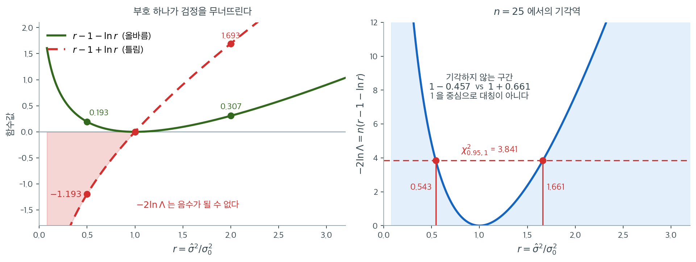

# 분산에 대한 가능도비 검정

가능도비 검정(LRT)은 귀무가설과 대립가설 아래의 최대화된 가능도를 비교하는 범용 가설검정 틀을 제공한다. $k$개 정규 모집단의 분산이 같은지 검정하는 문제에 적용하면 Bartlett 검정과 밀접하게 관련된 통계량이 나온다. 이 절은 분산 동질성에 대한 LRT를 유도하고 그 연결을 설명한다.

---

## 1. 가능도비의 틀

일반적인 가설검정 $H_0$ 대 $H_1$에 대해 가능도비 통계량은

$$
\Lambda = \frac{\sup_{\theta \in \Theta_0} L(\theta)}{\sup_{\theta \in \Theta} L(\theta)}
$$

여기서 $\Theta_0$은 $H_0$ 아래의 모수공간이고 $\Theta$는 전체 모수공간이다. $\Theta_0 \subseteq \Theta$이므로 항상 $0 \le \Lambda \le 1$이다. $\Lambda$가 작다는 것은 $H_0$의 제약이 가능도를 크게 떨어뜨린다는 뜻이다.

Wilks 정리에 의해 정칙조건 아래에서 $n \to \infty$일 때

$$
-2\ln\Lambda \stackrel{d}{\to} \chi^2_r
$$

여기서 $r$은 $\Theta$와 $\Theta_0$의 자유모수 개수 차이이다.

---

## 2. 일표본 분산 LRT

$\mu$를 모르는 단일 표본 $X_1, \ldots, X_n \sim N(\mu, \sigma^2)$에서 $H_0\colon \sigma^2 = \sigma_0^2$을 검정한다고 하자.

**$H_0$ 아래에서:** $\mu$의 최대가능도추정량은 $\bar{X}$이고 $\sigma^2$은 $\sigma_0^2$으로 고정된다. 최대화된 로그가능도는

$$
\ell_0 = -\frac{n}{2}\ln(2\pi\sigma_0^2) - \frac{1}{2\sigma_0^2}\sum_{i=1}^{n}(X_i - \bar{X})^2
$$

**전체 모형 아래에서:** 최대가능도추정량은 $\hat{\mu} = \bar{X}$, $\hat{\sigma}^2 = \frac{1}{n}\sum(X_i - \bar{X})^2$이다. 최대화된 로그가능도는

$$
\ell_1 = -\frac{n}{2}\ln(2\pi\hat{\sigma}^2) - \frac{n}{2}
$$

로그가능도비 통계량은 $r = \hat{\sigma}^2/\sigma_0^2$이라 쓰면

$$
-2\ln\Lambda = -2(\ell_0 - \ell_1) = n\ln\!\left(\frac{\sigma_0^2}{\hat{\sigma}^2}\right) + \frac{n\hat{\sigma}^2}{\sigma_0^2} - n = n\left(r - 1 - \ln r\right)
$$

$H_0$ 아래에서 이 값은 분포수렴으로 $\chi^2_1$에 접근한다.

!!! warning "로그의 방향에 주의하라"
    이 통계량은 $n(r - 1 - \ln r)$이지 $n(r - 1 + \ln r)$이 아니다. 부호를 뒤집으면 검정이 완전히 망가진다.

    함수 $g(r) = r - 1 - \ln r$는 $r > 0$에서 항상 음이 아니고 $r = 1$에서만 0이 된다($g'(r) = 1 - 1/r$이므로 $r=1$이 유일한 최소점). 이는 $-2\ln\Lambda \geq 0$이라는 요구조건을 만족한다.

    반면 $r - 1 + \ln r$는 $r < 1$에서 음수가 된다($r = 0.5$에서 $-1.193$). $-2\ln\Lambda$는 정의상 음수가 될 수 없으므로 이 형태는 틀린 것이다.

    | $r = \hat{\sigma}^2/\sigma_0^2$ | 0.5 | 1 | 2 |
    |---|---|---|---|
    | $r - 1 - \ln r$ (올바름) | 0.193 | 0 | 0.307 |
    | $r - 1 + \ln r$ (틀림) | $-1.193$ | 0 | 1.693 |



왼쪽에서 초록 곡선 $g(r) = r - 1 - \ln r$는 $r = 1$에서 바닥을 치고 양쪽으로 올라가는 **골짜기 모양**이다. 분산 추정값이 가설값보다 크든 작든 증거가 쌓인다는 뜻이며, 가능도비 검정이 자동으로 양측검정이 되는 이유이기도 하다. 붉은 곡선은 부호를 뒤집은 것인데 $r < 1$에서 통째로 음수 영역(분홍 음영)에 잠긴다. $-2\ln\Lambda$는 가능도의 비의 로그이고 $\Lambda \le 1$이므로 음수가 될 수 없으니, 이 형태는 정의부터 어긋난다.

곡선이 **비대칭**이라는 점도 중요하다. $g(0.5) = 0.193$인데 $g(2) = 0.307$이다. 분산이 절반이 된 것과 두 배가 된 것은 직관적으로 같은 정도의 이탈처럼 보이지만, 가능도는 두 배 쪽에 1.6배 강한 증거를 준다. 로그가능도가 $\ln \sigma^2$의 형태로 들어가기 때문에 생기는 자연스러운 비대칭이다.

오른쪽이 그 비대칭의 실제 결과다. $n = 25$에서 $-2\ln\Lambda = 25\,g(r)$을 그리고 임계값 $\chi^2_{0.95,1} = 3.841$을 그으면 기각하지 않는 구간이 $(0.543,\ 1.661)$이다. 1에서 **아래로는 $0.457$, 위로는 $0.661$**만큼 뻗는다. 15.2절 카이제곱 검정의 기각역이 비대칭이었던 것과 같은 현상이며, 분산을 다루는 검정에서는 "1을 중심으로 대칭"이라는 직관을 버려야 한다.

마지막으로 부호 확인법을 하나 기억해 두자. **$r = 1$을 넣어 0이 나오는지, 그리고 $r$을 1에서 조금 움직여 값이 커지는지 보면 된다.** 두 조건을 모두 만족하지 않는 식은 $-2\ln\Lambda$가 아니다.

---

## 3. 다표본 등분산 LRT

정규 모집단 $N(\mu_i, \sigma_i^2)$에서 나온 표본크기 $n_i$, 표본분산 $S_i^2$인 독립 표본 $k$개를 생각하자.

**$H_0\colon \sigma_1^2 = \cdots = \sigma_k^2 = \sigma^2$ 아래에서:** 공통 분산의 추정량은 합동분산이다.

$$
\hat{\sigma}^2 = S_p^2 = \frac{\sum_{i=1}^{k}(n_i - 1)S_i^2}{N - k}
$$

**대립가설 아래에서:** 각 집단이 자기 추정량 $\hat{\sigma}_i^2 = \frac{n_i - 1}{n_i}S_i^2 \approx S_i^2$($n_i$가 클 때)을 갖는다.

로그가능도비 통계량은 (자유도 $\nu_i = n_i - 1$을 써서) 다음으로 정리된다.

$$
-2\ln\Lambda = \sum_{i=1}^{k} \nu_i \ln\!\left(\frac{S_p^2}{S_i^2}\right) = (N - k)\ln S_p^2 - \sum_{i=1}^{k}\nu_i \ln S_i^2
$$

이것이 정확히 보정인자를 적용하기 전의 Bartlett 검정통계량 분자이다.

여기서는 일표본의 경우와 달리 $r-1$에 해당하는 항이 나타나지 않는다는 점에 주목하라. $S_p^2$이 $S_i^2$들의 가중평균이므로 $\sum_i \nu_i (S_i^2/S_p^2 - 1) = 0$이 되어 그 항이 소거되기 때문이다.

---

## 4. Bartlett 검정과의 연결

Bartlett 검정통계량은 LRT의 보정판이다.

$$
T_{\text{Bartlett}} = \frac{-2\ln\Lambda}{C}
$$

여기서

$$
C = 1 + \frac{1}{3(k-1)}\left(\sum_{i=1}^{k}\frac{1}{\nu_i} - \frac{1}{N-k}\right)
$$

보정인자 $C > 1$이 유한표본 카이제곱 근사를 개선한다. 보정하지 않으면 원래의 LRT 통계량 $-2\ln\Lambda$가 작은 표본에서 지나치게 자주 기각한다.

!!! note "Bartlett 검정의 토대로서의 LRT"
    Bartlett 검정은 독립적으로 고안된 것이 아니라 작은 표본 보정을 더한 가능도비 검정이다. LRT 유도를 이해하면 Bartlett 검정이 왜 그런 형태를 갖는지, 그리고 왜 정규성을 요구하는지(가능도가 Gauss 가능도이기 때문) 알 수 있다.

---

## 5. 자유도

$H_0$ 아래에서 자유모수는 $k + 1$개이다($\mu_1, \ldots, \mu_k, \sigma^2$). 대립가설 아래에서는 $2k$개이다($\mu_1, \ldots, \mu_k, \sigma_1^2, \ldots, \sigma_k^2$). 차이는 $r = 2k - (k+1) = k - 1$이다.

따라서 Wilks 정리에 의해

$$
-2\ln\Lambda \stackrel{d}{\to} \chi^2_{k-1}
$$

Bartlett 검정이 올바른 기준분포를 쓴다는 것이 확인된다.

<div class="exbox" markdown>

**보기 1.** <span class="diff easy" title="쉬움"></span> 두 집단 분산의 가능도비 검정. $n_1 = 15$, $S_1^2 = 22.4$인 집단과 $n_2 = 18$, $S_2^2 = 35.1$인 집단이 있다.

</div>

??? success "풀이"
    **1단계.** 합동분산:

    $$
    S_p^2 = \frac{14(22.4) + 17(35.1)}{31} = \frac{313.6 + 596.7}{31} = 29.3645
    $$

    **2단계.** LRT 통계량:

    $$
    -2\ln\Lambda = 14\ln\!\left(\frac{29.3645}{22.4}\right) + 17\ln\!\left(\frac{29.3645}{35.1}\right)
    $$

    $$
    = 14(0.2707) + 17(-0.1784) = 3.790 - 3.033 = 0.757
    $$

    **3단계.** 보정인자:

    $$
    C = 1 + \frac{1}{3}\left(\frac{1}{14} + \frac{1}{17} - \frac{1}{31}\right) = 1 + \frac{1}{3}(0.0714 + 0.0588 - 0.0323) = 1 + 0.0327 = 1.0327
    $$

    **4단계.** Bartlett 통계량: $T = 0.757 / 1.0327 = 0.733$.

    **5단계.** $\chi^2_{0.95, 1} = 3.841$과 비교한다. $0.733 < 3.841$이므로 $H_0$을 기각하지 못한다($p = 0.392$).

<div class="exbox" markdown>

**보기 2.** <span class="diff easy" title="쉬움"></span> 가능도비 검정과 Bartlett 보정. 보기 1 과 같은 요약값을 코드로 옮긴다.

**(1)** 보정인자 $C$ 가 **자료에 전혀 의존하지 않고** 자유도만의 함수임을 지적하고, 늘 $C > 1$ 임을 증명하시오. 또 $\nu_i$ 가 모두 $\nu$ 로 같으면 $C = 1 + \dfrac{k+1}{3k\nu}$ 이고, 이것이 **총자유도를 고정했을 때 $C$ 의 최솟값**임을 보이시오.

**(2)** 보정이 실제로 1종 오류율을 고치는지 모의실험으로 재시오. $H_0$ 아래에서는 $\nu_i S_i^2/\sigma^2 \sim \chi^2_{\nu_i}$ 이므로 원자료 없이 카이제곱에서 바로 뽑을 수 있다.

</div>

??? success "풀이"

    **(1) $C$ 는 자료를 보지 않는다.**

    $$
    C = 1 + \frac{1}{3(k-1)}\left(\sum_{i=1}^{k}\frac{1}{\nu_i} - \frac{1}{N-k}\right)
    $$

    에 들어 있는 것은 $k$ 와 $\nu_1, \ldots, \nu_k$ 뿐이고 $S_i^2$ 은 어디에도 없다. **그러므로 설계가 정해지면 $C$ 도 정해지고, 자료를 보기 전에 계산할 수 있다.** 보정은 통계량을 자료와 무관한 상수로 나누는 일, 곧 **눈금을 한 번 다시 매기는 일**이다. 따라서

    $$
    \frac{T_{\text{Bartlett}}}{-2\ln\Lambda} = \frac1C
    $$

    가 모든 자료에서 같은 값이고, 두 검정의 $p$ 값 순서도 결코 뒤바뀌지 않는다.

    **늘 $C > 1$ 이다.** $\nu_i \ge 1$ 이고 $\sum_i \nu_i = N - k$ 이므로, $k \ge 2$ 일 때

    $$
    \sum_{i=1}^k \frac{1}{\nu_i} \;\ge\; \frac{1}{\max_i \nu_i} \;>\; \frac{1}{\sum_i \nu_i} = \frac{1}{N-k}
    $$

    이다(가운데 부등호는 $k \ge 2$ 라 $\max_i \nu_i < \sum_i \nu_i$ 이기 때문이다). 괄호 안이 양수이므로 $C > 1$ 이고, 따라서

    $$
    T_{\text{Bartlett}} = \frac{-2\ln\Lambda}{C} \;<\; -2\ln\Lambda
    $$

    가 **언제나** 성립한다. **보정은 늘 통계량을 줄이고, 그러므로 늘 기각을 덜 하게 만든다.** 보정하지 않은 LRT 가 작은 표본에서 지나치게 자주 기각한다는 말과 방향이 맞는다.

    **등자유도일 때.** $\nu_i = \nu$ 이면 $\sum 1/\nu_i = k/\nu$ 이고 $N - k = k\nu$ 이므로

    $$
    C = 1 + \frac{1}{3(k-1)}\left(\frac{k}{\nu} - \frac{1}{k\nu}\right)
    = 1 + \frac{k^2-1}{3(k-1)k\nu}
    = 1 + \frac{k+1}{3k\nu}
    $$

    이다. $k = 2$ 면 $C = 1 + \dfrac{1}{2\nu}$ 로 아주 간단하다.

    **이것이 최솟값이다.** 산술–조화평균 부등식(또는 코시–슈바르츠)에서

    $$
    \sum_{i=1}^k \frac{1}{\nu_i} \;\ge\; \frac{k^2}{\sum_i \nu_i} = \frac{k^2}{N-k}
    $$

    이고 등호는 $\nu_i$ 가 모두 같을 때만 성립한다. 이를 넣으면

    $$
    C \;\ge\; 1 + \frac{1}{3(k-1)}\cdot\frac{k^2-1}{N-k} = 1 + \frac{k+1}{3(N-k)}
    $$

    인데, $N - k = k\nu$ 를 쓰면 이 하한이 바로 위의 등자유도 공식이다. **총자유도가 같다면 집단 크기가 고를 때 보정이 가장 작다.** 거꾸로 말하면 **집단 크기가 불균형할수록 카이제곱 근사가 더 나쁘고 보정이 더 커야 한다.**

    **(2) 수로 확인한다.** $H_0$ 이 참이고 자료가 정규라면 $\nu_i S_i^2/\sigma^2 \sim \chi^2_{\nu_i}$ 이 서로 독립이다. 통계량이 $S_i^2$ 의 비에만 의존하므로 $\sigma^2 = 1$ 로 두어도 일반성을 잃지 않고, 원자료를 만들 필요 없이 카이제곱에서 바로 뽑으면 된다.

    ```python
    import numpy as np
    from scipy import stats

    # 원자료 없이 집단별 크기와 표본분산만으로 계산할 수 있다.
    n = np.array([15, 18])
    s2 = np.array([22.4, 35.1])
    k = len(n)
    nu = n - 1
    N = n.sum()

    # 귀무가설(분산이 모두 같다) 아래에서의 공통 분산 추정값
    s2_pooled = np.sum(nu * s2) / np.sum(nu)

    # 가능도비 검정통계량. 제약 있는 최대가능도와 없는 것의 비에 로그를 씌운
    # 값이며, 각 집단의 분산이 공통값에서 얼마나 벗어났는지를 재는 셈이다.
    lrt = np.sum(nu * np.log(s2_pooled / s2))

    # 그대로 두면 카이제곱 근사가 작은 표본에서 어긋난다. Bartlett 보정은
    # 통계량을 이 인자로 나눠 근사를 개선한다.
    C = 1 + (1 / (3 * (k - 1))) * (np.sum(1 / nu) - 1 / np.sum(nu))

    # 보정한 통계량
    T = lrt / C

    # p-값
    p_value = stats.chi2.sf(T, k - 1)

    print(f"Pooled variance: {s2_pooled:.4f}")
    print(f"LRT statistic (uncorrected): {lrt:.4f}")
    print(f"Correction factor: {C:.4f}")
    print(f"Bartlett statistic (corrected): {T:.4f}")
    print(f"P-value: {p_value:.4f}")

    # === (1) C 가 자료를 보지 않는다. 불균형이 C 를 키우는가 ===
    def corr_factor(nu):
        nu = np.asarray(nu, dtype=float)
        kk = len(nu)
        return 1 + (1 / (3 * (kk - 1))) * (np.sum(1 / nu) - 1 / np.sum(nu))

    print(f"\n총자유도 N-k = {nu.sum()} 를 2 집단에 어떻게 쪼개는가")
    print(f"  균형 하한 1+(k+1)/(3(N-k)) = {1 + (k + 1) / (3 * nu.sum()):.6f}")
    for split in ([15, 16], [14, 17], [10, 21], [5, 26], [1, 30]):
        print(f"  nu = {str(split):10s} -> C = {corr_factor(split):.6f}")

    # === (2) 보정이 1종 오류율을 고치는가 ===
    def sizes(nu, M=200_000, alpha=0.05, rng=None):
        """H0 아래에서 nu_i S_i^2 ~ chi2(nu_i) 이므로 바로 뽑는다."""
        nu = np.asarray(nu, dtype=float)
        kk = len(nu)
        W = rng.chisquare(nu, size=(M, kk))       # nu_i * S_i^2  (sigma^2 = 1)
        s2b = W / nu                              # S_i^2
        sp = W.sum(axis=1) / nu.sum()             # 합동분산
        stat = (nu * np.log(sp[:, None] / s2b)).sum(axis=1)
        crit = stats.chi2(kk - 1).ppf(1 - alpha)
        Cc = corr_factor(nu)
        return np.mean(stat > crit), np.mean(stat / Cc > crit), Cc

    rng = np.random.default_rng(0)
    M = 200_000
    print(f"\n정규 자료, H0 참, alpha = 0.05, 반복 {M} 회 "
          f"(0.05 근처 표준오차 +-{np.sqrt(0.05 * 0.95 / M):.5f})")
    print("  nu                    C      보정 전    보정 후   등자유도 공식")
    for nus in ([4, 4], [3, 3, 3, 3], [4, 4, 4, 4, 4], [9, 9], [9, 9, 9],
                [14, 17], [49, 49]):
        a, b, Cc = sizes(nus, M=M, rng=rng)
        kk = len(nus)
        eq = (f"{1 + (kk + 1) / (3 * kk * nus[0]):.4f}"
              if len(set(nus)) == 1 else "-")
        print(f"  {str(nus):18s}{Cc:7.4f}   {a:.4f}     {b:.4f}   {eq:>8s}")
    ```

    출력:

    ```text
    Pooled variance: 29.3645
    LRT statistic (uncorrected): 0.7571
    Correction factor: 1.0327
    Bartlett statistic (corrected): 0.7332
    P-value: 0.3919

    총자유도 N-k = 31 를 2 집단에 어떻게 쪼개는가
      균형 하한 1+(k+1)/(3(N-k)) = 1.032258
      nu = [15, 16]   -> C = 1.032303
      nu = [14, 17]   -> C = 1.032665
      nu = [10, 21]   -> C = 1.038454
      nu = [5, 26]    -> C = 1.068734
      nu = [1, 30]    -> C = 1.333692

    정규 자료, H0 참, alpha = 0.05, 반복 200000 회 (0.05 근처 표준오차 +-0.00049)
      nu                    C      보정 전    보정 후   등자유도 공식
      [4, 4]             1.1250   0.0650     0.0500     1.1250
      [3, 3, 3, 3]       1.1389   0.0736     0.0475     1.1389
      [4, 4, 4, 4, 4]    1.1000   0.0697     0.0493     1.1000
      [9, 9]             1.0556   0.0561     0.0496     1.0556
      [9, 9, 9]          1.0494   0.0572     0.0494     1.0494
      [14, 17]           1.0327   0.0531     0.0494          -
      [49, 49]           1.0102   0.0507     0.0494     1.0102
    ```

    **보기 1 의 손계산과 코드가 맞는다.** 합동분산 $29.3645$, 보정 전 $0.7571$, $C = 1.0327$, 보정 후 $0.7332$, $p = 0.3919$ 로 다섯 값 모두 보기 1 과 같다.

    **(1)의 등자유도 공식이 정확히 맞는다.** 마지막 열의 $1 + (k+1)/(3k\nu)$ 가 실제 $C$ 와 네 자리까지 모두 같다. $\nu = 4$, $k = 2$ 에서 $1 + 1/(2\cdot4) = 1.1250$, $\nu = 3$, $k = 4$ 에서 $1 + 5/36 = 1.1389$ 이다.

    **균형이 $C$ 를 최소로 한다는 것도 확인된다.** 총자유도 $31$ 을 두 집단에 쪼갤 때 하한이 $1.032258$ 인데, 가장 고른 $[15,16]$ 이 $1.032303$ 으로 거의 거기에 붙고, 불균형을 키우면 $[10,21]$ $1.038454$, $[5,26]$ $1.068734$, $[1,30]$ $1.333692$ 로 올라간다. **한 집단이 자유도 1 밖에 없으면 보정이 $33\%$ 나 된다.** 보기 1 의 $[14,17]$ 은 거의 균형이라 보정이 $3.3\%$ 로 작다.

    **보정은 정말로 1종 오류율을 고친다.** 보정하지 않은 $-2\ln\Lambda$ 의 크기가 $\nu = 4$ 두 집단에서 $0.0650$, 네 집단 $\nu = 3$ 에서 $0.0736$, 다섯 집단 $\nu = 4$ 에서 $0.0697$ 으로 모두 명목값을 넘는다. 같은 자료에 $C$ 로 나누면 $0.0500$, $0.0475$, $0.0493$ 이 된다. 20 만 번 반복에서 표준오차가 $\pm0.00049$ 이므로 보정 전의 초과($0.0650$ 은 명목값보다 $31$ 표준오차 위다)는 의심의 여지 없이 실재하고, 보정 후에는 거의 다 명목값으로 돌아온다.

    자유도가 커지면 보정할 것도 줄어든다. $\nu = 49$ 두 집단에서는 보정 전이 이미 $0.0507$ 이고 보정 후 $0.0494$ 이며 $C$ 도 $1.0102$ 로 1 에 가깝다. **$C$ 는 $\nu \to \infty$ 에서 1 로 가고, Wilks 정리의 $\chi^2_{k-1}$ 근사가 그 극한에서 정확해진다.** 보정은 그 수렴을 앞당기는 유한표본 손질이다.

    **다만 완벽하지는 않다.** 가장 작은 자유도인 $[3,3,3,3]$ 에서 보정 후가 $0.0475$ 로 명목값보다 $5$ 표준오차 **낮다.** 보정이 살짝 지나친 것이다. $\nu = 3$ 은 집단당 관측값 4 개이니 그 정도는 당연하고, 실무에서 문제가 될 크기도 아니다(보정 전 $0.0736$ 과 견주라). **그러나 "보정했으니 정확하다"가 아니라 "보정했으니 훨씬 낫다"가 맞는 말이다.** 보정 후 값들이 $0.0475$–$0.0500$ 으로 모두 명목값 쪽에서 조금 아래에 모이는 것을 보면, 이 보정은 평균적으로 아주 조금 보수적인 편이다.

    그리고 이 모의실험은 **정규성을 가정한 것**이다. $\nu_i S_i^2 \sim \chi^2_{\nu_i}$ 자체가 정규모집단에서만 참이기 때문이다. 정규성이 깨지면 $C$ 로 나누는 일은 아무 도움이 되지 않는다. Bartlett 검정이 꼬리가 무거운 자료에서 무너지는 것은 **보정의 실패가 아니라 가능도의 실패**다. 15.4절 [Bartlett 검정의 한계](../bartlett_test/limitations.md)가 그 이야기다.

---

## 연습문제

<div class="drillbox" markdown>

**연습문제 1.** <span class="diff med" title="중간"></span>
정규 자료에서 $H_0: \sigma^2 = \sigma_0^2$ 대 $H_a: \sigma^2 \neq \sigma_0^2$을 검정하는 가능도비 검정통계량을 쓰라.

</div>

??? success "풀이"
    가능도비 통계량은

    $$
    \Lambda = \frac{L(\sigma_0^2)}{L(\hat{\sigma}^2)} = \left(\frac{\hat{\sigma}^2}{\sigma_0^2}\right)^{n/2} \exp\!\left(-\frac{n}{2}\left(\frac{\hat{\sigma}^2}{\sigma_0^2} - 1\right)\right)
    $$

    여기서 $\hat{\sigma}^2 = \frac{1}{n}\sum(x_i - \bar{x})^2$은 최대가능도추정량이다.

    양변에 로그를 취하고 $-2$를 곱하면 $r = \hat{\sigma}^2/\sigma_0^2$에 대해

    $$
    -2\ln\Lambda = -n\ln r + n(r - 1) = n\left(r - 1 - \ln r\right)
    $$

    이며 $H_0$ 아래에서 점근적으로 $-2\ln\Lambda \sim \chi^2_1$이다. 본문의 유도와 일치한다.

    **검산.** $\Lambda \leq 1$이어야 하므로 $\ln \Lambda \leq 0$, 곧 $-2\ln\Lambda \geq 0$이다. $g(r) = r - 1 - \ln r$가 $r>0$에서 항상 음이 아니므로 조건이 충족된다. $\square$

<div class="drillbox" markdown>

**연습문제 2.** <span class="diff med" title="중간"></span>
일표본 분산에 대한 가능도비 검정과 카이제곱 검정을 비교하라. 두 검정은 동등한가?

</div>

??? success "풀이"
    고전적 카이제곱 검정은 $\chi^2 = (n-1)s^2/\sigma_0^2 \sim \chi^2_{n-1}$을 쓰며 정규성 아래에서 **정확**하다. 가능도비 검정은 $-2\ln\Lambda \sim \chi^2_1$을 점근적으로 쓴다.

    **동등하지 않다.** 유한표본에서 카이제곱 검정은 정확하고 LRT는 근사에 기댄다. 큰 $n$에서는 거의 같은 결과를 준다.

    모의실험으로 확인해 보자($H_0$ 참, $\alpha = 0.05$, 반복 20,000회).

    ```python
    import numpy as np
    from scipy import stats

    rng = np.random.default_rng(0)
    R = 20000

    for n in [10, 25, 50, 100, 500]:
        a = b = 0
        for _ in range(R):
            x = rng.normal(0, 1, n)
            r = x.var(ddof=0)                      # MLE / sigma0^2 with sigma0=1
            lrt = n * (r - 1 - np.log(r))
            a += lrt > stats.chi2.ppf(0.95, 1)

            c = (n - 1) * x.var(ddof=1)
            p = 2 * min(stats.chi2.cdf(c, n - 1), stats.chi2.sf(c, n - 1))
            b += p < 0.05
        print(f"n = {n:>4}: LRT size {a/R:.4f}, exact chi2 size {b/R:.4f}")
    ```

    출력:

    ```text
    n =   10: LRT size 0.0731, exact chi2 size 0.0500
    n =   25: LRT size 0.0586, exact chi2 size 0.0500
    n =   50: LRT size 0.0558, exact chi2 size 0.0519
    n =  100: LRT size 0.0515, exact chi2 size 0.0490
    n =  500: LRT size 0.0537, exact chi2 size 0.0521
    ```

    | $n$ | LRT | 정확 카이제곱 |
    |---|---|---|
    | 10 | 0.073 | 0.050 |
    | 25 | 0.059 | 0.050 |
    | 50 | 0.056 | 0.052 |
    | 100 | 0.052 | 0.049 |
    | 500 | 0.054 | 0.052 |

    정확 카이제곱 검정은 모든 $n$에서 정확히 0.05이다(당연하다, 정확한 검정이므로). LRT는 $n = 10$에서 0.073으로 46% 부풀려져 있고 $n$이 커지면서 0.05로 수렴한다.

    **그렇다면 왜 LRT를 쓰는가.** 일표본 분산 문제에서는 쓸 이유가 없다. 정확한 검정이 존재하기 때문이다. LRT의 가치는 정확한 검정이 존재하지 않는 복잡한 가설($k$개 분산의 동시 검정 등)로 쉽게 일반화된다는 점에 있다. $\square$

<div class="drillbox" markdown>

**연습문제 3.** <span class="diff med" title="중간"></span>
$H_0: \sigma_1^2 = \sigma_2^2 = \dots = \sigma_k^2$의 검정에서 LRT 통계량이 Bartlett 검정과 어떻게 관련되는지 보여라.

</div>

??? success "풀이"
    Bartlett 검정통계량은 정규 모집단에서 $k$개 분산의 동일성에 대한 가능도비 검정이다. LRT는 $H_0$ 아래의 합동분산 추정값과 개별 분산 추정값들을 비교한다.

    $$
    -2\ln\Lambda = \sum_{j=1}^k (n_j - 1)\ln\!\left(\frac{s_p^2}{s_j^2}\right)
    $$

    여기서 $s_p^2 = \sum(n_j-1)s_j^2/\sum(n_j-1)$이다. Bartlett 검정은 카이제곱 근사를 개선하기 위해 보정인자 $C$를 적용한다. 보정된 통계량은 $-2\ln\Lambda / C \sim \chi^2_{k-1}$이다.

    **일표본의 경우와의 차이.** 연습문제 1에서 일표본 LRT는 $n(r - 1 - \ln r)$로 $r-1$ 항을 포함했다. 다표본에서는 그 항이 사라진다. 이유는

    $$
    \sum_i \nu_i\left(\frac{S_i^2}{S_p^2} - 1\right) = \frac{\sum_i \nu_i S_i^2}{S_p^2} - \sum_i \nu_i = \frac{(N-k)S_p^2}{S_p^2} - (N-k) = 0
    $$

    이기 때문이다. 곧 합동분산이 개별 분산의 가중평균이라는 사실이 선형항을 정확히 소거한다.

    이는 일표본에서 $\sigma_0^2$이 **외부에서 주어진 고정값**인 반면 다표본에서는 $S_p^2$이 **자료에서 추정된 값**이라는 차이에서 온다. 추정하면서 이미 최적화 조건을 만족시켰으므로 1차 항이 0이 된다. $\square$

<div class="drillbox" markdown>

**연습문제 4.** <span class="diff med" title="중간"></span>
분산에 대한 가능도비 검정이 비정규성에 민감한 이유는 무엇이며 어떤 대안이 있는가?

</div>

??? success "풀이"
    LRT는 자료가 정규분포를 따른다고 가정한다. 가능도함수 $L(\sigma^2)$이 정규 가능도이기 때문이다. 비정규성 아래에서는 가능도가 잘못 설정되고 점근 $\chi^2$ 분포가 성립하지 않는다. 두꺼운 꼬리가 분산 추정값을 부풀려 검정통계량을 왜곡한다.

    **더 정확히는 정보행렬 등식이 깨진다.** 올바르게 설정된 모형에서는 Fisher 정보의 두 표현(스코어의 분산과 헤시안의 음수 기댓값)이 일치하고, 그 덕분에 $-2\ln\Lambda$가 $\chi^2$을 따른다. 모형이 잘못 설정되면 두 값이 달라지고 $-2\ln\Lambda$는 $\chi^2$이 아니라 **가중 카이제곱**의 혼합을 따른다. 정규 모형에서 그 가중치는 $(\gamma_2+2)/2$에 비례하며, 이것이 15.1절부터 반복해 온 팽창 인자와 정확히 같은 양이다.

    **대안.**

    1. **Levene 검정**(절대편차 기반, 비정규성에 로버스트)
    2. **Brown-Forsythe 검정**(평균 대신 중앙값 사용)
    3. **붓스트랩 LRT**($\chi^2$ 기준분포를 붓스트랩 기준분포로 대체). LRT 통계량은 그대로 쓰되 기준분포만 자료에서 얻는다. 모형 오설정의 영향을 대부분 제거한다.
    4. **Fligner-Killeen 검정**(순위 기반, 분포무관)
    5. **샌드위치(로버스트) 보정.** 정보행렬 등식이 깨진 것을 명시적으로 보정하는 방법으로, $-2\ln\Lambda$를 추정된 가중치로 나눈다. 준가능도(quasi-likelihood) 이론의 표준 도구이다.

    실무적으로는 3번(붓스트랩)이 가장 간단하면서도 효과적이다. 기존 코드에서 $p$값 계산 부분만 바꾸면 되기 때문이다. $\square$

<div class="drillbox" markdown>

**연습문제 5.** <span class="diff med" title="중간"></span>
$g(r) = r - 1 - \ln r$ 를 $r = 1 + \epsilon$ 에서 전개한다.

**(1)** 2 차까지만 남기면 일표본 LRT 통계량이

$$
-2\ln\Lambda \;\approx\; \frac{(\hat\sigma^2 - \sigma_0^2)^2}{2\sigma_0^4/n}
$$

가 됨을 보이고, 분모 $2\sigma_0^4/n$ 이 무엇인지 말하라. 이것으로 왜 자유도가 $\chi^2_1$ 인지 설명하라.

**(2)** 2 절은 $g(2) = 0.307$ 과 $g(0.5) = 0.193$ 을 견주어 "가능도는 두 배 쪽에 1.6 배 강한 증거를 준다"고 했다. 그런데 $\hat\sigma^2$ 의 **차이**를 같게 맞추어 $g(1.5)$ 와 $g(0.5)$ 를 견주면 어느 쪽이 큰가? 두 결론이 어긋나는 까닭을 전개의 3 차항으로 설명하라.

**(3)** $g(r^\ast) = g(0.5)$ 인 $r^\ast > 1$ 을 소수 넷째 자리까지 구하라.

</div>

??? success "풀이"
    **(1) 2 차 근사는 왈드 통계량이다.** $\ln(1+\epsilon) = \epsilon - \frac{\epsilon^2}{2} + \frac{\epsilon^3}{3} - \cdots$ 이므로 $\lvert\epsilon\rvert < 1$ 에서

    $$
    g(1+\epsilon) = \epsilon - \ln(1+\epsilon) = \frac{\epsilon^2}{2} - \frac{\epsilon^3}{3} + \frac{\epsilon^4}{4} - \cdots
    $$

    이다. 1 차항이 없다는 것이 바로 2 절의 "$r = 1$ 이 유일한 최소점" 이고, 2 차항이 양수라는 것이 "골짜기 모양" 이다. $\epsilon = (\hat\sigma^2 - \sigma_0^2)/\sigma_0^2$ 을 넣고 2 차까지만 남기면

    $$
    -2\ln\Lambda = n\,g(1+\epsilon) \approx \frac{n\epsilon^2}{2} = \frac{n(\hat\sigma^2-\sigma_0^2)^2}{2\sigma_0^4} = \frac{(\hat\sigma^2-\sigma_0^2)^2}{2\sigma_0^4/n}
    $$

    이다. 분모 $2\sigma_0^4/n$ 은 **정규 모집단에서 $\hat\sigma^2$ 의 분산**이다. 5 장 표본분산의 표준오차 정리 1 이 $\operatorname{Var}(S^2) = \frac{\sigma^4}{n}(\beta_2 - 1)$ 을 주고 정규분포는 $\beta_2 = 3$ 이므로 $2\sigma^4/n$ 이 된다. 그러므로

    $$
    -2\ln\Lambda \;\approx\; \left(\frac{\hat\sigma^2 - \sigma_0^2}{\operatorname{SE}(\hat\sigma^2)}\right)^{\!2} = Z^2
    $$

    꼴이고, $Z \xrightarrow{d} N(0,1)$ 이므로 $-2\ln\Lambda \xrightarrow{d} \chi^2_1$ 이다. **윌크스 정리의 자유도 1 은 "표준화한 정규 하나를 제곱한 것" 이라는 뜻이다.** 모수 하나를 제약했으니 제곱이 하나 생긴다.

    **(2) 차이를 같게 맞추면 방향이 뒤집힌다.** $\epsilon = \pm 0.5$ 로 견주면

    $$
    g(0.5) = -0.5 - \ln 0.5 = 0.193147, \qquad g(1.5) = 0.5 - \ln 1.5 = 0.094535
    $$

    이다. **아래쪽이 위쪽보다 2.04 배 강한 증거를 준다.** 2 절의 결론과 정반대다. 까닭은 3 차항 $-\epsilon^3/3$ 의 부호다. $\epsilon < 0$ 이면 $-\epsilon^3/3 > 0$ 이라 2 차 근사에 **보태고**, $\epsilon > 0$ 이면 **덜어낸다**. 실제로 $\epsilon = \pm 0.5$ 에서 2 차 근사는 둘 다 $0.125$ 인데, 3 차까지 쓰면 $0.125 + 0.0417 = 0.1667$ 과 $0.125 - 0.0417 = 0.0833$ 으로 갈라진다.

    두 결론이 다 참인 이유는 **견주는 눈금이 다르기** 때문이다. 2 절은 비($r$ 과 $1/r$)를 같게 맞추었고 그것은 $\epsilon = +1$ 대 $\epsilon = -0.5$ 를 견주는 일이다. $\lvert\epsilon\rvert$ 자체가 두 배 크니 3 차항의 벌점을 이기고 위쪽이 커진다. 여기서는 $\lvert\epsilon\rvert$ 을 같게 맞추었으므로 3 차항만 남아 아래쪽이 커진다.

    **(3)** $g(r^\ast) = 0.193147$ 을 $r > 1$ 에서 풀면 $r^\ast = 1.7564$ 이다($g(1.7564) = 0.193147$). **분산이 절반이 된 것은 $2$ 배가 아니라 $1.7564$ 배가 된 것과 같은 증거다.** 로그 눈금으로 보면 아래로 $\ln 2 = 0.6931$ 과 위로 $\ln 1.7564 = 0.5633$ 이 맞먹으니, 로그 눈금에서도 정확히 대칭은 아니다. 분산을 재는 검정에서 "1 을 중심으로 대칭" 이라는 직관은 어느 눈금에서도 성립하지 않는다. $\square$

<div class="drillbox" markdown>

**연습문제 6.** <span class="diff med" title="중간"></span>
$k = 2$ 인 다표본 LRT 를 분산비 하나로 바꿔 쓴다. $F = S_1^2/S_2^2$, $w = \nu_1/(\nu_1+\nu_2)$ 라 두자.

**(1)** $-2\ln\Lambda = (\nu_1+\nu_2)\ln(wF + 1 - w) - \nu_1\ln F$ 임을 보이라. 자료가 $F$ 하나를 통해서만 들어온다는 사실과 보기 2 의 "$C$ 는 자료를 보지 않는다"를 합치면 $k=2$ 의 바틀렛 검정에 대해 무엇을 말할 수 있는가?

**(2)** 이 함수를 $F$ 로 미분해 $F = 1$ 이 유일한 최소점이고 그 값이 0 임을 보이라.

**(3)** $\nu_1 = \nu_2$ 이면 통계량이 $F \mapsto 1/F$ 에 대해 불변임을 보이고, 자유도가 다르면 그 불변성이 깨짐을 보기 1 의 수로 확인하라.

</div>

??? success "풀이"
    **(1)** $S_p^2 = \dfrac{\nu_1 S_1^2 + \nu_2 S_2^2}{\nu_1+\nu_2} = w S_1^2 + (1-w)S_2^2$ 이므로 양변을 $S_2^2$ 으로 나누면

    $$
    \frac{S_p^2}{S_2^2} = wF + 1 - w, \qquad \frac{S_p^2}{S_1^2} = \frac{wF + 1 - w}{F}
    $$

    이다. 3 절의 식에 넣으면

    $$
    -2\ln\Lambda = \nu_1\ln\frac{wF+1-w}{F} + \nu_2\ln(wF+1-w) = (\nu_1+\nu_2)\ln(wF+1-w) - \nu_1\ln F
    $$

    를 얻는다.

    **자료가 $F$ 하나로만 들어온다.** $S_1^2$ 과 $S_2^2$ 이 각각 얼마인지는 전혀 쓰이지 않고 비만 쓰인다. 보기 2 에서 $C$ 는 자유도만의 함수였으므로 $T_{\text{Bartlett}} = -2\ln\Lambda/C$ 도 $F$ 의 함수다. 그리고 (2)에서 그 함수가 $F=1$ 양쪽으로 단조이므로 기각역은 $\{F < F_L\} \cup \{F > F_U\}$ 꼴이 된다. 곧 **$k=2$ 의 바틀렛 검정(= LRT)은 양측 $F$ 검정과 같은 검정이고, 다른 점은 임계값을 어디에 놓느냐 뿐이다.** $H_0$ 아래에서 $F \sim F_{\nu_1,\nu_2}$ 라는 5 장 분산비 정리 1 과 앞뒤가 맞는다.

    **(2)** $h(F) = (\nu_1+\nu_2)\ln(wF+1-w) - \nu_1\ln F$ 라 하면 $(\nu_1+\nu_2)w = \nu_1$ 이므로

    $$
    h'(F) = \frac{(\nu_1+\nu_2)w}{wF+1-w} - \frac{\nu_1}{F} = \nu_1\left(\frac{1}{wF+1-w} - \frac{1}{F}\right)
    $$

    이다. 두 분모의 차는 $F - (wF+1-w) = (1-w)(F-1)$ 이다. $0 < w < 1$ 이므로 $F > 1$ 이면 $wF+1-w < F$ 라 $h' > 0$, $F < 1$ 이면 $h' < 0$ 이고 $F = 1$ 에서만 $h' = 0$ 이다. 또 $h(1) = (\nu_1+\nu_2)\ln 1 - \nu_1 \ln 1 = 0$ 이다. **그러므로 $h$ 는 $F=1$ 에서 0 으로 바닥을 치고 양쪽으로 올라가는 골짜기이며**, 일표본의 $g$ 와 같은 모양이다($-2\ln\Lambda \ge 0$ 이 여기서도 자동으로 보장된다).

    **(3)** $\nu_1 = \nu_2 = \nu$ 면 $w = 1/2$ 이라 $h(F) = 2\nu\ln\frac{F+1}{2} - \nu\ln F$ 이고

    $$
    h(1/F) = 2\nu\ln\frac{1/F+1}{2} - \nu\ln\frac1F = 2\nu\ln\frac{1+F}{2F} + \nu\ln F = 2\nu\ln\frac{1+F}{2} - 2\nu\ln F + \nu\ln F = h(F)
    $$

    이다. 따라서 기각역은 $F < F_L$ 또는 $F > 1/F_L$ 로 **비의 역수에 대해 저절로 대칭**이 된다. 집단에 1 번과 2 번 이름을 어떻게 붙여도 같은 결론이 나온다는 뜻이다.

    **자유도가 다르면 깨진다.** 보기 1 은 $\nu_1 = 14$, $\nu_2 = 17$ 이고 $F = 22.4/35.1 = 0.638177$, $w = 14/31 = 0.451613$ 이다.

    $$
    h(F) = 31\ln(0.836596) - 14\ln(0.638177) = 0.757125
    $$

    로 보기 1 의 $0.7571$ 과 같다. 그런데 비를 뒤집어 $1/F = 1.566960$ 을 넣으면 $h(1/F) = 0.779126$ 으로 **다른 값**이 나온다. 반면 $\nu_1=\nu_2=14$ 로 맞추면 $h(0.638177) = h(1.566960) = 0.700188$ 로 같다.

    자유도가 불균형하면 "1 번 집단의 분산이 2 번의 $0.638$ 배" 와 "2 번이 1 번의 $0.638$ 배" 가 서로 다른 증거가 된다. 보기 2 에서 불균형할수록 보정인자 $C$ 가 커졌던 것과 **같은 뿌리**다. 자유도가 적은 집단의 $S_i^2$ 이 더 흔들리는데 통계량은 그것을 가중치 $\nu_i$ 로만 반영하기 때문이다. $\square$

<div class="drillbox" markdown>

**연습문제 7.** <span class="diff hard" title="어려움"></span>
연습문제 2 는 일표본 LRT 의 크기를 모의실험으로 쟀다. 그런데 이 값은 **모의실험 없이 정확히 계산할 수 있다.** $\sigma_0 = 1$ 로 두면 $nr = n\hat\sigma^2 = \sum_i (X_i - \bar X)^2 \sim \chi^2_{n-1}$ 이 정확한 사실이기 때문이다.

채택역 $\{r : n\,g(r) < \chi^2_{0.95,1}\} = (r_L, r_U)$ 의 양 끝을 수치로 구하고, 두 꼬리 확률을 **따로** 적어라. $n = 10, 25, 50, 100, 500, 5000$ 에서 계산하고 연습문제 2 의 모의실험값과 견주라. 그리고 두 꼬리가 $0.025$ 씩으로 갈라지지 않는 까닭을 **두 가지** 말하라.

</div>

??? success "풀이"
    **왜 정확히 계산할 수 있는가.** 5 장 표본분산 정리 2 에 의해 정규 모집단에서 $\sum_i(X_i-\bar X)^2/\sigma_0^2 \sim \chi^2_{n-1}$ 이다. 연습문제 2 의 코드가 쓴 $r$ 은 최대가능도추정량 $\hat\sigma^2 = \frac1n\sum(X_i-\bar X)^2$ 이므로($\sigma_0=1$) $Q := nr \sim \chi^2_{n-1}$ 이다. 한편 $-2\ln\Lambda = n\,g(r)$ 이고 $g$ 는 $r=1$ 에서 바닥을 치는 골짜기이므로 기각하지 않는 집합은 구간 $(r_L, r_U)$ 이고 두 끝은 $g(r) = \chi^2_{0.95,1}/n$ 의 두 근이다. 따라서

    $$
    \text{정확한 크기} = P(Q < n r_L) + P(Q > n r_U), \qquad Q \sim \chi^2_{n-1}
    $$

    이고 모의실험이 전혀 필요하지 않다.

    ```python
    import numpy as np
    from scipy import optimize, stats

    g = lambda r: r - 1 - np.log(r)      # -2 ln Lambda = n * g(r)
    crit = stats.chi2.ppf(0.95, 1)

    # 연습문제 2 의 모의실험에서 얻은 LRT 크기 (반복 20,000 회)
    sim = {10: 0.0731, 25: 0.0586, 50: 0.0558, 100: 0.0515, 500: 0.0537}

    print(f"chi2(0.95, 1) = {crit:.4f}")
    print("   n      rL      rU    아래꼬리  위꼬리  정확크기   모의실험")
    for n in [10, 25, 50, 100, 500, 5000]:
        c = crit / n                     # g(r) = c 의 두 근이 채택역의 끝이다
        rL = optimize.brentq(lambda r: g(r) - c, 1e-12, 1.0)
        rU = optimize.brentq(lambda r: g(r) - c, 1.0, 1e9)
        # n*r = sum (x_i - xbar)^2 / sigma0^2 ~ chi2(n-1) 은 정확한 사실이다
        lo = stats.chi2.cdf(n * rL, n - 1)
        hi = stats.chi2.sf(n * rU, n - 1)
        s = f"{sim[n]:.4f}" if n in sim else "-"
        print(f"{n:5d}  {rL:.4f}  {rU:.4f}   {lo:.4f}  {hi:.4f}   {lo + hi:.4f}  {s:>9s}")
    ```

    출력:

    ```text
    chi2(0.95, 1) = 3.8415
       n      rL      rU    아래꼬리  위꼬리  정확크기   모의실험
       10  0.3586  2.1493   0.0635  0.0106   0.0741     0.0731
       25  0.5430  1.6612   0.0443  0.0146   0.0589     0.0586
       50  0.6575  1.4448   0.0373  0.0170   0.0543     0.0558
      100  0.7478  1.3034   0.0331  0.0190   0.0521     0.0515
      500  0.8811  1.1291   0.0283  0.0221   0.0504     0.0537
     5000  0.9613  1.0397   0.0260  0.0240   0.0500          -
    ```

    **본문과 맞는다.** $n=25$ 의 채택구간 $(0.5430, 1.6612)$ 는 2 절이 그림 설명에서 말한 $(0.543,\ 1.661)$ 과 같다.

    **모의실험과도 맞는다.** 20,000 회 반복의 표준오차는 $\sqrt{0.05 \times 0.95/20000} = 0.0015$ 이다. $n=10$ 에서 $0.0731$ 대 $0.0741$, $n=25$ 에서 $0.0586$ 대 $0.0589$, $n=100$ 에서 $0.0515$ 대 $0.0521$ 로 모두 1 표준오차 안이다. $n=500$ 의 $0.0537$ 만 정확값 $0.0504$ 보다 $2.1$ 표준오차 위인데, 이것은 **LRT 의 성질이 아니라 모의실험의 잡음**이다. 정확 계산이 있을 때 모의실험을 쓸 이유가 없다는 것을 보여 주는 대목이다.

    **두 꼬리가 갈라지지 않는 첫째 까닭: $g$ 의 비대칭.** 채택구간이 1 에서 아래로 $1-0.3586 = 0.641$, 위로 $2.1493-1 = 1.149$ 만큼 뻗는다($n=10$). 위쪽 울타리가 거의 두 배 멀다. 위로 넘어가기가 그만큼 어려우니 위꼬리가 $0.0106$ 으로 작다.

    **둘째 까닭: 최대가능도추정량이 아래로 치우쳐 있다.** $E[\hat\sigma^2] = \frac{n-1}{n}\sigma^2$ 이므로 $H_0$ 이 참이어도 $E[r] = 1 - 1/n$ 이다. $n=10$ 이면 $r$ 의 중심이 $0.9$ 이고 표준편차가 $\sqrt{2(n-1)}/n = 0.424$ 이므로, 아래 울타리 $0.3586$ 은 중심에서 $1.28$ 표준편차, 위 울타리 $2.1493$ 은 $2.95$ 표준편차 떨어져 있다. **$n$ 으로 나눈 추정량을 쓰면서 울타리는 $r=1$ 을 기준으로 세웠으니, 기각이 거의 다 아래쪽에서 일어난다**($0.0635$ 대 $0.0106$ 으로 여섯 배).

    두 효과가 모두 $O(1/n)$ 이라 느리게 사라진다. $n = 5000$ 에 가서야 $0.0260$ 과 $0.0240$ 으로 $0.025$ 에 가까워지고 크기가 $0.0500$ 이 된다. **점근 분포가 맞다는 말은 유한표본에서 쓸 만하다는 말이 전혀 아니다.** $\square$

<div class="drillbox" markdown>

**연습문제 8.** <span class="diff hard" title="어려움"></span>
연습문제 4 는 모형이 잘못 설정되면 $-2\ln\Lambda$ 가 가중 카이제곱을 따르고 그 가중치가 $(\gamma_2+2)/2$ 에 비례한다고 했다. 연습문제 5 의 2 차 근사와 5 장 표본분산의 표준오차 정리 1 을 써서 그 가중치를 직접 유도하라.

**(1)** 일표본 LRT 가 $\dfrac{\beta_2-1}{2}\chi^2_1$ 로 분포수렴함을 보이고, 이것이 $(\gamma_2+2)/2$ 와 같은 양임을 확인하라.

**(2)** 지수분포($\beta_2 = 9$), 라플라스($\beta_2 = 6$), 균일분포($\beta_2 = 1.8$)에서 명목 $0.05$ 검정의 점근적 실제 크기를 소수 넷째 자리까지 구하라.

**(3)** 2 장의 하한 $\beta_2 \ge 1 + \gamma_1^2$ 을 써서, 왜도가 $\lvert\gamma_1\rvert > \sqrt2$ 인 분포에서는 이 검정이 **반드시** 과대기각함을 보이라.

</div>

??? success "풀이"
    **(1) 가중치의 유도.** 정규성을 버리고 네 번째 적률만 있다고 하자. 5 장 표본분산의 표준오차 정리 1 에서 $\operatorname{Var}(\hat\sigma^2) \to \frac{\sigma^4(\beta_2-1)}{n}$ 이므로

    $$
    \frac{\hat\sigma^2 - \sigma^2}{\sqrt{\sigma^4(\beta_2-1)/n}} \;\xrightarrow{d}\; N(0,1)
    $$

    이다. 그런데 LRT 는 **정규 가능도에서 나왔으므로** 연습문제 5 (1)에 따라 분모에 $2\sigma^4/n$ 을, 곧 $\beta_2 = 3$ 을 넣은 값을 쓴다.

    $$
    -2\ln\Lambda \approx \frac{(\hat\sigma^2-\sigma^2)^2}{2\sigma^4/n}
    = \underbrace{\frac{\sigma^4(\beta_2-1)/n}{2\sigma^4/n}}_{\text{참 분산} \,/\, \text{쓴 분산}}\cdot\frac{(\hat\sigma^2-\sigma^2)^2}{\sigma^4(\beta_2-1)/n}
    \;\xrightarrow{d}\; \frac{\beta_2-1}{2}\,\chi^2_1
    $$

    **가중치는 참 분산을 쓴 분산으로 나눈 값, 곧 $\dfrac{\beta_2-1}{2}$ 이다.** 초과첨도 $\gamma_2 = \beta_2 - 3$ 을 넣으면 $\dfrac{\gamma_2+2}{2}$ 이므로 연습문제 4 의 표현과 정확히 같다. 가중치가 1 이 되는 것은 $\beta_2 = 3$ 일 때, 곧 정규분포(와 첨도가 같은 분포)뿐이다. 이것이 연습문제 4 가 말한 "정보행렬 등식이 깨진다"의 구체적 모습이다. 헤시안은 $n/(2\sigma^4)$ 을 주는데 스코어의 참 분산은 $n/(\sigma^4(\beta_2-1))$ 의 역수꼴이어서 둘이 $\frac{\beta_2-1}{2}$ 배 차이가 난다.

    **(2) 실제 크기.** 명목 검정은 $\chi^2_{0.95,1} = 3.8415$ 를 임계값으로 쓰므로

    $$
    \text{실제 크기} = P\!\left(\frac{\beta_2-1}{2}\chi^2_1 > 3.8415\right) = P\!\left(\chi^2_1 > \frac{7.6829}{\beta_2-1}\right)
    $$

    이다. $P(\chi^2_1 > x) = 2\left(1 - \Phi(\sqrt x)\right)$ 를 쓰면

    | 분포 | $\beta_2$ | 가중치 $(\beta_2-1)/2$ | 임계값 환산 | 실제 크기 |
    |---|---|---|---|---|
    | 균일 | 1.8 | 0.4 | 9.6036 | 0.0019 |
    | 정규 | 3 | 1 | 3.8415 | 0.0500 |
    | 라플라스 | 6 | 2.5 | 1.5366 | 0.2151 |
    | 지수 | 9 | 4 | 0.9604 | 0.3271 |

    예컨대 지수분포는 $\sqrt{0.9604} = 0.98$ 이고 $2(1-\Phi(0.98)) = 2 \times 0.16354 = 0.3271$ 이다. **지수분포 자료에서 명목 $5\%$ 검정이 실제로는 세 번에 한 번 기각한다.** 가중치 4 는 5 장이 "지수분포에서 분산 검정의 1 종 오류율이 네 배" 라고 적어 놓은 바로 그 수다. 자유도 5 인 $t$ 분포도 초과첨도가 $6/(5-4) = 6$ 이라 $\beta_2 = 9$, 똑같이 $0.3271$ 이다.

    균일분포는 거꾸로 $0.0019$ 로 명목값의 $4\%$ 에 불과하다. **비정규성은 크기를 키우기만 하는 것이 아니라 어느 쪽으로든 망가뜨린다.** 다만 꼬리가 가벼운 쪽은 보수적이어서 덜 위험하다.

    **(3) 왜도가 크면 과대기각이 확정이다.** 가중치가 1 보다 작아 보수적이 되려면 $\frac{\beta_2-1}{2} < 1$, 곧 $\beta_2 < 3$ 이어야 한다. 2 장의 하한 $\beta_2 \ge 1 + \gamma_1^2$ 에서

    $$
    3 > \beta_2 \ge 1 + \gamma_1^2 \;\Longrightarrow\; \gamma_1^2 < 2 \;\Longrightarrow\; \lvert\gamma_1\rvert < \sqrt2 = 1.4142
    $$

    이다. 대우를 취하면 $\lvert\gamma_1\rvert \ge \sqrt2$ 인 분포는 반드시 $\beta_2 \ge 3$ 이고, 따라서 가중치가 1 이상이라 **과대기각한다**($\lvert\gamma_1\rvert > \sqrt2$ 이면 $\beta_2 > 3$ 이므로 엄격하게 크다).

    쓸모가 분명한 결론이다. **자료의 왜도만 재어 $1.41$ 을 넘으면, 첨도를 보지 않고도 "이 분산 검정은 과대기각한다" 고 단정할 수 있다.** 지수분포는 $\gamma_1 = 2 > \sqrt2$ 이니 이 기준에 바로 걸린다. 거꾸로 보수적일 수 있는 것은 **거의 대칭이면서 꼬리가 가벼운** 분포뿐이고, 실무에서 만나는 치우친 자료는 모두 위험한 쪽이다. $\square$

<div class="drillbox" markdown>

**연습문제 9.** <span class="diff hard" title="어려움"></span>
보기 2 는 "정규성이 깨지면 $C$ 로 나누는 일은 아무 도움이 되지 않는다" 고 했다. 이를 수로 못 박는다.

**(1)** $\nu_i \ge 1$ 만 가정하여, 집단 크기를 어떻게 잡아도 $C < 1 + \dfrac{k}{3(k-1)} \le \dfrac53$ 임을 보이라.

**(2)** 연습문제 8 의 가중치는 다표본에서도 같은 꼴로 들어와 $-2\ln\Lambda \xrightarrow{d} \frac{\beta_2-1}{2}\chi^2_{k-1}$ 이다. 비정규성을 보정으로 지우려면 $C$ 가 얼마여야 하는지 쓰고, 그런 $C$ 를 주는 설계가 존재하는 $\beta_2$ 의 범위를 구하라.

**(3)** 두 오차의 **차수**를 견주어, 왜 하나는 표본이 커지면 사라지고 다른 하나는 남는지 설명하라.

</div>

??? success "풀이"
    **(1) $C$ 는 위로 막혀 있다.** $\nu_i \ge 1$ 이면 $1/\nu_i \le 1$ 이므로 $\sum_{i=1}^k 1/\nu_i \le k$ 이고, $1/(N-k) > 0$ 이므로

    $$
    C = 1 + \frac{1}{3(k-1)}\left(\sum_{i=1}^k \frac{1}{\nu_i} - \frac{1}{N-k}\right) < 1 + \frac{k}{3(k-1)}
    $$

    이다. 오른쪽은 $k \ge 2$ 에서 $k$ 에 대해 감소하므로 $k=2$ 에서 가장 크고 그 값이 $1 + \frac23 = \frac53$ 이다. 가장 극단인 $\nu = [1,1]$ 을 넣어 보면 $C = 1 + \frac13\left(2 - \frac12\right) = 1.5$ 이고, 보기 2 의 $\nu = [1,30]$ 이 $1.3337$ 이었던 것과 앞뒤가 맞는다. **아무리 불균형한 설계를 가져와도 바틀렛 보정은 통계량을 $40\%$ 이상 줄일 수 없다.**

    **(2) 필요한 보정과 가능한 보정.** 점근 분포가 $\frac{\beta_2-1}{2}\chi^2_{k-1}$ 이므로 $\chi^2_{k-1}$ 로 되돌리려면 통계량을

    $$
    C_{\text{필요}} = \frac{\beta_2-1}{2}
    $$

    로 나누어야 한다. (1)에서 $C < 5/3$ 이므로 이런 설계가 있으려면

    $$
    \frac{\beta_2-1}{2} < \frac53 \;\Longleftrightarrow\; \beta_2 < \frac{13}{3} = 4.3333
    $$

    곧 초과첨도가 $4/3$ 보다 작아야 한다. **라플라스($\beta_2=6$, 필요한 값 $2.5$)부터 이미 손이 닿지 않고, 지수분포($\beta_2=9$, 필요한 값 $4$)는 전혀 불가능하다.** 어떤 집단 크기를 잡아도 지수분포 자료의 과대기각을 바틀렛 보정으로 메울 수 없다.

    더 짧은 이유도 있다. 보기 2 (1)이 보인 대로 **$C$ 는 자료를 보지 않는다.** 설계만 알면 자료를 보기 전에 계산되는 상수다. 그런데 필요한 보정은 자료의 첨도 $\beta_2$ 에 달려 있다. **자료와 무관한 상수가 자료에 달린 오차를 고칠 수 없다**는 것이 가장 간결한 설명이다.

    **(3) 차수가 다르다.** 보기 2 의 등자유도 공식에서

    $$
    C - 1 = \frac{k+1}{3k\nu} = O(1/\nu)
    $$

    이고, 이것이 고치려는 오차(유한표본에서 $\chi^2_{k-1}$ 근사가 어긋나는 양)도 같은 $O(1/\nu)$ 이다. 둘이 같은 속도로 사라지므로 **$\nu \to \infty$ 에서 보정도, 고칠 것도 함께 0 으로 간다.** 보기 2 의 $\nu=[49,49]$ 에서 $C = 1.0102$, 보정 전 크기 $0.0507$ 이었던 것이 그 모습이다.

    반면 비정규성의 가중치 $\frac{\beta_2-1}{2}$ 는 $n$ 이 전혀 들어 있지 않은 $O(1)$ 양이다. 표본을 키워도 줄지 않고, 오히려 분포수렴이 더 날카롭게 이루어져 **크기가 $0.05$ 가 아니라 $0.3271$ 로 수렴한다.** 자료를 더 모으면 유한표본 오차는 사라지지만 모형 오설정 오차는 **확정된다.**

    그래서 연습문제 4 의 처방이 "통계량을 다시 재는 것"(샌드위치 보정)이거나 "기준분포를 자료에서 얻는 것"(붓스트랩)이어야 한다. 전자는 $\frac{\beta_2-1}{2}$ 를 자료에서 추정해 나누는 일이고 후자는 그 비를 추정하지 않고 우회하는 일이다. 어느 쪽이든 **자료를 봐야 한다.** $C$ 는 자료를 보지 않으므로 애초에 다른 일을 하는 도구다. $\square$

<div class="drillbox" markdown>

**연습문제 10.** <span class="diff hard" title="어려움"></span>
바틀렛 보정의 착상은 "$-2\ln\Lambda$ 의 기댓값을 자유도에 맞추는 상수로 나눈다" 는 것이다. 같은 착상을 **일표본** LRT $-2\ln\Lambda = n\,g(\hat\sigma^2/\sigma_0^2)$ 에 적용해 보정인자를 직접 만들어 보자.

**(1)** $Q = n\hat\sigma^2/\sigma_0^2 \sim \chi^2_{n-1}$ 과 $E[\ln Q] = \psi\!\left(\frac{n-1}{2}\right) + \ln 2$ 를 써서 $H_0$ 아래의 $E[-2\ln\Lambda]$ 를 닫힌 꼴로 구하라.

**(2)** 디감마의 전개 $\psi(x) = \ln x - \frac{1}{2x} - \frac{1}{12x^2} + O(x^{-4})$ 를 써서 $E[-2\ln\Lambda] = 1 + \dfrac{11}{6n} + O(n^{-2})$ 임을 보이라.

**(3)** $n = 10$ 에서 보정인자를 소수 넷째 자리까지 구하고, 연습문제 7 의 꼬리확률 계산을 보정 후 통계량에 다시 적용하면 크기 $0.0741$ 이 어디로 가는지 답하라. 또 이 보정이 연습문제 9 의 비정규성에는 왜 아무 소용이 없는지 한 줄로 답하라.

</div>

??? success "풀이"
    **(1) 기댓값의 닫힌 꼴.** $r = Q/n$ 이므로

    $$
    -2\ln\Lambda = n\left(\frac{Q}{n} - 1 - \ln\frac{Q}{n}\right) = Q - n - n\ln Q + n\ln n
    $$

    이다. $Q \sim \chi^2_{n-1}$ 에서 $E[Q] = n-1$ 이고 $E[\ln Q] = \psi\!\left(\frac{n-1}{2}\right) + \ln 2$ 이므로

    $$
    E[-2\ln\Lambda] = (n-1) - n - n\left(\psi\!\left(\tfrac{n-1}{2}\right) + \ln 2\right) + n\ln n
    = -1 + n\left(\ln n - \ln 2 - \psi\!\left(\tfrac{n-1}{2}\right)\right)
    $$

    를 얻는다. 모르는 모수가 하나도 없는 **완전히 알려진 수**다. 자유도가 1 이므로 바틀렛식 보정인자는 이 값 자체다.

    **(2) 전개.** $x = \frac{n-1}{2}$ 를 넣으면 $\ln x = \ln\frac{n-1}{2}$, $\frac{1}{2x} = \frac{1}{n-1}$, $\frac{1}{12x^2} = \frac{1}{3(n-1)^2}$ 이므로

    $$
    \ln n - \ln 2 - \psi\!\left(\tfrac{n-1}{2}\right) = \ln\frac{n}{n-1} + \frac{1}{n-1} + \frac{1}{3(n-1)^2} + O(n^{-4})
    $$

    이다. 각 항을 $1/n$ 으로 펼치면 $\ln\frac{n}{n-1} = \frac1n + \frac{1}{2n^2} + O(n^{-3})$, $\frac{1}{n-1} = \frac1n + \frac{1}{n^2} + O(n^{-3})$, $\frac{1}{3(n-1)^2} = \frac{1}{3n^2} + O(n^{-3})$ 이므로 합은

    $$
    \frac{2}{n} + \left(\frac12 + 1 + \frac13\right)\frac{1}{n^2} + O(n^{-3}) = \frac{2}{n} + \frac{11}{6n^2} + O(n^{-3})
    $$

    이다. 여기에 $n$ 을 곱하고 1 을 빼면

    $$
    E[-2\ln\Lambda] = -1 + 2 + \frac{11}{6n} + O(n^{-2}) = 1 + \frac{11}{6n} + O(n^{-2})
    $$

    가 된다. $\chi^2_1$ 의 기댓값 1 보다 $\frac{11}{6n}$ 만큼 크다. **기댓값이 위로 치우쳐 있으니 과대기각한다**는 방향이 연습문제 7 과 맞는다.

    **(3) 보정의 효과.** (1)의 닫힌 꼴을 쓰면 $n=10$ 에서

    $$
    E[-2\ln\Lambda] = -1 + 10\left(\ln 10 - \ln 2 - \psi(4.5)\right) = 1.2057
    $$

    이고 (2)의 근사는 $1 + \frac{11}{60} = 1.1833$ 이다. 이 값으로 나눈 통계량에 연습문제 7 의 정확 꼬리확률 계산을 다시 적용하면(임계값을 $\chi^2_{0.95,1}$ 에서 $E \cdot \chi^2_{0.95,1}$ 로 바꾸는 것과 같다)

    | $n$ | $E[-2\ln\Lambda]$ | $1+\frac{11}{6n}$ | 보정 전 크기 | $E$ 로 나눈 뒤 | 근사식으로 나눈 뒤 |
    |---|---|---|---|---|---|
    | 10 | 1.2057 | 1.1833 | 0.0741 | 0.0497 | 0.0519 |
    | 25 | 1.0767 | 1.0733 | 0.0589 | 0.0500 | 0.0503 |
    | 50 | 1.0375 | 1.0367 | 0.0543 | 0.0500 | 0.0501 |
    | 100 | 1.0185 | 1.0183 | 0.0521 | 0.0500 | 0.0500 |
    | 500 | 1.0037 | 1.0037 | 0.0504 | 0.0500 | 0.0500 |

    **$n=10$ 에서 $0.0741$ 이 $0.0497$ 로 내려간다.** 연습문제 7 이 $n=5000$ 까지 가야 $0.0500$ 이 된다고 했던 것을 기댓값 하나 맞추는 것으로 $n=10$ 에서 해결한 셈이다. 기댓값만 맞추었는데 꼬리확률이 네 자리까지 맞는 것은 다소 운이 좋은 편이지만, **바틀렛이 다표본에서 한 일이 정확히 이것**이고 왜 그것이 통했는지를 보여 준다. 보기 2 의 $C = 1 + \frac{k+1}{3k\nu}$ 가 여기서 얻은 $1 + \frac{11}{6n}$ 과 같은 $1 + O(1/n)$ 꼴인 것도 우연이 아니다.

    **비정규성에는 소용이 없다.** 위 보정인자에 들어간 것은 $n$ 과 디감마뿐이고 **자료의 첨도가 들어갈 자리가 없다.** 연습문제 9 가 보인 대로 자료를 보지 않는 상수는 유한표본 근사 오차 $O(1/n)$ 만 고치고 모형 오설정 오차 $O(1)$ 은 건드리지 못한다. 실제로 $E[\ln Q] = \psi(\frac{n-1}{2}) + \ln 2$ 자체가 $Q \sim \chi^2_{n-1}$, 곧 **정규성에서만 나오는 사실**이다. $\square$

---

## 정리하며

가능도비 검정이 **바틀렛의 출처**다.

$$
\Lambda=\frac{\sup_{H_0}L}{\sup_{H_0\cup H_1}L},
\qquad -2\log\Lambda\;\dot\sim\;\chi^2_{k-1}
$$

- **범용 틀이다.** 제약된 최대가능도와 제약 없는 최대가능도를 비교하며, 6장의 최대가능도 이론 위에 선다.
- **분산 동질성에 적용하면 바틀렛 통계량이 나온다.** 바틀렛 보정은 그 카이제곱 근사를 소표본에서 개선한 것이다. **두 절이 같은 것을 다른 각도에서 본 셈이다.**
- **윌크스 정리가 점근 분포를 준다.** 정칙 조건 아래에서 $-2\log\Lambda$ 가 카이제곱으로 가며, 자유도는 제약의 개수다.
- **정규 가능도에서 출발하므로 같은 취약성을 물려받는다.** 가능도비라는 일반적 틀이 강건성을 보장하지는 않는다.
- **다른 가설에도 그대로 적용된다.** 회귀의 내포모형 비교, 혼합모형의 성분 수 검정 등이 같은 구조다.

다음 절 **고급 방법 개관**으로 넘어간다.
