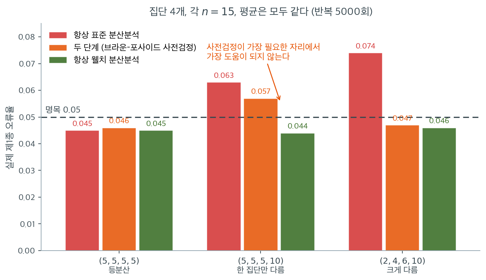
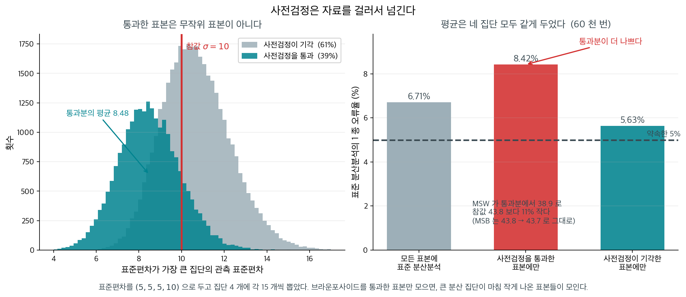

# 분산분석 등분산성 사전검정

일원분산분석은 $k$개 집단이 공통 분산을 갖는다고 가정한다. 곧 $\sigma_1^2 = \sigma_2^2 = \cdots = \sigma_k^2$이다. 이 가정이 위배되면 표준 분산분석 F 검정이 오도하는 $p$값을 낼 수 있다. 자연스러운 전략은 분산분석을 수행하기 전에 이 장의 분산 검정 가운데 하나로 등분산 가정을 검정하는 것이다. 이 절은 사전검정 흐름, 사전검정의 선택, 그리고 두 단계 접근을 둘러싼 논쟁을 다룬다.

---

## 1. 두 단계 흐름

전통적인 접근은 두 단계로 진행된다.

**1단계 (사전검정).** 어떤 유의수준 $\alpha_{\text{pre}}$에서 분산 동질성 검정을 적용한다.

- 사전검정이 $H_0\colon \sigma_1^2 = \cdots = \sigma_k^2$을 기각하지 못하면 표준 분산분석 F 검정으로 진행한다.
- 사전검정이 $H_0$을 기각하면 등분산을 요구하지 않는 대안 절차(Welch 분산분석 등)를 쓴다.

**2단계 (본 검정).** 분산분석 또는 그 대안을 수행한다.

- **표준 분산분석**은 F 통계량의 분모에 합동분산 $\text{MSE} = S_p^2$을 쓰며 $F_{k-1, N-k}$ 분포를 따른다.
- **Welch 분산분석**은 분산을 합동하지 않는다. 대신 집단평균의 가중평균과 조정된 자유도 근사(Welch-Satterthwaite)를 쓴다.

---

## 2. 사전검정 고르기

사전검정은 분산분석에 들어갈 바로 그 자료에서 신뢰할 만한 결과를 낼 만큼 로버스트해야 한다. 분산분석 자료가 완벽히 정규인 경우는 드물므로, Bartlett 검정처럼 정규성에 의존하는 사전검정은 실제 분산 차이가 아니라 비정규성 때문에 등분산 가설을 기각할 수 있다.

**권장 사전검정:**

| 사전검정 | 사용 상황 |
|---|---|
| Brown-Forsythe | 대부분의 상황에서 기본 선택 |
| Levene (평균) | 자료가 근사적으로 대칭일 때 |
| Fligner-Killeen | 자료가 심하게 비정규일 때 |

!!! warning "Bartlett 검정을 사전검정으로 쓰지 말라"
    Bartlett 검정은 비정규성에 지나치게 민감하여 신뢰할 만한 분산분석 사전검정이 되지 못한다. 자료가 비정규이면 분산이 같아도 $H_0$을 기각할 수 있고, 그러면 불필요하게 Welch 분산분석을 쓰게 된다.

    15.4절 표에서 보았듯 지수분포 자료에서 Bartlett의 실제 크기는 **0.390**이다. 등분산인 자료의 39%에서 "분산이 다르다"고 잘못 판정한다. Brown-Forsythe 검정이 표준적 권고이다.

---

## 3. 사전검정 논쟁

두 단계 접근은 여러 근거에서 비판받아 왔다.

**1. 전체 제1종 오류의 왜곡.** 결합된 절차(사전검정 후 조건부 분산분석)는 본 검정의 명목 유의수준 $\alpha$를 유지하지 못한다. 전체 제1종 오류율은 사전검정의 검정력, 사전검정의 유의수준, 분산 이질성의 정도에 의존한다.

**2. 사전검정의 낮은 검정력.** 분산 검정은 중간 정도의 분산 차이를 탐지할 검정력이 제한적이며 표본이 작을수록 심하다. 사전검정이 유의하지 않다고 분산이 같은 것이 아니라, 단지 표본이 작아 차이를 탐지하지 못한 것일 수 있다.

**3. 조건부 편향.** 표준 분산분석과 Welch 분산분석 중 어느 것을 쓸지가 자료에 의존한다. 이 조건화가 본 검정의 작동 특성에 미묘한 편향을 들여온다.

### 수치로 본 논쟁

집단 4개, 각 $n = 15$, 평균이 모두 같은($H_0$ 참) 상황에서 세 전략의 실제 제1종 오류율을 비교했다(반복 5,000회, 명목 $\alpha = 0.05$).

| 표준편차 | 항상 표준 분산분석 | 항상 Welch | 두 단계 (BF 사전검정) |
|---|---|---|---|
| $(5,5,5,5)$ 등분산 | 0.045 | 0.045 | 0.046 |
| $(5,5,5,10)$ | **0.063** | 0.044 | 0.057 |
| $(2,4,6,10)$ | **0.074** | 0.046 | 0.047 |

읽을 점이 세 가지이다.

1. **표준 분산분석은 분산이 다르면 크기가 부풀려진다.** $(2,4,6,10)$에서 0.074로 명목값의 1.5배이다.
2. **Welch 분산분석은 모든 경우에 0.044~0.046으로 안정적이다.**
3. **두 단계 절차는 중간이다.** $(5,5,5,10)$에서 0.057로 여전히 부풀려져 있다. 분산 차이가 작아 Brown-Forsythe가 자주 놓치고, 그때마다 부적절한 표준 분산분석으로 넘어가기 때문이다. 분산 차이가 큰 $(2,4,6,10)$에서는 사전검정이 잘 탐지하므로 0.047로 회복된다.

**곧 사전검정이 가장 필요한 상황(작고 애매한 분산 차이)에서 가장 도움이 되지 않는다.**



왼쪽 묶음은 분산이 정말로 같은 경우다. 세 전략이 $0.045,\ 0.046,\ 0.045$로 구별되지 않는다. **등분산일 때는 무엇을 쓰든 상관없다**는 뜻이고, 웰치를 기본값으로 써도 잃는 것이 없다는 근거의 절반이 여기 있다.

가운데 묶음이 이 그림의 핵심이다. 네 집단 중 하나만 표준편차가 두 배인, 실무에서 가장 흔한 형태의 위배다. 표준 분산분석은 $0.063$으로 부풀고 웰치는 $0.044$로 멀쩡한데, **두 단계 절차는 $0.057$로 둘 사이에 어정쩡하게 놓인다.** 브라운–포사이드가 이 정도 차이를 자주 놓치기 때문이다. 사전검정이 기각하지 못하면 그대로 부적절한 표준 분산분석으로 넘어가므로, 두 단계 절차는 표준 분산분석의 잘못을 상당 부분 물려받는다.

오른쪽 묶음에서는 사전검정이 제 몫을 한다. 표준편차가 $2, 4, 6, 10$으로 크게 다르니 브라운–포사이드가 대부분 탐지하고, 두 단계 절차의 크기가 $0.047$로 회복된다. 그런데 바로 이 경우가 **사전검정 없이도 문제를 알아차릴 수 있는 경우**다. 집단별 표준편차를 표로만 보아도 5배 차이는 눈에 띈다.

정리하면 이렇다. **사전검정은 차이가 작을 때 놓치고, 차이가 클 때만 잡아낸다.** 그런데 차이가 작을 때야말로 판정이 필요한 순간이고, 클 때는 이미 눈으로 보인다. 진단 도구가 쉬운 문제만 풀고 어려운 문제를 넘긴다면 그 도구를 쓸 이유가 없다. 초록 막대가 세 경우 모두 $0.044\sim0.046$인 것을 보라. 사전검정이라는 단계를 아예 없애는 것이 가장 단순하면서 가장 잘 작동하는 선택이다.

---

<div class="storybox" markdown>

**그림으로 보는 통계학 1.** 통과했다는 것이 무슨 뜻인가

§3 이 두 단계 절차의 크기가 $(5,5,5,10)$ 에서 $0.057$ 로 어정쩡한 까닭을 「브라운포사이드가
이 정도 차이를 자주 놓치기 때문」이라고 적었다. 맞는 말인데 **절반**이다. 나머지 절반이
더 고약하다.

사전검정을 통과했다는 것은 **분산이 같다는 뜻이 아니다.** 큰 분산을 가진 집단이 **마침
작게 나왔다**는 뜻이다.

<figure markdown>
  { width=1000 }
  <figcaption markdown>네 집단의 **평균은 모두 같게** 두었으므로 $5\%$ 만 기각해야 한다. 통과분에서 큰 집단의 관측 표준편차가 평균 $8.48$ 로, 참값 $10$ 에서 아래쪽으로 치우쳐 있다. 자료에서 직접 쟀다.</figcaption>
</figure>

오른쪽 막대가 이 상자의 요점이다. **사전검정을 통과한 표본에서 표준 분산분석의 오류율이
$8.42\%$ 로, 아무 거르지 않았을 때의 $6.71\%$ 보다 오히려 높다.** 사전검정이 거르고 난
자료가 거르기 전보다 **나쁘다.**

까닭은 분산분석의 두 조각을 따로 보면 드러난다.

| | 모든 표본 | 통과한 표본 |
|---|---:|---:|
| MSW (분모) | $43.8$ | $\mathbf{38.9}$ |
| MSB (분자) | $43.8$ | $43.7$ |

**분모만 $11\%$ 작아지고 분자는 그대로다.** 당연하다 — 통과란 큰 집단의 흩어짐이 작게
나왔다는 뜻이고, 그 작게 나온 값이 합동분산 MSW 를 끌어내린다. 그런데 집단평균들이
흩어지는 정도는 **참** 분산이 정하므로 MSB 는 줄지 않는다. $F = \text{MSB}/\text{MSW}$
의 분모만 깎인 셈이다.

**그러니 사전검정은 분산분석에 무작위 표본을 넘겨주지 않는다. 골라낸 표본을 넘겨준다.**
왼쪽 그림의 청록 봉우리가 그 「골라냄」이고, 거기서 분산분석이 믿는 「MSW 가 참 평균분산을
겨눈다」는 전제가 조용히 깨진다.

이것이 이 책에서 세 번째로 나오는 같은 병이다.

- **자료를 보고 변수를 고른 뒤 그 자료로 검정하면** — $13$ 장
  [단계적 선택](../../ch13/model_selection/stepwise_subset.md)에서 관계가 없는 자료의
  $F$ 검정이 $95\%$ 를 기각했다.
- **자료를 보고 변수를 고른 뒤 그 자료로 교차검증하면** — $13$ 장
  [교차검증](../../ch13/model_selection/cross_validation.md)에서 $R^2$ 이 $+0.44$ 로
  나왔다. 참값은 $0$ 이다.
- **자료를 보고 방법을 고른 뒤 그 자료로 검정하면** — 여기다.

셋 다 구조가 같다. **고르는 데 자료를 한 번 쓰고, 고른 뒤의 절차는 그 사실을 모른다.**
§4 가 「사전검정을 건너뛰고 웰치를 기본값으로」 권하는 까닭이 검정력 계산에만 있는 것이
아니다. **고르는 단계를 없애면 고름으로써 생기는 병도 없어진다.**

_확인한 곳 — 두 단계 절차의 조건부 오류율 문제는 사전검정 비판의 표준적인 내용이다 · 그림과 표의 수치($8.42\%$ 대 $6.71\%$, MSW $43.8 \to 38.9$)는 $(5,5,5,10)$ · 집단 $4$ 개 · 각 $15$ 개 · $6$ 만 번으로 이 쪽이 직접 쟀다. §3 의 표가 $0.063$ 으로 적은 자리를 여기서 $0.0671$ 로 적은 것은 반복을 $5{,}000$ 회에서 $6$ 만 회로 늘렸기 때문이다_

</div>

## 4. 현대의 권고

많은 통계학자가 사전검정을 아예 건너뛰고 Welch 분산분석을 기본값으로 쓰기를 권한다.

- **등분산일 때의 Welch 분산분석.** 실제로 분산이 같을 때 Welch 분산분석의 검정력은 표준 분산분석보다 조금 낮을 뿐이다.
- **이분산일 때의 Welch 분산분석.** 분산이 다를 때 Welch 분산분석은 올바른 제1종 오류율을 유지하지만 표준 분산분석은 그러지 못한다.

검정력 손실의 크기를 확인해 보자. 네 집단, 각 $n = 15$, 모든 표준편차가 5인 등분산 상황에서

| 참 평균 | 표준 분산분석 검정력 | Welch 검정력 | 손실 |
|---|---|---|---|
| $(0,0,0,3)$ | 0.337 | 0.319 | $-1.8$%p |
| $(0,0,0,5)$ | 0.780 | 0.754 | $-2.7$%p |

등분산 아래에서 잃는 검정력이 2~3퍼센트포인트에 불과하다. 이분산에서 얻는 크기 보호(0.074 → 0.046)와 견주면 매우 작은 대가이다.

!!! tip "언제 사전검정을 하고 언제 Welch를 기본값으로 하는가"

    - 모든 검정력을 짜내는 것보다 로버스트성이 중요한 일상적 분석에서는 **Welch 분산분석을 기본값**으로 하라.
    - 표본이 커서 사전검정의 검정력이 좋고, 정규성이 확인되었으며, 정당화될 때 분산을 합동하여 검정력을 최대화하고 싶을 때만 **사전검정을 쓰라**.

<div class="exbox" markdown>

**보기 1.** <span class="diff easy" title="쉬움"></span> 흐름. 어떤 연구자가 $k = 4$개 처치집단의 평균 점수를 비교한다. 각 집단은 $n_i = 15$개 관측값을 갖는다.

</div>

??? success "풀이"
    **1단계.** 각 집단의 정규성을 확인한다(Shapiro-Wilk 검정 또는 Q-Q 그림). 네 집단이 모두 정규성 확인을 통과했다고 하자.

    **2단계.** $\alpha_{\text{pre}} = 0.05$에서 등분산에 대한 Brown-Forsythe 검정을 수행한다.

    **3단계.** Brown-Forsythe 검정이 기각하지 못하면($p > 0.05$) 표준 일원분산분석을, 기각하면($p \le 0.05$) Welch 분산분석을 수행한다.

<div class="exbox" markdown>

**보기 2.** <span class="diff easy" title="쉬움"></span> 사전검정을 거치는 절차의 문제. 사전검정이 기각하지 못하면 표준 분산분석을, 기각하면 Welch 분산분석을 쓰는 두 단계 절차를 생각한다. 집단 $k = 4$개, 집단당 $n = 15$, 평균은 모두 같아 $H_0$이 참이다.

**(1)** 사전검정이 본 검정과 **독립이라면** 두 단계 절차의 실제 크기가 두 전략의 크기의 **볼록결합**임을 보이고 그 가중치가 무엇인지 밝히시오. 이로부터 두 단계 절차가 "항상 Welch"만큼 좋아지는 조건은 무엇인가.

**(2)** 모의실험으로 그 예측을 확인하시오. 예측이 어긋나는 곳에서 **사전검정을 통과한 표본이 무엇에 대해 치우쳐 있는지** 찾고, 그 치우침이 표준 분산분석의 $F$를 어느 방향으로 미는지 밝히시오.

</div>

??? success "풀이"

    **(1) 두 단계 절차의 크기는 정확히 적을 수 있다.** 사전검정이 기각하는 사건을 $A$, 표준 분산분석이 기각하는 사건을 $S$, Welch가 기각하는 사건을 $W$라 하자. 두 단계 절차는 $A^c$에서 표준을 쓰고 $A$에서 Welch를 쓰므로, 그 기각사건은

    $$
    (A^c \cap S) \;\cup\; (A \cap W)
    $$

    이고 두 덩어리가 서로 배반이므로

    $$
    \alpha_2 = P(A^c \cap S) + P(A \cap W)
    $$

    이다. **여기까지는 가정 없이 정확하다.** 이제 사전검정이 본 검정과 독립이라고 **가정하면** 두 교집합이 쪼개져

    $$
    \alpha_2 = P(A^c)P(S) + P(A)P(W) = (1-\pi)\,\alpha_{\text{std}} + \pi\,\alpha_W,
    \qquad \pi = P(A)
    $$

    가 된다. 곧 **두 크기의 볼록결합이고 가중치는 사전검정의 기각률 $\pi$**다. 분산이 정말 같으면 $\pi$는 사전검정의 크기($\approx \alpha_{\text{pre}} = 0.05$)이고, 분산이 다르면 $\pi$는 사전검정의 **검정력**이다.

    볼록결합은 늘 두 끝점 사이에 놓이므로 결론이 둘 나온다.

    $$
    \min(\alpha_{\text{std}},\, \alpha_W) \;\le\; \alpha_2 \;\le\; \max(\alpha_{\text{std}},\, \alpha_W)
    $$

    **첫째, 두 단계 절차는 결코 두 전략 바깥으로 나가지 않는다.** 어느 쪽에 가까운지는 $\pi$ 하나가 정한다. **둘째, $\alpha_2 = \alpha_W$가 되려면 $\pi = 1$, 곧 사전검정이 이분산을 빠짐없이 탐지해야 한다.** 그런데 분산 검정의 검정력은 차이가 작을 때 낮다. 그러므로 차이가 작아 표준 분산분석이 **조금** 부푸는 상황에서는 $\pi$가 작아 두 단계 절차가 표준 분산분석 쪽으로 끌려가고, 차이가 커서 $\pi \approx 1$이 되는 상황에서만 Welch를 따라간다. 본문이 "사전검정이 가장 필요한 상황에서 가장 도움이 되지 않는다"고 적은 것이 이 식 한 줄에 들어 있다.

    사전검정의 선택이 왜 중요한지도 여기서 보인다. **가중치가 $\pi$ 하나이므로 사전검정이 엉뚱한 것에 반응하면 가중치가 통째로 엉뚱해진다.** Bartlett처럼 정규성에 기대는 사전검정은 분산이 같아도 모집단 모양만으로 기각하므로 $\pi$가 올라가고, 그 극한값이 첨도만의 함수라 **표본을 키워도 낫지 않는다.** 5.3절이 그 계산을 해 두었다.

    **(2) 먼저 한 벌로 손풀기.** 등분산이 참인 자료 한 벌에 두 분산분석을 모두 돌려 본다.

    ```python
    import numpy as np
    from scipy import stats

    def welch_anova(groups):
        """Welch 의 일원배치 분산분석. (F, df1, df2, p) 를 돌려준다.

        등분산을 가정하지 않는다. 집단마다 분산의 역수로 가중해 평균을 내고,
        분모 자유도를 실수로 조정한다.
        """
        k = len(groups)
        n = np.array([len(g) for g in groups])
        m = np.array([g.mean() for g in groups])
        v = np.array([g.var(ddof=1) for g in groups])
        w = n / v
        m_w = np.sum(w * m) / np.sum(w)
        A = np.sum(w * (m - m_w) ** 2) / (k - 1)
        lam = np.sum((1 - w / np.sum(w)) ** 2 / (n - 1)) / (k ** 2 - 1)
        F = A / (1 + 2 * (k - 2) * lam)
        df2 = 1 / (3 * lam)
        return F, k - 1, df2, stats.f.sf(F, k - 1, df2)

    # 네 집단 모두 표준편차가 5 로 같다. 곧 등분산이 참인 자료다.
    rng = np.random.default_rng(42)
    g1 = rng.normal(50, 5, size=15)
    g2 = rng.normal(55, 5, size=15)
    g3 = rng.normal(52, 5, size=15)
    g4 = rng.normal(48, 5, size=15)
    groups = [g1, g2, g3, g4]

    # 1단계: 등분산 사전검정. 그런데 이 절차 자체가 문제를 안고 있다.
    # 자료를 보고 다음 검정을 고르면, 최종 결과의 제1종 오류율이 명목수준을
    # 넘어선다. 사전검정 없이 처음부터 Welch 를 쓰라는 권고가 나오는 까닭이다.
    bf_stat, bf_p = stats.levene(*groups, center='median')
    print(f"Brown-Forsythe: W = {bf_stat:.4f}, p = {bf_p:.4f}")

    # 2단계: 두 분산분석을 모두 돌려 견준다. 등분산이 참인 자료에서는
    # Welch 가 잃는 것이 거의 없다. 그래서 그냥 Welch 를 쓰면 된다.
    f_std, p_std = stats.f_oneway(*groups)
    f_w, df1, df2, p_w = welch_anova(groups)
    print(f"Standard ANOVA: F = {f_std:.4f}, p = {p_std:.6f}")
    print(f"Welch ANOVA:    F = {f_w:.4f}, df = ({df1}, {df2:.2f}), "
          f"p = {p_w:.6f}")
    ```

    출력:

    ```text
    Brown-Forsythe: W = 0.4728, p = 0.7025
    Standard ANOVA: F = 8.1365, p = 0.000138
    Welch ANOVA:    F = 9.7514, df = (3, 30.81), p = 0.000112
    ```

    자료를 등분산으로 생성했으므로 Brown-Forsythe가 기각하지 않고($p = 0.70$) 두 분산분석의 결과도 사실상 같다($p = 0.000138$ 대 $0.000112$). Welch의 분모 자유도가 $44$에서 $30.81$로 줄었는데도 결론이 바뀌지 않는다. **한 벌로는 아무 문제도 보이지 않는다.** 문제는 같은 절차를 되풀이할 때 비로소 드러난다.

    **(1)의 예측을 20만 번으로 확인한다.** 반복 횟수를 늘리려면 `scipy` 함수를 한 벌씩 부르는 대신 세 검정을 모두 벡터화해야 한다. 아래 세 함수는 한 벌 자료에서 `stats.levene(..., center='median')`, `stats.f_oneway`, 위의 `welch_anova`와 같은 값을 준다.

    ```python
    import numpy as np
    from scipy import stats


    def anova_p(Y):
        """균형자료 (R, k, n) 에 대한 표준 일원분산분석 p-값을 한꺼번에."""
        R, k, n = Y.shape
        m = Y.mean(axis=2)
        gm = Y.reshape(R, -1).mean(axis=1)
        msb = n * ((m - gm[:, None]) ** 2).sum(axis=1) / (k - 1)
        mse = Y.var(axis=2, ddof=1).mean(axis=1)   # 균형자료에서는 합동분산 = 평균
        return stats.f.sf(msb / mse, k - 1, k * (n - 1)), msb, mse


    def bf_p(Y):
        """Brown-Forsythe = 중앙값 중심 Levene. |y - median| 에 분산분석을 돌린다.
        scipy.stats.levene 의 center 기본값이 'median' 이므로 그것과 같은 검정이다."""
        return anova_p(np.abs(Y - np.median(Y, axis=2, keepdims=True)))[0]


    def welch_p(Y):
        R, k, n = Y.shape
        m, v = Y.mean(axis=2), Y.var(axis=2, ddof=1)
        w = n / v
        sw = w.sum(axis=1)
        m_w = (w * m).sum(axis=1) / sw
        A = (w * (m - m_w[:, None]) ** 2).sum(axis=1) / (k - 1)
        lam = ((1 - w / sw[:, None]) ** 2 / (n - 1)).sum(axis=1) / (k ** 2 - 1)
        return stats.f.sf(A / (1 + 2 * (k - 2) * lam), k - 1, 1 / (3 * lam))


    rng = np.random.default_rng(1)
    R, n, alpha = 200_000, 15, 0.05

    for sds in [(5, 5, 5, 5), (5, 5, 5, 10), (2, 4, 6, 10)]:
        sd = np.array(sds, float)
        k = len(sd)
        # 평균이 모두 0 이므로 H0 이 참이다. 기각하면 모두 1종오류다.
        Y = rng.normal(0, 1, size=(R, k, n)) * sd[None, :, None]

        pre = bf_p(Y)
        p_std, msb, mse = anova_p(Y)
        p_w = welch_p(Y)

        A = pre <= alpha                      # 사전검정이 기각한 표본
        pi = A.mean()
        a_std, a_w = (p_std < alpha).mean(), (p_w < alpha).mean()
        a_two = np.where(A, p_w < alpha, p_std < alpha).mean()
        pred = (1 - pi) * a_std + pi * a_w     # (1) 의 볼록결합

        v = Y.var(axis=2, ddof=1)
        ratio = v.max(axis=1) / v.min(axis=1)

        print(f"sd = {sds}")
        print(f"   사전검정 기각률 pi      = {pi:.4f}")
        print(f"   항상 표준 분산분석      = {a_std:.4f}")
        print(f"   항상 Welch              = {a_w:.4f}")
        print(f"   두 단계 (실제)          = {a_two:.4f}")
        print(f"   두 단계 (독립가정 예측) = {pred:.4f}      차 = {a_two - pred:+.4f}")
        print(f"   P(표준이 기각 | 사전검정 통과) = {(p_std < alpha)[~A].mean():.4f}"
              f"   (무조건 {a_std:.4f})")
        print(f"   E[MSB]  전체 {msb.mean():7.2f}  ->  통과 {msb[~A].mean():7.2f}"
              f"   ({msb[~A].mean() / msb.mean():.3f} 배)")
        print(f"   E[MSE]  전체 {mse.mean():7.2f}  ->  통과 {mse[~A].mean():7.2f}"
              f"   ({mse[~A].mean() / mse.mean():.3f} 배)")
        print(f"   E[s^2_max/s^2_min] 전체 {ratio.mean():6.2f}  ->  통과 {ratio[~A].mean():6.2f}")
    ```

    출력:

    ```text
    sd = (5, 5, 5, 5)
       사전검정 기각률 pi      = 0.0276
       항상 표준 분산분석      = 0.0488
       항상 Welch              = 0.0493
       두 단계 (실제)          = 0.0498
       두 단계 (독립가정 예측) = 0.0488      차 = +0.0010
       P(표준이 기각 | 사전검정 통과) = 0.0487   (무조건 0.0488)
       E[MSB]  전체   24.90  ->  통과   24.89   (1.000 배)
       E[MSE]  전체   25.00  ->  통과   25.00   (1.000 배)
       E[s^2_max/s^2_min] 전체   2.39  ->  통과   2.32
    sd = (5, 5, 5, 10)
       사전검정 기각률 pi      = 0.6108
       항상 표준 분산분석      = 0.0663
       항상 Welch              = 0.0492
       두 단계 (실제)          = 0.0617
       두 단계 (독립가정 예측) = 0.0559      차 = +0.0059
       P(표준이 기각 | 사전검정 통과) = 0.0861   (무조건 0.0663)
       E[MSB]  전체   43.55  ->  통과   43.58   (1.001 배)
       E[MSE]  전체   43.72  ->  통과   38.84   (0.888 배)
       E[s^2_max/s^2_min] 전체   6.38  ->  통과   4.01
    sd = (2, 4, 6, 10)
       사전검정 기각률 pi      = 0.9798
       항상 표준 분산분석      = 0.0777
       항상 Welch              = 0.0512
       두 단계 (실제)          = 0.0524
       두 단계 (독립가정 예측) = 0.0518      차 = +0.0007
       P(표준이 기각 | 사전검정 통과) = 0.1477   (무조건 0.0777)
       E[MSB]  전체   39.04  ->  통과   39.29   (1.006 배)
       E[MSE]  전체   39.01  ->  통과   28.47   (0.730 배)
       E[s^2_max/s^2_min] 전체  29.29  ->  통과  11.93
    ```

    **볼록결합이 두 경우에는 맞고 한 경우에는 틀린다.** 등분산 $(5,5,5,5)$에서 예측 $0.0488$ 대 실제 $0.0498$, 차 $+0.0010$이다. 20만 번에서 기각률의 표준오차가 $\sqrt{0.05 \times 0.95/200000} = 0.0005$이니 두 표준오차 안이다. $(2,4,6,10)$에서도 예측 $0.0518$ 대 실제 $0.0524$로 맞는다. 여기서는 $\pi = 0.9798$이라 **가중치가 거의 전부 Welch로 가므로 조건부 치우침이 들어갈 틈이 없다.**

    어긋나는 것은 가운데 경우다. $(5,5,5,10)$에서 예측 $0.0559$인데 실제가 $0.0617$로 $+0.0059$, 곧 **열두 표준오차**만큼 크다. 몬테카를로 오차가 아니다. (1)에서 쓴 독립 가정이 틀렸다는 뜻이다.

    **치우침의 정체는 한 줄에 드러난다.** 표준 분산분석이 기각할 확률이 무조건으로는 $0.0663$인데, **사전검정을 통과한 표본만 보면 $0.0861$로 올라간다.** $(2,4,6,10)$에서는 $0.0777$에서 $0.1477$로 거의 두 배다. 사전검정의 "안심하라"는 신호가 도움이 되지 않는 정도가 아니라 **거꾸로 간다.** 사전검정이 통과시킨 표본에서 표준 분산분석이 **더** 많이 틀린다.

    **왜 그런가.** 마지막 세 줄이 답이다. 사전검정을 통과한 표본에서

    - $E[\text{MSB}]$는 $1.001$배, $1.006$배로 **꿈쩍하지 않는다.**
    - $E[\text{MSE}]$는 $0.888$배, $0.730$배로 **줄어든다.**
    - $E[s^2_{\max}/s^2_{\min}]$이 $6.38 \to 4.01$, $29.29 \to 11.93$으로 **줄어든다.**

    셋째 줄이 선택의 흔적이다. 사전검정은 표본분산들이 **비슷해 보이는** 표본만 남기므로, 참 분산이 가장 큰 집단의 $s_k^2$이 우연히 작게 나온 표본을 골라낸다. 그러면 그 $s_k^2$을 섞어 만든 $\text{MSE}$가 작아진다. **그런데 집단평균이 흔들리는 폭은 표본분산이 아니라 참 분산 $\sigma_i^2$이 정한다.** 그래서 분자 $\text{MSB}$는 그대로 남고 분모만 작아져

    $$
    F = \frac{\text{MSB}}{\text{MSE}}
    $$

    가 위로 밀린다. 사전검정은 $\text{MSE}$가 참 분산들을 대표하는지 묻는 것이 아니라 **표본분산들이 서로 닮았는지**만 묻기 때문에, 바로 $\text{MSE}$가 작게 나온 표본을 통과시킨다.

    **조건부 표본은 더 이상 무작위 표본이 아니다.** 위 논쟁 3번의 "조건부 편향"이 이것이고, (1)의 독립 가정이 깨지는 자리도 이것이다. 그리고 그 어긋남의 방향이 **나쁜 쪽**이다. 두 단계 절차의 실제 크기가 볼록결합 예측보다 높다.

    마지막으로 수치를 맞춰 둔다. 아래 연습문제 1과 본문 표는 같은 설정을 5,000번 돌려 $(0.0634,\ 0.0440,\ 0.0568)$ 등을 얻었다. 5,000번에서 표준오차는 $\sqrt{0.05\times0.95/5000} = 0.0031$이고, 위 20만 번 값과의 차이는 세 설정 아홉 숫자 모두 **두 표준오차 안**이다. 20만 번은 같은 그림을 더 또렷하게 만들었을 뿐이며, 볼록결합과의 어긋남은 5,000번에서는 오차에 묻혀 보이지 않았던 것이다.

---

## 연습문제

<div class="drillbox" markdown>

**연습문제 1.** <span class="diff med" title="중간"></span>
집단 4개, 각 $n = 15$, 표준편차 $(5, 5, 5, 10)$이고 평균이 모두 같은 상황에서 세 전략(항상 표준 분산분석, 항상 Welch, 두 단계)의 제1종 오류율을 모의실험으로 비교하라.

</div>

??? success "풀이"

    ```python
    import numpy as np
    from scipy import stats

    def welch_p(groups):
        k = len(groups)
        n = np.array([len(g) for g in groups])
        m = np.array([g.mean() for g in groups])
        v = np.array([g.var(ddof=1) for g in groups])
        w = n / v
        m_w = np.sum(w * m) / np.sum(w)
        A = np.sum(w * (m - m_w) ** 2) / (k - 1)
        lam = np.sum((1 - w / np.sum(w)) ** 2 / (n - 1)) / (k ** 2 - 1)
        F = A / (1 + 2 * (k - 2) * lam)
        return stats.f.sf(F, k - 1, 1 / (3 * lam))

    def sim(sds, R=5000, n=15, seed=1):
        rng = np.random.default_rng(seed)
        a = b = c = 0
        for _ in range(R):
            gs = [rng.normal(0, s, n) for s in sds]
            p_bf = stats.levene(*gs, center='median')[1]
            p_std = stats.f_oneway(*gs)[1]
            p_w = welch_p(gs)
            a += p_std < 0.05
            b += p_w < 0.05
            c += (p_std < 0.05) if p_bf > 0.05 else (p_w < 0.05)
        return a / R, b / R, c / R

    for sds in [(5, 5, 5, 5), (5, 5, 5, 10), (2, 4, 6, 10)]:
        std, welch, twostage = sim(sds)
        print(f"sd = {str(sds):>16}: standard {std:.4f}, "
              f"Welch {welch:.4f}, two-stage {twostage:.4f}")
    ```

    출력:

    ```text
    sd =     (5, 5, 5, 5): standard 0.0452, Welch 0.0452, two-stage 0.0458
    sd =    (5, 5, 5, 10): standard 0.0634, Welch 0.0440, two-stage 0.0568
    sd =    (2, 4, 6, 10): standard 0.0738, Welch 0.0464, two-stage 0.0468
    ```

    **핵심 관찰: 두 단계 절차가 중간 사례에서 가장 나쁘다.**

    $(5,5,5,10)$에서 두 단계 절차의 크기가 $0.057$로, 항상 Welch를 쓰는 $0.044$보다 나쁘다. 분산 차이가 중간이라 Brown-Forsythe가 자주 놓치기 때문이다.

    반면 $(2,4,6,10)$처럼 차이가 크면 사전검정이 잘 탐지하여 두 단계 절차도 $0.047$로 회복된다.

    **이 패턴이 사전검정 논쟁의 핵심이다.** 사전검정은 분산 차이가 명백할 때 잘 작동하지만, 그런 상황에서는 애초에 사전검정 없이도 Welch를 쓰면 된다. 사전검정이 필요한 애매한 상황에서는 검정력이 부족해 도움이 되지 않는다. $\square$

<div class="drillbox" markdown>

**연습문제 2.** <span class="diff med" title="중간"></span>
등분산일 때 Welch 분산분석이 잃는 검정력을 모의실험으로 수량화하라. 그 손실이 받아들일 만한지 논하라.

</div>

??? success "풀이"

    ```python
    import numpy as np
    from scipy import stats

    rng = np.random.default_rng(7)
    R, n = 5000, 15

    for mus in [(0, 0, 0, 3), (0, 0, 0, 5)]:
        a = b = 0
        for _ in range(R):
            gs = [rng.normal(m, 5, n) for m in mus]
            a += stats.f_oneway(*gs)[1] < 0.05
            b += welch_p(gs) < 0.05          # welch_p from Exercise 1
        print(f"mu = {str(mus):>14}: standard {a/R:.4f}, Welch {b/R:.4f}")
    ```

    출력:

    ```text
    mu =   (0, 0, 0, 3): standard 0.3368, Welch 0.3190
    mu =   (0, 0, 0, 5): standard 0.7804, Welch 0.7536
    ```

    | 효과 크기 | 표준 | Welch | 절대 손실 | 상대 손실 |
    |---|---|---|---|---|
    | 평균차 3 (0.6 SD) | 0.337 | 0.319 | 1.8%p | 5.3% |
    | 평균차 5 (1.0 SD) | 0.780 | 0.754 | 2.7%p | 3.5% |

    **손실이 받아들일 만한가.** 세 관점에서 따져 보자.

    1. **크기와 검정력의 교환.** 연습문제 1에서 표준 분산분석의 크기가 이분산 아래에서 0.074까지 부풀려졌다. 크기가 5%에서 7.4%로 뛰는 것은 검정력이 2%p 오르는 것과 비교할 수 없이 심각하다. 크기 왜곡은 **잘못된 발견**을 만들지만 검정력 손실은 단지 발견을 놓칠 뿐이다.

    2. **보험료로서의 관점.** 등분산이 확실한 경우에만 2~3%p를 잃는다. 등분산이 확실하지 않은 대부분의 실무 상황에서는 오히려 이득이다.

    3. **손실이 왜 그렇게 작은가.** Welch의 분모 자유도는 등분산일 때 $N - k$에 가깝다. 본문 보기에서 $44$ 대 $30.81$로 줄었지만, F 분포는 분모 자유도가 30을 넘으면 거의 변하지 않는다. 자유도 손실의 실질적 대가가 작은 이유이다.

    **결론: 받아들일 만하다.** 다만 집단 수가 많고($k \geq 6$) 각 집단이 매우 작으면($n_i \leq 5$) Welch의 자유도 근사 자체가 불안정해질 수 있으므로, 그때는 순열검정이나 붓스트랩을 고려하는 편이 낫다. $\square$

<div class="drillbox" markdown>

**연습문제 3.** <span class="diff med" title="중간"></span>
Welch 분산분석의 검정통계량과 자유도 공식을 서술하고, 등분산일 때 표준 분산분석으로 환원되는지 확인하라.

</div>

??? success "풀이"
    **Welch 통계량.** 집단 $i$의 가중치를 $w_i = n_i / s_i^2$이라 하고 가중평균을 $\bar{X}_w = \sum_i w_i \bar{X}_i / \sum_i w_i$라 하자.

    $$
    A = \frac{1}{k-1}\sum_{i=1}^k w_i (\bar{X}_i - \bar{X}_w)^2,
    $$

    $$
    \Lambda = \frac{1}{k^2 - 1}\sum_{i=1}^k \frac{1}{n_i - 1}\left(1 - \frac{w_i}{\sum_j w_j}\right)^2,
    $$

    $$
    F_W = \frac{A}{1 + 2(k-2)\Lambda} \;\sim\; F_{k-1,\; \nu_2}, \qquad \nu_2 = \frac{1}{3\Lambda}.
    $$

    **핵심 아이디어.** 가중치 $w_i = n_i/s_i^2$은 각 집단평균의 **정밀도의 역수**이다. 분산이 큰 집단은 평균 추정이 부정확하므로 가중치를 적게 받는다. 표준 분산분석이 모든 집단에 같은 가중치를 주는 것과 대조적이다.

    **등분산일 때의 환원.** 모든 $s_i^2 = s^2$이고 모든 $n_i = n$이면 $w_i = n/s^2$으로 같아지고

    - $\bar{X}_w = \bar{X}$ (단순 전체평균)
    - $A = \frac{n}{s^2(k-1)}\sum_i(\bar{X}_i - \bar{X})^2 = \frac{\text{MSB}}{s^2}$
    - $w_i/\sum_j w_j = 1/k$이므로 $\Lambda = \frac{1}{k^2-1}\cdot\frac{k}{n-1}\left(1-\frac{1}{k}\right)^2 = \frac{(k-1)}{k(k+1)(n-1)}$

    표준 분산분석의 $F = \text{MSB}/\text{MSE}$와 비교하면 $A$가 $\text{MSB}/s^2$이고 여기서 $s^2$이 각 집단분산이므로, $s_i^2$이 모두 같으면 $s^2 = \text{MSE}$가 되어 $A = F_{\text{std}}$이다.

    다만 **정확히 같지는 않다.** 보정항 $1 + 2(k-2)\Lambda > 1$이 통계량을 약간 줄이고, 자유도 $\nu_2 = 1/(3\Lambda)$이 $N-k$보다 작다. $k = 4$, $n = 15$이면

    $$
    \Lambda = \frac{3}{4 \times 5 \times 14} = 0.01071, \quad \nu_2 = \frac{1}{0.03214} = 31.1
    $$

    로 $N - k = 56$보다 작다. 이 차이가 연습문제 2에서 관찰한 2~3%p의 검정력 손실을 만든다.

    (본문 보기에서 $\nu_2 = 30.81$이 나온 것은 표본분산이 정확히 같지는 않기 때문이며, 위 이론값 31.1에 가깝다.) $\square$

<div class="drillbox" markdown>

**연습문제 4.** <span class="diff med" title="중간"></span>
"사전검정이 기각하지 못했으므로 등분산성이 확인되었다"는 서술이 왜 부적절한지 설명하고, 대신 어떻게 보고해야 하는지 제시하라.

</div>

??? success "풀이"
    **부적절한 이유 1: 기각 실패는 증거가 아니다.** 가설검정에서 $H_0$을 기각하지 못한 것은 "$H_0$이 참"이 아니라 "$H_0$을 반박할 증거가 부족하다"는 뜻이다. 14장의 정규성 검정에서 반복한 논리가 그대로 적용된다.

    **부적절한 이유 2: 검정력이 낮다.** 15.4절 연습문제 4에서 보았듯, 세 집단 총 30개 관측값으로는 분산이 **네 배** 달라야 탐지한다. 15.5절 보기에서는 $n_i = 5$일 때 분산비 3.9배도 놓쳤다.

    구체적으로 $(5,5,5,10)$인 연습문제 1의 설정, 곧 한 집단의 분산이 다른 집단의 **네 배**인 상황에서도 Brown-Forsythe의 검정력은 절반이 채 되지 않는다(두 단계 절차의 크기가 0.057로 표준 분산분석의 0.063에 가까웠다는 사실이 이를 보여준다).

    **부적절한 이유 3: 이분법이 정보를 버린다.** 사전검정의 $p$값 하나로 등분산 여부를 판정하면 집단별 분산의 실제 크기와 그 불확실성이 사라진다.

    **어떻게 보고해야 하는가.**

    1. **집단별 표준편차(또는 분산)와 표본크기를 표로 제시한다.** 독자가 이질성의 정도를 직접 판단할 수 있게 한다.
    2. **상자그림을 함께 싣는다.** 분산 차이뿐 아니라 모양의 차이도 드러난다.
    3. **사전검정 결과를 "확인"이 아니라 "관찰"로 서술한다.** "등분산성이 확인되었다" 대신 "Brown-Forsythe 검정에서 분산 이질성의 증거를 찾지 못했다($W = 0.47$, $p = 0.70$). 다만 집단당 $n = 15$로 검정력이 제한적이다"라고 쓴다.
    4. **가능하면 판정 자체를 피한다.** Welch 분산분석을 쓰면 등분산성이 확인되었는지 여부와 무관하게 타당한 추론이 되므로, 이 문장을 쓸 필요가 없어진다.

    가장 좋은 해결책은 **답하기 어려운 질문에 답하려 하지 말고 그 질문이 필요 없는 방법을 쓰는 것**이다. $\square$

<div class="drillbox" markdown>

**연습문제 5.** <span class="diff med" title="중간"></span>
보기 2 (2)의 20만 번 모의실험은 세 설정에서 다음을 얻었다($\alpha_{\text{std}}$는 항상 표준 분산분석, $\alpha_W$는 항상 Welch, $\alpha_2$는 두 단계 절차의 실제 크기, $\pi$는 Brown-Forsythe 사전검정의 기각률).

| 표준편차 | $\alpha_{\text{std}}$ | $\alpha_W$ | $\alpha_2$ (실제) | $\pi$ (실제) |
|---|---|---|---|---|
| $(5,5,5,5)$ | 0.0488 | 0.0493 | 0.0498 | 0.0276 |
| $(5,5,5,10)$ | 0.0663 | 0.0492 | 0.0617 | 0.6108 |
| $(2,4,6,10)$ | 0.0777 | 0.0512 | 0.0524 | 0.9798 |

**(1)** 보기 2 (1)의 볼록결합 식을 $\pi$에 대해 풀어, 관측된 $\alpha_2$를 설명하는 **함축된 기각률** $\hat\pi$를 세 설정에서 구하시오.

**(2)** $\hat\pi$를 실제 $\pi$와 견주시오. 어긋나는 방향이 왜 그 방향인지 밝히고, 세 수치만 보고 독립 가정을 믿은 사람이 **사전검정에 대해 어떤 잘못된 진단**을 내리게 되는지 말하시오.

**(3)** 등분산 설정에서 $\hat\pi$가 쓸 수 없는 값으로 나온다. 왜 그렇게 되는지와 그것이 실무에서 뜻하는 바를 적으시오.

</div>

??? success "풀이"

    **(1) 식을 뒤집는다.** 보기 2 (1)의 $\alpha_2 = (1-\pi)\alpha_{\text{std}} + \pi\,\alpha_W$를 $\pi$에 대해 풀면

    $$
    \hat\pi = \frac{\alpha_{\text{std}} - \alpha_2}{\alpha_{\text{std}} - \alpha_W}
    $$

    이다. 세 설정에 넣는다.

    - $(5,5,5,5)$: $\hat\pi = \dfrac{0.0488 - 0.0498}{0.0488 - 0.0493} = \dfrac{-0.0010}{-0.0005} = 2.00$
    - $(5,5,5,10)$: $\hat\pi = \dfrac{0.0663 - 0.0617}{0.0663 - 0.0492} = \dfrac{0.0046}{0.0171} = 0.269$
    - $(2,4,6,10)$: $\hat\pi = \dfrac{0.0777 - 0.0524}{0.0777 - 0.0512} = \dfrac{0.0253}{0.0265} = 0.955$

    **(2) 가운데 설정에서 절반 이하로 어긋난다.** 실제 $\pi = 0.6108$인데 $\hat\pi = 0.269$이다. $(2,4,6,10)$에서는 $0.955$ 대 $0.9798$로 거의 맞는다.

    어긋나는 **방향**은 식에서 바로 읽힌다. $\alpha_W < \alpha_{\text{std}}$이므로 $\alpha_2$는 $\pi$의 감소함수이고, 따라서 $\alpha_2$가 예측보다 **크면** 그것을 설명하는 $\hat\pi$는 참값보다 **작게** 나온다. 실제로 $\pi = 0.6108$을 넣은 예측은 $0.3892 \times 0.0663 + 0.6108 \times 0.0492 = 0.0559$인데 관측값이 $0.0617$로 더 크다. 조건부 편향이 두 단계 절차의 크기를 위로 밀어 올린 만큼, 식을 뒤집으면 그 초과분이 "사전검정이 덜 기각했다"는 쪽으로 번역된다.

    **그래서 잘못된 진단이 나온다.** 세 크기만 재고 독립 가정을 믿은 사람은 "$(5,5,5,10)$에서 Brown-Forsythe가 27%밖에 탐지하지 못한다"고 결론짓는다. 실제로는 61%를 탐지하고 있다. 진단이 틀리면 처방도 틀린다. 그 사람은 **사전검정의 검정력을 올리는 쪽**(더 민감한 검정, $\alpha_{\text{pre}}$ 상향, 표본 확대)으로 가겠지만, 남은 $+0.0058$은 사전검정의 검정력 부족이 아니라 **통과한 표본이 더 이상 무작위 표본이 아니라는 데서** 온다. 그 원인은 사전검정을 더 세게 만들어도 사라지지 않는다.

    **(3) 분모가 0이다.** 등분산에서는 두 전략의 크기가 같아 $\alpha_{\text{std}} - \alpha_W$가 참값으로 $0$이다. 관측된 $-0.0005$는 몬테카를로 요동일 뿐이다(20만 번에서 기각률의 표준오차가 $\sqrt{0.05 \times 0.95 / 200000} = 0.0005$이니 딱 한 표준오차다). 0 가까운 수로 나누었으니 $\hat\pi = 2.00$처럼 $[0,1]$ 밖의 값이 나오는 것이 당연하고, 이 설정에서 식은 **뒤집을 수 없다**.

    실무적으로는 이것이 나쁜 소식이 아니라 좋은 소식이다. 분모가 0이라는 말은 **$\pi$가 무엇이든 $\alpha_2$가 같다**는 뜻, 곧 등분산이 참이면 사전검정이 어떻게 행동하든 최종 크기가 바뀌지 않는다는 뜻이다. 본문이 "등분산일 때는 무엇을 쓰든 상관없다"고 한 것의 역산판이다. 사전검정의 선택이 문제가 되는 것은 오직 분산이 실제로 다를 때이고, 하필 그때 식이 어긋난다. $\square$

<div class="drillbox" markdown>

**연습문제 6.** <span class="diff med" title="중간"></span>
사전검정 수준 $\alpha_{\text{pre}}$를 손으로 돌릴 수 있는 다이얼로 보고, $\pi(\alpha_{\text{pre}}) = P(p_{\text{pre}} \le \alpha_{\text{pre}})$라 쓴다.

**(1)** $\pi$가 $\alpha_{\text{pre}}$의 비감소함수이고 $\pi(0) = 0$, $\pi(1) = 1$임을 보이시오.

**(2)** 보기 2 (1)의 독립 가정 아래, $\alpha_W < \alpha_{\text{std}}$인 설정에서 $\alpha_2(\alpha_{\text{pre}})$가 비증가이며 최솟값이 어디서 달성되는지 보이시오. 이 결론을 한 문장으로 적으시오.

**(3)** 등분산이 참인 설정에서는 같은 식이 $\alpha_{\text{pre}}$에 대해 상수가 된다. (2)와 (3)을 합치면 **다이얼을 돌려 얻을 수 있는 최선**은 무엇인가.

**(4)** (2)는 독립 가정에 기댄다. 가정 없이도 성립하는 것은 어디까지인가. 두 끝점 $\alpha_{\text{pre}} = 0, 1$에서는 가정이 필요 없음을 보이시오.

</div>

??? success "풀이"

    **(1) $\pi$는 사전검정 $p$값의 분포함수다.** $\pi(t) = P(p_{\text{pre}} \le t)$이므로 분포함수의 정의상 $t$에 대해 비감소다. Brown-Forsythe 통계량은 연속분포를 가지므로 $p_{\text{pre}}$도 연속이고 $P(p_{\text{pre}} = 0) = 0$, 곧 $\pi(0) = 0$이다. 또 $p$값은 $[0,1]$ 값을 가지므로 $\pi(1) = 1$이다. 양 끝에서 절차가 무엇이 되는지도 분명하다. $\alpha_{\text{pre}} = 0$이면 사전검정이 결코 기각하지 않아 절차는 **항상 표준 분산분석**이고, $\alpha_{\text{pre}} = 1$이면 항상 기각하여 **항상 Welch**다.

    **(2) 볼록결합을 $\pi$의 함수로 본다.**

    $$
    \alpha_2 = (1-\pi)\alpha_{\text{std}} + \pi\,\alpha_W
    = \alpha_{\text{std}} - \pi\,(\alpha_{\text{std}} - \alpha_W)
    $$

    에서 $\alpha_{\text{std}} - \alpha_W > 0$이므로 $\alpha_2$는 $\pi$에 대해 기울기가 음인 직선이다. (1)에서 $\pi$가 $\alpha_{\text{pre}}$에 대해 비감소이므로 합성하면 $\alpha_2$는 $\alpha_{\text{pre}}$에 대해 **비증가**이고, 최솟값은 $\pi = 1$, 곧 $\alpha_{\text{pre}} = 1$에서 $\alpha_W$로 달성된다.

    한 문장으로: **크기만 생각하면 가장 좋은 사전검정 수준은 $\alpha_{\text{pre}} = 1$이며, 그것은 사전검정을 하지 않고 늘 Welch를 쓰는 것과 같다.**

    **(3) 등분산에서는 다이얼이 헛돈다.** $\alpha_{\text{std}} = \alpha_W$이면 위 식에서 $\pi$의 계수가 0이 되어 $\alpha_2 = \alpha_{\text{std}}$로 $\alpha_{\text{pre}}$와 무관하다. 보기 2의 $(5,5,5,5)$ 행이 $0.0488,\ 0.0493,\ 0.0498$로 구별되지 않는 것이 이것이다.

    둘을 합치면 결론이 하나로 모인다. **다이얼을 끝까지 돌리는 것(사전검정을 없애는 것)이 크기에 관해서는 언제나 약우월하다.** 분산이 다르면 끝까지 돌릴수록 좋아지고, 분산이 같으면 돌려도 아무 일이 없으니 잃을 것이 없다. 크기만 보면 사전검정을 두는 어떤 수준도 **다이얼을 끝까지 돌린 쪽에 약지배된다**. 사전검정을 정당화하려면 크기가 아닌 다른 통화(연습문제 2의 2~3%p 검정력)로 값을 치러야 한다.

    **(4) 두 끝점은 가정 없이 성립한다.** 보기 2 (1)의 $\alpha_2 = P(A^c \cap S) + P(A \cap W)$는 가정 없이 정확했다. $\alpha_{\text{pre}} = 0$이면 $P(A) = 0$이므로 둘째 항이 0이고 $P(A^c \cap S) = P(S) = \alpha_{\text{std}}$다. $\alpha_{\text{pre}} = 1$이면 $P(A^c) = 0$이므로 $\alpha_2 = P(W) = \alpha_W$다. **곧 직선의 두 끝은 못이 박혀 있고, 독립 가정이 하는 일은 그 사이를 직선으로 잇는 것뿐이다.**

    가운데서는 $P(A^c \cap S) \ne P(A^c)P(S)$이므로 곡선이 직선 위든 아래든 지날 수 있다. 어느 쪽인지는 식으로 알 수 없고 재어 보아야 한다. 다음 문제에서 재면 **위로 들려 있다.** $\square$

<div class="drillbox" markdown>

**연습문제 7.** <span class="diff hard" title="어려움"></span>
집단 4개, 각 $n = 15$, 표준편차 $(5,5,5,10)$, 평균은 모두 같고 본 검정의 명목수준은 $\alpha = 0.05$로 고정한다. Brown-Forsythe 사전검정의 수준 $\alpha_{\text{pre}}$만 $0,\ 0.01,\ 0.05,\ 0.10,\ 0.25,\ 0.50,\ 1$로 바꾸며 두 단계 절차의 실제 크기와 연습문제 6 (2)의 예측을 20만 번으로 비교하라. 사전검정을 통과한 표본에서 표준 분산분석이 기각할 확률도 함께 재라.

**(1)** 예측이 깨지는 곳을 찾고, 특히 $\alpha_{\text{pre}} = 0.01$에서 무슨 일이 일어나는지 설명하라.

**(2)** 두 단계 절차의 크기를 $0.055$ 아래로 내리려면 $\alpha_{\text{pre}}$를 얼마로 해야 하며 그때 몇 %의 표본이 Welch로 가는가. 그 답이 사전검정이라는 단계에 대해 무엇을 말하는가.

</div>

??? success "풀이"

    사전검정 수준을 바꾸는 것은 **같은 $p$값을 다른 문턱으로 자르는 것**뿐이므로, 세 검정의 $p$값을 한 번만 계산하고 문턱만 바꾸면 된다. 사전검정 수준마다 모의실험을 다시 돌릴 필요가 없다.

    ```python
    import numpy as np
    from scipy import stats


    def anova_p(Y):
        """균형자료 (R, k, n) 의 표준 분산분석 p-값. 보기 2 의 것에서 p-값만 남겼다."""
        R, k, n = Y.shape
        m = Y.mean(axis=2)
        gm = Y.reshape(R, -1).mean(axis=1)
        msb = n * ((m - gm[:, None]) ** 2).sum(axis=1) / (k - 1)
        mse = Y.var(axis=2, ddof=1).mean(axis=1)
        return stats.f.sf(msb / mse, k - 1, k * (n - 1))


    def bf_p(Y):
        return anova_p(np.abs(Y - np.median(Y, axis=2, keepdims=True)))


    def welch_p(Y):
        R, k, n = Y.shape
        m, v = Y.mean(axis=2), Y.var(axis=2, ddof=1)
        w = n / v
        sw = w.sum(axis=1)
        m_w = (w * m).sum(axis=1) / sw
        A = (w * (m - m_w[:, None]) ** 2).sum(axis=1) / (k - 1)
        lam = ((1 - w / sw[:, None]) ** 2 / (n - 1)).sum(axis=1) / (k ** 2 - 1)
        return stats.f.sf(A / (1 + 2 * (k - 2) * lam), k - 1, 1 / (3 * lam))


    rng = np.random.default_rng(2)
    R, n, alpha = 200_000, 15, 0.05
    sd = np.array([5.0, 5.0, 5.0, 10.0])
    k = len(sd)
    Y = rng.normal(0, 1, size=(R, k, n)) * sd[None, :, None]   # 평균은 모두 0

    # 사전검정 수준을 바꾸는 것은 같은 p-값을 다른 문턱으로 자르는 것뿐이다.
    # 그러므로 p-값은 한 번만 계산하면 된다.
    pre = bf_p(Y)
    r_std, r_w = anova_p(Y) < alpha, welch_p(Y) < alpha
    a_std, a_w = r_std.mean(), r_w.mean()

    print(f"항상 표준 분산분석 {a_std:.4f}      항상 Welch {a_w:.4f}")
    print("a_pre      pi    두 단계    예측      차     P(표준 기각|통과)")
    for a_pre in [0.0, 0.01, 0.05, 0.10, 0.25, 0.50, 1.0]:
        A = pre <= a_pre
        pi = A.mean()
        a_two = np.where(A, r_w, r_std).mean()
        pred = (1 - pi) * a_std + pi * a_w
        cond = f"{r_std[~A].mean():.4f}" if pi < 1 else "   -"
        print(f"{a_pre:5.2f}  {pi:.4f}   {a_two:.4f}   {pred:.4f}  {a_two - pred:+.4f}"
              f"       {cond}")
    ```

    출력:

    ```text
    항상 표준 분산분석 0.0667      항상 Welch 0.0506
    a_pre      pi    두 단계    예측      차     P(표준 기각|통과)
     0.00  0.0000   0.0667   0.0667  +0.0000       0.0667
     0.01  0.3707   0.0668   0.0608  +0.0061       0.0774
     0.05  0.6118   0.0626   0.0569  +0.0058       0.0859
     0.10  0.7254   0.0597   0.0550  +0.0047       0.0915
     0.25  0.8659   0.0552   0.0528  +0.0024       0.0994
     0.50  0.9496   0.0524   0.0514  +0.0009       0.1133
     1.00  1.0000   0.0506   0.0506  +0.0000          -
    ```

    **(1) 예측 열은 연습문제 6 (2)대로 단조 감소한다.** $0.0667$에서 $0.0506$까지 내려간다. 두 끝점에서 차가 정확히 $0$인 것도 연습문제 6 (4)대로다.

    **그런데 실제 열은 단조가 아니다.** $\alpha_{\text{pre}} = 0.01$에서 $0.0668$로, $\alpha_{\text{pre}} = 0$의 $0.0667$과 구별되지 않는다(표준오차 $0.0005$). 독립 가정 아래라면 $0.0608$이어야 하므로 열두 표준오차 차이다. 그런데 그 수준에서도 $\pi = 0.3707$, 곧 **표본 열에 넷은 Welch로 간다.** 표본의 37%를 더 좋은 검정으로 보내면서 크기는 한 치도 내려오지 않았다. 볼록결합이 벌어 준 $0.0059$를 조건부 편향이 통째로 먹었다.

    마지막 열이 그 먹힘을 보여 준다. 사전검정을 통과한 표본에서 표준 분산분석의 기각률이

    $$
    0.0667 \;\to\; 0.0774 \;\to\; 0.0859 \;\to\; 0.0915 \;\to\; 0.0994 \;\to\; 0.1133
    $$

    으로 $\alpha_{\text{pre}}$와 함께 **올라간다.** 사전검정을 엄하게 할수록 통과한 표본에서 표준 분산분석이 더 많이 틀린다. $\alpha_{\text{pre}} = 0.50$에서는 $0.1133$으로 명목값의 두 배가 넘는다. **사전검정의 "안심하라"는 신호가 강해질수록 그 신호가 허락한 검정은 더 망가져 있다.**

    어긋남이 가운데서 가장 큰 까닭도 이 열로 설명된다. 차를 쪼개 쓰면 주된 항이

    $$
    (1 - \pi)\bigl[P(S \mid A^c) - \alpha_{\text{std}}\bigr]
    $$

    인데, $\alpha_{\text{pre}}$가 0에 가까우면 둘째 괄호가 0으로 가고 1에 가까우면 $1 - \pi$가 0으로 간다. 양 끝에서 0이니 어긋남은 가운데서 최대가 된다. 표에서는 $\alpha_{\text{pre}} = 0.01 \sim 0.05$가 그 자리다. **하필 실무에서 쓰는 수준이다.**

    **(2) $\alpha_{\text{pre}} = 0.25$로도 $0.0552$라 모자라고, $0.50$에서 비로소 $0.0524$가 된다.** 그때 $\pi = 0.9496$, 곧 **표본의 95%가 Welch로 간다.**

    읽을 점은 이것이다. 두 단계 절차를 Welch 수준으로 만들려면 사전검정을 거의 항상 기각하게 만들어야 하고, 그러면 그 절차는 **표본 20개 가운데 하나에만 표준 분산분석을 허락하는 장치**가 된다. 그 하나를 위해 절차를 두 단계로 만들고, 조건부 편향을 안고, 보고할 $p$값이 자료에 의존해 결정되는 대가를 치를 이유가 없다. 다이얼을 끝까지 돌리면 사전검정은 사라지는데, **사라지기 직전까지 돌려야 비로소 제 몫을 한다.** $\square$

<div class="drillbox" markdown>

**연습문제 8.** <span class="diff hard" title="어려움"></span>
보기 2 (2)의 출력에서 사전검정을 통과한 표본의 $E[\text{MSB}]$ 비는 세 설정 모두 $1.000,\ 1.001,\ 1.006$으로 꿈쩍하지 않았고, $E[\text{MSE}]$ 비는 등분산에서만 $1.000$이고 이분산에서 $0.888,\ 0.730$으로 줄었다. 이 두 줄이 우연이 아님을 증명하라. 정규모집단과 균형자료 $n_i = n$을 가정한다.

**(1)** Brown-Forsythe 통계량이 집단내 잔차 $X_{ij} - \bar X_i$만의 함수임을 보이고, 이로부터 사전검정 사건 $A$가 집단평균 벡터와 독립임을 보이시오. 분산이 달라도 성립하는가. 따라서 $E[\text{MSB} \mid A^c] = E[\text{MSB}]$가 **정확히** 성립함을 결론지으시오.

**(2)** 이제 모든 $\sigma_i = \sigma$라 하자. 통계량이 자료의 공통 상수배에 불변임을 보이고, 잔차벡터의 구면대칭성을 써서 $A$가 $\text{MSE}$와도 독립임을 보이시오. 이로써 $P(A^c \cap S) = (1-\pi)\,\alpha_{\text{std}}$가 **정확히** 성립함을 보이시오.

**(3)** 분산이 다르면 (2)의 어느 단계가 깨지는가. 깨진 뒤 왜 $E[\text{MSE} \mid A^c] < E[\text{MSE}]$가 되는지 적으시오.

</div>

??? success "풀이"

    **(1) 통계량이 잔차만의 함수다.** Brown-Forsythe는 $Z_{ij} = \lvert X_{ij} - M_i \rvert$($M_i$는 집단 $i$의 표본중앙값)에 표준 분산분석 $F$를 적용한 것이다. 중앙값은 평행이동 등변이므로 $X_{ij} = \bar X_i + R_{ij}$로 쓰면 $M_i = \bar X_i + M_i^R$이고($M_i^R$은 잔차의 중앙값)

    $$
    Z_{ij} = \lvert (\bar X_i + R_{ij}) - (\bar X_i + M_i^R) \rvert = \lvert R_{ij} - M_i^R \rvert
    $$

    로 $\bar X_i$가 상쇄된다. 곧 $Z$는 잔차벡터 $R = (R_{ij})$만의 함수이고, 사전검정 사건 $A$도 그렇다.

    정규표본에서 집단마다 $\bar X_i$와 잔차벡터가 독립이고(5장 표본평균과 표본분산의 독립성) 집단끼리 독립이므로

    $$
    (\bar X_1, \ldots, \bar X_k) \;\perp\; R
    $$

    이다. **이 독립성은 집단 안에서 성립하는 것이라 $\sigma_i$가 서로 달라도 그대로 성립한다.** 한편 $\text{MSB} = \frac{n}{k-1}\sum_i (\bar X_i - \bar X)^2$은 집단평균만의 함수다. 그러므로 $A \perp \text{MSB}$이고

    $$
    E[\text{MSB} \mid A^c] = E[\text{MSB}]
    $$

    가 정확히 성립한다. 보기 2의 $1.000,\ 1.001,\ 1.006$이 이것이다. $1.006$이 꼭 1이 아닌 것은 통과표본이 전체의 2%뿐인 $(2,4,6,10)$에서의 요동이다. MSB의 상대표준편차가 약 $1.04$이고 통과표본이 약 $0.0202 \times 200000 = 4040$개이므로 비의 표준오차가 $1.04/\sqrt{4040} = 0.016$, 곧 $1.006$은 한 표준오차 안이다.

    **(2) 등분산이면 MSE와도 독립이다.** 먼저 축척불변성을 본다. 자료를 $c > 0$배 하면 $R \mapsto cR$, $Z \mapsto cZ$이고, $Z$에 대한 $F$ 통계량은 분자와 분모가 모두 $Z$의 2차 동차식이라 $c^2$이 약분된다. 그러므로 통계량 $W$는 $W(cR) = W(R)$을 만족한다.

    이제 $\sigma_i = \sigma$라 하자. 집단 $i$의 잔차는 합이 0인 $(n-1)$차원 부분공간에 놓이고, 그 부분공간의 정규직교기저에서 좌표는 독립인 $\mathcal{N}(0, \sigma^2)$이다. 집단을 모두 쌓으면 $k(n-1)$개의 독립 $\mathcal{N}(0,\sigma^2)$ 좌표가 되므로 $R$은 **구면대칭**이다. 축척불변성에서 $W$는 방향 $U = R/\lVert R \rVert$만의 함수이고, 구면대칭분포에서는

    $$
    U \;\perp\; \lVert R \rVert
    $$

    이다. 그런데 균형자료에서

    $$
    \lVert R \rVert^2 = \sum_{i}\sum_{j}(X_{ij} - \bar X_i)^2 = (n-1)\sum_i S_i^2 = k(n-1)\,\text{MSE}
    $$

    이므로 $A$($U$의 함수)는 $\text{MSE}$와 독립이다. $E[\text{MSE} \mid A^c] = E[\text{MSE}]$가 정확히 성립하고, 보기 2의 $(5,5,5,5)$ 행이 $1.000$인 것이 이것이다.

    더 나아가 (1)의 $(\bar X) \perp R$과 $U \perp \lVert R \rVert$을 합치면 $(\bar X),\ \lVert R \rVert,\ U$ 세 덩어리가 서로 독립이다. $S = \{F > c\}$는 $\text{MSB}$와 $\text{MSE}$, 곧 앞의 두 덩어리만의 함수이고 $A$는 셋째 덩어리만의 함수이므로 $A \perp S$이다. 따라서

    $$
    P(A^c \cap S) = P(A^c)P(S) = (1-\pi)\,\alpha_{\text{std}}
    $$

    가 **근사가 아니라 등식**이다. 보기 2의 $P(\text{표준이 기각} \mid \text{통과}) = 0.0487$ 대 무조건 $0.0488$이 이 등식의 확인이다.

    (다만 Welch 쪽 항은 이렇게 쪼개지지 않는다. $F_W$도 축척불변이지만 가중치 $w_i = n/s_i^2$가 방향 $U$에 의존하므로 $A$와 독립이 아니다. 등분산 행의 차가 꼭 0이 아닌 까닭이 여기 있을 수 있는데, 그 크기가 $+0.0010$으로 두 표준오차라 몬테카를로 요동과 구별되지 않는다.)

    **(3) 깨지는 것은 구면대칭성이다.** $\sigma_i$가 다르면 $R$을 공통 $\sigma$로 나누어 표준화할 수 없고, 잔차벡터는 집단마다 축척이 다른 **타원형** 분포를 갖는다. $W$가 방향만의 함수라는 것은 그대로지만, 그 방향이 길이와 독립일 이유가 사라진다.

    깨진 뒤의 방향은 하나로 정해진다. $\lVert R \rVert^2 \propto \text{MSE} = \frac1k \sum_i S_i^2$이고 $W$는 $S_i^2$들이 **서로 닮았는지**를 본다. 참 분산이 가장 큰 집단의 $S_k^2$이 우연히 작게 나오면 (i) 분산들이 닮아 보여 사전검정을 통과하고 (ii) 동시에 $\sum_i S_i^2$이 작아진다. 두 사건이 같은 방향으로 묶여 있으므로 통과표본에서 $\text{MSE}$가 평균적으로 작고, 그 정도는 참 분산이 많이 다를수록 심하다($0.888$ 대 $0.730$).

    (1)에서 분자는 꿈쩍하지 않으므로 $F = \text{MSB}/\text{MSE}$가 위로 밀린다. **분산이 같을 때만 사전검정이 "무해한 선택"이고, 분산이 다를 때는 바로 그 선택이 다음 검정을 망가뜨린다.** 그런데 사전검정을 하는 이유는 분산이 다를까 걱정해서다. $\square$

<div class="drillbox" markdown>

**연습문제 9.** <span class="diff hard" title="어려움"></span>
본문 경고상자는 Bartlett 검정을 사전검정으로 쓰지 말라고 한다. 그런데 Bartlett 검정은 정규자료에서 가장 강력한 분산검정이기도 하다. 두 주장이 어디서 만나는지 수로 보라.

집단 4개, 각 $n = 15$, 평균은 모두 같고 $\alpha = \alpha_{\text{pre}} = 0.05$로 둔다. 모집단은 (가) 정규와 (나) 중심을 맞춘 지수분포(왜도 2, 첨도 $\beta_2 = 9$)이고 표준편차는 $(5,5,5,5)$와 $(5,5,5,10)$이다. 네 설정에서 두 사전검정의 기각률 $\pi$와, 각 사전검정을 쓴 두 단계 절차의 실제 크기를 20만 번으로 재라.

**(1)** 정규자료만 보면 어느 쪽이 더 좋은 사전검정인가.

**(2)** 판별비 $\pi(\text{이분산})/\pi(\text{등분산})$을 두 모집단에서 계산해 (1)의 답이 유지되는지 보라.

**(3)** 지수자료에서 Bartlett 사전검정이 실제로 재고 있는 것을 한 문장으로 적으라.

**(4)** 지수분포 등분산 행에서는 Welch가 표준 분산분석보다 **나쁘다.** 이것이 이 쪽의 권고와 어긋나는가.

</div>

??? success "풀이"

    Bartlett 통계량도 벡터화해 둔다. 나머지 세 함수는 연습문제 7의 것을 그대로 쓴다.

    ```python
    import numpy as np
    from scipy import stats


    def bart_p(Y):
        """Bartlett 검정 p-값을 (R, k, n) 자료에 한꺼번에. scipy.stats.bartlett 와 같다."""
        R, k, n = Y.shape
        nu = n - 1
        v = Y.var(axis=2, ddof=1)
        T = k * nu * np.log(v.mean(axis=1)) - nu * np.log(v).sum(axis=1)
        C = 1 + (k / nu - 1 / (k * nu)) / (3 * (k - 1))
        return stats.chi2.sf(T / C, k - 1)


    rng = np.random.default_rng(5)
    R, n, alpha, k = 200_000, 15, 0.05, 4
    pi_tab = {}

    print("모집단  표준편차        Bartlett pi   BF pi    항상표준  항상Welch"
          "  두단계(Bart)  두단계(BF)")
    for shape in ["정규", "지수"]:
        for sds in [(5, 5, 5, 5), (5, 5, 5, 10)]:
            sd = np.array(sds, float)
            if shape == "정규":
                Y = rng.normal(0, 1, size=(R, k, n)) * sd[None, :, None]
            else:
                # 평균을 빼 중심을 맞춘다. 왜도 2, 첨도 9 는 그대로다.
                Y = (rng.exponential(1.0, size=(R, k, n)) - 1.0) * sd[None, :, None]

            A_b, A_f = bart_p(Y) <= alpha, bf_p(Y) <= alpha
            r_std, r_w = anova_p(Y) < alpha, welch_p(Y) < alpha
            pi_tab[(shape, sds)] = (A_b.mean(), A_f.mean())
            print(f"{shape}  {str(sds):<14}"
                  f"  {A_b.mean():.4f}     {A_f.mean():.4f}"
                  f"   {r_std.mean():.4f}   {r_w.mean():.4f}"
                  f"    {np.where(A_b, r_w, r_std).mean():.4f}      "
                  f"{np.where(A_f, r_w, r_std).mean():.4f}")

    print()
    for shape in ["정규", "지수"]:
        b0, f0 = pi_tab[(shape, (5, 5, 5, 5))]
        b1, f1 = pi_tab[(shape, (5, 5, 5, 10))]
        print(f"{shape} 자료에서 판별비 pi(이분산)/pi(등분산):"
              f"  Bartlett {b1 / b0:5.2f}      Brown-Forsythe {f1 / f0:5.2f}")
    ```

    출력:

    ```text
    모집단  표준편차        Bartlett pi   BF pi    항상표준  항상Welch  두단계(Bart)  두단계(BF)
    정규  (5, 5, 5, 5)    0.0496     0.0266   0.0504   0.0504    0.0518      0.0512
    정규  (5, 5, 5, 10)   0.7732     0.6111   0.0671   0.0496    0.0579      0.0617
    지수  (5, 5, 5, 5)    0.4526     0.0407   0.0453   0.0582    0.0591      0.0418
    지수  (5, 5, 5, 10)   0.7890     0.3356   0.0744   0.0660    0.0758      0.0778

    정규 자료에서 판별비 pi(이분산)/pi(등분산):  Bartlett 15.57      Brown-Forsythe 22.98
    지수 자료에서 판별비 pi(이분산)/pi(등분산):  Bartlett  1.74      Brown-Forsythe  8.25
    ```

    **(1) 정규자료만 보면 Bartlett이 더 좋은 사전검정이다.** $(5,5,5,10)$에서 $\pi = 0.7732$로 Brown-Forsythe의 $0.6111$보다 높고, 연습문제 6 (2)대로 가중치가 더 Welch로 가므로 두 단계 절차의 크기가 $0.0579$로 Brown-Forsythe의 $0.0617$보다 Welch의 $0.0496$에 가깝다. 등분산에서 $\pi = 0.0496$으로 명목수준도 정확히 지킨다. 놀랄 일이 아니다. **Bartlett은 정규성 아래의 가능도비검정이므로 정규자료에서 가장 강력한 것이 당연하다.** 본문 표의 "Levene (평균)은 자료가 근사적으로 대칭일 때"와 같은 논리로, 정규가 보장되면 Bartlett이 최선이다.

    **(2) 판별비로 보면 정규자료에서도 Brown-Forsythe가 이긴다.** 정규에서 $15.57$ 대 $22.98$, 지수에서 $1.74$ 대 $8.25$다.

    기각이 정보를 주는 정도는 기각률의 **절대값**이 아니라 등분산일 때와 이분산일 때의 **비**다. Bartlett의 높은 $\pi = 0.7732$는 거짓경보율도 함께 올려서 산 것이고($0.0496$ 대 $0.0266$), 정규화하면 두 모집단 모두에서 Brown-Forsythe가 낫다. (공정하게 적어 두면, Brown-Forsythe의 실제 크기 $0.0266$이 명목 $0.05$보다 작아 보수적인 탓에 비가 유리해진 부분이 있다. 둘을 같은 실제 크기로 맞추면 정규자료에서의 격차는 줄어든다. 그러나 지수자료의 $1.74$ 대 $8.25$는 그런 보정으로 메울 수 있는 차이가 아니다.)

    **(3) 지수자료에서 Bartlett은 분산이 아니라 첨도를 재고 있다.** 분산이 모두 같은데도 $45.26$%를 기각하며, 분산이 정말 네 배 다른 행에서도 $78.90$%로 판별비가 $1.74$에 그친다. 15.4절이 보인 대로 초과첨도 하나가 이 기각률을 거의 설명하며, 본문 경고상자가 인용한 $0.390$($k = 3$, $n = 20$)이 여기서는 집단이 하나 늘고 표본이 줄어 $0.4526$으로 더 높아졌을 뿐이다. 그러므로 **두 단계 절차는 분산이 다른지 묻는 대신 자료의 모양을 보고 동전을 던져 분산분석을 고르는 절차가 된다.** 연습문제 5의 눈으로 말하면, 볼록결합의 가중치 $\pi$가 통째로 엉뚱한 양에 반응한다.

    **(4) 어긋나지 않는다. 다른 가정의 이야기다.** 이 쪽의 권고는 Welch가 **이분산**에 로버스트하다는 것이고 **비정규성**에 로버스트하다는 말이 아니다. 지수분포 등분산 행에서 Welch가 $0.0582$로 표준 분산분석의 $0.0453$보다 나쁜 것은 Welch가 집단마다의 $s_i^2$에 하나씩 기대기 때문이다. 치우치고 꼬리가 두꺼운 자료에서 $S^2$의 요동은 4차 적률이 정하므로(5장 표본분산의 표준오차) $s_i^2$ 하나하나가 불안정하고, 모든 집단에서 모아 $N - k = 56$의 자유도를 얻는 합동 $\text{MSE}$가 그만큼 안정적이다. 실제로 이분산이 더해진 지수 $(5,5,5,10)$ 행에서는 순서가 다시 뒤집혀 Welch가 $0.0660$으로 표준의 $0.0744$보다 낫다.

    **읽을 점은 두 위배가 서로 다른 처방을 요구한다는 것이다.** 이분산이 주된 문제면 Welch가 답이고, 심한 치우침이 주된 문제면 Welch도 표준도 명목수준을 지키지 못하므로 필요한 것은 사전검정이 아니라 순열검정·붓스트랩이나 변수변환이다(연습문제 2의 마지막 단락과 같은 결). 사전검정은 어느 쪽에도 답이 아니다. $\square$

<div class="drillbox" markdown>

**연습문제 10.** <span class="diff hard" title="어려움"></span>
연습문제 3은 $k = 4$, $n = 15$의 등분산 상황에서 $\Lambda = 0.01071$, $\nu_2 = 31.1$을 얻고 이를 $N - k = 56$과 견주었다. 표본분산이 어떻게 나오든 $\nu_2$가 가질 수 있는 값의 범위를 구하라. 균형자료 $n_i = n$을 가정한다.

**(1)** $p_i = w_i / \sum_j w_j$로 두고 $\Lambda$를 $Q = \sum_i p_i^2$만의 함수로 적으시오.

**(2)** $Q$의 범위를 써서 $\nu_2$의 상한과 하한을 $k, n$의 식으로 구하고, 각 끝점이 표본분산들의 어떤 배치에서 달성되는지 말하시오.

**(3)** $k = 4$, $n = 15$에 넣어 수로 적고, 연습문제 3의 $31.1$과 본문 보기의 $30.81$이 그 범위 안인지 확인하시오.

**(4)** 두 끝점에서 상위 5% 임계값은 $F_{0.95}(3,\ \nu_2) = 3.0214$와 $2.9102$이다. 이 범위의 좁음이 Welch 분산분석에 대해 무엇을 말하는가. 표준 분산분석의 $F_{0.95}(3, 56) = 2.7694$와 견주어 논하시오.

</div>

??? success "풀이"

    **(1) $\Lambda$는 가중치의 쏠림만 본다.** 연습문제 3의 정의에서 $n_i = n$이면

    $$
    \Lambda = \frac{1}{k^2-1}\sum_{i=1}^k \frac{(1-p_i)^2}{n-1}
    = \frac{1}{(k^2-1)(n-1)}\sum_{i=1}^k (1-p_i)^2
    $$

    이고, $\sum_i p_i = 1$이므로

    $$
    \sum_{i=1}^k (1-p_i)^2 = k - 2\sum_i p_i + \sum_i p_i^2 = k - 2 + Q
    $$

    이다. 따라서

    $$
    \Lambda = \frac{k-2+Q}{(k^2-1)(n-1)}, \qquad
    \nu_2 = \frac{1}{3\Lambda} = \frac{(k^2-1)(n-1)}{3(k-2+Q)}
    $$

    로 $\nu_2$는 $Q$ 하나의 감소함수다. **표본분산의 절대적 크기는 전혀 들어오지 않는다.** 들어오는 것은 가중치가 얼마나 한쪽에 쏠렸는지뿐이다.

    **(2) $Q$는 단위단순체 위에서 범위가 정해져 있다.** $p$가 확률벡터이므로 코시-슈바르츠에서 $Q = \sum p_i^2 \ge (\sum p_i)^2/k = 1/k$이고, $p_i \le 1$에서 $Q = \sum p_i^2 \le \sum p_i = 1$이다. 곧 $1/k \le Q \le 1$이다. $\nu_2$가 $Q$의 감소함수이므로

    $$
    \frac{(k+1)(n-1)}{3} \;=\; \frac{(k^2-1)(n-1)}{3(k-1)} \;\le\; \nu_2 \;\le\;
    \frac{(k^2-1)(n-1)}{3(k-2+1/k)} = \frac{k(k+1)(n-1)}{3(k-1)}
    $$

    이다(오른쪽은 $\frac{k^2-1}{k-2+1/k} = \frac{k(k^2-1)}{(k-1)^2} = \frac{k(k+1)}{k-1}$에서 나온다).

    끝점의 뜻은 이렇다. $Q = 1/k$는 모든 $p_i$가 같은 경우, 곧 균형자료에서 **모든 $s_i^2$이 같은** 경우이고 여기서 $\nu_2$가 **최대**다. $Q \to 1$은 한 $p_i$가 1로 가는 경우, 곧 **한 집단의 $s_i^2$이 다른 집단들에 비해 0으로 가서** 그 집단이 가중치를 독차지하는 극단이고 여기서 $\nu_2$가 **최소**다.

    **(3) 수를 넣는다.** $k = 4$, $n = 15$에서

    $$
    \nu_2^{\min} = \frac{5 \times 14}{3} = \frac{70}{3} = 23.333, \qquad
    \nu_2^{\max} = \frac{4 \times 5 \times 14}{3 \times 3} = \frac{280}{9} = 31.111
    $$

    이다. 연습문제 3의 $31.1$은 등분산을 가정해 얻은 값이고 등분산이 바로 $Q = 1/k$이므로, **그 값은 우연히 큰 것이 아니라 상한 그 자체다.** 본문 보기의 $30.81$도 $23.333 \le 30.81 \le 31.111$ 안에 있고 상한에 가깝다. 자료가 등분산으로 생성되었으니 그래야 한다.

    여기서 결론이 하나 더 나온다. **Welch의 분모 자유도는 등분산일 때가 최선이다.** 표본분산이 서로 다르게 나올수록 자유도가 깎이지만, 그 깎임에는 바닥이 있어 $(k+1)(n-1)/3$ 아래로는 결코 내려가지 않는다.

    **(4) 자유도가 4분의 1 깎여도 임계값은 3.8%밖에 안 움직인다.** $\nu_2$가 $31.111$에서 $23.333$까지 내려가는 동안 임계값은 $2.9102$에서 $3.0214$로 갈 뿐이다. 자유도를 최악인데 최선으로 착각하는 가장 나쁜 경우를 재어 보면, 참 분모자유도가 $23.333$인데 $2.9102$를 문턱으로 쓰면 실제 크기가

    $$
    P\bigl(F_{3,\,23.333} > 2.9102\bigr) = 0.0558
    $$

    로 명목 $0.05$에서 조금 벗어나는 데 그친다. 연습문제 2 (3)이 "F 분포는 분모 자유도가 30을 넘으면 거의 변하지 않는다"고 한 것의 정량판이고, Welch-Satterthwaite 자유도가 **근사**라는 사실이 실무에서 거의 문제가 되지 않는 까닭이다. **Welch의 안정성은 근사가 정확해서가 아니라 애초에 민감하지 않은 자리에 서 있기 때문이다.**

    표준 분산분석과 견주면 성격이 다르다. $F_{0.95}(3,56) = 2.7694$는 위 범위의 **아래**에 있다. 표준 분산분석은 늘 더 낮은 문턱을 쓰므로 등분산이면 검정력을 조금 더 얻고(연습문제 2의 2~3%p가 이것이다), 이분산이면 참 분포가 $F_{3,56}$이 아니어서 크기가 부푼다(보기 2의 $0.0663$, $0.0777$). **한쪽은 임계값이 3.8% 움직이는 문제이고 다른 쪽은 기준분포 자체가 틀리는 문제다.** 연습문제 2에서 "손실이 받아들일 만하다"고 한 비교가 이 두 수의 비교다. $\square$

---

## 정리하며

분산분석 등분산성 사전검정은 여전히 흔한 관행이지만 그 한계를 이해해야 한다. 사전검정을 쓴다면 Brown-Forsythe 검정이 적절하다. 그러나 현대의 합의는 분산이 같든 다르든 잘 작동하는 Welch 분산분석을 기본값으로 삼는 쪽이다. 사전검정이 가장 가치 있는 때는 의미 있는 분산 차이를 탐지할 만큼 표본이 크고 정규성이 확인되었을 때이다.
