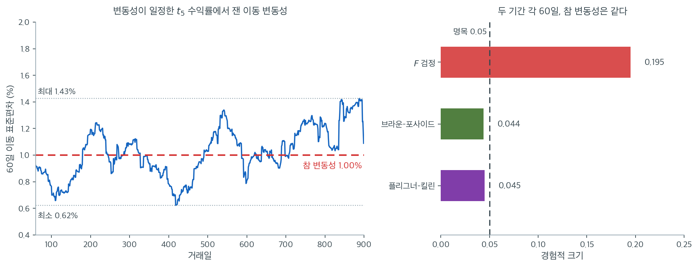
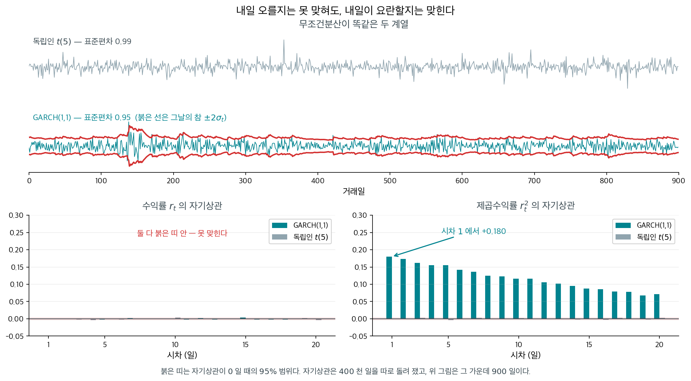

# 금융 변동성 비교

참 변동성이 일 $1.00\%$ 로 한 번도 변하지 않은 수익률 $900$ 일치에서 $60$ 일 이동 표준편차를 계산하면 $0.62\%$ 에서 $1.43\%$ 까지 출렁인다. **최대가 최소의 $2.3$ 배다.** 고점과 저점만 떼어 놓으면 「변동성이 절반으로 줄었다」는 이야기를 쓰고 싶어지지만 전부 잡음이다. 이 잡음을 F 검정에 넘기면 변동성이 전혀 변하지 않았는데도 실제 기각률이 $0.195$ 가 된다. 그러면 두 기간의 변동성을 비교한다는 말은 무엇을 재는 일인가.

금융에서 변동성(수익률의 표준편차)은 위험의 핵심 척도이다. 포트폴리오 관리자, 위험 분석가, 규제당국은 변동성이 시간에 따라 변했는지 또는 자산에 따라 다른지를 일상적으로 판단해야 한다. 이 장의 분산 검정들이 그 비교의 통계적 도구를 제공하지만, 금융 자료에는 고유한 어려움이 있다. 수익률은 꼬리가 두껍고, 때로 자기상관되어 있으며, 정규분포를 따르는 경우가 드물다.

---

## 1. 금융 맥락에서의 변동성

$P_t$가 시각 $t$의 자산 가격이면 로그수익률은

$$
r_t = \ln\!\left(\frac{P_t}{P_{t-1}}\right)
$$

주어진 기간의 자산 변동성은 로그수익률의 표준편차이다.

$$
\sigma = \sqrt{\operatorname{Var}(r_t)}
$$

연율화 변동성은 보통 $\sigma_{\text{annual}} = \sigma_{\text{daily}} \times \sqrt{252}$로 보고한다. 252는 연간 거래일 수의 근사값이다.

---

## 2. 흔한 질문

금융 변동성 검정은 다음과 같은 질문을 다룬다.

1. **변동성이 변했는가?** 사건(실적 발표, 정책 변경, 위기) 전후의 수익률 분산을 비교한다.
2. **두 자산의 변동성이 같은가?** 두 주식, 채권, 포트폴리오의 수익률 분산을 비교한다.
3. **시장 국면에 따라 변동성이 같은가?** 시계열을 국면(상승장, 하락장, 횡보장)으로 나누어 등분산을 검정한다.

---

## 3. F 검정이 금융 자료에서 실패하는 이유

금융 수익률의 꼬리가 두껍고 초과첨도가 크다는 것은 잘 알려져 있다. 실증적으로 일별 주식 수익률의 초과첨도 $\gamma_2$는 흔히 3에서 10 사이로, 정규분포의 0보다 훨씬 크다. 15.3절에서 논한 대로 F 검정은 첨도에 매우 민감하다.

| 자료 유형 | 전형적 초과첨도 | F 검정 신뢰성 |
|---|---|---|
| 정규 모의생성 | 0 | 타당 |
| 일별 주식 수익률 | 3~10 | 신뢰 불가 |
| 일별 외환 수익률 | 2~5 | 신뢰 불가 |
| 월별 주식 수익률 | 1~3 | 경계선 |
| 국채 수익률 | 1~2 | 경계선 |

!!! danger "일별 수익률 자료에 F 검정을 쓰지 말라"
    일별 금융 수익률에 적용하면 F 검정은 $H_0\colon \sigma_1^2 = \sigma_2^2$을 지나치게 자주 기각한다. 두꺼운 꼬리가 검정통계량을 부풀리기 때문이다. 유의한 F 검정 결과는 진짜 변동성 차이가 아니라 비정규성을 반영하는 것일 수 있다.

    수치로 확인하자. $t_5$ 수익률(초과첨도 6), 두 기간 각 60일, **참 변동성이 같은** 상황에서 명목 $\alpha = 0.05$의 실제 기각률은

    | 검정 | 경험적 크기 |
    |---|---|
    | F 검정 | **0.195** |
    | Brown-Forsythe | 0.044 |
    | Fligner-Killeen | 0.045 |

    F 검정은 변동성이 전혀 변하지 않았는데도 다섯 번에 한 번꼴로 "변했다"고 판정한다. 로버스트 검정들은 올바른 크기를 유지한다.

문제의 뿌리를 보려면 검정 이전에 **추정** 단계부터 봐야 한다. 아래 왼쪽은 참 변동성이 시종일관 일 $1.00\%$로 **고정된** $t_5$ 수익률 900일치에서 60일 이동 표준편차를 계산한 것이다. 변동성은 한 번도 변하지 않았다.



그런데 파란 선은 $0.62\%$에서 $1.43\%$까지 출렁인다. **최대가 최소의 2.3배다.** 200일 무렵의 고점과 420일 무렵의 저점만 떼어 놓고 보면 "변동성이 절반으로 줄었다"는 이야기를 쓰고 싶어진다. 850일 이후의 상승은 "시장이 불안해졌다"는 해설을 부를 것이다. 전부 잡음이다.

두 가지가 겹쳐 이 출렁임을 만든다. 첫째, 60일은 분산을 추정하기에 짧다. 정규 자료라도 $S$의 상대오차가 $1/\sqrt{2(n-1)} \approx 9\%$이다. 둘째, 꼬리가 두꺼우면 그 변동이 더 커진다. $t_5$의 초과첨도가 6이므로 $\operatorname{Var}(S^2)$가 정규의 4배다. 셋째로 이동창이 겹쳐 있어 인접한 추정값이 강하게 상관되므로, 잡음이 **추세처럼 보이는 매끄러운 곡선**을 그린다. 무작위 산점이었다면 아무도 속지 않았을 것이다.

오른쪽 막대가 이 잡음을 검정으로 넘겼을 때의 결과다. $F$ 검정의 실제 크기가 $0.195$다. 앞 표에서 본 숫자와 같지만, 이제 그 숫자가 어디서 오는지 알 수 있다. **검정통계량이 재고 있는 것의 상당 부분이 변동성의 변화가 아니라 변동성 추정의 잡음이다.** 브라운–포사이드 $0.044$, 플리그너–킬린 $0.045$는 그 잡음의 크기를 자료에서 다시 읽어 내므로 속지 않는다.

실무 규칙 하나. **두 기간의 변동성을 비교하기 전에 각 기간의 변동성이 얼마나 정밀하게 추정되었는지부터 물어라.** 60일짜리 추정값 두 개로 1.5배 차이를 논하는 것은, 위 그림에서 아무 두 지점을 골라 비교하는 것과 다르지 않다.

---

## 4. 금융 자료에 권장되는 검정

수익률의 두꺼운 꼬리를 고려하면 다음 중에서 고르는 것이 좋다.

1. **Brown-Forsythe 검정.** 로버스트성이 좋고 검정력도 합리적이다. 수익률의 꼬리가 중간 정도로 두꺼울 때 적합하다.
2. **Fligner-Killeen 검정.** 매우 두꺼운 꼬리 자료에서 제1종 오류 조절이 가장 좋다. 분포가 강하게 비정규일 때 선호된다.
3. **붓스트랩 검정.** 분포 가정을 하지 않는다. 15.6절의 붓스트랩 분산 검정은 수익률 분포의 실제 모양에 적응하므로 금융 자료에 잘 맞는다.

<div class="exbox" markdown>

**보기 1.** <span class="diff easy" title="쉬움"></span> 두 기간의 변동성 비교. 어떤 분석가가 중앙은행 정책 발표 후 주식의 일별 수익률 변동성이 변했는지 판정하려 한다. 자료는 발표 전 60거래일과 발표 후 60거래일이다.

**설정:**

- 기간 1 (전): $n_1 = 60$개 일별 수익률, $S_1^2 = 0.000324$ (일별 변동성 $= 1.8\%$)
- 기간 2 (후): $n_2 = 60$개 일별 수익률, $S_2^2 = 0.000576$ (일별 변동성 $= 2.4\%$)

**가설:**

</div>

??? success "풀이"
    $$
    H_0\colon \sigma_{\text{before}}^2 = \sigma_{\text{after}}^2 \quad \text{대} \quad H_1\colon \sigma_{\text{before}}^2 \neq \sigma_{\text{after}}^2
    $$

    **참고: F 검정을 쓴다면.** $F = 0.000324/0.000576 = 0.5625$이고 $F_{59,59}$ 아래에서 양측 $p = 0.0288$이다. 5% 수준에서 기각한다.

    **그러나 이 $p$값을 믿어서는 안 된다.** 위 경고 상자에서 보았듯 $t_5$ 수준의 두꺼운 꼬리에서 F 검정의 실제 크기는 0.195이다. 명목 $p = 0.029$는 실제로는 훨씬 약한 증거이다.

    **검정 선택.** 일별 수익률의 꼬리가 두꺼우므로 분석가는 F 검정 대신 Brown-Forsythe 검정을 써야 한다. 요약통계량만으로는 로버스트 검정을 계산할 수 없고 **원자료가 필요하다**는 점도 실무적으로 중요하다. 표본분산만 보고된 논문의 결과를 재검토할 수 없는 이유이다.

---

## 5. 금융 자료 고유의 어려움

### 제곱 수익률의 자기상관

원래의 수익률 $r_t$는 근사적으로 무상관이지만, 순간분산의 대리변수인 제곱 수익률 $r_t^2$은 흔히 강한 양의 자기상관을 보인다. **변동성 군집**이라 불리는 이 현상은 변동성이 높은 날 뒤에 다시 변동성이 높은 날이 오는 경향을 뜻한다.

$r_t^2$의 자기상관은 이 장의 모든 분산 검정이 요구하는 독립성 가정을 위배한다. 변동성 군집이 있으면 실효 표본크기가 명목 $n$보다 작아지고 분산 검정이 인위적으로 작은 $p$값을 낸다.

!!! danger "로버스트 검정도 변동성 군집은 해결하지 못한다"
    GARCH(1,1) 과정($\alpha = 0.1$, $\beta = 0.85$)에서 120일을 생성하고 전반 60일과 후반 60일을 비교하는 모의실험을 하자. **두 기간의 무조건분산이 정확히 같으므로 $H_0$이 참이다.**

    | 검정 | $t_5$ 독립 자료 | GARCH 자료 |
    |---|---|---|
    | F 검정 | 0.195 | **0.331** |
    | Brown-Forsythe | 0.044 | **0.297** |
    | Fligner-Killeen | 0.045 | **0.287** |

    독립인 두꺼운 꼬리 자료에서는 로버스트 검정이 크기를 완벽히 통제했지만(0.044, 0.045), **변동성 군집이 있으면 세 검정 모두 0.29~0.33으로 무너진다.**

    이유는 명확하다. 로버스트 검정은 **분포 모양**에 대한 가정을 완화할 뿐 **독립성** 가정은 그대로 요구한다. 15.1절 [왜 분산을 검정하는가](../introduction/motivation.md) 연습문제 3에서 자기상관에 대해 확인한 것과 같은 결론이다.

    실무적 함의: 금융 시계열에서 "Brown-Forsythe를 썼으니 안전하다"고 생각해서는 안 된다. 두꺼운 꼬리보다 변동성 군집이 훨씬 심각한 문제이다.

**완화 전략:**

- 자기상관이 감쇠할 만큼 충분히 긴 비중첩 부분기간을 쓴다
- GARCH 모형을 적합하여 변동성 동학을 포착하고 GARCH 모수의 구조변화를 검정한다
- 자기상관 구조를 보존하는 블록 붓스트랩을 적용한다

### 비정상성

금융 변동성은 한 시점에서 급격히 바뀌기보다 시간에 걸쳐 점진적으로 변하는 경우가 많다. 두 기간을 각각 일정한 분산을 갖는 것처럼 검정하는 것은 지나친 단순화일 수 있다. 형식적 변화점 탐지 방법이나 이동창 추정이 더 미묘한 그림을 제공한다.

<div class="exbox" markdown>

**보기 2.** <span class="diff easy" title="쉬움"></span> 변동성 변화 검정하기. $t_5$ 수익률 $60$일씩 두 기간을 만들되 참 변동성을 $1.8\%$와 $2.4\%$로 **정말 다르게** 두고, F 검정·Brown-Forsythe·Fligner-Killeen 을 나란히 돌린다.

**(1)** $t_5$의 첨도를 구하고, 5.10절의 극한 오류율 공식으로 이 자료에서 F 검정의 **극한 크기**를 계산하시오. 표본을 키우면 그 값이 $0.05$로 수렴하는가?

**(2)** 세 검정을 돌려 $p$값을 견주고, F 검정이 증거를 몇 배 과장하는지 적으시오. 또 (1)의 극한값을 모의실험으로 확인하시오.

</div>

??? success "풀이"

    **(1) 첨도 하나가 극한 크기를 정한다.** $t_\nu$ 분포의 첨도는 $\nu > 4$에서

    $$
    \beta_2(t_\nu) = 3 + \frac{6}{\nu - 4}
    $$

    이므로 $\nu = 5$이면 $\beta_2 = 9$, 초과첨도가 $6$이다. 위 표가 말하는 "$t_5$ 수익률(초과첨도 6)"이 이것이다. ($\nu = 5$라 네 번째 적률이 **겨우** 존재한다. $\nu \le 4$이면 첨도가 무한대가 되어 아래 계산 자체가 성립하지 않는다.)

    5.10절이 유도해 둔 것을 가져온다. 델타법으로 $\operatorname{Var}(\log S^2) \approx (\beta_2-1)/n$이고 두 표본이 독립이므로

    $$
    \operatorname{Var}\!\left(\log \frac{S_1^2}{S_2^2}\right) \approx (\beta_2-1)\left(\frac{1}{n_1}+\frac{1}{n_2}\right)
    $$

    인데, F 검정은 이 값을 정규 이론의 $2\left(\frac1{n_1}+\frac1{n_2}\right)$로 믿는다. 그러므로 **참 산포가 믿는 산포의 $\sqrt{(\beta_2-1)/2}$배**다. $\beta_2 = 9$를 넣으면

    $$
    \sqrt{\frac{9-1}{2}} = 2
    $$

    로 정확히 **두 배**다. 임계값이 참 산포 단위로는 $\pm 1.96/2 = \pm 0.98$만큼만 뻗으므로

    $$
    \text{극한 크기} = 2\left[1 - \Phi\!\left(1.96\sqrt{\frac{2}{\beta_2-1}}\right)\right]
    = 2\left[1 - \Phi(0.98)\right] = 0.327
    $$

    이다. 5.10절의 표에서 $\beta_2 = 9$인 지수분포 줄에 적힌 $0.327$과 같은 수이고, 그래야 한다. **극한 오류율은 첨도만의 함수**이므로 분포 모양이 달라도 첨도가 같으면 같은 값이 나온다.

    **$0.05$로 수렴하지 않는다. 오히려 올라간다.** 위 식에 $n$이 아예 들어 있지 않다는 것이 요점이다. 임계값도 $1/\sqrt n$로 줄고 참 산포도 $1/\sqrt n$로 줄어 둘의 비가 처음부터 끝까지 $2$로 고정되기 때문이다. 작은 $n$에서는 $F$ 분포 자체가 넓어 왜곡이 가려지므로, 실제 크기는 **아래에서 위로 올라가** $0.327$에 다가간다. 연습문제 2 이 $n = 60$에서 잰 $0.195$는 극한값이 아니라 그 도중의 한 점이다.

    **(2) 먼저 자료 한 벌로 세 검정을 견준다.**

    ```python
    import numpy as np
    from scipy import stats

    rng = np.random.default_rng(42)

    # t(5) 의 표준편차는 sqrt(5/3) 이다. 목표 변동성을 정확히 맞추려면
    # 이 값으로 나눠야 한다. 이러면 달라지는 것은 꼬리 두께뿐이다.
    scale_correction = np.sqrt(5 / 3)

    # 1구간: 일변동성 1.8%
    returns_before = rng.standard_t(df=5, size=60) * 0.018 / scale_correction

    # 2구간: 일변동성 2.4%. 실제로 분산이 달라진 자료다.
    returns_after = rng.standard_t(df=5, size=60) * 0.024 / scale_correction

    print(f"sample sd: {returns_before.std(ddof=1):.5f}, "
          f"{returns_after.std(ddof=1):.5f}")

    # 중앙값을 중심으로 쓰므로 꼬리가 두꺼운 자료에서도 버틴다.
    bf_stat, bf_p = stats.levene(returns_before, returns_after, center='median')
    print(f"Brown-Forsythe:  W = {bf_stat:.4f}, p = {bf_p:.4f}")

    # 순위만 쓰는 검정이라 꼬리의 두께에는 셋 중 가장 덜 흔들린다.
    # 다만 치우침이 극단이면 브라운–포사이드가 낫다 (15.5절 비교).
    fk_stat, fk_p = stats.fligner(returns_before, returns_after)
    print(f"Fligner-Killeen: H = {fk_stat:.4f}, p = {fk_p:.4f}")

    # F 검정은 정규성에 매우 민감하다. 수익률처럼 꼬리가 두꺼운 자료에서는
    # 분산이 같아도 자주 기각해 버리므로 쓰지 않는 편이 낫다.
    f_stat = np.var(returns_before, ddof=1) / np.var(returns_after, ddof=1)
    f_p = 2 * min(stats.f.cdf(f_stat, 59, 59), stats.f.sf(f_stat, 59, 59))
    print(f"F-test:          F = {f_stat:.4f}, p = {f_p:.4g} "
          f"(unreliable for heavy-tailed data)")
    ```

    출력:

    ```text
    sample sd: 0.01504, 0.02611
    Brown-Forsythe:  W = 5.4046, p = 0.0218
    Fligner-Killeen: H = 3.2325, p = 0.0722
    F-test:          F = 0.3317, p = 3.791e-05 (unreliable for heavy-tailed data)
    ```

    **세 $p$값이 자릿수째로 갈린다.** F 검정 $3.791\times10^{-5}$, Brown-Forsythe $0.0218$, Fligner-Killeen $0.0722$다. 비로 적으면 F 검정이 Brown-Forsythe 보다 **$575$배**, Fligner-Killeen 보다 $1900$배 작은 $p$값을 준다. **F 검정이 증거를 500배 넘게 과장한다.** 이 자료에는 실제로 변동성 차이가 있으므로($1.8\%$ 대 $2.4\%$, 분산비 $1.78$배) 기각 자체는 옳지만, 그 확신의 정도가 완전히 부풀려져 있다.

    (1)이 왜 그런지 말해 준다. **$\log F$의 참 산포가 F 검정이 믿는 것의 두 배**이므로, F 검정은 관측된 $\log F$를 실제보다 두 배 멀리 있는 것으로 읽는다. 정규 꼬리에서 $z$를 두 배로 읽으면 $p$값은 자릿수로 줄어든다. Brown-Forsythe 와 Fligner-Killeen 은 산포의 크기를 자료에서 다시 읽어 내므로 속지 않는다.

    **이제 (1)의 극한값 $0.327$을 확인한다.** 참 변동성을 두 기간에 **같게** 두고 $n$을 키우며 실제 크기를 잰다.

    ```python
    import numpy as np
    from scipy import stats

    # (1) 극한 크기를 식으로 먼저 적는다. t_5 의 첨도는 3 + 6/(nu-4) = 9 다.
    beta2 = 3 + 6 / (5 - 4)
    c = stats.norm.isf(0.025) * np.sqrt(2 / (beta2 - 1))
    print(f"t_5 의 첨도 beta2 = {beta2:.1f}   (초과첨도 {beta2 - 3:.1f})")
    print(f"산포 배율 sqrt((beta2-1)/2) = {np.sqrt((beta2 - 1) / 2):.3f}")
    print(f"1.96*sqrt(2/(beta2-1)) = {c:.4f}   ->  극한 크기 = {2 * stats.norm.sf(c):.4f}")


    def bf_p2(A, B):
        """두 표본에 대한 중앙값 중심 Levene(= Brown-Forsythe) p-값을 벡터화.
        scipy.stats.levene(a, b, center='median') 와 같은 값을 준다."""
        Z = [np.abs(X - np.median(X, axis=1, keepdims=True)) for X in (A, B)]
        n1, n2 = A.shape[1], B.shape[1]
        m = [z.mean(axis=1) for z in Z]
        gm = (n1 * m[0] + n2 * m[1]) / (n1 + n2)
        msb = n1 * (m[0] - gm) ** 2 + n2 * (m[1] - gm) ** 2
        msw = (((Z[0] - m[0][:, None]) ** 2).sum(axis=1)
               + ((Z[1] - m[1][:, None]) ** 2).sum(axis=1)) / (n1 + n2 - 2)
        return stats.f.sf(msb / msw, 1, n1 + n2 - 2)


    # (2) 표본을 키우며 두 검정의 실제 크기를 잰다. 참 변동성은 두 기간이 같다.
    rng = np.random.default_rng(11)
    print(f"\n{'n':>6}{'R':>8}{'F-test':>10}{'Brown-Forsythe':>17}")
    for n, R in [(60, 20_000), (250, 20_000), (1000, 10_000), (4000, 4_000)]:
        A = rng.standard_t(5, size=(R, n))
        B = rng.standard_t(5, size=(R, n))
        F = A.var(axis=1, ddof=1) / B.var(axis=1, ddof=1)
        d = stats.f(n - 1, n - 1)
        p_f = 2 * np.minimum(d.cdf(F), d.sf(F))
        print(f"{n:>6}{R:>8}{np.mean(p_f < 0.05):>10.4f}{np.mean(bf_p2(A, B) < 0.05):>17.4f}")
    ```

    출력:

    ```text
    t_5 의 첨도 beta2 = 9.0   (초과첨도 6.0)
    산포 배율 sqrt((beta2-1)/2) = 2.000
    1.96*sqrt(2/(beta2-1)) = 0.9800   ->  극한 크기 = 0.3271

         n       R    F-test   Brown-Forsythe
        60   20000    0.2028           0.0474
       250   20000    0.2399           0.0481
      1000   10000    0.2696           0.0499
      4000    4000    0.2755           0.0493
    ```

    **(1)의 예측이 그대로 보인다.** 산포 배율이 정확히 $2.000$이고 극한 크기가 $0.3271$이다. 그리고 모의실험한 F 검정의 크기가

    $$
    0.2028 \;\to\; 0.2399 \;\to\; 0.2696 \;\to\; 0.2755
    $$

    으로 $n$을 $60$에서 $4000$까지 키우는 동안 **단조증가**한다. 표본을 $67$배 늘렸는데 거짓 양성률이 $0.20$에서 $0.28$로 올라갔다. **표본을 키우면 더 나빠진다.** 연습문제 2 의 $n = 60$ 값 $0.1948$은 이 수열의 첫 점이고(여기서는 $0.2028$, 씨앗과 반복 횟수가 달라 생긴 차이이며 $R = 20000$에서 표준오차 $0.0028$이니 두 표준오차 안이다), 끝점은 $0.05$가 아니라 $0.327$이다.

    수렴이 느린 것도 눈여겨볼 만하다. $n = 4000$에서도 아직 $0.276$으로 극한값에서 $0.05$나 떨어져 있다. 델타근사의 오차가 $1/\sqrt n$로만 줄기 때문이다. 그러나 **방향은 처음부터 끝까지 한쪽**이다.

    **Brown-Forsythe 는 네 경우 모두 $0.047$–$0.050$으로 명목값에 붙어 있다.** 같은 $t_5$ 자료, 같은 표본크기인데 한쪽은 $n$과 함께 망가지고 한쪽은 꿈쩍하지 않는다. 15.6절이 보일 붓스트랩 검정도 같은 이유로 버틴다. **"분산 검정에는 중심극한정리의 보호가 없다"는 말은 고전적 검정에만 해당하는 말이고, 그 보호를 자료에서 직접 만들어 내는 것이 로버스트 검정이 하는 일이다.**

    다만 이 결론은 **독립성을 전제로 한 것**이다. 아래의 변동성 군집 상자가 그 전제가 깨지면 Brown-Forsythe 도 $0.297$까지 무너짐을 보인다.

!!! warning "`standard_t(df)*scale`의 표준편차는 `scale`이 아니다"
    원래 코드는 `rng.standard_t(df=5, size=60) * 0.018`로 "일별 변동성 1.8%"를 만들려 했지만, $t_5$의 표준편차가 $\sqrt{5/3} = 1.291$이므로 실제 표준편차는 $0.018 \times 1.291 = 0.0232$, 곧 **2.3%**이다.

    위 코드는 `/ np.sqrt(5/3)`으로 이를 보정했다. 14장 금융 수익률 페이지에서 지적한 것과 같은 함정이다.

    (분산 **비**는 척도에 불변이므로 검정통계량과 $p$값은 보정 전후가 같다. 보정은 "1.8%"라는 서술을 자료와 일치시키기 위한 것이다.)

---

<div class="storybox" markdown>

**그림으로 보는 통계학 1.** 분산이 같은지 묻지 않기로 한 사람

이 장은 내내 한 가지를 묻는다 — **두 집단의 분산이 같은가.** 그런데 금융 수익률 앞에서
그 물음은 조금 이상해진다. 답을 이미 알기 때문이다. **같을 리가 없다.** §5 가 적은
변동성 군집이 그 말이고, 그렇다면 검정으로 가릴 일이 아니라 **모형으로 적을 일**이다.

$1982$ 년에 그렇게 방향을 튼 사람이 **로버트 엥글**이다. 그는 분산을 상수로 두고 「변했나
안 변했나」를 묻는 대신, 분산 자체가 **어제까지의 일에 따라 달라지는 양**이라고 적었다.

$$
\sigma_t^2 = \omega + \alpha\,r_{t-1}^2 + \beta\,\sigma_{t-1}^2
$$

어제가 요란했으면($r_{t-1}^2$ 이 컸으면) 오늘도 요란하리라고 보는 식이다. 이것이 ARCH
이고, 위의 꼴은 그의 제자 볼러슬레우가 $1986$ 년에 일반화한 GARCH 다.

**정말 그런지는 간단히 가릴 수 있다.**

<figure markdown>
  { width=1000 }
  <figcaption markdown>두 계열의 무조건 표준편차가 $0.99$ 와 $0.95$ 로 사실상 같다. **수익률의 자기상관은 둘 다 $0$** 인데(아래 왼쪽) **제곱수익률의 자기상관은 GARCH 만 또렷이 양수**다(아래 오른쪽). 자료에서 직접 그렸다.</figcaption>
</figure>

아래 두 칸의 대조가 요점이다. **내일 오를지 내릴지는 못 맞힌다** — 그것을 맞힐 수 있다면
시장이 아니다. **그런데 내일이 요란할지 조용할지는 맞힐 수 있다.** 시차 $1$ 에서
$+0.180$ 이고 시차 $20$ 까지도 $+0.07$ 이 남는다. 이 비대칭이 엥글이 붙잡은 것이고,
$2003$ 년 노벨 경제학상이 그 일에 주어졌다.

지속성을 읽는 법도 간단하다. $\alpha + \beta = 0.95$ 이므로 한 번의 충격이 절반으로
사그라드는 데 $\ln 0.5 / \ln 0.95 = 13.5$ 일 걸린다. 위 그림에서 $140$ 일 무렵의 소동이
보름 넘게 꼬리를 끄는 것이 그것이다.

**두꺼운 꼬리와 변동성 군집은 다른 것이다.** 이 쪽 §3 은 앞엣것을, §5 는 뒤엣것을
다루는데 둘을 묶어 「금융 자료는 까다롭다」로 뭉뚱그리기 쉽다. 위 그림의 두 계열이 그
구별을 보여 준다 — 독립인 $t_5$ 는 **초과첨도 $4.72$** 로 꼬리가 아주 두꺼운데 군집이
전혀 없고, GARCH 쪽은 초과첨도가 $0.81$ 로 오히려 얌전한데 군집이 뚜렷하다. §5 의 표가
「로버스트 검정도 변동성 군집은 해결하지 못한다」고 한 까닭이 이것이다. 로버스트성은
**모양**에 관한 것이고 군집은 **시간**에 관한 것이라, 고치는 연장이 다르다.

마지막으로 뜻밖의 사실 하나. 엥글의 $1982$ 년 논문 제목에는 주식도 환율도 나오지 않는다.
「자기회귀 조건부 이분산과 **영국 물가**의 분산 추정」이다. 금융을 바꾼 연장이 물가
자료를 들여다보다 나왔고, 금융 쪽이 그것을 가져다 쓴 것은 그 뒤의 일이다.

_확인한 곳 — R. F. Engle, 「Autoregressive Conditional Heteroscedasticity with Estimates of the Variance of United Kingdom Inflation」, 『Econometrica』 $50$권 $4$호($1982$) · GARCH 로의 일반화는 볼러슬레우($1986$)이고, 엥글이 $2003$ 년 노벨 경제학상을 받은 것은 널리 알려진 바다 · 그림의 자기상관과 첨도는 $\alpha = 0.1$, $\beta = 0.85$(이 쪽 §5 와 같은 값)로 $40$ 만 일을 돌려 이 쪽이 직접 쟀다_

</div>

## 연습문제

<div class="drillbox" markdown>

**연습문제 1.** <span class="diff easy" title="쉬움"></span>
분석가가 논문에서 두 기간의 표본분산 $S_1^2 = 0.000324$, $S_2^2 = 0.000576$($n_1 = n_2 = 60$)만 보고했다. 이 정보만으로 로버스트 검정을 수행할 수 있는가? 할 수 없다면 무엇이 필요한가?

</div>

??? success "풀이"
    **할 수 없다.**

    F 검정과 Bartlett 검정은 **요약통계량만으로** 계산할 수 있다. 표본분산과 표본크기만 있으면 된다.

    $$
    F = \frac{S_1^2}{S_2^2} = \frac{0.000324}{0.000576} = 0.5625, \quad p = 0.0288.
    $$

    그러나 로버스트 검정은 다르다.

    | 검정 | 필요한 정보 |
    |---|---|
    | F 검정 | $S_1^2, S_2^2, n_1, n_2$ |
    | Bartlett | $S_i^2, n_i$ |
    | Levene | **원자료 전체** |
    | Brown-Forsythe | **원자료 전체** |
    | Fligner-Killeen | **원자료 전체** |
    | 붓스트랩 | **원자료 전체** |

    Levene 계열은 각 관측값과 집단 중심의 절대편차 $|X_{ij} - c_i|$를 계산해야 하므로 개별 관측값이 필요하다. Fligner-Killeen은 그 편차들의 순위까지 필요하다.

    **실무적 함의.**

    1. **논문 재검토가 불가능하다.** 요약통계량만 보고된 연구의 F 검정 결과가 두꺼운 꼬리 때문에 부풀려졌는지 확인할 방법이 없다.
    2. **보고 관행에 대한 시사.** 금융이나 다른 두꺼운 꼬리 분야에서는 분산 검정 결과와 함께 **왜도와 첨도를 반드시 보고**해야 한다. 그래야 독자가 F 검정의 신뢰성을 가늠할 수 있다. 가능하면 원자료나 재현 코드를 공개하는 것이 최선이다.
    3. **부분적 대안.** 표본첨도 $g_2$를 알면 대략적인 보정이 가능하다. 15.3절 [비정규성에 대한 민감도](../f_test/sensitivity.md) 연습문제 4에서 유도했듯 $\ln F$의 실제 분산이 명목값의 $(\gamma_2+2)/2$배이므로, $p$값을 다시 계산할 때 $\ln F$를 $\sqrt{(g_2+2)/2}$로 나누어 보정할 수 있다.

        이 자료에서 $g_2 = 6$($t_5$ 수준)이라면 보정계수가 $\sqrt{4} = 2$이므로 유효 $z$가 절반이 된다. 구체적으로 $\ln F = \ln 0.5625 = -0.5754$이고 $\operatorname{sd}(\ln F) \approx \sqrt{4/59} = 0.2604$이므로 명목 $z = -2.21$($p = 0.027$)인데, 보정하면 $z = -1.10$이 되어 $p = 0.269$가 된다. **유의하지 않게 된다.**

    이 간단한 계산만으로도 원래 결론이 뒤집힌다는 사실이, 첨도를 함께 보고하는 것이 왜 중요한지를 잘 보여준다. $\square$

---

<div class="drillbox" markdown>

**연습문제 2.** <span class="diff med" title="중간"></span>
$t_5$ 수익률에서 F 검정, Brown-Forsythe, Fligner-Killeen의 경험적 크기를 모의실험으로 확인하라. 두 기간의 참 변동성은 같게 둔다.

</div>

??? success "풀이"

    ```python
    import numpy as np
    from scipy import stats

    rng = np.random.default_rng(3)
    R = 5000
    counts = [0, 0, 0]

    for _ in range(R):
        a = rng.standard_t(5, 60)
        b = rng.standard_t(5, 60)
        f = a.var(ddof=1) / b.var(ddof=1)
        counts[0] += 2 * min(stats.f.cdf(f, 59, 59),
                             stats.f.sf(f, 59, 59)) < 0.05
        counts[1] += stats.levene(a, b, center='median')[1] < 0.05
        counts[2] += stats.fligner(a, b)[1] < 0.05

    print(f"F-test:          {counts[0] / R:.4f}")
    print(f"Brown-Forsythe:  {counts[1] / R:.4f}")
    print(f"Fligner-Killeen: {counts[2] / R:.4f}")
    ```

    출력:

    ```text
    F-test:          0.1948
    Brown-Forsythe:  0.0438
    Fligner-Killeen: 0.0448
    ```

    F 검정의 크기가 $0.195$로 명목값의 **네 배**이다. 참 변동성이 같은데도 다섯 번에 한 번 "변했다"고 판정한다.

    Brown-Forsythe($0.044$)와 Fligner-Killeen($0.045$)은 올바른 크기를 유지한다.

    **실무적 해석.** 어떤 분석가가 F 검정으로 "변동성이 유의하게 변했다($p = 0.03$)"고 보고했다면, 그 결과가 실제 변동성 변화 때문일 확률과 두꺼운 꼬리 때문일 확률을 구별할 수 없다. 명목 5% 검정의 실제 크기가 19.5%이므로 그 "유의한" 결과의 상당 부분이 거짓 양성이다. $\square$

---

<div class="drillbox" markdown>

**연습문제 3.** <span class="diff med" title="중간"></span>
변동성 군집이 있을 때 로버스트 검정도 무너짐을 모의실험으로 확인하라. GARCH(1,1) 자료로 두 인접 기간을 비교하라.

</div>

??? success "풀이"

    ```python
    import numpy as np
    from scipy import stats

    def garch11(n, rng, omega=1e-5, alpha=0.1, beta=0.85):
        """GARCH(1,1) 수익률을 만든다. 무조건분산은 omega/(1-alpha-beta) 다.

            변동성이 뭉쳐 다니는 실제 수익률의 성질을 흉내 내기 위한 모형이다.
            """
        h = omega / (1 - alpha - beta)
        r = np.zeros(n)
        for t in range(n):
            r[t] = np.sqrt(h) * rng.normal()
            h = omega + alpha * r[t] ** 2 + beta * h
        return r

    rng = np.random.default_rng(3)
    R = 5000
    counts = [0, 0, 0]

    for _ in range(R):
        x = garch11(120, rng)
        a, b = x[:60], x[60:]           # two adjacent periods, same true variance
        f = a.var(ddof=1) / b.var(ddof=1)
        counts[0] += 2 * min(stats.f.cdf(f, 59, 59),
                             stats.f.sf(f, 59, 59)) < 0.05
        counts[1] += stats.levene(a, b, center='median')[1] < 0.05
        counts[2] += stats.fligner(a, b)[1] < 0.05

    print(f"F-test:          {counts[0] / R:.4f}")
    print(f"Brown-Forsythe:  {counts[1] / R:.4f}")
    print(f"Fligner-Killeen: {counts[2] / R:.4f}")
    ```

    출력:

    ```text
    F-test:          0.3312
    Brown-Forsythe:  0.2968
    Fligner-Killeen: 0.2868
    ```

    | 검정 | $t_5$ 독립 (연습문제 2) | GARCH |
    |---|---|---|
    | F 검정 | 0.195 | 0.331 |
    | Brown-Forsythe | 0.044 | **0.297** |
    | Fligner-Killeen | 0.045 | **0.287** |

    **결과가 충격적이다.** 독립인 두꺼운 꼬리 자료에서 완벽하게 작동하던 로버스트 검정들이 변동성 군집 앞에서는 F 검정과 거의 같은 수준으로 무너진다. 세 검정 모두 세 번에 한 번꼴로 잘못 기각한다.

    **왜 그런가.** GARCH 과정에서 무조건분산은 두 기간이 같지만, 어떤 표본경로에서는 전반 60일이 우연히 고변동성 국면에, 후반 60일이 저변동성 국면에 놓인다. 그러면 두 기간의 **표본**분산이 크게 달라진다.

    검정들은 이것을 "참 변동성 차이"로 읽지만, 실은 하나의 정상 과정 안에서의 국면 변동일 뿐이다. 어떤 검정도 이를 구별할 수 없다. 분포 모양의 문제가 아니라 **종속성의 문제**이기 때문이다.

    **해결책.** (1) 블록 붓스트랩으로 자기상관을 보존한 귀무분포를 만들거나, (2) GARCH 모형을 적합하고 그 모수의 구조변화를 검정하거나, (3) 애초에 "두 기간의 무조건분산이 같은가"라는 질문 자체가 적절한지 재검토한다. 금융 변동성은 본래 시간에 따라 변하는 양이므로, 두 상수를 비교하는 틀이 문제에 맞지 않을 수 있다. $\square$

---

<div class="drillbox" markdown>

**연습문제 4.** <span class="diff med" title="중간"></span>
"일별 변동성 1.8%"를 $t_5$ 분포로 모의생성할 때 `standard_t(5) * 0.018`이 왜 틀렸는지 설명하고, 여러 자유도에 대한 보정계수를 계산하라.

</div>

??? success "풀이"
    $t_\nu$ 분포의 표준편차는 $\nu > 2$일 때

    $$
    \operatorname{sd}(t_\nu) = \sqrt{\frac{\nu}{\nu - 2}}
    $$

    이다. 곧 `standard_t(nu)`는 표준편차가 1이 **아니다**. 여기에 `scale`을 곱하면 표준편차가 $\text{scale} \times \sqrt{\nu/(\nu-2)}$가 된다.

    ```python
    import numpy as np

    print(f"{'nu':>5} {'sd(t_nu)':>10} {'sd from *0.018':>15}")
    for nu in [3, 4, 5, 6, 10, 30, 100]:
        sd = np.sqrt(nu / (nu - 2))
        print(f"{nu:>5} {sd:>10.4f} {0.018 * sd:>15.5f}")
    ```

    출력:

    ```text
       nu   sd(t_nu)  sd from *0.018
        3     1.7321         0.03118
        4     1.4142         0.02546
        5     1.2910         0.02324
        6     1.2247         0.02205
       10     1.1180         0.02012
       30     1.0351         0.01863
      100     1.0102         0.01818
    ```

    $\nu = 5$이면 목표 1.8%가 실제로는 **2.32%**가 되어 29% 초과한다. $\nu = 3$이면 3.12%로 73%나 초과한다. 자유도가 작을수록(꼬리가 두꺼울수록) 오차가 커진다는 점이 특히 곤란하다. 두꺼운 꼬리를 모의생성하려 할수록 변동성이 더 심하게 어긋난다.

    **올바른 방법.** 목표 표준편차 $\sigma$를 얻으려면

    ```python
    rng = np.random.default_rng(0)
    nu, n, sigma = 5, 100_000, 0.018

    naive = rng.standard_t(nu, n) * sigma
    correct = rng.standard_t(nu, n) * sigma / np.sqrt(nu / (nu - 2))

    print(f"target sd:  {sigma:.5f}")
    print(f"naive sd:   {naive.std(ddof=1):.5f}")
    print(f"correct sd: {correct.std(ddof=1):.5f}")
    ```

    출력:

    ```
    target sd:  0.01800
    naive sd:   0.02316
    correct sd: 0.01805
    ```

    순진한 방법은 표준편차가 $0.0232$로 목표보다 29% 크지만, $\sqrt{\nu/(\nu-2)}$로 나누면 $0.0181$로 목표에 맞는다.

    **왜 중요한가.** 검정통계량은 분산의 **비**에 의존하므로 두 집단에 같은 척도 오차가 있으면 $p$값은 바뀌지 않는다. 그러나 (1) "변동성 1.8%"라는 서술이 자료와 어긋나고, (2) VaR나 절대적 위험 수준을 계산하면 결과가 틀리며, (3) 다른 분포에서 생성한 자료와 비교할 때 공정하지 않다. $\square$

---

<div class="drillbox" markdown>

**연습문제 5.** <span class="diff med" title="중간"></span>
본문 3절은 이동 추정값이 출렁이는 첫째 이유로 "정규 자료라도 $S$의 상대오차가 $1/\sqrt{2(n-1)} \approx 9\%$"를 들고, 둘째 이유로 "$t_5$의 초과첨도가 6이므로 $\operatorname{Var}(S^2)$가 정규의 4배"를 들었다. 두 이유를 한 식으로 묶는다.

**(1)** 5.6절의 $\operatorname{Var}(S^2) \approx \sigma^4(\beta_2-1)/n$에서 출발해 델타법으로

$$
\operatorname{sd}(\log S) \approx \frac{1}{2}\sqrt{\frac{\beta_2-1}{n}}
$$

를 유도하시오. $\beta_2 = 3$, $n = 60$에서 본문의 $9\%$가 나오는가? $t_5$($\beta_2 = 9$)에서는 얼마인가? 두 값의 비가 보기 2의 "산포 배율" $\sqrt{(\beta_2-1)/2}$와 같은 수인 이유를 설명하시오.

**(2)** $\operatorname{Var}(S^2)$는 정규의 **4배**인데 $S$의 상대오차는 **2배**뿐이다. 어디서 제곱근이 한 번 더 나오는가?

**(3)** 본문 그림의 이동 표준편차는 참값 $1.00\%$에서 $0.62\%$와 $1.43\%$까지 갔다. 이 두 값은 로그 눈금에서 참값으로부터 몇 표준편차 떨어진 것인가. 정규 이론의 $9\%$로 잴 때와 $t_5$의 값으로 잴 때를 각각 답하고, 본문이 "전부 잡음이다"라고 단언할 수 있는 근거가 무엇인지 적으시오.

</div>

??? success "풀이"

    **(1) 로그를 씌우면 첨도가 그대로 남는다.** $g(u) = \tfrac12\log u$에 델타법을 쓰면 $g'(\sigma^2) = 1/(2\sigma^2)$이므로

    $$
    \operatorname{Var}(\log S) = \operatorname{Var}\!\left(\tfrac12 \log S^2\right)
    \approx \frac{1}{4\sigma^4}\operatorname{Var}(S^2)
    \approx \frac{\beta_2-1}{4n}
    $$

    곧 $\operatorname{sd}(\log S) \approx \tfrac12\sqrt{(\beta_2-1)/n}$이다. 로그 눈금의 표준편차는 상대오차와 같은 뜻이므로 이것이 "$S$의 상대오차"다.

    $\beta_2 = 3$, $n = 60$을 넣으면

    $$
    \frac{1}{2}\sqrt{\frac{2}{60}} = \frac{1}{\sqrt{120}} = 0.0913
    $$

    으로 본문의 $1/\sqrt{2(n-1)} = 1/\sqrt{118} = 0.0921$과 소수 셋째 자리까지 같다(둘의 차이는 $n$과 $n-1$뿐이다). $t_5$는 $\beta_2 = 9$이므로

    $$
    \frac{1}{2}\sqrt{\frac{8}{60}} = 0.1826
    $$

    곧 **18.3%**다. 두 값의 비는

    $$
    \frac{\tfrac12\sqrt{(\beta_2-1)/n}}{\tfrac12\sqrt{2/n}} = \sqrt{\frac{\beta_2-1}{2}} = \sqrt{4} = 2
    $$

    로 보기 2의 산포 배율과 **같은 식**이다. 당연하다. 보기 2는 $\log F = 2(\log S_1 - \log S_2)$의 산포를 정규 이론값과 견준 것이고, $n$에 의존하는 부분 $\sqrt{1/n_1+1/n_2}$가 분자와 분모에서 약분되면 남는 것은 한 표본의 $\operatorname{sd}(\log S)$의 비, 곧 $\sqrt{(\beta_2-1)/2}$뿐이다. **분산비 검정의 왜곡은 한 표본의 변동성 추정이 이미 안고 있는 왜곡을 두 번 쓴 결과일 뿐이다.**

    **(2) 제곱근 변환이 상대오차를 절반으로 줄인다.** $\operatorname{Var}(S^2)$가 $4$배이면 $\operatorname{sd}(S^2)$는 $2$배다(여기서 제곱근 한 번). 그리고 $S = \sqrt{S^2}$의 상대오차는 $S^2$의 상대오차의 **절반**이다($\log S = \tfrac12\log S^2$이므로). 절반은 정규와 $t_5$ 양쪽에 똑같이 걸리므로 비에는 영향을 주지 않는다. 그래서 분산의 분산 $4$배 $\to$ 표준편차의 산포 $2$배가 된다. 요약하면 $\operatorname{Var}(S^2)$에 대한 배율 $4$, $\operatorname{sd}(\log S)$에 대한 배율 $\sqrt{4} = 2$다.

    **(3) 정규 이론으로는 설명이 안 되는 출렁임이다.** 로그 눈금에서 참값은 $\log 1.00\%$이므로

    $$
    \log\frac{0.62}{1.00} = -0.4780, \qquad \log\frac{1.43}{1.00} = +0.3577
    $$

    이다. 정규 이론의 $0.0913$으로 나누면

    $$
    -5.2 \;\text{와}\; +3.9
    $$

    표준편차다. $t_5$의 $0.1826$으로 나누면

    $$
    -2.6 \;\text{와}\; +2.0
    $$

    이다. **같은 그림이 정규 자료라면 $5$ 시그마 사건이고 $t_5$ 자료라면 평범한 일이다.** 900일에 들어가는 60일 창이 많다는 것을 감안해도 $-5.2$는 잡음으로 설명되지 않는다. 그러므로 본문이 "전부 잡음이다"라고 말할 수 있는 근거는 **창의 길이가 짧다는 것만이 아니라 꼬리가 두껍다는 것까지 합친 것**이다. 꼬리 두께를 빼놓고 $9\%$만 가지고 보면 오히려 "변동성이 정말 변했다"는 쪽으로 읽게 된다. $\square$

---

<div class="drillbox" markdown>

**연습문제 6.** <span class="diff med" title="중간"></span>
연습문제 5의 예측을 모의실험으로 확인한다.

**(1)** $n = 60$에서 $\operatorname{sd}(\log S)$를 정규와 $t_5$ 각각에 대해 재고 연습문제 5의 예측값 $0.0913$, $0.1826$과 견주시오. 한쪽은 맞고 한쪽은 어긋난다. 어느 쪽이 어긋나며 예측이 큰가 작은가?

**(2)** 참 변동성이 같은, 겹치지 않는 두 60일 창의 변동성 비 $S_1/S_2$의 95% 구간을 구하시오. 본문 끝의 실무 규칙("60일짜리 추정값 두 개로 1.5배 차이를 논하는 것")과 비교하시오.

**(3)** 실현 배율 $k(n) = \operatorname{sd}(\log S;\, t_5) / \operatorname{sd}(\log S;\, \text{정규})$를 $n = 60, 250, 1000, 4000$에서 재고, 그것이 함의하는 F 검정의 크기 $2[1-\Phi(1.96/k)]$를 보기 2가 직접 센 크기와 나란히 놓으시오. 보기 2의 표가 $0.2028$에서 시작해 올라간 이유를 설명하시오.

</div>

??? success "풀이"

    ```python
    import numpy as np
    from scipy import stats

    rng = np.random.default_rng(0)


    def log_sd(n, R, kind, chunk=2000):
        """표본표준편차의 로그 R 개를 모은다. 메모리를 아끼려 토막으로 나눠 돈다."""
        out = []
        for i in range(0, R, chunk):
            m = min(chunk, R - i)
            X = (rng.normal(size=(m, n)) if kind == "normal"
                 else rng.standard_t(5, size=(m, n)) / np.sqrt(5 / 3))
            out.append(np.log(X.std(axis=1, ddof=1)))
        return np.concatenate(out)


    # (1), (2) n = 60 에서 델타근사의 예측·모의실험과 두 창의 비 구간
    print(f"{'분포':>8}{'beta2':>7}{'예측':>9}{'모의':>9}{'두 창의 비 95% 구간':>24}")
    for kind, beta2 in [("normal", 3.0), ("t(5)", 9.0)]:
        L = log_sd(60, 40_000, kind)
        ratio = np.exp(L[:20_000] - L[20_000:])      # 겹치지 않는 두 창의 변동성 비
        lo, hi = np.percentile(ratio, [2.5, 97.5])
        print(f"{kind:>8}{beta2:>7.1f}{0.5 * np.sqrt((beta2 - 1) / 60):>9.4f}"
              f"{L.std(ddof=1):>9.4f}{f'[{lo:.3f}, {hi:.3f}]':>24}")

    # (3) 부풀림 배율이 n 과 함께 2 로 가는지 본다. 끝 칸은 보기 2 가 직접 센 크기다.
    print(f"\n{'n':>6}{'normal':>9}{'t(5)':>9}{'배율':>8}{'함의 크기':>12}{'보기 2':>9}")
    for n, measured in [(60, 0.2028), (250, 0.2399), (1000, 0.2696), (4000, 0.2755)]:
        s0 = log_sd(n, 20_000, "normal").std(ddof=1)
        s1 = log_sd(n, 20_000, "t(5)").std(ddof=1)
        k = s1 / s0
        print(f"{n:>6}{s0:>9.4f}{s1:>9.4f}{k:>8.3f}{2 * stats.norm.sf(1.96 / k):>12.4f}"
              f"{measured:>9.4f}")
    ```

    출력:

    ```text
          분포  beta2       예측       모의           두 창의 비 95% 구간
      normal    3.0   0.0913   0.0927          [0.773, 1.293]
        t(5)    9.0   0.1826   0.1460          [0.666, 1.506]

         n   normal     t(5)      배율       함의 크기     보기 2
        60   0.0927   0.1450   1.565      0.2104   0.2028
       250   0.0451   0.0786   1.745      0.2613   0.2399
      1000   0.0227   0.0407   1.789      0.2732   0.2696
      4000   0.0113   0.0211   1.877      0.2963   0.2755
    ```

    **(1) 정규는 맞고 $t_5$는 어긋난다.** 정규에서 예측 $0.0913$, 모의 $0.0927$로 거의 같다. $t_5$에서는 예측 $0.1826$인데 모의가 $0.1460$으로, **예측이 25% 크다.** 델타법은 $\operatorname{Var}(S^2)$를 그대로 쓰는 근사인데 $t_5$에서 $S^2$의 분포는 오른쪽으로 길게 늘어진 꼴이어서, $\operatorname{Var}(S^2)$는 드물게 나오는 큰 값들이 끌어올리지만 로그를 씌우면 그 꼬리가 눌린다. 그래서 $n = 60$에서는 로그 눈금의 실제 산포가 예측보다 작다. 15.3절이 "$t_5$는 8차 적률이 무한해서 중심극한 수렴이 극단적으로 느리다"고 한 것과 같은 사정이다.

    **(2) 두 창의 비가 1.5배까지 벌어지는 것이 정상이다.** $t_5$에서 95% 구간이 $[0.666,\, 1.506]$이다. 참 변동성이 **완전히 같은** 두 기간인데도 추정된 변동성의 비가 $1.5$배(또는 그 역수인 $0.67$배)까지 가는 일이 스무 번에 한 번 일어난다. 본문의 실무 규칙에 적힌 "1.5배"가 바로 이 수다. 정규 자료라면 같은 구간이 $[0.773,\, 1.293]$으로 훨씬 좁아, $1.5$배 차이는 유의한 신호로 읽어도 좋다. **두꺼운 꼬리는 "무엇이 놀라운 일인가"의 기준선 자체를 옮긴다.**

    **(3) 배율이 보기 2의 표를 설명한다.** 실현 배율이

    $$
    1.565 \;\to\; 1.745 \;\to\; 1.789 \;\to\; 1.877
    $$

    로 $n$과 함께 극한값 $2$를 향해 올라간다. 그 배율을 그대로 극한 크기 공식에 넣으면 $0.2104,\, 0.2613,\, 0.2732,\, 0.2963$이 나오고, 보기 2가 모의로 직접 센 $0.2028,\, 0.2399,\, 0.2696,\, 0.2755$와 같은 걸음으로 간다(네 쌍 모두 $0.02$ 안에 들어온다. 남은 차이는 $\log F$가 아직 정확히 정규가 아니고 임계값도 정규 대신 $F$ 분포에서 왔기 때문이다).

    **그러므로 보기 2의 표가 아래에서 위로 올라가는 이유는 "배율이 아직 2에 못 미쳤다"는 것 하나다.** $n = 60$에서 배율이 $1.565$라서 크기가 $0.21$에 머물고, $n$이 커져 배율이 $2$에 닿으면 크기가 $0.327$에 닿는다. 극한 크기 $0.327$은 $n$이 사라진 공식이 주는 값이지만, 그 공식에 도달하는 일 자체가 $t_5$에서는 아주 느리다. $\square$

---

<div class="drillbox" markdown>

**연습문제 7.** <span class="diff med" title="중간"></span>
연습문제 1이 제안한 보정을 받아들인다. 곧 $\ln F$의 실제 표준편차가 명목값의 $\sqrt{(\gamma_2+2)/2}$배이므로, 일별 수익률($\gamma_2 = 6$)에서는 명목 $\operatorname{sd}(\ln F) = \sqrt{4/59} = 0.2604$를 두 배로 늘려 읽는다. $n_1 = n_2 = 60$, 명목 양측 $5\%$로 둔다.

**(1)** 보정 전과 보정 후에 기각이 일어나려면 분산비 $S_1^2/S_2^2$가 최소 얼마여야 하는가. 변동성비 $S_1/S_2$로는 얼마인가. 네 수 사이에 보이는 관계를 지적하시오.

**(2)** 보기 1의 자료($1.8\%$ 대 $2.4\%$)는 그 두 문턱 가운데 어디에 놓이는가. 연습문제 1이 얻은 $p = 0.269$와 앞뒤가 맞는가?

**(3)** 보기 1의 변동성비 $4/3$이 그대로 유지된다고 할 때, 보정 검정으로 그것을 유의하게 만들려면 기간마다 며칠이 필요한가. 정규 가정이라면 며칠인가. 두 수의 비가 무엇과 같은지 적으시오.

</div>

??? success "풀이"

    **(1) 보정은 문턱을 제곱한다.** 보정 전에는 $\lvert \ln F \rvert \ge 1.96 \times 0.2604 = 0.5103$에서 기각하므로

    $$
    \frac{S_1^2}{S_2^2} \ge e^{0.5103} = 1.666 \quad \text{또는} \quad \le \frac{1}{1.666} = 0.600
    $$

    이다($F_{59,59}$의 정확한 상위 $2.5\%$ 점은 $1.674$로, 정규근사와 소수 둘째 자리까지 같다). 변동성비로는 $\sqrt{1.666} = 1.291$이다.

    보정 후에는 표준편차가 두 배이므로 문턱도 두 배다. $\lvert \ln F \rvert \ge 1.96 \times 0.5208 = 1.0207$에서

    $$
    \frac{S_1^2}{S_2^2} \ge e^{1.0207} = 2.775, \qquad \frac{S_1}{S_2} \ge \sqrt{2.775} = 1.666
    $$

    | | 분산비 문턱 | 변동성비 문턱 |
    |---|---:|---:|
    | 보정 전 | 1.666 | 1.291 |
    | 보정 후 | 2.775 | 1.666 |

    **보정 후의 변동성비 문턱이 보정 전의 분산비 문턱과 같은 수 $1.666$이다.** 로그 눈금에서 문턱을 두 배로 늘리는 것은 원 눈금에서 제곱하는 것이고, 분산비를 변동성비로 바꾸는 것은 제곱근을 씌우는 것이어서 두 연산이 상쇄된 결과다. 우연이 아니라 배율이 정확히 $2$이기 때문에 생기는 일이다.

    **(2) 보기 1은 두 문턱 사이에 놓인다.** 보기 1의 분산비는 $0.000576/0.000324 = 1.778$이고 변동성비는 $2.4/1.8 = 1.333$이다.

    $$
    1.666 \;<\; 1.778 \;<\; 2.775
    $$

    이므로 **보정 전에는 기각하고 보정 후에는 기각하지 못한다.** 연습문제 1이 보정 후 $p = 0.269$를 얻은 것과 정확히 앞뒤가 맞는다. 보기 1의 명목 $p = 0.029$는 문턱 $1.666$을 겨우 넘긴 결과였고, 꼬리 두께를 셈에 넣으면 문턱이 $2.775$로 올라가 한참 못 미친다.

    **(3) 첨도가 표본을 4배 요구한다.** 보정 검정이 기각하려면

    $$
    1.96 \times 2\sqrt{\frac{4}{n-1}} \;\le\; \ln 1.778 = 0.5754
    $$

    곧 $\sqrt{n-1} \ge 7.84/0.5754 = 13.63$, $n \ge 186.7$이므로 **$n = 187$일**이다. 정규 가정이라면 배율 $2$가 빠져

    $$
    1.96\sqrt{\frac{4}{n-1}} \le 0.5754 \;\Longrightarrow\; \sqrt{n-1} \ge 6.81 \;\Longrightarrow\; n = 48
    $$

    일이다. 두 수의 비는 $187/48 = 3.90$으로 **배율의 제곱 $2^2 = 4$**다. 표준오차가 $1/\sqrt n$으로 줄므로 산포가 $2$배면 같은 정밀도를 얻는 데 표본이 $4$배, 곧 $(\gamma_2+2)/2$배 든다.

    해석. 두 기간이 각각 60일뿐일 때 일별 수익률로 잡아낼 수 있는 변동성 변화는 **$1.67$배 이상**이다. 실무가 관심을 갖는 "변동성이 30% 올랐다" 정도는 60일로는 원리적으로 판정할 수 없고, 같은 차이를 유의하게 만들려면 기간마다 아홉 달 가까운 자료가 필요하다. 본문이 "두 기간의 변동성을 비교하기 전에 각 기간의 변동성이 얼마나 정밀하게 추정되었는지부터 물어라"고 한 것의 구체적인 답이다. $\square$

---

<div class="drillbox" markdown>

**연습문제 8.** <span class="diff hard" title="어려움"></span>
본문 3절은 이동 추정값의 출렁임이 "추세처럼 보이는 매끄러운 곡선"을 그리는 세 번째 이유로 창이 겹쳐 있음을 들었다. 이것을 수로 만든다. $X_1, X_2, \dots$가 독립이고 평균 $\mu$, 분산 $\sigma^2$, 첨도 $\beta_2$를 가진다고 하자. $m$일 창의 표본분산을 평균 추정에서 오는 항을 무시해 $S_t^2 \approx \frac1m\sum_{i=t}^{t+m-1}(X_i-\mu)^2$로 본다.

**(1)** $0 \le k < m$에 대해

$$
\operatorname{Corr}(S_t^2,\, S_{t+k}^2) \approx 1 - \frac{k}{m}
$$

임을 보이고, 이 값이 $\beta_2$에 의존하지 않는 이유를 말하시오.

**(2)** $m = 60$일 때 하루 차이와 한 달 차이($k = 1$, $k = 30$)의 상관은 얼마인가. $k \ge 60$에서는 얼마인가. 본문의 900일 경로에 서로 상관이 없는 창은 몇 개 들어 있는가.

**(3)** (2)의 독립인 창들과 연습문제 5의 $\operatorname{sd}(\log S)$를 써서 이동 표준편차의 최대/최소 비를 어림하시오. 독립인 표준정규 15개의 최댓값은 평균적으로 $1.74$다. 정규 자료와 $t_5$ 자료 각각 얼마가 나오는가. 이 어림이 실제 이동 최대/최소 비를 **과소**추정하는 이유를 하나 지적하시오.

</div>

??? success "풀이"

    **(1) 겹친 날의 수가 그대로 상관이 된다.** $Y_i = (X_i - \mu)^2$라 두면 $Y_i$는 독립이고

    $$
    \operatorname{Var}(Y_i) = E[(X-\mu)^4] - \sigma^4 = \sigma^4(\beta_2 - 1)
    $$

    이다. $S_t^2 \approx \frac1m\sum_{i=t}^{t+m-1} Y_i$이므로 $\operatorname{Var}(S_t^2) \approx \operatorname{Var}(Y)/m$이다. 두 창 $[t,\,t+m-1]$과 $[t+k,\,t+k+m-1]$은 $m-k$개의 날을 공유하고, 공유하지 않는 항끼리는 독립이어서 공분산에 기여하지 않으므로

    $$
    \operatorname{Cov}(S_t^2, S_{t+k}^2) \approx \frac{1}{m^2}\sum_{i=t+k}^{t+m-1}\operatorname{Var}(Y_i) = \frac{(m-k)\operatorname{Var}(Y)}{m^2}
    $$

    따라서

    $$
    \operatorname{Corr}(S_t^2, S_{t+k}^2) \approx \frac{(m-k)\operatorname{Var}(Y)/m^2}{\operatorname{Var}(Y)/m} = \frac{m-k}{m} = 1 - \frac{k}{m}
    $$

    이다. $\operatorname{Var}(Y)$가 분자와 분모에 똑같이 들어 있어 **약분된다.** 그래서 상관은 $\beta_2$와 무관하다. 첨도는 출렁임의 **크기**를 정하고(연습문제 5), 겹침은 출렁임의 **모양**을 정한다. 둘은 서로 독립인 두 가지 결함이다.

    **(2) 하루 차이의 상관이 0.983이다.** $m = 60$이므로

    $$
    k = 1\colon\; 1 - \tfrac1{60} = 0.983, \qquad k = 30\colon\; 1 - \tfrac{30}{60} = 0.500
    $$

    이고 $k \ge 60$에서는 공유하는 날이 없으므로 $0$이다. 인접한 두 추정값의 상관이 $0.983$이라면 그 곡선은 **기울기가 작은 매끄러운 선**일 수밖에 없다. 본문이 "무작위 산점이었다면 아무도 속지 않았을 것"이라고 한 것이 이 수다. 매끄러움은 자료에 추세가 있다는 증거가 아니라 **이동평균을 취했다는 사실의 반영**이다.

    900일 경로에는 길이 60의 비중첩 창이 $900/60 = 15$개 들어간다. 겉으로는 $900 - 60 + 1 = 841$개의 추정값이 그려지지만 **실질적인 정보는 15개뿐이다.**

    **(3) 정규라면 1.37배, $t_5$라면 1.89배다.** 독립인 15개 창의 $\log S$가 평균 $\log\sigma$, 표준편차 $s = \operatorname{sd}(\log S)$를 가진다고 보면, 최댓값은 평균적으로 $+1.74s$, 최솟값은 $-1.74s$에 놓이므로

    $$
    \frac{\max S}{\min S} \approx \exp(2 \times 1.74 \times s)
    $$

    이다. 연습문제 5의 값을 넣는다.

    | 자료 | $s = \operatorname{sd}(\log S)$ | 최대/최소 어림 |
    |---|---:|---:|
    | 정규 | 0.0913 | 1.37 |
    | $t_5$ | 0.1826 | 1.89 |

    본문이 보고한 $2.3$배는 $t_5$ 어림 $1.89$와 같은 자리수이고 정규 어림 $1.37$과는 거리가 멀다.

    **어림이 과소추정인 이유.** 실제로 그려지는 추정값은 15개가 아니라 841개다. 비중첩 창 15개의 최댓값보다 그 사이에 놓인 826개까지 포함한 최댓값이 크거나 같다(겹친 창들은 강하게 상관되어 있어 새 정보를 조금씩만 더하지만, 최댓값을 **낮추지는 못한다**). 곧 최대/최소 비에 관해서는 "독립인 창 15개"가 유효 개수의 하한이다. 다음 문제가 실제 분포를 재어 이 차이를 확인한다. $\square$

---

<div class="drillbox" markdown>

**연습문제 9.** <span class="diff hard" title="어려움"></span>
연습문제 8의 두 결론을 본문 그림과 같은 설정(900일, 60일 창, 참 변동성 일 $1.00\%$ 고정)에서 모의실험으로 확인한다.

**(1)** 이동 표본분산의 시차 $k$ 상관을 $k = 1, 15, 30, 45, 59, 60, 120$에서 재어 $1 - k/m$과 견주시오. 정규와 $t_5$ 양쪽에서 같은 값이 나오는가.

**(2)** 경로 하나에서 얻는 이동 표준편차의 최대/최소 비의 분포를 구하고 연습문제 8의 어림값 $1.37$, $1.89$와 비교하시오. 본문이 보고한 $2.3$배가 나올 확률은 정규와 $t_5$에서 각각 얼마인가.

</div>

??? success "풀이"

    ```python
    import numpy as np


    def rolling_var(X, m):
        """각 행의 m 일 이동표본분산(ddof=1). 누적합으로 한 번에 구한다."""
        z = np.zeros((X.shape[0], 1))
        c1 = np.hstack([z, np.cumsum(X, axis=1)])
        c2 = np.hstack([z, np.cumsum(X ** 2, axis=1)])
        s1 = c1[:, m:] - c1[:, :-m]
        s2 = c2[:, m:] - c2[:, :-m]
        return (s2 - s1 ** 2 / m) / (m - 1)


    rng = np.random.default_rng(7)
    R, n, m = 4000, 900, 60      # 그림과 같은 설정: 900 일, 60 일 창

    V = {}
    for kind in ("normal", "t(5)"):
        X = (rng.normal(size=(R, n)) if kind == "normal"
             else rng.standard_t(5, size=(R, n)) / np.sqrt(5 / 3)) * 0.01
        V[kind] = rolling_var(X, m)

    # (1) 겹침이 만드는 상관: 이론은 1 - k/m 이다
    print(f"{'k':>5}{'1-k/m':>9}{'normal':>9}{'t(5)':>9}")
    for k in (1, 15, 30, 45, 59, 60, 120):
        row = [np.corrcoef(np.log(v[:, 0]), np.log(v[:, k]))[0, 1] for v in V.values()]
        print(f"{k:>5}{max(1 - k / m, 0):>9.3f}{row[0]:>9.3f}{row[1]:>9.3f}")

    # (2) 900 일 경로 하나에서 이동 표준편차의 최대/최소 비
    print(f"\n{'분포':>8}{'중위수':>9}{'사분위':>18}{'2.3 이상':>10}")
    for kind, v in V.items():
        S = np.sqrt(v)
        rat = S.max(axis=1) / S.min(axis=1)
        q1, q2, q3 = np.percentile(rat, [25, 50, 75])
        print(f"{kind:>8}{q2:>9.2f}{f'[{q1:.2f}, {q3:.2f}]':>18}"
              f"{np.mean(rat >= 2.3):>10.4f}")
    ```

    출력:

    ```text
        k    1-k/m   normal     t(5)
        1    0.983    0.982    0.977
       15    0.750    0.737    0.723
       30    0.500    0.488    0.478
       45    0.250    0.234    0.240
       59    0.017    0.007    0.020
       60    0.000   -0.009   -0.006
      120    0.000    0.014   -0.004

          분포      중위수               사분위    2.3 이상
      normal     1.56      [1.49, 1.63]    0.0000
        t(5)     1.91      [1.78, 2.08]    0.1005
    ```

    **(1) $1 - k/m$이 그대로 나온다.** 일곱 개 시차 모두 이론값과 소수 둘째 자리까지 맞고, $k = 60$에서 정확히 끊긴다($-0.009$와 $-0.006$은 $R = 4000$에서의 영에 대한 잡음이다). 정규와 $t_5$가 거의 같은 값을 주는 것도 연습문제 8 (1)의 예측대로다. **겹침이 만드는 상관은 꼬리 두께와 무관하다.** (여기서는 로그를 취해 재었다. 이론은 $S^2$ 자체에 대한 것이지만 $t_5$에서 $S^2$의 표본상관은 8차 적률이 필요해 수렴이 아주 느리므로, 로그 눈금이 같은 구조를 더 안정적으로 보여 준다. 그 대가로 이론값보다 조금씩 작게 나온다.)

    **(2) 중위수가 정규 $1.56$, $t_5$ $1.91$이다.** 연습문제 8의 어림은 $1.37$과 $1.89$였다. $t_5$는 거의 맞고 정규는 어림이 $12\%$ 작다. 어림이 아래로 치우치는 이유는 연습문제 8에서 지적한 대로 실제 최댓값이 841개 창에 대해 취해지기 때문이다($t_5$에서 어긋남이 작아 보이는 것은 연습문제 6 (1)에서 본 반대 방향의 오차, 곧 $\operatorname{sd}(\log S)$ 예측 $0.1826$이 실제 $0.1460$보다 컸던 것이 상쇄해 준 결과다).

    결정적인 수는 마지막 칸이다.

    $$
    P(\max/\min \ge 2.3) = \begin{cases} 0.0000 & \text{정규} \\ 0.1005 & t_5 \end{cases}
    $$

    **본문 그림의 $2.3$배는 $t_5$ 자료에서는 열 번에 한 번 나오는 평범한 일이지만, 정규 자료 4000 경로에서는 한 번도 나오지 않았다.** 사분위범위를 보면 $t_5$에서 $[1.78,\,2.08]$, 곧 변동성이 전혀 변하지 않은 900일 경로의 절반이 "최고 시기가 최저 시기의 두 배 가까이"로 보인다. 변동성이 두 배로 변한 듯한 그림이 귀무가설 아래의 **중앙값**인 것이다. 60일 이동 추정값으로 변동성의 역사를 이야기하는 관행이 왜 위험한지가 이 한 수에 들어 있다. $\square$

---

<div class="drillbox" markdown>

**연습문제 10.** <span class="diff hard" title="어려움"></span>
본문 5절은 변동성 군집의 완화 전략으로 "자기상관 구조를 보존하는 블록 붓스트랩"을 들었지만, 그것이 정말로 크기를 되찾아 주는지는 보이지 않았다. 확인한다.

연습문제 3과 같은 GARCH(1,1) 자료($\omega = 10^{-5}$, $\alpha = 0.1$, $\beta = 0.85$, $n = 120$, 두 반쪽의 무조건분산이 같으므로 $H_0$이 참이다)에서 통계량을 $T = \lvert \ln(S_1^2/S_2^2) \rvert$로 두고, 길이 $b$의 블록을 겹침을 허용해 뽑아 이어 붙이는 **이동블록 붓스트랩**으로 귀무분포를 만든다. $b = 1, 10, 20, 40$에 대해 명목 $5\%$ 검정의 경험적 크기를 재시오.

**(1)** $b = 1$은 어떤 검정과 같아지는가. 그 결과를 F 검정·Brown-Forsythe와 비교하시오.

**(2)** 블록 길이를 늘리면 크기가 어떻게 변하는가. 단조인가? 가장 좋은 $b$에서도 명목값에 도달하는가?

**(3)** 블록 붓스트랩이 이 문제를 "고친다"고 말할 수 있는가. GARCH의 지속성 $\alpha + \beta = 0.95$와 $n = 120$을 함께 생각해 답하시오.

</div>

??? success "풀이"

    ```python
    import numpy as np
    from scipy import stats


    def garch11_paths(R, n, rng, omega=1e-5, alpha=0.1, beta=0.85):
        """GARCH(1,1) 경로 R 개를 한꺼번에 만든다. 연습문제 3 과 같은 모수다."""
        h = np.full(R, omega / (1 - alpha - beta))
        r = np.empty((R, n))
        for t in range(n):
            r[:, t] = np.sqrt(h) * rng.normal(size=R)
            h = omega + alpha * r[:, t] ** 2 + beta * h
        return r


    def logF(x):
        """두 반쪽의 로그 분산비. 마지막 축이 시간이다."""
        n = x.shape[-1]
        a, b = x[..., :n // 2], x[..., n // 2:]
        return np.log(a.var(axis=-1, ddof=1) / b.var(axis=-1, ddof=1))


    rng = np.random.default_rng(5)
    R, n, B = 5000, 120, 399
    X = garch11_paths(R, n, rng)
    T = np.abs(logF(X))

    d = stats.f(n // 2 - 1, n // 2 - 1)
    F = np.exp(logF(X))
    p_f = 2 * np.minimum(d.cdf(F), d.sf(F))
    p_bf = np.array([stats.levene(x[:60], x[60:], center='median')[1] for x in X])
    print(f"F 검정             {np.mean(p_f < 0.05):.4f}")
    print(f"Brown-Forsythe     {np.mean(p_bf < 0.05):.4f}")

    for b in (1, 10, 20, 40):
        nb = n // b
        rej = 0
        for i in range(R):
            # 길이 b 의 블록 nb 개를 겹침 허용으로 뽑아 이어 붙인다
            start = rng.integers(0, n - b + 1, size=(B, nb))
            idx = (start[:, :, None] + np.arange(b)).reshape(B, nb * b)
            Ts = np.abs(logF(X[i][idx]))
            rej += (1 + np.sum(Ts >= T[i])) / (B + 1) <= 0.05
        print(f"블록 붓스트랩 b = {b:>2}  {rej / R:.4f}")
    ```

    출력:

    ```text
    F 검정             0.3284
    Brown-Forsythe     0.2920
    블록 붓스트랩 b =  1  0.3230
    블록 붓스트랩 b = 10  0.1752
    블록 붓스트랩 b = 20  0.1076
    블록 붓스트랩 b = 40  0.1280
    ```

    먼저 F 검정 $0.3284$와 Brown-Forsythe $0.2920$이 연습문제 3의 $0.3312$, $0.2968$을 재현한다(씨앗이 달라 생긴 차이이며 $R = 5000$에서 표준오차 약 $0.0065$ 안이다). 같은 자료 위에서 붓스트랩을 견주는 셈이 된다.

    **(1) $b = 1$은 보통의 i.i.d. 붓스트랩이고, 똑같이 무너진다.** 블록 길이가 1이면 관측값을 하나씩 무작위로 다시 뽑는 것이므로 **재추출된 열에서 시간 구조가 완전히 지워진다.** 크기가 $0.3230$으로 F 검정의 $0.3284$와 사실상 같다.

    이것이 본문 4절이 "붓스트랩 검정은 분포 가정을 하지 않으므로 금융 자료에 잘 맞는다"고 한 대목에 붙여야 할 단서다. 붓스트랩이 자료에서 읽어 내는 것은 **분포의 모양**이고, 재추출 방식이 독립을 전제하면 **종속성은 읽지 못한다.** 그 점에서 i.i.d. 붓스트랩의 실패는 Brown-Forsythe의 실패($0.2920$)와 같은 종류다. 로버스트냐 비모수냐의 문제가 아니라, 귀무분포를 만드는 방식이 자료의 어떤 성질을 복제하느냐의 문제다.

    **(2) 단조가 아니다. $b = 20$에서 최선이고 그 뒤 다시 나빠진다.**

    | $b$ | 블록 수 $n/b$ | 경험적 크기 |
    |---:|---:|---:|
    | 1 | 120 | 0.3230 |
    | 10 | 12 | 0.1752 |
    | 20 | 6 | 0.1076 |
    | 40 | 3 | 0.1280 |

    블록을 늘리면 블록 **안**의 변동성 군집이 보존되어 귀무분포가 넓어지고 크기가 내려간다. 그러나 블록을 너무 늘리면 블록의 **개수**가 줄어 재추출이 만들어 내는 열의 다양성이 사라진다. $b = 40$이면 블록이 셋뿐이고, 원래 열에서 뽑은 조각 세 개를 이어 붙인 것들끼리 서로 많이 겹쳐 귀무분포가 거칠어진다. 블록 붓스트랩의 전형적인 편향–분산 맞바꿈이다.

    가장 좋은 $b = 20$에서도 크기가 $0.1076$으로 **명목값의 두 배가 넘는다.**

    **(3) 고치지 못한다. 완화할 뿐이다.** 세 수를 나란히 놓자. 아무 대비도 없는 F 검정 $0.3284$, 로버스트 검정 $0.2920$, 최선의 블록 붓스트랩 $0.1076$, 그리고 명목값 $0.05$. 블록 붓스트랩은 왜곡의 $3/4$ 정도를 걷어 내지만 남은 $1/4$을 지우지 못한다.

    이유는 자료의 길이다. GARCH의 조건분산 $h_t$는 $\alpha+\beta = 0.95$로 감쇠하므로 충격의 반감기가

    $$
    \frac{\ln 0.5}{\ln 0.95} = 13.5\ \text{일}
    $$

    이고, 자기상관이 실질적으로 사라지려면 그 몇 배가 필요하다. 그런데 열 전체가 $120$일뿐이다. 자기상관이 감쇠할 만큼 긴 블록을 쓰면 블록이 서너 개밖에 안 되고, 블록을 여러 개 확보하면 블록이 너무 짧아 군집을 담지 못한다. **$120$일 안에는 "독립인 조각"이 애초에 몇 개 들어 있지 않다.** 본문의 완화 전략 세 가지가 모두 더 긴 자료나 모형 가정을 요구하는 것이 이 때문이고, 세 번째 제안("두 기간의 무조건분산이 같은가라는 질문 자체가 적절한지 재검토한다")이 가장 정직한 대안인 이유도 이것이다. $\square$

---

## 정리하며

금융 변동성 비교는 수익률 자료에 있는 두꺼운 꼬리와 자기상관 때문에 검정 선택에 주의가 필요하다. Brown-Forsythe와 Fligner-Killeen 검정은 횡단면 비교나 두 기간 비교에서 신뢰할 만한 추론을 제공한다. 변동성 군집이 있는 시계열 자료에서는 종속 구조를 반영하기 위해 추가적인 모형화(GARCH, 블록 붓스트랩)가 필요하다.

여기서 15장이 끝난다. 다음 장 **[16 비모수 검정](../../ch16/index.md)**으로 넘어간다. 이 장의 검정들이 **정규성을 덜어 내면서도 분산을** 재려 했다면, 16장은 분포 가정을 아예 버리고 **순위**로 간다. 여기서 본 금융 수익률처럼 꼬리가 두꺼운 자료가 그 방법들이 기다리는 자리다.
