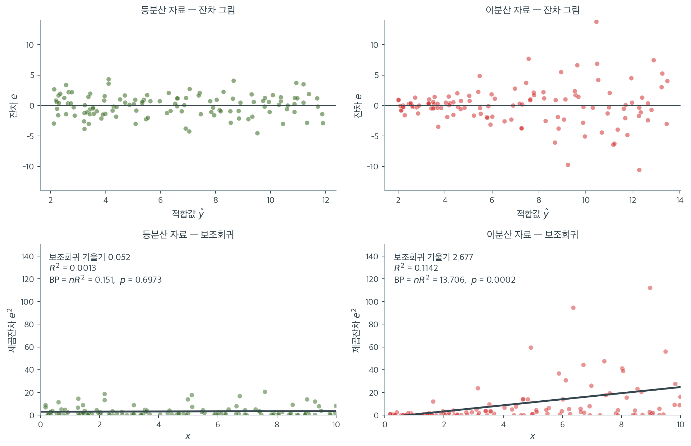
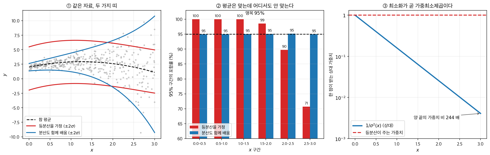

# 회귀에서의 분산 검정

선형회귀는 오차항이 설명변수의 모든 수준에서 일정한 분산을 갖는다고 가정한다. 곧 모든 $i$에 대해 $\operatorname{Var}(\varepsilon_i) = \sigma^2$이다. 이 가정을 **등분산성**이라 한다. 이것이 무너져 오차의 분산이 설명변수 값이나 적합값에 의존하면 **이분산**이라 부른다. 이 절은 회귀 잔차에서 이분산을 탐지하는 형식적 검정들을 다루고 이분산을 무시했을 때의 결과를 논한다.

---

## 1. 이분산이 왜 문제인가

선형회귀모형

$$
Y_i = \beta_0 + \beta_1 X_{i1} + \cdots + \beta_p X_{ip} + \varepsilon_i
$$

에서 OLS 추정량 $\hat{\boldsymbol{\beta}}$는 이분산 아래에서도 불편이고 일치성을 갖는다. 그러나 두 가지 중요한 문제가 생긴다.

1. **비효율성.** OLS가 더 이상 최량선형불편추정량(BLUE)이 아니다. 가중최소제곱(WLS)이나 일반화최소제곱(GLS)이 더 효율적인 추정값을 낼 수 있다.
2. **무효한 추론.** OLS가 계산하는 표준오차는 일정한 분산을 가정한다. 이분산 아래에서 이 표준오차가 편향되어 회귀계수의 $t$ 통계량, $p$값, 신뢰구간이 모두 틀리게 된다.

**두 번째가 훨씬 심각하다.** 계수 추정값 자체는 여전히 옳으므로 "얼마나 큰 효과인가"에 대한 답은 유지되지만, "그 효과가 통계적으로 유의한가"에 대한 답이 무너진다.

---

## 2. 시각적 탐지

형식적 검정을 적용하기 전에 잔차를 적합값 $\hat{Y}_i$에 대해 그린다.

- **등분산 패턴:** 잔차가 0 주위에서 대략 일정한 띠를 이룬다.
- **이분산 패턴:** 잔차의 산포가 $\hat{Y}_i$에 따라 체계적으로 커지거나 작아진다. 흔한 패턴으로 깔때기 모양(적합값에 따라 산포 증가)과 나비넥타이 모양(산포가 커졌다가 작아짐)이 있다.

---

## 3. Breusch-Pagan 검정

Breusch-Pagan(1979) 검정은 이분산에 대해 가장 널리 쓰이는 형식적 검정이다. 제곱잔차가 설명변수와 관련되어 있는지 검정한다.

**절차:**

**1단계.** 회귀모형을 적합하고 OLS 잔차 $e_i = Y_i - \hat{Y}_i$를 얻는다.

**2단계.** 제곱잔차 $e_i^2$을 원래의 설명변수 $X_{i1}, \ldots, X_{ip}$에 회귀시킨다.

$$
e_i^2 = \gamma_0 + \gamma_1 X_{i1} + \cdots + \gamma_p X_{ip} + u_i
$$

**3단계.** 이 보조회귀의 $R^2$에 $n$을 곱한 값을 검정통계량으로 삼는다.

$$
\text{BP} = n \cdot R^2_{\text{aux}}
$$

**4단계.** $H_0\colon$ 등분산 아래에서 이 통계량은 근사적으로 카이제곱분포를 따른다.

$$
\text{BP} \sim \chi^2_p
$$

여기서 $p$는 보조회귀의 설명변수 개수이다.

**가설:**

$$
H_0\colon \operatorname{Var}(\varepsilon_i) = \sigma^2 \text{ (일정)}
$$

$$
H_1\colon \operatorname{Var}(\varepsilon_i) = h(X_{i1}, \ldots, X_{ip}) \text{ (설명변수에 의존)}
$$

$\text{BP} > \chi^2_{1-\alpha,\, p}$이면 $H_0$을 기각한다.

이 네 단계가 실제로 무엇을 보는지 등분산 자료와 이분산 자료에 나란히 적용해 보았다. 두 자료 모두 $n = 120$이고 참 회귀식은 $y = 2 + x$로 같다. 다른 것은 오차의 표준편차뿐이다(왼쪽은 $2.0$으로 일정, 오른쪽은 $0.4 + 0.5x$).



위 두 칸이 1단계의 잔차다. 왼쪽은 적합값과 무관하게 일정한 띠를 이루고, 오른쪽은 오른쪽으로 갈수록 벌어지는 **깔때기 모양**이다. 눈으로도 구별되지만 "얼마나 벌어져야 문제인가"에는 답하지 못한다. 형식적 검정이 필요한 이유다.

아래 두 칸이 2–3단계다. 제곱잔차 $e^2$을 $x$에 회귀시킨 결과인데, **이 보조회귀의 기울기가 곧 "분산이 $x$에 의존하는가"라는 질문 자체**다. 등분산 자료에서 기울기는 $0.052$로 사실상 0이고 $R^2 = 0.0013$이다. 이분산 자료에서는 기울기가 $2.677$이고 $R^2 = 0.1142$이다.

검정통계량은 이 $R^2$에 $n$을 곱한 것뿐이다. $\text{BP} = 120 \times 0.0013 = 0.151$ ($p = 0.697$)과 $\text{BP} = 120 \times 0.1142 = 13.706$ ($p = 0.0002$). 앞쪽은 기각하지 못하고 뒤쪽은 강하게 기각한다. **$n$을 곱하는 이유도 여기서 보인다.** 같은 $R^2$이라도 관측값이 많을수록 그 관계가 우연일 가능성이 줄어들기 때문이다.

한 가지 유의할 점. 이분산 자료의 $R^2$이 $0.114$에 불과하다는 사실을 보라. 제곱잔차는 그 자체로 변동이 매우 크므로 **뚜렷한 이분산에서도 보조회귀의 설명력은 낮게 나온다.** $R^2$이 작다고 이분산이 약한 것이 아니다. 판정은 $R^2$이 아니라 $n R^2$과 카이제곱 기준으로 해야 한다.

!!! warning "원래의 Breusch-Pagan 검정은 정규성을 요구한다"
    Breusch와 Pagan의 원래 검정통계량은 오차의 정규성을 가정하며, 이 장에서 반복해 본 대로 그 가정이 깨지면 크기가 왜곡된다.

    위에 제시한 $n \cdot R^2$ 형태는 Koenker(1981)의 **스튜던트화 판**으로, 정규성 없이도 타당하다. `statsmodels`의 `het_breuschpagan`은 두 값을 모두 반환하며(`lm` 통계량과 `fvalue`), 실무에서는 스튜던트화 판을 쓰는 것이 표준이다.

---

## 4. White 검정

White(1980)는 이분산의 함수 형태를 지정할 필요가 없는 더 일반적인 검정을 제안했다. $e_i^2$을 원래 설명변수에만 회귀시키는 대신 그 제곱항과 교차항까지 포함한다.

**White 검정의 보조회귀:**

$$
e_i^2 = \gamma_0 + \sum_{j=1}^{p}\gamma_j X_{ij} + \sum_{j=1}^{p}\gamma_{jj} X_{ij}^2 + \sum_{j<l}\gamma_{jl} X_{ij} X_{il} + u_i
$$

검정통계량은 다시 $n \cdot R^2_{\text{aux}}$이지만 이제 설명변수가 $q$개이다($q$는 원래 설명변수, 그 제곱, 교차항을 모두 포함한다).

$$
\text{W} = n \cdot R^2_{\text{aux}} \sim \chi^2_q
$$

!!! note "Breusch-Pagan과 White"
    Breusch-Pagan 검정은 설명변수의 **선형**함수인 이분산을 탐지한다. White 검정은 **어떤** 함수 형태의 이분산이든 탐지한다. White 검정이 더 일반적이지만 자유도를 더 쓰므로, 이분산이 실제로 선형일 때는 검정력이 떨어질 수 있다.

    설명변수가 많을 때 이 대가가 커진다. $p$개 설명변수에 대해 White 검정의 자유도는 $p(p+3)/2$로 늘어난다. $p = 10$이면 $65$개이므로 검정력이 크게 떨어진다.

---

## 5. Goldfeld-Quandt 검정

Goldfeld-Quandt(1965) 검정은 이분산의 원인으로 의심되는 변수에 따라 자료를 두 집단으로 나눈 뒤 등분산 F 검정을 적용하는 더 단순한 접근이다.

**절차:**

1. 이분산을 일으킨다고 의심되는 설명변수 $X$로 관측값을 정렬한다.
2. 대비를 뚜렷하게 하기 위해 가운데 $c$개 관측값을 제거한다(보통 $c \approx n/5$).
3. 아래 집단과 위 집단에 각각 회귀를 적합한다.
4. 위 집단의 잔차제곱합을 아래 집단의 잔차제곱합으로 나눈 비를 F 통계량으로 삼는다.

$H_0$ 아래에서 이 비는 $F$ 분포를 따른다. Goldfeld-Quandt 검정은 직관적이지만 하나의 설명변수와 관련된 이분산에만 적용된다.

또한 15.3절에서 본 대로 **F 검정은 비정규성에 극도로 민감하므로** Goldfeld-Quandt 검정도 그 취약성을 물려받는다. 실무에서는 Breusch-Pagan(Koenker 판)이나 White 검정이 더 안전하다.

---

## 6. 결과와 대책

이분산이 탐지되면

1. **이분산 일치 표준오차.** 계수 추정값은 바꾸지 않고 이분산 아래에서도 타당한 로버스트 표준오차(White 표준오차 또는 샌드위치 추정량)를 쓴다.

$$
\widehat{\operatorname{Var}}(\hat{\boldsymbol{\beta}}) = (\mathbf{X}'\mathbf{X})^{-1}\left(\sum_{i=1}^{n} e_i^2 \mathbf{x}_i\mathbf{x}_i'\right)(\mathbf{X}'\mathbf{X})^{-1}
$$

2. **가중최소제곱.** 이분산의 형태를 알거나 추정할 수 있으면($\operatorname{Var}(\varepsilon_i) \propto X_i^2$ 등) WLS가 더 효율적인 추정값을 낸다.

3. **분산안정화 변환.** $\ln Y$나 $\sqrt{Y}$ 같은 변환이 분산을 안정시킬 때가 있다.

<div class="exbox" markdown>

**보기 1.** <span class="diff easy" title="쉬움"></span> 이분산 진단과 로버스트 표준오차. $y_i = 3 + 2x_i + \varepsilon_i$에서 $\varepsilon_i = x_i z_i$, $z_i \overset{\text{iid}}{\sim} N(0,1)$으로 두어 $\operatorname{Var}(\varepsilon_i) = x_i^2$이 되게 한다. $x_i \sim U(1,10)$, $n = 100$이다.

**(1)** 참 공분산행렬 $\operatorname{Var}(\hat{\boldsymbol\beta}) = (\mathbf{X}'\mathbf{X})^{-1}\mathbf{X}'\boldsymbol\Omega\mathbf{X}(\mathbf{X}'\mathbf{X})^{-1}$에 이 자료의 $\boldsymbol\Omega$를 넣어, **모수를 하나도 추정하지 않고** 참 표준오차를 설계행렬만으로 계산하시오. OLS 공식 $s^2(\mathbf{X}'\mathbf{X})^{-1}$이 겨누는 값도 구해 두 값의 비를 적으시오.

**(2)** 오차만 다시 뽑아 반복하여 ① 계수가 불편인지 ② 어느 표준오차가 참값을 맞히는지 ③ 명목 $95\%$ 구간의 실제 포함률을 재시오. 절편과 기울기에서 **어긋나는 방향이 서로 반대**임을 확인하시오.

</div>

??? success "풀이"

    **(1) 참값은 설계행렬만으로 정해진다.** $\hat{\boldsymbol\beta} = (\mathbf{X}'\mathbf{X})^{-1}\mathbf{X}'\mathbf{Y}$에 $\mathbf{Y} = \mathbf{X}\boldsymbol\beta + \boldsymbol\varepsilon$을 넣으면

    $$
    \hat{\boldsymbol\beta} - \boldsymbol\beta = (\mathbf{X}'\mathbf{X})^{-1}\mathbf{X}'\boldsymbol\varepsilon
    $$

    이다. $E[\boldsymbol\varepsilon \mid \mathbf{X}] = \mathbf{0}$이므로 **이 줄에서 이미 불편성이 끝난다.** 오차의 분산 구조가 어떻든 상관없다. 분산을 재면

    $$
    \operatorname{Var}(\hat{\boldsymbol\beta} \mid \mathbf{X})
    = (\mathbf{X}'\mathbf{X})^{-1}\mathbf{X}' \boldsymbol\Omega \mathbf{X} (\mathbf{X}'\mathbf{X})^{-1},
    \qquad \boldsymbol\Omega = \operatorname{Var}(\boldsymbol\varepsilon \mid \mathbf{X})
    $$

    이고, 이 자료에서는 $\varepsilon_i = x_i z_i$이므로

    $$
    \boldsymbol\Omega = \operatorname{diag}(x_1^2, \ldots, x_n^2)
    $$

    으로 **완전히 알려져 있다.** 그러므로 참 표준오차를 추정 없이 수로 적을 수 있다. 단순회귀에서는 손으로도 쓸 수 있다.

    $$
    \operatorname{Var}(\hat\beta_1 \mid \mathbf{X}) = \frac{\sum_i (x_i - \bar x)^2 x_i^2}{\left[\sum_i (x_i-\bar x)^2\right]^2}
    $$

    **OLS 공식이 겨누는 값은 다르다.** OLS는 $\boldsymbol\Omega = \sigma^2\mathbf{I}$로 믿고 $\sigma^2$을 $s^2 = \mathbf{e}'\mathbf{e}/(n-2)$로 추정한다. $\mathbf{e} = (\mathbf{I}-\mathbf{H})\boldsymbol\varepsilon$이므로

    $$
    E[\mathbf{e}'\mathbf{e}] = E[\boldsymbol\varepsilon'(\mathbf{I}-\mathbf{H})\boldsymbol\varepsilon] = \operatorname{tr}\!\left[(\mathbf{I}-\mathbf{H})\boldsymbol\Omega\right]
    \quad\Longrightarrow\quad
    E[s^2] = \frac{1}{n-2}\sum_i (1-h_{ii})\,\sigma_i^2
    $$

    이다. 곧 $s^2$은 $\sigma_i^2$들을 지렛대로 가중한 **평균 하나**로 수렴한다. 등분산이면 $\operatorname{tr}(\mathbf{I}-\mathbf{H}) = n-2$라 정확히 $\sigma^2$이 되지만, 이분산이면 **스칼라 하나로 대각이 다른 $\boldsymbol\Omega$를 흉내 내야 한다.**

    여기에 문제의 핵심이 있다. OLS 표준오차는 참 표준오차에 **공통 배수**를 곱한 꼴

    $$
    \widehat{\operatorname{SE}}_{\text{OLS}}(\hat\beta_j) \;\approx\; \sqrt{E[s^2]\cdot\left[(\mathbf{X}'\mathbf{X})^{-1}\right]_{jj}}
    $$

    인데 참값은 $\sqrt{\left[(\mathbf{X}'\mathbf{X})^{-1}\mathbf{X}'\boldsymbol\Omega\mathbf{X}(\mathbf{X}'\mathbf{X})^{-1}\right]_{jj}}$이다. **고를 수 있는 수가 하나뿐이므로 여러 계수를 동시에 맞힐 수 없고, 어느 쪽으로 틀릴지도 정해져 있지 않다.** 연습문제 2 가 지렛대와 잔차의 상관으로 설명한 것이 이 대수의 내용이다.

    **(2) 수치로 확인한다.** 설계행렬 $\mathbf{X}$는 보기의 것을 그대로 고정하고 오차만 4000번 다시 뽑는다. $\mathbf{X}$를 고정하는 것은 위의 모든 식이 $\mathbf{X}$에 조건을 건 식이기 때문이다.

    ```python
    import numpy as np
    from scipy import stats
    import statsmodels.api as sm
    from statsmodels.stats.diagnostic import het_breuschpagan, het_white

    rng = np.random.default_rng(42)
    n = 100
    X = rng.uniform(1, 10, size=n)

    # 잡음에 X 를 곱해 분산이 X 에 비례해 커지도록 만든다. 전형적인 이분산이다.
    epsilon = rng.normal(0, 1, size=n) * X
    Y = 3 + 2 * X + epsilon

    X_with_const = sm.add_constant(X)
    model = sm.OLS(Y, X_with_const).fit()
    residuals = model.resid

    # Breusch-Pagan 은 분산이 설명변수의 선형함수로 커지는 경우를 잘 잡는다.
    bp_stat, bp_p, bp_f, bp_fp = het_breuschpagan(residuals, X_with_const)
    print(f"Breusch-Pagan: LM = {bp_stat:.4f}, p = {bp_p:.6f}")

    # White 는 제곱항과 교차항까지 넣어 비선형 형태의 이분산도 잡는다.
    w_stat, w_p, w_f, w_fp = het_white(residuals, X_with_const)
    print(f"White:         LM = {w_stat:.4f}, p = {w_p:.6f}")

    # 이분산이 있어도 계수 추정값 자체는 여전히 불편이다. 망가지는 것은
    # 표준오차다. HC3 로버스트 표준오차는 이분산을 셈에 넣어 계산하므로,
    # 모형을 바꾸지 않고도 추론을 바로잡을 수 있다.
    # 아래 출력에서 계수는 그대로이고 표준오차와 t 값만 달라지는 것을 본다.
    robust_model = model.get_robustcov_results(cov_type='HC3')
    print(f"\ncoefficients:      {np.round(model.params, 4)}")
    print(f"OLS std errors:    {np.round(model.bse, 4)}")
    print(f"Robust std errors: {np.round(robust_model.bse, 4)}")
    print(f"OLS t-values:      {np.round(model.tvalues, 3)}")
    print(f"Robust t-values:   {np.round(robust_model.tvalues, 3)}")
    ```

    출력:

    ```text
    Breusch-Pagan: LM = 14.2174, p = 0.000163
    White:         LM = 14.7165, p = 0.000637

    coefficients:      [3.1523 1.9672]
    OLS std errors:    [1.5014 0.254 ]
    Robust std errors: [1.0664 0.2719]
    OLS t-values:      [2.1   7.746]
    Robust t-values:   [2.956 7.235]
    ```

    두 검정 모두 이분산을 강하게 탐지한다($p = 0.00016$과 $p = 0.00064$). 자료를 $\operatorname{Var}(\varepsilon_i) \propto X_i^2$이 되도록 생성했으므로 당연한 결과이다. 그런데 **이 한 벌만 보면 어느 표준오차가 옳은지 알 수 없다.** $1.5014$와 $1.0664$ 가운데 무엇이 참값에 가까운가. (1)의 식과 반복추출이 그 답을 준다.

    ```python
    import numpy as np
    from scipy import stats
    import statsmodels.api as sm

    # 위 보기의 설계행렬을 그대로 쓴다. X 는 고정하고 오차만 다시 뽑는다.
    rng = np.random.default_rng(42)
    n = 100
    X = rng.uniform(1, 10, size=n)
    Xc = sm.add_constant(X)

    # (1) 참 공분산행렬을 설계행렬만으로 정확히 계산한다.
    #     Var(eps_i) = X_i^2 이므로 Omega = diag(X^2) 다. 모수 추정이 전혀 없다.
    XtX_inv = np.linalg.inv(Xc.T @ Xc)
    Omega = np.diag(X ** 2)
    V_true = XtX_inv @ Xc.T @ Omega @ Xc @ XtX_inv
    se_true = np.sqrt(np.diag(V_true))

    # OLS 공식이 겨누는 값:  sigma^2 (X'X)^-1 에서 sigma^2 을 s^2 으로 바꾼 것.
    # E[s^2] = tr((I-H) Omega)/(n-2) 이므로 그것을 넣는다.
    H = Xc @ XtX_inv @ Xc.T
    Es2 = np.trace((np.eye(n) - H) @ Omega) / (n - 2)
    se_ols_target = np.sqrt(Es2 * np.diag(XtX_inv))

    print(f"참 표준오차 (샌드위치)      : {np.round(se_true, 4)}")
    print(f"OLS 공식이 겨누는 값        : {np.round(se_ols_target, 4)}   (E[s^2] = {Es2:.3f})")
    print(f"비 (OLS 겨냥 / 참)          : {np.round(se_ols_target / se_true, 4)}")

    # (2) 4000 번 반복해 실제 표준편차·표준오차·포함률을 잰다.
    R = 4000
    beta = np.array([3.0, 2.0])
    rng2 = np.random.default_rng(7)
    b = np.empty((R, 2))
    se_o = np.empty((R, 2))
    se_r = np.empty((R, 2))
    for r in range(R):
        Y = beta[0] + beta[1] * X + rng2.normal(0, 1, n) * X
        m = sm.OLS(Y, Xc).fit()
        b[r] = m.params
        se_o[r] = m.bse
        se_r[r] = m.get_robustcov_results(cov_type="HC3").bse

    print(f"\n반복 {R} 회 (X 고정, 오차만 다시 뽑음)")
    print(f"계수의 평균                 : {np.round(b.mean(axis=0), 4)}   참값 [3. 2.]")
    print(f"계수의 평균 - 참값          : {np.round(b.mean(axis=0) - beta, 4)}"
          f"   (몬테카를로 표준오차 {np.round(b.std(axis=0, ddof=1) / np.sqrt(R), 4)})")
    print(f"계수의 실제 표준편차        : {np.round(b.std(axis=0, ddof=1), 4)}")
    print(f"  참 표준오차 (1)           : {np.round(se_true, 4)}")
    print(f"OLS 표준오차의 평균         : {np.round(se_o.mean(axis=0), 4)}")
    print(f"HC3 표준오차의 평균         : {np.round(se_r.mean(axis=0), 4)}")

    t = stats.t(n - 2).ppf(0.975)
    for name, se in [("OLS", se_o), ("HC3", se_r)]:
        cov = np.mean(np.abs(b - beta) <= t * se, axis=0)
        print(f"명목 95% 구간의 포함률 ({name})  : {np.round(cov, 4)}")
    ```

    출력:

    ```text
    참 표준오차 (샌드위치)      : [1.0367 0.2543]
    OLS 공식이 겨누는 값        : [1.4257 0.2412]   (E[s^2] = 34.913)
    비 (OLS 겨냥 / 참)          : [1.3752 0.9481]

    반복 4000 회 (X 고정, 오차만 다시 뽑음)
    계수의 평균                 : [2.9915 2.0019]   참값 [3. 2.]
    계수의 평균 - 참값          : [-0.0085  0.0019]   (몬테카를로 표준오차 [0.0165 0.0041])
    계수의 실제 표준편차        : [1.0404 0.2565]
      참 표준오차 (1)           : [1.0367 0.2543]
    OLS 표준오차의 평균         : [1.4176 0.2398]
    HC3 표준오차의 평균         : [1.0434 0.2547]
    명목 95% 구간의 포함률 (OLS)  : [0.9922 0.937 ]
    명목 95% 구간의 포함률 (HC3)  : [0.952  0.9452]
    ```

    **① 계수는 불편이다.** 평균이 $(2.9915,\ 2.0019)$로 참값 $(3, 2)$에서 $(-0.0085,\ 0.0019)$만큼 떨어져 있고, 몬테카를로 표준오차가 $(0.0165,\ 0.0041)$이다. 두 편차 모두 **한 표준오차 안**이라 $0$과 구별되지 않는다. 이분산이 뚜렷한 자료인데도 그렇다. (1)의 한 줄 유도가 말한 대로다.

    **② 참값을 맞히는 것은 HC3 뿐이다.** 반복추출로 잰 $\hat\beta$의 실제 표준편차가 $(1.0404,\ 0.2565)$이고 (1)이 설계행렬만으로 계산한 참 표준오차가 $(1.0367,\ 0.2543)$이다. **모수 추정 없이 적은 식이 모의실험과 소수 셋째 자리까지 맞는다.** 그리고

    | | 절편 | 기울기 |
    |:---|---:|---:|
    | 참 표준오차 | $1.0367$ | $0.2543$ |
    | OLS 표준오차의 평균 | $1.4176$ | $0.2398$ |
    | HC3 표준오차의 평균 | $1.0434$ | $0.2547$ |

    **HC3 는 두 계수 모두 맞히고 OLS 는 두 계수 모두 틀린다.** (1)에서 예측한 OLS 의 겨냥값 $(1.4257,\ 0.2412)$도 관측된 평균 $(1.4176,\ 0.2398)$과 맞는다(제곱근을 먼저 취해 평균하므로 Jensen 부등식으로 조금 작게 나온다).

    **③ 어긋나는 방향이 서로 반대다.** 비 $(1.3752,\ 0.9481)$이 그 말이다. OLS 는 **절편의 표준오차를 $38\%$ 과대**, **기울기의 표준오차를 $5\%$ 과소**평가한다. 그 결과 포함률이

    - OLS: 절편 $0.9922$(과대포함, 구간이 너무 넓다), 기울기 $0.9370$(과소포함, 구간이 너무 좁다)
    - HC3: 절편 $0.9520$, 기울기 $0.9452$ — 둘 다 명목 $0.95$

    가 된다. **같은 자료, 같은 적합인데 한 계수는 지나치게 보수적이고 다른 계수는 지나치게 자신만만하다.** (1)에서 본 대로 OLS 에는 고를 수 있는 수가 $E[s^2] = 34.913$ 하나뿐이므로 두 계수를 동시에 맞힐 길이 없다. 아래 상자와 연습문제 2 가 그 방향이 왜 계수마다 다른지를 지렛대로 설명한다.

    **그러므로 "로버스트 표준오차는 보수적"이 아니라 "로버스트 표준오차는 옳다"가 맞는 말이다.** 기울기에서는 커지고 절편에서는 작아졌는데, 두 변화 모두 참값 쪽으로의 이동이었다.

!!! note "로버스트 표준오차가 항상 커지는 것은 아니다"
    흔한 오해는 "로버스트 표준오차는 OLS보다 크다"는 것이다. 위 출력에서 **절편의 표준오차는 오히려 줄었다**($1.501 \to 1.066$). 기울기의 표준오차만 커졌다($0.254 \to 0.272$).

    이유는 이분산의 **패턴**에 있다. 여기서 분산이 $X$에 따라 커지므로, $X$가 작은(따라서 절편 추정에 영향력이 큰) 관측값들은 오히려 잔차가 작다. OLS는 모든 관측값이 같은 분산을 갖는다고 가정하여 이 정보를 버리므로 절편의 불확실성을 **과대추정**한다.

    결과적으로 절편의 $t$ 값이 $2.10$에서 $2.96$으로 **커진다**. 로버스트 표준오차를 쓰면 유의성이 오히려 강해질 수 있다는 뜻이다. "로버스트 = 보수적"이라는 도식은 틀렸다.

<div class="aibox" markdown>

**AI로 보는 통계학 1.** 분산을 검정하지 않고 예측한다

이 쪽의 절차는 한 줄로 요약된다 — **등분산을 가정하고, 그것을 검정하고, 깨지면 고친다.**
$6$ 절의 대책 셋(로버스트 표준오차·가중최소제곱·변수변환)이 그 「고친다」이다.

요즘 모형은 네 번째 길로 간다. 분산을 **가정이나 검정의 대상이 아니라 모형의 출력**으로
삼는 것이다. $x$ 를 받아 $\mu(x)$ 하나를 내놓는 대신 $\mu(x)$ 와 $\sigma(x)$ **둘을**
내놓게 하고, 가우스 음의 로그가능도를 최소화한다.

$$
\mathcal{L} \;=\; \frac{1}{n}\sum_{i=1}^{n}
\left[
\frac{\bigl(y_i - \mu(x_i)\bigr)^2}{2\,\sigma^2(x_i)}
\;+\;
\frac{1}{2}\log \sigma^2(x_i)
\right]
$$

새 발명이 아니다. **닉스와 바이겐트**가 $1994$ 년에 신경망의 출력 단위를 하나 더 달아
평균과 분산을 함께 내놓게 한 것이 이 꼴이고, 「**우연적 불확실성**(aleatoric)」이라는
이름으로 널리 퍼진 것은 켄들과 갈의 $2017$ 년 논문 뒤다. 자료 자체에 들어 있어
**자료를 더 모아도 줄지 않는** 흩어짐을 가리킨다.

<figure markdown>
{ width="960" }
  <figcaption markdown>가운데 칸의 붉은 막대 여섯 개를 평균하면 $93.2\%$ 다. **평균은 그럴듯한데 어느 구간에서도 맞지 않는다.**</figcaption>
</figure>

왼쪽 칸의 자료는 흩어짐이 $x$ 에 따라 $0.30$ 에서 $4.48$ 로 **$15$ 배** 커진다. 등분산을
가정한 띠는 평행하게 나아가므로 왼쪽에서는 너무 넓고 오른쪽에서는 너무 좁다. 가운데 칸이
그 대가다.

| $x$ 구간 | 등분산을 가정 | 분산도 함께 배움 |
|---|---:|---:|
| $0.0$–$0.5$ | $100.0\%$ | $94.9\%$ |
| $1.0$–$1.5$ | $100.0\%$ | $95.0\%$ |
| $2.0$–$2.5$ | $89.7\%$ | $95.1\%$ |
| $2.5$–$3.0$ | $\mathbf{70.7\%}$ | $95.0\%$ |
| **전체** | $93.2\%$ | $95.0\%$ |

$95\%$ 라고 적어 놓은 구간이 어떤 자리에서는 $100\%$ 를, 다른 자리에서는 $71\%$ 를
담는다. 이 모양은 이 책이 [웰치 구간의 조건부 포함확률](../../ch05/applications/diff_means_welch.md)에서
이미 한 번 만난 것이다 — **전체 평균이 맞는 것과 지금 이 자리에서 맞는 것은 다른 말이다.**

오른쪽 칸이 통계학 쪽에서 보면 가장 중요한 그림이다. 위 식을 $\mu$ 에 대해 미분하면
첫째 항만 남고, 그 항은 각 점에 **$1/\sigma^2(x_i)$ 의 가중치**를 매긴 제곱오차다. 곧
**음의 로그가능도를 최소화하는 일이 곧 가중최소제곱**이고, $6$ 절의 「가중최소제곱」이
하는 일과 글자까지 같다. 다른 것은 가중치를 사람이 정해 주느냐 자료에서 함께 배우느냐
뿐이다. 이 자료에서 양 끝의 가중치 비가 **$244$ 배**다.

둘째 항 $\tfrac12\log\sigma^2$ 이 없으면 어떻게 되는지도 식에서 읽힌다. 그 항이 없으면
$\sigma$ 를 무한히 키워 손실을 $0$ 으로 만들 수 있다. 로그 항이 그것을 막는 **대가**이고,
두 항이 맞물려 **자기가 믿는 만큼만 넓게 말하는 것이 최적**이 된다 —
[적정 점수규칙](../../ch19/evaluation/calibration.md)에서 본 구조가 여기서도 그대로다.

마지막으로 한계 하나. 이 길은 가중치를 자료에서 배우므로, **어려운 점에 큰 $\sigma$ 를
주어 가중치를 낮추는 것**으로도 손실을 줄일 수 있다. 오른쪽 칸의 곡선이 그 유인을 그대로
보여 준다 — 오른쪽 끝의 점들은 $\mu$ 를 맞히는 데 거의 기여하지 못한다. 분산을 출력으로
삼는 순간, 모형이 **포기한 자리**와 **정말로 시끄러운 자리**를 사람이 구별해 주어야 한다.

_확인한 곳 — 닉스와 바이겐트의 「Estimating the mean and variance of the target probability distribution」(IEEE 국제신경망학회 논문집, $1994$, $1$ 권 $55$–$60$ 쪽)이 출력 단위를 하나 더 달아 평균과 분산을 함께 내놓고 음의 로그가능도를 최소화하는 꼴을 세운 것, 켄들과 갈의 「What uncertainties do we need in Bayesian deep learning for computer vision?」(NIPS, $2017$)이 **우연적**(aleatoric)과 **인식적**(epistemic) 불확실성을 가르고 앞의 것을 이분산 로그가능도로 모형화한 것. 표와 그림의 수는 모두 직접 모의실험한 값이다_

</div>


---

<div class="exbox" markdown>

**보기 2.** <span class="diff easy" title="쉬움"></span> 회귀에서의 등분산 검정. $n = 10$짜리 자료에 `Y ~ X`를 적합하고 `het_breuschpagan` 으로 Breusch-Pagan 검정을 돌린다.

**(1)** 이 함수가 돌려주는 LM 통계량과 F 통계량이 **제곱잔차를 설명변수에 회귀시킨 보조회귀**의 $nR^2$과 $F$임을 밝히고, 두 수를 $R^2$ 하나로부터 손으로 조립해 함수의 값과 맞추시오. `robust=False`로 바뀌는 것은 무엇인가.

**(2)** 두 판본의 **실제 크기**를 등분산 자료에서 $n = 10, 50, 200$으로 재고, 어느 쪽이 표본을 키워 고쳐지고 어느 쪽이 고쳐지지 않는지 밝히시오. 또 $n = 10$에서 검정력이 얼마인지 재어 본문의 $p = 0.777$을 어떻게 읽어야 하는지 결론하시오.

</div>

??? success "풀이"

    **(1) 보조회귀 하나가 전부다.** 원래 회귀 $y_i = \beta_0 + \beta_1 x_i + \varepsilon_i$의 OLS 잔차를 $e_i$라 하자. 등분산이면 $E[\varepsilon_i^2]$이 $x_i$와 무관해야 하므로, 제곱잔차를 설명변수에 회귀시켜

    $$
    e_i^2 = \gamma_0 + \gamma_1 x_i + u_i
    $$

    의 기울기가 $0$인지 보면 된다. 이 **보조회귀**의 결정계수를 $R_{\text{aux}}^2$, 설명변수 개수를 $k$라 하면 코엔커(1981)의 **스튜던트화 BP 통계량**은

    $$
    \text{LM} = n R_{\text{aux}}^2 \;\xrightarrow{\;d\;}\; \chi^2_k \quad (H_0 \text{ 아래})
    $$

    이고, F 판본은 그 보조회귀 자체의 F 통계량

    $$
    F = \frac{R_{\text{aux}}^2/k}{(1-R_{\text{aux}}^2)/(n-k-1)} \;\sim\; F_{k,\; n-k-1}
    $$

    이다. **둘 다 $R_{\text{aux}}^2$ 하나의 함수**이므로, $R_{\text{aux}}^2$만 알면 두 수를 손으로 적을 수 있다. 여기서는 $k = 1$, $n = 10$이다.

    `robust=False`로 바꾸면 **원래 Breusch-Pagan(1979)** 통계량이 나온다. 그쪽은 제곱잔차를 $\hat\sigma^2 = \frac1n\sum e_i^2$으로 나눈 $g_i = e_i^2/\hat\sigma^2$을 설명변수에 회귀시킨 뒤 설명제곱합의 절반

    $$
    \text{BP} = \tfrac12 \,\text{ESS}_g \;\xrightarrow{\;d\;}\; \chi^2_k
    $$

    을 쓴다. **$\chi^2_k$ 극한이 오차의 정규성에 기대고 있다는 것이 이 판본의 약점**이고, 코엔커 판본은 $\hat\sigma^2$ 대신 $g$의 실제 표본분산으로 눈금을 맞춰 그 의존을 없앤 것이다. 두 판본이 같은 자료에서 다른 수를 준다.

    **(2) 먼저 함수를 그대로 돌린다.**

    ```python
    import statsmodels.api as sm
    import statsmodels.formula.api as smf
    from statsmodels.stats.diagnostic import het_breuschpagan
    import pandas as pd

    data = pd.DataFrame({
        'X': [1, 2, 3, 4, 5, 6, 7, 8, 9, 10],
        'Y': [2, 4, 6, 8, 10, 9, 15, 16, 18, 20]
    })

    model = smf.ols('Y ~ X', data=data).fit()

    # 회귀에서 등분산성은 잔차의 퍼짐이 적합값에 따라 달라지지 않는다는 가정이다.
    # Breusch-Pagan 은 잔차의 제곱을 설명변수에 회귀해 그 관계를 찾는다.
    lm_stat, lm_p, f_stat, f_p = het_breuschpagan(model.resid, model.model.exog)

    print(f"Breusch-Pagan LM = {lm_stat:.4f}, p = {lm_p:.4f}")
    print(f"Breusch-Pagan F  = {f_stat:.4f}, p = {f_p:.4f}")
    ```

    출력:

    ```text
    Breusch-Pagan LM = 0.0803, p = 0.7769
    Breusch-Pagan F  = 0.0648, p = 0.8055
    ```

    **이제 (1)을 손으로 조립해 맞추고, 두 판본의 크기와 검정력을 잰다.**

    ```python
    import numpy as np
    import statsmodels.api as sm
    from scipy import stats

    # --- (1) 손으로 조립해 het_breuschpagan 과 맞춘다. 위 model 을 이어받는다. ---
    e = model.resid.values
    X = model.model.exog                       # [1, x]
    n, k = len(e), X.shape[1] - 1

    aux = sm.OLS(e ** 2, X).fit()              # 보조회귀: e^2 을 x 에 회귀
    R2 = aux.rsquared
    lm_sm, p_lm, f_sm, p_f = het_breuschpagan(model.resid, X)

    print(f"보조회귀 R^2  = {R2:.8f}")
    print(f"n R^2 (손)    = {n * R2:.8f}      LM  (statsmodels) = {lm_sm:.8f}")
    F_hand = (R2 / k) / ((1 - R2) / (n - k - 1))
    print(f"F     (손)    = {F_hand:.8f}      F   (statsmodels) = {f_sm:.8f}")
    print(f"p(chi2_{k})     = {stats.chi2.sf(n * R2, k):.6f}      p   (statsmodels) = {p_lm:.6f}")
    print(f"p(F({k},{n - k - 1}))     = {stats.f.sf(F_hand, k, n - k - 1):.6f}      p   (statsmodels) = {p_f:.6f}")

    # 정규성을 쓰는 원래 BP(1979) 는 robust=False 다. (1/2)*ESS of e^2/sigmahat^2
    sig2 = (e ** 2).mean()
    g = e ** 2 / sig2
    ess0 = ((sm.OLS(g, X).fit().fittedvalues - g.mean()) ** 2).sum()
    print(f"\n원래 BP = ESS/2 = {ess0 / 2:.8f}      robust=False  = "
          f"{het_breuschpagan(model.resid, X, robust=False)[0]:.8f}")


    # --- (2) 두 판본의 크기와 검정력을 모의실험으로 잰다 ---
    def bp_both(E, X):
        """E: (R,n) 잔차.  (코엔커 nR^2, 원래 BP) 를 한꺼번에."""
        R, n = E.shape
        P = X @ np.linalg.pinv(X)
        G = E ** 2
        Gc = G - G.mean(axis=1, keepdims=True)
        ess = ((Gc @ P.T) ** 2).sum(axis=1)     # 중심화한 g 의 사영 제곱합 = ESS
        tss = (Gc ** 2).sum(axis=1)
        return n * ess / tss, 0.5 * ess / G.mean(axis=1) ** 2


    def size_power(n, R, dist, slope, seed):
        rng = np.random.default_rng(seed)
        x = np.linspace(1, 10, n)
        X = np.column_stack([np.ones(n), x])
        if dist == "Normal":
            u = rng.normal(size=(R, n))
        elif dist == "t(3)":
            u = rng.standard_t(3, size=(R, n))
        else:                                    # 로그정규를 평균 0, 분산 1 로 표준화
            z = rng.lognormal(0, 1, size=(R, n))
            u = (z - np.exp(0.5)) / np.sqrt((np.e - 1) * np.e)
        y = 2 + x + u * (1 + slope * x)          # slope = 0 이면 등분산
        P = X @ np.linalg.pinv(X)
        lm, bp = bp_both(y - y @ P.T, X)
        return (stats.chi2.sf(lm, 1) < 0.05).mean(), (stats.chi2.sf(bp, 1) < 0.05).mean()


    print("\n등분산 자료에서의 실제 크기 (명목 0.05, 4만 회)")
    print(f"{'n':>5}  {'errors':<8}{'Koenker':>10}{'orig BP':>10}")
    for nn in (10, 50, 200):
        for d in ("Normal", "t(3)", "LogN"):
            a, b = size_power(nn, 40_000, d, 0.0, seed=1)
            print(f"{nn:>5}  {d:<8}{a:>10.4f}{b:>10.4f}")

    print("\n이분산 자료에서의 검정력 (정규오차, sd = 1 + 0.5x)")
    for nn in (10, 30, 100, 300):
        a, b = size_power(nn, 40_000, "Normal", 0.5, seed=2)
        print(f"  n = {nn:>3}:  코엔커 {a:.4f}   원래 BP {b:.4f}")
    ```

    출력:

    ```text
    보조회귀 R^2  = 0.00803084
    n R^2 (손)    = 0.08030838      LM  (statsmodels) = 0.08030838
    F     (손)    = 0.06476684      F   (statsmodels) = 0.06476684
    p(chi2_1)     = 0.776880      p   (statsmodels) = 0.776880
    p(F(1,8))     = 0.805534      p   (statsmodels) = 0.805534

    원래 BP = ESS/2 = 0.23674242      robust=False  = 0.23674242

    등분산 자료에서의 실제 크기 (명목 0.05, 4만 회)
        n  errors     Koenker   orig BP
       10  Normal      0.0580    0.0237
       10  t(3)        0.0663    0.0637
       10  LogN        0.1103    0.1262
       50  Normal      0.0507    0.0463
       50  t(3)        0.0428    0.2449
       50  LogN        0.0523    0.4062
      200  Normal      0.0502    0.0489
      200  t(3)        0.0409    0.3776
      200  LogN        0.0435    0.5475

    이분산 자료에서의 검정력 (정규오차, sd = 1 + 0.5x)
      n =  10:  코엔커 0.1656   원래 BP 0.1189
      n =  30:  코엔커 0.5497   원래 BP 0.6179
      n = 100:  코엔커 0.9913   원래 BP 0.9958
      n = 300:  코엔커 1.0000   원래 BP 1.0000
    ```

    **(1)의 조립이 여덟 자리까지 맞는다.** 보조회귀의 $R_{\text{aux}}^2 = 0.00803084$ 하나에서 $n R^2 = 0.08030838$과 $F = 0.06476684$가 나오고, 둘 다 `het_breuschpagan` 의 값과 소수 여덟째 자리까지 같다. $p$값도 $\chi^2_1$과 $F_{1,8}$에서 각각 $0.776880$과 $0.805534$로 맞는다. **같은 $R^2$을 두 참조분포에 들이댄 것이 LM 과 F 판본의 차이 전부**이고, 그래서 $n = 10$처럼 작은 표본에서 두 $p$값이 $0.78$과 $0.81$로 갈린다. $\chi^2$ 쪽은 $n \to \infty$의 극한이므로 작은 표본에서는 F 쪽이 낫다.

    원래 BP 도 맞는다. 손으로 센 $\tfrac12 \text{ESS}_g = 0.23674242$가 `robust=False` 의 값과 같다. **같은 자료에서 $0.0803$과 $0.2367$, 곧 세 배 차이**다. 어느 판본을 돌렸는지 모르면 통계량을 보고할 수도 없다.

    **(2) 표가 이 장의 주제를 그대로 되풀이한다.** 등분산 자료의 실제 크기를 보라.

    - **코엔커 판본은 $n$을 키우면 고쳐진다.** $n = 10$에서 $0.058$–$0.110$으로 흐트러져 있다가 $n = 50$에서 $0.043$–$0.052$, $n = 200$에서 $0.041$–$0.050$으로 세 오차분포 모두 명목값에 모인다.
    - **원래 BP 는 $n$을 키우면 더 나빠진다.** $t_3$에서 $0.064 \to 0.245 \to 0.378$, 로그정규에서 $0.126 \to 0.406 \to 0.548$이다. 표본을 스무 배 늘리는 동안 거짓 양성률이 다섯 배, 네 배로 올라갔다.

    **이것이 15장이 되풀이해 온 바로 그 실패다.** $F$ 검정과 Bartlett 검정도 같은 일을 하며, 5.10절이 그 극한 오류율이 모집단 첨도만의 함수이고 표본을 키워도 낫지 않음을 유도해 두었다. 분산에 관한 통계량은 네 번째 적률에 기대므로 중심극한정리의 보호를 받지 못한다. 원래 BP 가 정규성 아래에서만 $\chi^2$인 것도 같은 이유이고, 코엔커의 눈금 바꾸기가 그 의존을 끊어 준 것이다. 그러므로 **`het_breuschpagan` 의 기본값 `robust=True` 를 건드리지 말라.**

    **$n = 10$에서는 어느 판본도 쓸 수 없다.** 마지막 표가 그 까닭이다. 오차 표준편차가 $x = 1$에서 $1.5$, $x = 10$에서 $6$으로 **네 배** 벌어지는 뚜렷한 이분산인데도 $n = 10$에서 코엔커의 검정력이 $0.1656$이다. 여섯 번에 한 번만 잡아낸다. 같은 이분산을 $n = 100$에서는 $0.9913$으로 거의 늘 잡는다.

    그러므로 본문 자료의 $p = 0.777$은 **"등분산이다"는 증거가 아니다.** 등분산이어도 $p$가 크고, 네 배짜리 이분산이 있어도 다섯 번 중 네 번은 $p$가 크다. 두 경우를 $n = 10$으로는 구별할 수 없다. 게다가 $n = 10$에서 코엔커의 실제 크기가 정규오차에서조차 $0.058$, 로그정규에서 $0.110$이라 **검정 자체도 아직 눈금이 맞지 않는다.** 이 자료에 대해 할 수 있는 정직한 말은 "판정할 수 없다" 하나뿐이다.

**해석:**

- $p$값이 0.05보다 작으면 귀무가설을 기각하고 이분산이 존재한다고 결론짓는다.
- $p$값이 0.05보다 크면 귀무가설을 기각하지 못하고 잔차가 등분산과 일관된다고 본다.

여기서는 $p = 0.777$로 기각하지 못한다. 다만 $n = 10$으로 매우 작아 검정력이 사실상 없으므로, **"등분산성이 확인되었다"가 아니라 "이 자료로는 판정할 수 없다"**가 옳은 결론이다.
---

## 연습문제

<div class="drillbox" markdown>

**연습문제 1.** <span class="diff med" title="중간"></span>
$\text{BP} = n \cdot R^2_{\text{aux}}$가 왜 $\chi^2_p$을 따르는지 설명하라. 이 형태가 다른 라그랑주 승수 검정과 어떻게 연결되는가?

</div>

??? success "풀이"
    **일반적 결과.** 보조회귀 $Z_i = \gamma_0 + \boldsymbol{\gamma}'\mathbf{X}_i + u_i$에서 $H_0: \boldsymbol{\gamma} = \mathbf{0}$을 검정할 때, $n$개 관측값에 대한 라그랑주 승수(스코어) 검정통계량은

    $$
    \text{LM} = n R^2 \stackrel{d}{\to} \chi^2_p
    $$

    이다. 여기서 $R^2$은 보조회귀의 결정계수이고 $p$는 검정하는 계수의 개수이다.

    **직관.** $R^2$은 $Z_i$의 변동 중 $\mathbf{X}_i$가 설명하는 비율이다. $H_0$이 참이면 $\mathbf{X}_i$가 아무것도 설명하지 못하므로 $R^2 \approx 0$이고, $nR^2$이 작다. 관계가 있으면 $R^2$이 커지고 $nR^2$도 커진다.

    $n$을 곱하는 이유는 $R^2$ 자체가 표본크기와 무관한 비율이기 때문이다. 같은 $R^2 = 0.1$이라도 $n = 20$에서는 우연일 수 있지만 $n = 1000$에서는 확실한 신호이다. $nR^2$이 그 차이를 반영한다.

    **다른 LM 검정과의 연결.** 같은 $nR^2$ 형태가 여러 진단검정에 등장한다.

    | 검정 | 보조회귀의 종속변수 | 설명변수 |
    |---|---|---|
    | Breusch-Pagan | $e_i^2$ | 원래 설명변수 |
    | White | $e_i^2$ | 설명변수 + 제곱 + 교차항 |
    | Breusch-Godfrey (자기상관) | $e_i$ | 설명변수 + 시차잔차 $e_{i-1},\ldots$ |
    | ARCH-LM (조건부 이분산) | $e_i^2$ | 시차 제곱잔차 |

    모두 "잔차(또는 그 제곱)에 아직 설명되지 않은 구조가 남아 있는가"를 묻는 같은 질문의 변형이다. $\square$

<div class="drillbox" markdown>

**연습문제 2.** <span class="diff med" title="중간"></span>
본문 보기에서 로버스트 표준오차를 쓰자 절편의 표준오차가 오히려 **줄었다**. 이 현상을 설명하고, 어떤 상황에서 로버스트 표준오차가 OLS보다 작아지는지 일반화하라.

</div>

??? success "풀이"
    **관찰.** 절편은 $1.501 \to 1.066$(29% 감소), 기울기는 $0.254 \to 0.272$(7% 증가)이다.

    **원인.** 샌드위치 추정량

    $$
    \widehat{\operatorname{Var}}(\hat{\boldsymbol{\beta}}) = (\mathbf{X}'\mathbf{X})^{-1}\left(\sum_i e_i^2 \mathbf{x}_i\mathbf{x}_i'\right)(\mathbf{X}'\mathbf{X})^{-1}
    $$

    은 각 관측값의 실제 잔차 크기 $e_i^2$로 가중한다. OLS는 이를 공통 $s^2$으로 대체한다.

    $$
    \widehat{\operatorname{Var}}_{\text{OLS}}(\hat{\boldsymbol{\beta}}) = s^2 (\mathbf{X}'\mathbf{X})^{-1}.
    $$

    두 값의 차이는 **$e_i^2$과 관측값의 지렛대(leverage) 사이의 상관**으로 결정된다.

    - $e_i^2$이 큰 관측값이 그 계수에 대해 지렛대도 크면 → 로버스트 표준오차가 **커진다**.
    - $e_i^2$이 큰 관측값이 그 계수에 대해 지렛대가 작으면 → 로버스트 표준오차가 **작아진다**.

    **이 예에서.** $\operatorname{Var}(\varepsilon_i) \propto X_i^2$이므로 $X$가 큰 관측값의 잔차가 크다.

    - **기울기**에 대해서는 $X$가 극단적인(작거나 큰) 관측값의 지렛대가 크다. $X$가 큰 쪽에서 잔차도 크므로 양의 상관이 생겨 로버스트 표준오차가 커진다.
    - **절편**에 대해서는 $X$가 **작은** 관측값의 영향력이 크다(외삽 거리가 짧으므로). 그런데 그 관측값들의 잔차는 작다. 음의 상관이 생겨 로버스트 표준오차가 작아진다.

    **일반화.** 로버스트 표준오차는 "OLS보다 보수적인 값"이 아니라 **올바른 값**이다. OLS 표준오차가 참값보다 클 수도 작을 수도 있으며, 로버스트 추정량은 어느 방향이든 바로잡는다.

    실무적 함의: 이분산이 의심되면 로버스트 표준오차를 쓰되, 그것이 자동으로 "더 안전한" 결과를 준다고 기대하지 말라. 유의성이 오히려 강해질 수 있다. $\square$

<div class="drillbox" markdown>

**연습문제 3.** <span class="diff med" title="중간"></span>
설명변수가 $p$개일 때 White 검정의 자유도가 $p(p+3)/2$임을 보이고, 이것이 왜 검정력 문제를 일으키는지 논하라.

</div>

??? success "풀이"
    **자유도 계산.** White 검정의 보조회귀에 들어가는 항(상수 제외)은

    - 원래 설명변수: $p$개
    - 제곱항 $X_j^2$: $p$개
    - 교차항 $X_j X_l$ ($j < l$): $\binom{p}{2} = \frac{p(p-1)}{2}$개

    합계는

    $$
    p + p + \frac{p(p-1)}{2} = 2p + \frac{p^2 - p}{2} = \frac{4p + p^2 - p}{2} = \frac{p(p+3)}{2}.
    $$

    | $p$ | 1 | 2 | 3 | 5 | 10 | 20 |
    |---|---|---|---|---|---|---|
    | White df | 2 | 5 | 9 | 20 | 65 | 230 |
    | BP df | 1 | 2 | 3 | 5 | 10 | 20 |

    (이진 설명변수가 있으면 $X_j^2 = X_j$이므로 그만큼 항이 줄어들고, `statsmodels`는 이런 완전공선 항을 자동으로 제거한다. 본문 보기에서 $p=1$인데 White 자유도가 2인 것이 표와 일치한다.)

    **검정력 문제.** 카이제곱 검정에서 자유도가 커지면 임계값이 커진다.

    $$
    \chi^2_{0.95, 2} = 5.99, \quad \chi^2_{0.95, 20} = 31.4, \quad \chi^2_{0.95, 65} = 84.8.
    $$

    이분산의 신호가 소수의 항에만 집중되어 있다면, 나머지 무의미한 항들이 $R^2$을 거의 올리지 못하면서 임계값만 높인다. 곧 **신호를 잡음으로 희석한다.**

    구체적으로 $p = 10$이면 White 검정은 65개 항을 쓴다. $n = 200$인 자료에서 65개 설명변수의 보조회귀는 그 자체로 과적합 위험이 있고, 검정력이 Breusch-Pagan(자유도 10)보다 크게 떨어진다.

    **실무 지침.**

    - $p$가 작고(3 이하) 이분산의 형태를 모르면 White 검정.
    - $p$가 크거나 이분산이 특정 변수와 관련될 것으로 예상되면 Breusch-Pagan, 또는 의심되는 변수만 넣은 보조회귀.
    - 어느 쪽이든 **탐지 여부와 무관하게 로버스트 표준오차를 기본으로 쓰는 것**이 가장 간단한 해법이다. 이분산이 없으면 로버스트 표준오차가 OLS와 거의 같으므로 잃는 것이 거의 없다. $\square$

<div class="drillbox" markdown>

**연습문제 4.** <span class="diff med" title="중간"></span>
Goldfeld-Quandt 검정에서 가운데 $c \approx n/5$개 관측값을 제거하는 이유를 설명하고, 이 절차의 한계를 논하라.

</div>

??? success "풀이"
    **왜 제거하는가.** 검정의 목적은 $X$가 작은 구간과 큰 구간에서 오차분산이 다른지 보는 것이다. 자료를 정렬하여 절반씩 나누면 두 집단의 경계 근처 관측값들은 $X$ 값이 비슷하므로 분산도 비슷하다. 이 관측값들이 두 집단의 대비를 흐린다.

    가운데를 잘라내면 두 집단의 $X$ 범위가 확실히 분리되어 분산 차이가 뚜렷해진다. 검정력이 올라간다.

    **$c = n/5$의 근거.** Goldfeld와 Quandt의 원논문은 모의실험으로 $c \approx n/3$까지 검토했고, 이후 문헌에서 $n/5$ 정도가 대비 강화와 표본 손실 사이의 절충으로 자리 잡았다. 너무 많이 자르면 각 집단의 자유도가 줄어 오히려 검정력이 떨어진다.

    **한계.**

    1. **정렬 변수를 미리 알아야 한다.** 이분산이 어느 변수와 관련되는지 모르면 쓸 수 없다. 여러 변수를 시도하면 다중검정 문제가 생긴다.
    2. **단조 이분산만 탐지한다.** 나비넥타이 모양(가운데가 좁고 양끝이 넓은)처럼 비단조 패턴은 놓친다. 오히려 가운데를 잘라내는 것이 역효과를 낸다.
    3. **F 검정의 정규성 민감도를 물려받는다.** 4단계에서 두 잔차제곱합의 비를 F 분포와 비교하는데, 15.3절에서 보았듯 F 검정은 비정규성에 극도로 민감하다. 오차가 두꺼운 꼬리를 가지면 크기가 심하게 부풀려진다.
    4. **관측값을 버린다.** $n/5$를 버리는 것은 정보의 낭비이다. Breusch-Pagan은 모든 관측값을 쓴다.
    5. **다변량으로 확장되지 않는다.** 설명변수가 여러 개일 때 하나만 골라 정렬해야 한다.

    **결론.** Goldfeld-Quandt 검정은 역사적 의의와 교육적 직관은 있지만, 오늘날 실무에서는 Breusch-Pagan(Koenker 판)이나 White 검정이 거의 모든 면에서 낫다. 이분산의 원인 변수가 명확하고 관계가 단조이며 오차가 정규에 가깝다고 확신하는 특수한 경우에만 고려할 만하다. $\square$

<div class="drillbox" markdown>

**연습문제 5.** <span class="diff med" title="중간"></span>
본문 보기에서 White 통계량 $14.7165$가 Breusch-Pagan 통계량 $14.2174$보다 **큰데도** $p$값은 $0.000637$로 $0.000163$보다 **네 배 가까이 크다**.

**(1)** $p = 1$인 단순회귀에서 언제나 $\text{W} \ge \text{BP}$임을 보이시오. 이것이 두 보조회귀의 설명변수 집합에 대한 어떤 사실에서 따라오는가.

**(2)** 그런데도 $p$값이 거꾸로 가는 까닭을 수로 설명하시오. 자유도 $2$의 카이제곱 생존함수가 $e^{-w/2}$라는 사실을 쓰면 White 의 $p$값을 손으로 적을 수 있다.

**(3)** 이 자료에서 White 검정이 BP 보다 작은 $p$값을 내려면 통계량이 얼마나 더 커야 하는가. 그 값을 $R^2_{\text{aux}}$의 증가분으로 환산하고, 실제 증가분과 비교하시오.

</div>

??? success "풀이"
    **(1) 중첩된 보조회귀는 $R^2$을 줄일 수 없다.** 두 검정은 **같은 종속변수** $e_i^2$과 **같은 표본크기** $n$을 쓴다. 다른 것은 설명변수 집합뿐인데, $p = 1$이면

    $$
    \text{BP}\colon \{1, x\}, \qquad \text{White}\colon \{1, x, x^2\}
    $$

    이므로 BP 의 집합이 White 의 집합에 **포함된다.** 최소제곱은 주어진 설명변수 공간에서 잔차제곱합을 최소화하므로, 공간을 넓히면 잔차제곱합이 줄거나 같다. 곧 $R^2_{\text{W}} \ge R^2_{\text{BP}}$이고 양변에 같은 $n$을 곱하면

    $$
    \text{W} = n R^2_{\text{W}} \;\ge\; n R^2_{\text{BP}} = \text{BP}
    $$

    이다. 일반 $p$에서도 White 의 항은 원래 설명변수를 모두 포함하므로 같은 논리가 그대로 간다. **White 통계량이 BP 통계량보다 작게 나오는 일은 원리상 없다.**

    **(2) 커진 통계량을 커진 자유도가 되돌린다.** 두 $p$값을 각각 적는다. $\text{BP} \sim \chi^2_1$이므로 $\chi^2_1 = Z^2$을 써서

    $$
    p_{\text{BP}} = P(Z^2 > 14.2174) = 2\left[1 - \Phi(\sqrt{14.2174})\right] = 2\left[1 - \Phi(3.7706)\right] = 0.000163
    $$

    이다. $\chi^2_2$는 평균 $2$의 지수분포이므로 생존함수가 정확히 $e^{-w/2}$다. 따라서

    $$
    p_{\text{W}} = e^{-14.7165/2} = e^{-7.3583} = 0.000637
    $$

    이다. 통계량은 $0.4991$ 올랐지만 자유도가 $1$에서 $2$로 가면서 분포가 오른쪽으로 밀려 **그 이득을 삼키고도 남았다.** 눈으로 보려면 $5\%$ 임계값을 비교하면 된다.

    $$
    \chi^2_{0.95,\,1} = 3.841, \qquad \chi^2_{0.95,\,2} = 5.991
    $$

    자유도 하나를 더 쓰는 **입장료가 통계량 $2.150$**인데 실제로 번 것은 $0.4991$뿐이다.

    **(3) 필요한 증가분은 실제 증가분의 여섯 배가 넘는다.** $e^{-\text{W}/2} < 0.00016286$이려면

    $$
    \text{W} > 2\ln\frac{1}{0.00016286} = 2 \times 8.7226 = 17.445
    $$

    이어야 한다. $\text{BP} = 14.2174$에서 출발하므로 $3.228$을 더 벌어야 하고, $n = 100$이므로 이것은

    $$
    \Delta R^2_{\text{aux}} > \frac{3.228}{100} = 0.0323
    $$

    을 뜻한다. 실제로 $x^2$ 항이 번 것은 $\Delta R^2_{\text{aux}} = 0.4991/100 = 0.00499$로 필요한 양의 $15\%$에 불과하다.

    **해석.** 본문 상자가 "이분산이 실제로 선형일 때는 White 검정의 검정력이 떨어질 수 있다"고 한 것이 한 벌의 자료에서 이렇게 보인다. 이 자료의 이분산 $\operatorname{Var}(\varepsilon_i) = x_i^2$은 $x$의 2차식이지만 $x \in (1,10)$ 구간에서는 거의 직선처럼 올라가므로 $x^2$ 항이 보탤 것이 거의 없다. **항을 더하면 통계량은 반드시 오르지만 임계값도 오른다. 더한 항이 제 몫의 자유도 값을 벌지 못하면 검정은 손해를 본다.** $\square$

<div class="drillbox" markdown>

**연습문제 6.** <span class="diff med" title="중간"></span>
본문은 이분산이 뚜렷한 자료에서도 보조회귀의 $R^2$이 $0.1142$에 불과하다고 적었다. 이 천장이 어디서 오는지 재어 본다. 오차가 조건부 정규, 곧 $\varepsilon_i \mid X_i \sim N(0, \sigma^2(X_i))$라 하자.

**(1)** $\operatorname{Var}(\varepsilon_i^2) = 2E[\sigma^4(X)] + \operatorname{Var}(\sigma^2(X))$임을 보이고, **참 분산함수를 알고 있을 때조차** 보조회귀의 모집단 $R^2$이

$$
R^2_{\max} = \frac{\operatorname{Var}(\sigma^2(X))}{2E[\sigma^4(X)] + \operatorname{Var}(\sigma^2(X))}
$$

를 넘을 수 없음을 설명하시오.

**(2)** 관측값의 절반은 분산 $1$, 절반은 분산 $r$을 갖는 두 집단 설계에 이 식을 넣어 $r = 2, 4, 10, 100$에서 $R^2_{\max}$를 구하고 $r \to \infty$의 극한을 구하시오. 집단 비율을 $q : 1-q$로 바꾸면 극한이 어떻게 되는가. $q$를 자유롭게 골라도 넘을 수 없는 값은 무엇인가.

**(3)** 오차가 정규가 아니고 첨도가 $\beta_2$이면 (1)의 식에서 무엇이 바뀌는가. 지수분포 오차에서 (2)의 균형 설계 천장을 다시 구하시오.

</div>

??? success "풀이"
    **(1) 제곱오차의 변동은 두 몫으로 쪼개진다.** 조건부 분산의 분해를 $z = \varepsilon^2$에 쓴다. 조건부 정규에서 $E[\varepsilon^4 \mid X] = 3\sigma^4(X)$이므로

    $$
    E[z \mid X] = \sigma^2(X), \qquad \operatorname{Var}(z \mid X) = 3\sigma^4(X) - \sigma^4(X) = 2\sigma^4(X)
    $$

    이다. 따라서

    $$
    \operatorname{Var}(z) = E\!\left[\operatorname{Var}(z \mid X)\right] + \operatorname{Var}\!\left(E[z \mid X]\right) = 2E[\sigma^4(X)] + \operatorname{Var}(\sigma^2(X))
    $$

    이다. 앞의 항이 **설명할 수 없는 바닥 잡음**이고 뒤의 항만이 설명변수가 설명할 수 있는 몫이다. 어떤 함수 형태를 쓰든 보조회귀가 설명하는 것은 $E[z \mid X]$를 넘지 못하므로 모집단 $R^2$의 상한은

    $$
    R^2_{\max} = \frac{\operatorname{Var}(E[z\mid X])}{\operatorname{Var}(z)} = \frac{\operatorname{Var}(\sigma^2(X))}{2E[\sigma^4(X)] + \operatorname{Var}(\sigma^2(X))}
    $$

    이다. 바닥 잡음 $2\sigma^4$은 **정규성에서 그냥 따라 나오는 것**이어서 표본을 키워도 줄지 않는다. $\varepsilon^2$의 변동계수가 $\sqrt{2\sigma^4}/\sigma^2 = \sqrt{2}$, 곧 $141\%$라는 말이다.

    **(2) 분산비를 무한대로 보내도 $R^2$은 $0.2$에서 멈춘다.** $\sigma^2$이 확률 $1/2$로 $1$, 확률 $1/2$로 $r$이면

    $$
    E[\sigma^4] = \frac{1 + r^2}{2}, \qquad \operatorname{Var}(\sigma^2) = \frac{(r-1)^2}{4}
    $$

    이므로

    $$
    R^2_{\max}(r) = \frac{(r-1)^2/4}{(1+r^2) + (r-1)^2/4} = \frac{(r-1)^2}{4(1+r^2) + (r-1)^2}
    $$

    이다. 수를 넣는다.

    | $r$ | 2 | 4 | 10 | 100 | $\infty$ |
    |:---|---:|---:|---:|---:|---:|
    | $R^2_{\max}$ | $0.0476$ | $0.1169$ | $0.1670$ | $0.1968$ | $0.2$ |

    극한은 $r^2$항만 남겨 $\dfrac{r^2/4}{4r^2/4 + r^2/4}$에서

    $$
    R^2_{\max} \longrightarrow \frac{1/4}{1 + 1/4} = \frac{1}{5} = 0.2
    $$

    이다. **분산이 무한 배 차이 나도 보조회귀의 $R^2$은 $0.2$를 넘지 못한다.**

    비율을 $q$로 바꾸면 $\operatorname{Var}(\sigma^2) = q(1-q)(r-1)^2$, $E[\sigma^4] = (1-q) + qr^2$이므로 $r \to \infty$에서

    $$
    R^2_{\max} \longrightarrow \frac{q(1-q)}{2q + q(1-q)} = \frac{1-q}{3-q}
    $$

    이다. 이 값은 $q$에 대해 감소하므로 $q \to 0$에서 상한에 닿는다.

    $$
    \sup_{q} \frac{1-q}{3-q} = \frac{1}{3}
    $$

    두 집단 설계에서는 **어떤 비율, 어떤 분산비에서도 $R^2_{\text{aux}} < 1/3$이다.**

    **해석.** 본문이 "$R^2 = 0.1142$에 불과하다"고 한 것은 오히려 조심스러운 표현이다. 균형 설계의 천장이 $0.2$이므로 $0.1142$는 이미 **갈 수 있는 거리의 절반을 넘게 간 값**이다. 판정을 $R^2$으로 하면 안 되고 $nR^2$으로 해야 하는 까닭이 여기 있다.

    **(3) 첨도가 바닥 잡음을 키운다.** 일반 분포에서 $E[\varepsilon^4 \mid X] = \beta_2\sigma^4(X)$이므로 $\operatorname{Var}(z \mid X) = (\beta_2 - 1)\sigma^4(X)$이고, (1)의 $2$가 $\beta_2 - 1$로 바뀐다.

    $$
    R^2_{\max} = \frac{\operatorname{Var}(\sigma^2(X))}{(\beta_2-1)E[\sigma^4(X)] + \operatorname{Var}(\sigma^2(X))}
    $$

    지수분포 오차는 $\beta_2 = 9$이므로 계수가 $2$에서 $8$로 네 배가 된다. 균형 설계에서 $r \to \infty$를 보내면

    $$
    R^2_{\max} \longrightarrow \frac{1/4}{4 + 1/4} = \frac{1}{17} = 0.0588
    $$

    이다. 천장이 $0.2$에서 $0.0588$로 내려앉는다. **첨도가 큰 오차에서는 이분산의 신호가 제곱잔차 자신의 잡음에 더 깊이 묻힌다.** 이 장에서 되풀이되는 결, 곧 분산을 재는 모든 양이 4차 적률에 매여 있다는 사실이 보조회귀의 설명력에도 그대로 나타난다. $\square$

<div class="drillbox" markdown>

**연습문제 7.** <span class="diff hard" title="어려움"></span>
연습문제 6 의 식을 본문 보기 1 의 설계에 넣는다. $X \sim U(1,10)$, $\operatorname{Var}(\varepsilon_i) = X_i^2$, 오차는 조건부 정규, $n = 100$이다.

**(1)** $E[X^2], E[X^3], E[X^4]$를 구하고 BP 보조회귀(설명변수 $x$ 하나)의 **모집단** $R^2$과 그에 따른 $nR^2$의 예측값을 구하시오. 관측값 $\text{BP} = 14.2174$와 비교하시오.

**(2)** White 보조회귀는 설명변수가 $\{x, x^2\}$이므로 이 설계에서 **참 분산함수를 정확히 담는다.** 그 모집단 $R^2$이 연습문제 6 의 천장과 같음을 지적하고, $x^2$ 항이 통계량에 보탤 수 있는 최대치를 구하시오.

**(3)** (2)의 최대치를 연습문제 5 가 계산한 자유도 입장료 $2.150$과 비교하여, 이 설계에서 White 검정이 BP 검정을 이길 수 있는지 판정하시오.

</div>

??? success "풀이"
    **(1) 적률 넷으로 끝난다.** $U(a,b)$에서 $E[X^k] = \dfrac{b^{k+1}-a^{k+1}}{(k+1)(b-a)}$이므로 $a=1, b=10$에서

    $$
    E[X] = 5.5, \quad E[X^2] = \frac{999}{27} = 37, \quad E[X^3] = \frac{9999}{36} = 277.75, \quad E[X^4] = \frac{99999}{45} = 2222.2
    $$

    이다. 필요한 양들을 조립한다. $\sigma^2(X) = X^2$이므로

    $$
    \operatorname{Var}(X) = 37 - 5.5^2 = 6.75, \qquad \operatorname{Cov}(X, X^2) = 277.75 - 5.5 \times 37 = 74.25
    $$

    $$
    \operatorname{Var}(X^2) = 2222.2 - 37^2 = 853.2, \qquad \operatorname{Var}(\varepsilon^2) = 2E[X^4] + \operatorname{Var}(X^2) = 4444.4 + 853.2 = 5297.6
    $$

    이다. 설명변수가 $x$ 하나인 단순회귀의 모집단 $R^2$은 상관계수의 제곱이므로

    $$
    R^2_{\text{BP}} = \frac{\operatorname{Cov}(X, \varepsilon^2)^2}{\operatorname{Var}(X)\operatorname{Var}(\varepsilon^2)} = \frac{74.25^2}{6.75 \times 5297.6} = \frac{5513.06}{35758.8} = 0.1542
    $$

    이다($E[\varepsilon^2 \mid X] = X^2$이므로 $\operatorname{Cov}(X, \varepsilon^2) = \operatorname{Cov}(X, X^2)$다). 예측값은

    $$
    n R^2_{\text{BP}} \approx 100 \times 0.1542 = 15.42
    $$

    이고 관측값은 $14.2174$다. 제곱잔차의 변동이 워낙 커서 한 벌의 자료에서 통계량은 몇 단위씩 흔들리므로 둘은 잘 맞는 셈이다. 중요한 것은 **자릿수가 맞는다**는 것이다. 등분산 자료의 $\text{BP} = 0.151$과 백 배 차이가 난다.

    **(2) White 의 보조회귀는 천장에 정확히 닿는다.** 이 설계에서 $E[\varepsilon^2 \mid X] = X^2$은 $\{1, x, x^2\}$의 선형결합으로 **정확히** 표현된다. 곧 White 의 보조회귀는 오지정이 없고, 그 모집단 $R^2$은 연습문제 6 의 천장과 같다.

    $$
    R^2_{\text{W}} = R^2_{\max} = \frac{\operatorname{Var}(X^2)}{\operatorname{Var}(\varepsilon^2)} = \frac{853.2}{5297.6} = 0.1611
    $$

    따라서 $x^2$ 항이 벌 수 있는 최대치는

    $$
    \Delta R^2 = 0.1611 - 0.1542 = 0.0069 \quad\Longrightarrow\quad \Delta(nR^2) = 100 \times 0.0069 = 0.69
    $$

    다. 본문 보기에서 실제로 번 것이 $14.7165 - 14.2174 = 0.4991$이었으니 **이론 상한 $0.69$의 거의 끝까지 간 값**이다. 표본이 운이 나빠서 적게 번 것이 아니다.

    **(3) 이길 수 없다.** 입장료가 $2.150$인데 벌 수 있는 최대치가 $0.69$다.

    $$
    0.69 < 2.150
    $$

    이므로 이 설계에서 White 검정은 **모집단 수준에서 이미 BP 검정에 진다.** 자료를 다시 뽑아도 평균적으로는 늘 진다.

    까닭이 (1)의 두 수에 있다. $R^2_{\text{BP}} = 0.1542$와 $R^2_{\max} = 0.1611$의 차가 $0.0069$뿐인 것은, $\sigma^2(x) = x^2$이 2차식이긴 해도 $x \in (1,10)$에서 **직선이 거의 다 설명하기** 때문이다. 실제로 $x^2$과 $x$의 상관계수를 재면 $74.25/\sqrt{6.75 \times 853.2} = 0.9785$다.

    **해석.** White 검정의 일반성은 공짜가 아니다. 참 분산함수가 비선형이어도 그 비선형성이 **자료가 놓인 구간에서** 직선과 크게 다르지 않으면, White 가 더 담는 항들은 자유도만 먹고 신호는 거의 보태지 못한다. 연습문제 3 이 $p$가 클 때의 자유도 폭발로 말한 문제가, $p = 1$에서도 이렇게 수로 나타난다. $\square$

<div class="drillbox" markdown>

**연습문제 8.** <span class="diff hard" title="어려움"></span>
본문 풀이는 OLS 표준오차가 "고를 수 있는 수가 하나뿐"이어서 참값을 맞히지 못한다고 했다. 단순회귀에서 그 어긋남이 **정확히 언제 $0$이 되는지** 찾는다. $w_i = (x_i - \bar x)^2$, $u_i = w_i / \sum_j w_j$로 쓰자.

**(1)** 지렛대가 $h_{ii} = 1/n + u_i$임을 이용하여, 기울기의 OLS 표준오차가 참값과 **정확히** 같아지는 필요충분조건이

$$
\sum_i u_i \sigma_i^2 = \frac{1}{n}\sum_i \sigma_i^2
$$

임을 보이시오. 이 조건을 $w_i$와 $\sigma_i^2$ 사이의 표본공분산으로 다시 읽으시오.

**(2)** 이 조건을 쓰면 **이분산인데도 OLS 표준오차가 옳은** 자료를 만들 수 있다. $n = 4$, $x = (-3, -1, 1, 3)$에서 그런 $(\sigma_1^2, \ldots, \sigma_4^2)$를 하나 찾고, 참 분산과 OLS 가 겨누는 값을 둘 다 계산해 같음을 확인하시오. $\sigma^2 = (1,1,1,4)$에서는 어긋남이 얼마인가.

**(3)** (1)의 조건으로 본문 보기 1 의 기울기 비 $0.9481$을 예측하시오. $X \sim U(1,10)$, $\sigma^2(X) = X^2$의 모집단 값을 쓰면 된다.

</div>

??? success "풀이"
    **(1) 조건은 "지렛대 가중평균 = 보통 평균"이다.** 단순회귀에서 참 분산과 OLS 가 겨누는 값은

    $$
    \operatorname{Var}(\hat\beta_1) = \frac{\sum_i w_i \sigma_i^2}{\left(\sum_i w_i\right)^2} = \frac{\sum_i u_i \sigma_i^2}{\sum_i w_i},
    \qquad
    \frac{E[s^2]}{\sum_i w_i}
    $$

    이다. 분모가 같으므로 $\sum_i u_i\sigma_i^2 = E[s^2]$가 필요충분조건이다. 본문 풀이의 $E[s^2] = \frac{1}{n-2}\sum_i (1-h_{ii})\sigma_i^2$에 $h_{ii} = 1/n + u_i$를 넣고 $A = \sum_i u_i\sigma_i^2$, $S = \sum_i \sigma_i^2$로 줄여 쓰면

    $$
    E[s^2] = \frac{1}{n-2}\left[\left(1 - \frac1n\right)S - A\right]
    $$

    이다. 조건 $A = E[s^2]$를 풀면

    $$
    (n-2)A = \frac{n-1}{n}S - A
    \quad\Longrightarrow\quad
    (n-1)A = \frac{n-1}{n}S
    \quad\Longrightarrow\quad
    A = \frac{S}{n}
    $$

    이다. $u_i$들의 합이 $1$이므로 좌변은 $\sigma_i^2$의 **지렛대 가중평균**, 우변은 **보통 평균**이다. 두 가중치의 차로 다시 쓰면

    $$
    \sum_i \left(u_i - \frac1n\right)\sigma_i^2 = 0
    \quad\Longleftrightarrow\quad
    \operatorname{Cov}_{\text{표본}}\!\left(w_i,\, \sigma_i^2\right) = 0
    $$

    이다. 곧 **오차분산이 중심으로부터의 거리제곱과 무상관일 때, 그리고 그때만 OLS 기울기 표준오차가 옳다.** 연습문제 2 가 "잔차 크기와 지렛대의 상관"으로 말한 것이 바로 이 공분산이다. 부호도 읽힌다. 상관이 양이면 $A > S/n$이라 참 분산이 OLS 가 겨누는 값보다 커서 **OLS 가 과소평가**하고, 음이면 반대다.

    **(2) 이분산인데도 옳은 자료.** $x = (-3,-1,1,3)$에서 $\bar x = 0$, $w = (9,1,1,9)$, $\sum w = 20$이므로

    $$
    u = (0.45,\, 0.05,\, 0.05,\, 0.45), \qquad h = (0.7,\, 0.3,\, 0.3,\, 0.7)
    $$

    이다. 조건 $\sum u_i\sigma_i^2 = \frac14\sum\sigma_i^2$는

    $$
    0.45(\sigma_1^2 + \sigma_4^2) + 0.05(\sigma_2^2+\sigma_3^2) = 0.25\sum_i \sigma_i^2
    \quad\Longleftrightarrow\quad
    \sigma_1^2 + \sigma_4^2 = \sigma_2^2 + \sigma_3^2
    $$

    로 정리된다. 예컨대 $\sigma^2 = (4,1,4,1)$이 이것을 만족한다. 분산이 네 배 차이 나는 뚜렷한 이분산이다. 확인한다.

    $$
    \operatorname{Var}(\hat\beta_1) = \frac{9(4) + 1(1) + 1(4) + 9(1)}{20^2} = \frac{50}{400} = 0.125
    $$

    $$
    E[s^2] = \frac{1}{2}\left[0.3(4) + 0.7(1) + 0.7(4) + 0.3(1)\right] = \frac{5.0}{2} = 2.5
    \quad\Longrightarrow\quad
    \frac{E[s^2]}{\sum w_i} = \frac{2.5}{20} = 0.125
    $$

    정확히 같다. 반면 $\sigma^2 = (1,1,1,4)$는 $1 + 4 = 5 \ne 1 + 1 = 2$로 조건을 깨뜨린다. 이때

    $$
    \operatorname{Var}(\hat\beta_1) = \frac{9 + 1 + 1 + 36}{400} = 0.1175,
    \qquad
    E[s^2] = \frac{0.3 + 0.7 + 0.7 + 1.2}{2} = 1.45
    \quad\Longrightarrow\quad
    \frac{1.45}{20} = 0.0725
    $$

    이라 분산비가 $0.0725/0.1175 = 0.617$, 표준오차의 비가 $\sqrt{0.617} = 0.786$이다. **OLS 가 기울기 표준오차를 $21\%$ 과소평가한다.** 같은 설계에서 분산 패턴만 바꾸었는데 한쪽은 완전히 옳고 한쪽은 크게 틀린다.

    **(3) 보기 1 의 비를 모집단 값으로 예측한다.** $n$이 크면 $A \to E[w\sigma^2]/E[w]$이고 $S/n \to E[\sigma^2]$이다. $w = (X - 5.5)^2$, $\sigma^2 = X^2$이므로 연습문제 7 의 적률을 쓴다.

    $$
    E[(X-5.5)^2 X^2] = E[X^4] - 11E[X^3] + 30.25E[X^2] = 2222.2 - 3055.25 + 1119.25 = 286.2
    $$

    $$
    A \to \frac{286.2}{6.75} = 42.4, \qquad \frac{S}{n} \to E[X^2] = 37
    $$

    분산의 비가 $37/42.4 = 0.873$이므로 표준오차의 비는

    $$
    \sqrt{0.873} = 0.934
    $$

    이다. 본문이 설계행렬로 계산한 $0.9481$과 잘 맞는다(차이는 $n = 100$인 한 벌의 $X$ 표본이 균등분포와 완전히 같지 않은 몫이다). 공분산의 부호도 맞는다.

    $$
    \operatorname{Cov}\!\left((X-5.5)^2,\, X^2\right) = 286.2 - 6.75 \times 37 = 36.45 > 0
    $$

    양이므로 **OLS 는 기울기 표준오차를 과소평가한다.** 본문 모의실험에서 기울기의 포함률이 $0.9370$으로 명목값에 미치지 못한 것이 이 부호의 결과다.

    **해석.** 두 가지를 얻었다. 첫째, **이분산이 있다는 것만으로는 OLS 추론이 틀렸다고 말할 수 없다.** 틀리는지는 분산 패턴과 설계행렬이 어떻게 맞물리는지에 달려 있고, 그 조건은 공분산 하나로 정확히 적힌다. BP 검정이 기각했다는 사실 자체가 표준오차의 오차 크기를 말해 주지는 않는다. 둘째, 그렇더라도 $\sigma^2 = (4,1,4,1)$에서 OLS 를 쓸 이유는 없다. 표준오차는 옳지만 OLS 는 여전히 BLUE 가 아니다. 이 자료에서 가중최소제곱의 기울기 분산은 $0.0862$로 OLS 의 $0.125$보다 $31\%$ 작다. **추론이 옳은 것과 추정이 효율적인 것은 별개의 문제다.** $\square$

<div class="drillbox" markdown>

**연습문제 9.** <span class="diff hard" title="어려움"></span>
Goldfeld-Quandt 검정이 가운데 $c$개를 버리는 거래를 수로 재어 본다. 본문 보기 1 의 설계($X \sim U(1,10)$, $\operatorname{Var}(\varepsilon_i) = X_i^2$, $n = 100$)에서 $X$로 정렬한 뒤 가운데 비율 $f$를 버리고 양쪽에 각각 회귀를 적합한다고 하자. 정규근사 $\operatorname{Var}(\ln F) \approx 2/\nu_1 + 2/\nu_2$를 쓴다.

**(1)** $f = 0$과 $f = 0.2$($c = n/5$)에서 두 집단의 평균 오차분산과 $F$ 통계량이 겨누는 비 $r$을 구하시오. 각 구간에서 $\overline{\sigma^2} = E[X^2]$를 쓰면 된다.

**(2)** 표준화된 신호 $d = \ln r / \operatorname{SD}(\ln F)$를 정의하고 두 경우에서 구하시오. 버리는 것이 이득인가.

**(3)** $f = 1/3$과 $f = 0.5$까지 넓혀 $d$를 재고, 본문 연습문제 4 가 말한 $c \approx n/5$가 이 설계에서 최적인지 판정하시오.

</div>

??? success "풀이"
    **(1) 자르면 대비가 커진다.** 균등분포이므로 분위수가 그대로 $x$ 값이다. 가운데 비율 $f$를 버리면 아래 집단은 $x \le q_{(1-f)/2}$, 위 집단은 $x \ge q_{(1+f)/2}$이고 각 집단의 관측값은 $n(1-f)/2$개다. 구간 $(a,b)$에서

    $$
    \overline{\sigma^2} = E[X^2 \mid a < X < b] = \frac{b^3 - a^3}{3(b-a)}
    $$

    를 쓴다. $f = 0$이면 경계가 $5.5$ 하나다.

    $$
    \overline{\sigma^2}_L = \frac{5.5^3 - 1}{3(4.5)} = \frac{165.375}{13.5} = 12.25,
    \qquad
    \overline{\sigma^2}_U = \frac{1000 - 166.375}{13.5} = \frac{833.625}{13.5} = 61.75
    $$

    $$
    r = \frac{61.75}{12.25} = 5.041
    $$

    $f = 0.2$이면 경계가 $40\%$와 $60\%$ 분위수, 곧 $x = 4.6$과 $x = 6.4$다.

    $$
    \overline{\sigma^2}_L = \frac{4.6^3 - 1}{3(3.6)} = \frac{96.336}{10.8} = 8.920,
    \qquad
    \overline{\sigma^2}_U = \frac{1000 - 6.4^3}{10.8} = \frac{737.856}{10.8} = 68.320
    $$

    $$
    r = \frac{68.320}{8.920} = 7.659
    $$

    $F$는 두 집단의 잔차제곱평균의 비이므로 $E[\text{MSE}_g] \approx \overline{\sigma^2}_g$에서 $r$이 통계량이 겨누는 값이다. 가운데를 버려 $r$이 $5.04$에서 $7.66$으로 **$52\%$ 커졌다.**

    **(2) 신호는 커지지만 잡음도 커진다.** 각 집단이 절편과 기울기를 쓰므로 $\nu = n(1-f)/2 - 2$다. $f=0$에서 $\nu = 48$, $f=0.2$에서 $\nu = 38$이고

    $$
    \operatorname{SD}(\ln F) = \sqrt{\frac{2}{\nu} + \frac{2}{\nu}} = \sqrt{\frac{4}{\nu}}
    $$

    이다. 표준화된 신호를 잰다.

    | $f$ | 경계 | $\overline{\sigma^2}_L$ | $\overline{\sigma^2}_U$ | $r$ | $\ln r$ | $\nu$ | $\operatorname{SD}(\ln F)$ | $d$ |
    |:---|:---|---:|---:|---:|---:|---:|---:|---:|
    | $0$ | $5.5$ | $12.25$ | $61.75$ | $5.041$ | $1.618$ | $48$ | $0.289$ | $5.60$ |
    | $0.2$ | $4.6,\ 6.4$ | $8.920$ | $68.320$ | $7.659$ | $2.036$ | $38$ | $0.324$ | $6.28$ |

    $d$가 $5.60$에서 $6.28$로 **$12\%$ 올랐으므로 버리는 쪽이 이득이다.** 자유도를 $48$에서 $38$로 깎아 잡음을 $12\%$ 늘렸지만, 대비를 $\ln$ 자에서 $26\%$ 늘려 그보다 많이 벌었다. 본문 연습문제 4 가 말로 설명한 "대비 강화와 표본 손실의 절충"이 이 두 수의 경쟁이다.

    **(3) 최적은 $n/5$보다 훨씬 깊다.** 같은 계산을 넓힌다. $f = 1/3$이면 경계가 $x = 4, 7$이고 각 집단 $33$개($\nu = 31$), $f = 0.5$이면 경계가 $x = 3.25, 7.75$이고 각 집단 $25$개($\nu = 23$)다.

    | $f$ | 경계 | $\overline{\sigma^2}_L$ | $\overline{\sigma^2}_U$ | $r$ | $\ln r$ | $\nu$ | $d$ |
    |:---|:---|---:|---:|---:|---:|---:|---:|
    | $0$ | $5.5$ | $12.25$ | $61.75$ | $5.041$ | $1.618$ | $48$ | $5.60$ |
    | $0.2$ | $4.6,\ 6.4$ | $8.920$ | $68.320$ | $7.659$ | $2.036$ | $38$ | $6.28$ |
    | $1/3$ | $4,\ 7$ | $7.000$ | $73.000$ | $10.429$ | $2.345$ | $31$ | $6.53$ |
    | $0.5$ | $3.25,\ 7.75$ | $4.938$ | $79.188$ | $16.038$ | $2.775$ | $23$ | $6.65$ |

    $d$가 계속 오른다. 더 넓혀 보면 $f \approx 0.46$에서 $d \approx 6.67$로 봉우리를 이루고 그 뒤로 떨어진다($f = 0.8$이면 각 집단이 $10$개뿐이라 $\nu = 8$로 줄어 $d$가 $5.29$로 주저앉는다). 곧 **이 설계에서 $c \approx n/5$는 최적이 아니다.** 버려서 얻을 수 있는 이득 $6.67 - 5.60 = 1.07$ 가운데 $f = 0.2$는 $0.68$, 곧 $63\%$만 거두고 $f = 1/3$은 $0.93$, 곧 $87\%$를 거둔다. Goldfeld 와 Quandt 의 원논문이 검토한 $n/3$ 쪽이 이 자료에서는 더 낫다.

    다만 봉우리가 매우 납작하다는 점이 중요하다. $f$가 $1/3$에서 $0.6$ 사이면 $d$가 $6.5$와 $6.67$ 사이에 머문다. **절단 비율은 넓은 구간에서 거의 무관하다.** 그래서 $n/5$든 $n/3$든 실무에서 다툴 일이 아니다.

    **해석.** 세 가지를 짚을 수 있다. 첫째, $d$의 **비**는 $\nu$의 $-2$를 빼면 $n$에 거의 의존하지 않는다. $d \propto \ln r \sqrt{\nu}$이고 $\nu \propto n(1-f)$이므로 $f$를 고르는 문제는 표본크기와 거의 무관하다는 뜻이다. 둘째, 이 설계에서는 $d$가 어느 쪽이든 $5$를 넘으므로 검정력이 사실상 $1$이고, 절단 비율은 **이분산이 약해 $d$가 $2$ 근처일 때만** 승부를 가른다. 셋째, 그리고 이 모든 계산은 정규성을 깔고 한 것이다. 오차가 비정규면 $\operatorname{Var}(\ln F)$가 $(\beta_2-1)/2$배로 부풀어 $d$가 그 제곱근만큼 줄고, 무엇보다 크기 자체가 명목값을 잃는다. **절단 비율을 다듬는 것은 더 큰 고장 앞에서 작은 일이다.** $\square$

<div class="drillbox" markdown>

**연습문제 10.** <span class="diff hard" title="어려움"></span>
본문 경고 상자는 Breusch 와 Pagan 의 **원래** 통계량이 정규성을 요구하고 Koenker 의 $nR^2$ 판은 그렇지 않다고 했다. 그 차이가 정확히 무엇인지 찾는다. $z_i = e_i^2$, $\hat\sigma^2 = \bar z = \frac1n\sum_i z_i$라 하고, 보조회귀의 설명제곱합을 $\text{ESS}$라 쓰자. 두 통계량은

$$
\text{BP}_{\text{원래}} = \frac{\text{ESS}}{2\hat\sigma^4},
\qquad
\text{BP}_{\text{Koenker}} = \frac{\text{ESS}}{\frac1n\sum_i (z_i - \bar z)^2}
$$

이다.

**(1)** $\text{BP}_{\text{Koenker}} = nR^2_{\text{aux}}$임을 보이고, 두 통계량의 비가 $H_0$ 아래에서 오차의 첨도 $\beta_2$만으로 정해지는 상수에 수렴함을 보이시오.

**(2)** $p = 1$, 명목 $\alpha = 0.05$에서 $\text{BP}_{\text{원래}}$의 극한 제1종 오류율을 $\beta_2$의 함수로 적고, 균등·정규·$t_{10}$·라플라스·지수 오차에 대해 표로 구하시오.

**(3)** (2)에서 얻은 식을 15.3절이 F 검정에 대해 유도한 극한 오류율 공식과 비교하시오. 두 검정은 왜 같은 식으로 무너지는가. Koenker 의 수정은 무엇을 고쳤고, Goldfeld-Quandt 검정에는 왜 같은 수정을 할 수 없는가.

</div>

??? success "풀이"
    **(1) 비는 제곱잔차의 분산을 어떻게 믿는가의 차이다.** 보조회귀의 종속변수가 $z_i$이므로 정의에서

    $$
    R^2_{\text{aux}} = \frac{\text{ESS}}{\sum_i (z_i - \bar z)^2}
    \quad\Longrightarrow\quad
    \text{BP}_{\text{Koenker}} = \frac{\text{ESS}}{\frac1n \sum_i (z_i-\bar z)^2} = n R^2_{\text{aux}}
    $$

    이다. 두 통계량은 분자가 같으므로 비는 분모의 비다.

    $$
    \frac{\text{BP}_{\text{원래}}}{\text{BP}_{\text{Koenker}}}
    = \frac{\frac1n\sum_i (z_i - \bar z)^2}{2\hat\sigma^4}
    = \frac{\widehat{\operatorname{Var}}(e^2)}{2\left(\overline{e^2}\right)^2}
    $$

    $H_0$(등분산, 분산 $\sigma^2$) 아래에서 $\overline{e^2} \to \sigma^2$이고

    $$
    \widehat{\operatorname{Var}}(e^2) \to \operatorname{Var}(\varepsilon^2) = E[\varepsilon^4] - \sigma^4 = (\beta_2 - 1)\sigma^4
    $$

    이므로

    $$
    \frac{\text{BP}_{\text{원래}}}{\text{BP}_{\text{Koenker}}} \longrightarrow \frac{(\beta_2-1)\sigma^4}{2\sigma^4} = \frac{\beta_2 - 1}{2}
    $$

    이다. **원래 통계량은 분모에 $2\hat\sigma^4$을 박아 넣었는데, 그 $2$는 정규분포에서만 옳다.** 정규이면 $\beta_2 = 3$이라 비가 $1$이 되어 두 통계량이 일치한다. Koenker 는 그 자리에 표본에서 실제로 잰 $\widehat{\operatorname{Var}}(e^2)$를 넣었을 뿐이고, 그래서 정규성이 필요 없다.

    **(2) 극한 오류율.** $\text{BP}_{\text{Koenker}} \to \chi^2_1$이므로 (1)에서

    $$
    \text{BP}_{\text{원래}} \;\stackrel{d}{\longrightarrow}\; \frac{\beta_2-1}{2}\,\chi^2_1
    $$

    이다. 검정은 이것을 $\chi^2_{0.95,1} = 3.8415 = 1.96^2$과 비교하므로

    $$
    \text{실제 오류율} \longrightarrow P\!\left(\chi^2_1 > \frac{2 \times 1.96^2}{\beta_2 - 1}\right)
    = 2\left[1 - \Phi\!\left(1.96\sqrt{\frac{2}{\beta_2-1}}\right)\right]
    $$

    이다. 수를 넣는다.

    | 오차분포 | $\gamma_2$ | $\beta_2$ | 팽창인자 $(\beta_2-1)/2$ | 극한 오류율 |
    |:---|---:|---:|---:|---:|
    | 균등 | $-1.2$ | $1.8$ | $0.4$ | $0.0019$ |
    | 정규 | $0$ | $3.0$ | $1.0$ | $0.0500$ |
    | $t_{10}$ | $1$ | $4.0$ | $1.5$ | $0.1095$ |
    | 라플라스 | $3$ | $6.0$ | $2.5$ | $0.2151$ |
    | 지수 | $6$ | $9.0$ | $4.0$ | $0.3271$ |

    지수분포 오차에서 명목 $5\%$ 검정이 **$32.7\%$로 기각한다.** 팽창인자가 $4$이므로 임계값 $3.8415$를 $\chi^2_1$의 자로는 $0.9604$로 읽는 셈이고, $\sqrt{0.9604} = 0.98$에서 $2[1-\Phi(0.98)] = 0.3271$이 나온다. 반대쪽 끝인 균등분포에서는 팽창인자가 $0.4$라 오류율이 $0.0019$로 명목값의 $1/26$이다. 검정이 사실상 아무것도 기각하지 않는다.

    **(3) 같은 실수를 하므로 같은 식으로 무너진다.** 15.3절이 F 검정에 대해 얻은 극한 오류율은

    $$
    2\left[1 - \Phi\!\left(1.96\sqrt{\frac{2}{\beta_2-1}}\right)\right]
    $$

    로 (2)의 식과 **글자 하나까지 같다.** 표의 다섯 수도 15.3절 표의 수와 모두 같다. 겉모습이 전혀 다른 두 검정이 이렇게 겹치는 까닭은 둘이 똑같은 한 가지를 가정하기 때문이다.

    - F 검정은 $\operatorname{Var}(\ln S^2) \approx 2/n$이라 믿는다. 참값은 $(\beta_2-1)/n$이다.
    - 원래 BP 검정은 $\operatorname{Var}(e^2) \approx 2\sigma^4$이라 믿는다. 참값은 $(\beta_2-1)\sigma^4$이다.

    두 "$2$"는 같은 자리에서 왔다. **정규분포에서 $E[\varepsilon^4] = 3\sigma^4$이라는 사실 하나다.** 그래서 어긋남의 배수가 둘 다 $(\beta_2-1)/2$이고, 그 배수를 정규 임계값에 넣으면 같은 식이 나온다. 이 장이 거듭 말하는 "분산 검정의 정규성 의존은 4차 적률에 있다"는 명제의 가장 깔끔한 증거다.

    **Koenker 가 고친 것.** 가정한 $2\hat\sigma^4$를 **자료에서 잰** $\widehat{\operatorname{Var}}(e^2)$로 바꾸었다. 4차 적률을 가정하지 않고 추정하므로 $\beta_2$가 무엇이든 분모가 제 몫을 하고, 통계량은 어떤 오차분포에서도 $\chi^2_p$로 간다. 값싼 수정인데 효과는 $0.3271$을 $0.05$로 되돌리는 크기다.

    **Goldfeld-Quandt 에는 같은 수선이 불가능하다.** 거기서 정규성은 분모의 상수 하나에 들어 있는 것이 아니라 **기준분포 자체**에 들어 있다. 두 잔차제곱합의 비가 $F$ 분포를 따른다는 말은 분자와 분모가 각각 카이제곱이라는 뜻이고, 그것은 $(n-1)S^2/\sigma^2 \sim \chi^2_{n-1}$에서만 나온다. 고칠 상수가 없으니 분포를 바꾸거나(붓스트랩) 통계량을 바꿀 수밖에 없다. 본문이 "Goldfeld-Quandt 가 F 검정의 취약성을 물려받는다"고 한 것과 "BP 는 Koenker 판을 쓰면 된다"고 한 것의 차이가 바로 이 구조의 차이다.

    **해석.** 분산을 재는 검정은 저절로 정규성에 약한 것이 아니다. **4차 적률을 가정으로 메꾸면 약해지고, 자료에서 추정하면 약해지지 않는다.** 같은 보조회귀, 같은 $\text{ESS}$, 같은 자료인데 분모를 무엇으로 나누었는지에 따라 하나는 $32.7\%$로 기각하고 다른 하나는 $5\%$로 기각한다. $\square$

---

<div class="drillbox" markdown>

**연습문제 11.** <span class="diff hard" title="어려움"></span>
보기 2 (2)의 표에서 `robust=False` 판본(원래 BP)은 $t_3$ 과 로그정규에서 표본을 키울수록 **더** 나빠졌다. 왜 그런지, 그리고 극한값이 얼마인지 적률로 계산하자. 설명변수가 하나인 단순회귀, $H_0$ 아래 $\operatorname{Var}(\varepsilon_i) = \sigma^2$, 오차의 표준화 4 차 적률을 $\beta_2 = E[\varepsilon^4]/\sigma^4$ 라 한다.

**(1)** $g_i = e_i^2/\hat\sigma^2$ 의 보조회귀에서 $\text{ESS}_g = \left(\sum_i (x_i-\bar x)g_i\right)^2/S_{xx}$ 임을 보이고, $\operatorname{Var}(\varepsilon_i^2/\sigma^2) = \beta_2 - 1$ 을 써서

$$
\text{BP} = \tfrac12\text{ESS}_g \;\xrightarrow{\;d\;}\; \frac{\beta_2-1}{2}\,\chi^2_1
$$

임을 보이시오. 코엔커 판본 $nR^2$ 에서는 이 상수가 왜 사라지는가.

**(2)** 명목 $\alpha = 0.05$ 에서 원래 BP 의 극한 크기가 $P\!\left(\chi^2_1 > 2\chi^2_{1,0.95}/(\beta_2-1)\right)$ 임을 쓰고, 정규($\beta_2 = 3$)·균일($\beta_2 = 1.8$)·지수($\beta_2 = 9$)·로그정규($\beta_2 = 113.94$)에서 값을 구하시오. 또 극한 크기가 명목값의 두 배가 되는 $\beta_2$ 를 구하고, 2 장의 하한 $\beta_2 \ge 1 + \gamma_1^2$ 과 묶어 "비대칭도가 얼마를 넘으면 반드시 그만큼 나빠진다"는 꼴의 결론을 적으시오. 끝으로 보기 1 표의 로그정규 칸이 $n = 200$ 에서 $0.5475$ 에 그친 것을 (2)의 예측과 견주어 설명하시오.

</div>

??? success "풀이"

    **(1) 보조회귀의 설명제곱합을 적는다.** 보조회귀 $g_i = \gamma_0 + \gamma_1 x_i + u_i$ 의 OLS 기울기는 $\hat\gamma_1 = \sum_i (x_i-\bar x)g_i/S_{xx}$ 이고, 설명제곱합은 $\text{ESS}_g = \hat\gamma_1^2 S_{xx}$ 이므로

    $$
    \text{ESS}_g = \frac{\left(\sum_i (x_i-\bar x)g_i\right)^2}{S_{xx}}
    $$

    이다.

    이제 극한을 본다. $\hat\sigma^2 = \frac1n\sum_i e_i^2 \to \sigma^2$ 이고 $e_i = \varepsilon_i + O_p(n^{-1/2})$ 이므로 $g_i = \varepsilon_i^2/\sigma^2 + o_p(1)$ 이다. $u_i = \varepsilon_i^2/\sigma^2$ 이라 두면 $E[u_i] = 1$ 이고

    $$
    \operatorname{Var}(u_i) = \frac{E[\varepsilon^4]}{\sigma^4} - 1 = \beta_2 - 1
    $$

    이다. $\sum_i (x_i - \bar x) = 0$ 이라 평균 $1$ 은 떨어지므로, $\max_i (x_i-\bar x)^2/S_{xx} \to 0$ 인 설계에서 린데베르그 중심극한정리가

    $$
    \frac{\sum_i (x_i-\bar x)u_i}{\sqrt{S_{xx}}} \;\xrightarrow{\;d\;}\; N(0,\;\beta_2-1)
    $$

    을 준다. 제곱하면 $\text{ESS}_g \to (\beta_2-1)\chi^2_1$ 이고 절반이 BP 다. $\square$

    정규오차라면 $\beta_2 = 3$ 이라 상수가 $\frac{3-1}{2} = 1$ 이고 $\text{BP}\to\chi^2_1$ 이다. **교과서의 참조분포는 정규성에서만 맞는다.** 보기 1 (1)이 "이 판본의 약점은 $\chi^2_k$ 극한이 정규성에 기댄다는 것"이라 한 말의 정확한 형태가 이 상수다.

    **코엔커는 그 상수를 추정해 약분한다.** $nR^2 = n\,\text{ESS}_g/\text{TSS}_g$ 이고 $\text{TSS}_g = \sum_i (g_i-\bar g)^2$ 은 큰 수의 법칙으로 $n\operatorname{Var}(u) = n(\beta_2-1)$ 에 가까워지므로

    $$
    nR^2 = \frac{\text{ESS}_g}{\text{TSS}_g/n} \;\xrightarrow{\;d\;}\; \frac{(\beta_2-1)\chi^2_1}{\beta_2-1} = \chi^2_1
    $$

    이다. **4 차 적률을 가정하지 않고 표본에서 재어 나눈 것이 차이의 전부**이고, 그래서 보기 1 의 표에서 코엔커 열만 세 오차분포 모두 $0.05$ 로 모인다.

    **(2) 극한 크기를 수로 적는다.** $\text{BP} \to \frac{\beta_2-1}{2}\chi^2_1$ 이고 임계값은 $c = \chi^2_{1,0.95} = 3.8415$ 이므로

    $$
    P(\text{BP} > c) \to P\!\left(\chi^2_1 > \frac{2c}{\beta_2-1}\right)
    $$

    이다. 네 경우를 넣는다.

    | 오차분포 | $\beta_2$ | 문턱 $2c/(\beta_2-1)$ | 극한 크기 |
    |---|---|---|---|
    | 균일 | $1.8$ | $9.6037$ | $0.0019$ |
    | 정규 | $3$ | $3.8415$ | $0.0500$ |
    | 지수 | $9$ | $0.9604$ | $0.3271$ |
    | 로그정규 | $113.94$ | $0.0680$ | $0.7942$ |

    **첨도가 $3$ 보다 작으면 지나치게 보수적이고, 크면 거짓 양성이 폭발한다.** 균일오차에서는 $0.05$ 가 $0.0019$ 로 내려앉아(26 분의 1) 이분산을 찾아내지 못하고, 지수오차에서는 세 번에 한 번 거짓 경보가 난다.

    **두 배가 되는 첨도.** $P(\chi^2_1 > q) = 0.10$ 인 $q$ 는 $\chi^2_{1,0.90} = 2.7055$ 이므로

    $$
    \frac{2c}{\beta_2-1} = 2.7055 \;\Longrightarrow\; \beta_2 = 1 + \frac{2(3.8415)}{2.7055} = 3.8397
    $$

    이다. **첨도가 $3.84$ 만 되어도 1 종 오류율이 두 배다.** 정규분포에서 $0.84$ 만큼 벗어난 자리이니 실무에서 흔한 수준이다.

    **2 장의 하한을 끼운다.** $\beta_2 \ge 1 + \gamma_1^2$ 이므로 $\gamma_1^2 \ge 2.8397$, 곧

    $$
    \lvert \gamma_1 \rvert \ge 1.6851 \;\Longrightarrow\; \beta_2 \ge 3.8397 \;\Longrightarrow\; \text{극한 크기} \ge 0.10
    $$

    이다. **비대칭도의 절댓값이 $1.6851$ 을 넘는 오차분포라면 첨도를 따져 볼 필요도 없이 원래 BP 의 1 종 오류율은 적어도 두 배다.** 지수분포는 $\gamma_1 = 2$ 로 여기에 걸리고 실제로 $0.327$ 이다. 거꾸로 보수적($\beta_2 < 3$)이 되려면 $\lvert\gamma_1\rvert < \sqrt2 = 1.4142$ 가 필요조건이다.

    **표의 로그정규 칸은 아직 극한에 닿지 않았다.** 예측은 $0.7942$ 인데 $n = 200$ 에서 $0.5475$ 다. 틀린 것이 아니라 **느린 것**이다. (1)의 중심극한정리는 $\varepsilon$ 이 아니라 $u = \varepsilon^2/\sigma^2$ 에 적용되므로 수렴 속도는 $u$ 의 비대칭도, 곧 $\varepsilon$ 의 6 차·8 차 적률에 달려 있다. 로그정규 $e^{Z}$ 는 $E[e^{8Z}] = e^{32} \approx 8\times10^{13}$ 으로 터무니없이 무거워 $n = 200$ 은 극한 근처가 아니다. 표의 $0.126 \to 0.406 \to 0.548$ 이 **느리게 오르는 중**인 것이 그 증거다. $t_3$ 은 $\beta_2 = \infty$ 이므로 극한 크기가 $1$ 이고, 역시 $0.064 \to 0.245 \to 0.378$ 로 오르는 중이다.

    **이것이 "표본을 키워도 낫지 않는다"의 정확한 뜻이다.** $n$ 이 커지면서 통계량이 $\chi^2_1$ 로 가는 것이 아니라 $\frac{\beta_2-1}{2}$ 배 부풀려진 분포로 간다. 분모를 표본에서 재는 코엔커 판본만이 그 배율을 지운다.

---

<div class="drillbox" markdown>

**연습문제 12.** <span class="diff hard" title="어려움"></span>
실무에서 흔히 쓰는 두 단계 절차가 있다 — "BP 로 이분산을 확인하고, 있으면 로버스트 표준오차, 없으면 OLS". [분산분석 사전검정](anova_pretest.md)이 분산분석에서 이 꼴을 비판했듯 회귀에서도 같은 일이 벌어지는지 재어 보자.

$x$ 를 $[0,2]$ 의 $n = 50$ 등간격 점, $y = 2 + x + \sigma(x)Z$, $Z\sim N(0,1)$ 로 두고 기울기의 명목 95% 구간이 참값 $1$ 을 덮는 비율을 세 규칙 — (가) 늘 OLS, (나) 늘 HC3, (다) BP($\alpha=0.05$)를 통과하면 OLS·기각하면 HC3 — 로 잰다. $\sigma(x) = 0.8$, $0.3+0.5x$, $0.2+0.3x^2$ 세 자료에서 10 만 번씩 돌린다.

**(1)** 세 규칙의 포함률을 표로 내고, 무조건 포함률만 보면 **사전검정 규칙이 왜 무해해 보이는지** 밝히시오. 어느 자료에서 사전검정 규칙이 명목값에 가장 가까운가.

**(2)** 이번에는 사전검정의 판정으로 표본을 나누어 포함률을 다시 재시오. 사전검정이 "등분산이다" 하고 통과시킨 표본에서 OLS 구간의 포함률은 얼마인가. 같은 표본에서 HC3 로 바꾸면 고쳐지는가. 고쳐지지 않는다면 기울기의 참 산포와 두 표준오차의 평균을 재어 까닭을 밝히고, 세 규칙 가운데 무엇을 쓸지 결론하시오.

</div>

??? success "풀이"

    **재어 본다.** 단순회귀이므로 $\hat\beta_1 = \mathbf{w}'\mathbf{y}$, $w_i = (x_i-\bar x)/S_{xx}$ 로 모든 것을 행렬 한 번에 벡터화할 수 있다.

    ```python
    import numpy as np
    from scipy import stats


    def simulate(n, sdfun, R=100_000, seed=7):
        """x in [0,2] 에서 y = 2 + x + sd(x)Z 를 R 벌 만들고
        기울기의 95% 구간과 BP 사전검정을 한꺼번에 계산한다."""
        x = np.linspace(0, 2, n)
        xc = x - x.mean()
        Sxx = (xc ** 2).sum()
        h = 1 / n + xc ** 2 / Sxx                  # 단순회귀의 지렛대
        w = xc / Sxx                               # b1 = w'y
        rng = np.random.default_rng(seed)
        Y = 2 + x + rng.normal(size=(R, n)) * sdfun(x)
        b1 = Y @ w
        b0 = Y.mean(axis=1) - b1 * x.mean()
        E = Y - b0[:, None] - b1[:, None] * x
        se_ols = np.sqrt((E ** 2).sum(axis=1) / (n - 2) / Sxx)
        se_hc3 = np.sqrt((w ** 2 * E ** 2 / (1 - h) ** 2).sum(axis=1))

        # 코엔커 판 Breusch-Pagan: e^2 을 x 에 회귀시킨 nR^2
        G = E ** 2
        Gc = G - G.mean(axis=1, keepdims=True)
        lm = n * (Gc @ xc) ** 2 / (Sxx * (Gc ** 2).sum(axis=1))
        keep = stats.chi2.sf(lm, 1) >= 0.05        # 통과 = "등분산이다" 하고 OLS 를 쓴다

        t = stats.t.ppf(0.975, n - 2)
        return (keep, np.abs(b1 - 1) <= t * se_ols, np.abs(b1 - 1) <= t * se_hc3,
                b1, se_ols, se_hc3)


    n = 50
    settings = [("sd=0.8 (homo)", lambda x: 0.8 + 0 * x),
                ("sd=0.3+0.5x", lambda x: 0.3 + 0.5 * x),
                ("sd=0.2+0.3x^2", lambda x: 0.2 + 0.3 * x ** 2)]

    print(f"n = {n}, 10 만 회.  nominal 95% 구간의 실제 포함률")
    print(f"{'data':<16}{'BP pass':>9}{'OLS':>8}{'HC3':>8}{'pretest':>9}")
    rows = []
    for name, f in settings:
        keep, ok_o, ok_h, b1, so, sh = simulate(n, f)
        pre = np.where(keep, ok_o, ok_h)
        print(f"{name:<16}{keep.mean():>9.4f}{ok_o.mean():>8.4f}"
              f"{ok_h.mean():>8.4f}{pre.mean():>9.4f}")
        rows.append((name, keep, ok_o, ok_h, b1, so, sh))

    print("\n사전검정 결과로 표본을 나누어 본 포함률")
    print(f"{'data':<16}{'#pass':>8}{'OLS|pass':>10}{'HC3|pass':>10}{'HC3|rej':>9}")
    for name, keep, ok_o, ok_h, b1, so, sh in rows:
        print(f"{name:<16}{keep.sum():>8d}{ok_o[keep].mean():>10.4f}"
              f"{ok_h[keep].mean():>10.4f}{ok_h[~keep].mean():>9.4f}")

    print("\nsd=0.2+0.3x^2 자료: 기울기의 참 산포와 표준오차의 평균")
    name, keep, ok_o, ok_h, b1, so, sh = rows[2]
    print(f"  all  : SD(b1) = {b1.std():.4f}, "
          f"E[se_ols] = {so.mean():.4f}, E[se_hc3] = {sh.mean():.4f}")
    print(f"  pass : SD(b1) = {b1[keep].std():.4f}, "
          f"E[se_ols] = {so[keep].mean():.4f}, E[se_hc3] = {sh[keep].mean():.4f}")
    ```

    출력:

    ```text
    n = 50, 10 만 회.  nominal 95% 구간의 실제 포함률
    data              BP pass     OLS     HC3  pretest
    sd=0.8 (homo)      0.9497  0.9499  0.9517   0.9506
    sd=0.3+0.5x        0.1528  0.9391  0.9475   0.9510
    sd=0.2+0.3x^2      0.0084  0.8988  0.9432   0.9434

    사전검정 결과로 표본을 나누어 본 포함률
    data               #pass  OLS|pass  HC3|pass  HC3|rej
    sd=0.8 (homo)      94970    0.9497    0.9508   0.9676
    sd=0.3+0.5x        15283    0.9121    0.8894   0.9580
    sd=0.2+0.3x^2        841    0.8169    0.7943   0.9445

    sd=0.2+0.3x^2 자료: 기울기의 참 산포와 표준오차의 평균
      all  : SD(b1) = 0.2013, E[se_ols] = 0.1670, E[se_hc3] = 0.2020
      pass : SD(b1) = 0.2115, E[se_ols] = 0.1414, E[se_hc3] = 0.1383
    ```

    **(1) 무조건 포함률만 보면 사전검정이 흠잡을 데가 없다.** 세 자료에서 $0.9506$, $0.9510$, $0.9434$ 로 모두 명목값 근처이고, **약한 이분산 자료에서는 세 규칙 가운데 가장 명목값에 가깝기까지 하다**($0.9510$ 대 HC3 의 $0.9475$, OLS 의 $0.9391$). 이것이 두 단계 절차가 끈질기게 살아남는 까닭이다.

    까닭은 두 가지다. 첫째, **강한 이분산 자료에서는 사전검정이 거의 늘 기각한다.** BP 통과율이 $0.0084$ 이므로 (다)는 $99.2\%$ 의 경우 (나)와 같은 규칙이고, 그래서 $0.9434$ 와 $0.9432$ 로 사실상 같은 수가 나온다. 사전검정이 잘하는 것이 아니라 **일을 거의 하지 않는** 것이다. 둘째, 약한 이분산에서는 두 치우침이 서로 상쇄된다. 기각한 표본에서 HC3 가 $0.9580$ 으로 과대포함하고 통과한 표본에서 OLS 가 $0.9121$ 로 과소포함하는데, $15\%$ 와 $85\%$ 로 섞으니 $0.9510$ 이 된다. **우연한 상쇄를 정당성으로 읽어서는 안 된다.**

    등분산 자료의 열이 또 하나를 말해 준다. BP 통과율 $0.9497$ 은 사전검정의 실제 크기가 $0.0503$ 으로 제대로 맞는다는 뜻이고, 세 규칙의 포함률도 $0.9499$, $0.9517$, $0.9506$ 으로 모두 같다. **가정이 성립할 때 늘 HC3 가 잃는 것이 사실상 없다.**

    **(2) 사전검정의 판정으로 나누어 보면 이야기가 뒤집힌다.** 사전검정의 값어치는 "통과했으니 이 표본에서는 OLS 를 써도 좋다"는 **조건부 보증**이다. 그 보증을 그대로 재면

    - 약한 이분산: 통과한 표본에서 OLS 포함률 $0.9121$
    - 강한 이분산: 통과한 표본에서 OLS 포함률 $0.8169$

    로, 무조건 포함률($0.9391$, $0.8988$)보다 **더 나쁘다.** 통과시킨 표본만 모으면 $95\%$ 구간이 $82\%$ 밖에 덮지 않는다.

    **같은 표본에서 HC3 로 바꾸어도 고쳐지지 않는다.** $0.8894$, $0.7943$ 으로 오히려 조금 더 낮다. 그러므로 범인은 표준오차 공식이 아니다. 마지막 묶음이 그것을 보인다. 강한 이분산 자료에서 기울기의 참 산포는 전체 $0.2013$, 통과한 표본에서 $0.2115$ 로 **오히려 커졌는데**, 평균 표준오차는 OLS 가 $0.1670\to0.1414$, HC3 가 $0.2020\to0.1383$ 으로 **둘 다 크게 작아졌다.** (전체에서 HC3 의 $0.2020$ 이 참 산포 $0.2013$ 과 거의 같다는 점도 확인해 두자 — HC3 는 무조건적으로는 정확하다.)

    까닭은 BP 가 통과시키는 표본의 정체다. **통과한 표본은 이분산이 없는 표본이 아니라 이분산이 우연히 눈에 띄지 않은 표본**이고, 그것은 큰 $x$ 쪽 잔차가 작게 나온 표본이다. 잔차가 작으니 어떤 공식으로 재도 표준오차가 작게 나오는데, 기울기의 오차는 그만큼 줄지 않는다. **조건부로 보는 순간 어떤 표준오차도 눈금이 맞지 않는다.**

    **결론: (나) 늘 HC3 다.** (나)는 애초에 조건부 주장을 하지 않는다. "이 규칙을 반복하면 $95\%$ 를 덮는다"만 주장하고 그 주장이 세 자료에서 $0.9517$, $0.9475$, $0.9432$ 로 맞는다. (다)는 "통과했으니 OLS 로 충분하다"는 조건부 주장을 덧붙이는데 그 주장이 $0.82$ 로 틀린다. 틀린 주장을 하나 더 하면서 얻는 것은 없다 — 등분산 자료에서도 (나)가 잃는 것이 없으니까. 본문 마지막 상자의 "사전검정 없이 처음부터 로버스트 표준오차" 권고가 회귀에서도 수로 확인된다.

---

## 정리하며

회귀의 이분산은 시각적 검토(잔차 그림)와 형식적 검정(Breusch-Pagan, White, Goldfeld-Quandt)으로 탐지한다. Breusch-Pagan 검정은 단순성과 검정력의 균형 덕분에 표준적인 첫 선택이다. 이분산이 있으면 로버스트 표준오차가 올바른 분산함수를 지정하지 않고도 타당한 추론을 제공한다.

