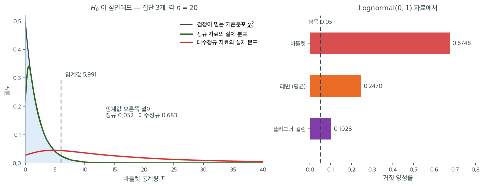

# Bartlett 검정 비정규성 민감도

## 개요

분산 동일성에 대한 Bartlett 검정은 정규성 아래에서 일양최강력 검정이지만, 정규성 이탈에 민감하기로 악명 높다. 자료가 치우쳤거나 꼬리가 두꺼우면 Bartlett 검정의 거짓 양성률이 부풀려져, 명목 유의수준 $\alpha$가 시사하는 것보다 훨씬 자주 등분산 귀무가설을 기각한다. 이 페이지는 모의실험으로 이 민감도를 시연하고 대수정규 자료에서 Bartlett 검정을 Levene 검정 및 Fligner-Killeen 검정과 비교한다.

---

## 1. 문제

$H_0: \sigma_1^2 = \sigma_2^2 = \cdots = \sigma_k^2$과 정규성 가정 아래에서 Bartlett 통계량 $T$는 근사적으로 $\chi^2(k-1)$ 분포를 갖는다. 자료가 비정규이면 초과첨도가 $S_i^2$의 변동을 부풀리므로 $T$의 실제 분포가 $\chi^2(k-1)$보다 확률적으로 커진다. 그 결과

$$
P(T > \chi^2_{1-\alpha}(k-1) \mid H_0, \text{비정규 자료}) \gg \alpha.
$$

---

## 2. 모의실험 설계

이 효과를 보이려면

1. 모수가 같은 **대수정규** 분포에서 크기 $n$인 집단 $k = 3$개를 생성한다(등분산 귀무가설이 참으로 성립한다).
2. 수준 $\alpha = 0.05$에서 Bartlett, Levene, Fligner-Killeen 검정을 적용한다.
3. 여러 번 반복하여 기각 비율(경험적 거짓 양성률)을 기록한다.

올바르게 보정되어 있다면 모든 검정이 약 5%로 기각해야 한다.

<div class="exbox" markdown>

**보기 1.** <span class="diff easy" title="쉬움"></span> 치우친 자료에서의 거짓 양성률. $\text{Lognormal}(0,1)$ 에서 $k = 3$ 집단을 **같은 모수로** 뽑아($H_0$ 가 참) 각 $n = 20$, 반복 5,000 회로 세 검정의 기각률을 센다.

**(1)** [비정규성 아래의 한계](limitations.md) 보기 1 이 유도한 극한 오류율

$$
P\!\left(\chi^2_{k-1} > \frac{2\,\chi^2_{1-\alpha,\,k-1}}{\beta_2 - 1}\right)
$$

에 $\text{Lognormal}(0,1)$ 의 첨도를 넣어 바틀렛의 **극한 거짓 양성률**을 구하시오($\beta_2 = \gamma_2 + 3$, 연습문제 4 가 $\gamma_2 = 110.936$ 을 계산했다).

**(2)** 세 검정의 기각률을 재고, $n$ 을 $20$ 에서 $10{,}000$ 까지 키우며 바틀렛의 기각률이 (1)의 극한값으로 가는지 확인하시오.

</div>

??? success "풀이"

    **(1) 첨도 하나로 극한값이 정해진다.** 연습문제 4 가 구한 $\gamma_2 = 110.936$ 에서

    $$
    \beta_2 - 1 = \gamma_2 + 2 = 112.936
    $$

    이고, $\operatorname{Var}(\ln S^2)$ 의 팽창 배율이

    $$
    \frac{\beta_2 - 1}{2} = \frac{112.936}{2} = 56.47
    \qquad(\text{표준편차로는 } \sqrt{56.47} = 7.51 \text{ 배})
    $$

    이다. $k = 3$, $\alpha = 0.05$ 이면 $\chi^2_{0.95,2} = 5.9915$ 이므로 극한 오류율은

    $$
    P\!\left(\chi^2_2 > \frac{2 \times 5.9915}{112.936}\right)
    = P\bigl(\chi^2_2 > 0.1061\bigr)
    = e^{-0.1061/2}
    = 0.9483
    $$

    이다(자유도 2 의 카이제곱은 $P(\chi^2_2 > t) = e^{-t/2}$ 이다). **표본을 무한히 키우면 등분산인 로그정규 자료의 $94.8\%$ 에서 "분산이 다르다"고 판정한다는 뜻이다.**

    이 수가 말하는 것을 분명히 해 두자. 임계값 $5.9915$ 가 참 분포에서는 $5.9915/56.47 = 0.1061$ 짜리 분위점에 해당하고, 그것은 $\chi^2_2$ 의 **아래쪽 $5.2\%$** 지점이다($1 - 0.9483 = 0.0517$). 곧 **기각하지 못하는 쪽이 오히려 희귀한 사건**이 된다. 검정이 틀린 것이 아니라 들이대는 자가 56배 짧은 것이다.

    $n = 20$ 에서는 이 극한에 못 미칠 것으로 예상된다. $\ln S^2$ 의 중심극한정리가 듣기까지 멀기 때문이다(그 수렴에는 4차 적률이 필요하고, 로그정규의 고차 적률은 $e^{4\sigma^2}$ 꼴로 폭발한다).

    **(2) 먼저 $n = 20$ 에서 세 검정을 나란히 둔다.**

    ```python
    import numpy as np
    from scipy.stats import bartlett, levene, fligner

    rng = np.random.default_rng(0)


    def simulate_once(n=20, sigmas=(1.0, 1.0, 1.0), skew=True):
        """치우친 로그정규 또는 정규에서 k 개 집단을 만든다.

        셋 다 같은 sigma 를 주므로 분산은 참으로 같다. 그런데도 자료가
        치우쳐 있으면 검정이 기각해 버리는지를 보려는 것이다.
        """
        if skew:
            groups = [rng.lognormal(mean=0.0, sigma=s, size=n) for s in sigmas]
        else:
            groups = [rng.normal(loc=0.0, scale=s, size=n) for s in sigmas]
        return groups


    def trial(n=20, sigmas=(1.0, 1.0, 1.0), skew=True):
        """한 벌의 모의자료에 세 검정을 모두 돌린다."""
        g1, g2, g3 = simulate_once(n=n, sigmas=sigmas, skew=skew)
        _, p_bartlett = bartlett(g1, g2, g3)
        _, p_levene = levene(g1, g2, g3, center='mean')
        _, p_fligner = fligner(g1, g2, g3)
        return p_bartlett, p_levene, p_fligner


    # 분산이 참으로 같으므로, 아래 비율은 모두 0.05 근처여야 옳다.
    # Bartlett 만 크게 벗어난다면 그것이 이 검정의 약점이다.
    n_sims, alpha = 5000, 0.05
    ps_b, ps_lv, ps_fl = [], [], []

    for _ in range(n_sims):
        p_b, p_l, p_f = trial(n=20, sigmas=(1.0, 1.0, 1.0), skew=True)
        ps_b.append(p_b)
        ps_lv.append(p_l)
        ps_fl.append(p_f)

    fp_b = np.mean(np.array(ps_b) < alpha)
    fp_lv = np.mean(np.array(ps_lv) < alpha)
    fp_fl = np.mean(np.array(ps_fl) < alpha)

    print("False-positive rates under skewed (lognormal) data:")
    print(f"  Bartlett       : {fp_b:.4f}")
    print(f"  Levene (mean)  : {fp_lv:.4f}")
    print(f"  Fligner-Killeen: {fp_fl:.4f}")
    ```

    출력:

    ```text
    False-positive rates under skewed (lognormal) data:
      Bartlett       : 0.6748
      Levene (mean)  : 0.2470
      Fligner-Killeen: 0.1028
    ```

    **$n = 20$ 에서 세 검정이 모두 명목값을 넘는다.** 바틀렛 $0.6748$, 레빈(평균 중심) $0.2470$, 플리그너–킬린 $0.1028$ 이다. 세 집단의 **모분산은 정확히 같은데도** 그렇다. 명목값의 배수로는 $13.5$, $4.9$, $2.1$ 이다.

    순서가 뜻을 담고 있다. 바틀렛은 $\ln S_i^2$ 을 그대로 쓰므로 첨도가 감쇄 없이 실린다. 레빈(평균 중심)은 $\lvert y_{ij} - \bar y_i \rvert$ 를 쓰는데, 긴 오른쪽 꼬리가 평균을 끌어당겨 중심화가 불안정해진다. 플리그너–킬린은 **순위**로 바꾸므로 꼬리의 크기 자체가 지워져 가장 덜 흔들린다. 그래도 $0.1028$ 로 명목값의 두 배는 된다. 이 극단적 치우침에서는 순위조차 모자라고 **중앙값 중심화**가 결정적이다(아래 경고 상자).

    **이제 $n$ 을 키워 (1)의 극한값과 견준다.**

    ```python
    import numpy as np
    from scipy import stats

    k, alpha = 3, 0.05
    crit = stats.chi2.ppf(1 - alpha, k - 1)

    # 로그정규(0,1) 의 초과첨도와 그에서 나오는 팽창 배율
    g2 = np.exp(4) + 2 * np.exp(3) + 3 * np.exp(2) - 6
    beta2_m1 = g2 + 2                      # = gamma2 + 2 = beta2 - 1
    print(f"Lognormal(0,1):  gamma2 = {g2:.3f},  beta2 - 1 = {beta2_m1:.3f}")
    print(f"  Var(ln S^2) 의 팽창 배율 = (beta2-1)/2 = {beta2_m1 / 2:.2f}"
          f"   (표준편차로는 {np.sqrt(beta2_m1 / 2):.2f} 배)")
    print(f"  극한 거짓 양성률 = P(chi2_2 > 2*{crit:.4f}/{beta2_m1:.3f})"
          f" = {stats.chi2.sf(2 * crit / beta2_m1, k - 1):.4f}")

    # 표본을 키우면 그 극한으로 가는가. 반복 2000 회.
    rng = np.random.default_rng(4)
    M = 2000
    print(f"\n{'n':>8}{'Bartlett 거짓 양성률':>24}")
    for n, ch in [(20, 250), (100, 250), (1000, 100), (10000, 25)]:
        C = 1 + (k + 1) / (3 * k * (n - 1))
        hits = 0
        for _ in range(M // ch):
            S = rng.lognormal(0, 1, (ch, k, n)).var(axis=2, ddof=1)
            T = k * (n - 1) * np.log(S.mean(axis=1)
                                     / np.exp(np.log(S).mean(axis=1))) / C
            hits += int(np.sum(T > crit))
        print(f"{n:>8}{hits / M:>24.4f}")
    print(f"\n반복 {M} 회이므로 몬테카를로 표준오차는 0.67 근처 "
          f"{np.sqrt(0.67 * 0.33 / M):.4f}, 0.93 근처 {np.sqrt(0.93 * 0.07 / M):.4f}")
    ```

    출력:

    ```text
    Lognormal(0,1):  gamma2 = 110.936,  beta2 - 1 = 112.936
      Var(ln S^2) 의 팽창 배율 = (beta2-1)/2 = 56.47   (표준편차로는 7.51 배)
      극한 거짓 양성률 = P(chi2_2 > 2*5.9915/112.936) = 0.9483

           n         Bartlett 거짓 양성률
          20                  0.6655
         100                  0.8025
        1000                  0.8890
       10000                  0.9270

    반복 2000 회이므로 몬테카를로 표준오차는 0.67 근처 0.0105, 0.93 근처 0.0057
    ```

    **(1)의 예측 방향이 맞는다.** 기각률이 $0.6655 \to 0.8025 \to 0.8890 \to 0.9270$ 으로 **$n$ 과 함께 단조증가하며** 극한값 $0.9483$ 쪽으로 간다. $n = 20$ 의 $0.6655$ 는 위 블록의 $0.6748$ 과 다른 씨앗·다른 반복수(2,000 회)에서 얻은 값인데, 표준오차 $0.0105$ 를 감안하면 두 값의 차 $0.0093$ 은 우연의 범위다.

    **"표본을 키우면 나아진다"가 여기서 완전히 무너진다.** 평균에 대한 검정이라면 중심극한정리가 $n$ 과 함께 구원해 주지만, 분산 검정에서는 통계량의 크기와 그 요동이 같은 비율로 커져 둘의 비가 $(\beta_2-1)/2$ 에 고정된다. 그래서 $n$ 을 500배로 늘려도 오류율이 내려가지 않고 **올라간다.** 연습문제 2 가 $n = 100$ 에서 $0.813$ 을 얻은 것이 이 표의 두 번째 줄이며, 이제 그것이 어디로 향하는 길목인지까지 알게 되었다.

    **아직 극한에 닿지는 않았다.** $n = 10{,}000$ 에서 $0.9270$ 이고 예측은 $0.9483$ 으로 표준오차 $0.0057$ 의 네 배쯤 떨어져 있다. 수렴이 느린 것이지 어긋난 것이 아니다. 위 극한식은 $u_i = S_i^2/\sigma^2 - 1$ 이 근사적으로 정규라는 데 기대고, 그 수렴 속도는 모집단의 고차 적률이 정한다. $\text{Lognormal}(0,1)$ 의 $m$ 차 적률이 $e^{m^2/2}$ 로 폭발하므로($4$ 차가 $e^8 = 2981$, $8$ 차가 $e^{32} \approx 8\times10^{13}$) 이보다 느린 수렴을 찾기도 어렵다. 연습문제 4 가 보인 $\sigma$ 에 대한 지수적 민감도와 같은 뿌리다.

    **그러므로 $0.675$ 는 바닥이 아니라 천장 쪽으로 가는 길의 한 점이다.** "$n = 20$ 이라 작아서 그렇다"는 설명은 틀렸다. 표본이 작은 것이 오히려 피해를 **줄여** 주고 있었다.

---

## 3. 해석

| 검정 | 거짓 양성률 | 명목값의 배수 |
|---|---|---|
| Bartlett | **0.675** | 13.5 |
| Levene (평균) | **0.247** | 4.9 |
| Fligner-Killeen | **0.103** | 2.1 |

- **Bartlett 검정**의 거짓 양성률이 $0.675$이다. 명목 $\alpha = 0.05$의 **13.5배**이며, 등분산인 자료의 3분의 2에서 기각한다. 정규성이 의심스러울 때 등분산 진단 도구로 쓸 수 없다.
- **Levene 검정**(평균 중심)도 $0.247$로 크게 부풀려진다. 대수정규의 강한 치우침 때문에 평균 중심화가 무너진다.
- **Fligner-Killeen**도 $0.103$으로 명목값의 두 배이다. 순위 기반이라 다른 두 검정보다는 훨씬 낫지만 **완전히 통제되지는 않는다**.

$0.675$라는 숫자가 어디서 나오는지는 통계량 $T$의 **실제 분포**를 그려 보면 한눈에 들어온다. 같은 설정(집단 3개, 각 $n = 20$, $H_0$ 참)에서 $T$를 2만 번 계산했다.



초록이 정규 자료의 실제 분포인데 회색 기준분포 $\chi^2_2$와 거의 완벽하게 겹친다. 임계값 $5.991$ 오른쪽 넓이가 $0.052$로 약속한 5%와 같다. 검정이 제 몫을 한다.

빨강이 대수정규 자료의 실제 분포다. **모양이 아예 다르다.** $\chi^2_2$는 0 근처에서 가장 높고 빠르게 떨어지는데, 대수정규 자료의 분포는 봉우리가 $5$ 부근으로 밀려나고 꼬리가 $40$ 너머까지 길게 끌린다. 임계값 $5.991$이 이 분포의 **왼쪽 어깨쯤**에 그어지니, 분포의 대부분이 기각역 안에 들어간다. 그 넓이가 $0.683$이다(본문 코드의 $0.6748$과 몬테카를로 오차 범위에서 일치한다).

여기서 분명히 해 둘 것이 있다. **세 집단의 모분산은 정확히 같다.** 통계량이 커진 것은 분산이 달라서가 아니라 $\ln S_i^2$의 변동이 정규 이론이 예측하는 것보다 훨씬 크기 때문이다. $\text{Lognormal}(0,1)$의 초과첨도가 $110.9$이니 $\operatorname{Var}(\ln S^2) \approx (2+\gamma_2)/\nu$가 정규의 50배를 넘는다. 검정은 그 변동을 "분산이 다르다"는 신호로 오독한다.

오른쪽 막대가 대안들의 성적이다. 레빈(평균)도 $0.2470$으로 무사하지 못하고, 플리그너–킬린은 $0.1028$로 명목값의 두 배다. 세 검정 모두 기각선을 넘는다는 점이 이 분포의 악명을 말해 준다. 이 극단적 치우침에서 유일하게 살아남는 검정이 무엇인지는 아래 경고 상자에서 이어진다.

!!! warning "여기서 통제되는 검정은 Brown-Forsythe뿐이다"
    위 코드는 세 검정만 비교하지만, 같은 조건에서 **Brown-Forsythe**(`center='median'`)를 추가하면 거짓 양성률이 $0.030$으로 유일하게 통제된다.

    $\text{Lognormal}(0,1)$은 왜도 $6.185$, 초과첨도 $110.9$로 극단적으로 치우쳐 있다. 이 정도 치우침에서는 순위 변환(Fligner-Killeen)조차 부족하고 **중앙값 중심화**가 결정적이다. 자세한 비교는 15.5절 [대수정규에서의 비교](../robust_tests/robust_tests_comparison.md)를 보라.

핵심은 Bartlett의 비정규성 민감도가 사소한 불편이 아니라 **근본적으로 잘못된 결론**으로 이어질 수 있다는 점이다.

---

## 연습문제

<div class="drillbox" markdown>

**연습문제 1.** <span class="diff easy" title="쉬움"></span> `skew=False`(정규 자료)로 모의실험을 실행하여 세 검정의 거짓 양성률이 모두 0.05에 가까움을 확인하라.

</div>

??? success "풀이"

    ```python
    import numpy as np
    from scipy.stats import bartlett, levene, fligner

    rng = np.random.default_rng(0)
    n_sims, alpha = 5000, 0.05
    rej = {"Bartlett": 0, "Levene": 0, "Fligner": 0}

    for _ in range(n_sims):
        g1 = rng.normal(0, 1, 20)
        g2 = rng.normal(0, 1, 20)
        g3 = rng.normal(0, 1, 20)
        _, p = bartlett(g1, g2, g3)
        if p < alpha: rej["Bartlett"] += 1
        _, p = levene(g1, g2, g3, center='mean')
        if p < alpha: rej["Levene"] += 1
        _, p = fligner(g1, g2, g3)
        if p < alpha: rej["Fligner"] += 1

    for name, count in rej.items():
        print(f"{name}: {count/n_sims:.4f}")
    ```

    출력:

    ```text
    Bartlett: 0.0508
    Levene: 0.0556
    Fligner: 0.0364
    ```

    세 비율 모두 0.05 근처로, 정규성 아래에서 모든 검정이 올바르게 보정되어 있음을 확인해 준다.

    Bartlett($0.0508$)이 가장 정확하다. 15.4절 유도 페이지에서 본 Bartlett 보정인자 $C$가 유한표본 오차를 제거하기 때문이다. Fligner-Killeen($0.0364$)은 다소 보수적인데, 순위 변환이 정보를 버린 대가이다.

    **대조가 뚜렷하다.** 정규 자료에서 Bartlett의 크기는 $0.051$로 완벽하지만 대수정규 자료에서는 $0.675$이다. **가정이 성립할 때 가장 좋고 깨질 때 가장 나쁜 것**이 이 검정의 특징이다. $\square$

<div class="drillbox" markdown>

**연습문제 2.** <span class="diff med" title="중간"></span> 대수정규 분포를 유지한 채 표본크기를 $n = 100$으로 늘려라. Bartlett 검정의 부풀려진 거짓 양성률이 개선되는가? 이유를 설명하라.

</div>

??? success "풀이"

    ```python
    import numpy as np
    from scipy.stats import bartlett

    rng = np.random.default_rng(0)
    n_sims = 5000
    rej = 0
    for _ in range(n_sims):
        g1 = rng.lognormal(0, 1, 100)
        g2 = rng.lognormal(0, 1, 100)
        g3 = rng.lognormal(0, 1, 100)
        _, p = bartlett(g1, g2, g3)
        if p < 0.05:
            rej += 1
    print(f"Bartlett FP rate (n=100): {rej/n_sims:.4f}")
    ```

    출력:

    ```text
    Bartlett FP rate (n=100): 0.8134
    ```

    거짓 양성률이 개선되지 않을 뿐 아니라 **악화된다**. $n = 20$의 $0.675$에서 $n = 100$의 $0.813$으로 올라간다.

    | $n$ | 20 | 30 | 100 |
    |---|---|---|---|
    | Bartlett 거짓 양성률 | 0.675 | 0.732 | 0.813 |

    ($n = 30$ 값은 15.5절 [대수정규에서의 비교](../robust_tests/robust_tests_comparison.md)에서 얻었다.)

    표본이 커지면 분산 추정이 정밀해지지만 검정의 통계적 검정력도 커진다. 근본 문제는 Bartlett의 $\chi^2$ 기준분포가 비정규 자료에 대해 **틀렸다**는 것이며, 이는 표본크기로 개선되지 않는다. 편향이 유한표본 문제가 아니라 점근적이다.

    15.3절 연습문제 3의 유도로 설명하면, 실제 $\operatorname{Var}(\ln S^2)$와 명목값의 비율 $(\gamma_2+2)/2$가 $n$에 의존하지 않는다. $n$이 커지면 명목 분포는 좁아지는데 실제 분포는 같은 비율로 넓은 상태를 유지하므로 불일치의 상대적 크기가 커진다. $\square$

<div class="drillbox" markdown>

**연습문제 3.** <span class="diff med" title="중간"></span> 대수정규 대신 $t(3)$ 자료를 쓰도록 모의실험을 수정하라. Bartlett 검정이 여전히 부풀려지는가? 심각도가 대수정규의 경우와 어떻게 비교되는가?

</div>

??? success "풀이"

    ```python
    import numpy as np
    from scipy.stats import bartlett, t as tdist

    rng = np.random.default_rng(0)
    n_sims = 5000
    rej = 0
    for _ in range(n_sims):
        g1 = tdist(df=3).rvs(20, random_state=rng)
        g2 = tdist(df=3).rvs(20, random_state=rng)
        g3 = tdist(df=3).rvs(20, random_state=rng)
        _, p = bartlett(g1, g2, g3)
        if p < 0.05:
            rej += 1
    print(f"Bartlett FP rate (t(3)): {rej/n_sims:.4f}")
    ```

    출력:

    ```text
    Bartlett FP rate (t(3)): 0.4076
    ```

    $t(3)$에서 $0.408$로 심하게 부풀려지지만, 대수정규의 $0.675$보다는 **덜하다**.

    | 분포 | 왜도 | 초과첨도 | Bartlett 크기 |
    |---|---|---|---|
    | $\mathcal{N}(0,1)$ | 0 | 0 | 0.051 |
    | $t(3)$ | 0 | $\infty$ | 0.408 |
    | $\text{Lognormal}(0,1)$ | 6.19 | 110.9 | 0.675 |

    **흥미로운 대비.** $t(3)$은 네 번째 적률이 아예 존재하지 않으므로 초과첨도가 $\infty$인데도, 유한한 $\gamma_2 = 110.9$인 대수정규보다 덜 나쁘다.

    이유는 **유한표본 거동**의 차이이다. $t(3)$은 대칭이고 극단값이 드물게 나타나므로, 대부분의 $n = 20$ 표본에서 표본첨도가 이론값보다 훨씬 작게 나온다. 반면 대수정규는 모든 적률이 존재하고 치우침이 일관되게 나타나므로 왜곡이 매번 발생한다.

    대수정규는 **치우침** 문제가 있고 $t(3)$은 **첨도** 문제가 있다. 둘 다 Bartlett의 정규성 가정을 위반하지만 방식이 다르며, 실무에서는 치우침이 더 큰 위협임을 보여준다. $\square$

<div class="drillbox" markdown>

**연습문제 4.** <span class="diff med" title="중간"></span> 모수 $\sigma$인 대수정규분포의 분산은 $(e^{\sigma^2} - 1)e^{2\mu + \sigma^2}$이다. 모든 집단이 같은 $\sigma$와 $\mu$를 쓰면 모분산이 같다. $\mu = 0, \sigma = 1$인 대수정규의 모분산, 왜도, 첨도를 계산하라.

</div>

??? success "풀이"

    $X \sim \text{Lognormal}(\mu, \sigma^2)$이고 $\mu = 0, \sigma = 1$일 때

    $$
    E[X] = e^{\mu + \sigma^2/2} = e^{1/2} = 1.6487.
    $$

    $$
    \operatorname{Var}(X) = (e^{\sigma^2} - 1)e^{2\mu + \sigma^2} = (e - 1)e^1 = 1.7183 \times 2.7183 = 4.6708.
    $$

    왜도는

    $$
    \gamma_1 = (e^{\sigma^2} + 2)\sqrt{e^{\sigma^2} - 1} = (e + 2)\sqrt{e - 1} = 4.7183 \times 1.3108 = 6.1849.
    $$

    초과첨도는

    $$
    \gamma_2 = e^{4\sigma^2} + 2e^{3\sigma^2} + 3e^{2\sigma^2} - 6 = e^4 + 2e^3 + 3e^2 - 6
    $$

    $$
    = 54.598 + 40.171 + 22.167 - 6 = 110.936.
    $$

    엄청난 왜도와 첨도가 Bartlett 검정이 그토록 극적으로 실패하는 이유를 설명한다. 자료가 이 정도로 비정규이면 $T$에 대한 $\chi^2$ 근사가 터무니없이 부정확하다.

    **정량화.** 15.4절 연습문제 4에서 $\operatorname{Var}(\ln S^2) \approx (\gamma_2+2)/n$임을 보았다. 여기서 $\gamma_2 = 110.9$이므로 팽창 인자가

    $$
    \frac{\gamma_2 + 2}{2} = \frac{112.9}{2} = 56.5
    $$

    이다. $\ln S_i^2$의 실제 분산이 정규 이론값의 **56배**이며, 표준편차로는 7.5배이다. Bartlett 통계량이 명목 $\chi^2_2$보다 그만큼 큰 값을 내므로 거의 항상 기각한다.

    $\sigma$에 따른 민감도도 극적이다.

    | $\sigma$ | 0.25 | 0.5 | 1.0 | 1.5 |
    |---|---|---|---|---|
    | $\gamma_2$ | 1.10 | 5.90 | 110.9 | 10,075 |

    $\sigma$가 0.25에서 1.5로 여섯 배가 될 때 $\gamma_2$가 만 배 가까이 커진다. $\gamma_2$의 지배항이 $e^{4\sigma^2}$이라 $\sigma^2$에 지수적으로 반응하기 때문이다. $\square$

<div class="drillbox" markdown>

**연습문제 5.** <span class="diff med" title="중간"></span> 관측된 첨도에 기반하여 임계값을 조정하는 Bartlett 검정의 보정판을 제안하라. 이 접근의 실현 가능성과 한계를 논하라.

</div>

??? success "풀이"

    한 가지 접근은 Box(1953)의 보정으로, $\chi^2(k-1)$ 기준을 $\chi^2(k-1)/C$로 바꾼다.

    $$
    C = 1 + \frac{\hat\gamma_2}{2(k+1)}\left(\sum_{i=1}^k \frac{1}{n_i - 1} - \frac{1}{N-k}\right) + \text{고차항},
    $$

    여기서 $\hat\gamma_2$는 집단들에 걸쳐 합동한 공통 초과첨도의 추정값이다.

    ```python
    import numpy as np
    from scipy.stats import bartlett, kurtosis, chi2

    def bartlett_corrected(*groups):
        stat, _ = bartlett(*groups)
        k = len(groups)
        all_data = np.concatenate(groups)
        kappa_hat = kurtosis(all_data, fisher=True)
        ns = [len(g) for g in groups]
        N = sum(ns)
        correction = max(1 + kappa_hat / (2 * (k + 1)) *
                         (sum(1 / (n - 1) for n in ns) - 1 / (N - k)), 0.5)
        adjusted_stat = stat / correction
        return adjusted_stat, chi2(df=k - 1).sf(adjusted_stat)
    ```

    **실제로 작동하는가.** 위 구현으로 크기를 측정한다($k=3$, $n=20$, $R = 5000$).

    ```python
    rng = np.random.default_rng(0)
    k, n, R, alpha = 3, 20, 5000, 0.05
    rej = {"정규 보정": 0, "정규 무보정": 0, "대수정규 보정": 0, "대수정규 무보정": 0}
    for _ in range(R):
        g = [rng.normal(0, 1, n) for _ in range(k)]
        rej["정규 보정"] += bartlett_corrected(*g)[1] < alpha
        rej["정규 무보정"] += bartlett(*g)[1] < alpha
        g = [rng.lognormal(0, 1, n) for _ in range(k)]
        rej["대수정규 보정"] += bartlett_corrected(*g)[1] < alpha
        rej["대수정규 무보정"] += bartlett(*g)[1] < alpha
    for name, c in rej.items():
        print(f"{name:14s} 크기 = {c / R:.4f}")
    ```

    출력:

    ```text
    정규 보정          크기 = 0.0456
    정규 무보정         크기 = 0.0462
    대수정규 보정        크기 = 0.6546
    대수정규 무보정       크기 = 0.6780
    ```

    !!! danger "이 보정은 문제를 거의 해결하지 못한다"
        대수정규 자료에서 보정 전 $0.6780$이 보정 후 $0.6546$으로 **3% 개선에 그친다.** 여전히 명목값의 13배이다.

        정규 자료에서는 $0.0456$으로 크기를 망가뜨리지 않으므로 무해하기는 하다. 그러나 필요한 상황에서 무력하다.

        **왜 실패하는가.** 세 가지 이유가 겹친다.

        1. **보정 항이 너무 작다.** 괄호 안의 $\sum 1/(n_i-1) - 1/(N-k)$가 $n = 20$에서 $3/19 - 1/57 = 0.1404$에 불과하다. $\hat\gamma_2 = 110$이어도 $C = 1 + \frac{110}{8}(0.1404) = 2.93$이다. 그런데 필요한 보정 배수는 $(\gamma_2+2)/2 = 56.5$이다. **20분의 1 수준이다.**

        2. **첨도 추정 자체가 불가능하다.** $\text{Lognormal}(0,1)$의 참 $\gamma_2 = 110.9$인데, $n = 60$짜리 합동표본의 표본첨도는 중앙값이 $7.1$이고 10~90백분위수가 $2.2$~$24.7$이다. 표본첨도가 참값을 심하게 과소추정한다(치우친 분포에서 표본 적률이 아래로 편향된다). 보정할 양을 알 수 없으므로 보정이 성립하지 않는다.

        3. **Box의 보정은 중간 정도의 비정규성을 위한 것이다.** 1차 근사이므로 $\gamma_2$가 작을 때만 유효하다. $\gamma_2 = 110$에서는 고차항이 지배한다.

    **한계 정리.**

    1. 첨도 추정 자체가 신뢰할 만하려면 큰 표본이 필요하고, 두꺼운 꼬리에서는 큰 표본으로도 불안정하다.
    2. 보정은 집단들이 하나의 공통 첨도를 갖는다고 가정한다. 집단마다 분포가 다르면 근사적일 뿐이다.
    3. 극단적으로 비정규인 자료에서는 어떤 단순 보정도 문제를 완전히 고치지 못한다.

    **결론: 보정하지 말고 검정을 바꾸라.** Brown-Forsythe나 Fligner-Killeen 같은 비모수 검정이 훨씬 신뢰할 만하다. 위 실험에서 Brown-Forsythe는 같은 대수정규 자료에서 $0.030$이었다. 보정된 Bartlett의 $0.649$와 비교할 수 없는 수준이다.

    이는 통계학의 일반적 교훈이기도 하다. **잘못된 모형을 보정으로 구제하려 하기보다 처음부터 가정이 약한 방법을 쓰는 편이 낫다.** $\square$

<div class="drillbox" markdown>

**연습문제 6.** <span class="diff med" title="중간"></span> 보기 1 이 쓴 극한 오류율 식

$$
P\!\left(\chi^2_{k-1} > \frac{2\,\chi^2_{1-\alpha,\,k-1}}{\beta_2 - 1}\right)
$$

을 거꾸로 읽는다. 아래에서 $k = 3$, $\alpha = 0.05$ 로 두고 $\chi^2_{0.95,2} = 5.9915$ 를 쓴다.

**(1)** 극한 오류율이 명목값의 정확히 두 배, 곧 $0.10$ 이 되는 첨도 $\beta_2$ 와 초과첨도 $\gamma_2$ 를 구하시오.

**(2)** 2 장의 하한 $\beta_2 \ge 1 + \gamma_1^2$ 을 써서, 첨도를 **재지 않고 왜도만** 알아도 극한 오류율의 하한을 말할 수 있음을 보이시오. 어느 왜도를 넘으면 (1)의 $0.10$ 이 보장되는가. 연습문제 4 의 $\gamma_1 = 6.1849$ 에 적용하면 그 하한이 얼마인가.

**(3)** 지수분포($\gamma_1 = 2$, $\gamma_2 = 6$)의 극한 오류율을 구하고 (2)의 하한과 견주시오.

</div>

??? success "풀이"

    자유도 2 의 카이제곱은 $P(\chi^2_2 > t) = e^{-t/2}$ 이므로 모든 계산이 손으로 끝난다.

    **(1) 두 배가 되는 첨도.** $e^{-t/2} = 0.10$ 에서

    $$
    t = -2\ln 0.10 = 2\ln 10 = 4.6052
    $$

    이고, 이 $t$ 가 $2\chi^2_{0.95,2}/(\beta_2-1)$ 과 같아야 하므로

    $$
    \beta_2 - 1 = \frac{2 \times 5.9915}{4.6052} = \frac{11.9829}{4.6052} = 2.6021,
    \qquad \beta_2 = 3.6021, \qquad \gamma_2 = 0.6021.
    $$

    **초과첨도가 $0.60$ 에 불과해도 점근 오류율이 벌써 명목값의 두 배다.** 정규($\gamma_2 = 0$)에서 $0.60$ 까지 가는 거리는 눈으로 보아서는 알 수 없는 정도의 비정규성이다. 로그정규의 $\gamma_2 = 110.9$ 는 이 문턱의 184 배다.

    **(2) 왜도만으로 하한이 나온다.** 먼저 극한 오류율이 $\beta_2 - 1$ 의 증가함수임을 확인한다. 문턱 $t = 2\chi^2_{1-\alpha,k-1}/(\beta_2-1)$ 은 $\beta_2 - 1$ 이 커지면 작아지고, $P(\chi^2_{k-1} > t)$ 는 $t$ 의 감소함수이므로 합성은 증가함수다. 따라서 $\beta_2 - 1$ 의 하한이 곧 오류율의 하한이다. 2 장의 부등식 $\beta_2 \ge 1 + \gamma_1^2$ 에서 $\beta_2 - 1 \ge \gamma_1^2$ 이므로

    $$
    \text{극한 오류율} \;\ge\; P\!\left(\chi^2_2 > \frac{2\,\chi^2_{0.95,2}}{\gamma_1^2}\right) = \exp\!\left(-\frac{5.9915}{\gamma_1^2}\right).
    $$

    이 하한이 $0.10$ 을 넘는 조건은 (1)에서 $\gamma_1^2 > 2.6021$, 곧

    $$
    \lvert \gamma_1 \rvert > \sqrt{2.6021} = 1.6131
    $$

    이다. **왜도의 절댓값이 $1.61$ 을 넘는 모집단이면 첨도가 무엇이든 바틀렛의 점근 오류율이 $0.10$ 보다 크다.** 로그정규$(0,1)$ 은 $\gamma_1^2 = 6.1849^2 = 38.2527$ 이므로

    $$
    \text{극한 오류율} \ge e^{-5.9915/38.2527} = e^{-0.15663} = 0.8550.
    $$

    **왜도 하나만 알고도 $85.5\%$ 이상이라고 단언할 수 있다.** 첨도 $110.9$ 를 실제로 넣으면 $0.9483$ 이니, 하한이 참값의 $90\%$ 까지 설명한다.

    **(3) 지수분포.** $\beta_2 - 1 = \gamma_2 + 2 = 8$ 이므로

    $$
    \text{극한 오류율} = e^{-5.9915/8} = e^{-0.74894} = 0.4729.
    $$

    (2)의 왜도 하한은 $\gamma_1^2 = 4$ 에서 $e^{-5.9915/4} = e^{-1.4979} = 0.2236$ 이다. 참값 $0.4729$ 가 하한 $0.2236$ 보다 크므로 부등식이 지켜지며, 하한은 느슨하다. 2 장의 부등식은 $\beta_2 - 1 \ge 4$ 를 주는데 실제는 $8$ 이기 때문이다.

    **쓸모가 여기 있다.** 첨도는 4 차 적률이라 추정이 극히 불안정하지만(연습문제 5 가 $n = 60$ 에서 중앙값 $7.1$, 10–90 백분위수 $2.2$–$24.7$ 임을 보였다), 왜도는 3 차 적률이라 훨씬 잘 재진다. **치우친 자료를 손에 들었다면 첨도를 재 보기 전에 이미 바틀렛을 쓸 수 없다는 것을 알 수 있다.** $\square$

<div class="drillbox" markdown>

**연습문제 7.** <span class="diff med" title="중간"></span> 본문은 레빈을 `center='mean'` 으로만 돌렸고, 경고 상자는 중앙값 중심화(브라운–포사이드)가 로그정규에서 유일하게 통제된다고만 말한다. 그 맞바꿈을 수로 재라.

$k = 3$, $n = 20$, $\alpha = 0.05$, 반복 20,000 회로 세 상황에서 두 중심화를 비교하시오. (가) 정규·등분산에서의 **크기**, (나) 정규 $\sigma = (1, 1, 2)$ 에서의 **검정력**, (다) 로그정규·등분산에서의 **크기**.

중앙값으로 바꿀 때 정규에서 **잃는 검정력**과 로그정규에서 **되찾는 크기**를 각각 적고 어느 쪽이 큰지 판단하시오. 또 (가)에서 브라운–포사이드가 왜 보수적으로 나오는지 설명하시오.

</div>

??? success "풀이"

    세 상황에 **같은 자료**를 쓰고 중심화만 바꾸면 차이의 원인이 중심화 하나로 좁혀진다. 절대편차에 일원분산분석을 돌리는 것이 레빈 검정이므로 직접 벡터화한다.

    ```python
    import numpy as np
    from scipy.stats import f as fdist

    rng = np.random.default_rng(7)
    R, n, k, alpha = 20000, 20, 3, 0.05


    def levene_p(X, center):
        """X 는 (R, k, n). 중심화만 바꿔 두 검정의 p 값을 한꺼번에 낸다.

        절대편차에 일원분산분석을 적용하는 것이 레빈 검정이고, 중심을
        평균에서 중앙값으로 바꾼 것이 브라운-포사이드 검정이다.
        """
        c = X.mean(axis=2) if center == "mean" else np.median(X, axis=2)
        Z = np.abs(X - c[:, :, None])
        zi = Z.mean(axis=2)
        zbar = Z.mean(axis=(1, 2))[:, None]
        ssb = n * ((zi - zbar) ** 2).sum(axis=1)
        ssw = ((Z - zi[:, :, None]) ** 2).sum(axis=(1, 2))
        W = (ssb / (k - 1)) / (ssw / (k * n - k))
        return fdist.sf(W, k - 1, k * n - k)


    def draw(dist, sigmas):
        Z = rng.normal(0.0, 1.0, (R, k, n)) * np.array(sigmas)[None, :, None]
        return Z if dist == "normal" else np.exp(Z)


    for label, dist, sig in [
        ("정규   (1,1,1)  크기 ", "normal", (1.0, 1.0, 1.0)),
        ("정규   (1,1,2)  검정력", "normal", (1.0, 1.0, 2.0)),
        ("로그정규 (1,1,1)  크기 ", "lognormal", (1.0, 1.0, 1.0)),
    ]:
        X = draw(dist, sig)
        a = np.mean(levene_p(X, "mean") < alpha)
        b = np.mean(levene_p(X, "median") < alpha)
        print(f"{label}  Levene(평균) {a:.4f}   Brown-Forsythe {b:.4f}")
    ```

    출력:

    ```text
    정규   (1,1,1)  크기   Levene(평균) 0.0574   Brown-Forsythe 0.0392
    정규   (1,1,2)  검정력  Levene(평균) 0.8180   Brown-Forsythe 0.7722
    로그정규 (1,1,1)  크기   Levene(평균) 0.2606   Brown-Forsythe 0.0364
    ```

    | 상황 | Levene(평균) | Brown–Forsythe |
    |---|---|---|
    | 정규, 등분산 — 크기 | 0.0574 | 0.0392 |
    | 정규, $\sigma = (1,1,2)$ — 검정력 | 0.8180 | 0.7722 |
    | 로그정규, 등분산 — 크기 | 0.2606 | 0.0364 |

    **맞바꿈을 수로 적으면 이렇다.** 중앙값으로 바꾸면 정규 자료에서 검정력을 $0.8180 \to 0.7722$ 로 $0.0458$ 잃는다(상대적으로 $5.6\%$). 대신 로그정규 자료에서 크기 오차를 $0.2606 - 0.05 = 0.2106$ 에서 $0.05 - 0.0364 = 0.0136$ 으로 줄인다. **$4.6$ 퍼센트포인트를 내고 $19.7$ 퍼센트포인트를 되찾는 거래이니 비교가 되지 않는다.** 명목값의 배수로는 $5.2$ 배에서 $0.73$ 배로 바뀐다. 즉 넘치던 것이 약간 모자라는 쪽으로 간다.

    레빈(평균)의 $0.2606$ 은 보기 1 이 반복 5,000 회로 얻은 $0.2470$ 과 같은 수다. 두 추정의 차 $0.0136$ 에 대한 표준오차가 $\sqrt{0.25 \times 0.75\,(1/5000 + 1/20000)} = 0.0068$ 이므로 두 배 안에 있다. 브라운–포사이드의 $0.0364$ 는 경고 상자가 보고한 $0.030$ 과 같은 결론이다(씨앗과 반복수가 달라 셋째 자리에서 갈린다).

    **(가)의 보수성은 중앙값의 비효율에서 온다.** 정규분포에서 표본중앙값의 분산은 $\dfrac{\pi}{2}\dfrac{\sigma^2}{n} \approx 1.571\dfrac{\sigma^2}{n}$ 으로 표본평균의 $\sigma^2/n$ 보다 $57\%$ 크다. 중심화 상수가 더 흔들리면 그 흔들림이 $z_{ij} = \lvert x_{ij} - \tilde x_i \rvert$ 에 잡음으로 실려 **집단 안 제곱합 $\text{SSW}$ 를 부풀린다.** $W$ 의 분모가 커지므로 통계량이 작아지고 기각이 줄어든다. 치우친 자료에서는 평균이 꼬리에 끌려가 중심화 자체가 틀려 버리므로 이 손해가 이익으로 뒤집힌다.

    **결론.** 정규성이 확실할 때만 평균 중심화가 낫고, 그 이득은 검정력 $5\%$ 어치다. 정규성이 불확실하면 중앙값 중심화를 쓴다. 보기 1 이 레빈을 `center='mean'` 으로 돌려 $0.2470$ 을 얻은 것은 레빈 검정의 한계가 아니라 **중심화 선택의 한계**였다. $\square$

<div class="drillbox" markdown>

**연습문제 8.** <span class="diff hard" title="어려움"></span> 보기 1 은 로그정규$(0,1)$ 에서 바틀렛 통계량의 극한분포가 $\frac{\beta_2-1}{2}\chi^2_{k-1} = 56.468\,\chi^2_2$ 임을 썼다. 그렇다면 임계값을 $56.468$ 배로 키워 로그정규에 맞게 보정하면 되지 않는가. $k = 3$, $\alpha = 0.05$, $n = 20$ 에서 따져 보자.

**(1)** 로그정규$(0,1)$ 자료에서 점근적으로 크기가 정확히 $0.05$ 가 되는 임계값 $c^\ast$ 를 구하시오.

**(2)** 그 $c^\ast$ 를 **정규** 자료에 쓰면 점근 크기가 얼마인가.

**(3)** 정규 자료에서 $c^\ast$ 를 넘기려면 분산이 얼마나 달라야 하는가. 요동을 무시하고 $S_i^2$ 를 $\sigma_i^2$ 로 바꾼 결정론적 근사

$$
T \approx \frac{k(n-1)}{C}\,\ln\frac{\overline{\sigma^2}}{\bigl(\prod_i \sigma_i^2\bigr)^{1/k}},
\qquad C = 1 + \frac{k+1}{3k(n-1)}
$$

에서 $\sigma^2 = (1, 1, r)$ 로 두고 $r$ 을 구하시오.

**(4)** 이 결과가 연습문제 5 의 결론에 무엇을 **더하는지** 한 문단으로 적으시오.

</div>

??? success "풀이"

    **(1) 임계값을 배율만큼 밀어 올린다.** 극한분포가 $56.468\,\chi^2_2$ 이므로 그 상위 $5\%$ 지점은 $\chi^2_2$ 의 상위 $5\%$ 지점을 같은 배율로 늘린 값이다.

    $$
    c^\ast = \frac{\beta_2 - 1}{2}\,\chi^2_{0.95,2} = 56.468 \times 5.9915 = 338.33.
    $$

    원래 임계값 $5.9915$ 대신 $338.33$ 을 쓰면 로그정규 자료에서 크기가 $0.05$ 로 돌아온다.

    **(2) 정규 자료에서는 그 임계값이 재앙이다.** 정규에서는 $T \sim \chi^2_2$ 가 맞으므로

    $$
    P(\chi^2_2 > 338.33) = e^{-338.33/2} = e^{-169.16} = 3.4 \times 10^{-74}.
    $$

    **$10^{-74}$ 는 크기가 작다는 말로 부족하다.** 이 임계값을 쓰는 검정은 정규 자료에서 사실상 **절대로 기각하지 않는다.**

    **(3) 얼마나 달라야 넘기는가.** $k = 3$, $n = 20$ 이므로

    $$
    C = 1 + \frac{4}{3 \times 3 \times 19} = 1 + 0.023392 = 1.023392, \qquad k(n-1) = 57
    $$

    이고, $T \ge c^\ast$ 가 되려면

    $$
    \ln\frac{\overline{\sigma^2}}{(\prod \sigma_i^2)^{1/3}} \;\ge\; \frac{338.33 \times 1.023392}{57} = 6.0744
    $$

    이어야 한다. $\sigma^2 = (1,1,r)$ 이면 산술평균이 $(2+r)/3$, 기하평균이 $r^{1/3}$ 이므로 조건은

    $$
    \ln\frac{2+r}{3} - \frac{1}{3}\ln r \ge 6.0744
    $$

    이다. $r$ 이 크면 $2 + r \approx r$ 이라 왼쪽이 $\frac{2}{3}\ln r - \ln 3$ 이므로

    $$
    \ln r \approx \frac{3}{2}\,(6.0744 + \ln 3) = \frac{3}{2}\,(6.0744 + 1.0986) = 10.760,
    \qquad r \approx 4.70 \times 10^4
    $$

    이고, 버린 항을 되살려 수치로 풀면 $r = 4.71 \times 10^4$ 이다. **표준편차 비로는 $217 : 1$ 이다.** 키를 재는 자로 따지면 한 집단의 표준편차가 1 cm 일 때 다른 집단이 2.17 m 여야 비로소 기각한다.

    **(4) 연습문제 5 가 말하지 않은 것.** 연습문제 5 는 박스 보정이 **모자란다**는 것을 보였다($C = 2.93$ 인데 필요한 것은 $56.5$). 여기서 더해지는 것은 그보다 나쁜 소식이다. **보정량을 정확히 맞혀도 쓸 수 없다.** 올바른 보정 배율 $(\beta_2-1)/2$ 가 모집단의 모양에만 달려 있고 그 값이 $(0, \infty)$ 를 다 훑으므로, 임계값이 모집단에 따라 $5.99$ 에서 $338$ 로, 균등분포에서는 반대로 $2.40$ 으로 움직인다. 곧 **$T$ 는 점근적으로 추축량(pivotal)이 아니고, 어떤 임계값 표도 존재할 수 없다.** 보정을 쓰려면 $\beta_2$ 를 추정해야 하는데 그 추정이 바로 연습문제 5 가 불가능하다고 보인 일이다. 브라운–포사이드나 플리그너–킬린이 하는 일은 보정이 아니라 **기준분포가 모양에 거의 의존하지 않도록 통계량 자체를 바꾸는 것**이다. 고칠 수 없는 저울은 눈금을 다시 매기는 것이 아니라 저울을 바꿔야 한다. $\square$

<div class="drillbox" markdown>

**연습문제 9.** <span class="diff hard" title="어려움"></span> 본문은 $k = 3$ 에서 극한 오류율 $0.9483$ 을 얻었다. 집단 수를 바꾸면 어떻게 되는가.

**(1)** 로그정규$(0,1)$($\beta_2 - 1 = 112.936$)에서 $k = 2$ 와 $k = 10$ 의 극한 오류율을 구하시오. $\chi^2_{0.95,1} = 3.8415$, $\chi^2_{0.95,9} = 16.9190$ 이고, $P(\chi^2_9 > 0.2996) = 0.999997$ 은 주어진 것으로 쓴다.

**(2)** $k \to \infty$ 에서 극한 오류율이 $\beta_2 > 3$ 이면 $1$ 로, $\beta_2 < 3$ 이면 $0$ 으로 감을 보이시오. $\beta_2 = 3$ 에서는 모든 $k$ 에서 정확히 $\alpha$ 임도 확인하시오. $\chi^2_{1-\alpha,m} = m + z_{1-\alpha}\sqrt{2m} + O(1)$ 을 써도 된다.

**(3)** (2)를 균등분포($\gamma_2 = -1.2$)에 적용하여 $k = 3$ 과 $k = 10$ 의 극한 오류율을 구하시오. [비정규성 아래의 한계](limitations.md) 연습문제 2 가 "안전해 보이지만 위험하다"고 한 보수성이 집단 수와 함께 어떻게 되는가.

</div>

??? success "풀이"

    **(1) 집단이 늘면 나빠진다.** $k = 2$ 는 $\chi^2_1 = Z^2$ 을 쓴다.

    $$
    \frac{2 \times 3.8415}{112.936} = 0.068029,
    \qquad P(\chi^2_1 > 0.068029) = 2\bigl[1 - \Phi(0.26083)\bigr] = 0.7942.
    $$

    $k = 10$ 은

    $$
    \frac{2 \times 16.9190}{112.936} = 0.29962,
    \qquad P(\chi^2_9 > 0.29962) = 0.999997.
    $$

    | $k$ | 2 | 3 | 10 |
    |---|---|---|---|
    | 극한 오류율 | 0.7942 | 0.9483 | 0.999997 |

    $k = 2$ 의 $0.7942$ 는 5.3 절의 두 분산 $F$ 검정의 극한 크기와 같은 수다. 바틀렛의 $k = 2$ 가 그 검정으로 줄어들기 때문이다.

    **(2) $k \to \infty$ 의 이분법.** $m = k - 1$ 로 두면 기각 확률은

    $$
    P\!\left(\frac{\chi^2_m}{m} > \frac{2}{\beta_2-1}\cdot\frac{\chi^2_{1-\alpha,m}}{m}\right)
    $$

    이다. 주어진 전개에서 $\chi^2_{1-\alpha,m}/m = 1 + z_{1-\alpha}\sqrt{2/m} + O(1/m) \to 1$ 이다(수치로도 $m = 9$ 에서 $16.919/9 = 1.880$, $m = 99$ 에서 $123.225/99 = 1.245$ 로 내려간다). 한편 $\chi^2_m$ 은 평균 $1$, 분산 $2$ 인 독립 확률변수 $m$ 개의 합이므로 큰 수의 법칙에서 $\chi^2_m/m \to 1$ (확률수렴)이다. 따라서 위 확률은

    $$
    P\!\left(\chi^2_m/m > \frac{2}{\beta_2-1} + o(1)\right)
    \;\longrightarrow\;
    \begin{cases}
    1, & \dfrac{2}{\beta_2-1} < 1 \iff \beta_2 > 3,\\[2mm]
    0, & \dfrac{2}{\beta_2-1} > 1 \iff \beta_2 < 3.
    \end{cases}
    $$

    $\beta_2 = 3$ 이면 $2/(\beta_2-1) = 1$ 이라 문턱이 정확히 $\chi^2_{1-\alpha,m}$ 으로 돌아오므로 모든 $k$ 에서 확률이 정확히 $\alpha$ 다. **$\beta_2 = 3$, 곧 정규분포의 첨도가 칼날이다.** 그 한쪽에서는 오류율이 $1$ 로, 다른 쪽에서는 $0$ 으로 간다.

    **(3) 균등분포에서는 반대 방향으로 무너진다.** $\gamma_2 = -1.2$ 이므로 $\beta_2 - 1 = \gamma_2 + 2 = 0.8 < 2$ 다.

    $$
    k = 3: \quad \frac{2 \times 5.9915}{0.8} = 14.979, \qquad P(\chi^2_2 > 14.979) = e^{-7.4894} = 5.59 \times 10^{-4},
    $$

    $$
    k = 10: \quad \frac{2 \times 16.9190}{0.8} = 42.297, \qquad P(\chi^2_9 > 42.297) = 2.90 \times 10^{-6}.
    $$

    명목값의 배수로는 $k = 3$ 에서 $1/89$, $k = 10$ 에서 $1/17{,}000$ 이다. **집단을 늘리면 보수성도 같이 심해진다.**

    **왜 양쪽이 다 $k$ 와 함께 악화되는가.** 배율 오차 $(\beta_2-1)/2$ 자체는 $k$ 에 전혀 의존하지 않는다($\nu$ 가 약분되는 것과 같은 이유다). 달라지는 것은 $\chi^2_{k-1}$ 의 **상대적 집중도**다. 상대표준편차가 $\sqrt{2/(k-1)}$ 이라 $k$ 가 커지면 분포가 평균 주위로 좁아진다. 자가 한 번 틀려 있으면, 재는 대상이 좁게 모여 있을수록 그 전체가 눈금의 한쪽에 몰린다. 그래서 꼬리가 두꺼운 자료는 거의 언제나 기각하고 얇은 자료는 거의 절대 기각하지 않으며, 어느 쪽이든 **검정이 자료에서 얻는 정보가 $0$ 으로 간다.**

    **실무 함의.** 집단이 많은 설계(다중 처치, 다지점 임상시험)에서 바틀렛은 더 안전해지는 것이 아니라 더 위험해진다. 본문의 $0.9483$ 은 천장이 아니라 $k = 3$ 이라는 작은 설계에서의 값이다. $\square$

<div class="drillbox" markdown>

**연습문제 10.** <span class="diff hard" title="어려움"></span> 실무에서 흔한 두 단계 관행을 그대로 모의한다. 먼저 바틀렛으로 등분산을 검정하고($\alpha = 0.05$), 기각하지 않으면 보통 일원분산분석, 기각하면 웰치 분산분석으로 **평균**을 비교한다. 로그정규$(0,1)$ 세 집단($k = 3$, $n = 20$)은 평균도 분산도 모두 같으므로 평균에 대한 귀무가설도 참이다.

반복 20,000 회로 (가) 1 단계 기각률, (나) 두 검정의 **무조건** 크기, (다) 게이트의 각 분기 **안에서의 조건부** 크기, (라) 두 단계 절차 전체의 크기를 재고, 처음부터 웰치를 쓰는 쪽과 견주시오. 두 단계 절차의 전체 크기가 멀쩡해 보이는 까닭을 조건부 수치로 설명하시오.

웰치 분산분석은 $w_i = n_i/S_i^2$, $\tilde x = \sum w_i \bar x_i / \sum w_i$ 로 두고

$$
F^\ast = \frac{A}{1 + 2(k-2)\Lambda/k}, \quad
A = \frac{1}{k-1}\sum_i w_i (\bar x_i - \tilde x)^2, \quad
\Lambda = \frac{3}{k^2-1}\sum_i \frac{(1 - w_i/\sum_j w_j)^2}{n_i - 1}
$$

을 자유도 $(k-1,\ 1/\Lambda)$ 의 $F$ 분포와 견준다.

</div>

??? success "풀이"

    세 통계량을 **같은 자료**에서 계산해야 조건부 비율을 셀 수 있으므로 모두 벡터화한다.

    ```python
    import numpy as np
    from scipy import stats

    rng = np.random.default_rng(15)
    R, n, k, alpha = 20000, 20, 3, 0.05

    X = rng.lognormal(0.0, 1.0, (R, k, n))   # 세 집단의 평균도 분산도 모두 같다
    m, v = X.mean(axis=2), X.var(axis=2, ddof=1)

    # 1 단계: 바틀렛 등분산 검정
    C = 1 + (k + 1) / (3 * k * (n - 1))
    T = k * (n - 1) * np.log(v.mean(axis=1) / np.exp(np.log(v).mean(axis=1))) / C
    gate = T > stats.chi2.ppf(1 - alpha, k - 1)          # True 면 "분산이 다르다"

    # 2 단계 후보 1: 보통 일원분산분석
    grand = X.mean(axis=(1, 2))[:, None]
    msb = n * ((m - grand) ** 2).sum(axis=1) / (k - 1)
    p_anova = stats.f.sf(msb / v.mean(axis=1), k - 1, k * (n - 1))

    # 2 단계 후보 2: 웰치 분산분석
    w = n / v
    sw = w.sum(axis=1)
    mt = (w * m).sum(axis=1) / sw
    A = (w * (m - mt[:, None]) ** 2).sum(axis=1) / (k - 1)
    lam = 3 / (k * k - 1) * ((1 - w / sw[:, None]) ** 2 / (n - 1)).sum(axis=1)
    p_welch = stats.f.sf(A / (1 + 2 * (k - 2) * lam / k), k - 1, 1 / lam)

    ra, rw = p_anova < alpha, p_welch < alpha
    two_stage = np.where(gate, rw, ra)

    print(f"1 단계 바틀렛 기각률                : {gate.mean():.4f}")
    print(f"분산분석 크기 (무조건)              : {ra.mean():.4f}")
    print(f"웰치 크기 (무조건)                  : {rw.mean():.4f}")
    print(f"분산분석 크기 (게이트 통과한 표본만): {ra[~gate].mean():.4f}")
    print(f"웰치 크기 (게이트 기각한 표본만)    : {rw[gate].mean():.4f}")
    print(f"두 단계 절차의 크기                 : {two_stage.mean():.4f}")
    print(f"몬테카를로 표준오차 (0.05 근처)     : {np.sqrt(0.05 * 0.95 / R):.4f}")
    ```

    출력:

    ```text
    1 단계 바틀렛 기각률                : 0.6876
    분산분석 크기 (무조건)              : 0.0381
    웰치 크기 (무조건)                  : 0.0462
    분산분석 크기 (게이트 통과한 표본만): 0.0040
    웰치 크기 (게이트 기각한 표본만)    : 0.0649
    두 단계 절차의 크기                 : 0.0459
    몬테카를로 표준오차 (0.05 근처)     : 0.0015
    ```

    **(가) 게이트가 거의 언제나 기각한다.** $0.6876$ 으로 본문의 $0.675$ 와 같은 수다(반복 20,000 회의 표준오차는 $0.0033$ 이다). 세 집단의 모분산이 **정확히 같은데도** 열 중 일곱에서 "분산이 다르다"고 판정한다. 곧 이 사전검정이 재고 있는 것은 분산 차이가 아니라 첨도이고, 자료 분석자는 자기도 모르게 $69\%$ 의 경우에 웰치로 분기된다.

    **(나) 무조건 크기는 둘 다 무난하다.** 분산분석 $0.0381$, 웰치 $0.0462$ 다. 표본크기가 같은 설계에서는 분산분석이 등분산 위반에 로버스트하고, 여기서는 애초에 등분산이므로 둘 다 명목값 근처에 있다. 분산분석이 약간 보수적인 것은 로그정규의 치우침 때문이다.

    **(다) 그런데 분기 안에서는 둘 다 $0.05$ 수준이 아니다.**

    | 쓰이는 검정 | 무조건 크기 | 게이트 조건부 크기 | 명목값의 배수 |
    |---|---|---|---|
    | 분산분석 (게이트 통과) | 0.0381 | **0.0040** | 0.08 |
    | 웰치 (게이트 기각) | 0.0462 | **0.0649** | 1.30 |

    **분산분석 분기의 실제 수준이 $0.0040$ 이다. 명목값의 $1/12$ 다.** 왜 이렇게 쪼그라드는가. 게이트를 통과한 표본은 세 $S_i^2$ 이 서로 비슷한 표본이다. 로그정규에서 $S_i^2$ 를 크게 만드는 것은 몇 개의 극단 관측값이고, **같은 관측값이 $\bar x_i$ 도 함께 끌어올린다.** 그러므로 게이트는 "표본분산이 얌전한 표본"을 고르면서 동시에 "표본평균도 얌전한 표본"을 골라 주고, 분산분석이 기각할 만한 표본을 미리 걸러 버린다. 거꾸로 기각된 쪽에는 극단 표본이 몰려 있어 웰치의 크기가 $0.0649$ 로 명목값의 $1.30$ 배가 된다.

    **(라) 전체가 멀쩡해 보이는 것은 상쇄 때문이다.** 두 단계 절차 전체의 크기는

    $$
    0.3124 \times 0.0040 + 0.6876 \times 0.0649 = 0.0012 + 0.0446 = 0.0459
    $$

    로 명목값 안에 있다. 그러나 이 $0.0459$ 는 **한쪽이 $1/12$ 로 모자라고 다른 쪽이 $1.3$ 배로 넘쳐 서로 지워진 결과**다. 두 오차의 크기가 우연히 맞아떨어진 것이고, 분포나 $n$ 이나 $\alpha$ 를 바꾸면 상쇄도 깨진다. 그리고 결정적으로, **보고되는 $p$ 값은 어느 분기에서도 약속한 수준이 아니다.** "바틀렛을 통과했으므로 분산분석을 썼고 $p < 0.05$ 였다"는 문장의 실제 유의수준은 $0.05$ 가 아니라 $0.004$ 다. 크기가 $1/12$ 로 줄었으면 검정력도 그만큼 잃었다는 뜻이기도 하다.

    **처음부터 웰치를 쓰는 쪽이 낫다.** 무조건 웰치는 $0.0462$ 로 두 단계 절차의 $0.0459$ 와 사실상 같은 크기를 주면서, 자료를 보고 검정을 고르지 않으므로 조건부 왜곡이 없다. 게이트가 $69\%$ 에서 기각하니 두 단계 절차는 이미 "거의 언제나 웰치"이고, 나머지 $31\%$ 에서만 수준이 망가진 분산분석으로 새는 셈이다. **사전검정이 더해 주는 것은 정보가 아니라 오류 두 겹이다.** 5 장 웰치 정리 1 의 결론이 여기서 수로 확인된다. $\square$

---

## 정리하며

민감도를 **모의실험으로 수치화**했다.

- **로그정규 자료에서 바틀렛의 거짓 양성률이 크게 부푼다.** 분산이 실제로 **모두 같은데도** 명목 $5\%$ 를 훨씬 넘어 기각한다.
- **레빈과 플리그너–킬린은 명목 수준을 지킨다.** 같은 자료·같은 조건에서 비교하므로 차이의 원인이 검정 자체임이 분명하다.
- **이것이 이 장의 핵심 증거다.** 이론적 경고를 수치로 확인하는 절이며, "정규성에 민감하다"는 말이 실제로 어느 정도인지 보여 준다.
- **표본이 커져도 나아지지 않는다.** 오히려 잘못된 귀무분포를 더 정밀하게 따라가므로 문제가 유지되거나 악화된다.
- **실무 결론.** 정규성이 확립되지 않았다면 바틀렛을 쓰지 않는다.

다음 절부터 **로버스트 검정**으로 넘어간다.
