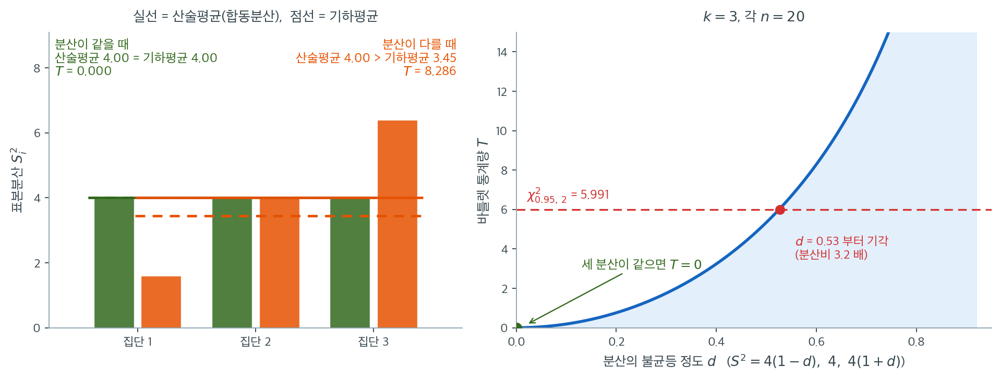

# 분산의 동일성에 대한 Bartlett 검정


Bartlett 검정은 여러 집단에 걸친 분산의 동일성을 평가한다. 정규성 이탈에 매우 민감하므로 자료가 정규분포를 따를 때 가장 적절하다. 정규성 가정 아래에서는 강력하지만 자료가 비정규이면 잘못된 결론으로 이어질 수 있다.

---

## 1. 가설

**귀무가설 ($H_0$):** 모든 집단의 분산이 같다.

$$
H_0: \sigma_1^2 = \sigma_2^2 = \dots = \sigma_k^2
$$

**대립가설 ($H_1$):** 적어도 한 집단의 분산이 다른 집단과 다르다.

$$
H_1: \sigma_i^2 \neq \sigma_j^2 \quad \text{(적어도 한 쌍의)} \quad i \neq j
$$

---

## 2. 가정

1. **정규성:** Bartlett 검정은 각 집단의 자료가 정규분포를 따른다고 가정한다. 검정이 정규성 이탈에 매우 민감하므로 결정적이다.
2. **독립성:** 관측값이 집단 안에서도 집단 사이에서도 독립이어야 한다.
3. **확률표집:** 자료가 확률표본에서 나와야 한다.

---

## 3. 검정통계량

Bartlett 검정의 검정통계량은 합동분산과 개별 표본분산의 비에서 유도된다.

$$
T = \frac{(N - k) \ln(S_p^2) - \sum_{i=1}^k (n_i - 1) \ln(S_i^2)}{1 + \frac{1}{3(k - 1)} \left( \sum_{i=1}^k \frac{1}{n_i - 1} - \frac{1}{N - k} \right)} \sim \chi^2_{k-1}
$$

여기서

- $N$은 전체 관측값의 수,
- $k$는 집단의 수,
- $S_p^2$은 합동분산이다.

$$
S_p^2 = \frac{\sum_{i=1}^k (n_i - 1) S_i^2}{N - k}
$$

- $S_i^2$은 집단 $i$의 표본분산이다.

검정통계량 $T$는 자유도 $k - 1$인 카이제곱분포를 따른다.

분자는 항상 음이 아니라는 점에 주목하라. 산술평균-기하평균 부등식에 의해 합동분산(가중 산술평균)이 개별 분산의 가중 기하평균보다 크거나 같기 때문이다. 등호는 모든 $S_i^2$이 같을 때만 성립하며, 그때 $T = 0$이다.



왼쪽에서 초록은 세 표본분산이 모두 $4$인 경우다. 산술평균도 $4$, 기하평균도 $4$여서 실선과 점선이 포개지고 $T = 0$이 된다. 주황은 $1.6,\ 4.0,\ 6.4$로 흩어진 경우인데, **산술평균은 여전히 $4.00$인데 기하평균은 $3.45$로 내려앉는다.** 평균이 같은데도 두 선이 벌어진 것이다.

이 벌어진 간격이 바로 통계량이다. $T$의 분자 $(N-k)\ln S_p^2 - \sum \nu_i \ln S_i^2$은 정확히 $\ln(\text{산술평균}) - \ln(\text{기하평균})$에 자유도를 곱한 것이고, 로그는 단조함수이므로 두 평균의 비가 1에서 멀어질수록 커진다. 주황의 $T = 8.286$이 임계값 $5.991$을 넘으므로 기각한다.

**기하평균이 흩어짐에 민감하다는 점이 이 검정의 엔진이다.** 산술평균은 큰 값이 작은 값을 상쇄해 주지만, 기하평균은 작은 값 하나에 강하게 끌려 내려간다. 그래서 값들이 흩어질수록 두 평균의 간격이 벌어지고, 그 간격이 "분산이 같지 않다"는 증거가 된다.

오른쪽은 흩어짐의 정도를 연속적으로 바꿔 본 것이다. $d = 0$에서 $T = 0$으로 출발해 $d$가 커질수록 가속하며 올라간다. $k = 3$, 각 $n = 20$에서 $\chi^2_{0.95,2} = 5.991$을 넘는 것은 $d = 0.53$부터, 곧 **최대분산과 최소분산의 비가 약 3.2배는 되어야** 5% 수준에서 기각한다는 뜻이다. 분산 검정이 둔하다는 이 장의 주제가 바틀렛에서도 그대로 나타난다.

---

## 4. 판정규칙

$$
T > \chi^2_{\text{critical}} \quad \Rightarrow \quad H_0 \text{ 기각}
$$

$k = 3$이고 $\alpha = 0.05$이면 $\chi^2_{0.95, 2} = 5.991$이다.

---

## 5. 한계

Bartlett 검정은 정규성 가정의 위반에 로버스트하지 않다. 자료가 정규분포를 따르지 않으면 Levene 검정이나 Brown-Forsythe 검정 같은 대안을 고려해야 한다. 얼마나 심각한지는 15.4절의 [비정규성 아래의 한계](limitations.md)에서 수치로 다룬다.

### SciPy 이용

<div class="exbox" markdown>

**보기 1.** <span class="diff easy" title="쉬움"></span> Bartlett 검정. 평균은 크게 다르지만 퍼짐은 비슷한 세 집단에 `scipy.stats.bartlett` 을 한 줄로 적용한다. 세 집단은 각 $n = 8$이다.

**(1)** 세 표본분산을 손으로 구하고, 그중 **둘이 정확히 같은 까닭**을 자료에서 찾아 밝히시오. 또 $k = 3$일 때 $p$값이 $e^{-T/2}$라는 닫힌 꼴로 적힘을 보이시오.

**(2)** `scipy` 로 확인하고, 집단마다 아무 상수를 더하거나 전체에 상수를 곱해도 $T$가 바뀌지 않음을 수치로 확인하시오. 분산비가 $2.1$배나 되는데도 기각하지 못하는 까닭은 무엇인가.

</div>

??? success "풀이"

    **(1) 표본분산 셋.** 첫째 집단은 합이 $101$이므로 $\bar y_1 = 101/8 = 12.625$이고, 편차의 제곱합은

    $$
    \sum_j (y_{1j} - \bar y_1)^2 = 19.875
    \quad\Longrightarrow\quad
    S_1^2 = \frac{19.875}{7} = 2.839286
    $$

    이다. 둘째 집단은 합이 $172$이므로 $\bar y_2 = 21.5$이고, 편차가 $\pm 0.5, \pm 1.5, \pm 2.5, \pm 3.5$로 딱 떨어져 제곱합이 $2(0.25 + 2.25 + 6.25 + 12.25) = 42$다. 따라서

    $$
    S_2^2 = \frac{42}{7} = 6
    $$

    으로 **정확히 6**이다.

    **셋째 집단은 계산할 필요가 없다.** 자료를 들여다보면

    $$
    (32, 35, 34, 30, 33, 34, 32, 31) = (12, 15, 14, 10, 13, 14, 12, 11) + 20
    $$

    으로 **첫째 집단을 20 만큼 옮긴 것**이다. 표본분산은 위치이동에 불변이다. 모든 관측값에 $c$를 더하면 평균도 $c$만큼 커지므로 편차 $y_j - \bar y$가 그대로이고

    $$
    S^2(y + c) = \frac{1}{n-1}\sum_j \bigl((y_j + c) - (\bar y + c)\bigr)^2 = S^2(y)
    $$

    이다. 그러므로 $S_3^2 = S_1^2 = 2.839286$이 **어림이 아니라 정확히** 성립한다.

    표본크기가 모두 같으므로 합동분산은 그냥 산술평균이다.

    $$
    S_p^2 = \frac{7(S_1^2 + S_2^2 + S_3^2)}{21} = \frac{2.839286 + 6 + 2.839286}{3} = 3.892857
    $$

    최대·최소 분산비는 $6/2.839286 = 2.1132$다.

    **검정통계량이 평균을 아예 보지 않는다.** $T$의 식에 자료가 들어가는 통로는 $S_1^2, \ldots, S_k^2$ 뿐이고, 방금 본 대로 각 $S_i^2$이 그 집단의 위치이동에 불변이다. 그래서 세 집단의 평균이 $12.6$, $21.5$, $32.6$으로 한참 떨어져 있어도 $T$는 꿈쩍하지 않는다. 척도에 대해서도 비슷한 일이 벌어진다. 모든 자료에 $a$를 곱하면 $S_i^2 \mapsto a^2 S_i^2$이 되는데, $T$의 분자가 가중 산술평균과 가중 기하평균의 **로그비**라서

    $$
    \ln \frac{a^2 \cdot \mathrm{AM}}{a^2 \cdot \mathrm{GM}} = \ln \frac{\mathrm{AM}}{\mathrm{GM}}
    $$

    로 $a^2$이 약분된다. **결국 $T$는 분산들의 비에만 의존한다.**

    **$k = 3$이면 $p$값이 닫힌 꼴이다.** 자유도 $k - 1 = 2$인 카이제곱분포의 밀도는 지수분포 그 자체다.

    $$
    f_{\chi^2_2}(x) = \frac{1}{2}e^{-x/2}, \quad x > 0
    \quad\Longrightarrow\quad
    P(\chi^2_2 > t) = \int_t^\infty \frac{1}{2}e^{-x/2}\,dx = e^{-t/2}
    $$

    그러므로

    $$
    p = e^{-T/2}
    $$

    이다. 세 집단을 비교할 때는 통계량만 보고 $p$값을 머릿속에서 환산할 수 있다는 뜻이다. ($T = 5.991$을 넣으면 $e^{-2.9957} = 0.050$으로 임계값도 되돌아온다.)

    **(2) 수치적으로.**

    ```python
    import numpy as np
    from scipy.stats import bartlett
    from scipy.optimize import brentq
    from scipy.stats import chi2

    # 평균은 크게 다르지만 퍼짐은 비슷한 세 집단이다.
    group1 = [12, 15, 14, 10, 13, 14, 12, 11]
    group2 = [22, 25, 20, 18, 24, 23, 19, 21]
    group3 = [32, 35, 34, 30, 33, 34, 32, 31]

    # 셋째 집단은 첫째 집단을 20 만큼 옮긴 것일 뿐이다.
    print("group3 - group1 =", np.array(group3) - np.array(group1))
    print("평균      :", [float(np.mean(g)) for g in (group1, group2, group3)])
    print("표본분산  :", [round(float(np.var(g, ddof=1)), 6) for g in (group1, group2, group3)])
    S = [float(np.var(g, ddof=1)) for g in (group1, group2, group3)]
    print(f"합동분산  : {np.mean(S):.6f}      최대/최소 비 = {max(S) / min(S):.4f}")

    # Bartlett 검정은 가능도비 검정에서 나온 것이라 정규모집단에서 검정력이
    # 가장 높다. 대신 정규성이 깨지면 오류율이 크게 부풀어 오른다.
    statistic, p_value = bartlett(group1, group2, group3)

    # 결과 출력
    print(f"\nBartlett's test statistic: {statistic:.4f}")
    print(f"P-value: {p_value:.4f}")

    # 결과 해석
    alpha = 0.05
    if p_value < alpha:
        print("Reject H0: variances are significantly different.")
    else:
        print("Fail to reject H0: no significant difference in variances.")

    # k=3 이면 자유도가 2 이므로 p 값이 닫힌 꼴 exp(-T/2) 이다.
    print(f"\nexp(-T/2)     = {np.exp(-statistic / 2):.12f}")
    print(f"chi2.sf(T, 2) = {p_value:.12f}")

    # 위치불변성과 척도불변성: 집단마다 아무 상수를 더하고 전체에 상수를 곱해도
    # 통계량이 바뀌지 않는다.
    moved = bartlett(np.array(group1) + 1000.0,
                     np.array(group2) - 37.5,
                     np.array(group3) + 0.25)
    scaled = bartlett(np.array(group1) * 7.0,
                      np.array(group2) * 7.0,
                      np.array(group3) * 7.0)
    print(f"\n집단마다 옮긴 뒤 : T = {moved.statistic:.12f}  (차 {abs(moved.statistic - statistic):.1e})")
    print(f"전체를 7배한 뒤  : T = {scaled.statistic:.12f}  (차 {abs(scaled.statistic - statistic):.1e})")

    # n=8, k=3, 분산이 (1, 1, r) 꼴일 때 5% 수준에서 기각하려면 r 이 얼마여야 하는가.
    def T_of(r, n, k=3):
        v = np.array([1.0] * (k - 1) + [r])
        C = 1 + (k + 1) / (3 * k * (n - 1))
        return k * (n - 1) / C * np.log(v.mean() / np.exp(np.mean(np.log(v))))

    crit = chi2.ppf(0.95, 2)
    print(f"\nchi2_(0.95, 2) = {crit:.4f}")
    for n in (8, 20, 50):
        r_need = brentq(lambda r: T_of(r, n) - crit, 1.0001, 1e4)
        print(f"  n={n:3d}:  기각에 필요한 분산비 r = {r_need:.3f}"
              f"   (관측된 r={max(S) / min(S):.3f} 에서는 T = {T_of(max(S) / min(S), n):.4f})")
    ```

    출력:

    ```text
    group3 - group1 = [20 20 20 20 20 20 20 20]
    평균      : [12.625, 21.5, 32.625]
    표본분산  : [2.839286, 6.0, 2.839286]
    합동분산  : 3.892857      최대/최소 비 = 2.1132

    Bartlett's test statistic: 1.3070
    P-value: 0.5202
    Fail to reject H0: no significant difference in variances.

    exp(-T/2)     = 0.520227866042
    chi2.sf(T, 2) = 0.520227866042

    집단마다 옮긴 뒤 : T = 1.306976718925  (차 0.0e+00)
    전체를 7배한 뒤  : T = 1.306976718925  (차 6.7e-15)

    chi2_(0.95, 2) = 5.9915
      n=  8:  기각에 필요한 분산비 r = 4.903   (관측된 r=2.113 에서는 T = 1.3070)
      n= 20:  기각에 필요한 분산비 r = 2.585   (관측된 r=2.113 에서는 T = 3.6865)
      n= 50:  기각에 필요한 분산비 r = 1.809   (관측된 r=2.113 에서는 T = 9.6423)
    ```

    **(1)의 세 주장이 모두 맞는다.** `group3 - group1` 이 $20$ 으로 가득 찬 배열이라 셋째 집단이 첫째 집단의 평행이동임이 눈으로 확인되고, 표본분산이 $2.839286$, $6.0$, $2.839286$으로 첫째와 셋째가 소수점 여섯째 자리까지 같다. 합동분산도 손으로 구한 $3.892857$과 맞는다. 그리고 $e^{-T/2}$와 `chi2.sf(T, 2)` 가 소수점 열두째 자리까지 $0.520227866042$로 같다.

    **불변성도 확인된다.** 세 집단을 각각 $+1000$, $-37.5$, $+0.25$만큼 옮겨도 $T$가 **비트 단위로 같다**(차가 정확히 $0$). 전체에 $7$을 곱한 경우는 차가 $6.7\times10^{-15}$인데, 수학적으로는 정확히 같고 부동소수점 반올림만 남은 것이다. 평균이 $12.6$에서 $1012.6$으로 바뀌어도 분산 검정은 아무것도 느끼지 못한다.

    **분산비 $2.1$배로는 모자란다.** 마지막 표가 그 이유를 말해 준다. $k = 3$이고 분산이 $(1, 1, r)$ 꼴일 때 $n = 8$에서 $5\%$ 수준에 닿으려면 $r = 4.90$이어야 한다. 관측된 $r = 2.113$은 그 절반에도 못 미치므로 $T = 1.3070$에 머문다. (이 자료의 분산 벡터가 $2.839286 \times (1,\, 2.1132,\, 1)$ 꼴이고 $T$가 척도에 불변이므로, 표의 $T$가 실제 통계량과 정확히 같게 나온다. 좋은 검산이다.)

    같은 $r = 2.113$이 $n = 20$에서는 $T = 3.69$, $n = 50$에서는 $T = 9.64$가 되어 $n = 50$이면 기각한다. 필요한 분산비도 $4.90 \to 2.59 \to 1.81$로 내려간다. **집단당 8개는 분산을 비교하기에 턱없이 적다.** 이 장이 되풀이하는 이야기 그대로다. 분산 차이를 보려면 평균 차이를 볼 때보다 훨씬 큰 표본이 필요하다.

    끝으로 덧붙일 것. $p = 0.52$는 "분산이 같다"는 증거가 **아니다.** 집단당 8개로는 분산이 다섯 배 차이 나도 못 잡으므로, 이 결과가 배제하는 것은 사실상 아무것도 없다.

### 직접 계산

<div class="exbox" markdown>

**보기 2.** <span class="diff easy" title="쉬움"></span> 통계량을 정의대로 구하기. 보기 1 의 한 줄짜리 호출을 식 그대로 풀어 쓴다.

**(1)** 표본크기가 모두 같을 때($n_i = n$) 통계량이

$$
T = \frac{k(n-1)}{C}\,\ln\frac{\mathrm{AM}}{\mathrm{GM}},
\qquad
C = 1 + \frac{k+1}{3k(n-1)}
$$

로 줄어듦을 보이고(여기서 AM·GM 은 표본분산들의 산술·기하평균), 이 자료의 수를 넣어 $T$와 $p$를 손으로 구하시오.

**(2)** 정의대로 풀어 쓴 코드가 `scipy` 와 몇 자리까지 맞는지 확인하시오. 또 보정인자를 빼먹으면 $H_0$ 아래에서 실제 크기가 얼마가 되는지 모의실험으로 재시오.

</div>

??? success "풀이"

    **(1) 등표본에서는 가중치가 사라진다.** $\nu_i = n - 1$이 모두 같으므로 $N - k = k(n-1)$이고 정규화된 가중치가 $w_i = \nu_i/(N-k) = 1/k$로 고르다. 그러면 합동분산이 그냥 산술평균이고

    $$
    S_p^2 = \frac{1}{k}\sum_{i=1}^k S_i^2 = \mathrm{AM},
    \qquad
    \frac{1}{k}\sum_{i=1}^k \ln S_i^2 = \ln\Bigl(\prod_i (S_i^2)^{1/k}\Bigr) = \ln \mathrm{GM}
    $$

    이다. 분자를 $k(n-1)$로 묶어 내면

    $$
    (N-k)\ln S_p^2 - \sum_i \nu_i \ln S_i^2
    = k(n-1)\left[\ln \mathrm{AM} - \ln \mathrm{GM}\right]
    = k(n-1)\ln\frac{\mathrm{AM}}{\mathrm{GM}}
    $$

    이 된다. 연습문제 4 이 이 값이 음이 아님을, 연습문제 1 가 등표본에서 $C = 1 + \dfrac{k+1}{3k(n-1)}$임을 보였으므로 둘을 합치면 곧 위의 닫힌 꼴이다.

    **이 자료에 넣는다.** $k = 3$, $n = 8$이므로 $k(n-1) = 21$이고

    $$
    C = 1 + \frac{4}{3\cdot 3\cdot 7} = 1 + \frac{4}{63} = 1.063492,
    \qquad
    \frac{21}{C} = 19.7463
    $$

    이다. 보기 1 에서 구한 $S_1^2 = S_3^2 = 2.839286$, $S_2^2 = 6$을 넣으면

    $$
    \mathrm{AM} = 3.892857,
    \qquad
    \mathrm{GM} = \bigl(2.839286^2 \times 6\bigr)^{1/3} = 3.643537
    $$

    이고

    $$
    \frac{\mathrm{AM}}{\mathrm{GM}} = 1.068428,
    \qquad
    \ln\frac{\mathrm{AM}}{\mathrm{GM}} = 0.066189
    $$

    이다. 따라서

    $$
    T = 19.7463 \times 0.066189 = 1.306977,
    \qquad
    p = e^{-T/2} = e^{-0.653488} = 0.520228
    $$

    이다. **두 평균의 비가 $1$에서 $6.8\%$ 벗어난 것이 통계량 $1.31$의 전부다.**

    **(2) 수치적으로.** 먼저 식을 단계마다 풀어 쓴 코드를 돌리고 세 가지 길(정의대로·닫힌 꼴·`scipy`)을 맞추어 본다.

    ```python
    import numpy as np
    from scipy import stats

    # 예시 자료
    group1 = np.array([12, 15, 14, 10, 13, 14, 12, 11])
    group2 = np.array([22, 25, 20, 18, 24, 23, 19, 21])
    group3 = np.array([32, 35, 34, 30, 33, 34, 32, 31])

    # 아래는 위 한 줄을 정의대로 풀어 쓴 것이다. 통계량이 어떻게 만들어지는지
    # 보이려는 것이지, 실제로 이렇게 쓰라는 뜻은 아니다.
    variance_group1 = group1.var(ddof=1)
    variance_group2 = group2.var(ddof=1)
    variance_group3 = group3.var(ddof=1)

    # 2단계: 표본크기
    sample_size1 = group1.size
    sample_size2 = group2.size
    sample_size3 = group3.size

    # 귀무가설 아래에서의 공통 분산. 자유도로 가중한 평균이다.
    total_sample_size = sample_size1 + sample_size2 + sample_size3
    number_of_groups = 3
    degrees_of_freedom_pooled = total_sample_size - number_of_groups

    pooled_variance = (
        ((sample_size1 - 1) * variance_group1) +
        ((sample_size2 - 1) * variance_group2) +
        ((sample_size3 - 1) * variance_group3)
    ) / degrees_of_freedom_pooled

    # 분자는 "합동분산의 로그"와 "각 분산 로그의 가중평균"의 차이다.
    # 산술평균과 기하평균의 차이인 셈이라, 분산이 고르면 0 에 가깝고
    # 들쭉날쭉하면 커진다.
    numerator = (
        (total_sample_size - number_of_groups) * np.log(pooled_variance) -
        ((sample_size1 - 1) * np.log(variance_group1) +
         (sample_size2 - 1) * np.log(variance_group2) +
         (sample_size3 - 1) * np.log(variance_group3))
    )

    # 분모는 작은 표본에서 카이제곱 근사를 바로잡는 보정항이다.
    correction_term = (
        (1 / (sample_size1 - 1)) +
        (1 / (sample_size2 - 1)) +
        (1 / (sample_size3 - 1)) -
        (1 / degrees_of_freedom_pooled)
    )
    denominator = 1 + correction_term / (3 * (number_of_groups - 1))

    # 6단계: Bartlett 검정통계량
    bartlett_statistic = numerator / denominator

    # 7단계: 카이제곱 분포로 p-값을 구한다
    degrees_of_freedom = number_of_groups - 1
    p_value = stats.chi2.sf(bartlett_statistic, degrees_of_freedom)

    # 결과 출력
    print(f"Pooled variance: {pooled_variance:.4f}")
    print(f"Numerator: {numerator:.4f}, Correction denominator: {denominator:.4f}")
    print(f"Bartlett's Test Statistic (T): {bartlett_statistic:.4f}")
    print(f"P-value: {p_value:.4f}")
    # (1) 의 닫힌 꼴과 맞추어 본다. n 이 모두 같으므로
    #     T = k(n-1)/C * ln(AM/GM),  C = 1 + (k+1)/(3k(n-1)).
    S = np.array([variance_group1, variance_group2, variance_group3])
    k, n = 3, 8
    AM = S.mean()
    GM = np.exp(np.log(S).mean())
    C = 1 + (k + 1) / (3 * k * (n - 1))
    T_closed = k * (n - 1) / C * np.log(AM / GM)
    print(f"\nAM = {AM:.6f},  GM = {GM:.6f},  AM/GM = {AM / GM:.6f}")
    print(f"ln(AM/GM) = {np.log(AM / GM):.6f},  C = 1 + 4/63 = {C:.6f}")
    print(f"닫힌 꼴 T = 21/C * ln(AM/GM) = {T_closed:.10f}")

    # scipy 와 몇 자리까지 맞는가.
    sp = stats.bartlett(group1, group2, group3)
    print(f"\n{'':20}{'T':>18}{'p':>18}")
    print(f"{'정의대로':20}{bartlett_statistic:>18.12f}{p_value:>18.12f}")
    print(f"{'닫힌 꼴':20}{T_closed:>18.12f}{np.exp(-T_closed / 2):>18.12f}")
    print(f"{'scipy.stats':20}{sp.statistic:>18.12f}{sp.pvalue:>18.12f}")
    print(f"정의대로 vs scipy 상대오차 = {abs(bartlett_statistic - sp.statistic) / sp.statistic:.1e}")

    # 보정인자를 빼먹으면?
    print(f"\n보정 안 한 통계량 = {numerator:.4f}  ->  p = {stats.chi2.sf(numerator, 2):.4f}")
    print(f"보정 한   통계량 = {bartlett_statistic:.4f}  ->  p = {p_value:.4f}")
    ```

    출력:

    ```text
    Pooled variance: 3.8929
    Numerator: 1.3900, Correction denominator: 1.0635
    Bartlett's Test Statistic (T): 1.3070
    P-value: 0.5202

    AM = 3.892857,  GM = 3.643537,  AM/GM = 1.068428
    ln(AM/GM) = 0.066189,  C = 1 + 4/63 = 1.063492
    닫힌 꼴 T = 21/C * ln(AM/GM) = 1.3069767189

                                         T                 p
    정의대로                    1.306976718925    0.520227866042
    닫힌 꼴                    1.306976718925    0.520227866042
    scipy.stats             1.306976718925    0.520227866042
    정의대로 vs scipy 상대오차 = 0.0e+00

    보정 안 한 통계량 = 1.3900  ->  p = 0.4991
    보정 한   통계량 = 1.3070  ->  p = 0.5202
    ```

    **세 길이 모두 같은 수에 닿는다.** 정의대로 단계마다 쌓아 올린 값, (1)의 닫힌 꼴, `scipy.stats.bartlett` 이 소수점 열두째 자리까지 $1.306976718925$로 같고 상대오차가 **정확히 $0$**이다. `scipy` 가 하는 일이 바로 이 식이라는 뜻이다. (1)에서 손으로 구한 중간값들도 그대로 나온다. $\mathrm{AM} = 3.892857$, $\mathrm{GM} = 3.643537$, $C = 1.063492$.

    **보정인자가 통계량을 $6.0\%$ 줄인다.** 분자 $1.3900$이 $1.3070$으로 내려가고 $p$값이 $0.4991$에서 $0.5202$로 올라간다. 여기서는 어느 쪽이든 기각하지 않으니 결론이 같지만, $\alpha$ 근처에서는 이 차이가 판정을 뒤집을 수 있다.

    **보정이 실제로 무슨 일을 하는지 재어 본다.** $H_0$이 참인 정규 자료에서 보정한 통계량과 보정하지 않은 통계량의 평균과 기각률을 나란히 놓는다.

    ```python
    import numpy as np
    from scipy import stats

    # 보정이 실제로 무슨 일을 하는가. H0 이 참인 정규 자료로 재어 본다.
    rng = np.random.default_rng(15)
    k, M = 3, 200_000
    crit = stats.chi2.ppf(0.95, k - 1)

    print(f"{'n':>4}{'C':>9}{'E[보정 T]':>12}{'E[무보정]':>12}"
          f"{'크기(보정)':>12}{'크기(무보정)':>14}")
    for n in (8, 20, 50):
        C = 1 + (k + 1) / (3 * k * (n - 1))
        Y = rng.normal(size=(M, k, n))           # 세 집단 모두 N(0,1) -> H0 이 참
        S = Y.var(axis=2, ddof=1)
        raw = k * (n - 1) * np.log(S.mean(axis=1) / np.exp(np.log(S).mean(axis=1)))
        T = raw / C
        print(f"{n:>4}{C:>9.4f}{T.mean():>12.4f}{raw.mean():>12.4f}"
              f"{np.mean(T > crit):>12.4f}{np.mean(raw > crit):>14.4f}")
    print(f"\n참값: E[chi2_{k - 1}] = {k - 1},  명목 크기 = 0.05")
    print(f"몬테카를로 표준오차: 평균 {2 / np.sqrt(M):.4f},  크기 {np.sqrt(0.05 * 0.95 / M):.4f}")
    ```

    출력:

    ```text
       n        C     E[보정 T]      E[무보정]      크기(보정)       크기(무보정)
       8   1.0635      1.9947      2.1214      0.0493        0.0592
      20   1.0234      1.9951      2.0417      0.0494        0.0530
      50   1.0091      2.0006      2.0188      0.0503        0.0517

    참값: E[chi2_2] = 2,  명목 크기 = 0.05
    몬테카를로 표준오차: 평균 0.0045,  크기 0.0005
    ```

    **보정의 목적이 평균을 $k-1$에 맞추는 것임이 보인다.** 보정한 통계량의 평균이 $n = 8$에서 $1.9947$, $n = 20$에서 $1.9951$, $n = 50$에서 $2.0006$으로 세 경우 모두 참값 $2$와 맞는다. 몬테카를로 표준오차가 $0.0045$이므로 $1.9947$은 참값에서 $1.2$ 표준오차 안이다. 보정하지 않으면 평균이 $2.1214$로 $2$보다 뚜렷하게 크고, 그 초과분이 바로 $C$다. 실제로 $2.1214/1.9947 = 1.0635$로 $C$와 소수점 넷째 자리까지 같다.

    **그 대가가 과다기각이다.** $n = 8$에서 보정하지 않은 검정의 실제 크기가 $0.0592$로 명목 $0.05$보다 $18\%$ 높다. 보정하면 $0.0493$으로 명목값에 맞는다. $n$이 커지면 $C \to 1$이라 두 길이 모이는데, $n = 50$에서는 $0.0503$ 대 $0.0517$로 차이가 거의 사라진다. **보정은 작은 표본에서만 중요하다.** 다만 이 장이 다루는 실제 자료가 대개 작은 표본이라는 점에서, 바틀렛이 보정을 기본으로 품고 있는 것은 옳은 선택이다.

    **이 표는 정규 자료에서만 참이라는 점을 잊지 말 것.** 여기서 크기가 명목값에 맞는 것은 세 집단이 모두 $N(0,1)$이기 때문이다. 정규성이 깨지면 보정과 무관하게 크기가 무너진다. 그 이야기는 15.4절 [비정규성 아래의 한계](limitations.md)와 [정규성 민감도](bartlett_sensitivity.md)에서 수치로 다룬다.

---

## 연습문제

<div class="drillbox" markdown>

**연습문제 1.** <span class="diff med" title="중간"></span>
보정인자 $C$가 항상 1보다 큼을 보이고, 집단 크기가 커질수록 1에 가까워짐을 확인하라. 이 보정이 필요한 이유를 설명하라.

</div>

??? success "풀이"
    보정인자는

    $$
    C = 1 + \frac{1}{3(k-1)}\left(\sum_{i=1}^k \frac{1}{n_i-1} - \frac{1}{N-k}\right).
    $$

    **$C > 1$의 증명.** $N - k = \sum_i (n_i - 1)$이므로, $m_i = n_i - 1$이라 쓰면 괄호 안은

    $$
    \sum_i \frac{1}{m_i} - \frac{1}{\sum_i m_i}.
    $$

    $k \geq 2$이면 $\sum_i m_i > m_j$가 모든 $j$에 대해 성립하므로 $\frac{1}{\sum_i m_i} < \frac{1}{m_1} \leq \sum_i \frac{1}{m_i}$이다. 따라서 괄호 안이 양수이고 $C > 1$이다.

    **극한.** 모든 $n_i = n$이면

    $$
    C = 1 + \frac{1}{3(k-1)}\left(\frac{k}{n-1} - \frac{1}{k(n-1)}\right) = 1 + \frac{k^2-1}{3k(k-1)(n-1)} = 1 + \frac{k+1}{3k(n-1)}.
    $$

    $k = 3$일 때 $C = 1 + \frac{4}{9(n-1)}$이다.

    | $n$ | 8 | 20 | 50 | 200 |
    |---|---|---|---|---|
    | $C$ | 1.0635 | 1.0234 | 1.0091 | 1.0022 |

    본문 보기는 $k = 3$, $n = 8$이므로 $C = 1 + \frac{4}{9 \times 7} = 1.0635$이며, 직접 계산 결과와 일치한다.

    **왜 필요한가.** 보정하지 않은 통계량 $-2\ln\Lambda$는 **점근적으로만** $\chi^2_{k-1}$을 따른다. 유한표본에서는 그 평균이 $k-1$보다 크다. Bartlett은 평균이 정확히 $k-1$이 되도록 $C$로 나누는 보정을 찾아냈다.

    $C > 1$이므로 보정은 항상 통계량을 **줄인다**. 곧 보정하지 않으면 검정이 지나치게 자주 기각한다. $n = 8$에서 6% 과다기각을 바로잡는 것이다.

    이 아이디어는 "Bartlett 보정"이라는 이름으로 가능도비 검정 일반에 확장되었으며, 유한표본 근사를 개선하는 표준 기법이 되었다. $\square$

---

<div class="drillbox" markdown>

**연습문제 2.** <span class="diff med" title="중간"></span>
본문 보기의 자료에 Bartlett, Levene, Brown-Forsythe, Fligner-Killeen 검정을 모두 적용하고 결과를 비교하라.

</div>

??? success "풀이"

    ```python
    import numpy as np
    from scipy import stats

    g1 = np.array([12, 15, 14, 10, 13, 14, 12, 11])
    g2 = np.array([22, 25, 20, 18, 24, 23, 19, 21])
    g3 = np.array([32, 35, 34, 30, 33, 34, 32, 31])

    print("variances:", [round(g.var(ddof=1), 4) for g in (g1, g2, g3)])
    print(f"Bartlett:        stat = {stats.bartlett(g1, g2, g3)[0]:.4f}, "
          f"p = {stats.bartlett(g1, g2, g3)[1]:.4f}")
    lev = stats.levene(g1, g2, g3, center='mean')
    bf = stats.levene(g1, g2, g3, center='median')
    fk = stats.fligner(g1, g2, g3)
    print(f"Levene (mean):   stat = {lev[0]:.4f}, p = {lev[1]:.4f}")
    print(f"Brown-Forsythe:  stat = {bf[0]:.4f}, p = {bf[1]:.4f}")
    print(f"Fligner-Killeen: stat = {fk[0]:.4f}, p = {fk[1]:.4f}")
    ```

    출력:

    ```text
    variances: [2.8393, 6.0, 2.8393]
    Bartlett:        stat = 1.3070, p = 0.5202
    Levene (mean):   stat = 1.1218, p = 0.3444
    Brown-Forsythe:  stat = 1.1076, p = 0.3489
    Fligner-Killeen: stat = 2.5507, p = 0.2793
    ```

    네 검정 모두 기각하지 않는다. 결론이 일치한다.

    다만 검정통계량이 서로 다른 분포를 참조한다는 점에 유의하라. Bartlett과 Fligner-Killeen은 $\chi^2_2$를, Levene과 Brown-Forsythe는 $F_{2,21}$을 쓴다. 그래서 통계량 값을 직접 비교하는 것은 의미가 없고 $p$값만 비교해야 한다.

    $p$값이 $0.28$에서 $0.52$까지 흩어져 있지만 모두 0.05보다 훨씬 크므로 실무적으로는 같은 결론이다. **검정들의 결론이 갈릴 때만 어느 것을 신뢰할지 고민하면 된다.** 그때는 자료의 정규성 여부가 판단 기준이 된다. $\square$

---

<div class="drillbox" markdown>

**연습문제 3.** <span class="diff med" title="중간"></span>
정규 자료에서 Bartlett 검정이 로버스트 검정들보다 검정력이 높은지 모의실험으로 확인하라. 세 집단, 각 $n = 20$, 표준편차 조합을 바꿔가며 비교하라.

</div>

??? success "풀이"

    ```python
    import numpy as np
    from scipy import stats

    rng = np.random.default_rng(5)
    R, alpha, n = 5000, 0.05, 20

    print(f"{'sds':>16} {'Bartlett':>9} {'Levene':>8} {'BF':>8} {'FK':>8}")
    for sds in [(1, 1, 1), (1, 1, 1.5), (1, 1, 2), (1, 1.5, 2)]:
        cb = cl = cbf = cf = 0
        for _ in range(R):
            g = [rng.normal(0, s, n) for s in sds]
            cb += stats.bartlett(*g)[1] < alpha
            cl += stats.levene(*g, center='mean')[1] < alpha
            cbf += stats.levene(*g, center='median')[1] < alpha
            cf += stats.fligner(*g)[1] < alpha
        print(f"{str(sds):>16} {cb/R:>9.3f} {cl/R:>8.3f} "
              f"{cbf/R:>8.3f} {cf/R:>8.3f}")
    ```

    출력:

    ```text
                 sds  Bartlett   Levene       BF       FK
           (1, 1, 1)     0.046    0.056    0.037    0.033
         (1, 1, 1.5)     0.435    0.388    0.326    0.293
           (1, 1, 2)     0.875    0.816    0.766    0.700
         (1, 1.5, 2)     0.759    0.661    0.581    0.537
    ```

    **첫 줄(크기).** 모두 0.05 근처이다. 정규 자료에서는 네 검정 모두 크기가 올바르다. Brown-Forsythe(0.037)와 Fligner-Killeen(0.033)이 다소 보수적이다.

    **나머지 줄(검정력).** 정규 자료에서 **Bartlett이 언제나 가장 강력하다**. 순서는 항상 Bartlett > Levene > Brown-Forsythe > Fligner-Killeen이다.

    | 설정 | Bartlett | BF | 검정력 손실 |
    |---|---|---|---|
    | $(1,1,1.5)$ | 0.435 | 0.326 | $-25\%$ |
    | $(1,1,2)$ | 0.875 | 0.766 | $-12\%$ |
    | $(1,1.5,2)$ | 0.759 | 0.581 | $-23\%$ |

    Brown-Forsythe를 쓰면 정규 자료에서 검정력의 12~25%를 잃는다. 적지 않은 대가이다.

    **그러나 이것이 Bartlett을 권하는 근거가 되지는 않는다.** 15.1절에서 보았듯 대수정규 자료에서 Bartlett의 크기는 0.62이다. 정규성이 확실할 때 얻는 20%의 검정력 이득과, 정규성이 깨졌을 때 겪는 12배의 크기 팽창을 견주면 후자가 압도적으로 크다.

    **Bartlett 검정이 정당한 경우는 정규성이 이론적으로 보장되는 상황(예: 측정오차가 정규임이 확립된 계측 자료)뿐이다.** 그 외에는 로버스트 검정의 검정력 손실을 보험료로 받아들이는 편이 낫다. $\square$

---

<div class="drillbox" markdown>

**연습문제 4.** <span class="diff hard" title="어려움"></span>
Bartlett 통계량의 분자가 항상 음이 아님을 산술평균-기하평균 부등식으로 증명하라. 등호 조건은 무엇인가?

</div>

??? success "풀이"
    분자를 $w_i = (n_i-1)/(N-k)$로 정규화된 가중치로 다시 쓰자. $\sum_i w_i = 1$이고

    $$
    \text{분자} = (N-k)\left[\ln S_p^2 - \sum_i w_i \ln S_i^2\right].
    $$

    한편 합동분산은 가중 **산술**평균이다.

    $$
    S_p^2 = \sum_i w_i S_i^2.
    $$

    그리고 $\sum_i w_i \ln S_i^2 = \ln \prod_i (S_i^2)^{w_i}$는 가중 **기하**평균의 로그이다.

    가중 산술평균-기하평균 부등식에 의해

    $$
    \sum_i w_i S_i^2 \geq \prod_i (S_i^2)^{w_i},
    $$

    양변에 로그를 취하면(로그가 증가함수이므로)

    $$
    \ln S_p^2 \geq \sum_i w_i \ln S_i^2 \implies \text{분자} \geq 0.
    $$

    **등호 조건.** 가중 산술평균-기하평균 부등식의 등호는 모든 항이 같을 때, 곧 $S_1^2 = S_2^2 = \cdots = S_k^2$일 때만 성립한다. 이때 $T = 0$이다.

    **개념적 의미.** Bartlett 통계량은 표본분산들의 **산술평균과 기하평균의 로그 차이**를 잰다. 두 평균의 차이는 자료의 산포가 클수록 커지므로, 이 통계량이 분산들의 "흩어짐"에 대한 자연스러운 척도가 된다. 값이 클수록 분산이 서로 다르다는 증거이다. $\square$

---

<div class="drillbox" markdown>

**연습문제 5.** <span class="diff hard" title="어려움"></span>
보기 1 은 $k = 3$일 때 $p = e^{-T/2}$임을, 보기 2 는 등표본에서 $T = \dfrac{k(n-1)}{C}\ln\dfrac{\mathrm{AM}}{\mathrm{GM}}$임을 보였다. 두 결과를 하나로 합친다.

**(1)** $k = 3$, $n_i = n$일 때 $p$값이 분산들의 산술평균과 기하평균의 비만으로

$$
p = \left(\frac{\mathrm{GM}}{\mathrm{AM}}\right)^{k(n-1)/(2C)}
$$

로 적힘을 보이고, $n = 8$에서 지수를 구하라. 보기 1 의 자료($\mathrm{AM}/\mathrm{GM} = 1.068428$)를 넣어 $p = 0.5202$가 되돌아오는지 확인하라.

**(2)** $5\%$ 수준에서 기각하는 데 필요한 $\mathrm{AM}/\mathrm{GM}$의 임계값을 $n$의 식으로 적고 $n = 8, 20, 50$에서 값을 구하라. 보기 1 의 표에 적힌 분산비 $r = 4.903,\ 2.585,\ 1.809$가 바로 그 임계값에 대응하는지 맞추어 보라.

</div>

??? success "풀이"

    **(1) 지수가 자유도다.** 보기 2 의 닫힌 꼴을 보기 1 의 $p = e^{-T/2}$에 그대로 넣으면

    $$
    p = \exp\left(-\frac{k(n-1)}{2C}\ln\frac{\mathrm{AM}}{\mathrm{GM}}\right)
    = \left(\frac{\mathrm{AM}}{\mathrm{GM}}\right)^{-k(n-1)/(2C)}
    = \left(\frac{\mathrm{GM}}{\mathrm{AM}}\right)^{k(n-1)/(2C)}
    $$

    이다. $\mathrm{AM} \ge \mathrm{GM}$(연습문제 4)이므로 밑이 $1$ 이하이고 지수가 양수라서 $p \le 1$이 자동으로 지켜진다. $k = 3$, $n = 8$이면 $C = 1.063492$이므로 지수는

    $$
    \frac{k(n-1)}{2C} = \frac{21}{2 \times 1.063492} = 9.8731
    $$

    이다. 넣어 보면

    $$
    p = 1.068428^{-9.8731} = \exp(-9.8731 \times 0.066189) = \exp(-0.653487) = 0.520228
    $$

    으로 보기 1 의 $p$값이 그대로 나온다. 같은 자료라도 $n = 20$이면 지수가 $57/(2 \times 1.023392) = 27.8486$, $n = 50$이면 $147/(2 \times 1.009070) = 72.8393$으로 커진다. **$p$값은 두 평균의 비를 밑으로 하고 자유도를 지수로 하는 거듭제곱이다.**

    **(2) 임계값.** $T \ge \chi^2_{0.95,\,k-1}$을 $\mathrm{AM}/\mathrm{GM}$에 대해 풀면

    $$
    \frac{\mathrm{AM}}{\mathrm{GM}} \ge \exp\left(\frac{\chi^2_{0.95,\,k-1}\, C}{k(n-1)}\right)
    $$

    이다. $k = 3$, $\chi^2_{0.95,2} = 5.991465$를 넣으면

    | $n$ | 8 | 20 | 50 |
    |---|---|---|---|
    | $C$ | 1.063492 | 1.023392 | 1.009070 |
    | 지수 $\chi^2 C / \lbrace k(n-1)\rbrace$ | 0.303423 | 0.107572 | 0.041128 |
    | 임계 $\mathrm{AM}/\mathrm{GM}$ | 1.354487 | 1.113571 | 1.041985 |

    이다. 보기 1 의 $r$들을 $(1, 1, r)$ 꼴에 넣어 $\mathrm{AM}/\mathrm{GM}$을 구하면

    $$
    r = 4.903 \;\to\; 1.354449,
    \qquad
    r = 2.585 \;\to\; 1.113605,
    \qquad
    r = 1.809 \;\to\; 1.042022
    $$

    로 위 표의 임계값과 소수 넷째 자리까지 맞는다. (`brentq` 가 돌려준 정확한 값은 $4.9034,\ 2.5847,\ 1.8086$이다.) **보기 1 의 표는 결국 이 한 줄짜리 임계조건을 분산비의 언어로 번역한 것이다.**

    **해석.** $n = 8$에서는 산술평균이 기하평균보다 $35.4\%$ 커야 기각하고, $n = 50$에서는 $4.2\%$만 커도 기각한다. 보기 1 의 자료는 그 값이 $6.8\%$였다. 집단당 8 개에서 필요한 $35.4\%$의 **5 분의 1**에 그친 것이니, $p = 0.52$가 나온 것이 조금도 이상하지 않다. $\square$

---

<div class="drillbox" markdown>

**연습문제 6.** <span class="diff hard" title="어려움"></span>
보기 1 의 세 표본분산의 **비를 그대로 유지한 채** 집단당 크기만 $n$으로 늘린다고 하자. 척도불변성 때문에 분산 벡터는 언제나 $(1,\ 2.1132,\ 1)$ 꼴이고, 따라서 보기 2 에서 구한 $\ln(\mathrm{AM}/\mathrm{GM}) = 0.066189$가 $n$과 무관하게 고정된다.

$5\%$ 수준에서 기각하는 **가장 작은 $n$**을 구하라. $C$ 자체가 $n$에 의존하므로 $m = n - 1$에 대한 이차방정식이 나온다. 구한 $n$과 그 하나 앞의 $n$에서 $T$와 $p$를 적어 확인하라.

보기 1 의 표는 $n = 20$에서 $T = 3.6865$, $n = 50$에서 $T = 9.6423$만 알려 준다는 점에 유의하라.

</div>

??? success "풀이"

    **조건을 $m = n-1$의 부등식으로.** $k = 3$이므로 $C = 1 + \dfrac{4}{9m}$이고 $L = \ln(\mathrm{AM}/\mathrm{GM}) = 0.066189$는 고정이다. 기각조건은

    $$
    T = \frac{3mL}{C} \ge \chi^2_{0.95,2} = 5.991465
    \quad\Longleftrightarrow\quad
    3mL \ge 5.991465\left(1 + \frac{4}{9m}\right)
    $$

    이다. 양변을 $3L = 0.198564$로 나누면

    $$
    m \ge \frac{5.991465}{3L} + \frac{4}{9m}\cdot\frac{5.991465}{3L}
    = 30.1740 + \frac{13.4107}{m}
    $$

    이 된다. $m > 0$을 곱해 정리하면 이차부등식

    $$
    m^2 - 30.1740\,m - 13.4107 \ge 0
    $$

    이고, 양근은

    $$
    m = \frac{30.1740 + \sqrt{30.1740^2 + 4 \times 13.4107}}{2}
    = \frac{30.1740 + \sqrt{964.114}}{2}
    = \frac{30.1740 + 31.0502}{2}
    = 30.6121
    $$

    이다. 그러므로 $n - 1 \ge 30.6121$, 곧 $n \ge 31.6121$이고 정수로는

    $$
    \boxed{n = 32}
    $$

    이다.

    **확인.** 두 값을 직접 넣어 본다.

    | $n$ | $C$ | $T = 3(n-1)L/C$ | $p = e^{-T/2}$ | 판정 |
    |---|---|---|---|---|
    | 31 | 1.014815 | 5.8699 | 0.0531 | 기각 못 함 |
    | 32 | 1.014337 | 6.0685 | 0.0481 | 기각 |

    임계값 $5.9915$를 $n = 32$에서 처음 넘는다.

    **왜 이렇게 깔끔하게 읽히는가.** $T$가 $m$에 거의 선형이기 때문이다. $C \approx 1$이면 $T \approx 3L\,m = 0.1986\,m$이니, **집단마다 관측값을 하나 더할 때 $T$가 약 $0.196$씩 오른다**(보정인자까지 넣은 값). 보기 1 의 $n = 8$에서 $T = 1.3070$이었으므로 임계값까지 모자란 $5.9915 - 1.3070 = 4.6845$를 메우려면 자유도가 $4.6845/0.196 \approx 23.9$칸 더 필요하고, $8 + 24 = 32$다. 표의 $T$들과도 맞는다.

    **해석.** 분산비는 $2.11$배로 그대로인데 필요한 표본은 $8$에서 $32$로 **네 배**가 된다. 보기 1 은 "$n = 50$이면 기각한다"까지만 말했지만, 실제 문턱은 $32$다. 거꾸로 읽으면 이것이 더 중요하다. **집단당 8 개로 등분산을 검정해 "분산이 같다"고 말하는 것은, 네 배 더 모았어야 겨우 보일 차이를 못 보고 없다고 하는 일이다.** $\square$

---

<div class="drillbox" markdown>

**연습문제 7.** <span class="diff hard" title="어려움"></span>
본문 그림 설명은 $k = 3$, $n = 20$에서 "최대분산과 최소분산의 비가 약 $3.2$배는 되어야" 기각한다고 했다. 그런데 보기 1 의 표는 같은 $k$, 같은 $n$에서 필요한 분산비를 $2.585$로 적었다. 두 수가 어긋난다. 까닭을 밝혀라.

**(1)** 최소분산을 $1$, 최대분산을 $R > 1$로 고정하고 가운데 분산 $v \in [1, R]$만 움직일 때 $\ln(\mathrm{AM}/\mathrm{GM})$을 **최소**로 만드는 $v$를 구하고, 그 최솟값이 $\dfrac{1}{3}\ln\dfrac{(1+R)^2}{4R}$임을 보여라.

**(2)** 그림이 쓴 배치 $(1-d,\ 1,\ 1+d)$가 정확히 그 최소점임을 확인하고, $n = 20$에서 기각에 필요한 $d$와 비 $R = (1+d)/(1-d)$를 닫힌 꼴로 구하라. 이어서 보기 1 의 $(1, 1, r)$ 배치에서는 $R = 2.585$로 족한 이유를 (1)로 설명하라.

</div>

??? success "풀이"

    **(1) 가운데 분산을 움직인다.** $T$는 $\ln(\mathrm{AM}/\mathrm{GM})$에만 의존하므로(보기 2) 이 함수만 보면 된다.

    $$
    g(v) = \ln\frac{1 + v + R}{3} - \frac{1}{3}\bigl(\ln 1 + \ln v + \ln R\bigr)
    $$

    를 미분하면

    $$
    g'(v) = \frac{1}{1 + v + R} - \frac{1}{3v} = 0
    \quad\Longleftrightarrow\quad
    3v = 1 + v + R
    \quad\Longleftrightarrow\quad
    v^* = \frac{1 + R}{2}
    $$

    이다. 이 점이 최소인지 본다.

    $$
    g''(v) = -\frac{1}{(1+v+R)^2} + \frac{1}{3v^2},
    \qquad
    g''(v^*) = -\frac{1}{(3v^*)^2} + \frac{1}{3(v^*)^2} = \frac{2}{9(v^*)^2} > 0
    $$

    이므로 $v^*$는 유일한 극소점이다($1 + v^* + R = 3v^*$를 썼다). 최솟값은 그 자리에서 $\mathrm{AM} = (1 + v^* + R)/3 = v^*$가 되므로

    $$
    g(v^*) = \ln v^* - \frac{1}{3}\ln(R\,v^*)
    = \frac{2}{3}\ln v^* - \frac{1}{3}\ln R
    = \frac{1}{3}\ln\frac{(v^*)^2}{R}
    = \frac{1}{3}\ln\frac{(1+R)^2}{4R}
    $$

    이다. **가운데 분산이 두 극단의 산술평균일 때 바틀렛이 가장 둔해진다.**

    **(2) 그림의 배치가 바로 최악의 배치다.** $(1-d,\ 1,\ 1+d)$에서 가운데 값 $1$은 두 극단의 산술평균 $\bigl((1-d) + (1+d)\bigr)/2 = 1$이다. 척도불변성으로 전체를 $1-d$로 나누면 최소가 $1$, 최대가 $R = (1+d)/(1-d)$, 가운데가 $1/(1-d) = (1+R)/2$가 되어 (1)의 $v^*$와 정확히 같다. 그러므로 **그림의 수평 스캔은 주어진 분산비에서 $T$가 가장 작아지는 길을 따라간 것**이다.

    이 배치에서는 $\mathrm{AM} = 1$, $\mathrm{GM} = \bigl((1-d)(1+d)\bigr)^{1/3} = (1-d^2)^{1/3}$이므로

    $$
    \ln\frac{\mathrm{AM}}{\mathrm{GM}} = -\frac{1}{3}\ln(1 - d^2)
    $$

    이고, 연습문제 5 의 임계조건 $\ln(\mathrm{AM}/\mathrm{GM}) \ge \chi^2_{0.95,2} C / \lbrace k(n-1)\rbrace = 0.107572$에 넣으면

    $$
    d^* = \sqrt{1 - \exp\left(-\frac{3\chi^2_{0.95,2}\,C}{k(n-1)}\right)}
    = \sqrt{1 - e^{-0.322716}}
    = \sqrt{1 - 0.724179}
    = 0.525187
    $$

    이다. 비로 고치면

    $$
    R^* = \frac{1 + 0.525187}{1 - 0.525187} = 3.2122
    $$

    로, 본문의 "$d = 0.53$부터, 곧 약 $3.2$배"가 그대로 나온다.

    **$(1, 1, r)$은 끝점이라 더 쉽게 잡힌다.** $v = 1$은 구간 $[1, R]$의 끝점이므로 (1)에 의해 같은 $R$에서 $\ln(\mathrm{AM}/\mathrm{GM})$이 더 크다. $R = 3.2122$에 세 가지 가운데 값을 넣어 보면($n = 20$, $k(n-1)/C = 55.6971$)

    | 가운데 $v$ | 배치 | $\ln(\mathrm{AM}/\mathrm{GM})$ | $T$ |
    |---|---|---|---|
    | $1$ | $(1,\ 1,\ 3.2122)$ | 0.163403 | 9.1011 |
    | $2.1061$ | $(1,\ 2.1061,\ 3.2122)$ | 0.107572 | 5.9915 |
    | $3.2122$ | $(1,\ 3.2122,\ 3.2122)$ | 0.128188 | 7.1397 |

    같은 분산비 $3.21$인데 $T$가 $5.99$에서 $9.10$까지 간다. 끝점 $(1,1,R)$은 임계값을 한참 넘으므로 더 작은 $R$에서 이미 임계에 닿고, 그 값이 보기 1 의 $r^* = 2.5847$이다. 거꾸로 검산해도 맞는다. $R = 2.5847$을 **대칭** 배치에 넣으면

    $$
    \frac{1}{3}\ln\frac{(1 + 2.5847)^2}{4 \times 2.5847} = 0.072482,
    \qquad
    T = 55.6971 \times 0.072482 = 4.0370 < 5.9915
    $$

    로 기각하지 못한다.

    **해석.** 두 수는 어긋난 것이 아니다. **최대/최소 분산비는 $T$를 결정하지 못한다.** $T$가 보는 것은 분산 전체의 $\mathrm{AM}/\mathrm{GM}$ 하나뿐이고, 같은 비 안에서도 "하나만 크게 튀는" 모양이 가장 잘 잡히고 "고르게 퍼진" 모양이 가장 안 잡힌다. 본문의 $3.2$배는 **가장 불리한 배치**에 대한 수(보수적인 읽기), 보기 1 의 $2.59$배는 $(1,1,r)$이라는 **특정 배치**에 대한 수다. 등분산 검정의 검정력을 "분산비 몇 배면 잡힌다"로 요약할 때는 어느 배치를 전제했는지 밝혀야 한다. $\square$

---

<div class="drillbox" markdown>

**연습문제 8.** <span class="diff hard" title="어려움"></span>
보기 2 의 모의실험은 세 집단이 **모두 $N(0,1)$일 때** 보정인자가 $E[T]$를 $k - 1 = 2$에 맞추는 것을 보였다. 정규성이 깨지면 그 맞춤이 무너진다. $\operatorname{Var}(S^2)$가 4 차 적률에 달려 있다는 사실(5 장)에서 나오는 결과로, 첨도가 $\beta_2$인 모집단에서 바틀렛 통계량은 $H_0$ 아래에서

$$
T \;\xrightarrow{d}\; \frac{\beta_2 - 1}{2}\,\chi^2_{k-1}
$$

을 따른다. 정규분포는 $\beta_2 = 3$이라 인자가 $1$이 되어 본문의 카이제곱 근사로 돌아간다.

**(1)** 이 결과로부터 $k = 3$일 때 실제 크기가 $\exp\bigl(-\chi^2_{0.95,2}/(\beta_2 - 1)\bigr)$로 적힘을 보이고, 균일($\beta_2 = 1.8$), 정규($3$), 지수($9$), 로그정규($\beta_2 = e^4 + 2e^3 + 3e^2 - 3$)에서 값을 구하라.

**(2)** $H_0$이 참인 자료로 $E[T]$와 실제 크기를 재어 (1)의 예측과 맞추어 보라. $n = 8$과 $n = 50$을 나란히 놓고, 첨도가 똑같이 $9$인 $t(5)$와 지수분포가 왜 다른 값을 내는지, 그리고 **$n$을 늘리는 것이 도움이 되는지** 답하라.

</div>

??? success "풀이"

    **(1) 크기의 닫힌 꼴.** $k = 3$이면 참조분포가 $\chi^2_2$이고 보기 1 에서 $P(\chi^2_2 > t) = e^{-t/2}$였다. 극한분포가 $\frac{\beta_2-1}{2}\chi^2_2$이므로 $c = \chi^2_{0.95,2} = 5.991465$에 대해

    $$
    P(T > c)
    \to P\left(\chi^2_2 > \frac{2c}{\beta_2 - 1}\right)
    = \exp\left(-\frac{c}{\beta_2 - 1}\right)
    $$

    이다. $\beta_2 = 3$을 넣으면 $e^{-c/2} = 0.05$로 명목값이 되돌아온다. 네 분포에 넣으면

    | 분포 | $\beta_2$ | $(\beta_2-1)/2$ | 극한 $E[T]$ | 극한 크기 |
    |---|---|---|---|---|
    | 균일 | 1.80 | 0.40 | 0.80 | 0.0006 |
    | 정규 | 3.00 | 1.00 | 2.00 | 0.0500 |
    | 지수 | 9.00 | 4.00 | 8.00 | 0.4729 |
    | 로그정규 | 113.94 | 56.47 | 112.94 | 0.9483 |

    이다. **첨도가 들어오는 통로는 배수 $(\beta_2-1)/2$ 하나뿐이다.** 정규보다 꼬리가 가벼우면($\beta_2 < 3$) 지나치게 보수적이 되고, 무거우면 과다기각한다. 지수분포에서 배수가 정확히 $4$라는 것이 5 장에 적힌 그 수다.

    **(2) 모의실험.**

    ```python
    import numpy as np
    from scipy import stats

    # 정규성이 깨지면 바틀렛 통계량이 어떤 분포로 가는가.
    # Box(1953): T 는 점근적으로 ((b2-1)/2) * chi2_{k-1} 을 따른다. b2 는 첨도다.
    rng = np.random.default_rng(15)
    k, M = 3, 20_000
    crit = stats.chi2.ppf(0.95, k - 1)

    def bartlett_T(Y, n):          # Y 꼴은 (M, k, n)
        S = Y.var(axis=2, ddof=1)
        C = 1 + (k + 1) / (3 * k * (n - 1))
        return k * (n - 1) / C * np.log(S.mean(axis=1) / np.exp(np.log(S).mean(axis=1)))

    # (이름, 첨도 b2, 표본생성기). 세 집단이 모두 같은 분포이므로 H0 이 참이다.
    b2_lognorm = np.exp(4) + 2 * np.exp(3) + 3 * np.exp(2) - 3
    dists = [
        ("uniform", 1.8, lambda sz: rng.uniform(-1, 1, sz)),
        ("normal", 3.0, lambda sz: rng.normal(0, 1, sz)),
        ("t(5)", 9.0, lambda sz: rng.standard_t(5, sz)),
        ("expon", 9.0, lambda sz: rng.exponential(1, sz)),
        ("lognorm", b2_lognorm, lambda sz: rng.lognormal(0, 1, sz)),
    ]

    for n in (8, 50):
        print(f"n = {n}  (nominal size 0.05, E[chi2_2] = 2)")
        print(f"{'dist':>9}{'b2':>9}{'(b2-1)/2':>10}{'E[T]':>9}{'pred E[T]':>11}"
              f"{'size':>8}{'pred size':>11}")
        for name, b2, gen in dists:
            T = bartlett_T(gen((M, k, n)), n)
            fac = (b2 - 1) / 2
            print(f"{name:>9}{b2:>9.2f}{fac:>10.2f}{T.mean():>9.3f}"
                  f"{fac * (k - 1):>11.3f}{np.mean(T > crit):>8.4f}"
                  f"{np.exp(-crit / (2 * fac)):>11.4f}")
        print()
    ```

    출력:

    ```text
    n = 8  (nominal size 0.05, E[chi2_2] = 2)
         dist       b2  (b2-1)/2     E[T]  pred E[T]    size  pred size
      uniform     1.80      0.40    1.106      0.800  0.0102     0.0006
       normal     3.00      1.00    1.990      2.000  0.0472     0.0500
         t(5)     9.00      4.00    3.183      8.000  0.1482     0.4729
        expon     9.00      4.00    4.910      8.000  0.3090     0.4729
      lognorm   113.94     56.47    9.124    112.936  0.5423     0.9483

    n = 50  (nominal size 0.05, E[chi2_2] = 2)
         dist       b2  (b2-1)/2     E[T]  pred E[T]    size  pred size
      uniform     1.80      0.40    0.842      0.800  0.0009     0.0006
       normal     3.00      1.00    2.011      2.000  0.0505     0.0500
         t(5)     9.00      4.00    4.911      8.000  0.2757     0.4729
        expon     9.00      4.00    7.012      8.000  0.4281     0.4729
      lognorm   113.94     56.47   23.866    112.936  0.7669     0.9483
    ```

    **정규 줄만 옳다.** $\beta_2 = 3$인 줄에서 $E[T]$가 $1.990$($n=8$), $2.011$($n=50$)로 참값 $2$와 맞고 크기도 $0.0472$, $0.0505$로 명목값에 맞는다. 보기 2 의 표가 바로 이 줄이다. 그 바깥은 전부 어긋난다. 지수분포에서 크기가 $n = 50$일 때 $0.4281$, 곧 **명목값의 $8.6$배**다. 균일분포는 반대쪽으로 어긋나 $0.0009$로 거의 기각하지 않는다. 보정인자 $C$는 $1.009$만큼의 유한표본 편의를 고치는 장치일 뿐, 배수 $4$의 첨도 편의는 손도 대지 못한다.

    **첨도가 같아도 수렴 속도가 다르다.** $t(5)$와 지수분포는 $\beta_2 = 9$가 같으므로 **극한은 같다.** 그런데 $n = 50$에서 $E[T]$가 $4.911$ 대 $7.012$로 벌어진다. 극한분포는 4 차 적률까지만 보지만 **유한 $n$에서의 접근 속도는 더 높은 적률이 정하기** 때문이다. $t(5)$는 5 차 이상 적률이 아예 없어서 $S^2$의 분포가 매우 느리게 안정되고, 지수분포는 모든 적률이 있어 $n = 50$에서 이미 예측값 $8.0$과 $0.4729$에 꽤 가깝다. **첨도만 보고 위험을 가늠하면 $t$처럼 꼬리가 두꺼운 쪽에서는 틀린다.**

    **$n$을 늘려도 낫지 않고 나빠진다.** 로그정규 줄에서 크기가 $n = 8$의 $0.5423$에서 $n = 50$의 $0.7669$로 **올라간다**(극한은 $0.9483$). 연습문제 3 의 풀이가 인용한 15.1 절의 $0.62$는 그 사이에 있다. 지수분포도 $0.3090 \to 0.4281$로 올라간다. 까닭은 분명하다. 표본을 늘리면 $T$가 **잘못된 극한**으로 더 잘 수렴할 뿐이다. 연습문제 6 에서 표본을 늘리는 것이 검정력을 사 주었던 것과 정반대다. **정규성이 깨진 자료에서는 자료를 더 모으는 것이 바틀렛 검정을 구하지 못한다.** $\square$

---

<div class="drillbox" markdown>

**연습문제 9.** <span class="diff hard" title="어려움"></span>
"정리하며"는 "$k = 2$면 $F$ 검정과 비슷한 역할을 한다"고 적었다. 그 "비슷"을 수로 재자. $k = 2$, $n_1 = n_2 = n$이라 하고 $F = S_1^2/S_2^2$라 쓴다.

**(1)** 연습문제 1 의 등표본 보정인자가 $C = 1 + \dfrac{1}{2(n-1)}$로 줄고 통계량이

$$
T = \frac{2(n-1)}{C}\,\ln\cosh\left(\frac{1}{2}\ln F\right)
$$

임을 보여라.

**(2)** 따라서 바틀렛 검정이 $F > r^*$ 또는 $F < 1/r^*$일 때 기각하며

$$
r^* = \exp\left(2\operatorname{arccosh}\exp\left(\frac{\chi^2_{0.95,1}\,C}{2(n-1)}\right)\right)
$$

임을 보여라. $n = 8, 20, 50$에서 $r^*$를 구해 **정확한** 양쪽 $F$ 검정의 임계값 $F_{0.975,\,n-1,\,n-1}$과 비교하고, 두 검정이 얼마나 가까운지 말하라.

</div>

??? success "풀이"

    **(1) 두 분산의 $\mathrm{AM}/\mathrm{GM}$은 쌍곡코사인이다.** 연습문제 1 에서 등표본 보정인자가 $C = 1 + \dfrac{k+1}{3k(n-1)}$였으므로 $k = 2$를 넣으면

    $$
    C = 1 + \frac{3}{6(n-1)} = 1 + \frac{1}{2(n-1)}
    $$

    이다. 두 분산의 산술·기하평균은 $\mathrm{AM} = (S_1^2 + S_2^2)/2$, $\mathrm{GM} = S_1 S_2$이므로 $u = \frac{1}{2}\ln F$라 두면 $S_1/S_2 = e^{u}$이고

    $$
    \frac{\mathrm{AM}}{\mathrm{GM}}
    = \frac{S_1^2 + S_2^2}{2 S_1 S_2}
    = \frac{1}{2}\left(\frac{S_1}{S_2} + \frac{S_2}{S_1}\right)
    = \frac{e^{u} + e^{-u}}{2}
    = \cosh u
    $$

    이다. 보기 2 의 닫힌 꼴 $T = \dfrac{k(n-1)}{C}\ln\dfrac{\mathrm{AM}}{\mathrm{GM}}$에 $k = 2$를 넣으면 곧 주어진 식이다. ($\cosh u \ge 1$이 바로 두 수에 대한 산술평균-기하평균 부등식이고, 등호는 $u = 0$, 곧 $S_1^2 = S_2^2$일 때다. 연습문제 4 의 특수한 경우다.)

    **(2) 기각역.** $\ln\cosh u$는 짝함수이고 $\lvert u \rvert$의 증가함수다. 따라서 $T$는 $\lvert \ln F \rvert$의 **단조증가함수**이고, $c_1 = \chi^2_{0.95,1} = 3.841459$에 대해

    $$
    T > c_1
    \iff \cosh u > t \coloneqq \exp\left(\frac{c_1 C}{2(n-1)}\right)
    \iff \lvert u \rvert > \operatorname{arccosh} t
    \iff \lvert \ln F \rvert > 2\operatorname{arccosh} t
    $$

    이다. 마지막 줄은 $F > e^{2\operatorname{arccosh} t}$ 또는 $F < e^{-2\operatorname{arccosh} t}$와 같으므로 $r^* = e^{2\operatorname{arccosh} t}$다. **기각역이 로그 척도에서 $1$을 중심으로 대칭**이라는 점에 주의하라. 등표본 $F$ 검정의 임계값이 $F_{0.025,\nu,\nu} = 1/F_{0.975,\nu,\nu}$를 만족하는 것과 같은 구조다.

    $n = 8$을 끝까지 계산해 본다. $C = 1.071429$, $2(n-1)/C = 13.0667$이므로

    $$
    t = \exp\left(\frac{3.841459}{13.0667}\right) = e^{0.293989} = 1.341769,
    $$

    $$
    \operatorname{arccosh} t = \ln\left(t + \sqrt{t^2 - 1}\right)
    = \ln(1.341769 + 0.894620) = \ln 2.236389 = 0.804863,
    $$

    $$
    r^* = e^{2 \times 0.804863} = e^{1.609725} = 5.0014
    $$

    이다. 세 $n$을 모아 놓으면

    | $n$ | $C$ | $2(n-1)/C$ | 바틀렛 $r^*$ | 정확한 $F_{0.975,\,n-1,\,n-1}$ | 차 |
    |---|---|---|---|---|---|
    | 8 | 1.071429 | 13.0667 | 5.001438 | 4.994909 | $+0.131\%$ |
    | 20 | 1.026316 | 37.0256 | 2.526618 | 2.526451 | $+0.007\%$ |
    | 50 | 1.010204 | 97.0101 | 1.762197 | 1.762189 | $+0.000\%$ |

    이다.

    **해석.** "비슷"이 아니라 거의 "같다"다. 두 검정은 (i) 둘 다 $\lvert \ln F \rvert$의 단조함수이고, (ii) 기각역이 로그 척도에서 대칭이며, (iii) 임계값마저 $n = 8$에서 $0.13\%$, $n = 20$에서 $0.007\%$밖에 다르지 않다. 다른 것은 임계값을 어디서 읽어 오는가뿐이다. $F$ 검정은 정규성 아래에서 **정확**하고 바틀렛은 카이제곱 **근사**인데, 보정인자 $C$가 그 차이를 집단당 8 개에서도 소수 셋째 자리까지 메워 준다. 연습문제 1 이 말한 "평균을 $k-1$에 맞추는 보정"이 실제로 얼마나 잘 듣는지를 보여 주는 가장 선명한 증거다.

    같다는 말은 양날이다. **$F$ 검정의 정규성 취약성도 그대로 물려받는다.** 연습문제 8 의 배수 $(\beta_2-1)/2$가 $k = 2$에서도 그대로 작동하므로, $k = 2$에서 바틀렛을 피하고 $F$ 검정을 쓴다고 해서 나아지는 것은 아무것도 없다. $\square$

---

<div class="drillbox" markdown>

**연습문제 10.** <span class="diff hard" title="어려움"></span>
실무에서 흔한 관행이 있다. **먼저 등분산을 검정해 보고** 기각하면 웰치 방법을, 기각하지 않으면 합동분산을 쓰는 고전적 방법을 선택하는 것이다. 이 두 단계 절차의 실제 1 종 오류율을 재자.

$n_1 = 6$, $n_2 = 30$인 정규 자료에서 두 평균이 같은($H_0$) 상황을 모의한다. $(\sigma_1, \sigma_2) = (1,1),\ (1,2),\ (1,4),\ (4,1)$의 네 경우에 대해 (i) 늘 합동 $t$, (ii) 늘 웰치 $t$, (iii) 바틀렛 사전검정으로 고르는 두 단계 절차의 기각률을, 바틀렛 자신의 기각률과 함께 $\alpha = 0.05$에서 구하라. $k = 2$이므로 사전검정의 참조분포는 $\chi^2_1$이다.

그리고 답하라. **두 단계 절차가 "늘 웰치"보다 나은 경우가 있는가?**

</div>

??? success "풀이"

    **모의실험.**

    ```python
    import numpy as np
    from scipy import stats

    # 등분산을 먼저 "검정해 보고" 평균 비교법을 고르는 관행을 재어 본다.
    # k=2 이므로 바틀렛 통계량은 자유도 1 인 카이제곱을 참조한다.
    rng = np.random.default_rng(15)
    M, n1, n2, alpha = 20_000, 6, 30, 0.05
    v1, v2, N = n1 - 1, n2 - 1, n1 + n2
    C = 1 + (1 / 3) * (1 / v1 + 1 / v2 - 1 / (N - 2))

    print(f"n1 = {n1}, n2 = {n2}, alpha = {alpha},  M = {M}")
    print(f"{'sd1':>5}{'sd2':>5}{'Bartlett reject':>17}{'pooled t':>10}"
          f"{'Welch t':>9}{'two-stage':>11}")
    for s1, s2 in [(1, 1), (1, 2), (1, 4), (4, 1)]:
        X1 = rng.normal(0.0, s1, (M, n1))       # 두 평균이 같으므로 H0 이 참이다
        X2 = rng.normal(0.0, s2, (M, n2))
        m1, m2 = X1.mean(axis=1), X2.mean(axis=1)
        S1, S2 = X1.var(axis=1, ddof=1), X2.var(axis=1, ddof=1)

        Sp = (v1 * S1 + v2 * S2) / (N - 2)                       # 합동분산
        T = ((N - 2) * np.log(Sp) - v1 * np.log(S1) - v2 * np.log(S2)) / C
        p_bart = stats.chi2.sf(T, 1)

        t_pool = (m1 - m2) / np.sqrt(Sp * (1 / n1 + 1 / n2))
        p_pool = 2 * stats.t.sf(np.abs(t_pool), N - 2)

        a, b = S1 / n1, S2 / n2
        t_welch = (m1 - m2) / np.sqrt(a + b)
        df_w = (a + b) ** 2 / (a ** 2 / v1 + b ** 2 / v2)
        p_welch = 2 * stats.t.sf(np.abs(t_welch), df_w)

        pretest = np.where(p_bart < alpha, p_welch, p_pool)       # 두 단계 절차
        print(f"{s1:>5}{s2:>5}{np.mean(p_bart < alpha):>17.4f}"
              f"{np.mean(p_pool < alpha):>10.4f}{np.mean(p_welch < alpha):>9.4f}"
              f"{np.mean(pretest < alpha):>11.4f}")
    print(f"\nMonte Carlo s.e. at 0.05 = {np.sqrt(0.05 * 0.95 / M):.4f}")
    ```

    출력:

    ```text
    n1 = 6, n2 = 30, alpha = 0.05,  M = 20000
      sd1  sd2  Bartlett reject  pooled t  Welch t  two-stage
        1    1           0.0486    0.0504   0.0541     0.0565
        1    2           0.4044    0.0040   0.0529     0.0381
        1    4           0.9722    0.0004   0.0478     0.0472
        4    1           0.9598    0.3453   0.0497     0.0582

    Monte Carlo s.e. at 0.05 = 0.0015
    ```

    **먼저 각 줄을 읽는다.**

    - $(1,1)$: 등분산이 **참**인 줄이다. 바틀렛의 크기가 $0.0486$으로 올바르고(연습문제 1 의 보정이 듣는다), 합동 $t$는 $0.0504$로 정확하다. 그런데 두 단계 절차는 $0.0565$로 셋 중 가장 높다. 사전검정이 $4.9\%$의 확률로 **틀리게** "분산이 다르다"고 말하고, 그 틀린 경우가 하필 $S_1^2/S_2^2$이 극단적인 표본들이라 선택 자체가 편향을 들여온다.
    - $(1,2)$: 작은 집단의 분산이 작은 쪽이다. 합동 $t$가 $0.0040$으로 **명목값의 $1/12$**까지 내려가 쓸모없이 보수적이다. 그런데 바틀렛은 이 차이를 $40.4\%$만 잡아낸다. 그래서 두 단계 절차는 $59.6\%$의 경우 합동 $t$를 물려받아 $0.0381$에 머문다.
    - $(1,4)$: 분산비가 $16$배라 바틀렛이 $97.2\%$ 잡는다. 두 단계($0.0472$)가 웰치($0.0478$)와 거의 같아진다. **사전검정이 잘 듣는 자리에서 두 단계는 웰치를 복제할 뿐이다.**
    - $(4,1)$: 작은 집단의 분산이 큰 쪽이다. 합동 $t$가 $0.3453$으로 **명목값의 7 배**다. 바틀렛이 $96.0\%$를 잡아내지만, 놓친 $4\%$만으로 두 단계가 $0.0497 \to 0.0582$로 밀려 올라간다.

    **답: 없다.** 네 줄 어디에서도 두 단계 절차가 "늘 웰치"보다 명목값에 가깝지 않다. 구조적으로 그렇다.

    - 사전검정이 **잘 들을 만큼 분산비가 크면** 두 단계는 웰치와 같아진다. 이득이 $0$이다.
    - 사전검정이 **잘 듣지 않을 만큼 분산비가 어중간하면**(여기서는 $2$배) 두 단계는 합동 $t$의 오류를 그 확률만큼 물려받는다. 손실이 생긴다.
    - 등분산이 **참일 때조차** 사전검정의 결과로 방법을 고르는 행위 자체가 크기를 부풀린다($0.0565$).

    곧 두 단계 절차의 오류율은 두 검정의 오류율을 **합쳐 놓은** 것이고, 어느 쪽 극단에서도 웰치를 넘어서지 못한다. 웰치는 네 설정에서 $0.0478$–$0.0541$ 안에 머문다(작은 집단이 $n_1 = 6$이라 약간 자유로운 편이지만 가장 고르다).

    **해석.** 이것이 이 장의 결론과 5 장 웰치 정리 1 이 같은 곳을 가리키는 자리다. **등분산 검정은 평균 비교법을 고르기 위한 관문으로 쓰기에 적합하지 않다.** 분산비가 어중간한 자리가 바로 사전검정의 검정력이 낮은 자리인데, 하필 그 자리가 합동 $t$를 쓰면 안 되는 자리이기도 하다. 연습문제 6 에서 보았듯 분산을 재는 검정은 둔하다. 둔한 검정을 관문으로 세우면 통과하는 것이 "등분산이 참"이라는 증거가 되지 못한다. 등분산 검정은 **분산 자체가 관심사일 때** 쓰는 것이고, 평균을 비교할 때는 처음부터 웰치를 쓰면 된다. $\square$

---

## 정리하며

바틀렛 검정은 **$k$ 개 집단**의 등분산을 한 번에 검정한다.

- **$F$ 검정의 다집단 확장이다.** $k=2$ 면 $F$ 검정과 비슷한 역할을 한다.
- **정규성 아래에서 가장 강력하다.** 가능도비에서 유도되며, 자료가 정말 정규라면 이 장의 어떤 검정보다 예민하다.
- **그 대가가 취약성이다.** **$F$ 검정보다도 비정규성에 민감하며**, 이 장에서 가장 취약한 검정이다.
- **합동분산과 각 집단 분산의 로그 차이**를 재는 구조이며, 다음 절에서 유도한다.
- **표본크기가 다르면 가중이 들어간다.** 각 집단의 자유도로 가중하므로 큰 집단의 분산이 더 큰 영향을 준다.

다음 절 **유도**로 넘어간다.
