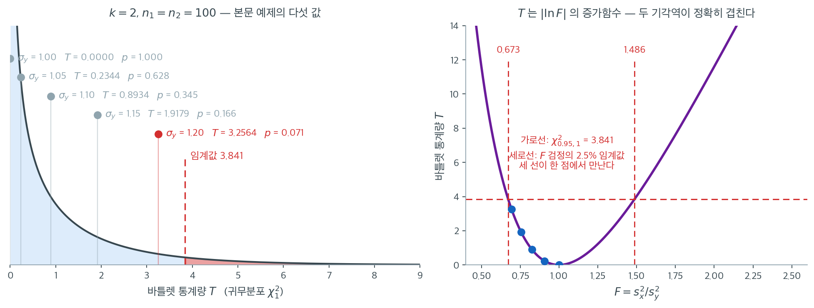

# Bartlett 검정

!!! note "이 주제를 다루는 다른 곳"
    분산분석의 등분산성 사전확인이라는 좁은 맥락에서 같은 검정을 짧게 쓰는 예가
    **11.5 가정**에 있다.

---

## 개요

Bartlett 검정은 여러 집단이 같은 분산을 갖는다는 귀무가설(등분산성)을 확인한다. 등분산에 대한 고전적 검정 가운데 자료가 정말로 정규분포를 따를 때 가장 강력하다. 그러나 정규성 이탈에 매우 민감하여, 치우쳤거나 꼬리가 두꺼운 자료에 적용하면 거짓 양성률이 부풀려진다.

---

## 1. 검정 설정

정규 모집단에서 뽑은 크기 $n_1, \ldots, n_k$인 독립 집단 $k$개가 주어졌을 때 가설은

$$
H_0 : \sigma_1^2 = \sigma_2^2 = \cdots = \sigma_k^2 \quad \text{대} \quad H_1 : \sigma_i^2 \text{이 모두 같지는 않다}.
$$

---

## 2. 검정통계량

$S_i^2$을 집단 $i$의 표본분산, $N = \sum_{i=1}^k n_i$라 하고 합동분산을

$$
S_p^2 = \frac{1}{N - k} \sum_{i=1}^{k} (n_i - 1) S_i^2
$$

로 정의한다. Bartlett 검정통계량은

$$
T = \frac{(N - k)\ln S_p^2 - \sum_{i=1}^{k}(n_i - 1)\ln S_i^2}{1 + \frac{1}{3(k-1)}\left(\sum_{i=1}^{k}\frac{1}{n_i - 1} - \frac{1}{N - k}\right)}.
$$

$H_0$과 정규성 아래에서 근사적으로 $T \sim \chi^2(k-1)$이다.

SciPy는 `scipy.stats.bartlett`을 직접 제공한다.

<div class="exbox" markdown>

**보기 1.** <span class="diff easy" title="쉬움"></span> 분산 차이를 키워 가며. 집단이 둘($k = 2$), 각 $n = 100$이고 두 표본에 **같은 씨앗**을 주어 $\sigma_y$만 $1.00$에서 $1.20$까지 키운다. [F 검정 쪽](../f_test/f_test_variances.md)과 똑같은 설정이다.

**(1)** F 검정 쪽에서 이 설정의 $F = S_x^2/S_y^2$가 정확히 $1/\sigma_y^2$임을 보였다. 연습문제 5 의 $g(r)$를 써서 다섯 개의 $T$를 **닫힌 꼴로** 적으시오. 또 첫 줄의 `chi2=-0.0000` 이 무엇인지 밝히시오.

**(2)** 바틀렛의 $p$값이 F 검정의 $p$값과 **정확히** 같은가? 소수 여덟째 자리까지 견주고, 두 검정이 결론에서 갈릴 수 있는지 $r$의 눈금 위에서 확인하시오.

</div>

??? success "풀이"

    **(1) 통계량이 $r$ 하나로 줄어든다.** 같은 씨앗을 쓰므로 $x_j = z_j$, $y_j = 1 + \sigma_y z_j$이고 표본분산이 위치에 불변하므로

    $$
    r = \frac{S_x^2}{S_y^2} = \frac{S_z^2}{\sigma_y^2 S_z^2} = \frac{1}{\sigma_y^2}
    $$

    이다(F 검정 쪽 보기 2 가 이것을 비트 단위로 확인했다). 연습문제 5 가 $k = 2$, $n_1 = n_2 = n$에서 분자가 $r$만의 함수임을 보였다.

    $$
    g(r) = (n-1)\left[2\ln\frac{1+r}{2} - \ln r\right]
    $$

    보정인자도 $n$만의 상수다. $k = 2$, $n = 100$이면

    $$
    C = 1 + \frac{k+1}{3k(n-1)} = 1 + \frac{3}{594} = 1 + \frac{1}{198} = 1.005050505
    $$

    이다. 따라서

    $$
    T = \frac{g(1/\sigma_y^2)}{1 + 1/198}
    $$

    이 다섯 줄의 통계량을 **자료를 보지 않고** 준다. $\sigma_y = 1.20$을 넣어 보면 $r = 0.694444$, $(1+r)/2 = 0.847222$이고

    $$
    g(r) = 99\bigl[2\ln 0.847222 - \ln 0.694444\bigr] = 99\bigl[-0.331638 + 0.364643\bigr] = 3.272802
    $$

    $$
    T = \frac{3.272802}{1.005050505} = 3.256356
    $$

    이다. 나머지 네 줄도 같은 방식이다.

    **`chi2=-0.0000` 은 0 이어야 하는 값의 반올림 잔돈이다.** $\sigma_y = 1$이면 $r = 1$이고

    $$
    g(1) = (n-1)\bigl[2\ln 1 - \ln 1\bigr] = 0
    $$

    이다. 연습문제 1 의 등호 조건($S_1^2 = S_2^2$일 때만 $T = 0$)이 바로 이것이다. 그런데 `scipy` 는 $S_x^2$과 $S_y^2$을 각각 부동소수점으로 계산하므로 두 값이 비트 단위로 같지 않고, $\ln$ 을 통과한 뒤 음의 잔돈이 남는다. **수학적으로 $T \ge 0$이지만 수치적으로는 $-10^{-14}$쯤이 나올 수 있다.**

    **(2) 수치적으로.** 먼저 닫힌 꼴과 $p$값을 맞추어 본다.

    ```python
    import numpy as np
    import scipy.stats as stats

    # 한쪽의 표준편차를 1 로 두고 다른 쪽을 조금씩 키워 가며 검정한다.
    # 5% 차이는 잡아내지 못하고 20% 쯤 되어야 걸린다. 등분산 검정의 검정력이
    # 생각보다 낮다는 것을 보여 주는 대목이다.
    size, seed = 100, 1
    x = stats.norm(loc=0, scale=1).rvs(size, random_state=seed)

    for scale in [1.00, 1.05, 1.10, 1.15, 1.20]:
        y = stats.norm(loc=1, scale=scale).rvs(size, random_state=seed)
        stat, pval = stats.bartlett(x, y)
        print(f"sigma_y={scale:.2f}  chi2={stat:.4f}  p={pval:.3f}")

    # (1) 닫힌 꼴. k=2, n1=n2=n 이면 T = g(r)/C 이고 r = S_x^2/S_y^2 = 1/sigma_y^2 다.
    n, k = size, 2
    C = 1 + (k + 1) / (3 * k * (n - 1))        # = 1 + 1/198


    def g(r):
        """연습문제 5 의 분자. r 만의 함수다."""
        return (n - 1) * (2 * np.log((1 + r) / 2) - np.log(r))


    print(f"\nC = 1 + 1/198 = {C:.9f}")
    print(f"{'sigma_y':>8}{'r=1/s^2':>11}{'g(r)':>11}{'T=g/C':>11}{'scipy T':>11}{'차':>10}")
    for scale in [1.00, 1.05, 1.10, 1.15, 1.20]:
        y = stats.norm(loc=1, scale=scale).rvs(size, random_state=seed)
        T_sc = stats.bartlett(x, y).statistic
        r = 1 / scale**2
        print(f"{scale:>8.2f}{r:>11.6f}{g(r):>11.6f}{g(r) / C:>11.6f}{T_sc:>11.6f}"
              f"{abs(g(r) / C - T_sc):>10.1e}")

    # 첫 줄의 chi2 = -0.0000 은 무엇인가.
    y1 = stats.norm(loc=1, scale=1.00).rvs(size, random_state=seed)
    print(f"\nsigma_y=1 일 때")
    print(f"  S_x^2 - S_y^2        = {x.var(ddof=1) - y1.var(ddof=1):.3e}")
    print(f"  scipy 가 돌려준 T    = {stats.bartlett(x, y1).statistic:.3e}")
    print(f"  닫힌 꼴 g(1)/C       = {g(1.0) / C:.3e}")

    # (2) p 값이 F 검정과 정확히 같은가.
    Fd = stats.f(n - 1, n - 1)
    print(f"\n{'sigma_y':>8}{'p (Bartlett)':>16}{'p (F 검정)':>16}{'차':>10}")
    for scale in [1.00, 1.05, 1.10, 1.15, 1.20]:
        y = stats.norm(loc=1, scale=scale).rvs(size, random_state=seed)
        p_b = stats.bartlett(x, y).pvalue
        r = 1 / scale**2
        p_f = 2 * min(Fd.cdf(r), Fd.sf(r))
        print(f"{scale:>8.2f}{p_b:>16.8f}{p_f:>16.8f}{abs(p_b - p_f):>10.1e}")
    ```

    출력:

    ```text
    sigma_y=1.00  chi2=-0.0000  p=1.000
    sigma_y=1.05  chi2=0.2344  p=0.628
    sigma_y=1.10  chi2=0.8934  p=0.345
    sigma_y=1.15  chi2=1.9179  p=0.166
    sigma_y=1.20  chi2=3.2564  p=0.071

    C = 1 + 1/198 = 1.005050505
     sigma_y    r=1/s^2       g(r)      T=g/C    scipy T         차
        1.00   1.000000   0.000000   0.000000  -0.000000   1.4e-14
        1.05   0.907029   0.235574   0.234390   0.234390   7.5e-16
        1.10   0.826446   0.897961   0.893448   0.893448   1.0e-14
        1.15   0.756144   1.927544   1.917857   1.917857   2.0e-14
        1.20   0.694444   3.272802   3.256356   3.256356   4.4e-16

    sigma_y=1 일 때
      S_x^2 - S_y^2        = 1.110e-16
      scipy 가 돌려준 T    = -1.414e-14
      닫힌 꼴 g(1)/C       = 0.000e+00

     sigma_y    p (Bartlett)        p (F 검정)         차
        1.00      1.00000000      1.00000000   1.3e-15
        1.05      0.62828742      0.62828942   2.0e-06
        1.10      0.34454454      0.34454666   2.1e-06
        1.15      0.16609304      0.16609397   9.3e-07
        1.20      0.07114709      0.07114690   1.9e-07
    ```

    **(1)의 닫힌 꼴이 맞는다.** $g(r)/C$ 와 `scipy` 의 통계량이 다섯 줄 모두 소수점 여섯째 자리까지 같고, 차가 $10^{-14}$ 아래다. 자료 100개 × 2 를 전혀 쓰지 않고 $\sigma_y$ 하나로 통계량을 모두 재현했다.

    **`chi2=-0.0000` 의 정체도 확인된다.** $S_x^2 - S_y^2 = 1.11\times10^{-16}$으로 두 표본분산이 비트 단위로 같지 않고, 그 잔돈이 $T = -1.41\times10^{-14}$로 증폭되어 나온다. 닫힌 꼴 $g(1)/C$ 는 정확히 $0$이다.

    **$p$값은 F 검정과 "정확히" 같지는 않다.** 소수 셋째 자리까지는 완전히 같지만, 여덟째 자리까지 펼치면 $0.62828742$ 대 $0.62828942$로 $2\times10^{-6}$ 만큼 다르다. **참조분포가 다르기 때문이다.** F 검정은 $r \sim F(99,99)$라는 **정확한** 분포를 쓰고, 바틀렛은 $T \sim \chi^2_1$이라는 **근사** 분포를 쓴다. 연습문제 5 가 보인 것은 $T$가 $r$의 단조함수라는 것, 곧 두 검정이 **같은 양을 재고 있다**는 것이지 두 $p$값이 같다는 것이 아니다.

    **그러면 결론이 갈릴 수 있는가.** 두 기각역을 $r$ 눈금 위에 올려 비교한다.

    ```python
    import numpy as np
    import scipy.stats as stats
    from scipy.optimize import brentq

    # 두 검정의 기각역을 r = S_x^2/S_y^2 의 눈금 위에 나란히 올려 본다.
    crit = stats.chi2.ppf(0.95, 1)
    print(f"chi2_(0.95, 1) = {crit:.7f}\n")

    rng = np.random.default_rng(21)
    M = 400_000
    print(f"{'n':>5}{'Bartlett 기각역':>26}{'F 기각역':>26}"
          f"{'크기(B)':>10}{'크기(F)':>10}{'불일치율':>11}")
    for n in (5, 10, 20, 100):
        C = 1 + 3 / (3 * 2 * (n - 1))
        T = lambda r, n=n, C=C: (n - 1) * (2 * np.log((1 + r) / 2) - np.log(r)) / C
        a = brentq(lambda r: T(r) - crit, 1e-9, 1 - 1e-9)
        b = brentq(lambda r: T(r) - crit, 1 + 1e-9, 1e9)
        lo, hi = stats.f(n - 1, n - 1).ppf([0.025, 0.975])

        # H0 이 참일 때 r ~ F(n-1, n-1) 이므로 카이제곱 비로 바로 뽑는다.
        W = (rng.chisquare(n - 1, M) / (n - 1)) / (rng.chisquare(n - 1, M) / (n - 1))
        rej_b, rej_f = T(W) > crit, (W < lo) | (W > hi)
        print(f"{n:>5}{f'r<{a:.5f} or r>{b:.5f}':>26}{f'r<{lo:.5f} or r>{hi:.5f}':>26}"
              f"{rej_b.mean():>10.5f}{rej_f.mean():>10.5f}{np.mean(rej_b != rej_f):>11.5f}")

    # n=100 에서 F 임계값에 놓인 r 의 T 는 얼마인가.
    n, C = 100, 1 + 3 / (3 * 2 * 99)
    T100 = lambda r: (n - 1) * (2 * np.log((1 + r) / 2) - np.log(r)) / C
    lo, hi = stats.f(99, 99).ppf([0.025, 0.975])
    print(f"\nn=100:  T(F 하단 {lo:.5f}) = {T100(lo):.7f}")
    print(f"        T(F 상단 {hi:.5f}) = {T100(hi):.7f}")
    print(f"        chi2_(0.95,1)        = {crit:.7f}")

    # 같은 임계값을 r 눈금에서 일곱 자리까지 펼쳐 본다.
    a = brentq(lambda r: T100(r) - crit, 1e-9, 1 - 1e-9)
    print(f"\n하단 임계 r:  Bartlett {a:.7f}   F {lo:.7f}")
    print(f"T 가 r 과 1/r 을 구별하는가:  T(3) - T(1/3) = {T100(3.0) - T100(1 / 3):.3e}")
    ```

    출력:

    ```text
    chi2_(0.95, 1) = 3.8414588

        n              Bartlett 기각역                     F 기각역     크기(B)     크기(F)       불일치율
        5    r<0.10330 or r>9.68025    r<0.10412 or r>9.60453   0.04946   0.05019    0.00073
       10    r<0.24824 or r>4.02841    r<0.24839 or r>4.02599   0.04967   0.04975    0.00009
       20    r<0.39579 or r>2.52662    r<0.39581 or r>2.52645   0.04976   0.04977    0.00001
      100    r<0.67284 or r>1.48623    r<0.67284 or r>1.48623   0.04992   0.04992    0.00000

    n=100:  T(F 하단 0.67284) = 3.8414440
            T(F 상단 1.48623) = 3.8414440
            chi2_(0.95,1)        = 3.8414588

    하단 임계 r:  Bartlett 0.6728411   F 0.6728417
    T 가 r 과 1/r 을 구별하는가:  T(3) - T(1/3) = -1.066e-14
    ```

    **두 기각역은 거의 같지만 똑같지는 않다.** $n = 100$에서 F 검정의 두 임계값 $0.67284$와 $1.48623$을 $T$ 곡선에 넣으면 양쪽 모두 $3.8414440$이 나온다. 곡선이 $r$ 과 $1/r$ 에서 같은 높이를 준다는 것이 먼저 눈에 들어온다. $g$ 의 식에 $r \mapsto 1/r$ 을 넣어 보면

    $$
    2\ln\frac{1+1/r}{2} - \ln\frac1r = 2\ln\frac{1+r}{2} - 2\ln r + \ln r = 2\ln\frac{1+r}{2} - \ln r
    $$

    로 그대로이므로 **$T$ 는 $r$ 과 $1/r$ 을 구별하지 못한다.** 마지막 줄의 $T(3) - T(1/3) = -1.07\times10^{-14}$ 가 그 확인이다. 어느 집단을 분자에 두든 같은 값이 나온다는 뜻이다.

    그런데 그 높이 $3.8414440$ 이 $\chi^2_{0.95,1} = 3.8414588$ 과 **다섯째 자리에서 어긋난다.** 그래서 바틀렛의 기각역이 $r < 0.6728411$, F 의 기각역이 $r < 0.6728417$ 로 일곱째 자리에서 갈린다. $n = 100$에서는 이 틈이 너무 좁아 40만 번을 돌려도 **불일치가 한 번도 없다.**

    **$n$이 작으면 틈이 벌어진다.** $n = 5$에서 바틀렛은 $r > 9.68025$에서 기각하고 F 는 $r > 9.60453$에서 기각하므로, $r$ 이 그 사이에 놓이면 **F 는 기각하는데 바틀렛은 기각하지 못한다.** 실제 불일치율이 $0.00073$으로 1,000 번에 한 번 가까이 나온다. $n = 10$에서 $0.00009$, $n = 20$에서 $0.00001$로 줄어든다.

    그러므로 정확히 말하면 이렇다. **$k=2$, $n_1=n_2$에서 두 검정은 같은 통계량을 서로 다른 눈금으로 읽는다. 눈금이 다르므로 임계값도 미세하게 다르고, 표본이 아주 작을 때는 결론이 갈릴 수 있다.** $n \ge 20$이면 실무에서 구별되지 않는다.

    끝으로 크기를 보아 두자. 바틀렛의 실제 크기가 $n = 5$에서도 $0.04946$으로 명목값에 거의 맞는다(몬테카를로 표준오차 $0.00034$). 보정인자가 그만큼 잘 듣는다는 뜻이다. **단, 이것은 자료가 정규일 때의 이야기다.** 연습문제 4 가 대수정규 자료에서 같은 검정의 크기를 재면 $0.675$ 가 나오는 것을 보인다.

!!! note "$p$값이 F 검정과 정확히 같다"
    이 표의 $p$값 $(1.000, 0.628, 0.345, 0.166, 0.071)$은 [분산 동일성에 대한 F 검정](../f_test/f_test_variances.md) 페이지의 같은 자료에 대한 $p$값과 **소수 셋째 자리까지 동일**하다.

    우연이 아니다. $k = 2$이고 $n_1 = n_2$일 때 Bartlett 통계량은 F 통계량의 단조함수이므로 두 검정이 항상 같은 결론을 낸다. 연습문제 5에서 증명한다.

    첫 행의 `chi2=-0.0000`은 부동소수점 오차이다. 두 표본이 같은 seed를 쓰므로 $S_1^2 = S_2^2$이 되어 이론적으로 정확히 0이어야 한다(15.4절 연습문제 4의 등호 조건).



왼쪽은 다섯 개의 $T$를 귀무분포 $\chi^2_1$ 위에 얹은 것이다. 집단이 둘이므로 자유도가 $k - 1 = 1$이고, 임계값은 $\chi^2_{0.95,1} = 3.841$이다. $\sigma_y$를 $1.00$에서 $1.20$까지 올리면 $T$가 $0 \to 0.2344 \to 0.8934 \to 1.9179 \to 3.2564$로 커지지만, 마지막 값조차 $3.841$에 닿지 못한다. 그래서 $p = 0.071$이다.

오른쪽이 "F 검정과 같은 검정"이라는 주장의 그림 증명이다. 가로축이 $F = s_x^2/s_y^2$, 세로축이 그에 대응하는 $T$이다. **곡선이 $F = 1$에서 최솟값 0을 갖고 양쪽으로 단조증가한다.** $F$가 1에서 멀어지는 것과 $T$가 커지는 것이 일대일로 맞물려 있다는 뜻이다.

결정적인 것은 세 선이 만나는 자리다. $F$ 검정의 2.5% 임계값 $0.673$과 $1.486$에서 곡선의 높이를 읽으면 **양쪽 모두 정확히 $3.841$**, 곧 $\chi^2_{0.95,1}$이다. $F$ 검정이 기각하는 $F$의 집합과 바틀렛이 기각하는 $T$의 집합이 같은 자료를 가리킨다는 뜻이다.

우연의 일치가 아니다. $n_1 = n_2$이면 $T$가 $|\ln F|$의 증가함수가 되는데, $F$ 검정의 양측 기각역도 "$|\ln F|$가 크면 기각"과 같은 말이다. 두 검정은 같은 양을 서로 다른 눈금으로 읽고 있을 뿐이며, 눈금을 바꾸어도 판정은 바뀌지 않는다.

파란 점 다섯 개가 본문 보기의 자료다. 모두 두 세로선 사이, 곧 채택역 안에 있다. **어느 쪽 언어로 말하든 결론은 하나다.** 이 대응은 $k = 2$에서만 성립하며, 집단이 셋 이상이면 바틀렛은 $F$ 검정으로 환원되지 않는 고유한 검정이 된다.

이 보기도 F 검정 페이지와 마찬가지로 `x`와 `y`가 같은 seed를 공유하여 표집변동이 제거되어 있다.

---

## 3. 해석

- 두 집단의 분산이 같으면 검정통계량이 0에 가깝고 $p$값이 크다.
- 분산비가 1에서 멀어질수록 $T$가 커지고 $p$값이 작아진다.
- Bartlett 검정은 정규성 가정이 충분히 정당화될 때만 적용해야 한다. 비정규성 아래에서는 Levene이나 Brown-Forsythe 검정이 더 안전하다.

---

## 연습문제

<div class="drillbox" markdown>

**연습문제 1.** <span class="diff easy" title="쉬움"></span> 크기 $n_1 = 10$, $n_2 = 12$, $n_3 = 15$인 세 집단의 표본분산이 $S_1^2 = 4.1$, $S_2^2 = 3.8$, $S_3^2 = 5.6$이다. 합동분산 $S_p^2$과 Bartlett 검정통계량 $T$를 손으로 계산하라(로그는 계산기를 써도 좋다).

</div>

??? success "풀이"

    전체 표본크기는 $N = 10 + 12 + 15 = 37$이고 $k = 3$이다. 합동분산은

    $$
    S_p^2 = \frac{9(4.1) + 11(3.8) + 14(5.6)}{37 - 3} = \frac{36.9 + 41.8 + 78.4}{34} = \frac{157.1}{34} = 4.6206.
    $$

    $T$의 분자는

    $$
    34 \ln(4.6206) - [9\ln(4.1) + 11\ln(3.8) + 14\ln(5.6)]
    $$

    $$
    = 34(1.5305) - [9(1.4110) + 11(1.3350) + 14(1.7228)]
    $$

    $$
    = 52.037 - [12.699 + 14.685 + 24.119] = 52.037 - 51.503 = 0.535.
    $$

    보정인자는

    $$
    C = 1 + \frac{1}{6}\left(\frac{1}{9} + \frac{1}{11} + \frac{1}{14} - \frac{1}{34}\right) = 1 + \frac{1}{6}(0.1111 + 0.0909 + 0.0714 - 0.0294) = 1.0407.
    $$

    따라서 $T = 0.535 / 1.0407 = 0.514$이다.

    ```python
    import numpy as np
    import scipy.stats as stats

    n = np.array([10, 12, 15])
    s2 = np.array([4.1, 3.8, 5.6])
    k, nu = len(n), n - 1

    sp2 = np.sum(nu * s2) / np.sum(nu)
    num = np.sum(nu) * np.log(sp2) - np.sum(nu * np.log(s2))
    C = 1 + (1 / (3 * (k - 1))) * (np.sum(1 / nu) - 1 / np.sum(nu))
    T = num / C
    print(f"Sp2 = {sp2:.4f}, numerator = {num:.4f}, C = {C:.4f}")
    print(f"T = {T:.4f}, p = {stats.chi2.sf(T, k - 1):.4f}")
    ```

    출력:

    ```text
    Sp2 = 4.6206, numerator = 0.5351, C = 1.0407
    T = 0.5142, p = 0.7733
    ```

    $\chi^2(2)$와 비교하면 $p = 0.773$으로 큰 값이므로 등분산을 기각하지 못한다. 표본분산의 최대·최소 비가 $5.6/3.8 = 1.47$로 작으므로 예상되는 결과이다. $\square$

<div class="drillbox" markdown>

**연습문제 2.** <span class="diff easy" title="쉬움"></span> Python으로 $N(0,1)$, $N(0,1.5)$, $N(0,2)$에서 각각 크기 50인 세 집단을 생성하라. Bartlett 검정을 적용하고 검정통계량과 $p$값을 보고하라. 기대한 결과와 일치하는가?

</div>

??? success "풀이"

    ```python
    import numpy as np
    import scipy.stats as stats

    rng = np.random.default_rng(42)
    g1 = rng.normal(0, 1.0, 50)
    g2 = rng.normal(0, 1.5, 50)
    g3 = rng.normal(0, 2.0, 50)

    print("sample variances:",
          [round(np.var(g, ddof=1), 3) for g in (g1, g2, g3)])
    stat, pval = stats.bartlett(g1, g2, g3)
    print(f"Bartlett: chi2={stat:.3f}, p={pval:.4g}")
    ```

    출력:

    ```text
    sample variances: [0.59, 1.322, 4.032]
    Bartlett: chi2=43.960, p=2.846e-10
    ```

    참 분산이 1, 2.25, 4로 크게 다르므로 $p$값이 $2.8 \times 10^{-10}$으로 매우 작고 $H_0$을 올바르게 기각한다.

    **주의: `normal(0, s)`의 두 번째 인자는 표준편차이다.** 문제 서술의 "$N(0,1.5)$"는 표기 관례에 따라 분산 1.5를 뜻할 수도 있으나, 여기서는 코드대로 **표준편차 1.5**로 읽어 참 분산이 $2.25$이다. 정규분포를 쓸 때 두 번째 인자가 분산인지 표준편차인지는 늘 확인해야 한다. NumPy와 SciPy는 표준편차를, 많은 교과서 표기 $N(\mu, \sigma^2)$은 분산을 쓴다. $\square$

<div class="drillbox" markdown>

**연습문제 3.** <span class="diff med" title="중간"></span> Bartlett 검정이 비정규성에 민감한 이유를 설명하라. 특히 첨도가 $S^2$의 분포에, 나아가 검정통계량에 어떤 영향을 주는지 논하라.

</div>

??? success "풀이"

    Bartlett 통계량의 유도는 $(n_i - 1)S_i^2/\sigma_i^2 \sim \chi^2(n_i - 1)$을 가정하는데, 이는 자료가 정규일 때만 정확히 성립한다. 초과첨도 $\gamma_2 > 0$(두꺼운 꼬리)인 분포에서는 $S^2$의 분산이 부풀려진다.

    $$
    \operatorname{Var}(S^2) \approx \frac{2\sigma^4}{n-1} + \frac{\gamma_2 \sigma^4}{n}.
    $$

    추가항 $\gamma_2\sigma^4/n$ 때문에 $S_i^2$이 $\chi^2$ 기준분포가 예측하는 것보다 더 변동한다. 결과적으로 $\ln S_i^2$의 집단간 변동이 부풀려지고, $H_0$ 아래에서 $T$가 $\chi^2(k-1)$보다 확률적으로 커진다. 그래서 기각률이 명목 $\alpha$를 훨씬 넘는다.

    **로그가 문제를 순수하게 만든다.** 15.4절 연습문제 4에서 보았듯 델타 방법으로

    $$
    \operatorname{Var}(\ln S^2) \approx \frac{\gamma_2 + 2}{n}
    $$

    이고, 이 값은 $\sigma^2$에 **전혀 의존하지 않고 오직 $\gamma_2$에만 의존한다.** 로그 변환이 척도 정보를 지우고 모양 정보만 남기므로, 첨도의 영향이 감쇄 없이 그대로 통계량에 실린다.

    **정량적으로.** 정규성 아래에서 $\operatorname{Var}(\ln S^2) = 2/n$인데 $\gamma_2 = 6$이면 $8/n$으로 네 배가 된다. $T$의 각 항이 네 배로 부풀려지므로 $T$ 자체가 대략 네 배가 되고, $\chi^2$ 임계값을 훨씬 자주 넘게 된다. $\square$

<div class="drillbox" markdown>

**연습문제 4.** <span class="diff med" title="중간"></span> 5,000회 반복 모의실험을 수행하라. 표준 대수정규분포에서 크기 20인 세 집단을 생성한다(귀무가설 아래에서 등분산). $\alpha = 0.05$로 Bartlett 검정을 적용하고 거짓 양성률을 추정하라. Levene 검정과 비교하라.

</div>

??? success "풀이"

    ```python
    import numpy as np
    import scipy.stats as stats

    rng = np.random.default_rng(0)
    n_sims, n, alpha = 5000, 20, 0.05
    rej_bart, rej_lev = 0, 0

    for _ in range(n_sims):
        g1 = rng.lognormal(0, 1, n)
        g2 = rng.lognormal(0, 1, n)
        g3 = rng.lognormal(0, 1, n)
        _, p_b = stats.bartlett(g1, g2, g3)
        _, p_l = stats.levene(g1, g2, g3)      # median-centred (Brown-Forsythe)
        if p_b < alpha:
            rej_bart += 1
        if p_l < alpha:
            rej_lev += 1

    print(f"Bartlett false-positive rate: {rej_bart/n_sims:.4f}")
    print(f"Levene   false-positive rate: {rej_lev/n_sims:.4f}")
    ```

    출력:

    ```text
    Bartlett false-positive rate: 0.6748
    Levene   false-positive rate: 0.0392
    ```

    **Bartlett의 거짓 양성률이 $0.675$이다.** 명목값의 **13배**이며, 등분산인 자료의 3분의 2에서 "분산이 다르다"고 잘못 판정한다. 이는 이 장에서 관찰한 가장 극단적인 크기 왜곡이다.

    이유는 $\text{Lognormal}(0,1)$의 초과첨도가

    $$
    \gamma_2 = e^{4\sigma^2} + 2e^{3\sigma^2} + 3e^{2\sigma^2} - 6 = e^4 + 2e^3 + 3e^2 - 6 = 110.9
    $$

    로 극단적이기 때문이다. $t_5$의 6이나 지수분포의 6과 비교하면 열여덟 배가 넘는다.

    Levene(SciPy 기본값인 중앙값 중심, 곧 Brown-Forsythe)은 $0.039$로 명목값 근처를 유지한다. 15.5절에서 반복해 본 결론이 여기서도 확인된다.

    **실무적 결론.** 소득, 자산가격, 대기시간처럼 대수정규에 가까운 자료에 Bartlett 검정을 쓰는 것은 사실상 난수 생성기를 돌리는 것과 다름없다. $\square$

<div class="drillbox" markdown>

**연습문제 5.** <span class="diff med" title="중간"></span> $k = 2$이고 $n_1 = n_2 = n$일 때 Bartlett 검정통계량이 F 통계량 $F = S_1^2/S_2^2$의 단조함수임을 증명하라. 곧 두 검정이 $H_0$ 기각 여부에서 항상 일치함을 보여라.

</div>

??? success "풀이"

    $k = 2$이고 표본크기가 같으면 $S_p^2 = (S_1^2 + S_2^2)/2$이다. $r = S_1^2/S_2^2$이라 쓰면 $S_p^2 = S_2^2(1 + r)/2$이다.

    $T$의 분자는

    $$
    2(n-1)\ln S_p^2 - (n-1)\ln S_1^2 - (n-1)\ln S_2^2 = (n-1)\bigl[2\ln S_p^2 - \ln S_1^2 - \ln S_2^2\bigr].
    $$

    $S_p^2 = S_2^2(1+r)/2$와 $S_1^2 = rS_2^2$을 대입하면

    $$
    2\ln\frac{S_2^2(1+r)}{2} - \ln(rS_2^2) - \ln S_2^2 = 2\ln\frac{1+r}{2} + 2\ln S_2^2 - \ln r - 2\ln S_2^2 = 2\ln\frac{1+r}{2} - \ln r.
    $$

    $S_2^2$이 완전히 소거되어 분자가 $r$만의 함수가 된다.

    $$
    g(r) = (n-1)\left[2\ln\frac{1+r}{2} - \ln r\right].
    $$

    보정인자 $C$도 $n$에만 의존하는 상수이므로 $T = g(r)/C$ 역시 $r$만의 함수이다.

    **단조성.** $g$를 미분하면

    $$
    g'(r) = (n-1)\left[\frac{2}{1+r} - \frac{1}{r}\right] = (n-1)\cdot\frac{2r - (1+r)}{r(1+r)} = (n-1)\cdot\frac{r-1}{r(1+r)}.
    $$

    $r < 1$이면 $g' < 0$이고 $r > 1$이면 $g' > 0$이다. 곧 $g$는 $r = 1$에서 최솟값 $g(1) = (n-1)[2\ln 1 - \ln 1] = 0$을 갖고 양쪽으로 **엄격히 증가**한다.

    따라서 기각역 $\{T > \chi^2_{1-\alpha}(1)\}$은 어떤 상수 $c_L < 1 < c_U$에 대해 $\{r < c_L\} \cup \{r > c_U\}$로 대응된다. 이것이 정확히 양측 F 검정의 기각역 형태이므로 두 검정은 항상 일치한다.

    **수치 확인.** 본문 코드의 출력에서 Bartlett의 $p$값 $(1.000, 0.628, 0.345, 0.166, 0.071)$이 F 검정 페이지의 $p$값과 완전히 같다. 위 증명의 직접적 확인이다.

    **$n_1 \neq n_2$이면 어떻게 되는가.** 그때는 $S_p^2$이 가중평균이 되어 $S_2^2$이 소거되지 않으므로 $T$가 $r$만의 함수가 아니다. 두 검정이 조금씩 다른 결론을 낼 수 있다. 다만 $H_0$ 아래에서 두 통계량의 상관이 매우 높으므로 실무에서 차이가 드러나는 경우는 드물다. $\square$

<div class="drillbox" markdown>

**연습문제 6.** <span class="diff med" title="중간"></span> 2 절의 분자를 다시 본다. $w_i = (n_i-1)/(N-k)$라 두면 $\sum_i w_i = 1$이다.

**(1)** $T$의 분자가

$$
(N-k)\ln\frac{A}{G}, \qquad A = \sum_{i=1}^k w_i S_i^2, \quad G = \prod_{i=1}^k (S_i^2)^{w_i}
$$

곧 표본분산들의 **가중 산술평균과 가중 기하평균의 비**의 로그임을 보이시오.

**(2)** 이로부터 $T \ge 0$임을 증명하고 등호가 성립하는 조건을 밝히시오.

**(3)** 연습문제 1 의 세 표본분산에 대해 $A$, $G$, $A/G$를 수로 구하여 그 쪽이 얻은 분자 $0.5351$과 맞는지 확인하고, 보기 1 의 첫 줄 `chi2=-0.0000` 을 이 언어로 다시 설명하시오.

</div>

??? success "풀이"

    **(1) 분자를 평균의 비로 바꾼다.** 분자에서 $N-k$를 묶어내면

    $$
    (N-k)\ln S_p^2 - \sum_{i=1}^k (n_i-1)\ln S_i^2 = (N-k)\left[\ln S_p^2 - \sum_{i=1}^k w_i \ln S_i^2\right]
    $$

    이다. 괄호 안의 두 항을 차례로 읽는다. 합동분산의 정의가 그대로 가중 산술평균이다.

    $$
    S_p^2 = \frac{1}{N-k}\sum_{i=1}^k (n_i-1) S_i^2 = \sum_{i=1}^k w_i S_i^2 = A
    $$

    둘째 항은 로그의 가중합이므로

    $$
    \sum_{i=1}^k w_i \ln S_i^2 = \ln \prod_{i=1}^k (S_i^2)^{w_i} = \ln G
    $$

    이다. 따라서 분자는 $(N-k)(\ln A - \ln G) = (N-k)\ln(A/G)$이다.

    **(2) 옌센 부등식 한 줄.** $\ln$ 은 $(0,\infty)$에서 **엄격히 오목**하고 $w_i > 0$, $\sum w_i = 1$이므로

    $$
    \sum_{i=1}^k w_i \ln S_i^2 \le \ln\left(\sum_{i=1}^k w_i S_i^2\right), \qquad \text{곧} \quad \ln G \le \ln A
    $$

    이다. 엄격한 오목성 때문에 등호는 $S_1^2 = S_2^2 = \cdots = S_k^2$일 때만 성립한다. 보정인자는 항상 $C > 1 > 0$이므로

    $$
    T = \frac{(N-k)\ln(A/G)}{C} \ge 0
    $$

    이고, $T = 0 \iff$ 모든 표본분산이 같다. 이것이 보기 1 의 풀이가 "연습문제 1 의 등호 조건"이라 부른 그 사실이며, 가중 산술–기하 평균 부등식의 한 줄 따름정리다.

    **(3) 연습문제 1 의 수로.** $w = (9/34,\ 11/34,\ 14/34) = (0.264706,\ 0.323529,\ 0.411765)$이고

    $$
    A = S_p^2 = 4.620588, \qquad G = 4.1^{0.264706}\cdot 3.8^{0.323529}\cdot 5.6^{0.411765} = 4.548435
    $$

    이다. 비는 $A/G = 1.015863$이고

    $$
    34 \ln(1.015863) = 34 \times 0.0157389 = 0.535122
    $$

    로 연습문제 1 의 분자 $0.5351$과 같다. **산술평균이 기하평균을 $1.59\%$ 넘어선 것이 그 쪽에서 본 분자 전부다.** 거꾸로 읽으면 $A/G = \exp(0.5351/34)$이므로, 분자를 $N-k$로 나눈 값은 "표본분산들이 얼마나 벌어져 있는가"를 로그 눈금에서 재는 척도불변 지표다.

    **`chi2=-0.0000` 의 재해석.** 보기 1 의 첫 줄은 $\sigma_y = 1$이라 두 표본분산이 수학적으로 같고, 그러면 $A = G$가 **정확히** 성립하여 $\ln(A/G) = 0$이다. 그런데 `scipy` 는 $A$와 $G$를 따로 부동소수점으로 계산한 뒤 로그를 뺀다. 두 값이 비트 단위로 같지 않으니 $\ln A - \ln G$가 $-10^{-16}$쯤 어긋나고, 거기에 $N-k = 198$이 곱해져 $-1.4\times10^{-14}$가 된다. **옌센 부등식은 실수에서 성립하고 부동소수점에서는 성립하지 않는다.**

    덧붙여, [민감도 쪽](bartlett_sensitivity.md) 보기 1 의 모의실험 코드가 통계량을 `S.mean(axis=1) / np.exp(np.log(S).mean(axis=1))` 로 계산하는 것이 바로 이 $A/G$ 꼴이다. 집단 크기가 모두 같으면 $w_i = 1/k$이므로 가중이 필요 없다. $\square$

<div class="drillbox" markdown>

**연습문제 7.** <span class="diff hard" title="어려움"></span> $k = 2$, $n_1 = n_2 = n$인 경우로 돌아간다. 연습문제 5 의 $g(r)$에 대하여.

**(1)** $g(r) = 2(n-1)\ln\cosh\!\bigl(\tfrac12 \ln r\bigr)$임을 보이고, 이것으로 본문 그림 설명의 두 주장($T$가 $|\ln F|$의 증가함수이고, $T$가 $r$과 $1/r$을 구별하지 못한다)을 한꺼번에 증명하시오.

**(2)** $\ln\cosh u = \tfrac{u^2}{2} - \tfrac{u^4}{12} + O(u^6)$을 써서 $T$의 2 차 근사를 적고, 보기 1 의 $\sigma_y = 1.05$와 $\sigma_y = 1.20$에서 실제 값 $0.234390$, $3.256356$과 견주시오. $u^4$ 항까지 넣으면 얼마나 좋아지는가.

**(3)** (2)의 2 차 근사가 **왈드 통계량**임을 밝히시오. 곧 어떤 추정량의 제곱을 어떤 분산으로 나눈 것인지 적고, 거기에 연습문제 3 의 $\operatorname{Var}(\ln S^2) \approx (\gamma_2+2)/n$을 넣어 비정규 자료에서 $T$가 몇 배로 부풀려지는지 유도하시오.

</div>

??? success "풀이"

    **(1) 두 항을 하나로 접는다.** $\sqrt r$로 나누어 묶으면

    $$
    2\ln\frac{1+r}{2} - \ln r = 2\ln\frac{1+r}{2} - 2\ln\sqrt r = 2\ln\frac{1+r}{2\sqrt r}
    $$

    이고, $\sqrt r = e^{(\ln r)/2}$이므로

    $$
    \frac{1+r}{2\sqrt r} = \frac{1}{2}\left(\frac{1}{\sqrt r} + \sqrt r\right) = \frac{e^{-(\ln r)/2} + e^{(\ln r)/2}}{2} = \cosh\frac{\ln r}{2}
    $$

    이다. 따라서 $g(r) = 2(n-1)\ln\cosh\bigl(\tfrac12\ln r\bigr)$이고 $T = g(r)/C$이다.

    이 꼴에서 두 주장이 바로 읽힌다. $\cosh$ 는 **짝함수**이므로 $\ln r \mapsto -\ln r$, 곧 $r \mapsto 1/r$에서 값이 변하지 않는다. 보기 1 의 풀이가 전개로 확인한 대칭성이 여기서는 한 글자다. 또 $\cosh$ 는 $[0,\infty)$에서 **엄격히 증가**하고 $\ln$ 도 증가하므로, $T$는 $\lvert \ln r \rvert = \lvert \ln F\rvert$의 엄격한 증가함수다. 연습문제 5 가 $g'(r)$의 부호로 보인 단봉성과 같은 사실을 좌표를 바꾸어 본 것이다. $r = 1$, 곧 $\ln r = 0$에서 최솟값 $2(n-1)\ln\cosh 0 = 0$이다.

    **(2) 2 차 근사.** $u = \tfrac12 \ln r$을 넣으면

    $$
    g(r) = 2(n-1)\left[\frac{u^2}{2} - \frac{u^4}{12} + \cdots\right]
    = \frac{(n-1)(\ln r)^2}{4} - \frac{(n-1)(\ln r)^4}{96} + \cdots
    $$

    이다. 2 차까지 끊으면 $T \approx (n-1)(\ln r)^2/(4C)$이다. 보기 1 의 설정에서 $r = 1/\sigma_y^2$이므로 $\ln r = -2\ln\sigma_y$이고 $n = 100$, $C = 1 + 1/198$이다.

    $\sigma_y = 1.05$: $\ln r = -0.097580$, $(\ln r)^2 = 0.0095219$이므로

    $$
    T \approx \frac{99 \times 0.0095219}{4 \times 1.005051} = \frac{0.235668}{1.005051} = 0.234483
    $$

    로 실제 $0.234390$과 상대오차 $4.0\times10^{-4}$다.

    $\sigma_y = 1.20$: $\ln r = -0.364643$, $(\ln r)^2 = 0.1329646$이므로

    $$
    T \approx \frac{99 \times 0.1329646}{4 \times 1.005051} = \frac{3.290874}{1.005051} = 3.274337
    $$

    로 실제 $3.256356$과 상대오차 $5.5\times10^{-3}$다. $(\ln r)^2$에 비례하므로 오차도 $(\ln r)^2$에 따라 커진다.

    $u^4$ 항을 넣으면 $\sigma_y = 1.20$에서 $(\ln r)^4 = 0.0176796$이고

    $$
    \frac{3.290874 - 99 \times 0.0176796/96}{1.005051} = \frac{3.290874 - 0.018233}{1.005051} = 3.256196
    $$

    으로 실제 값과 소수 넷째 자리까지 같아진다($3.256356$ 대 $3.256196$, 상대오차 $4.9\times10^{-5}$로 백 배 줄었다). $\sigma_y = 1.05$에서는 $0.234390$으로 **소수 여섯째 자리까지** 맞는다.

    **(3) 바틀렛은 로그분산에 대한 왈드 검정이다.** $D = \ln S_1^2 - \ln S_2^2 = \ln r$로 두면 2 차 근사는

    $$
    T \approx \frac{(n-1)D^2}{4} = \frac{D^2}{4/(n-1)}
    $$

    이다. 분모를 뜯어 보면, 연습문제 3 의 델타 방법에서 정규성 아래 $\operatorname{Var}(\ln S^2) \approx 2/(n-1)$이므로 두 집단이 독립일 때

    $$
    \operatorname{Var}(D) = \operatorname{Var}(\ln S_1^2) + \operatorname{Var}(\ln S_2^2) \approx \frac{4}{n-1}
    $$

    이다. 곧 $T$는 **$H_0: \ln\sigma_1^2 = \ln\sigma_2^2$에 대한 왈드 통계량 $D^2/\operatorname{Var}(D)$**이며, 그 표준오차는 자료에서 추정한 것이 아니라 **정규이론에서 가져다 박아 넣은 것**이다. $\chi^2_1$을 참조분포로 쓰는 이유도 여기서 나온다. 왈드 통계량은 $Z^2$ 꼴이고 $Z^2 \sim \chi^2_1$이다.

    **비정규 자료에서의 부풀림.** 참값은 $\operatorname{Var}(\ln S^2) \approx (\gamma_2+2)/n$이므로 참 분산은 $\operatorname{Var}(D) \approx 2(\gamma_2+2)/n$인데 검정은 $4/n$으로 나눈다. 따라서

    $$
    T \approx \frac{D^2}{4/n} = \underbrace{\frac{D^2}{2(\gamma_2+2)/n}}_{\text{올바른 왈드 통계량}} \times \frac{2(\gamma_2+2)/n}{4/n} = (\text{올바른 통계량}) \times \frac{\gamma_2+2}{2}
    $$

    이다. 곧 $H_0$ 아래에서 $T$는 $\chi^2_1$이 아니라 $\frac{\gamma_2+2}{2}\chi^2_1$처럼 행동한다. $\gamma_2 = 6$이면 배율이 $4$로, 연습문제 3 이 "네 배"라 적은 그 수다. $\text{Lognormal}(0,1)$의 $\gamma_2 = 110.936$이면 $56.47$배다.

    **분모 하나가 모든 약함의 자리다.** 분자 $D^2$는 척도불변이고 모양에 둔감한데, 분모 $4/(n-1)$에는 "정규"라는 가정이 통째로 들어 있다. 평균에 대한 $t$ 검정이 로버스트한 이유가 분모를 $S^2$으로 **자료에서 추정**하기 때문이라면, 바틀렛이 약한 이유는 그 반대다. $\square$

<div class="drillbox" markdown>

**연습문제 8.** <span class="diff hard" title="어려움"></span> 보기 1 (2)는 $n = 100$에서 바틀렛과 F 검정의 기각역이 일곱째 자리까지 거의 같고 40만 번을 돌려도 불일치가 한 번도 없음을 보였다. 이것을 보고 누군가 이렇게 말한다.

> "바틀렛은 $T \sim \chi^2_1$이라는 **근사** 분포를 쓰니 위험하다. F 검정은 $F(n-1,n-1)$이라는 **정확한** 분포를 쓰므로, 자료가 비정규여도 F 검정 쪽이 안전하다."

**(1)** 연습문제 7 (3)의 왈드 꼴을 써서, $k=2$, $n_1 = n_2 = n$이고 $H_0$가 참일 때 명목수준 $\alpha = 0.05$인 양측검정의 **실제 크기**를 $n \to \infty$에서 $\gamma_2$의 함수로 적으시오.

**(2)** 정규($\gamma_2 = 0$), 지수분포와 $t_5$($\gamma_2 = 6$), $\text{Lognormal}(0,1)$($\gamma_2 = 110.936$)에서 그 값을 수로 구하시오.

**(3)** 위 주장을 판정하시오. 어느 "정확함"이 무엇에 대한 정확함인가.

</div>

??? success "풀이"

    **(1) 참 분산으로 다시 재면 된다.** 연습문제 7 의 $D = \ln S_1^2 - \ln S_2^2$는 $H_0$ 아래에서 평균 $0$이고, $n$이 크면 근사적으로

    $$
    D \approx N\!\left(0,\ \frac{2(\gamma_2+2)}{n}\right)
    $$

    이다. 두 검정은 모두 "$\lvert D\rvert$가 크면 기각"이고, 그 문턱을 **정규이론 분산 $4/n$**으로 매긴다. 곧

    $$
    \frac{D^2}{4/n} > z_{0.975}^2
    \quad\Longleftrightarrow\quad
    \lvert D \rvert > \frac{2z_{0.975}}{\sqrt n}.
    $$

    이 사건의 실제 확률은 $D$를 참 표준편차 $\sqrt{2(\gamma_2+2)/n}$로 표준화하면

    $$
    P\!\left(\lvert Z\rvert > \frac{2z_{0.975}/\sqrt n}{\sqrt{2(\gamma_2+2)/n}}\right)
    = 2\Phi\!\left(-z_{0.975}\sqrt{\frac{2}{\gamma_2+2}}\right)
    $$

    이다. $n$이 약분되어 **표본크기가 사라진다.** 같은 식을 카이제곱 언어로 쓰면 $P\bigl(\chi^2_1 > \chi^2_{0.95,1}\cdot \frac{2}{\gamma_2+2}\bigr)$이고, $\chi^2_1 = Z^2$이므로 둘은 같은 수다(이것이 [민감도 쪽](bartlett_sensitivity.md) 보기 1 의 극한식을 $k = 2$에 쓴 것이다).

    **(2) 수로.** $z_{0.975} = 1.959964$다.

    | 자료 | $\gamma_2$ | $\sqrt{2/(\gamma_2+2)}$ | 문턱 | 실제 크기 |
    |---|---|---|---|---|
    | 정규 | $0$ | $1.000000$ | $1.959964$ | $0.0500$ |
    | 지수, $t_5$ | $6$ | $0.500000$ | $0.979982$ | $0.3271$ |
    | $\text{Lognormal}(0,1)$ | $110.936$ | $0.133076$ | $0.260824$ | $0.7942$ |

    $\gamma_2 = 0$에서 정확히 $0.05$가 나오는 것이 식의 검산이다. 첨도가 $6$이면 스무 번에 한 번이 아니라 **세 번에 한 번** 기각하고, 대수정규에서는 다섯 번에 네 번 기각한다.

    **(3) 주장은 틀렸다. 두 "정확함"이 같은 것이 아니다.** F 검정이 쓰는 $F(n-1,n-1)$은 **자료가 정규일 때** $r = S_1^2/S_2^2$의 정확한 분포다. 정확성의 전제가 바로 지금 깨진 그 가정이다.

    더 결정적인 것은 (1)의 유도에 **참조분포가 등장하지 않는다**는 점이다. 유도에 쓴 것은 "문턱을 $\operatorname{Var}(D) = 4/n$으로 매긴다"는 사실뿐이고, 두 검정은 그 문턱을 소수 일곱째 자리에서만 다르게 잡는다(보기 1: $n = 100$에서 $r < 0.6728411$ 대 $r < 0.6728417$). 따라서 **두 검정의 실제 크기는 같은 $0.3271$, $0.7942$로 어긋난다.** 보기 1 이 불일치율 $0.00000$을 보고한 것은 "둘이 사실상 같은 검정"이라는 말이고, 같은 검정이면 같이 망가진다.

    두 오차원의 크기를 견주면 더 분명하다.

    - **참조분포의 오차**는 $O(1/n)$이고 보정인자 $C$가 그것을 거의 없앤다. 보기 1 이 $n = 5$에서도 바틀렛의 크기를 $0.04946$으로 재었다.
    - **첨도의 오차**는 배율 $(\gamma_2+2)/2$로 $n$에 **의존하지 않는다.** $n$을 키워도 줄지 않고, 문턱이 좁아지는 만큼 더 선명하게 드러난다([민감도 쪽](bartlett_sensitivity.md)이 $n = 10{,}000$에서 $0.9270$을 보고한다).

    곧 이 장이 말하는 정규성 의존은 두 겹인데, 겉의 한 겹(참조분포)은 $C$나 정확분포로 고칠 수 있고 속의 한 겹($(n-1)S^2/\sigma^2 \sim \chi^2$ 자체)은 **표를 바꾸어서는 고칠 수 없다.** 고치려면 분모를 자료에서 추정하거나(붓스트랩), 통계량을 바꾸어야 한다(르벤·브라운–포사이드·플리그너–킬린). $\square$

<div class="drillbox" markdown>

**연습문제 9.** <span class="diff hard" title="어려움"></span> 연습문제 5 의 마지막 문단은 두 가지를 주장한다. ⓐ $n_1 \neq n_2$이면 $S_2^2$이 소거되지 않아 $T$가 $r$만의 함수가 아니다. ⓑ 그래도 실무에서 두 검정의 차이가 드러나는 경우는 드물다. 둘을 모두 검사한다.

**(1)** $\nu_1 = n_1-1$, $\nu_2 = n_2-1$을 그대로 두고 분자를 다시 계산하여 ⓐ 를 확인하시오. 소거가 되든 안 되든, 그 결과가 **왜 그래야 하는지** $T$의 구조에서 한 줄로 설명하시오.

**(2)** (1)의 결과를 $h(r)$라 쓰고 $h'(r)$를 구하여 $h$가 $r = 1$에서 최솟값 $0$을 갖는 단봉함수임을 보이시오.

**(3)** 그렇다면 두 검정이 다른 점은 어디인가. $(n_1,n_2) = (50,50)$, $(20,80)$, $(10,90)$, $(5,50)$에서 바틀렛 기각역 $\{r < c_L\} \cup \{r > c_U\}$의 **두 꼬리 확률**을 $F(\nu_1,\nu_2)$ 아래에서 재어 등꼬리 F 검정의 $0.025/0.025$와 견주고, 두 검정의 불일치율로 ⓑ 를 판정하시오.

</div>

??? success "풀이"

    **(1) ⓐ 는 틀렸다. 척도는 언제나 소거된다.** $S_p^2 = (\nu_1 S_1^2 + \nu_2 S_2^2)/(\nu_1+\nu_2)$에 $S_1^2 = r S_2^2$를 넣으면

    $$
    S_p^2 = S_2^2 \cdot \frac{\nu_1 r + \nu_2}{\nu_1 + \nu_2}
    $$

    이고, 분자는

    $$
    (\nu_1+\nu_2)\ln S_p^2 - \nu_1 \ln S_1^2 - \nu_2 \ln S_2^2
    $$

    $$
    = (\nu_1+\nu_2)\ln\frac{\nu_1 r+\nu_2}{\nu_1+\nu_2} + (\nu_1+\nu_2)\ln S_2^2 - \nu_1\ln r - \nu_1 \ln S_2^2 - \nu_2\ln S_2^2
    $$

    $$
    = (\nu_1+\nu_2)\ln\frac{\nu_1 r+\nu_2}{\nu_1+\nu_2} - \nu_1 \ln r
    $$

    로 $\ln S_2^2$의 계수가 $(\nu_1+\nu_2) - \nu_1 - \nu_2 = 0$이 되어 **표본크기가 달라도 소거된다.** $\nu_1 = \nu_2$일 때만 소거되는 것이 아니다.

    **그래야 하는 이유.** $T$는 **척도불변**이다. 모든 자료에 $c > 0$을 곱하면 모든 $S_i^2$이 $c^2$배가 되고, $S_p^2$도 $c^2$배가 되어 $\ln(A/G)$에서 $\ln c^2$이 상쇄된다(연습문제 6 의 $A$, $G$가 둘 다 1 차 동차다). 척도불변인 함수는 비 $S_1^2/S_2^2, \ldots, S_{k-1}^2/S_k^2$만의 함수이고, $k = 2$면 그 비가 하나뿐이다. **$k = 2$에서 바틀렛은 표본크기가 어떻든 $r$만의 함수다.**

    **(2) 단봉성.** $h(r) = (\nu_1+\nu_2)\ln\frac{\nu_1 r+\nu_2}{\nu_1+\nu_2} - \nu_1\ln r$를 미분하면

    $$
    h'(r) = \frac{(\nu_1+\nu_2)\nu_1}{\nu_1 r + \nu_2} - \frac{\nu_1}{r}
    = \nu_1 \cdot \frac{(\nu_1+\nu_2)r - (\nu_1 r + \nu_2)}{r(\nu_1 r+\nu_2)}
    = \frac{\nu_1\nu_2 (r-1)}{r(\nu_1 r + \nu_2)}
    $$

    이다. $r > 0$에서 분모가 양수이므로 $h' < 0$ ($r<1$), $h' > 0$ ($r>1$)이고, $h(1) = (\nu_1+\nu_2)\ln 1 - 0 = 0$이다. 곧 $h$는 $r = 1$에서 최솟값 $0$인 단봉함수이고, 기각역은 **$\nu_1 \neq \nu_2$에서도** 어떤 $c_L < 1 < c_U$에 대해 $\{r<c_L\}\cup\{r>c_U\}$ 꼴이다. 연습문제 5 의 결론(두 검정이 같은 양을 읽는다)이 불균형 설계로 그대로 확장된다. $\nu_1 = \nu_2 = n-1$을 넣으면 $h(r) = 2(n-1)\ln\frac{1+r}{2} - (n-1)\ln r = g(r)$로 연습문제 5 의 식이 된다.

    **(3) 차이는 꼬리를 나누는 방식에 있다.**

    ```python
    import numpy as np
    import scipy.stats as stats
    from scipy.optimize import brentq

    # k=2 에서 표본크기가 다를 때. 분자는 여전히 r = S_1^2/S_2^2 만의 함수다.
    #   h(r) = (v1+v2) ln[(v1 r + v2)/(v1+v2)] - v1 ln r,   T = h(r)/C
    crit = stats.chi2.ppf(0.95, 1)
    rng = np.random.default_rng(7)
    M = 200_000

    print(f"{'(n1,n2)':>9}{'Bartlett 기각역':>26}{'아래꼬리':>9}{'위꼬리':>9}"
          f"{'크기(B)':>9}{'크기(F)':>9}{'불일치율':>10}")
    for n1, n2 in [(50, 50), (20, 80), (10, 90), (5, 50)]:
        v1, v2 = n1 - 1, n2 - 1
        C = 1 + (1 / 3) * (1 / v1 + 1 / v2 - 1 / (v1 + v2))
        T = lambda r, v1=v1, v2=v2, C=C: ((v1 + v2) * np.log((v1 * r + v2) / (v1 + v2))
                                          - v1 * np.log(r)) / C
        cL = brentq(lambda r: T(r) - crit, 1e-12, 1 - 1e-12)
        cU = brentq(lambda r: T(r) - crit, 1 + 1e-12, 1e12)
        Fd = stats.f(v1, v2)
        lo, hi = Fd.ppf([0.025, 0.975])

        # H0 이 참일 때 r ~ F(v1, v2) 이므로 카이제곱 비로 바로 뽑는다.
        W = (rng.chisquare(v1, M) / v1) / (rng.chisquare(v2, M) / v2)
        rb, rf = T(W) > crit, (W < lo) | (W > hi)
        print(f"{f'({n1},{n2})':>9}{f'r<{cL:.4f} or r>{cU:.4f}':>26}"
              f"{Fd.cdf(cL):>9.4f}{Fd.sf(cU):>9.4f}"
              f"{rb.mean():>9.4f}{rf.mean():>9.4f}{np.mean(rb != rf):>10.4f}")

    # 척도가 정말 소거되는가. 같은 r 을 주는 두 자료를 넣어 본다.
    v1, v2 = 4, 49
    C = 1 + (1 / 3) * (1 / v1 + 1 / v2 - 1 / (v1 + v2))


    def Tdata(s1, s2):
        """표본분산 두 개에서 바로 T 를 계산한다 (n1=5, n2=50)."""
        sp = (v1 * s1 + v2 * s2) / (v1 + v2)
        return ((v1 + v2) * np.log(sp) - v1 * np.log(s1) - v2 * np.log(s2)) / C


    print(f"\n(n1,n2)=(5,50) 에서")
    print(f"  T(S_1^2=2,   S_2^2=1)   = {Tdata(2.0, 1.0):.10f}")
    print(f"  T(S_1^2=200, S_2^2=100) = {Tdata(200.0, 100.0):.10f}")
    print(f"  T(r=2) = {Tdata(2.0, 1.0):.6f}  vs  T(r=1/2) = {Tdata(1.0, 2.0):.6f}")
    ```

    출력:

    ```text
      (n1,n2)              Bartlett 기각역     아래꼬리      위꼬리    크기(B)    크기(F)      불일치율
      (50,50)      r<0.5675 or r>1.7622   0.0250   0.0250   0.0501   0.0501    0.0000
      (20,80)      r<0.4602 or r>1.9553   0.0293   0.0207   0.0498   0.0498    0.0083
      (10,90)      r<0.3173 or r>2.4026   0.0326   0.0173   0.0501   0.0503    0.0151
       (5,50)      r<0.1461 or r>3.5063   0.0361   0.0135   0.0500   0.0504    0.0230

    (n1,n2)=(5,50) 에서
      T(S_1^2=2,   S_2^2=1)   = 0.9998249831
      T(S_1^2=200, S_2^2=100) = 0.9998249831
      T(r=2) = 0.999825  vs  T(r=1/2) = 0.677103
    ```

    **척도 소거가 수로 확인된다.** $(S_1^2,S_2^2) = (2,1)$과 $(200,100)$은 자료의 척도가 열 배 다르지만 $T$가 소수 열째 자리까지 같은 $0.9998249831$이다. (1)의 대수 전개가 맞는다.

    **대신 $r \leftrightarrow 1/r$ 대칭이 깨진다.** $(n_1,n_2) = (5,50)$에서 $T(2) = 0.999825$인데 $T(1/2) = 0.677103$이다. 연습문제 7 의 $\cosh$ 대칭은 $\nu_1 = \nu_2$에만 있는 성질이었다. 자유도 $4$짜리 집단의 분산이 두 배인 것과 자유도 $49$짜리 집단의 분산이 두 배인 것은 증거의 무게가 다르고, $h$ 가 그 비대칭을 담고 있다.

    **ⓑ 도 틀렸다 — 불균형이 심하면 드물지 않다.** 두 검정의 전체 크기는 네 설계 모두 $0.05$ 근처로 같다. 그런데 그 $0.05$를 꼬리에 나누는 방식이 다르다.

    - $(50,50)$: 바틀렛도 $0.0250/0.0250$. 불일치율 $0.0000$. 보기 1 이 본 바로 그 경우다.
    - $(20,80)$: $0.0293/0.0207$. 불일치율 $0.0083$.
    - $(10,90)$: $0.0326/0.0173$. 불일치율 $0.0151$.
    - $(5,50)$: $0.0361/0.0135$로 아래 꼬리가 위 꼬리의 **2.7 배**다. 불일치율 $0.0230$, 곧 **43 표본에 한 번** 두 검정의 결론이 갈린다.

    자유도가 작은 집단의 $S^2$이 아래쪽으로 더 많이 요동하므로 우도비는 아래 꼬리에 더 넓은 자리를 준다. 등꼬리 F 검정의 $0.025/0.025$는 그런 고려 없이 **관례로** 반씩 나눈 것이다. 어느 쪽이 "옳다"기보다, 둘은 같은 증거 눈금을 서로 다르게 자르는 두 관례다.

    **정리.** 연습문제 5 의 마지막 문단은 고쳐 읽어야 한다. $k = 2$이면 표본크기가 달라도 $T$는 $r$만의 함수이고 기각역도 양측 꼴이다. 두 검정이 갈리는 이유는 $T$가 $r$ 밖의 정보를 쓰기 때문이 아니라 **$\alpha$를 두 꼬리에 다르게 배분하기 때문**이며, 그 차이는 $n_1/n_2$가 $1$에서 멀어질수록 커져 $(5,50)$에서는 $2.3\%$에 이른다. $\square$

<div class="drillbox" markdown>

**연습문제 10.** <span class="diff hard" title="어려움"></span> 연습문제 4 에서 대수정규 자료의 크기가 바틀렛 $0.675$, 르벤(중앙값 중심, 곧 브라운–포사이드) $0.039$였다. 그렇다면 바틀렛을 쓸 이유가 남아 있는가. 3 절은 "정규성이 충분히 정당화될 때만" 쓰라고 했는데, 그 조건이 충족될 때 얻는 것이 얼마인지 수로 재어 본다.

보기 1 과 같은 설정(정규 자료, $k=2$, $n = 100$, $\sigma_x = 1$, $\sigma_y$ 사다리)에서 두 검정의 **크기보정 검정력**을 비교하라. 곧 $H_0$ 모의실험으로 각 통계량의 경험적 $95\%$ 분위점을 먼저 구해 두 검정의 실제 크기를 정확히 $0.05$로 맞춘 뒤 검정력을 재라.

**(1)** 왜 명목 임계값을 그대로 쓰면 공정한 비교가 아닌가.

**(2)** $\sigma_y = 1.0, 1.1, 1.2, 1.3, 1.5$에서 두 검정력을 재고 비($\text{BF}/\text{B}$)를 보고하라.

**(3)** 그 손실을 **표본 수 단위**로 환산하라. $\sigma_y = 1.2$에서 바틀렛의 $n = 100$ 검정력을 브라운–포사이드는 $n$이 얼마일 때 따라잡는가.

</div>

??? success "풀이"

    **(1) 크기가 다르면 검정력 비교가 무의미하다.** 검정력은 크기와 맞바꿀 수 있다. 명목 임계값 $\chi^2_{0.95,1} = 3.8415$와 $F_{0.95}(1,198) = 3.8889$를 그대로 쓰면 두 검정의 실제 크기가 조금 다르고, **크기가 큰 쪽이 검정력에서 공짜 이득**을 본다. 두 검정을 같은 선에 세워야 "로버스트화의 대가"라는 양이 뜻을 갖는다. 아래 출력에서 보듯 정규 자료에서는 둘 다 거의 정확히 보정되어 있어($0.0476$, $0.0459$) 보정의 효과가 크지 않지만, 그 사실 자체도 확인해 두어야 한다.

    ```python
    import numpy as np
    import scipy.stats as stats

    # 정규 자료에서 로버스트화의 대가를 수로 매긴다. 보기 1 과 같은 설정
    # (k=2, n=100, sigma_x=1, sigma_y 를 키움)에서 바틀렛과
    # 브라운-포사이드(중앙값 중심 르벤)의 크기보정 검정력을 견준다.
    M = 20_000
    rng = np.random.default_rng(15)


    def two_stats(x, y, n):
        """바틀렛 T 와 브라운-포사이드 F 를 한꺼번에 (행마다 한 표본)."""
        C = 1 + 3 / (3 * 2 * (n - 1))              # k=2, n1=n2=n
        r = x.var(axis=1, ddof=1) / y.var(axis=1, ddof=1)
        T = (n - 1) * (2 * np.log((1 + r) / 2) - np.log(r)) / C
        zx = np.abs(x - np.median(x, axis=1, keepdims=True))
        zy = np.abs(y - np.median(y, axis=1, keepdims=True))
        mx, my = zx.mean(axis=1), zy.mean(axis=1)
        gm = (mx + my) / 2
        ssb = n * ((mx - gm) ** 2 + (my - gm) ** 2)
        ssw = ((zx - mx[:, None]) ** 2).sum(axis=1) + ((zy - my[:, None]) ** 2).sum(axis=1)
        return T, ssb / (ssw / (2 * n - 2))


    def crit95(n):
        """H0(등분산 정규) 에서 두 통계량의 경험적 95% 분위점."""
        T0, F0 = two_stats(rng.standard_normal((M, n)), rng.standard_normal((M, n)), n)
        return np.quantile(T0, 0.95), np.quantile(F0, 0.95), T0, F0


    cT, cF, T0, F0 = crit95(100)
    print("n=100, H0 에서의 임계값")
    print(f"  명목   Bartlett {stats.chi2.ppf(0.95, 1):.4f}   BF {stats.f.ppf(0.95, 1, 198):.4f}")
    print(f"  경험   Bartlett {cT:.4f}   BF {cF:.4f}")
    print(f"  명목 임계값의 실제 크기   Bartlett {np.mean(T0 > stats.chi2.ppf(0.95, 1)):.4f}"
          f"   BF {np.mean(F0 > stats.f.ppf(0.95, 1, 198)):.4f}")

    print(f"\n{'sigma_y':>8}{'B 검정력':>11}{'BF 검정력':>11}{'차':>9}{'BF/B':>8}")
    for s in [1.0, 1.1, 1.2, 1.3, 1.5]:
        x, y = rng.standard_normal((M, 100)), s * rng.standard_normal((M, 100))
        T, F = two_stats(x, y, 100)
        pb, pf = np.mean(T > cT), np.mean(F > cF)
        print(f"{s:>8.1f}{pb:>11.4f}{pf:>11.4f}{pb - pf:>9.4f}{pf / pb:>8.3f}")

    # sigma_y = 1.2 에서 바틀렛의 n=100 검정력을 BF 는 몇 개로 따라잡는가.
    print("\nsigma_y=1.2:  BF 의 표본을 키워 바틀렛(n=100) 을 따라잡기")
    for n in (100, 110, 120, 130):
        cTn, cFn, _, _ = crit95(n)
        x, y = rng.standard_normal((M, n)), 1.2 * rng.standard_normal((M, n))
        T, F = two_stats(x, y, n)
        print(f"  n={n:>4}   BF {np.mean(F > cFn):.4f}   (Bartlett {np.mean(T > cTn):.4f})")
    ```

    출력:

    ```text
    n=100, H0 에서의 임계값
      명목   Bartlett 3.8415   BF 3.8889
      경험   Bartlett 3.7669   BF 3.7587
      명목 임계값의 실제 크기   Bartlett 0.0476   BF 0.0459

     sigma_y      B 검정력     BF 검정력        차    BF/B
         1.0     0.0524     0.0496   0.0028   0.948
         1.1     0.1588     0.1440   0.0148   0.907
         1.2     0.4415     0.3894   0.0521   0.882
         1.3     0.7463     0.6787   0.0676   0.909
         1.5     0.9808     0.9621   0.0187   0.981

    sigma_y=1.2:  BF 의 표본을 키워 바틀렛(n=100) 을 따라잡기
      n= 100   BF 0.3861   (Bartlett 0.4394)
      n= 110   BF 0.4317   (Bartlett 0.4779)
      n= 120   BF 0.4574   (Bartlett 0.5177)
      n= 130   BF 0.4873   (Bartlett 0.5443)
    ```

    (벡터화한 두 통계량은 `scipy.stats.bartlett` 과 `scipy.stats.levene(center='median')` 에 한 표본을 넣어 소수 열째 자리까지 맞추어 확인했다.)

    **(2) 대가는 검정력의 $9\sim12\%$다.** $\sigma_y = 1.0$ 줄의 $0.0524$와 $0.0496$이 보정이 들었다는 검산이다(임계값을 뽑은 표본과 다른 표본이므로 $0.05$에서 몬테카를로 오차 $0.0015$만큼 흔들린다). 분산 차이가 있는 줄을 보면

    - $\sigma_y = 1.1$: $0.1588$ 대 $0.1440$, 비 $0.907$
    - $\sigma_y = 1.2$: $0.4415$ 대 $0.3894$, 비 $0.882$ (절대 차 $0.052$)
    - $\sigma_y = 1.3$: $0.7463$ 대 $0.6787$, 비 $0.909$ (절대 차 $0.068$)
    - $\sigma_y = 1.5$: $0.9808$ 대 $0.9621$, 비 $0.981$

    **절대 차는 검정력이 중간($0.3\sim0.8$)인 구간에서 가장 크고 양쪽 끝에서 사라진다.** 검정력 곡선이 $0$과 $1$에 붙는 자리에서는 어떤 검정을 써도 결론이 같기 때문이다. 판정이 어려운 구간, 곧 실제로 검정이 필요한 구간에서 브라운–포사이드는 바틀렛 검정력의 $88\sim91\%$를 낸다.

    **(3) 표본 $15\%$ 더.** $\sigma_y = 1.2$에서 바틀렛의 $n = 100$ 검정력은 $0.4415$(둘째 표에서는 다른 난수로 $0.4394$, 표준오차 $0.0035$ 안의 차이다)다. 브라운–포사이드는 $n = 110$에서 $0.4317$, $n = 120$에서 $0.4574$이므로 **$n \approx 115$**에서 그 값을 지난다. 곧 상대효율이 $100/115 \approx 0.87$이고, **로버스트화의 대가는 표본을 $15\%$ 더 모으는 것**이다.

    **결론: 보험료가 싸다.** 정규성이 참일 때 중앙값 중심화로 잃는 것은 표본 $15\%$인데, 정규성이 깨질 때 얻는 것은 연습문제 4 의 크기 $0.675 \to 0.039$다. 바틀렛이 "정규성 아래 최강력"이라는 말은 맞지만, 그 최강력이 브라운–포사이드보다 앞서는 폭은 $n$을 $100$에서 $115$로 올리는 정도다. 모양 가정이 참인지 확인할 길이 없는 실무에서 이 맞바꿈은 한쪽으로 기운다. 바틀렛이 남는 자리는 (ⅰ) 정규성을 독립적으로 확인했고(14 장), (ⅱ) 표본을 더 모을 수 없어 $15\%$가 아까운 경우뿐이다. $\square$

---

## 정리하며

`scipy.stats.bartlett` 로 **구현과 확인**을 했다.

- **집단별 배열을 넘기면 통계량과 $p$ 값이 나온다.** `bartlett(g1, g2, g3)` 형태다.
- **표본크기가 달라도 된다.** 자유도로 가중하므로 불균형 설계에서도 쓸 수 있다.
- **각 집단에 관측이 최소 2 개는 있어야 한다.** 분산을 계산할 수 없으면 오류가 난다.
- **정규 자료로 먼저 검증한다.** 등분산일 때 기각률이 명목 $\alpha$ 에 맞는지 확인하면 코드가 옳게 작동함을 알 수 있다.
- **분산비를 바꿔 가며 검정력을 본다.** 비가 커질수록 기각률이 오르는 것이 정상이며, 그 속도가 검정력 곡선이다.

다음 절 **바틀렛 민감도**에서 비정규 자료로 돌려 본다.
