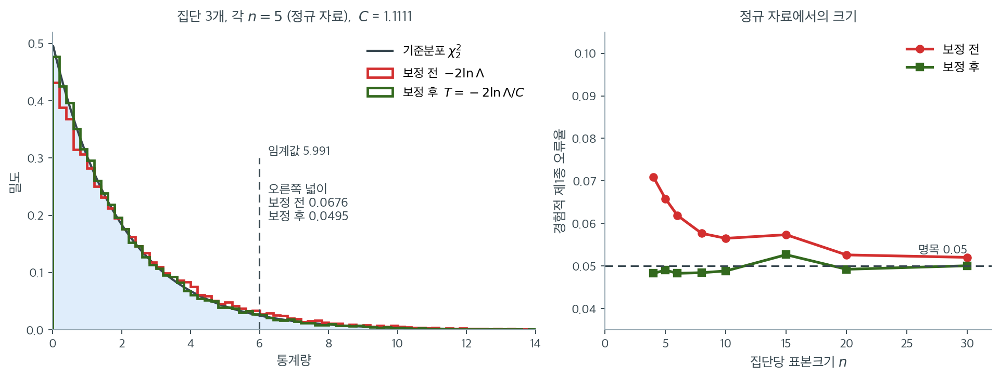

# 유도와 카이제곱 근사

Bartlett 검정통계량은 가능도비 원리로 동기를 부여할 수 있다. $k$개 집단이 공통 분산을 갖는다는 귀무가설 아래에서 가능도함수가 단순해지고, 제약된 가능도와 제약 없는 가능도의 비에서 익숙한 Bartlett 공식이 곧바로 나온다. 이 절은 유도를 단계별로 제시하고 정확한 카이제곱 근사를 보장하는 보정인자를 설명한다.

---

## 1. 설정과 기호

정규 모집단에서 $k$개의 독립 표본을 뽑았다고 하자.

$$
X_{ij} \sim N(\mu_i, \sigma_i^2), \quad i = 1, \ldots, k, \quad j = 1, \ldots, n_i
$$

$N = \sum_{i=1}^{k} n_i$를 전체 표본크기, $S_i^2$을 집단 $i$의 표본분산이라 하고 합동분산을 다음으로 정의한다.

$$
S_p^2 = \frac{\sum_{i=1}^{k} (n_i - 1) S_i^2}{N - k}
$$

이는 자유도 $\nu_i = n_i - 1$에 비례하는 가중치를 갖는 집단분산들의 가중평균이다.

---

## 2. 가능도비

귀무가설 $H_0\colon \sigma_1^2 = \cdots = \sigma_k^2 = \sigma^2$ 아래에서 공통 분산의 최대가능도추정량은 $\hat{\sigma}^2 = S_p^2$이다. 대립가설 아래에서는 각 집단이 자기 추정량 $\hat{\sigma}_i^2 = S_i^2$을 갖는다.

로그가능도비 통계량은

$$
-2 \ln \Lambda = \sum_{i=1}^{k} \nu_i \ln\!\left(\frac{S_p^2}{S_i^2}\right) = (N-k)\ln S_p^2 - \sum_{i=1}^{k} \nu_i \ln S_i^2
$$

여기서 $\nu_i = n_i - 1$이다. 이 양은 (로그의 오목성과 Jensen 부등식에 의해) 항상 음이 아니며, 모든 표본분산이 같을 때만 0이 된다.

---

## 3. 보정인자

통계량 $-2\ln\Lambda$는 표본크기가 커지면 $\chi^2_{k-1}$로 수렴하지만, 중간 정도의 표본크기에서는 수렴이 느리다. Bartlett(1937)은 카이제곱 근사를 개선하기 위해 보정인자를 도입했다.

$$
C = 1 + \frac{1}{3(k-1)}\left(\sum_{i=1}^{k} \frac{1}{\nu_i} - \frac{1}{N - k}\right)
$$

보정된 검정통계량은

$$
T = \frac{-2\ln\Lambda}{C} = \frac{(N-k)\ln S_p^2 - \sum_{i=1}^{k} \nu_i \ln S_i^2}{1 + \frac{1}{3(k-1)}\left(\sum_{i=1}^{k} \frac{1}{\nu_i} - \frac{1}{N-k}\right)}
$$

$H_0$과 정규성 아래에서 $T \stackrel{\text{근사}}{\sim} \chi^2_{k-1}$이다.

!!! note "보정의 목적"
    보정인자 $C$는 항상 1보다 크므로 $C$로 나누면 검정통계량이 줄어든다. 보정하지 않으면 작은 표본에서 $-2\ln\Lambda$가 지나치게 커져 제1종 오류율이 부풀려진다. 보정은 실제 기각률을 명목 수준 $\alpha$에 가깝게 되돌린다.

$C$가 실제로 얼마나 벌어 주는지 모의실험으로 재어 보자. 정규 자료에서 세 집단을 같은 분포에서 뽑아($H_0$이 참) 보정 전후의 통계량을 4만 번씩 계산했다.



왼쪽은 $n = 5$인 극단적으로 작은 표본이다. 이때 $C = 1.1111$이니 통계량을 11%쯤 줄이는 셈이다. 얼핏 두 계단 곡선이 거의 겹쳐 보이지만 **판정을 가르는 것은 꼬리다.** 임계값 $5.991$ 오른쪽 넓이가 보정 전에는 $0.0676$, 보정 후에는 $0.0495$이다. 겨우 11%를 줄였는데 오류율이 $0.068$에서 $0.050$으로 내려온다. 꼬리 근처에서는 작은 이동이 큰 확률 차이를 만든다.

오른쪽이 전체 그림이다. 보정 전(빨강)은 $n = 4$에서 $0.071$, $n = 10$에서 $0.057$로 $n$이 커지면서 천천히 $0.05$로 다가간다. 점근적으로는 옳지만 수렴이 느리다는 뜻이다. 보정 후(초록)는 $n = 4$에서 이미 $0.048$이고 이후 줄곧 $0.05$ 근처에 붙어 있다. **$C$는 점근 결과를 유한표본에서 쓸 수 있게 만드는 다리다.**

이 아이디어의 일반적 이름이 **바틀렛 보정**이다. 가능도비 통계량 $-2\ln\Lambda$의 기댓값이 자유도와 정확히 같지 않고 $\mathbb{E}[-2\ln\Lambda] \approx (k-1)\,C$ 꼴로 어긋난다는 관찰에서 출발해, 그 배수로 나누어 기댓값을 맞춘다. 바틀렛이 1937년에 분산 검정을 위해 고안했지만 오늘날에는 가능도비 검정 일반에 쓰이는 표준 기법이 되었다.

다만 한 가지를 분명히 해 두어야 한다. **$C$가 고치는 것은 유한표본 근사 오차뿐이다.** 자료가 정규가 아니면 기준분포 $\chi^2_{k-1}$ 자체가 틀린 것이고, 그 문제는 어떤 상수로 나누어도 해결되지 않는다. 다음 절 [비정규성 아래의 한계](limitations.md)가 그 경우를 다룬다.

---

## 4. 공식의 직관

$T$의 분자는 다음과 같이 해석할 수 있다.

- $(N - k)\ln S_p^2$은 합동분산의 로그에 전체 자유도를 곱한 것이다.
- $\sum \nu_i \ln S_i^2$은 각 집단분산의 로그에 그 집단의 자유도를 곱해 더한 것이다.

모든 집단분산이 같으면 모든 $i$에 대해 $S_i^2 \approx S_p^2$이므로 분자가 0에 가깝다. 하나 이상의 집단이 실질적으로 다른 분산을 가지면 개별 $\ln S_i^2$이 $\ln S_p^2$에서 벗어나고 분자가 커진다.

곧 이 검정통계량은 개별 로그분산이 합동 로그분산에서 얼마나 벗어나는지를 표본크기로 조정하여 재는 것이다.

---

## 5. 판정규칙

유의수준 $\alpha$에서 다음이면 $H_0$을 기각한다.

$$
T > \chi^2_{1-\alpha,\, k-1}
$$

여기서 $\chi^2_{1-\alpha,\, k-1}$은 자유도 $k-1$인 카이제곱분포의 $(1-\alpha)$ 분위수이다. 등분산에서 어느 방향으로 벗어나든 $T$가 커지므로 이 검정은 항상 단측(오른쪽 꼬리)이다.

<div class="exbox" markdown>

**보기 1.** <span class="diff easy" title="쉬움"></span> 세 집단의 Bartlett 검정. 세 집단의 표본크기와 분산이 다음과 같다.

| 집단 | $n_i$ | $S_i^2$ | $\nu_i = n_i - 1$ |
|---|---|---|---|
| 1 | 10 | 5.2 | 9 |
| 2 | 12 | 8.1 | 11 |
| 3 | 8 | 4.7 | 7 |

</div>

??? success "풀이"
    **1단계.** 합계: $N = 30$, $N - k = 27$.

    **2단계.** 합동분산:

    $$
    S_p^2 = \frac{9(5.2) + 11(8.1) + 7(4.7)}{27} = \frac{46.8 + 89.1 + 32.9}{27} = \frac{168.8}{27} = 6.2519
    $$

    **3단계.** 분자:

    $$
    27 \ln(6.2519) - [9\ln(5.2) + 11\ln(8.1) + 7\ln(4.7)]
    $$

    $$
    = 27(1.8329) - [9(1.6487) + 11(2.0919) + 7(1.5476)]
    $$

    $$
    = 49.488 - [14.838 + 23.011 + 10.833] = 49.488 - 48.682 = 0.806
    $$

    **4단계.** 보정인자:

    $$
    C = 1 + \frac{1}{3(2)}\left(\frac{1}{9} + \frac{1}{11} + \frac{1}{7} - \frac{1}{27}\right) = 1 + \frac{1}{6}(0.1111 + 0.0909 + 0.1429 - 0.0370) = 1 + \frac{0.3078}{6} = 1.0513
    $$

    **5단계.** 검정통계량:

    $$
    T = \frac{0.806}{1.0513} = 0.767
    $$

    **6단계.** $\chi^2_{0.95,\, 2} = 5.991$과 비교한다. $0.767 < 5.991$이므로 $H_0$을 기각하지 못한다($p = 0.682$). 집단분산이 다르다고 결론지을 증거가 충분하지 않다.

---

## 6. Python 검증

<div class="exbox" markdown>

**보기 2.** <span class="diff easy" title="쉬움"></span> 요약값만으로 통계량 만들기. 보기 1 의 세 집단($n = 10, 12, 8$, $S^2 = 5.2, 8.1, 4.7$)을 원자료 없이 검정한다.

**(1)** 바틀렛 통계량이 **$(n_i, S_i^2)$ 만의 함수**임을 식에서 읽어 내고, 그 결과로 $T$가 분산들의 **공통 척도에 불변**임을 보이시오.

**(2)** (1)을 역으로 쓰면 요약값에 맞는 원자료를 아무렇게나 꾸며도 `scipy` 가 같은 답을 주어야 한다. 확인하시오. 또 넘겨받은 분산이 $\nu_i$ 로 나눈 것인지 $n_i$ 로 나눈 것인지가 언제 문제가 되는지 밝히시오.

</div>

??? success "풀이"

    **(1) 식에 원자료가 들어오는 통로가 없다.** 통계량을 다시 적어 보면

    $$
    T = \frac{(N-k)\ln S_p^2 - \sum_i \nu_i \ln S_i^2}{C},
    \qquad
    S_p^2 = \frac{\sum_i \nu_i S_i^2}{N-k},
    \qquad
    C = 1 + \frac{1}{3(k-1)}\left(\sum_i \frac{1}{\nu_i} - \frac{1}{N-k}\right)
    $$

    인데 오른쪽에 나오는 것은 $n_i$(따라서 $\nu_i$, $N$, $k$)와 $S_i^2$ 뿐이다. **관측값 $X_{ij}$ 가 어디에도 없다.** 그러므로 논문 표에 집단 크기와 표본분산만 실려 있어도 등분산 검정을 그대로 돌릴 수 있다. 원자료를 구할 필요가 없다.

    이것이 우연이 아닌 까닭은 연습문제 3 의 유도에 있다. 정규 로그가능도를 평균에 대해 최적화하고 나면 자료가 $\sum_j (X_{ij} - \bar X_i)^2 = \nu_i S_i^2$ 이라는 형태로만 남는다. 곧 **$(\bar X_i, S_i^2)$ 가 정규모형의 충분통계량**이고, 분산에 관한 가설은 그중 $S_i^2$ 만 쓴다.

    **척도불변성.** 모든 표본분산에 같은 상수 $a > 0$ 을 곱하면 합동분산도 $a S_p^2$ 이 되고, $\sum_i \nu_i = N - k$ 이므로 분자에서

    $$
    (N-k)\ln(aS_p^2) - \sum_i \nu_i \ln(aS_i^2)
    = (N-k)\ln a + (N-k)\ln S_p^2 - \Bigl(\sum_i \nu_i\Bigr)\ln a - \sum_i \nu_i \ln S_i^2
    $$

    에서 $\ln a$ 항이 **정확히 상쇄된다.** $C$ 는 $n_i$ 만의 함수라 애초에 영향을 받지 않는다. 따라서

    $$
    T(a S_1^2, \ldots, a S_k^2) = T(S_1^2, \ldots, S_k^2)
    $$

    이다. **단위를 바꾸어도(미터를 센티미터로, 원을 달러로) 같은 답이 나온다.** $T$ 가 보는 것은 분산들의 **비**뿐이다.

    **(2) 요약값이 전부라면, 요약값만 맞춘 가짜 자료도 같은 답을 주어야 한다.** 그리고 척도불변성이 하나 더 알려 준다. $n_i$ 가 모두 같으면 $\nu_i/n_i = (n-1)/n$ 이 공통 상수이므로 `ddof=0` 으로 받은 분산을 그대로 넣어도 $T$ 가 **바뀌지 않는다.** 그러나 $n_i$ 가 다르면 $\nu_i/n_i$ 가 집단마다 달라 공통 상수가 아니고, 그때는 $T$ 가 달라진다. 이 자료는 $n = (10, 12, 8)$ 로 불균형이니 영향이 있어야 한다.

    ```python
    import numpy as np
    from scipy import stats

    # 원자료 없이 집단 크기와 표본분산만으로 통계량을 만들 수 있다.
    n = np.array([10, 12, 8])
    s2 = np.array([5.2, 8.1, 4.7])
    k = len(n)
    nu = n - 1
    N = n.sum()

    # 귀무가설 아래의 공통 분산 추정값
    s2_pooled = np.sum(nu * s2) / np.sum(nu)

    # 분자는 합동분산의 로그와 각 분산 로그의 가중평균의 차이다.
    # 분산들이 고를수록 0 에 가까워진다.
    numerator = np.sum(nu) * np.log(s2_pooled) - np.sum(nu * np.log(s2))

    # 보정인자. 표본이 작을수록 1 보다 눈에 띄게 커져 통계량을 낮춘다.
    C = 1 + (1 / (3 * (k - 1))) * (np.sum(1 / nu) - 1 / np.sum(nu))

    # 검정통계량
    T = numerator / C

    # p-값
    p_value = stats.chi2.sf(T, k - 1)

    print(f"Pooled variance: {s2_pooled:.4f}")
    print(f"Numerator: {numerator:.4f}")
    print(f"Correction factor C: {C:.4f}")
    print(f"Test statistic T: {T:.4f}")
    print(f"P-value: {p_value:.4f}")


    def bart_from_summary(n, s2):
        """(n_i, S_i^2) 만으로 바틀렛 통계량과 p 값을 돌려준다."""
        n, s2 = np.asarray(n, float), np.asarray(s2, float)
        k, nu = len(n), np.asarray(n, float) - 1
        sp2 = np.sum(nu * s2) / np.sum(nu)
        num = np.sum(nu) * np.log(sp2) - np.sum(nu * np.log(s2))
        C = 1 + (1 / (3 * (k - 1))) * (np.sum(1 / nu) - 1 / np.sum(nu))
        return num / C, stats.chi2.sf(num / C, k - 1)


    # 요약값에 맞는 원자료를 아무렇게나 만들어 scipy 에 넣어 본다.
    # 평균을 어디에 두든, 어떤 분포에서 뽑든 분산만 맞추면 같은 값이 나와야 한다.
    def fake(n, s2, rng, draw):
        out = []
        for ni, v in zip(n, s2):
            z = draw(ni)
            z = (z - z.mean()) / z.std(ddof=1) * np.sqrt(v)
            out.append(z + rng.normal() * 10)
        return out


    rng = np.random.default_rng(99)
    g_norm = fake(n, s2, rng, lambda m: rng.normal(size=m))
    rng2 = np.random.default_rng(7)
    g_t3 = [a - 123.0 for a in fake(n, s2, rng2, lambda m: rng2.standard_t(3, size=m))]

    print(f"\n만든 자료의 표본분산: {[round(float(g.var(ddof=1)), 10) for g in g_norm]}")
    print(f"{'요약값만으로':22}{bart_from_summary(n, s2)[0]:.13f}")
    print(f"{'정규에서 만든 자료':22}{stats.bartlett(*g_norm).statistic:.13f}")
    print(f"{'t_3 에서 만든 자료':22}{stats.bartlett(*g_t3).statistic:.13f}")

    # 척도불변성: 분산에 공통 상수를 곱해도 T 가 바뀌지 않는다.
    print(f"\n분산을 1000배 하면:  T = {bart_from_summary(n, s2 * 1000)[0]:.13f}")

    # ddof 함정. n 으로 나눈 분산을 받아 그대로 넣으면?
    s2_pop = s2 * nu / n
    print(f"\nn 으로 나눈 분산 = {np.round(s2_pop, 4)}")
    print(f"  불균형 n=(10,12,8):  ddof=1 -> T = {bart_from_summary(n, s2)[0]:.4f}"
          f"   ddof=0 -> T = {bart_from_summary(n, s2_pop)[0]:.4f}")
    ne = np.array([10, 10, 10])
    print(f"  균형   n=(10,10,10): ddof=1 -> T = {bart_from_summary(ne, s2)[0]:.13f}")
    print(f"                       ddof=0 -> T = {bart_from_summary(ne, s2 * 9 / 10)[0]:.13f}")
    ```

    출력:

    ```text
    Pooled variance: 6.2519
    Numerator: 0.8063
    Correction factor C: 1.0513
    Test statistic T: 0.7670
    P-value: 0.6815

    만든 자료의 표본분산: [5.2, 8.1, 4.7]
    요약값만으로                0.7669773746398
    정규에서 만든 자료            0.7669773746398
    t_3 에서 만든 자료          0.7669773746398

    분산을 1000배 하면:  T = 0.7669773746398

    n 으로 나눈 분산 = [4.68   7.425  4.1125]
      불균형 n=(10,12,8):  ddof=1 -> T = 0.7670   ddof=0 -> T = 0.8743
      균형   n=(10,10,10): ddof=1 -> T = 0.7478100156592
                           ddof=0 -> T = 0.7478100156592
    ```

    **요약값만으로 보기 1 의 손계산이 그대로 재현된다.** 합동분산 $6.2519$, 분자 $0.8063$, 보정인자 $1.0513$, 통계량 $0.7670$, $p$값 $0.6815$ 로 보기 1 의 여섯 단계와 모두 맞는다(보기 1 은 분자를 $0.806$ 까지만 적었다).

    **(2)의 첫 주장이 맞는다.** 표본분산만 $5.2$, $8.1$, $4.7$ 에 맞추어 꾸민 자료를 `scipy.stats.bartlett` 에 넣으면 요약값만으로 구한 값과 소수점 열셋째 자리까지 같은 $0.7669773746398$ 이 나온다. **정규에서 뽑아 만든 것이든 $t_3$ 에서 뽑아 만든 것이든, 평균을 $+10$ 쪽에 두든 $-123$ 에 두든 결과가 같다.** 자료의 모양과 위치를 모두 지워도 통계량이 살아남는다는 뜻이고, 이것이 (1)의 "원자료가 들어오는 통로가 없다"는 말의 실물이다.

    여기에는 반전이 하나 숨어 있다. **통계량은 자료의 모양을 못 보지만, 기준분포 $\chi^2_{k-1}$ 은 자료가 정규라는 가정에서 나왔다.** $t_3$ 에서 만든 자료를 넣어도 같은 $T$ 가 나오지만, 그 자료에 대해 $\chi^2_2$ 가 옳은 기준인지는 전혀 다른 문제다. 위 실험은 분산을 억지로 맞춘 것이라 그 물음에 답하지 않는다. 다음 절 [비정규성 아래의 한계](limitations.md)가 답한다.

    **척도불변성도 확인된다.** 분산 셋을 모두 1000배 해도 $T$ 가 열셋째 자리까지 같다.

    **`ddof` 는 불균형일 때만 문제가 된다.** $n = (10, 12, 8)$ 에서 $n_i$ 로 나눈 분산 $(4.68,\, 7.425,\, 4.1125)$ 를 그대로 넣으면 $T = 0.8743$ 이 되어 올바른 $0.7670$ 보다 $14\%$ 크다. 반면 $n = (10,10,10)$ 으로 균형을 맞추면 두 길이 $0.7478100156592$ 로 **열셋째 자리까지 같다.** 공통 인자 $(n-1)/n = 0.9$ 가 척도불변성에 흡수되기 때문이다.

    **실무적 교훈.** 남의 표에서 분산을 받아 올 때 그것이 $n-1$ 로 나눈 것인지 꼭 확인하라. 균형 설계라면 틀려도 답이 같아서 실수가 드러나지 않고, 불균형 설계에서만 조용히 틀린다. **드러나지 않는 실수가 더 위험하다.**

---

## 연습문제

<div class="drillbox" markdown>

**연습문제 1.** <span class="diff med" title="중간"></span>
Bartlett 보정이 실제로 유한표본 크기를 개선하는지 모의실험으로 확인하라. 세 집단, 각 $n = 5$인 정규 자료에서 보정 있는 통계량과 없는 통계량의 경험적 크기를 비교하라.

</div>

??? success "풀이"

    ```python
    import numpy as np
    from scipy import stats

    rng = np.random.default_rng(0)
    k, n, R, alpha = 3, 5, 20000, 0.05
    nu = n - 1
    N = k * n
    C = 1 + (1 / (3 * (k - 1))) * (k / nu - 1 / (N - k))
    crit = stats.chi2.ppf(1 - alpha, k - 1)

    rej_raw = rej_corr = 0
    for _ in range(R):
        s2 = np.array([rng.normal(0, 1, n).var(ddof=1) for _ in range(k)])
        sp2 = s2.mean()                      # equal nu, so simple mean
        raw = (N - k) * np.log(sp2) - nu * np.sum(np.log(s2))
        rej_raw += (raw > crit)
        rej_corr += (raw / C > crit)

    print(f"Correction factor C = {C:.4f}")
    print(f"Uncorrected size: {rej_raw / R:.4f}")
    print(f"Corrected size:   {rej_corr / R:.4f}")
    ```

    출력:

    ```text
    Correction factor C = 1.1111
    Uncorrected size: 0.0672
    Corrected size:   0.0505
    ```

    보정하지 않은 통계량의 크기가 $0.067$로 명목값보다 34% 크다. 보정 후에는 $0.050$으로 명목값과 사실상 일치한다(몬테카를로 표준오차 0.0015).

    $n = 5$에서 $C = 1 + \frac{k+1}{3k(n-1)} = 1 + \frac{4}{36} = 1.1111$이다. 이렇게 작은 표본에서 점근 $\chi^2$ 근사가 부정확하며, Bartlett의 보정이 그 오차를 거의 완전히 제거함을 보여준다.

    **주의.** 이 실험은 자료가 **정규일 때**만 보정이 작동함을 보여줄 뿐이다. 비정규 자료에서는 보정이 있어도 크기가 통제되지 않는다. 보정은 유한표본 근사 오차를 고치는 것이지 모형 오설정을 고치는 것이 아니다. $\square$

---

<div class="drillbox" markdown>

**연습문제 2.** <span class="diff med" title="중간"></span>
본문 보기에서 집단 2의 분산을 $S_2^2 = 8.1$에서 점점 키워가며 $T$가 임계값 $5.991$을 넘는 지점을 찾아라. 이것이 Bartlett 검정의 검정력에 대해 무엇을 말해 주는가?

</div>

??? success "풀이"

    ```python
    import numpy as np
    from scipy import stats

    n = np.array([10, 12, 8])
    k, nu, N = 3, n - 1, n.sum()
    C = 1 + (1 / (3 * (k - 1))) * (np.sum(1 / nu) - 1 / np.sum(nu))
    crit = stats.chi2.ppf(0.95, k - 1)

    print(f"{'s2_2':>8} {'T':>8} {'p':>8} {'ratio to others':>18}")
    for s2_2 in [8.1, 15, 21, 25, 40, 60, 80]:
        s2 = np.array([5.2, s2_2, 4.7])
        sp2 = np.sum(nu * s2) / np.sum(nu)
        T = (np.sum(nu) * np.log(sp2) - np.sum(nu * np.log(s2))) / C
        p = stats.chi2.sf(T, k - 1)
        print(f"{s2_2:>8.1f} {T:>8.3f} {p:>8.4f} {s2_2 / 5.0:>18.1f}")
    ```

    출력:

    ```text
        s2_2        T        p    ratio to others
         8.1    0.767   0.6815                1.6
        15.0    3.856   0.1454                3.0
        21.0    6.468   0.0394                4.2
        25.0    8.045   0.0179                5.0
        40.0   12.938   0.0016                8.0
        60.0   17.761   0.0001               12.0
        80.0   21.438   0.0000               16.0
    ```

    이분법으로 정확한 교차점을 찾으면 $S_2^2 = 19.85$에서 $T = 5.9915$가 되어 임계값과 일치한다. 곧 집단 2의 분산이 나머지 두 집단(약 5)의 **네 배**를 넘어야 5% 수준에서 기각한다.

    **검정력에 대한 함의.** 총 $N = 30$개의 관측값으로는 4배의 분산 차이도 겨우 탐지한다. 표준편차로 환산하면 2배이다.

    이는 15.3절 [F 검정 검정력 모의실험](../f_test/f_test_power_sim.md) 연습문제 1에서 F 검정에 대해 본 것과 같은 결론이다. **분산 검정은 검정력이 근본적으로 낮다.** 실무에서 사전검정이 기각하지 못했다는 사실만으로 등분산성을 확신해서는 안 된다.

    표를 더 보면 $T$가 분산비의 로그에 거의 선형으로 반응한다는 점도 확인할 수 있다. 분산비가 3배에서 16배로 늘어날 때($\ln$ 기준 1.10에서 2.77로 2.5배) $T$는 3.86에서 21.44로 5.6배 늘었다. Bartlett 통계량이 로그 척도에서 작동하고 그 제곱 규모로 커지기 때문이다. $\square$

---

<div class="drillbox" markdown>

**연습문제 3.** <span class="diff hard" title="어려움"></span>
$-2\ln\Lambda = (N-k)\ln S_p^2 - \sum_i \nu_i \ln S_i^2$을 정규 로그가능도에서 직접 유도하라.

</div>

??? success "풀이"
    집단 $i$의 정규 로그가능도는(평균을 $\bar{X}_i$로 최적화한 뒤)

    $$
    \ell_i(\sigma_i^2) = -\frac{n_i}{2}\ln(2\pi) - \frac{n_i}{2}\ln \sigma_i^2 - \frac{1}{2\sigma_i^2}\sum_j (X_{ij}-\bar{X}_i)^2.
    $$

    $\sum_j (X_{ij}-\bar{X}_i)^2 = \nu_i S_i^2$로 쓰고 $\sigma_i^2$에 대해 미분하여 0으로 두면

    $$
    -\frac{n_i}{2\sigma_i^2} + \frac{\nu_i S_i^2}{2\sigma_i^4} = 0 \implies \hat{\sigma}_i^2 = \frac{\nu_i S_i^2}{n_i}.
    $$

    **대립가설 아래.** 각 집단이 자기 추정량을 쓰므로 최대화된 로그가능도는 상수를 빼고

    $$
    \ell_1 = -\frac{1}{2}\sum_i n_i \ln \hat{\sigma}_i^2 - \frac{N}{2}.
    $$

    **귀무가설 아래.** 공통 분산 하나뿐이므로

    $$
    \hat{\sigma}^2 = \frac{\sum_i \nu_i S_i^2}{N} = \frac{(N-k)S_p^2}{N}, \qquad \ell_0 = -\frac{N}{2}\ln \hat{\sigma}^2 - \frac{N}{2}.
    $$

    따라서

    $$
    -2\ln\Lambda = 2(\ell_1 - \ell_0) = N \ln \hat{\sigma}^2 - \sum_i n_i \ln \hat{\sigma}_i^2.
    $$

    **$\nu_i$ 버전으로의 이행.** 위 식은 MLE(분모 $n_i$)를 쓰지만 Bartlett 통계량은 불편추정량(분모 $\nu_i$)을 쓴다. $\hat{\sigma}_i^2 = (\nu_i/n_i)S_i^2$을 대입하면

    $$
    \sum_i n_i \ln \hat{\sigma}_i^2 = \sum_i n_i \ln S_i^2 + \sum_i n_i \ln(\nu_i/n_i)
    $$

    이고 두 번째 합은 자료에 의존하지 않는 상수이다. 실제로 쓰이는 형태는 $n_i$를 $\nu_i$로 바꾼

    $$
    -2\ln\Lambda = (N-k)\ln S_p^2 - \sum_i \nu_i \ln S_i^2
    $$

    이다. 이 치환은 자유도를 올바르게 반영하여 유한표본 성질을 개선하며, Bartlett 보정과 함께 쓰일 때 $\chi^2_{k-1}$ 근사가 가장 정확해진다. $\square$

---

<div class="drillbox" markdown>

**연습문제 4.** <span class="diff hard" title="어려움"></span>
$-2\ln\Lambda \geq 0$임을 Jensen 부등식으로 증명하라.

</div>

??? success "풀이"
    $w_i = \nu_i/(N-k)$라 하면 $\sum_i w_i = 1$이고 $w_i > 0$이므로 $\{w_i\}$가 확률분포를 이룬다.

    $$
    -2\ln\Lambda = (N-k)\left[\ln S_p^2 - \sum_i w_i \ln S_i^2\right] = (N-k)\left[\ln\left(\sum_i w_i S_i^2\right) - \sum_i w_i \ln S_i^2\right].
    $$

    $\ln$이 **오목**함수이므로 Jensen 부등식에 의해

    $$
    \ln\left(\sum_i w_i S_i^2\right) \geq \sum_i w_i \ln S_i^2.
    $$

    따라서 대괄호 안이 음이 아니고 $(N-k) > 0$이므로 $-2\ln\Lambda \geq 0$이다.

    **등호 조건.** $\ln$이 **엄격히** 오목하므로 Jensen 부등식의 등호는 $S_i^2$이 (확률 1로) 상수일 때, 곧 모든 $i$에 대해 $S_i^2$이 같을 때만 성립한다.

    **일반적 의미.** 이는 가능도비 검정 일반의 성질을 반영한다. $-2\ln\Lambda \geq 0$은 제약 없는 최대가능도가 제약된 최대가능도보다 항상 크거나 같기 때문이며, 이 검정이 항상 오른쪽 꼬리 단측검정인 이유이기도 하다. $\square$

---

<div class="drillbox" markdown>

**연습문제 5.** <span class="diff hard" title="어려움"></span>
본문 3 절의 주석은 $C > 1$ 이므로 보정이 통계량을 **줄인다**고 했다. 그런데 줄일 수 있는 양에는 천장이 있다.

**(1)** $n_i \ge 2$ 인 모든 설계에서 $D = \sum_i \dfrac{1}{\nu_i} - \dfrac{1}{N-k}$ 가 각 $\nu_j$ 에 대해 엄격히 감소함을 보이고, 이로부터

$$
C \;\le\; 1 + \frac{k+1}{3k} \;\le\; \frac{3}{2}
$$

임을 보이시오. 등호가 성립하는 설계를 모두 적고 $k \to \infty$ 에서의 천장도 적으시오.

**(2)** 보정이 통계량을 줄이는 비율 $1 - 1/C$ 의 최댓값을 구하시오. $k = 3$ 등표본에서 그 비율이 $5\%$ 이상인 $n$ 을 모두 구하고, 본문이 $n = 5$ 에서 "통계량을 11%쯤 줄이는 셈"이라 한 것과 맞추어 보시오.

**(3)** [Bartlett 검정 비정규성 민감도](bartlett_sensitivity.md) 보기 1 은 비정규 자료에서 $T$ 의 극한분포가 $\dfrac{\beta_2-1}{2}\chi^2_{k-1}$ 임을 썼다. 지수분포($\beta_2 = 9$)에서 기준분포를 되돌리려면 어떤 수로 나누어야 하는가. (1)의 천장과 견주어, 본문의 "$C$ 가 고치는 것은 유한표본 근사 오차뿐이다"를 수로 뒷받침하시오.

</div>

??? success "풀이"

    **(1) 천장은 가장 작은 설계에서 나온다.** $N - k = \sum_i \nu_i$ 이므로 $D$ 를 $\nu_j$ 로 미분하면

    $$
    \frac{\partial D}{\partial \nu_j} = -\frac{1}{\nu_j^2} + \frac{1}{\left(\sum_i \nu_i\right)^2}
    $$

    이다. $k \ge 2$ 이고 모든 $\nu_i \ge 1$ 이므로 $\sum_i \nu_i > \nu_j$ 이고, 따라서 이 도함수가 **음수**다. 곧 $D$ 는 각 $\nu_j$ 에 대해 엄격히 감소하므로 허용된 가장 작은 값 $\nu_1 = \cdots = \nu_k = 1$(모든 집단이 $n_i = 2$)에서 최대가 된다. 그때

    $$
    D = k - \frac{1}{k} = \frac{k^2-1}{k}
    \quad\Longrightarrow\quad
    C \le 1 + \frac{1}{3(k-1)}\cdot\frac{k^2-1}{k} = 1 + \frac{k+1}{3k}
    $$

    이다. ([Bartlett 검정](bartlett_test.md) 연습문제 1 의 등표본 공식 $C = 1 + \frac{k+1}{3k(n-1)}$ 에 $n = 2$ 를 넣은 것과 같다.)

    이제 $\frac{k+1}{3k} = \frac13 + \frac{1}{3k}$ 가 $k$ 에 대해 엄격히 감소하므로 $k = 2$ 에서 가장 크다.

    | $k$ | 2 | 3 | 4 | 10 | $\infty$ |
    |---|---|---|---|---|---|
    | 천장 | $3/2$ | $1.4444$ | $1.4167$ | $1.3667$ | $4/3$ |

    따라서 모든 설계에서 $C \le 3/2$ 이고, 등호는 $k = 2$, $n_1 = n_2 = 2$ 인 설계 **하나뿐**이다. $k \to \infty$ 에서 천장은 $4/3$ 으로 내려간다. **집단 수를 늘려도 천장이 낮아진다**는 점에 유의하라.

    **(2) 보정이 깎을 수 있는 최대치는 3 분의 1 이다.** $1 - 1/C$ 는 $C$ 의 증가함수이므로

    $$
    1 - \frac{1}{C} \le 1 - \frac{1}{3/2} = \frac13 = 33.3\%
    $$

    이다. $k = 3$ 등표본에서는 $C = 1 + \frac{4}{9(n-1)}$ 이므로

    $$
    1 - \frac1C \ge 0.05
    \iff C \ge \frac{1}{0.95} = \frac{20}{19}
    \iff \frac{4}{9(n-1)} \ge \frac{1}{19}
    \iff n - 1 \le \frac{76}{9} = 8.4444
    $$

    곧 $2 \le n \le 9$ 다. $n = 9$ 에서 $C = 1.055556$, $1 - 1/C = 0.052632$ 이고 $n = 10$ 에서 $C = 1.049383$, $1 - 1/C = 0.047059$ 로 문턱을 넘는다.

    **본문의 "11%"와 맞추기.** $n = 5$ 에서 $C = 1.111111$ 이니 $C$ 는 1 보다 $11.1\%$ 크고, 통계량은 $1 - 1/C = 10.0\%$ 줄어든다. 같은 사실의 두 표현이다. 그 $10\%$ 가 꼬리확률을 $0.0676$ 에서 $0.0495$ 로 내렸다는 것이 본문의 요점이다.

    **(3) 비정규성이 요구하는 나눗수는 천장 밖에 있다.** 지수분포는 $\beta_2 = 9$ 이므로 극한분포가 $\frac{9-1}{2}\chi^2_{k-1} = 4\chi^2_{k-1}$ 이고, 기준분포를 되돌리려면 통계량을 **$4$ 로 나누어야** 한다($k = 3$, $\alpha = 0.05$ 에서 극한 오류율은 $P(\chi^2_2 > 5.9915/4) = e^{-0.7490} = 0.4729$ 이다).

    그런데 (1)에서 $C \le 1.5$ 다. 가장 극단적인 설계를 가져와도 $1.5$ 이고, 쓸 만한 설계에서는 훨씬 작다($k = 3$, $n = 20$ 이면 $C = 1.0234$). 필요한 $4$ 와 가능한 $1.5$ 사이에는 **2.7 배**의 간격이 있고, 현실적인 설계와 비교하면 거의 네 배의 간격이다.

    더 근본적인 이유는 $C$ 의 **식에 첨도가 들어갈 자리가 없다**는 것이다. $C$ 는 $n_i$ 만의 함수이므로 설계를 어떻게 바꾸어도 $\beta_2$ 에 반응하지 못한다. 보정은 몇 퍼센트 규모의 유한표본 오차를 고치는 도구이고 비정규성은 몇 백 퍼센트 규모의 오설정이다. **단위가 다른 문제여서 한쪽 도구로 다른 쪽을 고칠 수 없다.** $\square$

---

<div class="drillbox" markdown>

**연습문제 6.** <span class="diff hard" title="어려움"></span>
본문 3 절은 보정의 출처를 "$\mathbb{E}[-2\ln\Lambda] \approx (k-1)\,C$ 꼴로 어긋난다는 관찰"이라고만 적었다. 그 관찰을 실제로 계산해 **$C$ 를 유도**하자. $Q \sim \chi^2_\nu$ 이면 $\mathbb{E}[\ln Q] = \psi(\nu/2) + \ln 2$ 이고, 디감마의 전개

$$
\psi(x) = \ln x - \frac{1}{2x} - \frac{1}{12x^2} + \frac{1}{120x^4} + O(x^{-6})
$$

를 쓴다.

**(1)** $h(\nu) = \nu\left[\psi(\nu/2) - \ln(\nu/2)\right]$ 로 두면 $H_0$ 아래에서

$$
\mathbb{E}[-2\ln\Lambda] = h(N-k) - \sum_{i=1}^{k} h(\nu_i)
$$

가 **정확히** 성립하며 $\sigma^2$ 이 들어가지 않음을 보이시오.

**(2)** 전개를 넣어 $\mathbb{E}[-2\ln\Lambda] = (k-1)\,C + O(\nu^{-3})$ 임을 보이시오. 곧 $C$ 는 평균을 자유도에 맞추는 상수다.

**(3)** 한 항을 더 보아 $\mathbb{E}[-2\ln\Lambda] < (k-1)\,C$ 임을 보이시오. 곧 $C$ 는 아주 조금 **과잉보정**이다. 보기 1 의 설계 $n = (10, 12, 8)$ 에서 두 값을 소수 여섯째 자리까지 비교하시오.

</div>

??? success "풀이"

    **(1) 로그의 기댓값은 디감마다.** $H_0$ 아래에서 $\nu_i S_i^2/\sigma^2 \sim \chi^2_{\nu_i}$ 이 독립이고, 그 합이 $(N-k)S_p^2/\sigma^2 \sim \chi^2_{N-k}$ 이다. 따라서

    $$
    \mathbb{E}[\ln S_i^2]
    = \ln\frac{\sigma^2}{\nu_i} + \psi\!\left(\frac{\nu_i}{2}\right) + \ln 2
    = \ln \sigma^2 + \psi\!\left(\frac{\nu_i}{2}\right) - \ln\frac{\nu_i}{2}
    $$

    이고 $S_p^2$ 에도 자유도 $N-k$ 로 같은 식이 적용된다. 이제

    $$
    \mathbb{E}[-2\ln\Lambda]
    = (N-k)\,\mathbb{E}[\ln S_p^2] - \sum_i \nu_i\,\mathbb{E}[\ln S_i^2]
    $$

    에 넣으면 $\ln\sigma^2$ 의 계수가 $(N-k) - \sum_i \nu_i = 0$ 이므로 **모분산이 상쇄된다.** 남는 것은

    $$
    \mathbb{E}[-2\ln\Lambda] = (N-k)\left[\psi\!\left(\tfrac{N-k}{2}\right) - \ln\tfrac{N-k}{2}\right] - \sum_i \nu_i\left[\psi\!\left(\tfrac{\nu_i}{2}\right) - \ln\tfrac{\nu_i}{2}\right] = h(N-k) - \sum_i h(\nu_i)
    $$

    이다. **$\nu_i$ 만 알면 계산되는 완전히 알려진 수**이며, 모분산이 빠지는 것은 보기 2 의 척도불변성이 기댓값 수준에서 다시 나타난 것이다.

    **(2) 전개하면 $C$ 가 그대로 나온다.** $x = \nu/2$ 를 넣으면 $\frac{1}{2x} = \frac1\nu$, $\frac{1}{12x^2} = \frac{1}{3\nu^2}$, $\frac{1}{120x^4} = \frac{2}{15\nu^4}$ 이므로

    $$
    \psi\!\left(\frac\nu2\right) - \ln\frac\nu2 = -\frac{1}{\nu} - \frac{1}{3\nu^2} + \frac{2}{15\nu^4} + O(\nu^{-6}),
    \qquad
    h(\nu) = -1 - \frac{1}{3\nu} + \frac{2}{15\nu^3} + O(\nu^{-5})
    $$

    가 된다. 앞의 두 항만 쓰면

    $$
    \mathbb{E}[-2\ln\Lambda]
    = \left(-1 - \frac{1}{3(N-k)}\right) - \sum_i \left(-1 - \frac{1}{3\nu_i}\right) + O(\nu^{-3})
    = (k-1) + \frac13\left(\sum_i \frac{1}{\nu_i} - \frac{1}{N-k}\right) + O(\nu^{-3})
    $$

    이고, $k-1$ 로 묶으면

    $$
    \mathbb{E}[-2\ln\Lambda] = (k-1)\left[1 + \frac{1}{3(k-1)}\left(\sum_i \frac{1}{\nu_i} - \frac{1}{N-k}\right)\right] + O(\nu^{-3}) = (k-1)\,C + O(\nu^{-3})
    $$

    이 된다. **괄호 안이 바로 본문의 $C$ 다.** 상수 $-1$ 이 $k$ 번 빠지면서 $k-1$ 이 나오고, 디감마 전개의 둘째 항 $-\frac{1}{3\nu}$ 이 보정항 전체를 만든다. 보정인자의 $\frac13$ 과 $\sum 1/\nu_i$ 가 어디서 왔는지가 이 한 줄에 다 들어 있다. (일표본에서 같은 계산을 하는 것이 15.6 절 [분산에 대한 가능도비 검정](../advanced_methods/likelihood_ratio.md) 연습문제 10 이다.)

    **(3) 다음 항의 부호가 정해져 있다.** $h$ 의 셋째 항 $\frac{2}{15\nu^3}$ 까지 쓰면

    $$
    \mathbb{E}[-2\ln\Lambda] = (k-1)\,C - \frac{2}{15}\left(\sum_i \frac{1}{\nu_i^3} - \frac{1}{(N-k)^3}\right) + O(\nu^{-5})
    $$

    이다. 괄호 안은 연습문제 5 의 $D$ 와 같은 이유로 **양수**다($\nu_1 \le N-k$ 이므로 첫 항 하나만으로도 뺄 항보다 크다). 따라서 참 평균은 $(k-1)C$ 보다 **작다.**

    **보기 1 의 설계에서 확인.** $n = (10, 12, 8)$ 이면 $\nu = (9, 11, 7)$, $N - k = 27$ 이고

    | $\nu$ | 9 | 11 | 7 | 27 |
    |---|---|---|---|---|
    | $h(\nu)$ | $-1.036858$ | $-1.030204$ | $-1.047244$ | $-1.012339$ |

    이므로

    $$
    \mathbb{E}[-2\ln\Lambda] = -1.012339 + (1.036858 + 1.030204 + 1.047244) = 2.101968
    $$

    이고 $(k-1)C = 2 \times 1.051307 = 2.102613$ 이다. 차이는 $-0.000645$ 이고, 셋째 항의 예측값

    $$
    -\frac{2}{15}\left(\frac{1}{729} + \frac{1}{1331} + \frac{1}{343} - \frac{1}{19683}\right) = -0.000665
    $$

    와 잘 맞는다.

    **해석.** $C$ 는 평균을 $k-1$ 에 맞추지만 아주 조금 지나치게 맞춘다. $\mathbb{E}[T] = \mathbb{E}[-2\ln\Lambda]/C < k-1$ 이므로 **보정된 검정은 명목값보다 살짝 보수적**일 것이라고 예상할 수 있다. 연습문제 8 이 이를 수로 확인하고, 연습문제 9 가 $\nu_i$ 가 작을 때 그 "살짝"이 얼마나 커지는지 보인다. $\square$

---

<div class="drillbox" markdown>

**연습문제 7.** <span class="diff hard" title="어려움"></span>
연습문제 3 은 MLE 로 쓴 가능도비

$$
-2\ln\Lambda_{\mathrm{ML}} = N \ln \hat\sigma^2 - \sum_i n_i \ln \hat\sigma_i^2,
\qquad
\hat\sigma^2 = \frac{(N-k)S_p^2}{N}, \quad \hat\sigma_i^2 = \frac{\nu_i S_i^2}{n_i}
$$

에서 $n_i$ 를 $\nu_i$ 로 바꾼 것이 "실제로 쓰이는 형태"라고 했다. 그 치환이 상수 하나를 더하는 데 그치지 않음을 보인다. 분자를 $B = (N-k)\ln S_p^2 - \sum_i \nu_i \ln S_i^2$ 로 쓴다.

**(1)**

$$
-2\ln\Lambda_{\mathrm{ML}} = B + \Bigl(k\ln S_p^2 - \sum_i \ln S_i^2\Bigr) + a,
\qquad
a = N\ln\frac{N-k}{N} - \sum_i n_i \ln\frac{\nu_i}{n_i}
$$

임을 보이시오. 가운데 항이 **가중치만 $\nu_i$ 에서 $1$ 로 바꾼** 바틀렛 꼴임을 지적하고, 불균형 설계에서는 그것이 음수가 될 수도 있음을 설명하시오.

**(2)** 등표본 $n_i = n$ 에서는 $a = 0$ 이고 $-2\ln\Lambda_{\mathrm{ML}} = \frac{n}{n-1}B$ 임을 보이시오. 곧 두 통계량이 양의 상수배이므로 **같은 검정**이다.

**(3)** 불균형에서는 같은 검정이 아니다. $n = (5, 5, 25)$ 에서 두 자료 $S^2 = (1, 1, 3)$ 과 $S^2 = (3.1113,\, 1,\, 1)$ 이 $B$ 를 똑같이 $2.9546$ 으로 주는데도 $-2\ln\Lambda_{\mathrm{ML}}$ 은 갈라짐을 확인하고, 세 $p$ 값($T$ 하나와 $-2\ln\Lambda_{\mathrm{ML}}$ 둘)을 $\chi^2_2$ 로 구하시오. 어느 통계량이 "큰 집단의 분산이 튀는 것"에 더 민감한가.

**(4)** 연습문제 6 의 기법을 가운데 항에도 적용하여 $\mathbb{E}[-2\ln\Lambda_{\mathrm{ML}}]$ 을 $n = (10,12,8)$ 과 $n = (5,5,25)$ 에서 구하고, 둘 중 어느 통계량이 $\chi^2_2$ 에 맞게 눈금이 매겨진 것인지 판정하시오.

</div>

??? success "풀이"

    **(1) 두 합을 자유도 부분과 나머지로 쪼갠다.** MLE 를 대입하면

    $$
    -2\ln\Lambda_{\mathrm{ML}} = N\ln S_p^2 + N\ln\frac{N-k}{N} - \sum_i n_i \ln S_i^2 - \sum_i n_i \ln\frac{\nu_i}{n_i}
    $$

    이다. 여기서 $N\ln S_p^2 = (N-k)\ln S_p^2 + k\ln S_p^2$ 로, $\sum_i n_i \ln S_i^2 = \sum_i \nu_i \ln S_i^2 + \sum_i \ln S_i^2$ 로 쪼개면 자유도 부분이 정확히 $B$ 가 되고 나머지가 가운데 항과 상수 $a$ 다. 연습문제 3 은 $\sum_i n_i \ln(\nu_i/n_i)$ 가 상수임만 지적했는데, **치환은 그 상수 말고도 가운데 항을 남긴다.**

    가운데 항은

    $$
    k\ln S_p^2 - \sum_i \ln S_i^2 = k\ln\frac{S_p^2}{\mathrm{GM}},
    \qquad \mathrm{GM} = \Bigl(\prod_i S_i^2\Bigr)^{1/k}
    $$

    이다. $B$ 가 **$\nu_i$ 로 가중한** 산술평균과 기하평균의 로그차인 데 반해(연습문제 4), 이것은 $S_p^2$(여전히 $\nu_i$ 가중 산술평균)과 **가중하지 않은** 기하평균의 비교다. 두 평균의 가중치가 서로 다르므로 산술평균–기하평균 부등식이 적용되지 않고, 작은 집단의 분산이 유난히 클 때는 $S_p^2 < \mathrm{GM}$ 이 되어 **음수**가 된다. (3)의 둘째 자료가 그 보기다. $\nu = (4,4,24)$, $S^2 = (3.1113, 1, 1)$ 이면 $S_p^2 = 1.2639$, $\mathrm{GM} = 1.4599$ 이고 가운데 항은 $3\ln(1.2639/1.4599) = -0.4324$ 다.

    **(2) 균형에서는 상수배다.** $n_i = n$ 이면 $N = kn$, $N - k = k(n-1)$ 이므로

    $$
    a = kn\ln\frac{k(n-1)}{kn} - kn\ln\frac{n-1}{n} = 0
    $$

    이다. 또 가중치가 모두 같아 $S_p^2 = \frac1k\sum_i S_i^2$ 이고 $B = (n-1)\left[k\ln S_p^2 - \sum_i \ln S_i^2\right]$ 이므로 가운데 항이 정확히 $B/(n-1)$ 이다. 따라서

    $$
    -2\ln\Lambda_{\mathrm{ML}} = B\left(1 + \frac{1}{n-1}\right) = \frac{n}{n-1}\,B
    $$

    이다. ($n = (8,8,8)$, $S^2 = (1,2,5)$ 로 확인하면 $B = 4.47932$, $-2\ln\Lambda_{\mathrm{ML}} = 5.11922 = \frac87 \times 4.47932$ 다.) 양의 상수배이므로 임계값만 그 배수로 바꾸면 **기각 여부가 언제나 일치한다.**

    **(3) 불균형에서 두 통계량이 갈라진다.** $n = (5,5,25)$ 이므로 $\nu = (4,4,24)$, $N - k = 32$, $C = 1.085069$, $a = 0.115560$ 이다.

    | $S^2$ | $S_p^2$ | $B$ | 가운데 항 | $-2\ln\Lambda_{\mathrm{ML}}$ | $T = B/C$ |
    |---|---|---|---|---|---|
    | $(1, 1, 3)$ | $2.5000$ | $2.9546$ | $+1.6503$ | $4.7204$ | $2.7230$ |
    | $(3.1113, 1, 1)$ | $1.2639$ | $2.9546$ | $-0.4324$ | $2.6378$ | $2.7230$ |

    $p$ 값은 $\chi^2_2$ 에서

    $$
    p(T = 2.7230) = 0.2563, \qquad p(4.7204) = 0.0944, \qquad p(2.6378) = 0.2674
    $$

    다. **바틀렛 통계량이 똑같다고 판정한 두 자료를 정확한 가능도비는 $0.0944$ 와 $0.2674$ 로 갈라 놓는다.** 그러므로 $-2\ln\Lambda_{\mathrm{ML}}$ 은 $B$ 의 함수가 아니고, 두 통계량은 서로의 단조변환이 아니다. **치환은 눈금을 고치는 일이 아니라 검정을 바꾸는 일이다.**

    민감한 쪽은 **정확한 가능도비**다. 가운데 항이 모든 집단을 똑같이 $1$ 로 가중하므로 집단 크기에 상관없이 로그분산의 흩어짐을 한 번 더 세는데, 첫 줄에서는 튀는 집단이 $n = 25$ 인 큰 집단이라 $S_p^2$ 가 그쪽으로 끌려가 가운데 항이 $+1.65$ 로 커지고, 둘째 줄에서는 튀는 집단이 $n = 5$ 라 $S_p^2$ 가 거의 움직이지 않아 음수가 된다.

    **(4) 그런데 눈금이 맞는 쪽은 바틀렛이다.** 연습문제 6 의 $f(\nu) = \psi(\nu/2) - \ln(\nu/2) = h(\nu)/\nu$ 를 쓰면 가운데 항의 기댓값은 $\ln\sigma^2$ 이 상쇄되어

    $$
    \mathbb{E}\Bigl[k\ln S_p^2 - \sum_i \ln S_i^2\Bigr] = k\,f(N-k) - \sum_i f(\nu_i)
    $$

    이다. $n = (5,5,25)$ 에서 $f(32) = -0.031575$, $f(4) = -0.270363$, $f(24) = -0.042245$ 이므로 그 값은 $3(-0.031575) + 0.270363 + 0.270363 + 0.042245 = 0.4882$ 이고, 연습문제 6 의 $\mathbb{E}[B] = 2.1664$ 와 $a = 0.1156$ 을 더하면

    $$
    \mathbb{E}[-2\ln\Lambda_{\mathrm{ML}}] = 2.1664 + 0.4882 + 0.1156 = 2.7702.
    $$

    같은 계산을 $n = (10,12,8)$ 에 하면 가운데 항의 기댓값이 $0.2460$ 이고 $\mathbb{E}[-2\ln\Lambda_{\mathrm{ML}}] = 2.3531$ 이다.

    | 설계 | $\mathbb{E}[-2\ln\Lambda_{\mathrm{ML}}]$ | $\mathbb{E}[T]$ | 목표 $k-1$ |
    |---|---|---|---|
    | $(10, 12, 8)$ | $2.3531$ | $1.9994$ | 2 |
    | $(5, 5, 25)$ | $2.7702$ | $1.9965$ | 2 |

    정확한 가능도비의 평균은 $k-1 = 2$ 보다 $17.7\%$, $38.5\%$ 크다. 그대로 $\chi^2_2$ 에 넣으면 과대기각한다는 뜻이다. 반면 $T = B/C$ 의 평균은 연습문제 6 에 따라 $1.9994$, $1.9965$ 로 $2$ 에 붙어 있다. **연습문제 3 이 "자유도를 올바르게 반영하여 유한표본 성질을 개선한다"고 한 말의 정확한 내용이 이것이다.** 그리고 어긋남이 $(10,12,8)$ 보다 $(5,5,25)$ 에서 두 배 넘게 큰 데서 보듯, 문제는 **불균형이 심할수록 커진다.** 보기 2 의 `ddof` 함정과 같은 구조다. 균형 설계에서는 (2)에 의해 아무 차이가 없어 실수가 드러나지 않고, 불균형에서만 조용히 갈라진다. $\square$

---

<div class="drillbox" markdown>

**연습문제 8.** <span class="diff hard" title="어려움"></span>
연습문제 6 은 $C$ 가 $-2\ln\Lambda$ 의 **평균**을 $k-1$ 에 맞춘다는 것이었다. 적률 하나를 맞추면 꼬리는 따라오는가.

$k = 3$, 정규·등분산, $\alpha = 0.05$, 반복 20 만 회로 $n = 4, 5, 10, 20$ 에서 (가) 연습문제 6 의 정확한 $\mathbb{E}[-2\ln\Lambda]$ 와 모의 평균, (나) $\operatorname{Var}(T)$ 를 $\chi^2_{k-1}$ 의 $2(k-1) = 4$ 와, (다) $T$ 의 $95\%$ 분위수를 $\chi^2_{0.95,2} = 5.9915$ 와, (라) 실제 크기를 재시오.

이어서 평균과 분산을 **둘 다** 맞춘 기준분포 $c\,\chi^2_d$($c = \operatorname{Var}/(2\mathbb{E})$, $d = 2\mathbb{E}^2/\operatorname{Var}$)의 꼬리확률을 함께 적어, 남은 어긋남이 2 차 적률 하나로 설명되는지 보시오.

$n = 5$ 에서 보정 후 검정이 명목값보다 **자유로울지 보수적일지** 미리 짚고, 연습문제 6 (3)과 연결하시오.

</div>

??? success "풀이"

    **예측.** 연습문제 6 (3)이 $\mathbb{E}[-2\ln\Lambda] < (k-1)C$ 라 했으므로 $\mathbb{E}[T] < k-1$ 이다. 평균이 기준분포보다 아래에 있으면 꼬리도 얇을 것이고, 따라서 **살짝 보수적**이어야 한다.

    ```python
    import numpy as np
    from scipy import stats, special

    # 보정은 1 차 적률만 맞춘다. 2 차 적률과 꼬리는 어떻게 되는가.
    rng = np.random.default_rng(0)
    k, R, alpha = 3, 200_000, 0.05
    crit = stats.chi2.ppf(1 - alpha, k - 1)
    h = lambda v: v * (special.digamma(v / 2) - np.log(v / 2))   # 연습문제 6 의 h

    print(f"k = {k}, R = {R}, crit = {crit:.4f}")
    print(f"{'n':>4}{'C':>8}{'(k-1)C':>9}{'E exact':>9}{'E emp':>8}"
          f"{'Var T':>8}{'q95':>8}{'size':>8}{'2-mom':>8}")
    for n in (4, 5, 10, 20):
        nu, N = n - 1, k * n
        C = 1 + (1 / (3 * (k - 1))) * (k / nu - 1 / (N - k))
        s2 = rng.normal(size=(R, k, n)).var(axis=2, ddof=1)
        sp2 = s2.mean(axis=1)                  # 등표본이라 합동분산이 산술평균이다
        raw = (N - k) * np.log(sp2) - nu * np.log(s2).sum(axis=1)
        T = raw / C
        m, v = T.mean(), T.var(ddof=1)
        c, d = v / (2 * m), 2 * m * m / v      # 평균과 분산을 맞춘 기준분포 c * chi2_d
        print(f"{n:>4}{C:>8.4f}{(k - 1) * C:>9.4f}{h(N - k) - k * h(nu):>9.4f}"
              f"{raw.mean():>8.4f}{v:>8.4f}{np.quantile(T, 0.95):>8.4f}"
              f"{np.mean(T > crit):>8.4f}{stats.chi2.sf(crit / c, d):>8.4f}")
    print(f"Monte Carlo s.e. at 0.05 = {np.sqrt(alpha * (1 - alpha) / R):.4f}")
    ```

    출력:

    ```text
    k = 3, R = 200000, crit = 5.9915
       n       C   (k-1)C  E exact   E emp   Var T     q95    size   2-mom
       4  1.1481   2.2963   2.2839  2.2791  3.8160  5.8740  0.0472  0.0472
       5  1.1111   2.2222   2.2167  2.2215  3.9460  5.9558  0.0491  0.0493
      10  1.0494   2.0988   2.0982  2.0972  3.9627  5.9596  0.0492  0.0495
      20  1.0234   2.0468   2.0467  2.0506  4.0419  5.9944  0.0501  0.0506
    Monte Carlo s.e. at 0.05 = 0.0005
    ```

    **(가) 연습문제 6 의 닫힌 꼴이 맞는다.** `E exact` 와 `E emp` 가 네 줄 모두 소수 둘째–셋째 자리까지 일치한다($n = 5$ 에서 $2.2167$ 대 $2.2215$, 몬테카를로 오차 범위다). 그리고 `(k-1)C` 가 `E exact` 보다 네 줄 모두 **위에** 있다($2.2963 > 2.2839$, $2.2222 > 2.2167$, …). 과잉보정의 방향이 예측과 같다.

    **(나) 분산은 맞지 않는다.** $\operatorname{Var}(T)$ 가 $n = 4$ 에서 $3.8160$, $n = 5$ 에서 $3.9460$ 으로 목표 $4$ 보다 **작다.** 평균을 맞추는 상수 하나로는 2 차 적률을 건드릴 수 없으니 당연한 일이다. $n = 20$ 에서 $4.0419$ 로 올라와 목표를 지나친다.

    **(다),(라) 그래서 꼬리가 조금 얇다.** $95\%$ 분위수가 $n = 4$ 에서 $5.8740$, $n = 5$ 에서 $5.9558$ 로 임계값 $5.9915$ 보다 **아래**에 있고, 그만큼 크기가 $0.0472$, $0.0491$ 로 명목값 아래에 머문다. 예측대로 **보수적**이다. $n = 20$ 에서 분위수가 $5.9944$ 가 되면서 크기도 $0.0501$ 로 올라온다.

    **남은 어긋남은 분산 하나로 설명된다.** 평균과 분산을 맞춘 $c\,\chi^2_d$ 의 꼬리확률(`2-mom` 열)이 실제 크기와 네 줄 모두 몬테카를로 오차($0.0005$) 안에서 일치한다($0.0472$ 대 $0.0472$, $0.0491$ 대 $0.0493$, $0.0492$ 대 $0.0495$, $0.0501$ 대 $0.0506$). 곧 보정 후에 남은 오차는 3 차 이상의 모양이 아니라 **순전히 분산의 부족**이다. 평균을 맞추고 분산까지 맞추면 더 손댈 것이 없다.

    **본문과 연습문제 1 과의 대조.** 본문은 $n = 5$ 에서 보정 후 $0.0495$, $n = 4$ 에서 $0.048$ 이라 했고 연습문제 1 은 $n = 5$ 에서 $0.0505$ 를 얻었다. 여기서는 반복을 열 배로 늘려 $0.0491$ 과 $0.0472$ 를 얻었다. 반복 2 만 회의 표준오차가 $0.0015$ 이니 연습문제 1 의 $0.0505$ 와 모순은 아니지만, 반복을 늘려 보면 **보정 후 검정은 명목값에 "사실상 일치"하는 것이 아니라 아주 조금 보수적**이다.

    **해석.** 보정은 적률 하나를 맞추는 일이고, 판정은 꼬리에서 난다. 그 둘이 이렇게까지 잘 맞는 것은 $-2\ln\Lambda$ 의 분포가 $\chi^2$ 꼴에 가깝기 때문이다(연습문제 10 이 그 까닭을 보인다). **적률 하나로 꼬리를 거의 잡은 것은 운이 좋아서가 아니라 모양이 이미 맞았기 때문이다.** $\square$

---

<div class="drillbox" markdown>

**연습문제 9.** <span class="diff hard" title="어려움"></span>
$C$ 는 $n_i$ 만 보고 만들어진 상수이고, 연습문제 6 의 유도는 각 $\nu_i$ 가 **크다**는 전제 위에 있었다($O(\nu^{-3})$ 을 버렸다). $\nu_i = 1$ 인 집단이 있으면 그 전제가 깨진다.

$k = 3$, $N = 30$, 정규·등분산, $\alpha = 0.05$, 반복 20 만 회로 고정하고 **배분만** $(10,10,10)$, $(5,5,20)$, $(3,3,24)$, $(2,14,14)$, $(2,2,26)$ 으로 바꾸어 $C$, $(k-1)C$, 연습문제 6 의 정확한 $\mathbb{E}[-2\ln\Lambda]$, 그 차이, $\operatorname{Var}(T)$, 보정 전후의 크기를 재시오.

**(1)** 보정이 어느 방향으로 틀릴지 연습문제 6 (3)으로 먼저 예측하시오.

**(2)** "$N$ 이 같으면 바틀렛 검정의 크기도 비슷하다"는 생각이 왜 틀렸는지 표로 답하시오. 가장 나쁜 배분에서 명목 $0.05$ 가 얼마가 되는가.

**(3)** $\operatorname{Var}(T)$ 와 크기의 관계를 적고, 근사의 질을 정하는 것이 $N$ 인지 가장 작은 $\nu_i$ 인지 판정하시오. 보정하지 않은 쪽의 방향까지 보고 실무 조언 한 줄을 적으시오.

</div>

??? success "풀이"

    **(1) 예측.** 연습문제 6 (3)의 버린 항은 $-\frac{2}{15}\sum_i \nu_i^{-3}$ 꼴이라 $\nu_i = 1$ 인 집단이 하나 있으면 $\frac{2}{15} \approx 0.13$ 규모로 커진다. 참 평균이 $(k-1)C$ 보다 그만큼 **아래**이므로 $C$ 로 나누는 것은 과잉보정이고, 크기는 명목값보다 **작아질** 것이다. 균형 배분에서는 $\nu_i = 9$ 라 그 항이 $0.0005$ 밖에 안 되어 보이지 않을 것이다. (다만 이 급수는 $\nu_i = 1$ 에서 수렴이 나빠 **방향은 맞히지만 크기까지 맞히지는 못한다.** 정확한 값은 $h$ 로 직접 계산해야 한다.)

    ```python
    import numpy as np
    from scipy import stats, special

    # N = 30 을 고정하고 집단 크기의 배분만 바꾼다. C 는 n_i 만 보고 만들어진 상수다.
    rng = np.random.default_rng(1)
    k, R, alpha = 3, 200_000, 0.05
    crit = stats.chi2.ppf(1 - alpha, k - 1)
    h = lambda v: v * (special.digamma(v / 2) - np.log(v / 2))

    print(f"{'design':>14}{'C':>8}{'(k-1)C':>9}{'E exact':>9}{'gap':>9}"
          f"{'Var T':>8}{'raw':>8}{'corr':>8}")
    for design in [(10, 10, 10), (5, 5, 20), (3, 3, 24), (2, 14, 14), (2, 2, 26)]:
        n = np.array(design)
        nu, N = n - 1.0, n.sum()
        C = 1 + (1 / (3 * (k - 1))) * (np.sum(1 / nu) - 1 / (N - k))
        s2 = np.column_stack([rng.normal(size=(R, ni)).var(axis=1, ddof=1) for ni in n])
        sp2 = (s2 * nu).sum(axis=1) / (N - k)
        raw = (N - k) * np.log(sp2) - (np.log(s2) * nu).sum(axis=1)
        T = raw / C
        Ee = h(N - k) - np.sum([h(v) for v in nu])
        print(f"{str(design):>14}{C:>8.4f}{(k - 1) * C:>9.4f}{Ee:>9.4f}{Ee - (k - 1) * C:>9.4f}"
              f"{T.var(ddof=1):>8.4f}{np.mean(raw > crit):>8.4f}{np.mean(T > crit):>8.4f}")
    print(f"Monte Carlo s.e. at 0.05 = {np.sqrt(alpha * (1 - alpha) / R):.4f}")
    ```

    출력:

    ```text
            design       C   (k-1)C  E exact      gap   Var T     raw    corr
      (10, 10, 10)  1.0494   2.0988   2.0982  -0.0005  3.9645  0.0566  0.0491
        (5, 5, 20)  1.0859   2.1719   2.1681  -0.0038  3.9607  0.0627  0.0498
        (3, 3, 24)  1.1677   2.3355   2.3110  -0.0245  3.7840  0.0729  0.0470
       (2, 14, 14)  1.1861   2.3723   2.3092  -0.0631  3.5973  0.0724  0.0438
        (2, 2, 26)  1.3338   2.6677   2.5417  -0.1259  3.2852  0.0895  0.0378
    Monte Carlo s.e. at 0.05 = 0.0005
    ```

    **예측이 맞는다.** `gap` 열이 $-0.0005 \to -0.0038 \to -0.0245 \to -0.0631 \to -0.1259$ 로 커지고, 보정 후 크기가 $0.0491 \to 0.0498 \to 0.0470 \to 0.0438 \to 0.0378$ 로 그에 맞추어 내려간다. 두 열이 거의 한 줄로 대응한다. $\nu_i = 1$ 인 집단이 하나만 있어도($(2,14,14)$) 크기가 $0.0438$ 로 내려가고, 둘이면($(2,2,26)$) $0.0378$ 이다.

    **(2) $N$ 은 크기를 정하지 못한다.** 다섯 줄 모두 $N = 30$, $k = 3$, 정규, 등분산으로 **완전히 같은 조건**인데 보정 후 크기가 $0.0378$ 에서 $0.0498$ 까지 흩어진다. 가장 나쁜 배분 $(2, 2, 26)$ 에서 명목 $0.05$ 가 실제로는 $0.0378$ 이다. 명목값의 $76\%$, 곧 $24\%$ 모자란다(몬테카를로 오차는 $0.0005$ 이므로 잡음이 아니다). 전체 표본크기가 같다고 해서 카이제곱 근사의 질이 같은 것이 전혀 아니다.

    **(3) 가장 작은 $\nu_i$ 가 정한다.** $\operatorname{Var}(T)$ 가 $3.9645 \to 3.2852$ 로 목표 $4$ 에서 멀어지고 크기가 같은 순서로 내려간다. 연습문제 8 에서 본 관계가 그대로다. **분산이 모자라면 꼬리가 얇고 검정이 보수적이다.** 그리고 그 분산 부족을 만드는 것은 $N$ 이 아니라 자유도가 가장 작은 집단이다. $(2,14,14)$ 와 $(3,3,24)$ 를 보라. 앞쪽은 작은 집단이 **하나**($\nu = 1$)이고 뒤쪽은 **둘**($\nu = 2, 2$)인데, 자유도가 더 작은 쪽이 있는 $(2,14,14)$ 가 더 나쁘다($0.0438$ 대 $0.0470$). 자유도의 **총합**이 아니라 **최솟값**이 근사를 지배한다.

    보정하지 않은 쪽(`raw`)은 반대 방향으로 틀린다. $0.0566$ 에서 $0.0895$ 까지 모두 명목값 **위**다. 곧 참 크기는 늘 두 수 사이에 있고, 배분이 극단으로 갈수록 두 수가 $0.0378$ 과 $0.0895$ 처럼 양쪽으로 벌어진다.

    **실무 조언.** 집단 하나가 $n_i = 2$ 이면 바틀렛 검정의 카이제곱 근사를 믿지 말라. 다만 그 어긋남의 방향이 **보수적**이므로 "기각했다"는 결론은 그대로 쓸 수 있고(실제 수준이 명목값보다 낮으니 더 안전하다), "기각하지 못했다"는 결론만 더 약해진다. 그리고 비정규성의 왜곡(지수분포에서 $0.383$)과 비교하면 이 $24\%$ 는 작은 문제라는 점도 함께 기억해야 한다. **배분을 고르게 하는 것보다 정규성을 확인하는 것이 훨씬 급하다.** $\square$

---

<div class="drillbox" markdown>

**연습문제 10.** <span class="diff hard" title="어려움"></span>
본문 4 절은 분자를 "개별 로그분산이 합동 로그분산에서 얼마나 벗어나는지를 표본크기로 조정하여 재는 것"이라고 읽었다. 그 말을 식으로 만들면 자유도가 왜 $k-1$ 인지까지 나온다. $u_i = \ln S_i^2$, $w_i = \nu_i/(N-k)$, $\bar u = \sum_i w_i u_i$ 로 둔다.

**(1)** $-2\ln\Lambda = (N-k)\left[\ln\left(\sum_i w_i e^{u_i}\right) - \bar u\right]$ 임을 확인하고, 편차 $d_i = u_i - \bar u$ 가 작을 때

$$
-2\ln\Lambda = \frac12 \sum_i \nu_i \left(\ln S_i^2 - \bar u\right)^2 + O(d^3)
$$

임을 보이시오.

**(2)** 정규성 아래에서 $\operatorname{Var}(\ln S_i^2) \approx 2/\nu_i$ 이다([비정규성 아래의 한계](limitations.md) 연습문제 4). (1)의 가중치 $\nu_i/2$ 가 정확히 **역분산 가중치**임을 지적하고, $Z_i = \sqrt{\nu_i/2}\,(u_i - \ln\sigma^2)$ 로 바꾸어 (1)의 이차형식이

$$
\bigl\lVert (I - vv^{\mathsf T})Z \bigr\rVert^2,
\qquad v_i = \sqrt{\frac{\nu_i}{N-k}}, \qquad \lVert v \rVert = 1
$$

꼴의 **사영**임을 보이시오. 여기서 $\chi^2_{k-1}$ 과 자유도 $k-1$ 을 읽어 내시오.

**(3)** 보기 1 의 자료로 (1)의 근사값과 참값을 비교하시오.

**(4)** 같은 식에서 첨도 의존을 한 줄로 읽어 내시오. $\operatorname{Var}(\ln S_i^2) \approx (\beta_2-1)/\nu_i$ 이면 (2)의 이차형식은 무엇의 몇 배가 되는가.

</div>

??? success "풀이"

    **(1) 두 번 펼치면 가중 제곱합이 된다.** $S_p^2 = \sum_i w_i S_i^2 = \sum_i w_i e^{u_i}$ 이고 $\sum_i \nu_i \ln S_i^2 = (N-k)\bar u$ 이므로

    $$
    -2\ln\Lambda = (N-k)\ln S_p^2 - (N-k)\bar u = (N-k)\left[\ln\Bigl(\sum_i w_i e^{u_i}\Bigr) - \bar u\right]
    $$

    이다. 이제 $e^{u_i} = e^{\bar u}e^{d_i}$ 로 빼내면 $\ln\left(\sum_i w_i e^{u_i}\right) - \bar u = \ln\left(\sum_i w_i e^{d_i}\right)$ 이고, $\sum_i w_i = 1$ 과 $\sum_i w_i d_i = 0$ 이므로

    $$
    \sum_i w_i e^{d_i} = 1 + 0 + \frac12\sum_i w_i d_i^2 + O(d^3)
    = 1 + \frac12 V + O(d^3), \qquad V = \sum_i w_i d_i^2
    $$

    이다. $\ln(1+x) = x + O(x^2)$ 를 쓰면

    $$
    -2\ln\Lambda = (N-k)\left[\frac{V}{2} + O(d^3)\right] = \frac12\sum_i \nu_i d_i^2 + O(d^3)
    $$

    가 된다($(N-k)w_i = \nu_i$ 이므로). **분자는 로그분산의 가중 제곱합이고 가중치는 자유도다.** 본문 4 절의 말이 정확히 이 식이다.

    **(2) 가중치가 역분산이라는 것이 핵심이다.** $\operatorname{Var}(\ln S_i^2) \approx 2/\nu_i$ 이므로

    $$
    \frac{\nu_i}{2} \approx \frac{1}{\operatorname{Var}(\ln S_i^2)}
    $$

    이다. 곧 (1)의 이차형식은 각 집단을 **정밀도로 가중한** 제곱합이고, 중심 $\bar u$ 는 같은 가중치로 만든 가중평균이므로 $\ln\sigma^2$ 의 최소분산 추정값이다. (정확히는 $\operatorname{Var}(\ln S_i^2) = \psi'(\nu_i/2)$ 이고 그 주항이 $2/\nu_i$ 다.)

    $c_i = \sqrt{\nu_i/2}$, $Z_i = c_i(u_i - \ln\sigma^2)$ 로 두면 집단이 독립이므로 $Z = (Z_1,\ldots,Z_k)$ 의 성분이 독립이고 각각 근사적으로 $N(0,1)$ 이다. $\ln\sigma^2$ 은 $d_i$ 에서 상쇄되므로

    $$
    d_i = u_i - \bar u = \frac{Z_i}{c_i} - \sum_j \frac{w_j}{c_j}Z_j
    $$

    이고, 따라서

    $$
    \frac12\sum_i \nu_i d_i^2 = \sum_i c_i^2 d_i^2 = \sum_i \Bigl(Z_i - c_i\sum_j \frac{w_j}{c_j}Z_j\Bigr)^2
    $$

    이다. 여기서

    $$
    c_i\,\frac{w_j}{c_j} = \sqrt{\frac{\nu_i}{2}}\cdot\frac{\nu_j}{N-k}\cdot\sqrt{\frac{2}{\nu_j}} = \frac{\sqrt{\nu_i \nu_j}}{N-k} = v_i v_j
    $$

    이므로 괄호 안은 $Z_i - v_i(v^{\mathsf T}Z)$, 곧 벡터로 $(I - vv^{\mathsf T})Z$ 다. 그리고 $\sum_i v_i^2 = \sum_i \nu_i/(N-k) = 1$ 이니 $v$ 는 단위벡터이고 $I - vv^{\mathsf T}$ 는 $v^\perp$ 로의 **정사영**이다.

    표준정규 벡터를 $r$ 차원 부분공간에 사영한 길이의 제곱은 $\chi^2_r$ 이다. 여기서 $r = k - 1$ 이므로

    $$
    -2\ln\Lambda \;\approx\; \lVert (I - vv^{\mathsf T})Z \rVert^2 \;\sim\; \chi^2_{k-1}
    $$

    이다. **자유도가 $k-1$ 인 것은 $k$ 개의 로그분산에서 공통 수준 $\ln\sigma^2$ 하나를 가중평균으로 추정해 빼면서 한 차원을 잃기 때문이다.** 본문 5 절이 이 검정을 항상 오른쪽 꼬리 단측으로 쓰는 까닭도 여기서 보인다. 사영의 길이는 음이 아니고, 분산이 어느 방향으로 흩어지든 길이가 길어질 뿐이다.

    **(3) 보기 1 에서 확인.** $\nu = (9,11,7)$, $\ln S^2 = (1.648659,\ 2.091864,\ 1.547563)$ 이므로

    $$
    \bar u = \frac{9(1.648659) + 11(2.091864) + 7(1.547563)}{27} = \frac{48.681376}{27} = 1.803014
    $$

    이고 편차는 $(-0.154355,\ 0.288850,\ -0.255451)$ 이다. 따라서

    $$
    \frac12\sum_i \nu_i d_i^2 = \frac12\bigl[9(0.0238255) + 11(0.0834343) + 7(0.0652552)\bigr] = \frac{1.588993}{2} = 0.794497
    $$

    이고 참값 $0.806328$ 보다 $1.47\%$ 작다. 편차가 $0.29$ 쯤이니 $O(d^3)$ 항이 그 정도 남는 것이 자연스럽다. **두 항만 펼쳐도 이미 1.5% 안에서 맞는다.**

    **(4) 첨도는 저울의 눈금을 바꾼다.** $\operatorname{Var}(\ln S_i^2) \approx (\beta_2-1)/\nu_i$ 이면 (2)에서 만든 $Z$ 의 성분분산이 $1$ 이 아니라 $\frac{\beta_2-1}{2}$ 이므로, 같은 사영의 길이가

    $$
    -2\ln\Lambda \;\approx\; \frac{\beta_2-1}{2}\,\chi^2_{k-1}
    $$

    이 된다. [Bartlett 검정 비정규성 민감도](bartlett_sensitivity.md) 보기 1 이 다른 길로 얻은 배수가 바로 이것이다. **정규성은 통계량의 모양($\chi^2$ 꼴과 자유도 $k-1$)에는 거의 영향을 주지 않고 눈금에만 $\frac{\beta_2-1}{2}$ 배로 작용한다.** 그래서 비정규 자료에서 바틀렛 통계량의 분포는 여전히 카이제곱처럼 보이는데도 임계값이 틀리고, 상수 $C$ 로는 그 눈금을 고칠 수 없다(연습문제 5 (3)). $\square$

---

## 정리하며

바틀렛 통계량이 **가능도비에서** 나온다.

- **제약된 가능도와 제약 없는 가능도의 비**를 취한다. $H_0$ 아래에서는 공통 $\sigma^2$ 하나, 대립가설 아래에서는 집단마다 $\sigma_i^2$ 이다.
- **로그를 취하면 익숙한 형태가 된다.** 합동분산의 로그와 각 집단 분산의 로그의 가중 차이이며, 모두 같으면 $0$ 이 된다.
- **보정인자가 필요하다.** 가능도비의 점근 카이제곱 근사가 소표본에서 부정확하므로, 바틀렛이 도입한 보정항이 근사를 크게 개선한다. **"바틀렛 보정"이라는 이름이 여기서 왔다.**
- **자유도는 $k-1$ 이다.** 모수 $k$ 개에서 하나로 줄인 제약의 개수다.
- **정규 가능도에서 출발했다는 것이 취약성의 뿌리다.** 유도의 첫 줄부터 정규성을 쓰므로, 그것이 깨지면 통계량의 분포가 통째로 달라진다.

다음 절 **한계**로 넘어간다.
