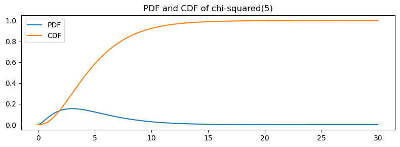
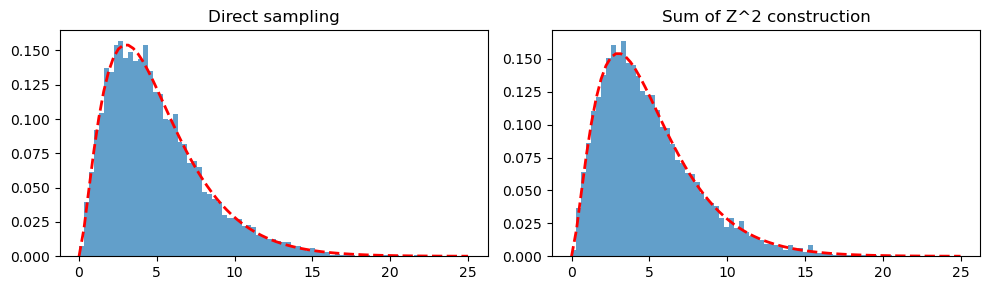
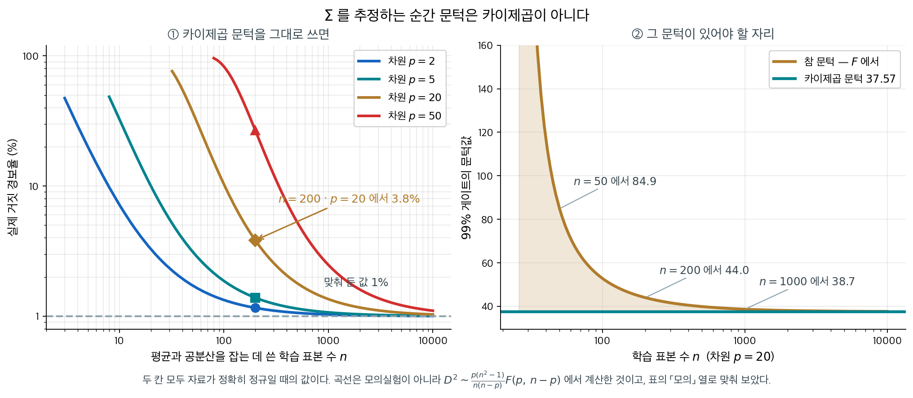
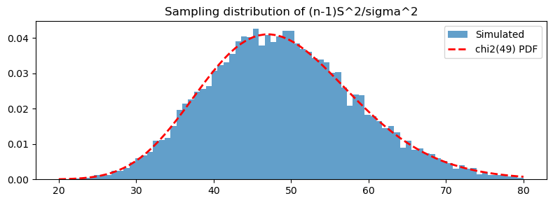

# 카이제곱분포

!!! note "이 주제를 다루는 다른 곳"
    분산분석에서 등분산성을 확인하는 맥락으로 이 분포를 짧게 만나려면 **11.5 가정**을 보라.

---

## 개요

카이제곱분포는 통계적 추론에서 가장 기본적인 분포 가운데 하나이다. 독립인 표준정규 확률변수의 제곱합의 분포로 자연스럽게 등장한다. 카이제곱분포는 분산 검정, 적합도 검정, 분할표의 독립성 검정을 떠받치며, 정규 모집단에서 나온 표본분산의 표집분포에도 나타난다.

<div class="defn" markdown>

### 정의 1. 카이제곱분포 { .dfn }

$Z_1, Z_2, \ldots, Z_d$가 독립인 표준정규 확률변수이면

$$
Q = \sum_{i=1}^{d} Z_i^2 \sim \chi^2(d),
$$

여기서 $d$는 자유도 모수이다.

</div>

---

## 1. 성질

$\chi^2(d)$ 확률변수의 평균과 분산은

$$
E[Q] = d, \qquad \operatorname{Var}(Q) = 2d.
$$

$x > 0$에 대한 확률밀도함수는

$$
f(x; d) = \frac{1}{2^{d/2}\,\Gamma(d/2)}\, x^{d/2 - 1}\, e^{-x/2}.
$$

추가적인 주요 성질은 다음과 같다.

- **가법성**: $Q_1 \sim \chi^2(d_1)$과 $Q_2 \sim \chi^2(d_2)$가 독립이면 $Q_1 + Q_2 \sim \chi^2(d_1 + d_2)$이다.
- **표본분산과의 관계**: $X_1, \ldots, X_n \overset{\text{iid}}{\sim} N(\mu, \sigma^2)$이면 $(n-1)S^2/\sigma^2 \sim \chi^2(n-1)$이다.
- **중심극한정리 근사**: $d$가 크면 $\chi^2(d) \approx N(d, 2d)$이다.
- **지수분포와의 관계**: $d = 2$ 이면 $\chi^2(2)$ 는 평균 $2$ (비율 $1/2$) 인 지수분포다. 밀도식에 $d = 2$ 를 넣으면 $f(x) = \tfrac12 e^{-x/2}$ 로 바로 보인다.

### PDF와 CDF

<div class="exbox" markdown>

**보기 1.** <span class="diff easy" title="쉬움"></span> 카이제곱 분포의 밀도와 분포함수. 자유도 $5$ 인 밀도와 분포함수를 $0 \le x \le 30$ 에서 한 축에 겹쳐 그린다.

**(1)** 위에 적은 밀도식에서 $\chi^2(d)$ 의 **최빈값이 $d > 2$ 일 때 $d - 2$** 임을 보이고, $d \le 2$ 에서는 왜 봉우리가 없는지 밝히시오. $d = 5$ 에서 봉우리의 높이는 얼마인가.

**(2)** 그려서 확인하시오. 코드의 격자가 그 봉우리를 정확히 집는가. 두 곡선을 **한 축에** 겹쳐 놓은 이 그림이 가리는 것은 무엇인가.

</div>

??? success "풀이"

    **(1) 해석적으로.** 밀도는

    $$
    f(x; d) = \frac{1}{2^{d/2}\,\Gamma(d/2)}\, x^{d/2 - 1}\, e^{-x/2}, \qquad x > 0
    $$

    이다. 앞의 상수는 $x$ 와 무관하므로 최대점을 찾는 데 쓸모가 없다. 곱을 합으로 바꾸려고 로그를 씌운다. $\log$ 가 엄격히 증가하므로 최대점은 옮겨 가지 않는다.

    $$
    \log f(x; d) = \text{상수} + \left(\frac d2 - 1\right)\log x - \frac x2
    $$

    미분하면

    $$
    \frac{d}{dx}\log f = \frac{d/2 - 1}{x} - \frac12
    $$

    이고, 이것을 $0$ 으로 두면 $x = d - 2$ 를 얻는다. 이 정류점이 최대임은 이계도함수가 보여 준다.

    $$
    \frac{d^2}{dx^2}\log f = -\frac{d/2 - 1}{x^2} < 0 \qquad (d > 2,\; x > 0)
    $$

    $\log f$ 가 $(0,\infty)$ 에서 위로 오목하므로 정류점은 하나뿐이고 그것이 최대다. 따라서 **$d > 2$ 이면 최빈값이 $d - 2$** 다.

    **$d \le 2$ 에서는 봉우리가 없다.** $d/2 - 1 \le 0$ 이면 위 도함수가 $(0,\infty)$ 전체에서 음수이므로 $f$ 가 **단조감소**한다. 정류점이 아예 없고 상한은 $x \to 0^+$ 에서만 다가간다. 그 끝점의 모습은 $d$ 에 따라 셋으로 갈린다.

    - $d = 2$: $f(x) = \tfrac12 e^{-x/2}$ 이므로 $f(0^+) = 1/2$ 로 유한하다(지수분포다).
    - $d < 2$: $x^{d/2-1} \to \infty$ 이므로 밀도가 $0$ 에서 **발산한다.** $d = 1$ 이 그렇다.
    - $d > 2$: $x^{d/2-1} \to 0$ 이므로 $f(0^+) = 0$ 이고, 그래서 안쪽에 봉우리가 생긴다.

    어느 쪽이든 $(0,\infty)$ 안에 최대점이 없으므로 관례상 최빈값을 $0$ 으로 적는다. 이것이 쪽 머리의 $\max(d-2, 0)$ 이라는 표기다.

    **$d = 5$ 의 봉우리.** 최빈값은 $x = 3$ 이고 높이는

    $$
    f(3; 5) = \frac{1}{2^{5/2}\,\Gamma(5/2)}\, 3^{3/2}\, e^{-3/2}
    $$

    이다. $\Gamma(5/2) = \tfrac34\sqrt\pi = 1.329340$ 이고 $2^{5/2} = 5.656854$ 이므로 앞의 상수가 $1/7.519884 = 0.132980$ 이고, $3^{3/2} = 5.196152$, $e^{-3/2} = 0.223130$ 을 곱하면 $f(3;5) = 0.154180$ 이다.

    **(2) 그려서 확인한다.** 아래 코드는 원래의 그림 코드에 (1)을 검산하는 출력만 덧붙인 것이다.

    ```python
    import numpy as np
    import scipy.stats as stats
    import matplotlib.pyplot as plt

    plt.rcParams["font.sans-serif"] = ["NanumGothic", "Apple SD Gothic Neo", "Malgun Gothic"]
    plt.rcParams["font.family"] = "sans-serif"
    plt.rcParams["axes.unicode_minus"] = False

    # 자유도 5 인 카이제곱의 밀도와 분포함수. 0 이상에서만 정의되고
    # 오른쪽으로 길게 늘어져 있다.
    df = 5
    x = np.linspace(0, 30, 300)

    rv = stats.chi2(df=df)
    print(f"해석적 최빈값 d - 2 = {df - 2}")
    print(f"  거기서의 밀도 f({df - 2}) = {rv.pdf(df - 2):.10f}")
    print(f"격자가 고른 최대점       = {x[np.argmax(rv.pdf(x))]:.10f}  (격자 간격 {x[1] - x[0]:.6f})")
    print(f"  거기서의 밀도         = {rv.pdf(x).max():.10f}")

    print(f"\n평균 = {df},  중앙값 = {rv.median():.4f},  최빈값 = {df - 2}")
    print(f"CDF 가 최빈값에서 가지는 값 = {rv.cdf(df - 2):.4f}")
    print(f"P(X > 10) = {rv.sf(10):.6f}   P(X > 30) = {rv.sf(30):.3e}")

    # 자유도가 2 이하이면 봉우리가 없다. 0 근처의 밀도를 재 본다.
    print("\n0 바로 옆(x = 1e-8)에서의 밀도")
    for d in (1, 2, 3, 4, 5):
        print(f"  d={d}:  f(1e-8) = {stats.chi2(df=d).pdf(1e-8):>12.4g}   최빈값 = {max(d - 2, 0)}")

    fig, ax = plt.subplots(figsize=(8, 3))
    ax.plot(x, stats.chi2(df=df).pdf(x), label="PDF")
    ax.plot(x, stats.chi2(df=df).cdf(x), label="CDF")
    ax.legend()
    ax.set_title(f"PDF and CDF of chi-squared({df})")
    plt.tight_layout()
    plt.show()
    ```

    출력:

    ```text
    해석적 최빈값 d - 2 = 3
      거기서의 밀도 f(3) = 0.1541803298
    격자가 고른 최대점       = 3.0100334448  (격자 간격 0.100334)
      거기서의 밀도         = 0.1541790392

    평균 = 5,  중앙값 = 4.3515,  최빈값 = 3
    CDF 가 최빈값에서 가지는 값 = 0.3000
    P(X > 10) = 0.075235   P(X > 30) = 1.475e-05

    0 바로 옆(x = 1e-8)에서의 밀도
      d=1:  f(1e-8) =         3989   최빈값 = 0
      d=2:  f(1e-8) =          0.5   최빈값 = 0
      d=3:  f(1e-8) =    3.989e-05   최빈값 = 1
      d=4:  f(1e-8) =      2.5e-09   최빈값 = 2
      d=5:  f(1e-8) =     1.33e-13   최빈값 = 3
    ```

    

    **봉우리의 높이가 맞는다.** 손으로 구한 $f(3;5) = 0.154180$ 과 코드가 준 $0.1541803298$ 이 소수 여섯째 자리까지 같다.

    **그러나 격자는 봉우리를 집지 못했다.** 코드의 격자가 $0$ 에서 $30$ 까지를 $300$ 등분해 간격이 $0.100334$ 이므로 **$x = 3$ 이 후보에 아예 없다.** `np.argmax` 가 고른 것은 가장 가까운 격자점 $3.0100$ 이고 거기서의 밀도는 $0.1541790$ 으로 참 봉우리보다 $1.3\times 10^{-6}$ 낮다. 밀도가 봉우리 근처에서 평평하므로 높이의 손해는 작지만, **위치는 한 칸 비껴나 있다.** 해석적으로 푼 답은 정확하고 격자 탐색은 격자만큼만 정확하다. 그림에서 봉우리의 자리를 눈으로 읽을 때도 같은 한계가 있다.

    **$d \le 2$ 의 경계도 수치로 보인다.** $x = 10^{-8}$ 에서 밀도가 $d = 1$ 이면 $3989$ 로 치솟고($x^{-1/2}$ 가 발산한다), $d = 2$ 이면 정확히 $0.5$ 이며, $d \ge 3$ 부터는 $0$ 으로 내려간다. $d = 3, 4, 5$ 에서 각각 $4\times10^{-5}$, $2.5\times10^{-9}$, $1.3\times10^{-13}$ 으로 $x^{d/2-1}$ 의 지수가 커질수록 더 빨리 꺼진다. **$d = 2$ 가 봉우리가 생기기 시작하는 문턱**이다.

    **세 중심이 한 줄로 늘어선다.** 최빈값 $3 <$ 중앙값 $4.3515 <$ 평균 $5$ 다. 오른쪽으로 치우친 분포의 표준적인 순서이고, 치우침의 정도는 연습문제 3 의 왜도 $\gamma_1 = \sqrt{8/d} = 1.2649$ 로 잰다. 분포함수가 최빈값에서 $0.3000$ 밖에 안 된다는 것도 같은 말이다. **밀도가 가장 높은 자리의 왼쪽에 질량의 $30\%$ 밖에 없다.**

    **이 그림이 가리는 것 — 세로축을 CDF 가 독차지한다.** 밀도의 최대값이 $0.1542$ 인데 분포함수는 $1$ 까지 올라가므로, 한 축에 겹쳐 놓으면 **밀도 곡선이 화면 아래쪽 $15\%$ 띠 안에 눌린다.** 그림에서 파란 곡선이 거의 바닥에 깔려 보이는 까닭이고, 그래서 꼬리의 모양을 전혀 읽을 수 없다. 밀도와 분포함수는 단위가 다르므로($f$ 는 $1/x$ 의 단위, $F$ 는 무차원) 원래 같은 축에 놓을 것이 아니다. 두 패널로 나누거나 오른쪽에 두 번째 축을 세워야 한다.

    **가로 범위도 낭비다.** $P(X > 10) = 0.0752$ 이고 $P(X > 30) = 1.5\times10^{-5}$ 다. 곧 $x = 10$ 오른쪽의 그림 **3분의 2가 질량의 $7.5\%$ 를 그리는 데 쓰이고**, 그 가운데 $x > 30$ 은 십만 분의 $1.5$ 다. 그 구간에서 밀도가 정확히 $0$ 인지 아주 작은지는 이 선형 축에서 분간할 수 없다. 꼬리를 보려면 로그 세로축을 쓰거나 범위를 좁혀야 한다. 분산 검정에서 정작 중요한 것이 이 꼬리라는 점을 생각하면 가볍게 넘길 일이 아니다.

### 표집과 정규분포로부터의 구성

다음 코드는 $\chi^2(d)$에서 직접 표집한 결과와 표준정규 제곱 $d$개의 합을 비교하여 정의를 확인한다.

<div class="exbox" markdown>

**보기 2.** <span class="diff easy" title="쉬움"></span> 정규 제곱합으로 만들어 보기. $\chi^2(5)$ 에서 직접 뽑은 표본 $10{,}000$ 개와, 표준정규 다섯 개를 제곱해 더해 만든 표본 $10{,}000$ 개를 견준다.

**(1)** 정규적률 $E[Z^2] = 1$, $E[Z^4] = 3$, $E[Z^6] = 15$ 에서 출발해 $E[Q] = d$, $\operatorname{Var}(Q) = 2d$, 왜도 $\gamma_1 = \sqrt{8/d}$ 를 유도하시오. $d = 5$, $N = 10{,}000$ 에서 표본평균의 몬테카를로 표준오차는 얼마인가.

**(2)** 두 방법이 정말 같은 분포를 주는지 적률과 적합도검정으로 확인하고, 그림이 보여 주는 것과 보여 주지 못하는 것을 가르시오.

</div>

??? success "풀이"

    **(1) 한 항의 적률부터.** $Z \sim N(0,1)$ 이면 $E[Z^{2k}] = (2k-1)!!$ 이므로 $E[Z^2] = 1$, $E[Z^4] = 3$, $E[Z^6] = 15$ 다. 한 항 $Z^2$ 의 중심적률을 차례로 구한다.

    $$
    E[Z^2] = 1, \qquad
    \operatorname{Var}(Z^2) = E[Z^4] - \bigl(E[Z^2]\bigr)^2 = 3 - 1 = 2
    $$

    $$
    E\bigl[(Z^2-1)^3\bigr] = E[Z^6] - 3E[Z^4] + 3E[Z^2] - 1 = 15 - 9 + 3 - 1 = 8
    $$

    **$d$ 항으로 넘어간다.** $Q = \sum_{i=1}^d Z_i^2$ 이고 항들이 독립이므로 기댓값·분산·3차 중심적률이 모두 더해진다(3차 중심적률의 가법성은 독립일 때 성립한다).

    $$
    E[Q] = d, \qquad \operatorname{Var}(Q) = 2d, \qquad E\bigl[(Q - d)^3\bigr] = 8d
    $$

    왜도는 3차 중심적률을 표준편차의 세제곱으로 나눈 것이므로

    $$
    \gamma_1 = \frac{E[(Q-d)^3]}{\bigl(\operatorname{Var} Q\bigr)^{3/2}}
    = \frac{8d}{(2d)^{3/2}}
    = \frac{8d}{2\sqrt2\, d^{3/2}}
    = \frac{2\sqrt2}{\sqrt d}
    = \sqrt{\frac8d}
    $$

    이다. $d = 5$ 에 넣으면 $\gamma_1 = \sqrt{1.6} = 1.264911$ 이다.

    **몬테카를로 표준오차.** 독립인 $N$ 개의 표본평균이므로

    $$
    \operatorname{SE}(\bar Q) = \sqrt{\frac{\operatorname{Var}(Q)}{N}} = \sqrt{\frac{2d}{N}} = \sqrt{\frac{10}{10000}} = 0.03162
    $$

    이다. **그러므로 표본평균이 $5$ 에서 $0.06$ 쯤 어긋나는 것은 흠이 아니라 예정된 일이다.** 아래 수치를 읽을 때 이 자를 들고 읽어야 한다.

    **(2) 수치적으로.** 그림만으로는 "비슷해 보인다"에서 멈추므로 적률과 적합도검정을 함께 찍는다.

    ```python
    plt.rcParams["font.sans-serif"] = ["NanumGothic", "Apple SD Gothic Neo", "Malgun Gothic"]
    plt.rcParams["font.family"] = "sans-serif"
    plt.rcParams["axes.unicode_minus"] = False

    df, seed = 5, 1

    # 방법 1: scipy 의 생성기를 그대로 쓴다.
    data_direct = stats.chi2(df=df).rvs(10_000, random_state=seed)

    # 방법 2: 정의를 그대로 실행한다. 표준정규 d 개를 제곱해 더하면
    # 자유도 d 인 카이제곱이 된다. 표본분산의 분포가 카이제곱이 되는 까닭도
    # 결국 이 구성에 있다.
    z = stats.norm().rvs(size=(df, 10_000), random_state=seed)
    data_constructed = np.sum(z ** 2, axis=0)

    # 이론값과 나란히 놓는다. 평균 d, 분산 2d, 왜도 sqrt(8/d).
    N = 10_000
    print(f"{'':>14}{'평균':>10}{'분산':>10}{'왜도':>10}")
    print(f"{'이론':>14}{df:>10.4f}{2 * df:>10.4f}{np.sqrt(8 / df):>10.4f}")
    for name, d in [("직접 표집", data_direct), ("Z^2 합 구성", data_constructed)]:
        print(f"{name:>12}{d.mean():>10.4f}{d.var(ddof=1):>10.4f}{stats.skew(d):>10.4f}")
    print(f"\n표본평균의 몬테카를로 표준오차 = sqrt(2d/N) = {np.sqrt(2 * df / N):.4f}")
    print(f"  직접 표집의 어긋남 = {data_direct.mean() - df:+.4f}"
          f"  ({(data_direct.mean() - df) / np.sqrt(2 * df / N):+.2f} SE)")
    print(f"  Z^2 합 구성의 어긋남 = {data_constructed.mean() - df:+.4f}"
          f"  ({(data_constructed.mean() - df) / np.sqrt(2 * df / N):+.2f} SE)")

    # 두 표본이 정말 chi2(5) 인가. 그리고 서로 같은 분포인가.
    for name, d in [("직접 표집", data_direct), ("Z^2 합 구성", data_constructed)]:
        ks = stats.kstest(d, "chi2", args=(df,))
        print(f"\n{name} vs chi2(5):   KS = {ks.statistic:.5f},  p = {ks.pvalue:.4f}")
    ks2 = stats.ks_2samp(data_direct, data_constructed)
    print(f"두 표본끼리:          KS = {ks2.statistic:.5f},  p = {ks2.pvalue:.4f}")

    # 두 히스토그램이 같은 이론 곡선에 얹히는지 확인한다.
    bins = np.linspace(0, 25, 80)
    fig, (ax1, ax2) = plt.subplots(1, 2, figsize=(10, 3))
    for ax, data, title in [
        (ax1, data_direct, "Direct sampling"),
        (ax2, data_constructed, "Sum of Z^2 construction"),
    ]:
        ax.hist(data, bins=bins, density=True, alpha=0.7)
        ax.plot(bins, stats.chi2(df=df).pdf(bins), "r--", lw=2)
        ax.set_title(title)
    plt.tight_layout()
    plt.show()
    ```

    출력:

    ```text
                          평균        분산        왜도
                이론    5.0000   10.0000    1.2649
           직접 표집    4.9953   10.0317    1.2592
        Z^2 합 구성    5.0068    9.9999    1.2822

    표본평균의 몬테카를로 표준오차 = sqrt(2d/N) = 0.0316
      직접 표집의 어긋남 = -0.0047  (-0.15 SE)
      Z^2 합 구성의 어긋남 = +0.0068  (+0.22 SE)

    직접 표집 vs chi2(5):   KS = 0.00478,  p = 0.9754

    Z^2 합 구성 vs chi2(5):   KS = 0.00554,  p = 0.9171
    두 표본끼리:          KS = 0.00760,  p = 0.9349
    ```

    

    **세 적률이 모두 이론과 맞는다.** 평균은 $4.9953$ 과 $5.0068$ 로 각각 $-0.15\,\mathrm{SE}$, $+0.22\,\mathrm{SE}$ 다. (1)에서 계산한 자가 $0.0316$ 이므로 둘 다 우연으로 완전히 설명되는 크기다. 분산은 $10.0317$ 과 $9.9999$ 로 이론값 $10$ 에, 왜도는 $1.2592$ 와 $1.2822$ 로 $\sqrt{8/5} = 1.2649$ 에 붙는다. **왜도의 어긋남이 평균보다 커 보이는 것은 흠이 아니다.** 고차 적률일수록 추정이 느리게 수렴하며, 꼬리가 긴 분포에서는 특히 그렇다. 연습문제 3 에서 $\chi^2(1)$ 의 표본왜도가 $10^5$ 개로도 이론값에 못 미치는 것이 같은 현상이다.

    **적합도검정도 통과한다.** 두 표본 모두 $\chi^2(5)$ 와의 KS 거리가 $0.005$ 수준이고 $p$ 값이 $0.92$, $0.98$ 이다. 표본 $10{,}000$ 개에서 KS 거리의 눈금이 $1/\sqrt{10000} = 0.01$ 쯤이므로 $0.005$ 는 그 안쪽이다. 두 표본끼리 맞대어도 $p = 0.93$ 으로 **같은 분포에서 나왔다는 것과 어긋나지 않는다.** 정의가 수치로 확인된 것이다.

    **씨앗이 같아도 두 표본은 같은 수가 아니다.** 보기 1 의 척도 바꾸기와 달리 여기서는 생성 방식 자체가 다르다. `chi2.rvs` 는 감마 생성기를, `norm.rvs` 는 정규 생성기를 거치므로 같은 난수열에서 출발해도 전혀 다른 수가 나온다. 두 표본이 **같은 분포를 따를 뿐 같은 값이 아니라는 것**이 두 KS 거리가 $0$ 이 아닌 까닭이고, 그래서 위의 비교가 의미를 가진다.

    **그림이 보여 주는 것.** 두 히스토그램이 같은 붉은 $\chi^2(5)$ 곡선에 얹힌다. 봉우리가 $x = 3$ 근처(보기 1 에서 구한 최빈값)에 있고 오른쪽으로 길게 늘어진 모양이 양쪽에서 같다.

    **그림이 보여 주지 못하는 것.** 눈으로는 $0.005$ 와 $0.05$ 의 KS 거리를 구별할 수 없다. 두 히스토그램 사이의 차이가 몬테카를로 요동인지 체계적 편차인지도 그림에서는 읽히지 않으며, 그래서 위의 수치가 필요했다. 가로 범위가 $25$ 에서 잘려 있어 $P(X > 25) = 1.4\times10^{-4}$ 쯤의 꼬리는 아예 그려지지 않고, 세로축이 선형이라 $x > 15$ 구간의 밀도 차이도 바닥에 눌린다. **"같은 곡선에 얹혔다"는 눈의 판정은 중심부에 대한 것이지 꼬리에 대한 것이 아니다.**

---

## 2. 해석

- 자유도 $d$가 커지면 분포가 오른쪽으로 이동하고 더 대칭이 되어 정규분포에 접근한다.
- $\chi^2(d)$의 최빈값은 $\max(d - 2, 0)$이므로 $d$가 작으면 분포가 심하게 오른쪽으로 치우친다.
- 정규 제곱합으로부터의 구성은 기하학적 직관을 준다. $Q$는 $d$차원 표준정규 벡터의 원점으로부터의 제곱거리이다.

---

<div class="aibox" markdown>

**AI로 보는 통계학 1.** $99\%$ 게이트라고 적어 놓고 $96\%$ 로 여는 문

정의 $1$ 은 표준정규 $d$ 개의 제곱합이고, 바로 위 세 번째 줄이 그것을 거리로 읽었다 —
$Q$ 는 $d$ 차원 표준정규 벡터의 원점까지의 제곱거리다. 기계가 그 줄을 **글자 그대로**
쓰는 자리가 있다.

$p$ 차원 관측 $x$ 를 $N_p(\mu, \Sigma)$ 로 보고 **마할라노비스 거리**

$$
D^2 = (x - \mu)^\top \Sigma^{-1} (x - \mu)
$$

를 잰다. $\Sigma^{-1/2}$ 를 곱해 백색화하면 좌표들이 독립인 표준정규가 되므로 $D^2$ 는
정의 $1$ 의 제곱합 그 자체이고, 따라서 $D^2 \sim \chi^2(p)$ 다. 그래서 「이 점이 평소
보던 분포 밖인가」를 묻는 코드는 거의 언제나 한 줄로 끝난다.

```python
gate = scipy.stats.chi2.ppf(0.99, p)   # 이 값을 넘으면 경보
```

여러 센서가 보낸 측정 가운데 어느 것이 어느 물체의 것인지 가르는 **게이팅**, 지표
수십 개를 한꺼번에 보는 **이상 탐지**, 학습 때 보지 못한 입력을 걸러내는 **분포 밖
탐지**가 모두 이 문턱 하나로 돌아간다. `scipy.spatial.distance.mahalanobis` 와
`sklearn.covariance.EmpiricalCovariance.mahalanobis` 가 재어 주는 것이 $D^2$ 와 그
제곱근이다.

**그런데 $\mu$ 와 $\Sigma$ 를 아는 경우는 없다.** 학습자료 $n$ 개로 $\bar x$ 와 $S$ 를
잡아 그 자리에 끼운다. 그 순간 거리는 $\chi^2(p)$ 를 따르지 않는다. 학습에 쓰지 않은
새 점 하나에 대해

$$
\widehat{D}^2 = (x - \bar x)^\top S^{-1} (x - \bar x)
\ \sim\ \frac{p\,(n^2-1)}{n\,(n-p)}\, F(p,\, n-p)
$$

이다. 호텔링 $T^2$ 로 알려진 결과이고, 오른쪽에 선 것은 이 장이 내내 쓰는 바로 그
$F$ 분포다. $S$ 가 흔들리는 만큼이 분모로 들어가 꼬리를 늘인다.

```python
import numpy as np
from scipy import stats

n, p, alpha = 200, 20, 0.01
c = stats.chi2.ppf(1 - alpha, p)          # 흔히 쓰는 문턱
k = p * (n**2 - 1) / (n * (n - p))        # D^2 ~ k * F(p, n-p)
print(f"카이제곱 문턱 {c:.2f}   참 문턱 {k * stats.f.ppf(1 - alpha, p, n - p):.2f}")
print(f"실제 경보율  {stats.f.sf(c / k, p, n - p):.4f}")

rng = np.random.default_rng(15)           # 같은 것을 모의로 맞춰 본다
hit = 0
for _ in range(20_000):
    tr = rng.normal(size=(n, p))                      # 학습자료
    v = rng.normal(size=p) - tr.mean(axis=0)          # 새 점 하나
    hit += v @ np.linalg.solve(np.cov(tr, rowvar=False), v) > c
print(f"모의 경보율  {hit / 20_000:.4f}")
```

출력:

```
카이제곱 문턱 37.57   참 문턱 44.04
실제 경보율  0.0383
모의 경보율  0.0355
```

문턱을 $37.57$ 에 두었지만 있어야 할 자리는 $44.04$ 다. **$1\%$ 로 맞춰 둔 경보가
$3.8\%$ 로 울린다.** 하루 백만 건을 보는 곳이면 하루 만 건이 아니라 $3$ 만 $8$ 천
건이고, 그 $2$ 만 $8$ 천 건은 자료에 아무 일도 일어나지 않았는데 생긴 것이다.

<figure markdown>
{ width="960" }
  <figcaption markdown>두 칸 모두 자료가 정확히 정규일 때의 값이다. 곡선은 모의실험이 아니라 위의 $F$ 분포에서 계산한 것이다.</figcaption>
</figure>

어긋남의 크기를 가르는 것은 $n$ 이 아니라 **$n/p$** 다. 명목 $1\%$ 가 실제로 몇 퍼센트가
되는지를 그 비로 늘어놓으면 네 차원이 거의 한 줄에 겹친다.

| $n/p$ | $p = 2$ | $p = 5$ | $p = 20$ | $p = 50$ |
|---:|---:|---:|---:|---:|
| $5$ | $7.2\%$ | $7.2\%$ | $10.4\%$ | $17.3\%$ |
| $10$ | $3.3\%$ | $3.2\%$ | $3.8\%$ | $5.3\%$ |
| $50$ | $1.3\%$ | $1.3\%$ | $1.4\%$ | $1.5\%$ |
| $500$ | $1.03\%$ | $1.03\%$ | $1.03\%$ | $1.04\%$ |

차원마다 표본을 다섯 배만 모으면 거짓 경보가 명목의 **일곱 배에서 열일곱 배**이고,
쉰 배를 모아도 아직 $1.4$ 배다. 「$1\%$ 를 $1\%$ 로」 쓰려면 $n$ 이 $p$ 의 수백 배여야
한다. 지표 $50$ 개를 보는 경보에 쓸 학습자료가 이틀치뿐이라면, 그 경보가 내는 양성의
대부분은 지표가 아니라 $S$ 가 만든 것이다.

고치는 길은 어렵지 않다 — 문턱을 $F$ 에서 받아 오면 된다. 다만 그 보정은 **자료가
정규라는 가정** 위에서만 맞다. 꼬리가 두꺼우면 바꾼 문턱도 틀리고, 학습자료 안의 점을
다시 재는 경우는 분포가 또 달라지며(그때는 베타분포다), $n \le p$ 이면 $S^{-1}$ 이 아예
없어 거리를 정의할 수조차 없다.

</div>

---

## 연습문제

<div class="drillbox" markdown>

**연습문제 1.** <span class="diff easy" title="쉬움"></span> $Q \sim \chi^2(10)$이라 하자. Python으로 $P(Q > 18.307)$과 $P(3.247 < Q < 20.483)$을 계산하라.

</div>

??? success "풀이"

    ```python
    import scipy.stats as stats

    rv = stats.chi2(df=10)
    p1 = rv.sf(18.307)
    p2 = rv.cdf(20.483) - rv.cdf(3.247)
    print(f"P(Q > 18.307) = {p1:.4f}")
    print(f"P(3.247 < Q < 20.483) = {p2:.4f}")
    ```

    출력:

    ```text
    P(Q > 18.307) = 0.0500
    P(3.247 < Q < 20.483) = 0.9500
    ```

    $P(Q > 18.307) = 0.05$이다($18.307$이 $\chi^2_{0.95}(10)$ 임계값이다). $P(3.247 < Q < 20.483) = 0.95$로 95% 중심구간이다.

    두 값이 우연이 아니라 정확히 나온다는 점에 주목하라. $3.247 = \chi^2_{0.025}(10)$이고 $20.483 = \chi^2_{0.975}(10)$이므로, 이 구간은 15.2절 신뢰구간 구성에 쓰이는 바로 그 분위수 쌍이다.

    구간이 평균 $d = 10$을 중심으로 대칭이 아니라는 점도 확인하라. 아래로 $6.75$, 위로 $10.48$ 떨어져 있다. 오른쪽 치우침 때문이다. $\square$

---

<div class="drillbox" markdown>

**연습문제 2.** <span class="diff easy" title="쉬움"></span> $N(3, 4)$(곧 $\mu = 3$, $\sigma^2 = 4$)에서 $n = 50$개 표본을 뽑아 $(n-1)S^2/\sigma^2$을 계산하는 과정을 10,000회 반복하는 모의실험을 작성하라. 히스토그램을 그리고 $\chi^2(49)$ PDF를 겹쳐 이론적 결과를 확인하라.

</div>

??? success "풀이"

    ```python
    import numpy as np
    import scipy.stats as stats
    import matplotlib.pyplot as plt

    rng = np.random.default_rng(42)
    n, mu, sigma2 = 50, 3, 4
    n_sims = 10000

    chi2_stats = []
    for _ in range(n_sims):
        x = rng.normal(mu, np.sqrt(sigma2), n)
        s2 = np.var(x, ddof=1)
        chi2_stats.append((n - 1) * s2 / sigma2)

    chi2_stats = np.array(chi2_stats)
    print(f"simulated mean = {chi2_stats.mean():.3f} (theory: {n-1})")
    print(f"simulated var  = {chi2_stats.var(ddof=1):.3f} "
          f"(theory: {2*(n-1)})")

    bins = np.linspace(20, 80, 80)
    fig, ax = plt.subplots(figsize=(8, 3))
    ax.hist(chi2_stats, bins=bins, density=True, alpha=0.7, label="Simulated")
    ax.plot(bins, stats.chi2(df=n - 1).pdf(bins), "r--", lw=2,
            label="chi2(49) PDF")
    ax.legend()
    ax.set_title("Sampling distribution of (n-1)S^2/sigma^2")
    plt.tight_layout()
    plt.show()
    ```

    출력:

    ```
    simulated mean = 49.090 (theory: 49)
    simulated var  = 97.480 (theory: 98)
    ```

    

    모의실험 평균 $49.09$와 분산 $97.48$이 이론값 $49$, $98$과 잘 맞는다. $(n-1)S^2/\sigma^2 \sim \chi^2(n-1)$이 성립함을 수치로 확인한 것이다.

    히스토그램이 $\chi^2(49)$ 곡선과 잘 맞는다. 모의실험 평균이 $49.09$(이론값 $49$), 분산이 $97.48$(이론값 $98$)로 이론과 부합한다.

    !!! note "$\sigma^2$을 알아야 한다는 점이 핵심이다"
        이 확인이 성립하는 것은 $\sigma^2 = 4$를 **알고** 있어서 통계량을 계산할 수 있기 때문이다. 실무에서는 $\sigma^2$을 모르므로 이 결과를 직접 쓸 수 없다.

        대신 이 결과를 **뒤집어** 쓴다. $(n-1)S^2/\sigma^2$의 분포를 알고 $S^2$을 관측했으므로, 미지의 $\sigma^2$에 대한 확률 진술을 만들 수 있다. 이것이 15.2절의 추축량 논법이며, 가설검정과 신뢰구간이 모두 여기서 나온다. $\square$

---

<div class="drillbox" markdown>

**연습문제 3.** <span class="diff easy" title="쉬움"></span> $d = 1, 5, 10, 30, 100$에 대해 공식 $\gamma_1 = \sqrt{8/d}$로 $\chi^2(d)$의 왜도를 계산하고 표본으로 수치 확인하라. $d$가 커질수록 정규근사가 개선되는 이유를 설명하라.

</div>

??? success "풀이"

    ```python
    import numpy as np
    import scipy.stats as stats

    for d in [1, 5, 10, 30, 100]:
        theoretical_skew = np.sqrt(8 / d)
        samples = stats.chi2(df=d).rvs(100000, random_state=42)
        empirical_skew = stats.skew(samples)
        print(f"df={d:3d}: theoretical={theoretical_skew:.4f}, "
              f"empirical={empirical_skew:.4f}")
    ```

    출력:

    ```text
    df=  1: theoretical=2.8284, empirical=2.7697
    df=  5: theoretical=1.2649, empirical=1.2716
    df= 10: theoretical=0.8944, empirical=0.8922
    df= 30: theoretical=0.5164, empirical=0.5128
    df=100: theoretical=0.2828, empirical=0.2790
    ```

    왜도 $\gamma_1 = \sqrt{8/d}$는 $d$가 커질수록 줄어든다. $d = 1$에서 $2\sqrt{2} = 2.83$이지만 $d = 100$에서는 $0.283$이다. 중심극한정리에 의해 $Q = \sum Z_i^2$이 i.i.d. 항의 합이므로 표준화된 분포가 $N(0,1)$로 수렴한다.

    ($d = 1$에서 표본왜도 $2.77$이 이론값 $2.83$보다 작은 것은 표본왜도가 두꺼운 꼬리 분포에서 아래로 편향되기 때문이다. $\chi^2(1)$은 극단적으로 치우쳐 있어 $10^5$개 표본으로도 이론값에 정확히 도달하지 않는다.)

    !!! warning "$d \gtrsim 30$이면 정규근사가 충분하다는 통설은 과장이다"
        정규근사 $\chi^2(d) \approx N(d, 2d)$의 정확도를 상위 5% 분위수에서 확인해 보자.

        ```python
        import numpy as np
        from scipy import stats

        for d in [5, 10, 30, 100]:
            exact = stats.chi2.ppf(0.95, d)
            approx = d + 1.645 * np.sqrt(2 * d)
            print(f"d={d:>4}: exact={exact:8.3f}, normal={approx:8.3f}, "
                  f"error={100*(approx-exact)/exact:+6.2f}%")
        ```

        출력:

        ```text
        d=   5: exact=  11.070, normal=  10.202, error= -7.85%
        d=  10: exact=  18.307, normal=  17.357, error= -5.19%
        d=  30: exact=  43.773, normal=  42.742, error= -2.36%
        d= 100: exact= 124.342, normal= 123.264, error= -0.87%
        ```

        $d = 30$에서도 임계값을 2.4% 과소추정한다. 검정에 쓰면 지나치게 자주 기각하게 된다. $d = 100$에서도 0.9% 오차가 남는다.

        분포의 **중심** 근처는 $d \geq 30$에서 정규근사가 좋지만, 검정과 신뢰구간에 필요한 **꼬리**는 훨씬 느리게 수렴한다. 15.2절 [유도와 분포이론](derivation.md) 연습문제 2에서 본 Wilson-Hilferty 근사 $\chi^2_\nu \approx \nu(1 - \frac{2}{9\nu} + z\sqrt{\frac{2}{9\nu}})^3$이 훨씬 정확하며, $d = 5$에서 이미 소수 둘째 자리까지 맞는다.

        오늘날에는 정확한 분위수를 직접 계산할 수 있으므로 근사가 필요 없다. 그래도 이 사실은 "$n \geq 30$이면 중심극한정리가 충분하다"는 일반적 통설을 꼬리 확률에 적용할 때 조심해야 한다는 점을 상기시킨다. $\square$

---

<div class="drillbox" markdown>

**연습문제 4.** <span class="diff med" title="중간"></span> 가법성을 증명하라. $Q_1 \sim \chi^2(d_1)$과 $Q_2 \sim \chi^2(d_2)$가 독립이면 $Q_1 + Q_2 \sim \chi^2(d_1 + d_2)$임을 보여라.

</div>

??? success "풀이"

    $Q_1 = \sum_{i=1}^{d_1} Z_i^2$, $Q_2 = \sum_{j=1}^{d_2} W_j^2$로 쓰고 모든 $Z_i, W_j \overset{\text{iid}}{\sim} N(0,1)$이 독립이라 하자($Q_1$과 $Q_2$의 독립성에서 나온다). 그러면

    $$
    Q_1 + Q_2 = \sum_{i=1}^{d_1} Z_i^2 + \sum_{j=1}^{d_2} W_j^2 = \sum_{l=1}^{d_1 + d_2} U_l^2,
    $$

    이는 독립인 표준정규 제곱 $d_1 + d_2$개의 합이므로 정의에 의해 $\chi^2(d_1 + d_2)$이다.

    **적률생성함수를 이용한 대안적 증명.** 연습문제 5에서 $M_Q(t) = (1-2t)^{-d/2}$임을 보인다. 독립인 확률변수의 합의 MGF는 각 MGF의 곱이므로

    $$
    M_{Q_1+Q_2}(t) = (1-2t)^{-d_1/2}(1-2t)^{-d_2/2} = (1-2t)^{-(d_1+d_2)/2},
    $$

    이는 $\chi^2(d_1+d_2)$의 MGF이다. MGF가 분포를 유일하게 결정하므로 결과가 따라 나온다.

    **왜 이 성질이 중요한가.** 15.2절 유도에서 쓴 분해

    $$
    \underbrace{\sum_i \frac{(X_i-\mu)^2}{\sigma^2}}_{\chi^2(n)} = \underbrace{\sum_i \frac{(X_i-\bar{X})^2}{\sigma^2}}_{\chi^2(n-1)} + \underbrace{\frac{n(\bar{X}-\mu)^2}{\sigma^2}}_{\chi^2(1)}
    $$

    가 정확히 가법성의 역방향 적용이다. 자유도가 $1 + (n-1) = n$으로 맞아떨어지는 것이 이 성질의 결과이다. $\square$

---

<div class="drillbox" markdown>

**연습문제 5.** <span class="diff med" title="중간"></span> $\chi^2(d)$의 적률생성함수(MGF)를 유도하고 이를 이용해 $E[Q]$와 $\operatorname{Var}(Q)$를 구하라.

</div>

??? success "풀이"

    $Z \sim N(0,1)$이면 $Z^2$의 MGF는 $t < 1/2$에 대해 $M_{Z^2}(t) = (1-2t)^{-1/2}$이다. $Q = \sum_{i=1}^d Z_i^2$이고 $Z_i$가 독립이므로

    $$
    M_Q(t) = \prod_{i=1}^d M_{Z_i^2}(t) = (1 - 2t)^{-d/2}, \quad t < \tfrac{1}{2}.
    $$

    미분하면

    $$
    M_Q'(t) = d(1-2t)^{-d/2 - 1}, \quad E[Q] = M_Q'(0) = d.
    $$

    $$
    M_Q''(t) = d(d+2)(1-2t)^{-d/2 - 2}, \quad E[Q^2] = M_Q''(0) = d(d+2).
    $$

    따라서

    $$
    \operatorname{Var}(Q) = E[Q^2] - (E[Q])^2 = d(d+2) - d^2 = 2d.
    $$

    **$M_{Z^2}(t) = (1-2t)^{-1/2}$의 유도.**

    $$
    E[e^{tZ^2}] = \int_{-\infty}^\infty \frac{1}{\sqrt{2\pi}}e^{tz^2 - z^2/2}\,dz = \int_{-\infty}^\infty \frac{1}{\sqrt{2\pi}}e^{-z^2(1-2t)/2}\,dz.
    $$

    $u = z\sqrt{1-2t}$로 치환하면($1-2t > 0$, 곧 $t < 1/2$일 때 유효)

    $$
    = \frac{1}{\sqrt{1-2t}}\int_{-\infty}^\infty \frac{1}{\sqrt{2\pi}}e^{-u^2/2}\,du = (1-2t)^{-1/2}.
    $$

    **더 높은 적률.** 같은 방법으로 3차, 4차 적률을 얻어 왜도 $\gamma_1 = \sqrt{8/d}$와 초과첨도 $\gamma_2 = 12/d$를 계산할 수 있다. $\square$

---

<div class="drillbox" markdown>

**연습문제 6.** <span class="diff med" title="중간"></span> §1 은 $X_1, \ldots, X_n \overset{\text{iid}}{\sim} N(\mu, \sigma^2)$ 일 때 $(n-1)S^2/\sigma^2 \sim \chi^2(n-1)$ 이라고 적었다. 여기서 $E[S^2] = \sigma^2$ 은 따라 나오지만 **$E[S] = \sigma$ 는 따라 나오지 않는다.**

**(1)** 정의 1 아래의 밀도식에서 $Q \sim \chi^2(d)$ 의 $E[\sqrt Q]$ 를 감마함수로 구하시오. 이를 써서 $E[S] = c_4\,\sigma$ 의 $c_4$ 를 $n$ 의 식으로 적으시오.

**(2)** $n = 2$ 와 $n = 10$ 에서 $c_4$ 를 소수 여섯째 자리까지 구하시오. $n = 2$ 의 값이 왜 $\sqrt{2/\pi}$ 인가.

**(3)** $\operatorname{Var}(S^2) = 2\sigma^4/(n-1)$ 에서 $c_4 \approx 1 - \dfrac{1}{4(n-1)}$ 을 얻고 (2)의 값과 견주시오. 편향의 **방향**이 왜 늘 한쪽인지 한 줄로 밝히시오.

</div>

??? success "풀이"

    **(1) 제곱근의 기댓값.** $Q \sim \chi^2(d)$ 의 밀도를 그대로 넣는다.

    $$
    E\bigl[\sqrt Q\bigr] = \int_0^\infty x^{1/2}\, \frac{x^{d/2-1} e^{-x/2}}{2^{d/2}\,\Gamma(d/2)}\, dx
    = \frac{1}{2^{d/2}\,\Gamma(d/2)} \int_0^\infty x^{\frac{d+1}{2}-1} e^{-x/2}\, dx
    $$

    여기서 $\int_0^\infty x^{a-1} e^{-x/2} dx = 2^a \Gamma(a)$ 를 $a = (d+1)/2$ 로 쓰면

    $$
    E\bigl[\sqrt Q\bigr] = \frac{2^{(d+1)/2}\,\Gamma\!\left(\frac{d+1}{2}\right)}{2^{d/2}\,\Gamma\!\left(\frac d2\right)}
    = \sqrt2\, \frac{\Gamma\!\left(\frac{d+1}{2}\right)}{\Gamma\!\left(\frac d2\right)}
    $$

    이다. 이제 $d = n-1$ 로 두고 $S = \sigma\sqrt{Q/(n-1)}$ 을 쓴다.

    $$
    E[S] = \frac{\sigma}{\sqrt{n-1}}\, E\bigl[\sqrt Q\bigr]
    = \sigma \sqrt{\frac{2}{n-1}}\; \frac{\Gamma\!\left(\frac n2\right)}{\Gamma\!\left(\frac{n-1}{2}\right)}
    $$

    따라서

    $$
    c_4 = \sqrt{\frac{2}{n-1}}\; \frac{\Gamma\!\left(\frac n2\right)}{\Gamma\!\left(\frac{n-1}{2}\right)}
    $$

    다. **$S^2$ 의 불편성이 $S$ 로 넘어가지 않는다**는 것이 이 식의 내용이다.

    **(2) 두 값.** $n = 2$ 이면 $d = 1$ 이므로

    $$
    c_4 = \sqrt{2}\cdot \frac{\Gamma(1)}{\Gamma(1/2)} = \frac{\sqrt2}{\sqrt\pi} = \sqrt{\frac2\pi} = 0.797885
    $$

    이다. $\Gamma(1) = 1$ 과 $\Gamma(1/2) = \sqrt\pi$ 가 들어가서 $\pi$ 가 나온다. 이것은 $n = 2$ 에서 $S = \lvert X_1 - X_2\rvert/\sqrt2$ 이고 $X_1 - X_2 \sim N(0, 2\sigma^2)$ 이므로 $E[S] = E[\lvert Z\rvert]\sigma = \sqrt{2/\pi}\,\sigma$ 라는 반절접기 정규분포의 평균과 같은 말이다.

    $n = 10$ 이면 $d = 9$ 이므로 $\Gamma(5) = 24$, $\Gamma(4.5) = 11.631728$ 이고 그 비가 $2.063322$, $\sqrt{2/9} = 0.471405$ 이므로

    $$
    c_4 = 0.471405 \times 2.063322 = 0.972659
    $$

    다. **표본 열 개로 $S$ 를 재면 $\sigma$ 를 평균 $2.73\%$ 낮게 본다.**

    **(3) 근사와 방향.** $S = \sigma\sqrt{S^2/\sigma^2}$ 에서 $g(u) = \sqrt u$ 를 $u = 1$ 에서 2차까지 전개한다. $g(1) = 1$, $g'(1) = 1/2$, $g''(1) = -1/4$ 이므로 $U = S^2/\sigma^2$ 에 대해

    $$
    E[\sqrt U] \approx 1 + \tfrac12 E[U-1] - \tfrac18 E[(U-1)^2]
    = 1 - \frac{\operatorname{Var}(S^2)}{8\sigma^4}
    = 1 - \frac{1}{8}\cdot\frac{2}{n-1} = 1 - \frac{1}{4(n-1)}
    $$

    이다($E[U] = 1$ 이므로 1차항이 사라진다). $n = 10$ 에서 $1 - 1/36 = 0.972222$ 이고 참값 $0.972659$ 와 소수 셋째 자리까지 맞는다. $n = 20$ 에서는 $1 - 1/76 = 0.986842$ 대 $0.986934$ 로 더 가까워진다.

    **방향은 늘 아래쪽이다.** $\sqrt{\cdot}$ 가 위로 오목하므로 옌센 부등식에 의해

    $$
    E[S] = \sigma\, E\bigl[\sqrt U\bigr] < \sigma \sqrt{E[U]} = \sigma
    $$

    이고, 등호는 $S^2$ 이 상수일 때만, 곧 $n = \infty$ 에서만 성립한다. 2차항의 부호 $-1/8$ 도 같은 사실의 다른 표현이다. **편향의 크기는 $\operatorname{Var}(S^2)$ 에 비례하므로, 표본분산이 널뛸수록 표준편차는 더 많이 작게 보인다.** 이 장이 $\sigma$ 가 아니라 $\sigma^2$ 을 검정의 주인공으로 삼는 이유 가운데 하나가 여기 있다. $\square$

---

<div class="drillbox" markdown>

**연습문제 7.** <span class="diff hard" title="어려움"></span> §1 은 $\operatorname{Var}(Q) = 2d$ 와 $W = (n-1)S^2/\sigma^2 \sim \chi^2(n-1)$ 을 나란히 적었다. 모집단이 정규가 아니면 이 두 진술 가운데 무엇이 살아남고 무엇이 깨지는지를 재어 보자. 모집단의 첨도를 $\beta_2 = \mu_4/\sigma^4$ 라 한다.

**(1)** $E[W] = n-1$ 은 모집단의 모양과 무관하게 성립함을 보이시오.

**(2)** 일반 공식 $\operatorname{Var}(S^2) = \dfrac{\sigma^4}{n}\left(\beta_2 - \dfrac{n-3}{n-1}\right)$([표본분산의 표준오차](../../ch05/applications/se_s2.md) 정리 1)에서 **분산 팽창 배율**

$$
R = \frac{\operatorname{Var}(W)}{2(n-1)}
$$

을 $n$ 과 $\beta_2$ 의 식으로 구하시오. 그리고 **모든 $n \ge 2$ 에 대해 $R = 1$ 인 것은 $\beta_2 = 3$ 일 때뿐**임을 보이시오.

**(3)** 첨도의 하한 $\beta_2 \ge 1 + \gamma_1^2$([왜도와 첨도](../../ch02/shape/skewness_kurtosis.md) 정리 2)를 써서, $\lvert \gamma_1 \rvert > \sqrt2$ 인 모집단에서는 $n$ 이 무엇이든 $R > 1$ 임을 보이시오. 지수분포($\gamma_1 = 2$, $\beta_2 = 9$)에서 하한이 주는 $R$ 과 실제 $R$ 을 $n$ 의 식으로 적고 $n = 20$ 의 값을 구하시오.

</div>

??? success "풀이"

    **(1) 평균은 깨지지 않는다.** $S^2$ 의 불편성 $E[S^2] = \sigma^2$ 은 2차 적률만 쓰므로 모집단을 가리지 않는다([표본분산](../../ch05/applications/sample_variance.md) 정리 1). 그러므로

    $$
    E[W] = \frac{n-1}{\sigma^2}\, E[S^2] = \frac{n-1}{\sigma^2}\cdot\sigma^2 = n-1
    $$

    이고 $\chi^2(n-1)$ 의 평균 $n-1$ 과 정확히 같다. **정규성이 깨져도 중심은 제자리에 있다.**

    **(2) 분산은 깨진다.** $W = (n-1)S^2/\sigma^2$ 이므로

    $$
    \operatorname{Var}(W) = \frac{(n-1)^2}{\sigma^4}\operatorname{Var}(S^2)
    = \frac{(n-1)^2}{\sigma^4}\cdot\frac{\sigma^4}{n}\left(\beta_2 - \frac{n-3}{n-1}\right)
    = \frac{n-1}{n}\Bigl[(n-1)\beta_2 - (n-3)\Bigr]
    $$

    이다. $\chi^2(n-1)$ 이 믿는 값 $2(n-1)$ 로 나누면

    $$
    R = \frac{(n-1)\beta_2 - (n-3)}{2n}
    $$

    를 얻는다. $R = 1$ 은 $(n-1)\beta_2 = 2n + (n-3) = 3(n-1)$, 곧 $\beta_2 = 3$ 과 동치다. **$n$ 이 약분되어 사라지므로 이 동치는 표본 크기와 무관하다.** $R$ 이 $\beta_2$ 의 증가함수이므로 $\beta_2 > 3$ 이면 $R > 1$, $\beta_2 < 3$ 이면 $R < 1$ 이고, 큰 $n$ 에서는

    $$
    R \longrightarrow \frac{\beta_2 - 1}{2}
    $$

    로 간다. **표본을 키워도 $1$ 로 돌아오지 않는다.**

    **(3) 치우침만으로도 결론이 난다.** $\lvert\gamma_1\rvert > \sqrt2$ 이면 $\beta_2 \ge 1 + \gamma_1^2 > 1 + 2 = 3$ 이므로 (2)에 의해 모든 $n$ 에서 $R > 1$ 이다. **치우침이 그 문턱을 넘은 모집단에서는 카이제곱 분산검정이 과대 기각하는 것이 확정된다.** 첨도를 따로 재 볼 필요조차 없다.

    지수분포는 $\gamma_1 = 2$ 이므로 하한이 $\beta_2 \ge 1 + 4 = 5$ 를 준다. 이것을 넣으면

    $$
    R_{\text{하한}} = \frac{5(n-1) - (n-3)}{2n} = \frac{4n-2}{2n} = 2 - \frac1n
    $$

    이고, 실제 첨도 $\beta_2 = 9$ 를 넣으면

    $$
    R = \frac{9(n-1) - (n-3)}{2n} = \frac{8n-6}{2n} = 4 - \frac3n
    $$

    이다. $n = 20$ 에서 하한이 $1.95$, 실제가 $3.85$ 다. 극한은 각각 $2$ 와 $4$ 이고, 뒤의 수가 [지수모집단의 표본분산](../../ch05/applications/s2_exponential.md) 정리 1 의 "네 배"다.

    **하한은 느슨하지만 방향을 확정한다.** $1.95$ 와 $3.85$ 는 두 배 차이지만 둘 다 $1$ 보다 크다는 점이 중요하다. 왜도는 자료에서 눈으로도 보이는 양이고 첨도는 추정이 훨씬 불안한 양이므로, **보이는 치우침만으로 분산검정의 실패를 예고할 수 있다**는 것이 이 하한의 쓸모다. 평균에 대한 $t$ 검정이 중심극한정리의 보호를 받아 $n$ 과 함께 회복되는 것과 정반대다. $\square$

---

<div class="drillbox" markdown>

**연습문제 8.** <span class="diff hard" title="어려움"></span> 연습문제 2 는 정규모집단에서 $W = (n-1)S^2/\sigma^2$ 의 표집분포가 $\chi^2(n-1)$ 임을 수치로 확인했다. 같은 모의실험을 정규가 아닌 모집단에서 돌려, **명목 $5\%$ 양쪽 카이제곱 분산검정의 실제 크기**를 재어 보자.

$n = 20$, 반복 $20{,}000$ 회로 정규 $N(0,1)$, 균등 $U(0,1)$, $t(5)$, 지수 $\text{Exp}(1)$, 대수정규 $\text{LN}(0,1)$ 에서 $W$ 를 만들고, 귀무가설이 참인데도 $W$ 가 $\chi^2(19)$ 의 $2.5\%$–$97.5\%$ 구간 밖으로 나가는 비율을 왼쪽·오른쪽으로 나누어 세시오. 연습문제 7 의 $R$ 과 비교하고, $\beta_2 = 9$ 가 똑같은 $t(5)$ 와 지수분포에서 결과가 갈리는지 확인하시오.

</div>

??? success "풀이"

    참 분산을 알고 있는 상황만 만들므로 귀무가설은 항상 참이고, 따라서 기각률이 곧 검정의 실제 크기다.

    ```python
    import numpy as np
    from scipy import stats

    rng = np.random.default_rng(15)
    n, B, alpha = 20, 20_000, 0.05

    # H0: sigma^2 = (참 분산) 만 만든다. 그러므로 기각률이 곧 검정의 실제 크기다.
    lo, hi = stats.chi2(n - 1).ppf([alpha / 2, 1 - alpha / 2])
    print(f"n = {n},  반복 {B:,} 회,  명목 크기 {alpha}")
    print(f"기각역 경계: chi2(19) 의 2.5% = {lo:.4f},  97.5% = {hi:.4f}")
    print(f"몬테카를로 표준오차(크기 0.05 근처) = {np.sqrt(0.05 * 0.95 / B):.4f}\n")

    e = np.e
    cases = [
        ("정규 N(0,1)",      3.0,                        1.0,       lambda s: rng.standard_normal(s)),
        ("균등 U(0,1)",      1.8,                        1 / 12,    lambda s: rng.random(s)),
        ("t(5)",             9.0,                        5 / 3,     lambda s: rng.standard_t(5, s)),
        ("지수 Exp(1)",      9.0,                        1.0,       lambda s: rng.exponential(size=s)),
        ("대수정규 LN(0,1)", e**4 + 2*e**3 + 3*e**2 - 3, e*(e - 1), lambda s: rng.lognormal(size=s)),
    ]

    # 한글은 두 칸을 차지하므로 폭을 글자 수가 아니라 표시 폭으로 맞춘다.
    def pad(s, k, right=False):
        gap = " " * (k - sum(2 if ord(c) > 0x2000 else 1 for c in s))
        return gap + s if right else s + gap

    rows = []
    print(pad("모집단", 18) + pad("beta2", 9, True) + pad("R", 8, True)
          + pad("왼쪽기각", 11, True) + pad("오른쪽기각", 13, True) + pad("실제크기", 11, True))
    for name, beta2, var, draw in cases:
        x = draw((B, n))
        w = (n - 1) * x.var(axis=1, ddof=1) / var    # 참 분산을 넣었으므로 H0 는 참이다
        left, right = np.mean(w < lo), np.mean(w > hi)
        R = ((n - 1) * beta2 - (n - 3)) / (2 * n)    # 연습문제 7 의 분산 팽창 배율
        rows.append((name, R, w))
        print(pad(name, 18) + f"{beta2:>9.2f}{R:>8.3f}{left:>11.4f}{right:>13.4f}{left + right:>11.4f}")

    # 팽창 배율이 맞는지, 그리고 그 분산이 어디서 오는지 분위수로 본다.
    q = stats.chi2(n - 1).ppf([0.025, 0.5, 0.975])
    print("\n" + pad("모집단", 18) + pad("이론sd", 10, True) + pad("모의sd", 10, True)
          + pad("W 의 2.5%", 12, True) + pad("중앙값", 10, True) + pad("97.5%", 10, True))
    print(pad("chi2(19) 자체", 18) + f"{np.sqrt(2 * (n - 1)):>10.3f}{'':>10}"
          + f"{q[0]:>12.3f}{q[1]:>10.3f}{q[2]:>10.3f}")
    for name, R, w in rows:
        qs = np.quantile(w, [0.025, 0.5, 0.975])
        print(pad(name, 18) + f"{np.sqrt(2 * (n - 1) * R):>10.3f}{w.std(ddof=1):>10.3f}"
              + f"{qs[0]:>12.3f}{qs[1]:>10.3f}{qs[2]:>10.3f}")
    ```

    출력:

    ```text
    n = 20,  반복 20,000 회,  명목 크기 0.05
    기각역 경계: chi2(19) 의 2.5% = 8.9065,  97.5% = 32.8523
    몬테카를로 표준오차(크기 0.05 근처) = 0.0015

    모집단                beta2       R   왼쪽기각   오른쪽기각   실제크기
    정규 N(0,1)            3.00   1.000     0.0265       0.0254     0.0519
    균등 U(0,1)            1.80   0.430     0.0040       0.0003     0.0043
    t(5)                   9.00   3.850     0.0796       0.0761     0.1557
    지수 Exp(1)            9.00   3.850     0.1651       0.1109     0.2760
    대수정규 LN(0,1)     113.94  53.695     0.4446       0.1218     0.5665

    모집단                이론sd    모의sd   W 의 2.5%    중앙값     97.5%
    chi2(19) 자체          6.164                 8.907    18.338    32.852
    정규 N(0,1)            6.164     6.202       8.802    18.295    32.921
    균등 U(0,1)            4.042     4.049      11.432    18.884    27.212
    t(5)                  12.095    11.735       6.945    16.685    44.161
    지수 Exp(1)           12.095    12.030       5.006    16.047    50.486
    대수정규 LN(0,1)      45.171    41.920       2.009    10.181    87.364
    ```

    **정규에서는 명목값이 지켜진다.** 실제 크기 $0.0519$ 가 명목 $0.05$ 에서 몬테카를로 표준오차 $0.0015$ 의 $1.3$ 배 떨어져 있고, 왼쪽 $0.0265$ 와 오른쪽 $0.0254$ 가 각각 $0.025$ 에 붙는다. 분위수도 $8.802/18.295/32.921$ 로 $\chi^2(19)$ 의 $8.907/18.338/32.852$ 와 맞는다. **이 줄이 나머지 줄을 읽는 기준선이다.**

    **첨도의 부호가 크기의 방향을 정한다.** 균등분포는 $\beta_2 = 1.8 < 3$ 이므로 $R = 0.430 < 1$ 이고, 실제 크기가 $0.0043$ 으로 명목값의 $1/12$ 다. 꼬리가 아예 없으니 $S^2$ 이 튀어 오를 일이 없고, $W$ 의 $2.5$–$97.5$ 분위수가 $11.43$–$27.21$ 로 기각역 경계 $8.91$–$32.85$ 안에 **깊이 들어앉아 있다.** 반대로 $\beta_2 > 3$ 인 세 모집단은 모두 과대 기각하며, $0.1557$, $0.2760$, $0.5665$ 로 첨도가 커지는 순서를 그대로 따른다. **대수정규에서는 명목 $5\%$ 검정이 실제로 $57\%$ 를 기각한다.**

    **$R$ 은 맞게 예측된다.** 이론 $\operatorname{sd}(W) = \sqrt{2 \cdot 19 R}$ 와 모의값이 $6.164$ 대 $6.202$, $4.042$ 대 $4.049$, $12.095$ 대 $12.030$ 으로 맞는다. 연습문제 7 의 공식이 수치로 확인된 것이다. 대수정규의 $45.171$ 대 $41.920$ 은 어긋나 보이지만, 그 분포의 $\operatorname{Var}(S^2)$ 를 표본으로 재려면 $X$ 의 $8$ 차 적률이 필요하고 $\text{LN}(0,1)$ 의 $8$ 차 적률은 $e^{32} \approx 8\times10^{13}$ 이므로 $20{,}000$ 회로는 전혀 모자란다. **공식이 틀린 것이 아니라 모의실험이 그 수를 재기에 짧은 것이다.**

    **첨도가 같아도 크기가 같지 않다.** 이것이 이 표에서 가장 눈여겨볼 곳이다. $t(5)$ 와 지수분포는 $\beta_2 = 9$ 로 **같고** 따라서 $R = 3.850$ 으로 같으며 $\operatorname{sd}(W)$ 도 $11.735$, $12.030$ 으로 같다. 그런데 실제 크기는 $0.1557$ 과 $0.2760$ 으로 **거의 두 배 다르다.** 분위수가 까닭을 보여 준다. 같은 표준편차인데도 $W$ 의 $2.5$–$97.5$ 분위수가 $t(5)$ 에서 $6.95$–$44.16$, 지수분포에서 $5.01$–$50.49$ 로 지수분포 쪽이 양끝에서 더 벌어져 있다. $t(5)$ 의 팽창된 분산은 **드물게 들어오는 거대한 관측값**에서 오므로 분포의 몸통은 상대적으로 조붓하고, 지수분포의 팽창은 몸통 전체가 넓어진 결과다.

    **그러므로 "첨도가 모든 것을 정한다"는 반쯤만 맞다.** 첨도는 $\operatorname{Var}(W)$ 를, 곧 팽창 배율 $R$ 을 정확히 정한다. 그러나 실제 기각률은 분산이 아니라 **분위수**가 정하고, 분위수는 $4$ 차 적률 하나로 결정되지 않는다. 왜도까지 보면 둘이 갈리는 방향이 설명된다. 지수분포는 $\gamma_1 = 2$ 로 치우쳐 있어 왼쪽 기각 $0.1651$ 이 오른쪽 $0.1109$ 보다 크고, 대칭인 $t(5)$ 에서는 $0.0796$ 과 $0.0761$ 로 양쪽이 거의 같다. $\square$

---

<div class="drillbox" markdown>

**연습문제 9.** <span class="diff hard" title="어려움"></span> §1 은 $d$ 가 크면 $\chi^2(d) \approx N(d, 2d)$ 라고 적었고, 연습문제 3 의 경고 상자는 $95\%$ 분위수에서 이 근사가 $d = 30$ 에서도 $2.36\%$, $d = 100$ 에서도 $0.87\%$ 어긋남을 보였다. 그 오차의 **크기를 예측**해 보자.

표준화한 양의 왜도가 $\gamma_1$ 일 때 $\alpha$ 분위수는 한 항 코니시–피셔 보정

$$
x_\alpha \approx \mu + \sigma\left[z_\alpha + \frac{\gamma_1}{6}\bigl(z_\alpha^2 - 1\bigr)\right]
$$

로 어림된다.

**(1)** 이 쪽의 $\mu = d$, $\sigma = \sqrt{2d}$, $\gamma_1 = \sqrt{8/d}$ 를 넣어, 정규근사가 참 분위수보다 작은 **절대** 오차가 $d$ 와 무관한 상수 $\frac23(z_\alpha^2 - 1)$ 로 수렴함을 보이시오. $\alpha = 0.95$ 에서 그 값은 얼마인가.

**(2)** $d = 5, 10, 30, 100, 1000, 10000$ 에서 정확한 분위수, 정규근사, 코니시–피셔 보정, 윌슨–힐퍼티 근사를 함께 찍어 (1)을 확인하시오. 절대오차와 상대오차의 거동이 어떻게 다른지 밝히시오.

</div>

??? success "풀이"

    **(1) 보정항에서 $d$ 가 사라진다.** 곱을 그대로 쓴다.

    $$
    \sigma\,\frac{\gamma_1}{6}\bigl(z^2-1\bigr)
    = \sqrt{2d}\cdot\frac{1}{6}\sqrt{\frac8d}\,\bigl(z^2-1\bigr)
    = \frac{\sqrt{16}}{6}\bigl(z^2-1\bigr)
    = \frac{2}{3}\bigl(z^2-1\bigr)
    $$

    $\sqrt{2d}\cdot\sqrt{8/d} = \sqrt{16} = 4$ 에서 **$d$ 가 완전히 약분된다.** 그러므로

    $$
    \chi^2_{\alpha}(d) \approx \underbrace{d + z_\alpha\sqrt{2d}}_{\text{정규근사}} \;+\; \frac23\bigl(z_\alpha^2-1\bigr)
    $$

    이고, 정규근사의 절대오차는 $d \to \infty$ 에서 상수 $\frac23(z_\alpha^2-1)$ 로 간다. $\alpha = 0.95$ 이면 $z = 1.644854$, $z^2 - 1 = 1.705545$ 이므로 그 상수는

    $$
    \frac23 \times 1.705545 = 1.137029
    $$

    다. **정규근사는 $d$ 를 아무리 키워도 상위 $5\%$ 임계값을 약 $1.14$ 만큼 작게 잡는다.**

    **(2) 수치 확인.**

    ```python
    import numpy as np
    from scipy import stats

    z = stats.norm.ppf(0.95)
    print(f"z_0.95 = {z:.6f},   2(z^2 - 1)/3 = {2 * (z**2 - 1) / 3:.6f}\n")

    def lp(s, k):   # 한글을 두 칸으로 세어 오른쪽 맞춤
        return " " * (k - sum(2 if ord(c) > 0x2000 else 1 for c in s)) + s

    print(lp("d", 7) + lp("정확", 12) + lp("정규", 12) + lp("절대오차", 11)
          + lp("상대오차%", 12) + lp("왜도보정", 13) + lp("오차%", 10)
          + lp("W-H", 12) + lp("오차%", 10))
    for d in (5, 10, 30, 100, 1000, 10000):
        exact = stats.chi2(d).ppf(0.95)
        g1 = np.sqrt(8 / d)                                   # 이 쪽의 왜도 공식
        normal = d + z * np.sqrt(2 * d)                       # 적률 둘만 맞춘 근사
        cf = d + np.sqrt(2 * d) * (z + g1 * (z**2 - 1) / 6)   # 왜도까지 넣은 보정
        wh = d * (1 - 2 / (9 * d) + z * np.sqrt(2 / (9 * d)))**3
        print(f"{d:>7}{exact:>12.4f}{normal:>12.4f}{exact - normal:>11.4f}"
              f"{100 * (normal - exact) / exact:>12.4f}"
              f"{cf:>13.4f}{100 * (cf - exact) / exact:>10.4f}"
              f"{wh:>12.4f}{100 * (wh - exact) / exact:>10.4f}")
    ```

    출력:

    ```text
    z_0.95 = 1.644854,   2(z^2 - 1)/3 = 1.137029

          d        정확        정규   절대오차   상대오차%     왜도보정     오차%         W-H     오차%
          5     11.0705     10.2015     0.8690     -7.8498      11.3385    2.4210     11.0439   -0.2398
         10     18.3070     17.3560     0.9510     -5.1949      18.4930    1.0160     18.2918   -0.0833
         30     43.7730     42.7410     1.0320     -2.3576      43.8780    0.2400     43.7666   -0.0145
        100    124.3421    123.2617     1.0804     -0.8689     124.3988    0.0456    124.3396   -0.0020
       1000   1074.6794   1073.5601     1.1194     -0.1042    1074.6971    0.0016   1074.6789   -0.0000
      10000  10233.7489  10232.6174     1.1315     -0.0111   10233.7545    0.0001  10233.7488   -0.0000
    ```

    **절대오차는 사라지지 않는다.** $0.8690 \to 0.9510 \to 1.0320 \to 1.0804 \to 1.1194 \to 1.1315$ 로 $d$ 와 함께 **커지면서** (1)의 상수 $1.137029$ 로 아래에서 다가간다. 이것이 정규근사의 정체다. 근사가 좋아지는 것은 오차가 줄어서가 아니라 **분위수 자체가 $d$ 만큼 커져서** 그 상수가 상대적으로 작아지기 때문이다.

    **상대오차는 $1/d$ 로 줄어든다.** $-7.85\% \to -5.19\% \to -2.36\% \to -0.87\% \to -0.10\% \to -0.011\%$ 이고, 어림식 $1.137/(d + z\sqrt{2d})$ 와 견주면 $d = 30$ 에서 $1.137/43.77 = 2.60\%$ 대 실제 $2.36\%$, $d = 100$ 에서 $1.137/124.34 = 0.91\%$ 대 실제 $0.87\%$ 로 맞는다. 상대오차가 $1\%$ 아래로 내려가는 첫 자유도는 $d = 86$ 이다. **"$d \ge 30$ 이면 충분하다"는 통설이 꼬리에서 세 배쯤 낙관적이다.**

    **왜도 한 항이 오차의 $9$ 할을 걷어 간다.** 보정을 넣으면 오차가 $-7.85\%$ 에서 $+2.42\%$ ($d=5$), $-2.36\%$ 에서 $+0.24\%$ ($d=30$), $-0.87\%$ 에서 $+0.046\%$ ($d=100$) 로 줄고 부호가 뒤집힌다. 부호가 뒤집히는 것은 보정이 **지나치게 많이** 밀었다는 뜻이고, 남은 차이는 첨도가 들어가는 다음 항($\gamma_2 = 12/d$)이 설명한다. $d$ 가 커지면 그 항이 $1/d$ 로 꺼지므로 보정 오차는 $d = 1000$ 에서 $0.0016\%$ 까지 떨어진다. **왜도가 오차의 주범이라는 진단이 맞았다.**

    **윌슨–힐퍼티는 작은 $d$ 에서도 이긴다.** $d = 5$ 에서 이미 $-0.24\%$ 이고 $d = 10$ 에서 $-0.083\%$ 다. 코니시–피셔 보정보다 $d = 5$ 에서 열 배, $d = 10$ 에서 열두 배 정확하다. 세제곱근 변환 $(\chi^2/\nu)^{1/3}$ 이 왜도와 첨도를 **동시에** 거의 없애기 때문이며, 적률을 하나씩 더해 가는 전개보다 변환 하나가 더 나은 전형적인 예다.

    **이 쪽의 맥락에서.** 분산검정과 신뢰구간이 쓰는 것은 분포의 중심이 아니라 바로 이 꼬리 분위수다. 절대오차가 상수로 남는다는 (1)의 결론은 **$n$ 을 키워 근사의 질을 사는 일이 생각보다 비싸다**는 뜻이고, 그래서 오늘날처럼 정확한 분위수를 바로 계산할 수 있으면 근사를 쓸 이유가 없다. $\square$

---

<div class="drillbox" markdown>

**연습문제 10.** <span class="diff hard" title="어려움"></span> 연습문제 7 은 비정규 모집단에서 $W = (n-1)S^2/\sigma^2$ 의 평균은 $n-1$ 로 맞고 분산만 $R$ 배로 틀어진다는 것을 보였다. 그렇다면 $W$ 를 $\chi^2(n-1)$ 대신 **배율을 곱한 카이제곱** $c\,\chi^2(\nu)$ 로 맞춰 보는 것이 자연스럽다.

**(1)** 평균과 분산을 맞추어 $c$ 와 $\nu$ 를 $n$, $R$ 로 구하시오. $n = 20$ 에서 정규, 균등, $\beta_2 = 9$, 대수정규($\beta_2 = 113.94$)의 **유효자유도** $\nu$ 를 구하고, 지수모집단에서 표본 $20$ 개가 정규 표본 몇 개에 해당하는지 말하시오.

**(2)** 이 적률맞춤이 예측하는 명목 $5\%$ 검정의 실제 크기는 차례로 $0.0500$, $0.0029$, $0.3276$, $0.8479$ 이다. 연습문제 8 의 모의실험 값과 견주어 **어디서 맞고 어디서 깨지는지** 가르시오. 특히 $\beta_2 = 9$ 하나에 두 개의 모의값 $0.1557$ 과 $0.2760$ 이 대응한다는 사실이 이 근사의 무엇을 드러내는지 밝히시오.

**(3)** 대수정규에서 $\nu < 1$ 이 나온다. 이 수가 무엇을 뜻하며 왜 적률맞춤이 거기서 쓸모를 잃는지 설명하시오.

</div>

??? success "풀이"

    **(1) 두 식, 두 미지수.** $c\,\chi^2(\nu)$ 의 평균은 $c\nu$, 분산은 $2c^2\nu$ 다. $W$ 의 평균 $n-1$ 과 분산 $2(n-1)R$ 에 맞추면

    $$
    c\nu = n-1, \qquad 2c^2\nu = 2(n-1)R
    $$

    이다. 둘째 식을 첫째 식으로 나누면 $c = R$ 이 바로 나오고, 다시 첫째 식에서

    $$
    c = R, \qquad \nu_{\text{eff}} = \frac{n-1}{R}
    $$

    를 얻는다. **$R$ 배로 부푼 분산은 "배율 $R$ 을 곱한, 자유도가 $R$ 배 줄어든 카이제곱"으로 읽힌다.** $R = 1$ 이면 $c = 1$, $\nu = n-1$ 로 원래 모형으로 돌아온다. $n = 20$ 의 값은 이렇다.

    | 모집단 | $\beta_2$ | $R$ | $\nu_{\text{eff}} = 19/R$ |
    |---|---|---|---|
    | 정규 | $3$ | $1.000$ | $19.00$ |
    | 균등 | $1.8$ | $0.430$ | $44.19$ |
    | $t(5)$, 지수 | $9$ | $3.850$ | $4.94$ |
    | 대수정규 | $113.94$ | $53.695$ | $0.35$ |

    **지수모집단의 표본 $20$ 개는 정규 표본 약 $6$ 개의 값을 한다.** $\nu_{\text{eff}} = 4.94$ 이고 정규라면 $\nu = n-1$ 이므로 $n_{\text{eff}} = \nu_{\text{eff}} + 1 = 5.94$ 다. **분산을 재는 일에서는 관측값 스무 개 가운데 열넷이 치우침에 먹힌다.** 반대로 균등모집단에서는 $\nu_{\text{eff}} = 44.19$ 로 표본이 두 배 넘게 불어난 것과 같다. 꼬리가 없는 모집단은 분산을 재기에 **정규보다 좋은** 모집단이다.

    **(2) 맞는 곳과 깨지는 곳.** 연습문제 8 의 모의값과 나란히 놓는다.

    | 모집단 | $\nu_{\text{eff}}$ | 예측 크기 | 모의 크기 |
    |---|---|---|---|
    | 정규 | $19.00$ | $0.0500$ | $0.0519$ |
    | 균등 | $44.19$ | $0.0029$ | $0.0043$ |
    | $t(5)$ | $4.94$ | $0.3276$ | $0.1557$ |
    | 지수 | $4.94$ | $0.3276$ | $0.2760$ |
    | 대수정규 | $0.35$ | $0.8479$ | $0.5665$ |

    **정규에서는 정확하다.** $R = 1$, $c = 1$, $\nu = 19$ 이므로 예측이 명목값 $0.0500$ 그 자체이고, 적률맞춤이 아무것도 바꾸지 않는다. 모의값 $0.0519$ 와의 차이는 몬테카를로 요동($\mathrm{SE} = 0.0015$)의 $1.3$ 배다.

    **방향과 자릿수는 맞춘다.** 균등에서 $0.0029$ 대 $0.0043$ 으로 "명목값의 십분의 일 수준까지 보수적이 된다"를 바르게 예고하고, 지수에서 $0.3276$ 대 $0.2760$ 으로 "명목 $5\%$ 가 실제로는 $30\%$ 쯤"이라는 결론을 바르게 준다. 첨도 하나와 $\chi^2$ 표만으로 여기까지 온다는 것이 적률맞춤의 쓸모다.

    **그러나 첨도 하나로는 크기가 정해지지 않는다.** $t(5)$ 와 지수분포는 $\beta_2 = 9$ 로 같으므로 $R$ 도, $c$ 도, $\nu_{\text{eff}}$ 도, 따라서 예측 크기도 **구별할 길 없이 같다.** 그런데 모의값은 $0.1557$ 과 $0.2760$ 으로 거의 두 배 다르다. 적률맞춤은 평균과 분산 둘만 쓰므로 $W$ 의 **모양**은 $c\chi^2(\nu)$ 라고 가정해 버린다. 그 가정은 $W$ 의 왜도를 $\sqrt{8/\nu_{\text{eff}}} = \sqrt{8/4.94} = 1.273$ 으로 **못 박는 것**과 같은데, 실제 $W$ 의 왜도는 모집단의 3차·4차 적률을 넘어 더 높은 적률까지 들어가 결정된다. 연습문제 8 의 분위수가 이것을 눈에 보이게 했다. 같은 표준편차 $12.1$ 을 가지고도 $W$ 의 $97.5\%$ 분위수가 $t(5)$ 에서 $44.16$, 지수에서 $50.49$ 였다. **두 모집단은 분산이 같고 분산의 출처가 다르다.**

    예측이 두 모의값을 모두 **과대평가**하는 것도 같은 까닭이다. $c\chi^2(\nu)$ 는 분산을 몸통에 고르게 나누어 주지만, 두 실제 분포는 그 분산의 일부를 드문 극단값에 몰아 두므로 몸통이 가정보다 조붓하고 따라서 기각이 덜 일어난다. **적률맞춤은 상한에 가까운 어림**으로 읽는 것이 안전하다.

    **(3) $\nu < 1$ 이 뜻하는 것.** 대수정규에서 $R = 53.695$ 이므로 $\nu_{\text{eff}} = 19/53.695 = 0.354$ 다. 자유도가 $1$ 보다 작다는 것은 **표본 $20$ 개가 정규 표본 한 개보다도 못하다**는 말이고, 문자 그대로 받으면 $n_{\text{eff}} = 1.354$ 라는 해석이 안 되는 수다. 분포의 모양으로 보아도 $\nu < 2$ 이면 $c\chi^2(\nu)$ 의 밀도가 $0$ 에서 발산하고(보기 1 에서 본 $d \le 2$ 의 경계) $\nu < 1$ 이면 그 발산이 심해져, 질량이 $0$ 근처에 몰린 모양이 된다. 그래서 왼쪽 기각 예측이 $0.6877$ 까지 치솟고 전체 예측이 $0.8479$ 이 되는데 실제는 $0.5665$ 다.

    **깨지는 까닭은 하나다.** $\text{LN}(0,1)$ 의 초과첨도가 $110.94$ 라는 것은 $\operatorname{Var}(S^2)$ 가 거의 전부 **아주 드문 거대한 관측값**에서 온다는 뜻이다. 적률맞춤은 그 분산을 분포 전체에 퍼뜨려 모양을 다시 그리므로, 질량의 대부분이 있는 곳을 가장 크게 틀리게 된다. 연습문제 8 에서 모의 $\operatorname{sd}$ 가 이론값에 못 미친 것($41.92$ 대 $45.17$)도 같은 일의 다른 얼굴이다. **첨도가 이 정도로 커지면 "유효자유도"라는 언어 자체가 쓸모를 잃는다.**

    이것이 분산검정에서 정규성 보정을 더 정교하게 만드는 길이 막히는 자리이고, 애초에 $S^2$ 을 쓰지 않는 검정 — 평균에서의 거리를 중앙값에서의 거리로 바꾸는 르벤·브라운–포사이드, 순위로 바꾸는 플리그너–킬린, 분포를 자료에서 다시 뽑는 붓스트랩 — 으로 넘어가는 까닭이다. $\square$

---

## 정리하며

카이제곱분포를 **이 장의 맥락에서** 다시 정리한다.

- **$\sum_{i=1}^d Z_i^2\sim\chi^2_d$ 가 정의다.** 평균 $d$, 분산 $2d$ 이고 오른쪽으로 치우쳐 있다.
- **정규성이 출발점이라는 사실이 중요하다.** 이 분포가 나오는 근거가 정규확률변수의 제곱이므로, **정규성이 깨지면 연쇄적으로 모든 분산 추론이 흔들린다.**
- **$d$ 가 커지면 정규에 가까워지지만 느리다.** 왜도가 $\sqrt{8/d}$ 이며, 4장에서 보았듯 정규근사가 필요하면 윌슨–힐퍼티 변환이 훨씬 낫다.
- **$F$ 분포의 재료다.** 독립인 두 카이제곱을 자유도로 나눈 비가 $F$ 이며, 다음 절의 이표본 검정이 거기 기댄다.
- **여러 장에서 반복해 등장한다.** 분산 추론, 적합도·독립성 검정, 분산분석의 $F$ 가 모두 이 분포에 뿌리를 둔다.

다음 절부터 **$F$ 검정**으로 넘어간다.
