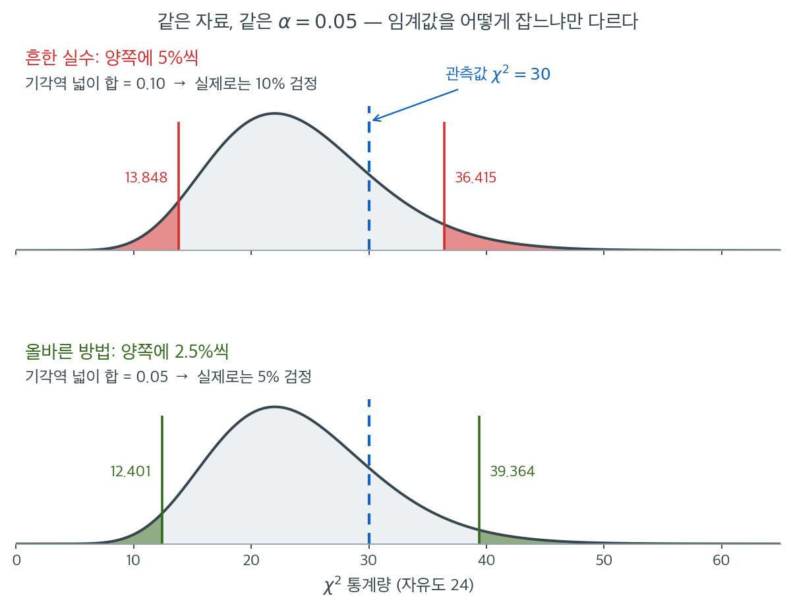
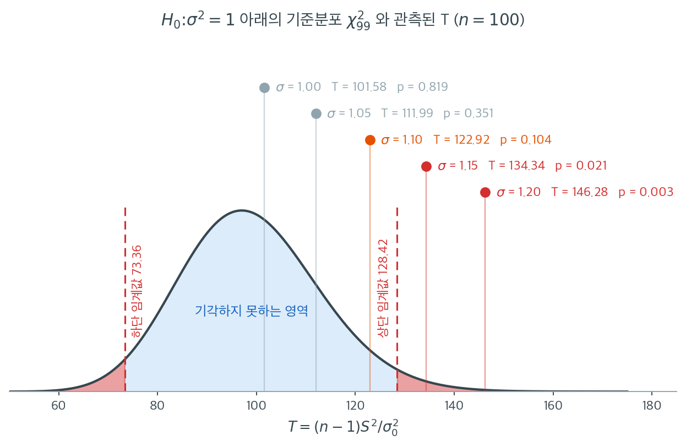

# 분산에 대한 카이제곱 검정


분산에 대한 카이제곱 검정은 모집단의 분산이 지정된 값과 다른지 판정한다. 모분산이 알려져 있거나 가설로 주어질 때 적용하는 일표본 검정이다. 이 검정은 자료가 정규분포를 따른다는 가정에 매우 민감하며, 정규성에서 크게 벗어나면 결과를 신뢰할 수 없다.

---

## 1. 가설

분산에 대한 카이제곱 검정의 가설은 다음과 같이 세운다.

**귀무가설 ($H_0$):** 모분산 $\sigma^2$이 지정된 값 $\sigma_0^2$과 같다.

$$
H_0: \sigma^2 = \sigma_0^2
$$

**대립가설 ($H_1$):** 모분산이 지정된 값 $\sigma_0^2$과 다르다. 양측검정인지 단측검정인지에 따라 다음과 같이 표현한다.

- **양측검정** (분산이 단지 다르다):

$$
H_1: \sigma^2 \neq \sigma_0^2
$$

- **단측검정** (분산이 지정된 값보다 크거나 작다):

$$
H_1: \sigma^2 > \sigma_0^2 \quad \text{또는} \quad H_1: \sigma^2 < \sigma_0^2
$$

---

## 2. 가정

분산에 대한 카이제곱 검정이 타당하려면 다음 가정이 충족되어야 한다.

1. 자료가 **정규분포를 따르는** 모집단에서 추출되어야 한다. 이 검정은 정규성 이탈에 로버스트하지 않으므로 이 가정이 결정적이다.
2. 표본이 **독립인 관측값**으로 이루어져야 한다.
3. 모분산 $\sigma^2$이 지정된 값 $\sigma_0^2$과 같다는 가설을 세운다.

이 가정들, 특히 정규성 가정이 위배되면 검정 결과가 오도할 수 있다.

---

## 3. 검정통계량

분산에 대한 카이제곱 검정의 검정통계량은 표본분산 $s^2$과 가설 모분산 $\sigma_0^2$에 기반한다.

$$
\frac{(n - 1) s^2}{\sigma_0^2} = \sum_{i=1}^n \left(\frac{X_i - \bar{X}}{\sigma_0}\right)^2 \sim \chi^2_{n-1}
$$

여기서

- $n$은 표본크기,
- $s^2$은 표본분산,
- $\sigma_0^2$은 가설 모분산이다.

귀무가설 아래에서 검정통계량 $\chi^2$은 자유도 $n-1$인 카이제곱분포를 따른다. 자유도는 표본크기를 반영하며, 표본이 클수록 분산 추정이 정밀해진다.

---

## 4. 기각역과 판정규칙

귀무가설을 기각할지 판정하려면 검정통계량을 카이제곱분포의 임계값과 비교한다. 임계값은 유의수준 $\alpha$와 자유도 $n-1$에 의존한다.

**양측검정**에서는 카이제곱분포의 아래 꼬리와 위 꼬리를 모두 확인한다.

$$
\chi^2_{1-\alpha/2,\,n-1} < \chi^2 < \chi^2_{\alpha/2,\,n-1}
$$

계산된 검정통계량이 이 범위 안에 있으면 귀무가설을 기각하지 못한다. 범위를 벗어나면 $H_0$을 기각한다.

!!! warning "양측검정에서는 꼬리마다 $\alpha/2$를 써야 한다"
    양측검정에서 흔한 실수는 양쪽 임계값을 각각 $\alpha$ 수준의 값으로 잡는 것이다. 예컨대 $\alpha = 0.05$, $\text{df} = 24$에서 $13.848$과 $36.415$를 쓰는 경우가 있는데, 이 둘은 각각 하단 5%와 상단 5% 지점이므로 합치면 **10% 검정**이 된다.

    올바른 5% 양측 임계값은 각 꼬리에 2.5%씩 배분한 $12.401$과 $39.364$이다.

이 실수가 왜 검정을 두 배로 헐겁게 만드는지는 그림으로 보면 분명하다. 아래 두 그림은 **같은 분포, 같은 자료, 같은 $\alpha = 0.05$**를 쓴다. 다른 것은 임계값을 어디에 긋느냐뿐이다.



위 그림은 각 꼬리에 5%씩 잘라 $13.848$과 $36.415$를 임계값으로 삼았다. 두 붉은 영역의 넓이를 더하면 $0.05 + 0.05 = 0.10$이다. **$\alpha = 0.05$라고 부르면서 실제로는 10% 검정을 하고 있는 것이다.** 제1종 오류율이 약속의 두 배다.

아래 그림이 올바른 배분이다. 각 꼬리에 2.5%씩 주어 $12.401$과 $39.364$를 쓰면 기각역의 넓이 합이 정확히 $0.05$가 된다. 두 그림을 겹쳐 보면 올바른 임계값 쌍이 바깥으로 더 벌어져 있다. 같은 총 오류율을 두 꼬리가 나눠 가져야 하니 각 꼬리가 더 얇아지고, 그만큼 임계값이 밖으로 밀리는 것이다.

카이제곱분포가 대칭이 아니라는 점이 이 그림에서 또 하나 드러난다. 하단 임계값은 $12.401 \to 13.848$로 $1.4$만 움직이는데 상단은 $36.415 \to 39.364$로 $2.9$나 움직인다. 오른쪽 꼬리가 길게 늘어져 있어 같은 확률을 떼어 내려면 더 멀리 가야 하기 때문이다. 평균 검정의 $\pm t_{\alpha/2}$처럼 한 숫자로 양쪽을 처리할 수 없는 이유가 여기 있다.

파란 점선이 보기 1의 관측값 $\chi^2 = 30$이다. 두 그림 모두에서 채택역 안에 들어 있으므로 이 자료에서는 판정이 바뀌지 않는다. 그러나 통계량이 $37$이었다면 잘못된 방식은 기각하고 올바른 방식은 기각하지 못한다. **임계값을 잘못 잡은 검정은 틀린 답을 낼 때까지 틀린 줄 모른다.**

**단측검정**에서는 분포의 한쪽 끝만 확인한다.

- $H_1: \sigma^2 > \sigma_0^2$을 검정한다면 검정통계량을 상단 임계값과 비교한다.
- $H_1: \sigma^2 < \sigma_0^2$을 검정한다면 하단 임계값과 비교한다.

임계값은 카이제곱분포표에서 얻으며 원하는 유의수준(흔히 $\alpha = 0.05$)에 의존한다.

<div class="exbox" markdown>

**보기 1.** <span class="diff easy" title="쉬움"></span> 공장이 주장하는 중량 분산. 어떤 공장이 제품 중량의 분산이 $0.04$ 그램$^2$이라고 주장한다. 제품 $25$ 개를 표본으로 뽑았더니 표본분산이 $0.05$ 그램$^2$이었다.

**(1)** 유의수준 $5\%$ 에서 모분산이 $0.04$ 그램$^2$ 과 다른지 검정하시오. 통계량·임계값·양측 $p$ 값을 모두 적을 것.

**(2)** 위 경고대로 꼬리마다 $\alpha$ 를 통째로 주면 실제 유의수준이 얼마가 되는지 구하고, **두 규칙의 판정이 갈리는 $\chi^2$ 값의 구간**을 밝히시오. 이 자료에서는 판정이 바뀌는가.

</div>

??? success "풀이"

    **(1) 단계별로.**

    **1단계 — 가설 설정.**

    $$
    H_0: \sigma^2 = 0.04 \quad \text{대} \quad H_1: \sigma^2 \neq 0.04
    $$

    분산이 크든 작든 "주장과 다르다"가 관심이므로 양측검정이다.

    **2단계 — 검정통계량.** $n = 25$, $s^2 = 0.05$, $\sigma_0^2 = 0.04$ 를 추축량에 넣는다.

    $$
    \chi^2 = \frac{(n-1)s^2}{\sigma_0^2} = \frac{(25 - 1) \times 0.05}{0.04} = \frac{1.2}{0.04} = 30
    $$

    $H_0$ 아래에서 이 값은 $\chi^2_{24}$ 를 따른다. 이 사실이 **정규모집단에서만** 참이라는 것은 15.2절이 유도해 두었다.

    **3단계 — 임계값.** 자유도 $24$, $\alpha = 0.05$ 를 양쪽 꼬리에 $0.025$ 씩 나눈다.

    - 하단 임계값 $\chi^2_{0.975,\,24} = 12.401$
    - 상단 임계값 $\chi^2_{0.025,\,24} = 39.364$

    **4단계 — 판정.** $12.401 < 30 < 39.364$ 이므로 채택역 안이다. $H_0$ 을 기각하지 못한다.

    양측 $p$ 값은 작은 쪽 꼬리의 두 배다. $P(\chi^2_{24} \le 30) = 0.8152$ 이고 $P(\chi^2_{24} \ge 30) = 0.1848$ 이므로 오른쪽이 작고

    $$
    p = 2\min\{0.8152,\; 0.1848\} = 2 \times 0.1848 = 0.3695
    $$

    이다.

    **5단계 — 결론.** 유의수준 $5\%$ 에서 모분산이 $0.04$ 그램$^2$ 과 다르다고 볼 증거가 충분하지 않다. $p = 0.37$ 로 문턱에서 한참 멀다.

    **(2) 꼬리마다 $\alpha$ 를 주면 크기가 정확히 두 배가 된다.** 잘못된 규칙은 $\chi^2 < \chi^2_{0.95,\,24}$ 또는 $\chi^2 > \chi^2_{0.05,\,24}$ 로 기각한다. 두 사건이 서로 배반이므로 크기가

    $$
    P(\text{기각} \mid H_0) = \alpha + \alpha = 0.05 + 0.05 = 0.10
    $$

    이다. **$\alpha = 0.05$ 라 부르면서 실제로는 $10\%$ 검정을 하는 것**이고, 이 두 배는 근사가 아니라 정확하다.

    **판정이 갈리는 구간.** 두 규칙은 모두 "양쪽 바깥이면 기각"인데 잘못된 쪽의 경계가 안쪽에 있으므로, 잘못된 쪽이 **더 많이** 기각한다. 갈리는 자리는 두 경계 사이의 띠 둘이다.

    $$
    \bigl[\chi^2_{0.975,\,24},\, \chi^2_{0.95,\,24}\bigr) \;\cup\; \bigl(\chi^2_{0.05,\,24},\, \chi^2_{0.025,\,24}\bigr]
    = [12.401,\, 13.848) \cup (36.415,\, 39.364]
    $$

    $H_0$ 아래에서 통계량이 이 띠에 떨어질 확률은 두 크기의 차 $0.10 - 0.05 = 0.05$ 다. **스무 번에 한 번은 두 규칙이 서로 다른 답을 낸다.**

    관측값 $30$ 은 두 띠 어디에도 들어 있지 않으므로 **이 자료에서는 판정이 바뀌지 않는다.** 둘 다 기각하지 못한다. 통계량이 $37$ 이었다면 갈렸을 것이다.

    **확인한다.**

    ```python
    from scipy import stats

    df, alpha = 24, 0.05
    lower = stats.chi2.ppf(alpha / 2, df)
    upper = stats.chi2.ppf(1 - alpha / 2, df)
    print(f"lower = {lower:.4f}, upper = {upper:.4f}")

    # 관측된 통계량과 양측 p-값
    n, s2, sigma2_0 = 25, 0.05, 0.04
    T = (n - 1) * s2 / sigma2_0
    rv = stats.chi2(df=df)
    print(f"\nT = (24 x 0.05) / 0.04 = {T:.4f}")
    print(f"  왼쪽 꼬리 P(chi2_24 <= T) = {rv.cdf(T):.4f}")
    print(f"  오른쪽 꼬리 P(chi2_24 >= T) = {rv.sf(T):.4f}")
    print(f"  양측 p = 2 x {min(rv.cdf(T), rv.sf(T)):.4f} = {2 * min(rv.cdf(T), rv.sf(T)):.4f}")
    print(f"  판정: {'기각' if (T < lower or T > upper) else '기각 못함'}")

    # 꼬리마다 alpha 를 통째로 주면 어떻게 되는가.
    w_lo = stats.chi2.ppf(alpha, df)
    w_hi = stats.chi2.ppf(1 - alpha, df)
    print(f"\n잘못된 임계값(꼬리마다 5%) = {w_lo:.4f}, {w_hi:.4f}")
    print(f"  그 규칙의 실제 크기 = {rv.cdf(w_lo) + rv.sf(w_hi):.4f}")
    print(f"  올바른 규칙의 크기  = {rv.cdf(lower) + rv.sf(upper):.4f}")
    dis = (rv.cdf(w_lo) - rv.cdf(lower)) + (rv.cdf(upper) - rv.cdf(w_hi))
    print(f"  두 규칙이 갈리는 구간 = [{lower:.4f}, {w_lo:.4f}) 와 ({w_hi:.4f}, {upper:.4f}]")
    print(f"  H0 아래에서 거기 떨어질 확률 = {dis:.4f}")
    for t in (13.0, 30.0, 37.0):
        a = "기각" if (t < lower or t > upper) else "기각 못함"
        b = "기각" if (t < w_lo or t > w_hi) else "기각 못함"
        print(f"    T = {t:5.1f}:  올바른 규칙 {a:>6s},  잘못된 규칙 {b:>6s}")
    ```

    출력:

    ```text
    lower = 12.4012, upper = 39.3641

    T = (24 x 0.05) / 0.04 = 30.0000
      왼쪽 꼬리 P(chi2_24 <= T) = 0.8152
      오른쪽 꼬리 P(chi2_24 >= T) = 0.1848
      양측 p = 2 x 0.1848 = 0.3695
      판정: 기각 못함

    잘못된 임계값(꼬리마다 5%) = 13.8484, 36.4150
      그 규칙의 실제 크기 = 0.1000
      올바른 규칙의 크기  = 0.0500
      두 규칙이 갈리는 구간 = [12.4012, 13.8484) 와 (36.4150, 39.3641]
      H0 아래에서 거기 떨어질 확률 = 0.0500
        T =  13.0:  올바른 규칙  기각 못함,  잘못된 규칙     기각
        T =  30.0:  올바른 규칙  기각 못함,  잘못된 규칙  기각 못함
        T =  37.0:  올바른 규칙  기각 못함,  잘못된 규칙     기각
    ```

    **(1)과 (2)의 수가 모두 맞는다.** 임계값 $12.4012$ 와 $39.3641$, 양측 $p = 0.3695$, 잘못된 규칙의 크기 $0.1000$, 갈리는 띠의 확률 $0.0500$ 이다. 마지막 세 줄이 띠의 쓸모를 보여 준다. $T = 13$ 은 아래쪽 띠 안이라 잘못된 규칙만 기각하고, $T = 37$ 은 위쪽 띠 안이라 역시 잘못된 규칙만 기각하며, 실제 관측값 $T = 30$ 은 어느 띠에도 없어 두 규칙이 같은 답을 낸다.

    **이것이 임계값 실수의 고약한 점이다.** 스무 번에 열아홉 번은 두 규칙이 같은 답을 내므로 **틀린 줄 모르고 지나간다.** 그러다 통계량이 띠에 떨어진 바로 그 한 번에 잘못된 결론을 내는데, 그때도 자기 규칙이 틀렸다는 신호는 어디에도 나타나지 않는다. 임계값이 맞는지는 자료가 아니라 분포표에서 확인해야 한다.

    위 띠의 너비가 아래 띠보다 넓다는 것도 눈여겨볼 만하다. 아래는 $12.401$ 에서 $13.848$ 까지 $1.45$ 인데 위는 $36.415$ 에서 $39.364$ 까지 $2.95$ 로 두 배가 넘는다. **같은 확률 $0.025$ 를 떼어 내는 데 오른쪽에서는 더 멀리 가야 하기 때문**이고, 이것이 $\chi^2$ 분포의 오른쪽 치우침이다. 평균 검정의 $\pm t_{\alpha/2}$ 처럼 한 숫자로 양쪽을 처리할 수 없는 까닭이 여기 있다.

---

## 5. 분산의 신뢰구간

가설검정에 더해 카이제곱분포로 모분산의 신뢰구간을 구성할 수 있다. 모분산 $\sigma^2$의 $100(1 - \alpha)\%$ 신뢰구간은

$$
\left( \frac{(n - 1) s^2}{\chi^2_{\alpha/2,\,n-1}}, \quad \frac{(n - 1) s^2}{\chi^2_{1-\alpha/2,\,n-1}} \right)
$$

여기서 $\chi^2_{\alpha/2,\,n-1}$과 $\chi^2_{1-\alpha/2,\,n-1}$은 자유도 $n-1$인 카이제곱분포의 상단·하단 임계값이고 $s^2$은 표본분산이다.

앞의 보기에 적용하면 모분산의 95% 신뢰구간은

$$
\left( \frac{24 \times 0.05}{39.364}, \quad \frac{24 \times 0.05}{12.401} \right) = (0.0305, \; 0.0968).
$$

따라서 모분산의 95% 신뢰구간은 $0.0305$와 $0.0968$ 그램$^2$ 사이이다. 가설값 $0.04$가 이 구간에 포함되므로 앞의 검정 결과와 일관된다.

표준편차의 구간은 양 끝에 제곱근을 취하면 된다.

$$
(\sqrt{0.0305},\; \sqrt{0.0968}) = (0.175,\; 0.311) \text{ 그램}.
$$

구간이 매우 넓다는 점에 주목하라. 상한이 하한의 1.8배이다. $n = 25$로는 분산을 정밀하게 추정할 수 없다는 뜻이며, 분산 추론에 큰 표본이 필요한 이유를 보여준다.

## 6. 코드로 검정하기

절 $4$ 가 적은 판정규칙 두 꼴 — 임계값과 양측 $p$ 값 — 을 함수 하나로 옮기고,
그 둘이 정말 같은 답을 내는지 확인한다. 이어서 참 $\sigma$ 를 조금씩 올려 가며
검정이 언제 반응하는지 본다.

<div class="exbox" markdown>

**보기 2.** <span class="diff easy" title="쉬움"></span> 분산에 대한 카이제곱 검정 구현. 위의 판정규칙을 그대로 함수로 옮긴다. 두 꼴로 적어 두고 "동등하게"라고 했으니, 정말 동등한지 확인할 몫이 남았다.

**(1)** 임계값으로 자르는 규칙과 $p = 2\min\bigl(F_{\chi^2}(T),\, 1 - F_{\chi^2}(T)\bigr) < \alpha$ 규칙이 **정확히 같은 기각역**을 줌을 보이시오.

**(2)** $n = 25$, $\alpha = 0.05$ 에서 수치로 확인하시오. 분포가 비대칭이라는 사실이 기각역의 어디에 나타나는가.

</div>

??? success "풀이"

    **(1) 두 규칙은 같은 사건이다.** $\ell = \chi^2_{\alpha/2,\,n-1}$, $u = \chi^2_{1-\alpha/2,\,n-1}$ 이라 쓰고 $F = F_{\chi^2}$ 라 하자. $F$ 는 $(0,\infty)$ 에서 연속이고 **엄격히 증가**하므로 분위수와 다음처럼 맞바꿀 수 있다.

    $$
    T < \ell \iff F(T) < \frac\alpha2,
    \qquad
    T > u \iff F(T) > 1 - \frac\alpha2 \iff 1 - F(T) < \frac\alpha2
    $$

    그러므로 임계값 규칙은 "$F(T)$ 와 $1-F(T)$ 가운데 **적어도 하나**가 $\alpha/2$ 보다 작다"는 것이고, 이것은 작은 쪽이 $\alpha/2$ 보다 작다는 말과 같다.

    $$
    T < \ell \;\text{ 또는 }\; T > u
    \iff
    \min\bigl(F(T),\, 1 - F(T)\bigr) < \frac\alpha2
    \iff
    p = 2\min\bigl(F(T),\, 1-F(T)\bigr) < \alpha
    $$

    **두 규칙이 같은 기각역을 준다.** 양쪽 꼬리에 각각 $\alpha/2$ 를 떼어 주었으니 **등꼬리 양측검정**이고, 두 사건이 서로 배반이므로 크기가 정확히 $\alpha/2 + \alpha/2 = \alpha$ 다.

    이 $p$ 값이 $1$ 을 넘지 않는다는 것과 $H_0$ 아래에서 **정확히** $U(0,1)$ 을 따른다는 것은 $F$ 검정의 양측 $p$ 값과 글자 하나 다르지 않은 논증이다. 15.3절 [이표본 F 검정](../f_test/f_test_two_variances.md) 보기 3 에 적어 두었으므로 되풀이하지 않는다. 다만 그 "정확히"가 어디에 기대고 있는지는 여기서도 같다. 유일한 고리는 $T \sim \chi^2_{n-1}$ 이고, 그것은 **정규모집단에서만** 참이다(5.2절). 정규성이 깨지면 위의 등식들은 그대로 남지만 $F$ 가 더 이상 $T$ 의 참 분포함수가 아니게 되어 크기가 $\alpha$ 에서 벗어난다.

    **(2) 수치적으로.** 임계값 바로 안팎까지 격자에 끼워 두 규칙을 한 점씩 맞춰 본다.

    ```python
    import numpy as np
    import scipy.stats as stats


    def chi2_test_for_variance(data, sigma2_0=1.0):
        """모분산이 sigma2_0 인지 검정하는 일표본 카이제곱 검정.

        H0: sigma^2 = sigma2_0
        H1: sigma^2 != sigma2_0

        카이제곱 분포는 좌우가 대칭이 아니므로, 양측 p-값은 두 꼬리 넓이 중
        작은 쪽을 두 배 해서 만든다.
        """
        n = len(data)
        s2 = np.var(data, ddof=1)
        statistic = (n - 1) * s2 / sigma2_0
        p_value = 2 * min(
            stats.chi2(df=n - 1).cdf(statistic),
            stats.chi2(df=n - 1).sf(statistic),
        )
        return statistic, p_value


    # 한 쌍으로 손풀기. H0 이 참인 표본이므로 p 가 커야 한다.
    rng = np.random.default_rng(5)
    stat, pval = chi2_test_for_variance(rng.normal(size=25), sigma2_0=1.0)
    print(f"표본 하나:  T = {stat:.4f},  p = {pval:.4f}")

    n, alpha = 25, 0.05
    dist = stats.chi2(df=n - 1)
    lo, hi = dist.ppf([alpha / 2, 1 - alpha / 2])
    print(f"\nchi2(24) 의 2.5%/97.5% 임계값 = {lo:.4f}  {hi:.4f}")
    print(f"  경계에서의 p:  p({lo:.4f}) = {2 * min(dist.cdf(lo), dist.sf(lo)):.6f}"
          f"   p({hi:.4f}) = {2 * min(dist.cdf(hi), dist.sf(hi)):.6f}")

    # (1) 두 판정규칙이 정말 같은 기각역을 주는가. 임계값 바로 안팎까지 격자에 끼운다.
    grid = np.unique(np.concatenate([
        np.linspace(1e-6, 120, 200_001),
        lo + np.array([-1e-9, 0.0, 1e-9]),
        hi + np.array([-1e-9, 0.0, 1e-9]),
    ]))
    U = dist.cdf(grid)
    p_grid = 2 * np.minimum(U, 1 - U)
    rule_crit = (grid < lo) | (grid > hi)      # 임계값으로 자르는 규칙
    rule_pval = p_grid < alpha                 # p < alpha 규칙
    print(f"\n격자점 {grid.size:,} 개에서 두 규칙이 어긋난 횟수 = {(rule_crit != rule_pval).sum()}")
    print(f"격자에서 p 의 최대값 = {p_grid.max():.6f}  (1 을 넘지 않는다)")

    # 비대칭이라는 것이 눈에 보이게. 평균은 n-1 = 24 지만 p = 1 이 되는 곳은 중앙값이다.
    print(f"\nchi2(24) 의 평균 = {n - 1},  중앙값 = {dist.median():.4f}")
    print(f"  기각역 하단은 평균에서 {(n - 1) - lo:.4f} 아래,  상단은 {hi - (n - 1):.4f} 위")
    print(f"  p(평균 24) = {2 * min(dist.cdf(24), dist.sf(24)):.6f}")
    print(f"  p(중앙값)  = {2 * min(dist.cdf(dist.median()), dist.sf(dist.median())):.6f}")
    ```

    출력:

    ```text
    표본 하나:  T = 18.8045,  p = 0.4753

    chi2(24) 의 2.5%/97.5% 임계값 = 12.4012  39.3641
      경계에서의 p:  p(12.4012) = 0.050000   p(39.3641) = 0.050000

    격자점 200,007 개에서 두 규칙이 어긋난 횟수 = 2
    격자에서 p 의 최대값 = 0.999968  (1 을 넘지 않는다)

    chi2(24) 의 평균 = 24,  중앙값 = 23.3367
      기각역 하단은 평균에서 11.5988 아래,  상단은 15.3641 위
      p(평균 24) = 0.923195
      p(중앙값)  = 1.000000
    ```

    **두 경계에서 $p$ 가 정확히 $\alpha$ 다.** $T = 12.4012$ 와 $T = 39.3641$ 에서 모두 $p = 0.050000$ 이 나왔다. (1)의 대응이 수치로 확인된 것이다. 기각역의 경계가 곧 $p = \alpha$ 의 등위면이다.

    **20만 개 격자점 가운데 어긋난 곳이 둘 있다.** 덮어 두지 말고 짚자. 어긋난 자리는 **임계값 그 자신인 $T = \ell$ 과 $T = u$ 뿐**이다. 그 두 점에서 참값은 $p = \alpha$ 지만 부동소수점 계산이 $p - \alpha$ 를 각각 $-4.9\times10^{-17}$, $-1.8\times10^{-16}$ 으로 돌려주어 `p < alpha` 가 참이 되어 버린다. 임계값 규칙은 `T < lo` 가 거짓이므로 기각하지 않는다. **연속분포에서 $T$ 가 임계값과 정확히 같을 확률은 $0$ 이므로** 실제 검정에서는 결코 걸리지 않는 차이이고, 격자에 일부러 그 점을 끼워 넣었기 때문에 드러난 것이다. 임계값에서 $10^{-9}$ 만 벗어난 네 점은 모두 두 규칙이 일치한다.

    **비대칭은 기각역의 모양에 나타난다.** $\chi^2_{24}$ 의 평균은 $n-1 = 24$ 인데 기각역 하단은 평균에서 $11.60$ 아래, 상단은 $15.36$ 위다. **한쪽이 다른 쪽보다 $3.8$ 만큼 멀다.** 평균을 중심으로 $\pm c$ 로 잘라서는 양쪽 꼬리를 $2.5\%$ 씩 맞출 수 없다는 뜻이고, 그래서 정규나 $t$ 검정처럼 "추정값 $\pm$ 임계값" 꼴로 쓸 수 없다. 꼬리확률을 직접 재는 수밖에 없다.

    $p = 1$ 이 되는 자리도 평균이 아니다. $p$ 가 $1$ 이 되려면 $F(T) = 1/2$, 곧 $T$ 가 **중앙값**이어야 한다. $\chi^2_{24}$ 의 중앙값은 $23.3367$ 이고 거기서 $p = 1.000000$ 이다. 평균 $24$ 에서는 $p = 0.923195$ 로 $1$ 에 못 미친다. 오른쪽으로 치우친 분포여서 평균이 중앙값보다 크기 때문이다.

전형적인 사용법은 참 표준편차를 바꿔가며 자료를 생성하고 검정이 $\sigma_0^2 = 1$로부터의 이탈을 탐지하는지 확인하는 것이다.

<div class="exbox" markdown>

**보기 3.** <span class="diff easy" title="쉬움"></span> 분산을 키워 가며 검정하기. $n = 100$, **씨앗을 고정**하고 참 표준편차 $\sigma$ 만 $1.00$ 에서 $1.20$ 까지 올린다. $\sigma_0^2 = 1$ 로 검정한다.

**(1)** 씨앗이 같으면 통계량이 표집변동 없이 $T(\sigma) = \sigma^2 T(1)$ 이 됨을 보이고, 기각이 시작되는 $\sigma$ 를 **돌려 보기 전에** 임계값으로 계산하시오.

**(2)** 수치로 확인한 뒤, 이 표를 "검정력"으로 읽으면 왜 안 되는지 밝히시오. 독립 표본에서의 실제 기각률을 구해 15.3절 두 표본 $F$ 검정과 견주시오.

</div>

??? success "풀이"

    **(1) 다섯 표본이 같은 난수를 척도만 바꾸어 쓴 것이다.** `stats.norm(loc=1, scale=sigma).rvs(size, random_state=seed)` 는 씨앗 하나로 정해지는 표준정규 추출값 $z_1, \ldots, z_{100}$ 에 $1 + \sigma z_j$ 를 씌워 돌려준다. 씨앗이 고정되어 있으니 $z$ 가 **같은 수열**이고

    $$
    y_j(\sigma) = 1 + \sigma z_j
    $$

    이다. 표본분산은 위치이동에 둔감하고 척도에 대해 이차이므로 $S_y^2(\sigma) = \sigma^2 S_z^2$ 이고, 따라서

    $$
    T(\sigma) = \frac{(n-1) S_y^2(\sigma)}{\sigma_0^2} = \sigma^2 \cdot \frac{(n-1) S_z^2}{\sigma_0^2} = \sigma^2 \, T(1)
    $$

    이다. **$S_z^2$ 이 공통인자로 빠져 자료가 통째로 사라졌다.** 표본표준편차도 $s_y(\sigma) = \sigma \, s_z$ 로 비례한다. 다섯 줄은 독립인 다섯 실험이 아니라 **한 표본을 다섯 배율로 늘여 본 것**이다.

    **기각이 시작되는 $\sigma$.** $T$ 가 커지는 쪽만 보면 되므로 상단 임계값 $u = \chi^2_{0.975,\,99}$ 만 쓰면 된다. $\sigma^2 T(1) > u$ 에서

    $$
    \sigma > \sqrt{\frac{u}{T(1)}}
    $$

    이다. 수치로는 $u = 128.4220$, $T(1) = 101.5827$ 이므로 문턱이 $\sigma = 1.1244$ 다. 다섯 후보 가운데 $1.15$ 와 $1.20$ 이 이를 넘으므로 **앞의 셋은 기각하지 못하고 뒤의 둘은 기각한다**고 예측된다. 판정이 뒤집히는 자리가 $1.10$ 과 $1.15$ 사이에 있다.

    **(2) 확인한다.** 아래 코드는 보기 2 의 `chi2_test_for_variance` 를 그대로 이어받는다.

    ```python
    # 참 표준편차를 1 에서 1.2 까지 올려 가며 검정이 언제부터 잡아내는지 본다.
    size, seed = 100, 0

    null = stats.chi2(df=size - 1)
    lo, hi = null.ppf([0.025, 0.975])
    T1, _ = chi2_test_for_variance(
        stats.norm(loc=1, scale=1.0).rvs(size, random_state=seed), sigma2_0=1.0)
    print(f"chi2(99) 의 2.5%/97.5% 임계값 = {lo:.4f}  {hi:.4f}")
    print(f"sigma = 1 일 때의 T(1) = {T1:.4f}")
    print(f"기각 문턱:  sigma > sqrt({hi:.4f}/{T1:.4f}) = {np.sqrt(hi / T1):.4f}\n")

    print(f"{'sigma':>6}{'s':>9}{'T':>10}{'sigma^2*T(1)':>14}{'차':>10}{'p':>8}  판정")
    for scale in [1.00, 1.05, 1.10, 1.15, 1.20]:
        y = stats.norm(loc=1, scale=scale).rvs(size, random_state=seed)
        stat, pval = chi2_test_for_variance(y, sigma2_0=1.0)
        pred = scale**2 * T1
        verdict = "기각" if (stat < lo or stat > hi) else "기각 못함"
        print(f"{scale:>6.2f}{y.std(ddof=1):>9.4f}{stat:>10.4f}{pred:>14.4f}"
              f"{abs(stat - pred):>10.1e}{pval:>8.3f}  {verdict}")

    # 다섯 표본이 같은 z 를 척도만 바꾸어 쓴 것인지 직접 확인한다.
    z = stats.norm(loc=0, scale=1).rvs(size, random_state=seed)
    y12 = stats.norm(loc=1, scale=1.2).rvs(size, random_state=seed)
    print(f"\ny(1.2) - (1 + 1.2*z) 의 최대 절대오차 = {np.abs(y12 - (1 + 1.2 * z)).max():.3e}")

    # 독립 표본이면 기각률이 얼마인가. T_obs = sigma^2 * W,  W ~ chi2(99) 이므로
    print("\n독립 표본일 때 정확한 기각률 (n=100, alpha=0.05)")
    print(f"{'sigma':>6}{'일표본 chi2':>14}{'두표본 F':>12}")
    f_null = stats.f(size - 1, size - 1)
    f_lo, f_hi = f_null.ppf([0.025, 0.975])
    for scale in [1.00, 1.05, 1.10, 1.15, 1.20, 1.30]:
        r = scale**2
        chi_pow = null.cdf(lo / r) + null.sf(hi / r)
        f_pow = f_null.cdf(f_lo * r) + f_null.sf(f_hi * r)
        print(f"{scale:>6.2f}{chi_pow:>14.4f}{f_pow:>12.4f}")
    ```

    출력:

    ```text
    chi2(99) 의 2.5%/97.5% 임계값 = 73.3611  128.4220
    sigma = 1 일 때의 T(1) = 101.5827
    기각 문턱:  sigma > sqrt(128.4220/101.5827) = 1.1244

     sigma        s         T  sigma^2*T(1)         차       p  판정
      1.00   1.0130  101.5827      101.5827   0.0e+00   0.819  기각 못함
      1.05   1.0636  111.9949      111.9949   2.8e-14   0.351  기각 못함
      1.10   1.1143  122.9150      122.9150   4.3e-14   0.104  기각 못함
      1.15   1.1649  134.3431      134.3431   5.7e-14   0.021  기각
      1.20   1.2156  146.2790      146.2790   5.7e-14   0.003  기각

    y(1.2) - (1 + 1.2*z) 의 최대 절대오차 = 0.000e+00

    독립 표본일 때 정확한 기각률 (n=100, alpha=0.05)
     sigma      일표본 chi2       두표본 F
      1.00        0.0500      0.0500
      1.05        0.1158      0.0769
      1.10        0.2946      0.1559
      1.15        0.5352      0.2817
      1.20        0.7500      0.4378
      1.30        0.9586      0.7381
    ```

    **(1)의 항등식이 기계 정밀도까지 맞는다.** $T$ 와 $\sigma^2 T(1)$ 의 차가 $5.7\times10^{-14}$ 이하이고 $\sigma = 1$ 에서는 정확히 $0$ 이다($T$ 가 $10^2$ 규모이므로 상대오차가 $10^{-16}$ 수준이다). 더 결정적인 것은 `y(1.2) - (1 + 1.2*z)` 의 최대 절대오차가 **정확히 $0$** 이라는 줄이다. 다섯 표본이 같은 $z$ 를 공유한다는 것이 어림이 아니라 비트 단위로 확인되었다. 표본표준편차가 $1.0130 \times \{1.00, 1.05, 1.10, 1.15, 1.20\}$ 으로 꼭 떨어지는 것도 같은 까닭이다.

    **기각 문턱 예측도 맞는다.** $\sigma = 1.1244$ 가 문턱이고, 실제로 $1.10$ 에서 $T = 122.9150$ 이 상단 임계값 $128.4220$ 안쪽($p = 0.104$)이며 $1.15$ 에서 $T = 134.3431$ 이 선을 넘는다($p = 0.021$). **표준편차가 $10\%$ 에서 $15\%$ 로 바뀌는 사이에 판정이 뒤집힌다.**

    **그러나 이 표는 검정력이 아니다.** 표집변동이 0 으로 눌려 있으므로 다섯 줄은 "같은 효과크기에서 $p$ 값이 어떻게 나오는가"의 분포를 전혀 보여 주지 않는다. 독립 표본에서는 $T_{\text{obs}} = \sigma^2 W$ 로 $W \sim \chi^2_{99}$ 가 곱해져 $T$ 가 $\sigma^2 T(1)$ 주위로 넓게 흩어진다. 마지막 표가 그 결과인데, $\sigma = 1.15$ 에서 실제 기각률이 $0.5352$ 다. **$p = 0.021$ 로 깔끔하게 기각한 그 효과크기가, 진짜 독립 표본에서는 두 번에 한 번쯤만 잡힌다.** $\sigma = 1.10$ 은 $0.2946$ 으로 넷에 하나를 조금 넘는다.

    검산도 된다. $\sigma = 1.00$ 줄의 기각률이 두 검정 모두 $0.0500$ 으로 명목값과 정확히 같다. 보기 2 에서 이 검정의 크기가 정규 가정 아래 정확히 $\alpha$ 임을 보였으니 그래야 한다.

    **일표본 $\chi^2$ 이 두 표본 $F$ 보다 한결 날카롭다.** 같은 $n = 100$, 같은 $\alpha$, 같은 $\sigma$ 비율에서 $\sigma = 1.20$ 일 때 $0.7500$ 대 $0.4378$, $\sigma = 1.15$ 에서 $0.5352$ 대 $0.2817$ 로 거의 두 배다. 까닭은 분모에 있다. 일표본 검정은 $\sigma_0^2$ 을 **알려진 상수**로 쓰므로 흔들리는 것이 $S^2$ 하나뿐인데, $F$ 검정은 분자와 분모가 둘 다 추정값이라 불확실성이 두 번 들어온다. **비교 대상이 추정값이라는 사실 하나가 검정력을 절반 가까이 깎는다.**

    마지막으로 이 깔끔함이 전부 정규성 위에 얹혀 있음을 다시 적어 둔다. 위의 모든 수는 $T \sim \chi^2_{99}$ 를 참으로 두고 나온 것이고, 15.3절은 비정규 모집단에서 그 $0.0500$ 이 **표본을 키워도 낫지 않는** 다른 상수로 간다는 것까지 유도해 두었다. 연습문제 14 의 $t_5$ 에서 $0.1725$ 가 나오는 것이 그 실물이다.

### 다섯 줄을 기준분포 위에 얹으면

- 참 분산이 가설값과 같으면($\sigma = 1.00$) $p$값이 크게 나오므로 $H_0$을 기각하지 못한다.
- 참 표준편차가 커질수록 검정통계량이 커지고 $p$값이 작아져 $H_0$에 반하는 증거가 강해진다.
- 이 검정은 정규성을 가정한다. 꼬리가 두껍거나 치우친 자료에서는 실제 제1종 오류율이 명목 수준 $\alpha$에서 크게 벗어날 수 있다.

$n = 100$에서 표준편차가 15%만 커져도($\sigma = 1.15$) 5% 수준에서 기각한다는 점이 눈에 띈다. 15.3절에서 본 F 검정의 낮은 검정력과 대비되는데, 이는 일표본 검정이 $\sigma_0^2$을 **알려진 상수**로 취급하여 비교 대상의 불확실성이 없기 때문이다.

이 다섯 줄의 출력을 기준분포 위에 얹어 보면 검정이 무슨 일을 하는지가 한눈에 들어온다.



연한 파랑이 $H_0\colon \sigma^2 = 1$ 아래에서 $T$가 살아야 할 곳, 곧 $\chi^2_{99}$이다. 양쪽 붉은 점선이 2.5% 임계값 $73.36$과 $128.42$다. 자유도가 99이므로 분포의 중심도 99 근처이고, 참 $\sigma$가 정확히 1이면 $T$가 이 근처에서 나온다. 실제로 $\sigma = 1.00$인 표본에서 $T = 101.58$이 나왔다. 기준분포 한가운데다.

참 표준편차를 조금씩 올리면 $T$가 **오른쪽으로 밀려난다.** $T$의 기댓값이 $(n-1)\sigma^2/\sigma_0^2$이므로 $\sigma$가 1.20이면 중심이 $99 \times 1.44 = 142.6$으로 옮겨 간다. 그림의 다섯 점이 정확히 그 궤적을 그린다. $101.58 \to 111.99 \to 122.92 \to 134.34 \to 146.28$.

결정적인 것은 **점이 임계선을 넘는 순간**이다. $\sigma = 1.10$의 $T = 122.92$는 아직 $128.42$ 안쪽이라 기각하지 못한다($p = 0.104$). $\sigma = 1.15$의 $T = 134.34$가 선을 넘으면서 $p = 0.021$이 된다. 표준편차가 10%에서 15%로 바뀌는 사이에 판정이 뒤집힌다. **검정력은 이 선을 넘을 확률이고, 그림에서는 점 무리가 선 오른쪽으로 얼마나 밀려났는지가 곧 검정력이다.**

한 가지 주의. 이 다섯 줄은 같은 난수 시드에서 뽑은 **표본 하나씩**이다. 같은 $\sigma = 1.10$으로 다시 뽑으면 $T$가 선 오른쪽에 떨어질 수도 있다. 점 하나는 검정력이 아니라 검정력 분포에서 뽑은 한 번의 추첨이다.

---

---

---

## 연습문제

<div class="drillbox" markdown>

**연습문제 1.** <span class="diff easy" title="쉬움"></span>
어떤 품질관리 기술자가 제품 $n = 25$개의 중량을 측정하여 $s^2 = 4.5$를 얻었다. $\alpha = 0.05$에서 $H_0: \sigma^2 = 3.0$을 $H_a: \sigma^2 > 3.0$에 대해 검정하라.

</div>

??? success "풀이"
    검정통계량은

    $$
    \chi^2 = \frac{(n-1)s^2}{\sigma_0^2} = \frac{24 \times 4.5}{3.0} = 36.0
    $$

    $H_0$ 아래에서 $\chi^2 \sim \chi^2_{24}$이다. 상단 단측검정이므로 임계값은 $\chi^2_{0.05, 24} = 36.415$이다.

    $36.0 < 36.415$이므로 5% 수준에서 $H_0$을 기각하지 못한다. 아슬아슬하다. $p$값은

    $$
    p = P(\chi^2_{24} \geq 36.0) = 0.0549
    $$

    로 0.05를 간신히 넘는다. 자료가 지정된 분산과 일관되지만 결과는 경계선상이다.

    이런 상황에서는 이분법적 판정에 기대기보다 신뢰구간을 함께 보고하는 편이 낫다. $\sigma^2$의 90% 하단 신뢰한계는 $24 \times 4.5/\chi^2_{0.10,24} = 108/33.196 = 3.253$이므로, 실제로는 $\sigma^2 > 3$을 시사한다. $p = 0.055$와 $p = 0.045$를 질적으로 다르게 취급해서는 안 된다. $\square$

---

<div class="drillbox" markdown>

**연습문제 2.** <span class="diff easy" title="쉬움"></span>
$n = 20$, $s^2 = 15$일 때 $\sigma^2$의 95% 신뢰구간을 구성하라.

</div>

??? success "풀이"
    신뢰구간은 $(n-1)s^2/\sigma^2 \sim \chi^2_{n-1}$에 기반한다.

    $$
    \frac{(n-1)s^2}{\chi^2_{\alpha/2,\, n-1}} \leq \sigma^2 \leq \frac{(n-1)s^2}{\chi^2_{1-\alpha/2,\, n-1}}
    $$

    $n-1 = 19$에서 $\chi^2_{0.025, 19} = 32.852$(상단), $\chi^2_{0.975, 19} = 8.907$(하단)이므로

    $$
    \frac{19 \times 15}{32.852} \leq \sigma^2 \leq \frac{19 \times 15}{8.907}
    $$

    $$
    8.67 \leq \sigma^2 \leq 32.00
    $$

    $\sigma^2$의 95% 신뢰구간은 $(8.67, 32.00)$이다.

    **비대칭성에 주목하라.** 상한이 $s^2 = 15$에서 $17.0$만큼 떨어져 있는 반면 하한은 $6.3$만큼만 떨어져 있다. 카이제곱분포가 오른쪽으로 치우쳐 있기 때문이다. 평균에 대한 $t$ 구간처럼 점추정값을 중심으로 대칭이 아니다.

    구간의 폭도 인상적이다. 상한이 하한의 $32.00/8.67 = 3.7$배이다. $n = 20$으로 분산을 추정하면 3~4배의 불확실성이 남는다는 뜻이다. 표준편차로 옮기면 $(\sqrt{8.67}, \sqrt{32.00}) = (2.94, 5.66)$으로 비율이 $1.9$배가 되어 다소 완화된다. $\square$

---

<div class="drillbox" markdown>

**연습문제 3.** <span class="diff med" title="중간"></span>
정규성 아래에서 $S^2$의 표집분포로부터 카이제곱 검정통계량을 유도하라.

</div>

??? success "풀이"
    $X_1, \dots, X_n \sim N(\mu, \sigma^2)$이면

    $$
    \frac{(n-1)S^2}{\sigma^2} = \frac{\sum_{i=1}^n (X_i - \bar{X})^2}{\sigma^2} \sim \chi^2_{n-1}
    $$

    이다. 자유도가 $n$이 아니라 $n-1$인 이유는 $\mu$ 대신 $\bar{X}$를 썼기 때문이다. 편차 $X_i - \bar{X}$는 제약 $\sum_i (X_i - \bar{X}) = 0$을 만족하므로 자유롭게 변할 수 있는 성분이 $n-1$개뿐이다.

    $H_0: \sigma^2 = \sigma_0^2$ 아래에서 대입하면 $\chi^2 = (n-1)S^2/\sigma_0^2 \sim \chi^2_{n-1}$을 얻는다.

    $\chi^2$이 크면 $S^2 \gg \sigma_0^2$을 뜻하고($\sigma^2 > \sigma_0^2$의 증거), 작으면 $S^2 \ll \sigma_0^2$을 뜻한다. $\square$

---

<div class="drillbox" markdown>

**연습문제 4.** <span class="diff med" title="중간"></span>
분산에 대한 카이제곱 검정이 평균에 대한 $t$ 검정보다 비정규성에 훨씬 민감한 이유를 설명하라.

</div>

??? success "풀이"
    $t$ 검정에는 $\bar{X}$가 들어가는데, 중심극한정리에 의해 자료 분포와 무관하게 $n$이 어느 정도만 되면 근사적으로 정규이다. 카이제곱 검정에는 $S^2 = \frac{1}{n-1}\sum(X_i - \bar{X})^2$이 들어가는데, 제곱편차를 쓰므로 분포의 꼬리 거동에 직접 영향을 받는다.

    꼬리가 두꺼운 분포는 이따금 극단적인 $(X_i - \bar{X})^2$ 값을 만들어 $S^2$을 부풀린다. 카이제곱 기준분포는 정규성을 가정하므로 이렇게 부풀려진 값들이 검정통계량을 지나치게 크게 만들고 과도한 기각(제1종 오류 팽창)으로 이어진다.

    정량적으로는 $\operatorname{Var}(S^2) \approx \sigma^4(\gamma_2+2)/n$이므로 초과첨도 $\gamma_2$가 크면 $S^2$의 변동이 정규 이론값의 $(\gamma_2+2)/2$배가 된다. $\gamma_2 = 6$인 지수분포 자료에서는 4배이다.

    **결정적인 점은 이 왜곡이 표본을 키워도 사라지지 않는다는 것이다.** 팽창 인자 $(\gamma_2+2)/2$는 $n$에 의존하지 않는다. 표본분산은 $\bar{X}$가 받는 것과 같은 중심극한정리의 보호를 받지 못한다. $\square$

---

<div class="drillbox" markdown>

**연습문제 5.** <span class="diff med" title="중간"></span>
5절은 보기 1 자료($n = 25$, $s^2 = 0.05$)에서 $\sigma^2$의 95% 신뢰구간이 $(0.0305,\, 0.0968)$이고 가설값 $0.04$가 그 안에 있으므로 "앞의 검정 결과와 일관된다"고 적었다. 이 일관성은 우연이 아니다.

**(1)** 임의의 $\sigma_0^2 > 0$에 대하여, 4절의 양측 $5\%$ 검정이 $H_0: \sigma^2 = \sigma_0^2$을 기각하지 **못하는** 것과 $\sigma_0^2$이 5절의 95% 신뢰구간에 들어 있는 것이 동치임을 보이시오.

**(2)** (1)의 부등식 변형에서, 신뢰구간 공식의 **상단** 임계값 $\chi^2_{\alpha/2,\,n-1} = 39.364$가 왜 구간의 **하한**을 만드는지 설명하시오.

**(3)** $\sigma_0^2 = 0.03$과 $\sigma_0^2 = 0.10$에 대해 검정통계량을 각각 구하고 판정하시오. 그 판정이 (1)과 맞는지 확인하시오.

</div>

??? success "풀이"
    **(1) 기각역을 $\sigma_0^2$에 대해 푼다.** 4절의 판정규칙에 따르면 기각하지 못하는 것은

    $$
    \chi^2_{1-\alpha/2,\,n-1} \;<\; \frac{(n-1)s^2}{\sigma_0^2} \;<\; \chi^2_{\alpha/2,\,n-1}
    $$

    이 성립하는 경우다. $(n-1)s^2 > 0$이고 $\sigma_0^2 > 0$이므로 각 부등식을 $\sigma_0^2$에 대해 풀 수 있다. 오른쪽 부등식에서

    $$
    \frac{(n-1)s^2}{\sigma_0^2} < \chi^2_{\alpha/2,\,n-1}
    \iff
    \sigma_0^2 > \frac{(n-1)s^2}{\chi^2_{\alpha/2,\,n-1}}
    $$

    이고 왼쪽 부등식에서

    $$
    \chi^2_{1-\alpha/2,\,n-1} < \frac{(n-1)s^2}{\sigma_0^2}
    \iff
    \sigma_0^2 < \frac{(n-1)s^2}{\chi^2_{1-\alpha/2,\,n-1}}
    $$

    이다. 둘을 합치면

    $$
    \frac{(n-1)s^2}{\chi^2_{\alpha/2,\,n-1}} \;<\; \sigma_0^2 \;<\; \frac{(n-1)s^2}{\chi^2_{1-\alpha/2,\,n-1}}
    $$

    이고 이것이 바로 5절의 신뢰구간이다. 따라서 **기각되지 않는 가설값의 집합이 정확히 신뢰구간이다.** $\square$

    **(2) 역수를 취하면 순서가 뒤집히기 때문이다.** 통계량 $(n-1)s^2/\sigma_0^2$은 $\sigma_0^2$의 **감소**함수다. 통계량이 큰 쪽(상단 임계값 $39.364$)에 닿는 것은 $\sigma_0^2$이 **작은** 쪽에 닿는 것과 같은 사건이다. 그래서 상단 임계값이 구간의 하한

    $$
    \frac{24 \times 0.05}{39.364} = \frac{1.2}{39.364} = 0.03048
    $$

    을 만들고, 하단 임계값 $12.401$이 상한

    $$
    \frac{24 \times 0.05}{12.401} = \frac{1.2}{12.401} = 0.09676
    $$

    을 만든다. 공식에서 첨자가 뒤바뀐 듯이 보이는 것은 오타가 아니라 이 역수 관계의 흔적이다.

    **(3) 두 가설값 모두 기각된다.** $\sigma_0^2 = 0.03$일 때

    $$
    \chi^2 = \frac{24 \times 0.05}{0.03} = \frac{1.2}{0.03} = 40.0 \;>\; 39.364
    $$

    이므로 위쪽 꼬리에서 기각한다. $\sigma_0^2 = 0.10$일 때

    $$
    \chi^2 = \frac{24 \times 0.05}{0.10} = \frac{1.2}{0.10} = 12.0 \;<\; 12.401
    $$

    이므로 아래쪽 꼬리에서 기각한다.

    (1)과 맞는다. $0.03 < 0.03048$이고 $0.10 > 0.09676$이므로 두 값은 모두 신뢰구간 $(0.03048,\, 0.09676)$ 밖에 있다. 가설값이 구간의 왼쪽에 있을 때는 통계량이 **위쪽** 꼬리로, 오른쪽에 있을 때는 **아래쪽** 꼬리로 빠져나간다는 점도 (2)의 감소성과 일치한다.

    **구간은 검정을 한 번에 다 해 둔 것이다.** 95% 신뢰구간을 하나 계산해 두면 모든 $\sigma_0^2$에 대한 양측 $5\%$ 검정의 판정을 눈으로 읽을 수 있다. 다만 이 동치는 **양측**검정에만 성립한다. 연습문제 1처럼 단측검정을 한다면 단측 신뢰한계와 짝지어야 하며, 양측 구간을 단측 판정에 쓰면 수준이 어긋난다. $\square$

---

<div class="drillbox" markdown>

**연습문제 6.** <span class="diff med" title="중간"></span>
연습문제 1에서 $n = 25$, $s^2/\sigma_0^2 = 4.5/3.0 = 1.5$였고 $p = 0.0549$로 아슬아슬하게 기각하지 못했다. **비율 $s^2/\sigma_0^2 = 1.5$를 그대로 둔 채** 표본크기만 키운다고 하자.

**(1)** 상단 단측 $5\%$ 검정이 기각하기 위한 조건을 $n$에 대한 부등식으로 적으시오.

**(2)** 아래 표를 써서 기각이 가능해지는 **최소 $n$**을 구하고, 그때의 $p$ 값을 적으시오.

| $d = n-1$ | 24 | 25 | 26 | 27 |
|---|---|---|---|---|
| $\chi^2_{0.05,\,d}$ | 36.415 | 37.653 | 38.885 | 40.113 |
| $P(\chi^2_d \ge 1.5d)$ | 0.0549 | 0.0517 | 0.0488 | 0.0460 |

**(3)** 비율이 $1.5$로 고정되어 있는데도 $n$이 커지면 $p$ 값이 계속 작아지는 이유를 설명하시오.

</div>

??? success "풀이"
    **(1) 통계량과 임계값을 모두 $n$으로 적는다.** $s^2 = 1.5\,\sigma_0^2$이므로

    $$
    \chi^2 = \frac{(n-1)s^2}{\sigma_0^2} = 1.5\,(n-1)
    $$

    이고, 상단 단측검정의 기각 조건은

    $$
    1.5\,(n-1) \;>\; \chi^2_{0.05,\,n-1}
    $$

    이다. 왼쪽은 $n$에 대해 기울기 $1.5$의 직선으로 늘고, 오른쪽 임계값은 자유도 $d$가 커질 때 대략 $d + 1.645\sqrt{2d}$로 늘어 기울기가 $1$에 가까워진다. 따라서 어떤 지점에서 직선이 임계값을 추월한다.

    **(2) 최소 $n = 27$이다.** 표의 두 줄을 비교한다.

    - $d = 24$: $1.5 \times 24 = 36.0 < 36.415$ → 기각 못함
    - $d = 25$: $1.5 \times 25 = 37.5 < 37.653$ → 기각 못함
    - $d = 26$: $1.5 \times 26 = 39.0 > 38.885$ → **기각**

    처음 추월이 일어나는 자유도가 $d = 26$, 곧 $n = 27$이다. 그때

    $$
    p = P(\chi^2_{26} \ge 39.0) = 0.0488 \;<\; 0.05
    $$

    이다. $n = 26$에서는 $p = 0.0517$로 아직 문턱 위에 있다. **관측값 두 개를 더 얻는 것만으로 $p$가 $0.0549$에서 $0.0488$로 내려가 판정이 뒤집힌다.**

    **(3) $p$ 값은 효과크기가 아니라 효과크기와 표본크기를 함께 읽은 값이다.** 비율 $1.5$는 모집단에 대한 주장의 크기를 재는 양이고, $p$ 값은 "그만한 비율이 우연히 나올 수 있는가"를 재는 양이다. $(n-1)S^2/\sigma_0^2$의 평균이 $n-1$, 표준편차가 $\sqrt{2(n-1)}$이므로 관측된 통계량은 귀무가설 평균에서

    $$
    \frac{1.5(n-1) - (n-1)}{\sqrt{2(n-1)}} = \frac{0.5(n-1)}{\sqrt{2(n-1)}} = 0.3536\sqrt{n-1}
    $$

    표준편차만큼 떨어져 있다. 이 거리가 $\sqrt{n-1}$에 비례해 **무한히 커지므로** $p \to 0$이다. $n = 25$에서 이 값은 $0.3536\sqrt{24} = 1.73$, $n = 27$에서 $0.3536\sqrt{26} = 1.80$으로 조금 커진다.

    이것은 검정의 **일관성**이다. 참인 대립가설($\sigma^2 = 1.5\sigma_0^2$)에서 검정력이 $1$로 간다. 거꾸로 말하면 $p = 0.0549$라는 값은 "분산이 $1.5$배라는 증거가 약하다"가 아니라 **"$n = 25$로는 $1.5$배를 가려낼 힘이 모자란다"**는 뜻이다. 비율이 같아도 표본이 작으면 못 잡는다. $\square$

---

<div class="drillbox" markdown>

**연습문제 7.** <span class="diff hard" title="어려움"></span>
연습문제 4는 $\operatorname{Var}(S^2) \approx \sigma^4(\gamma_2+2)/n$이라는 사실에서 정규성 이탈의 해악을 정성적으로 설명했다. 이제 그 해악을 수로 재어 보자. 자료가 **지수분포**($\gamma_2 = 6$)에서 왔고 $n = 25$, 명목 유의수준 $5\%$의 상단 단측검정을 한다고 하자. $S^2$이 근사적으로 정규분포를 따른다고 보고 다음을 구하시오.

**(1)** 기각역 $\chi^2 > 36.415$를 비 $S^2/\sigma^2$에 대한 조건으로 바꾸시오.

**(2)** 정규모집단($\gamma_2 = 0$)에 같은 근사를 적용해 기각확률을 구하고, 정확한 값 $0.05$와 비교하시오.

**(3)** 지수모집단($\gamma_2 = 6$)에서 기각확률을 구하시오. 표준정규 꼬리확률은 $P(Z > 1.83) = 0.0336$, $P(Z > 0.91) = 0.1814$를 쓰시오.

</div>

??? success "풀이"
    **(1) 임계값을 자유도로 나눈다.** $H_0: \sigma^2 = \sigma_0^2$가 참이라고 보고 $\sigma_0^2 = \sigma^2$을 넣으면

    $$
    \chi^2 = \frac{24\,S^2}{\sigma^2} > 36.415
    \iff
    \frac{S^2}{\sigma^2} > \frac{36.415}{24} = 1.5173
    $$

    이다. **표본분산이 참값의 $1.52$배를 넘으면 기각한다**는 규칙이다. 이 경계는 분포가 무엇이든 그대로이고, 바뀌는 것은 $S^2$이 그 경계를 넘을 확률뿐이다.

    **(2) 정규모집단에서 이 근사는 $0.0336$을 준다.** $\gamma_2 = 0$이면

    $$
    \operatorname{sd}(S^2) \approx \sigma^2\sqrt{\frac{0+2}{25}} = \sigma^2\sqrt{0.08} = 0.2828\,\sigma^2
    $$

    이므로 $E[S^2] = \sigma^2$에서 경계까지의 거리는

    $$
    z = \frac{1.5173 - 1}{0.2828} = \frac{0.5173}{0.2828} = 1.83
    $$

    표준편차이고 $P(Z > 1.83) = 0.0336$이다. **정확한 값은 정의상 $0.05$인데 근사는 $0.0336$으로 낮게 잡는다.** $S^2$의 표집분포가 정규가 아니라 오른쪽으로 치우친 카이제곱형이어서, 정규근사가 오른쪽 꼬리를 과소평가하기 때문이다. 이 $0.0336$은 뒤의 비교를 위한 **눈금**이다.

    **(3) 지수모집단에서는 $0.1814$가 된다.** $\gamma_2 = 6$이면

    $$
    \operatorname{sd}(S^2) \approx \sigma^2\sqrt{\frac{6+2}{25}} = \sigma^2\sqrt{0.32} = 0.5657\,\sigma^2
    $$

    로 정규 때의 $\sqrt{4} = 2$배다(연습문제 4의 팽창 인자 $(\gamma_2+2)/2 = 4$는 분산의 배수이므로 표준편차로는 $2$배다). 같은 경계까지의 거리가 절반으로 줄어

    $$
    z = \frac{1.5173 - 1}{0.5657} = \frac{0.5173}{0.5657} = 0.91,
    \qquad
    P(Z > 0.91) = 0.1814
    $$

    이다.

    **같은 근사끼리 비교하면 $0.1814 / 0.0336 = 5.4$배다.** 근사 자체가 두 경우 모두 꼬리를 과소평가하므로 이 비율이 그대로 실제 팽창은 아니다. 실제로 지수분포 자료를 모의실험해 재면 이 검정의 크기는 약 $0.146$으로, 명목 $0.05$의 **약 세 배**다(양측검정으로 하면 $0.28$까지 올라간다). 근사는 거칠지만 결론의 방향과 규모는 분명하다.

    **"유의수준 $5\%$"라고 적어 놓고 실제로는 일곱 번에 한 번 틀리는 검정을 하고 있는 것이다.** 4절의 임계값 실수가 크기를 두 배로 만든 것과 비교해 보라. 임계값을 바르게 읽어 $0.10$ 대신 $0.05$를 썼더라도, 자료가 지수분포라면 그 교정은 $0.146$ 앞에서 무의미하다. 분포 가정이 틀린 쪽의 피해가 임계값을 틀린 쪽보다 크다. $\square$

---

<div class="drillbox" markdown>

**연습문제 8.** <span class="diff hard" title="어려움"></span>
실무에서는 첨도보다 왜도를 먼저 눈치챈다. 히스토그램이 한쪽으로 길게 늘어진 것은 보이지만 $\gamma_2$를 추정하려면 4차 적률이 필요해 표본이 많이 든다. 2장은 임의의 분포에 대해 $\beta_2 \ge 1 + \gamma_1^2$($\beta_2 = \gamma_2 + 3$은 보정하지 않은 첨도)임을 증명했다. 이를 연습문제 4의 팽창 인자와 이으시오.

**(1)** 팽창 인자 $(\gamma_2+2)/2$를 $\beta_2$로 다시 쓰고, 2장의 부등식을 넣어 **왜도만으로** 그 하한을 적으시오.

**(2)** 하한이 $1$을 넘는, 곧 "$S^2$의 변동이 정규 이론값보다 반드시 크다"가 보장되는 왜도의 문턱을 구하시오.

**(3)** 지수분포($\gamma_1 = 2$)에서 (1)의 하한과 실제 팽창 인자를 비교하시오. 하한이 등호가 되는 분포는 어떤 것인가.

**(4)** 거꾸로 $\lvert\gamma_1\rvert$가 작으면 이 검정이 안전한가. 반례를 들어 답하시오.

</div>

??? success "풀이"
    **(1) 팽창 인자는 $(\beta_2-1)/2$다.** $\gamma_2 = \beta_2 - 3$을 넣으면

    $$
    \frac{\gamma_2+2}{2} = \frac{(\beta_2-3)+2}{2} = \frac{\beta_2-1}{2}
    $$

    이고, 여기에 $\beta_2 - 1 \ge \gamma_1^2$을 넣으면

    $$
    \frac{\gamma_2+2}{2} \;=\; \frac{\beta_2-1}{2} \;\ge\; \frac{\gamma_1^2}{2}
    $$

    이다. **왜도의 제곱을 반으로 나눈 값이 팽창 인자의 하한이다.** 4차 적률을 몰라도 3차 적률만으로 피해의 하한을 말할 수 있다.

    **(2) 문턱은 $\lvert\gamma_1\rvert \ge \sqrt{2} \approx 1.414$다.** 하한이 $1$ 이상이려면

    $$
    \frac{\gamma_1^2}{2} \ge 1 \iff \gamma_1^2 \ge 2 \iff \lvert\gamma_1\rvert \ge \sqrt{2}
    $$

    이다. 같은 말을 초과첨도로 쓰면 $\gamma_2 \ge \gamma_1^2 - 2 \ge 0$이다. **왜도의 절댓값이 $1.414$를 넘는 분포는 예외 없이 $\operatorname{Var}(S^2)$가 정규 이론값 $2\sigma^4/n$ 이상이고, 따라서 카이제곱 분산검정의 크기가 명목값 이상으로 부푼다.** 치우침만 확인해도 결론이 나는 것이 이 하한의 쓸모다.

    **(3) 지수분포에서 하한은 $2$, 실제는 $4$다.** $\gamma_1 = 2$이므로 하한은 $\gamma_1^2/2 = 2$이고, 실제로는 $\beta_2 = 9$, $\gamma_2 = 6$이어서

    $$
    \frac{\gamma_2+2}{2} = \frac{8}{2} = 4
    $$

    이다. 하한이 실제의 절반이므로 **부등식은 참이지만 느슨하다.** 2장이 밝힌 대로 등호는 **두 점에만 질량이 있는 분포**에서만 성립한다. 예컨대 베르누이 분포는 $\gamma_1 = (1-2p)/\sqrt{p(1-p)}$, $\beta_2 = (1-3p(1-p))/(p(1-p))$인데, $\gamma_1 = 2$가 되도록 $8p^2 - 8p + 1 = 0$에서 $p = 0.1464$를 잡으면 $p(1-p) = 0.125$이고

    $$
    \beta_2 = \frac{1 - 3(0.125)}{0.125} = \frac{0.625}{0.125} = 5 = 1 + 2^2
    $$

    로 정확히 하한에 걸린다. 이때 팽창 인자는 $(\beta_2-1)/2 = 2$로 하한과 같다. **같은 왜도 $2$를 가진 분포들 중 베르누이가 가장 덜 해롭고 지수분포는 그 두 배로 해롭다.**

    **(4) 안전하지 않다. $t$ 분포가 반례다.** 자유도 $5$인 $t$ 분포는 대칭이므로 $\gamma_1 = 0$이고 (1)의 하한은 $0$이어서 아무것도 말해 주지 않는다. 그러나 $t_\nu$의 초과첨도는 $6/(\nu-4)$이므로 $\nu = 5$에서 $\gamma_2 = 6$, 곧 팽창 인자가

    $$
    \frac{6+2}{2} = 4
    $$

    로 **지수분포와 똑같다.** 왜도는 $0$인데 피해는 같다. $\nu \to 4^{+}$로 보내면 $\gamma_2 \to \infty$이므로 피해를 얼마든지 키울 수 있다.

    **부등식은 한쪽으로만 작동한다.** 치우침은 두꺼운 꼬리를 **함의하지만**, 대칭성은 얇은 꼬리를 함의하지 않는다. 그러므로 "히스토그램이 대칭이니 카이제곱 분산검정을 써도 되겠다"는 추론은 틀렸다. 분산검정을 쓰기 전에 봐야 하는 것은 대칭성이 아니라 **꼬리**이고, 그래서 14장의 정규성 검정이나 이 장 뒷절의 로버스트 검정이 필요하다. $\square$

---

<div class="drillbox" markdown>

**연습문제 9.** <span class="diff hard" title="어려움"></span>
5절은 $n = 25$에서 $\sigma$의 95% 신뢰구간이 $(0.175,\, 0.311)$로 "상한이 하한의 $1.8$배"라며 분산 추론에 큰 표본이 필요하다고 적었다. 이 $1.8$을 $1.2$까지 줄이려면 표본이 얼마나 필요한지 재어 보자.

**(1)** $\sigma$의 $95\%$ 신뢰구간에서 상한과 하한의 비 $R$을 자유도 $d = n-1$의 카이제곱 임계값으로 적고, $d = 24$에서 $1.78$임을 확인하시오.

**(2)** 큰 자유도 근사 $\chi^2_{p,\,d} \approx d\bigl(1 + z_p\sqrt{2/d}\bigr)$($z_{0.025} = 1.96$, $z_{0.975} = -1.96$)를 써서 $R \le 1.2$를 만족하는 $d$의 조건을 풀고 필요한 $n$을 구하시오.

**(3)** 정확한 값은 $d = 232$에서 $R = 1.20005$, $d = 233$에서 $R = 1.19958$이다. (2)의 답과 비교하고 차이의 방향을 설명하시오.

</div>

??? success "풀이"
    **(1) 비는 임계값의 비의 제곱근이다.** 5절의 구간 양 끝에 제곱근을 취하면

    $$
    \left(\sqrt{\frac{(n-1)s^2}{\chi^2_{\alpha/2,\,n-1}}},\;\; \sqrt{\frac{(n-1)s^2}{\chi^2_{1-\alpha/2,\,n-1}}}\right)
    $$

    이므로 공통 인자 $(n-1)s^2$이 약분되어

    $$
    R = \sqrt{\frac{\chi^2_{\alpha/2,\,d}}{\chi^2_{1-\alpha/2,\,d}}}
    $$

    가 된다. **$R$은 자료에 전혀 의존하지 않고 표본크기만의 함수다.** $d = 24$에서

    $$
    R = \sqrt{\frac{39.364}{12.401}} = \sqrt{3.1743} = 1.7816
    $$

    으로 5절의 $0.311/0.175 = 1.78$과 맞는다.

    **(2) 근사를 넣고 $d$에 대해 푼다.** $u = 1.96\sqrt{2/d}$로 두면 $\chi^2_{0.025,\,d} \approx d(1+u)$, $\chi^2_{0.975,\,d} \approx d(1-u)$이므로

    $$
    R \approx \sqrt{\frac{1+u}{1-u}} \;\le\; 1.2
    \iff
    \frac{1+u}{1-u} \le 1.44
    $$

    이다. 분모를 넘기면 $1 + u \le 1.44 - 1.44u$, 곧

    $$
    2.44\,u \le 0.44
    \quad\Longrightarrow\quad
    u \le 0.18033
    $$

    이다. $u = 1.96\sqrt{2/d}$를 넣으면

    $$
    \sqrt{\frac{2}{d}} \le \frac{0.18033}{1.96} = 0.09200
    \quad\Longrightarrow\quad
    \frac{2}{d} \le 0.008464
    \quad\Longrightarrow\quad
    d \ge 236.3
    $$

    이므로 $d = 237$, 곧 **$n = 238$**이다.

    **(3) 정확한 답은 $n = 234$이고 근사는 넷을 더 요구한다.** $d = 233$에서 이미 $R = 1.19958 \le 1.2$이므로 최소 자유도는 $233$, 최소 표본크기는 $n = 234$다. 근사가 $d = 237$을 요구한 것은 **근사가 안전한 쪽으로 틀렸다**는 뜻이다.

    차이의 방향은 카이제곱분포의 치우침에서 온다. 정규근사는 두 꼬리를 대칭으로 놓아 $d(1 \pm u)$로 잡지만 실제 분포는 오른쪽으로 치우쳐 **두 임계값이 모두 근사보다 오른쪽에 있다.** $d = 24$에서 근사는 $24(1 \pm 1.96\sqrt{1/12}) = 24 \pm 13.58$, 곧 $(10.42,\, 37.58)$인데 실제는 $(12.401,\, 39.364)$다. 중요한 것은 **밀려난 정도가 다르다**는 점이다. 하단은 $10.42 \to 12.401$로 $1.19$배 올라가는데 상단은 $37.58 \to 39.364$로 $1.047$배만 올라간다. 비는 분자와 분모의 비율 변화로 정해지므로 하단이 더 크게 밀린 쪽이 이기고, 실제 비 $3.174$가 근사 비 $3.606$보다 작아진다. $d = 233$에서도 같은 일이 작은 규모로 일어난다. 근사 $(190.69,\, 275.31)$ 대 실제 $(192.62,\, 277.17)$로 $R$이 $1.20157$에서 $1.19958$로 내려가 목표를 넘긴다.

    **$1.8$을 $1.2$로 줄이는 데 표본이 $25$에서 $234$로, 아홉 배가 넘게 든다.** $R - 1$이 대략 $1.96\sqrt{2/d}$에 비례하므로 구간의 상대폭을 절반으로 줄이려면 표본을 네 배로 늘려야 한다. 평균의 신뢰구간 폭이 $1/\sqrt{n}$으로 줄어드는 것과 같은 지수인데, 분산은 출발점의 폭 자체가 훨씬 넓어 쓸 만한 정밀도에 닿기까지 가야 할 거리가 멀다. **분산이나 표준편차를 유효숫자 두 자리로 보고하고 싶다면 수백 개의 관측값을 준비해야 한다.** $\square$

---

<div class="drillbox" markdown>

**연습문제 10.** <span class="diff hard" title="어려움"></span>
4절은 꼬리마다 $\alpha/2$씩 배분하는 것이 올바른 양측 규칙이라고 했다. 그 배분이 크기를 정확히 $\alpha$로 맞추는 것은 사실이지만, **검정력에 대해서는 대가가 있다.** 보기 1의 설정($d = 24$, 임계값 $12.401$과 $39.364$)에서 $\lambda = \sigma^2/\sigma_0^2$로 두고 다음을 보이시오. $F$와 $f$는 $\chi^2_{24}$의 분포함수와 밀도함수다.

**(1)** $(n-1)S^2/\sigma_0^2 = \lambda \cdot (n-1)S^2/\sigma^2$임을 써서 검정력 함수 $\pi(\lambda)$를 $F$로 적으시오.

**(2)** $\pi'(1)$의 부호를 정하시오. $\chi^2_{24}$의 밀도가 $f(x) = c\,x^{11}e^{-x/2}$임을 쓰고, $\ln 12.401 = 2.5178$, $\ln 39.364 = 3.6728$을 쓰시오.

**(3)** (2)에서 $\pi(\lambda) < 0.05$인 $\lambda$가 존재한다고 결론지으시오. 실제로 $\pi$는 $\lambda^{*} = 0.9726$에서 최솟값 $0.04896$을 가지며 $0.9456 < \lambda < 1$에서 명목 수준 아래다. 이것이 무엇을 뜻하는지 $\sigma_0^2 = 0.04$의 말로 적으시오.

**(4)** 꼬리 확률의 합을 $0.05$로 유지하면서 $\pi'(1) = 0$이 되게 하려면 임계값을 어느 방향으로 옮겨야 하는가.

</div>

??? success "풀이"
    **(1) 척도를 바꿔 넣는다.** $\sigma^2$이 참 분산이면 $(n-1)S^2/\sigma^2 \sim \chi^2_{24}$이고 통계량은

    $$
    \chi^2 = \frac{(n-1)S^2}{\sigma_0^2} = \frac{\sigma^2}{\sigma_0^2}\cdot\frac{(n-1)S^2}{\sigma^2} = \lambda\,W,
    \qquad W \sim \chi^2_{24}
    $$

    이다. 기각확률은

    $$
    \pi(\lambda) = P(\lambda W < 12.401) + P(\lambda W > 39.364)
    = F\!\left(\frac{12.401}{\lambda}\right) + 1 - F\!\left(\frac{39.364}{\lambda}\right)
    $$

    이다. $\lambda = 1$에서 $\pi(1) = 0.025 + 0.025 = 0.05$로 크기가 맞는다.

    **(2) $\pi'(1) > 0$이다.** 연쇄법칙으로 미분하면

    $$
    \pi'(\lambda) = f\!\left(\frac{12.401}{\lambda}\right)\left(-\frac{12.401}{\lambda^2}\right) - f\!\left(\frac{39.364}{\lambda}\right)\left(-\frac{39.364}{\lambda^2}\right)
    = \frac{1}{\lambda^2}\Bigl[39.364\,f(39.364) - 12.401\,f(12.401)\Bigr]
    $$

    이므로 $\lambda = 1$에서 부호는 $x f(x)$를 두 임계값에서 비교하면 정해진다. $f(x) = c\,x^{11}e^{-x/2}$이므로 $x f(x) = c\,x^{12}e^{-x/2}$이고

    $$
    g(x) = \ln\bigl(x f(x)\bigr) - \ln c = 12\ln x - \frac{x}{2}
    $$

    로 두면

    $$
    g(12.401) = 12(2.5178) - 6.2006 = 30.2136 - 6.2006 = 24.0130
    $$

    $$
    g(39.364) = 12(3.6728) - 19.6820 = 44.0736 - 19.6820 = 24.3916
    $$

    이다. 차가 $0.3786 > 0$이므로

    $$
    \frac{39.364\,f(39.364)}{12.401\,f(12.401)} = e^{0.3786} = 1.46
    $$

    로 위쪽 항이 아래쪽보다 $1.46$배 크고, 따라서 $\pi'(1) > 0$이다.

    **(3) 검정이 불편(unbiased)하지 않다.** $\pi$가 $\lambda = 1$에서 증가하고 $\pi(1) = 0.05$이므로, $\lambda$를 $1$보다 조금 **작게** 하면 $\pi(\lambda) < 0.05$가 된다. 즉 **귀무가설이 틀렸는데도 기각확률이 명목 수준보다 낮아지는 대립가설이 존재한다.** 주어진 수로는 $\lambda^{*} = 0.9726$에서 $\pi = 0.04896$이 최솟값이고 $0.9456 < \lambda < 1$ 전체에서 $\pi < 0.05$다.

    $\sigma_0^2 = 0.04$의 말로 옮기면, 참 분산이

    $$
    0.04 \times 0.9456 = 0.03782 \;<\; \sigma^2 \;<\; 0.04
    $$

    일 때 이 검정은 **참인 귀무가설을 기각할 확률보다도 낮은 확률로** 틀린 귀무가설을 기각한다. 가장 나쁜 자리는 $\sigma^2 = 0.04 \times 0.9726 = 0.03891$로, 분산이 $2.7\%$ 작아졌는데 기각확률은 $0.05$에서 $0.04896$으로 **떨어진다**. 손실은 $0.001$ 정도로 작지만 부호가 거꾸로라는 점이 중요하다. 아래쪽 꼬리가 짧아 $\lambda$가 조금 줄 때 하단에서 얻는 확률이 상단에서 잃는 확률을 메우지 못하기 때문이다.

    **(4) 두 임계값을 모두 오른쪽으로 옮긴다.** $\pi'(1) = 0$은

    $$
    a\,f(a) = b\,f(b)
    $$

    를 요구한다. $g(x) = 12\ln x - x/2$는 $g'(x) = 12/x - 1/2 = 0$에서 $x = 24$이므로 $x < 24$에서 증가하고 $x > 24$에서 감소한다. 현재 $a = 12.401 < 24 < 39.364 = b$에서 $b f(b)$가 더 크므로, 균형을 맞추려면 $a$를 키워 $a f(a)$를 올리고 $b$를 키워 $b f(b)$를 내려야 한다. **곧 아래 꼬리에 $2.5\%$보다 많이, 위 꼬리에 적게 주어야 한다.** 실제로 $d = 24$, 전체 크기 $0.05$에서 두 조건을 함께 풀면

    $$
    (a,\,b) = (12.791,\; 40.384),
    \qquad
    P(\chi^2_{24} < a) = 0.0306,\quad P(\chi^2_{24} > b) = 0.0194
    $$

    가 나오고 이 쌍에서는 $\pi$가 $\lambda = 1$에서 최솟값 $0.05$를 갖는다.

    **꼬리를 똑같이 반씩 나누는 것은 최적성이 아니라 편의다.** 등꼬리 규칙은 분포표를 두 번 읽으면 끝나고 신뢰구간과의 동치(연습문제 5)도 깔끔하게 성립하지만, 비대칭 분포에서 공짜는 아니다. 4절이 경고한 "꼬리마다 $\alpha$씩" 실수는 크기를 두 배로 부풀리는 **명백한** 오류이고, 여기서 본 편의(bias)는 크기를 지키면서 검정력에서 $0.001$쯤 손해를 보는 **미세한** 대가다. 둘을 같은 저울에 올려서는 안 되지만, 등꼬리 배분이 어디서 완벽하지 않은지는 알아 둘 만하다. $\square$

<div class="drillbox" markdown>

**연습문제 11.** <span class="diff easy" title="쉬움"></span> 어떤 제조공정은 부품 지름의 분산이 $\sigma_0^2 = 0.04\;\text{mm}^2$이 되도록 설계되었다. 부품 $n = 25$개의 표본에서 $S^2 = 0.06$을 얻었다. 카이제곱 검정통계량을 계산하고 Python으로 양측 $p$값을 구하라. $\alpha = 0.05$에서 결론을 서술하라.

</div>

??? success "풀이"

    검정통계량은

    $$
    T = \frac{(25 - 1)(0.06)}{0.04} = \frac{1.44}{0.04} = 36.
    $$

    ```python
    import scipy.stats as stats

    T = 24 * 0.06 / 0.04  # 36.0
    p = 2 * min(stats.chi2(df=24).cdf(T), stats.chi2(df=24).sf(T))
    print(f"T = {T:.1f}, right tail = {stats.chi2(df=24).sf(T):.4f}, "
          f"two-sided p = {p:.4f}")
    ```

    출력:

    ```text
    T = 36.0, right tail = 0.0549, two-sided p = 0.1098
    ```

    $\chi^2(24)$에서 오른쪽 꼬리확률 $P(\chi^2 > 36) = 0.0549$이므로 양측 $p = 0.110$이다. $\alpha = 0.05$에서 $H_0$을 기각하지 못한다. 분산이 $0.04$와 다르다고 결론지을 증거가 충분하지 않다.

    **다만 단측이라면 결론이 달라질 뻔했다.** 품질관리에서는 보통 "분산이 목표보다 **큰가**"만 문제가 되므로 단측검정이 적절하다. 그 경우 $p = 0.0549$로 여전히 기각하지 못하지만 경계선에 훨씬 가깝다.

    검정 방향은 자료를 보기 전에 정해야 한다. 양측으로 계획했다가 결과를 보고 단측으로 바꾸는 것은 유의수준을 두 배로 부풀리는 조작이다. $\square$

---


<div class="drillbox" markdown>

**연습문제 12.** <span class="diff easy" title="쉬움"></span> $N(0,1)$에서 크기 $n = 30$인 표본을 뽑아 $\sigma_0^2 = 1$, $\alpha = 0.05$로 카이제곱 검정을 적용하는 모의실험(5,000회 이상)을 작성하라. 경험적 제1종 오류율을 추정하고 0.05에 가까운지 확인하라.

</div>

??? success "풀이"

    ```python
    import numpy as np
    import scipy.stats as stats

    rng = np.random.default_rng(42)
    n, sigma2_0, alpha, n_sims = 30, 1.0, 0.05, 10000
    rejections = 0

    for _ in range(n_sims):
        x = rng.normal(0, 1, size=n)
        s2 = np.var(x, ddof=1)
        T = (n - 1) * s2 / sigma2_0
        p = 2 * min(stats.chi2(df=n - 1).cdf(T), stats.chi2(df=n - 1).sf(T))
        if p < alpha:
            rejections += 1

    print(f"Empirical Type I error: {rejections / n_sims:.4f}")
    ```

    출력:

    ```text
    Empirical Type I error: 0.0500
    ```

    정확히 $0.0500$이다. 정규성 아래에서 이 검정이 **정확한**(exact) 검정이므로 당연한 결과이다. 점근근사가 아니라 정확한 표집분포를 쓰기 때문에 어떤 $n$에서도 크기가 정확히 $\alpha$이다.

    이는 14장과 15장에서 본 다른 검정들(D'Agostino $K^2$, Jarque-Bera, Levene 등)이 근사에 기대어 크기가 조금씩 어긋났던 것과 대조된다. $\square$

---


<div class="drillbox" markdown>

**연습문제 13.** <span class="diff med" title="중간"></span> 표본분산의 정의와, $H_0$ 아래에서 각 $(X_i - \mu)/\sigma_0 \sim N(0,1)$이라는 사실에서 출발하여 검정통계량 $T = (n-1)S^2 / \sigma_0^2$을 유도하라. 자유도가 왜 $n$이 아니라 $n - 1$인지 설명하라.

</div>

??? success "풀이"

    $Z_i = (X_i - \mu)/\sigma_0$이라 쓰면 $\sum_{i=1}^n Z_i^2 \sim \chi^2(n)$이다. 그러나 $\mu$는 알려져 있지 않아 $\bar{X}$로 대체된다. 제약 $\sum (X_i - \bar{X}) = 0$이 자유도 하나를 없애므로

    $$
    \sum_{i=1}^{n} \frac{(X_i - \bar{X})^2}{\sigma_0^2} = \frac{(n-1)S^2}{\sigma_0^2} \sim \chi^2(n-1).
    $$

    이는 $n$차원 표준정규 벡터를 모든 성분이 1인 벡터에 직교하는 $(n-1)$차원 부분공간으로 사영한 것이며, Cochran 정리에 의해 $\chi^2(n-1)$ 분포를 갖는다.

    **기하학적 그림.** $\mathbf{Z} = (Z_1,\ldots,Z_n)$의 분포는 회전에 불변이다. 이 벡터를 두 성분으로 분해한다.

    - $\mathbf{1}$ 방향 성분: $\sqrt{n}\bar{Z}$, 자유도 1
    - 그에 직교하는 성분: $\sum_i (Z_i - \bar{Z})^2$, 자유도 $n-1$

    직교 분해이므로 두 성분이 독립이고 자유도가 $1 + (n-1) = n$으로 더해진다. 우리가 관심 갖는 것은 두 번째 성분이며, 그것이 $\chi^2(n-1)$이다. $\square$

---


<div class="drillbox" markdown>

**연습문제 14.** <span class="diff med" title="중간"></span> 연습문제 12의 모의실험을 정규분포 대신 $t(5)$ 분포(꼬리가 더 두꺼움)에서 뽑아 반복하라. 경험적 기각률을 $\alpha = 0.05$와 비교하고, 카이제곱 검정이 비정규 자료에 왜 문제가 되는지 설명하라.

</div>

??? success "풀이"

    ```python
    import numpy as np
    import scipy.stats as stats

    rng = np.random.default_rng(42)
    n, sigma2_0, alpha, n_sims = 30, 5 / 3, 0.05, 10000
    # Var(t(5)) = 5/(5-2) = 5/3
    rejections = 0

    for _ in range(n_sims):
        x = stats.t(df=5).rvs(size=n, random_state=rng)
        s2 = np.var(x, ddof=1)
        T = (n - 1) * s2 / sigma2_0
        p = 2 * min(stats.chi2(df=n - 1).cdf(T), stats.chi2(df=n - 1).sf(T))
        if p < alpha:
            rejections += 1

    print(f"Empirical rejection rate (t(5)): {rejections / n_sims:.4f}")
    ```

    출력:

    ```text
    Empirical rejection rate (t(5)): 0.1725
    ```

    기각률이 $0.173$으로 명목값의 **3.5배**이다. 연습문제 12의 정확한 $0.0500$과 극명하게 대비된다.

    **원인.** 카이제곱 분산 검정은 첨도에 민감하다. 15.1절 [분산 검정의 공통 가정](../introduction/common_assumptions.md) 연습문제 1에서 유도했듯

    $$
    \operatorname{Var}(S^2) \approx \frac{\sigma^4(\gamma_2 + 2)}{n}
    $$

    이고 $t_5$는 $\gamma_2 = 6$이므로 $S^2$의 실제 분산이 정규 이론값의 **4배**이다. 카이제곱 기준분포는 정규 이론값을 쓰므로 실제보다 절반의 폭을 갖고, 그래서 $T$가 임계값 밖으로 자주 벗어난다.

    **표본을 키워도 나아지지 않는다.** 팽창 인자 $(\gamma_2+2)/2 = 4$가 $n$에 의존하지 않기 때문이다. 15.3절 [비정규성에 대한 민감도](../f_test/sensitivity.md) 연습문제 3에서 F 검정에 대해 확인한 것과 같은 구조이다.

    **대안.** 붓스트랩 신뢰구간(15.6절)이나, 분산 자체보다 로버스트 산포 측도(중앙값절대편차 등)를 쓰는 방법이 있다. $\square$

---


<div class="drillbox" markdown>

**연습문제 15.** <span class="diff med" title="중간"></span> 단측검정 $H_0 : \sigma^2 \le \sigma_0^2$ 대 $H_1 : \sigma^2 > \sigma_0^2$을 구성하라. 기각규칙을 $\chi^2_{1-\alpha,\, n-1}$로 표현하고, Python 함수 `chi2_test_for_variance`를 단측 $p$값을 반환하도록 수정하라.

</div>

??? success "풀이"

    오른쪽 대립가설 $H_1: \sigma^2 > \sigma_0^2$에 대해 다음이면 $H_0$을 기각한다.

    $$
    T = \frac{(n-1)S^2}{\sigma_0^2} > \chi^2_{1-\alpha,\, n-1}.
    $$

    단측 $p$값은 $p = P(\chi^2(n-1) \ge T) = 1 - F_{\chi^2}(T)$이다.

    ```python
    import numpy as np
    import scipy.stats as stats

    def chi2_test_variance(data, sigma2_0=1.0, alternative='two-sided'):
        """모분산에 대한 일표본 카이제곱 검정.

        alternative: 'two-sided', 'greater', or 'less'
        """
        n = len(data)
        s2 = np.var(data, ddof=1)
        T = (n - 1) * s2 / sigma2_0
        dist = stats.chi2(df=n - 1)
        if alternative == 'greater':
            p = dist.sf(T)
        elif alternative == 'less':
            p = dist.cdf(T)
        elif alternative == 'two-sided':
            p = 2 * min(dist.cdf(T), dist.sf(T))
        else:
            raise ValueError(f"unknown alternative: {alternative}")
        return T, p
    ```

    **왜 $H_0$을 $\sigma^2 \le \sigma_0^2$(부등호)로 쓰는가.** 복합 귀무가설이지만 검정은 경계값 $\sigma^2 = \sigma_0^2$에서 수행한다. $\sigma^2 < \sigma_0^2$이면 $T$가 더 작아져 기각확률이 더 낮아지므로, 경계에서의 크기가 $H_0$ 전체에 대한 크기의 **상한**이 된다. 이런 성질을 갖는 검정을 수준 $\alpha$ 검정이라 한다.

    **품질관리에서의 의미.** 실무에서 관심은 대체로 "변동성이 규격을 넘는가"이므로 단측이 자연스럽다. 15.2절 [모분산의 신뢰구간](ci_variance.md) 연습문제 2에서 다룬 상단 신뢰한계와 쌍대 관계에 있다. $\square$

---


<div class="drillbox" markdown>

**연습문제 16.** <span class="diff med" title="중간"></span> 연습문제 13 은 $\mu$ 를 $\bar X$ 로 바꿔 끼우는 대가로 자유도가 하나 줄어든다는 것을 보였다. 그 대가를 검정력으로 환산한다. 목표평균 $\mu$ 가 설계로부터 **정확히 알려져 있는** 계측기를 생각하고

$$
T_0 = \frac{1}{\sigma_0^2} \sum_{i=1}^{n} (X_i - \mu)^2
$$

으로 검정한다고 하자.

**(1)** $T_0 = T + n(\bar X - \mu)^2/\sigma_0^2$ 임을 보이고, $H_0$ 아래에서 두 항이 독립이며 $T_0 \sim \chi^2(n)$ 임을 밝히시오.

**(2)** $r = \sigma^2/\sigma_0^2$ 의 함수로 두 양측검정의 검정력함수를 쓰고, **$\mu$ 를 아는 $n$ 짜리 검정과 $\mu$ 를 모르는 $n+1$ 짜리 검정이 완전히 같은 검정력함수를 가짐**을 보이시오.

**(3)** $n = 25$, $\alpha = 0.05$, $\sigma = 1.2$ 에서 두 검정력은 $0.2907$($\mu$ 를 모를 때)과 $0.2991$($\mu$ 를 알 때)이다. 보기 3 의 $n = 100$ 에서는 $0.7500$ 과 $0.7539$ 다. 차이가 줄어든 까닭을 (2)로 설명하시오.

</div>

??? success "풀이"

    **(1) 제곱합이 둘로 쪼개진다.** $X_i - \mu = (X_i - \bar X) + (\bar X - \mu)$ 로 적고 제곱해 더하면 교차항이

    $$
    2(\bar X - \mu) \sum_{i=1}^{n} (X_i - \bar X) = 0
    $$

    으로 사라진다. 연습문제 13 에서 자유도 하나를 먹었던 바로 그 제약이다. 따라서

    $$
    \sum_{i=1}^{n} (X_i - \mu)^2 = \sum_{i=1}^{n} (X_i - \bar X)^2 + n(\bar X - \mu)^2
    $$

    이고 양변을 $\sigma_0^2$ 으로 나누면 $T_0 = T + n(\bar X - \mu)^2/\sigma_0^2$ 이다.

    $H_0$ 아래에서 $\bar X$ 와 $S^2$ 은 **독립**이므로(정규표본에서만 성립하는 5.2절의 사실) 두 항도 독립이다. 둘째 항은 $\sqrt n(\bar X - \mu)/\sigma_0 \sim N(0,1)$ 의 제곱이므로 $\chi^2(1)$ 이다. 적률생성함수를 곱하면

    $$
    (1-2t)^{-(n-1)/2} \cdot (1-2t)^{-1/2} = (1-2t)^{-n/2}
    $$

    이므로 $T_0 \sim \chi^2(n)$ 이다. 연습문제 13 의 기하로 다시 말하면, $\mathbf 1$ 방향 성분은 $\mu$ 를 모를 때 **버려야 했던** 자유도 하나이고 $T_0$ 는 그것을 되찾아 쓴 것이다.

    **(2) 검정력함수는 자유도만 본다.** $\sigma^2 = r\sigma_0^2$ 이면 $T = r W$, $W \sim \chi^2(n-1)$ 이고 $T_0 = r W_0$, $W_0 \sim \chi^2(n)$ 이다. 그러므로 자유도 $k$, 임계값 $\ell_k = \chi^2_{\alpha/2,k}$, $u_k = \chi^2_{1-\alpha/2,k}$ 를 쓰면 두 검정력함수가

    $$
    \beta_{\text{모름},\,n}(r) = F_{n-1}\!\left(\frac{\ell_{n-1}}{r}\right) + 1 - F_{n-1}\!\left(\frac{u_{n-1}}{r}\right),
    \qquad
    \beta_{\text{앎},\,n}(r) = F_{n}\!\left(\frac{\ell_{n}}{r}\right) + 1 - F_{n}\!\left(\frac{u_{n}}{r}\right)
    $$

    이다(보기 3 풀이에서 쓴 그 식이다). 두 식의 모양이 똑같고 **들어가는 수는 자유도 하나뿐**이다. $\mu$ 를 모르는 검정에 표본을 하나 더 주면 자유도가 $n$ 이 되므로

    $$
    \beta_{\text{모름},\,n+1}(r) = \beta_{\text{앎},\,n}(r) \qquad \text{모든 } r > 0
    $$

    이다. 근사가 아니라 **항등식**이고 $n$ 이 얼마든 성립한다. **평균을 아는 것은 관측값 딱 하나의 값을 갖는다.**

    **(3) 관측값 하나의 몫은 $n$ 이 커지면 묻힌다.** $n = 25$ 에서 차이는 $0.2991 - 0.2907 = 0.0084$, $n = 100$ 에서는 $0.7539 - 0.7500 = 0.0039$ 다. (2)에 따르면 두 차이는 각각 "스물여섯 번째 관측값의 몫"과 "백한 번째 관측값의 몫"이다. 이미 $100$ 개를 쥐고 있으면 하나 더 얻어 달라지는 몫은 상대적으로 $1/n$ 규모라 작아진다.

    교훈은 뒤집어 읽을 때 분명하다. 자유도 하나를 잃는 것이 분산추정에서 **치명적이지 않다.** $\bar X$ 를 끼워 넣은 대가는 늘 관측값 하나이고, 그래서 $n$ 이 어지간히 크면 $\mu$ 를 아는지 모르는지는 거의 중요하지 않다. 정작 이 검정을 망가뜨리는 것은 자유도가 아니라 **정규성 가정**이다. 연습문제 14 가 보인 것처럼 그쪽의 대가는 관측값 하나가 아니라 기각률 세 배다. $\square$

---


<div class="drillbox" markdown>

**연습문제 17.** <span class="diff hard" title="어려움"></span> 보기 3 는 같은 $n = 100$, 같은 $\alpha$ 에서 일표본 $\chi^2$ 의 검정력이 두 표본 $F$ 의 거의 두 배($\sigma = 1.20$ 에서 $0.7500$ 대 $0.4378$)라고 적었다. 그 두 배가 어디서 오는지 끝까지 따진다. 둘째 표본의 크기를 $m$, $F(n-1, m-1)$ 의 $2.5\%$·$97.5\%$ 분위수를 $f_\ell$, $f_u$, 그 CDF 를 $G$ 라 하자. $F$ 검정은 $F_{\text{obs}} = S_1^2/S_2^2$ 을 $f_\ell, f_u$ 와 견준다.

**(1)** $\sigma_1^2/\sigma_2^2 = r$ 일 때 기각률이 $G(f_\ell/r) + 1 - G(f_u/r)$ 임을 보이시오. 보기 3 의 코드는 이것을 `f_null.cdf(f_lo*r) + f_null.sf(f_hi*r)` 로, 곧 $r$ 을 **곱해서** 계산했다. $m = n$ 에서 두 식이 같은 값을 주는 까닭을 역수대칭 $1/F \sim F(k,k)$ 에서 밝히고, 그때 **두 꼬리의 몫이 서로 바뀐다**는 점을 지적하시오. $m \neq n$ 이면 두 식이 어긋남을 보이시오.

**(2)** $m \to \infty$ 에서 $F(n-1, m-1)$ 이 $\chi^2_{n-1}/(n-1)$ 로 가는 것을 써서, 일표본 $\chi^2$ 검정이 **$F$ 검정의 $m = \infty$ 끝**임을 보이시오.

**(3)** $\operatorname{Var}\bigl(\log S^2\bigr) \approx 2/(n-1)$ 을 써서 $\sigma = 1.20$ 의 두 검정력을 정규근사로 계산하고 참값 $0.7500$, $0.4378$ 과 견주시오. "두 배"를 한 줄로 설명하시오.

</div>

??? success "풀이"

    **(1) 기각률의 꼴.** $S_1^2/\sigma_1^2$ 과 $S_2^2/\sigma_2^2$ 을 쓰면

    $$
    \frac{S_1^2/\sigma_1^2}{S_2^2/\sigma_2^2} \sim F(n-1,\, m-1)
    \quad\Longrightarrow\quad
    F_{\text{obs}} = \frac{S_1^2}{S_2^2} = r \cdot F, \quad F \sim F(n-1, m-1)
    $$

    이다. 기각사건 $\{rF < f_\ell\} \cup \{rF > f_u\}$ 는 $\{F < f_\ell/r\} \cup \{F > f_u/r\}$ 이므로 기각률은 $G(f_\ell/r) + 1 - G(f_u/r)$ 다. $r$ 은 **나누어** 들어간다.

    **$m = n$ 이면 곱해도 값이 같다.** $k = n-1 = m-1$ 일 때 $1/F \sim F(k,k)$ 이므로 $f_\ell = 1/f_u$, 곧 $f_\ell f_u = 1$ 이다. 수치로 $0.6728 \times 1.4862 = 1.000000$ 이다. 그러면

    $$
    G(f_\ell r) = P\!\left(F < \frac{r}{f_u}\right) = P\!\left(\frac1F > \frac{f_u}{r}\right) = 1 - G\!\left(\frac{f_u}{r}\right),
    \qquad
    1 - G(f_u r) = G\!\left(\frac{f_\ell}{r}\right)
    $$

    이므로 두 식의 **합은 같고 항은 맞바뀐다.** $r = 1.44$ 에서 올바른 분해는 하단 $0.0001$ + 상단 $0.4377$ 이고 곱한 식의 분해는 하단 $0.4377$ + 상단 $0.0001$ 인데, 합은 둘 다 $0.4378$ 이다. 보기 3 의 표에 적힌 수는 맞지만 그 식을 그대로 읽으면 "분산이 커지면 **아래쪽** 꼬리로 기각된다"가 되어 뜻이 뒤집힌다.

    **$m \neq n$ 이면 값이 다르다.** 역수대칭이 깨져 $f_\ell f_u \neq 1$ 이다. $n = 100$, $m = 400$ 에서 $f_\ell f_u = 0.970681$ 이고 $r = 1.44$ 의 기각률이 올바른 식으로 $0.6502$, 곱한 식으로 $0.6050$ 이다. $m = 2000$ 에서는 $0.7290$ 대 $0.6748$ 로 더 벌어지고, $m \to \infty$ 에서 곱한 식은 $0.6946$ 라는 **엉뚱한 상수**로 수렴한다.

    **(2) 일표본 검정은 $m = \infty$ 다.** $F(n-1,m-1)$ 은

    $$
    F = \frac{\chi^2_{n-1}/(n-1)}{\chi^2_{m-1}/(m-1)}
    $$

    이고 분모는 큰 수의 법칙으로 $1$ 에 확률수렴한다. 따라서 $F \xrightarrow{d} \chi^2_{n-1}/(n-1)$ 이고 분위수도 함께 수렴한다.

    $$
    f_\ell \to \frac{\chi^2_{0.025,\,99}}{99} = \frac{73.3611}{99} = 0.7410,
    \qquad
    f_u \to \frac{128.4220}{99} = 1.2972
    $$

    기각규칙 $S_1^2/S_2^2 > f_u$ 는 $m$ 이 커지면 $S_2^2 \to \sigma_2^2$ 이므로 $99 S_1^2/\sigma_2^2 > 128.4220$ 으로, 곧 $\sigma_0^2 = \sigma_2^2$ 을 **알려진 상수**로 쓰는 일표본 규칙으로 바뀐다. 기각률도 따라간다.

    | $m$ | 100 | 200 | 400 | 1000 | 5000 | 100000 | $\infty$ |
    |---|---|---|---|---|---|---|---|
    | $\sigma = 1.20$ 의 기각률 | $0.4378$ | $0.5654$ | $0.6502$ | $0.7085$ | $0.7416$ | $0.7496$ | $0.7500$ |

    $m$ 에 대해 단조증가하여 일표본 값 $0.7500$ 에 닿는다. **$0.7500$ 과 $0.4378$ 은 다른 검정의 두 수가 아니라 같은 족의 양 끝이다.** 눈여겨볼 것은 속도다. $0.70$ 에 이르려면 $m = 826$ 이 필요하다. $\sigma_0^2$ 을 아는 것은 비교표본 $800$ 개보다 값지다.

    **(3) 두 배는 로그 눈금의 $\sqrt2$ 다.** $\log(S^2/\sigma^2)$ 의 분산이 $2/(n-1)$ 이므로 일표본 통계량의 잡음 표준편차는 $\sqrt{2/99} = 0.1421$ 이고, 두 표본에서는 분자와 분모가 독립이므로

    $$
    \operatorname{Var}\bigl(\log F_{\text{obs}}\bigr) \approx \frac{2}{n-1} + \frac{2}{m-1} = \frac{4}{99}
    \quad\Longrightarrow\quad
    0.2010 = \sqrt2 \times 0.1421
    $$

    이다. 효과크기는 둘 다 $\log(1.44) = 0.3646$ 이므로 신호 대 잡음비가 $2.5655$ 와 $1.8141$ 이고 정규근사 검정력은

    $$
    \Phi(2.5655 - 1.96) = 0.7276, \qquad \Phi(1.8141 - 1.96) = 0.4420
    $$

    이다. 참값 $0.7500$, $0.4378$ 과 소수 둘째 자리에서 맞는다($\chi^2$ 과 $F$ 의 치우침을 로그가 거의 펴 주기 때문이다).

    **한 줄 설명.** 분모를 추정값으로 두면 로그 눈금의 잡음분산이 정확히 두 배가 되고, 표준편차는 $\sqrt2$ 배가 된다. 그 $\sqrt2$ 가 신호 대 잡음비를 $2.57$ 에서 $1.81$ 로 낮추어 $1.96$ 의 문턱을 넘지 못하게 만든다. 표본크기로 환산하면 $2/(n^*-1) = 4/99$ 에서 $n^* = 50.5$, 정확한 대조로는 자유도 $43$(곧 $n^* = 44$, 기각률 $0.4402$)이 $F$ 검정의 $0.4378$ 과 맞는다. **비교값을 $100$ 개로 추정하는 것은 손에 든 $100$ 개 가운데 절반 이상을 버리는 것과 같다.** $\square$

---


<div class="drillbox" markdown>

**연습문제 18.** <span class="diff hard" title="어려움"></span> 연습문제 14 는 $t_5$ 에서 **크기**가 세 배 반으로 부푸는 것을 보았다. 그러면 크기를 고쳐 놓으면 문제가 끝나는가. 첨도를 $\beta_2 = \mu_4/\sigma^4$(정규는 $3$)로 쓰고 $\sqrt n \,\log(S^2/\sigma^2) \xrightarrow{d} N(0,\ \beta_2 - 1)$ 을 쓴다. 국소대립 $\sigma^2 = \sigma_0^2(1 + \delta/\sqrt n)$ 을 생각한다.

**(1)** 명목 $\chi^2$ 검정의 기각규칙이 $\lvert \log(S^2/\sigma_0^2)\rvert > z_{1-\alpha/2}\sqrt{2/n} + o(n^{-1/2})$ 와 같음을 쓰고, 검정력의 극한이

$$
\Phi\!\left(\frac{\delta - z_{1-\alpha/2}\sqrt2}{\sqrt{\beta_2-1}}\right) + \Phi\!\left(\frac{-\delta - z_{1-\alpha/2}\sqrt2}{\sqrt{\beta_2-1}}\right)
$$

임을 보이시오. $\delta = 0$ 에서 14.1절 [통계적 추론에서의 핵심 역할](../../ch14/introduction/role_in_inference.md) 연습문제 8 의 $\alpha_\infty(\beta_2)$ 가 나오는지 확인하시오.

**(2)** 첨도를 알고 임계값을 $z_{1-\alpha/2}\sqrt{(\beta_2-1)/n}$ 으로 **고쳐 쓴** 검정(크기가 점근적으로 정확하다)의 검정력 극한을 구하고, 그 값이 $\delta/\sqrt{\beta_2-1}$ 에만 달려 있음을 보이시오. 같은 검정력에 필요한 표본크기가 정규 대비 $(\beta_2-1)/2$ 배임을 결론지으시오.

**(3)** 보기 3 의 기준점에 적용한다. 정규, $n = 100$, $\sigma = 1.20$ 에서 참 검정력은 $0.7500$ 이다. 지수분포 자료에서 크기를 고친 검정이 같은 검정력을 가지려면 $n$ 이 얼마여야 하는가. 크기를 고치지 않은 $\chi^2$ 검정을 그 $n$ 에서 돌리면 $H_0$ 이 참인데도 얼마나 기각하는가.

</div>

??? success "풀이"

    **(1) 기각규칙을 로그 눈금으로 옮긴다.** 카이제곱 분위수의 전개 $\chi^2_{q,\,k} = k + z_q\sqrt{2k} + O(1)$ 을 $k = n-1$ 에 쓰면 기각사건 $T \notin [\chi^2_{\alpha/2,\,k},\ \chi^2_{1-\alpha/2,\,k}]$ 는

    $$
    \left\lvert \frac{S^2}{\sigma_0^2} - 1 \right\rvert > z_{1-\alpha/2}\sqrt{\frac{2}{n-1}} + O(n^{-1})
    $$

    이다. $S^2/\sigma_0^2 \to 1$ 이고 $\log(1+x) = x + O(x^2)$ 이므로 좌변을 $\lvert \log(S^2/\sigma_0^2)\rvert$ 로 바꾸어도 오차가 $o(n^{-1/2})$ 이고, $\sqrt{2/(n-1)} = \sqrt{2/n}\,(1+O(n^{-1}))$ 이므로 주장한 꼴을 얻는다.

    국소대립 아래에서 $\log(\sigma^2/\sigma_0^2) = \log(1+\delta/\sqrt n) = \delta/\sqrt n + O(n^{-1})$ 이므로

    $$
    \log\frac{S^2}{\sigma_0^2} = \log\frac{S^2}{\sigma^2} + \log\frac{\sigma^2}{\sigma_0^2}
    = \frac{1}{\sqrt n}\Bigl(\sqrt{\beta_2 - 1}\, Z + \delta\Bigr) + o(n^{-1/2}),
    \qquad Z \sim N(0,1)
    $$

    이다. 양변에 $\sqrt n$ 을 곱하면 기각사건은 $\lvert \delta + \sqrt{\beta_2-1}\,Z \rvert > z_{1-\alpha/2}\sqrt2$ 가 되고, 이를 두 꼬리로 나누어 적으면

    $$
    P\!\left(Z > \frac{z\sqrt2 - \delta}{\sqrt{\beta_2-1}}\right) + P\!\left(Z < \frac{-z\sqrt2 - \delta}{\sqrt{\beta_2-1}}\right)
    = \Phi\!\left(\frac{\delta - z\sqrt2}{\sqrt{\beta_2-1}}\right) + \Phi\!\left(\frac{-\delta - z\sqrt2}{\sqrt{\beta_2-1}}\right)
    $$

    이다. $\delta = 0$ 을 넣으면 두 항이 같아져

    $$
    2\Phi\!\left(-z_{1-\alpha/2}\sqrt{\frac{2}{\beta_2-1}}\right) = \alpha_\infty(\beta_2)
    $$

    로 14.1절 [통계적 추론에서의 핵심 역할](../../ch14/introduction/role_in_inference.md) 연습문제 8 의 식과 글자까지 같다. **크기는 검정력함수를 $\delta = 0$ 에서 읽은 값일 뿐이다.**

    **(2) 크기를 고쳐도 정보는 돌아오지 않는다.** 임계값을 $z\sqrt{(\beta_2-1)/n}$ 으로 바꾸면 기각사건이 $\lvert \delta + \sqrt{\beta_2-1}Z\rvert > z\sqrt{\beta_2-1}$, 곧

    $$
    \left\lvert \frac{\delta}{\sqrt{\beta_2-1}} + Z \right\rvert > z_{1-\alpha/2}
    $$

    이고 검정력 극한은

    $$
    \Phi\!\left(\frac{\delta}{\sqrt{\beta_2-1}} - z_{1-\alpha/2}\right) + \Phi\!\left(-\frac{\delta}{\sqrt{\beta_2-1}} - z_{1-\alpha/2}\right)
    $$

    이다. $\delta = 0$ 에서 정확히 $\alpha$ 이고(크기가 고쳐졌다), 그 밖에서는 **오직 $\delta/\sqrt{\beta_2-1}$ 하나**에 달려 있다. $\delta = \sqrt n\,(r-1)$ 이므로 같은 검정력을 유지하려면

    $$
    \frac{\delta^2}{\beta_2-1} = \frac{n(r-1)^2}{\beta_2-1} = \text{일정}
    \quad\Longrightarrow\quad
    n \propto \beta_2 - 1
    $$

    이다. 정규는 $\beta_2 - 1 = 2$ 이므로 필요한 표본크기가 정규 대비 $(\beta_2-1)/2$ 배다. 지수분포와 $t_5$ 는 둘 다 $\beta_2 = 9$ 이므로 **네 배**다.

    **(3) 네 배.** $n = 100$ 정규에서 로그 눈금의 잡음 표준편차는 $\sqrt{2/99}$ 다(연습문제 17(3)에서 이 값으로 $0.7500$ 을 $0.7276$ 까지 맞췄다). 지수분포에서 같은 잡음을 얻으려면

    $$
    \sqrt{\frac{\beta_2-1}{n^*-1}} = \sqrt{\frac{8}{n^*-1}} = \sqrt{\frac{2}{99}}
    \quad\Longrightarrow\quad
    n^* - 1 = 4 \times 99 = 396, \qquad n^* = 397
    $$

    로 약 $400$ 개가 필요하다. $100$ 개 정규자료가 하는 일을 지수자료는 $400$ 개로 겨우 한다.

    고치지 않은 $\chi^2$ 검정을 $n = 400$ 에서 돌리면 (1)의 $\delta = 0$ 값, 곧 $\alpha_\infty(9) = 0.3271$ 로 **참인 귀무가설을 세 번에 한 번 기각한다.** 자료를 네 배로 늘려도 이 수는 꿈쩍하지 않는다.

    **결론.** 정규성 이탈은 크기를 망치는 것으로 끝나지 않는다. 크기를 바로잡아도 같은 결론에 네 배의 자료가 들고, 게다가 그 보정에 쓸 $\beta_2$ 자체를 표본에서 추정해야 하는데 표본첨도는 분산보다 훨씬 더 요동이 심한 양이다(14장). 그래서 실무의 길은 첨도를 추정해 임계값을 고치는 쪽이 아니라 붓스트랩으로 분포를 직접 세우는 쪽이다(15.6절). $\square$

---


<div class="drillbox" markdown>

**연습문제 19.** <span class="diff hard" title="어려움"></span> 연습문제 18(1)의 극한 크기 $\alpha_\infty(\beta_2)$ 는 $\beta_2$ 하나만 본다. 그런데 연습문제 14 는 $n = 30$, $t_5$ 에서 $0.1725$ 를 얻었고 $t_5$ 의 $\beta_2 = 9$ 이므로 극한값은 $0.3271$ 이다. 두 수가 두 배 가까이 어긋난다.

**(1)** $\beta_2 = 9$ 인 두 분포 $\mathrm{Exp}(1)$ 과 $t_5$, 그리고 $\beta_2 = 1.8$ 인 $U(0,1)$ 과 $\beta_2 = 3$ 인 $N(0,1)$ 에서 $n = 30, 100, 300, 1000, 3000$ 의 경험적 크기를 재고 $\alpha_\infty$ 와 견주시오. 씨앗을 고정하고 반복은 $50{,}000$ 회로 한다. 참 분산을 $\sigma_0^2$ 으로 넣어 $H_0$ 이 참인 상황을 만든다.

**(2)** $\beta_2$ 가 같은 두 분포의 수렴 속도가 왜 그렇게 다른지 밝히시오. (힌트: $S^2$ 의 중심극한정리는 $(X-\mu)^2$ 의 분산, 곧 $\mu_4$ 만 있으면 성립하지만 수렴 **속도**를 주는 베리–에센 한계에는 $(X-\mu)^2$ 의 3 차 적률, 곧 $\mu_6$ 이 들어온다. $t_5$ 의 $\mu_6$ 은 얼마인가.)

**(3)** $U(0,1)$ 줄에서 읽을 것을 적으시오. 연습문제 14 의 "표본을 키워도 나아지지 않는다"는 말을 $t_5$ 줄에 비추어 고쳐 쓰시오.

</div>

??? success "풀이"

    **(1) 네 분포, 다섯 표본크기.**

    ```python
    import numpy as np
    import scipy.stats as stats

    rng = np.random.default_rng(0)
    alpha, reps = 0.05, 50_000
    z = stats.norm.ppf(1 - alpha / 2)
    ns = [30, 100, 300, 1000, 3000]


    def reject_rate(draw, var_true, n):
        """정규이론 카이제곱 검정을 reps 번 되풀이한 기각률.  H0 는 참이다."""
        d = stats.chi2(df=n - 1)
        lo, hi = d.ppf([alpha / 2, 1 - alpha / 2])
        hits, done = 0, 0
        while done < reps:                      # 메모리를 아끼려고 나누어 돈다
            b = min(2000, reps - done)
            T = (n - 1) * draw((b, n)).var(axis=1, ddof=1) / var_true
            hits += int(((T < lo) | (T > hi)).sum())
            done += b
        return hits / reps


    # (분포 이름, 추출 함수, 참 분산, beta_2)
    cases = [
        ("U(0,1)", lambda sh: rng.uniform(size=sh), 1 / 12, 1.8),
        ("N(0,1)", lambda sh: rng.normal(size=sh), 1.0, 3.0),
        ("Exp(1)", lambda sh: rng.exponential(size=sh), 1.0, 9.0),
        ("t(5)", lambda sh: rng.standard_t(5, size=sh), 5 / 3, 9.0),
    ]

    print(f"{'분포':>7}{'beta2':>7}" + "".join(f"{f'n={n}':>9}" for n in ns)
          + f"{'극한값':>10}")
    for name, draw, var_true, b2 in cases:
        lim = 2 * stats.norm.sf(z * np.sqrt(2 / (b2 - 1)))
        rates = "".join(f"{reject_rate(draw, var_true, n):>9.4f}" for n in ns)
        print(f"{name:>7}{b2:>7.1f}{rates}{lim:>10.4f}")

    print(f"\n반복 {reps:,} 회,  모의 표준오차: 0.05 근처 "
          f"{np.sqrt(0.05 * 0.95 / reps):.4f},  0.33 근처 "
          f"{np.sqrt(0.33 * 0.67 / reps):.4f}")
    ```

    출력:

    ```text
         분포  beta2     n=30    n=100    n=300   n=1000   n=3000       극한값
     U(0,1)    1.8   0.0030   0.0022   0.0020   0.0018   0.0019    0.0019
     N(0,1)    3.0   0.0510   0.0490   0.0500   0.0504   0.0507    0.0500
     Exp(1)    9.0   0.2879   0.3102   0.3193   0.3236   0.3279    0.3271
       t(5)    9.0   0.1707   0.2123   0.2383   0.2635   0.2789    0.3271

    반복 50,000 회,  모의 표준오차: 0.05 근처 0.0010,  0.33 근처 0.0021
    ```

    정규 줄은 다섯 칸 모두 $0.05$ 에서 두 표준오차 안에 있다. 연습문제 12 에서 본 **정확성**이 $n$ 과 무관하게 유지되는 것이다. $t_5$ 의 $n = 30$ 칸 $0.1707$ 은 연습문제 14 의 $0.1725$ 와 한 표준오차 안에서 같다(다른 씨앗으로 재현된 것이다).

    **$\beta_2$ 가 같은데 수렴 속도가 전혀 다르다.** 지수분포는 $n = 100$ 에서 이미 $0.3102$ 로 극한값 $0.3271$ 에 $0.017$ 차이고 $n = 3000$ 에서 $0.3279$ 로 모의오차 안에서 붙는다. $t_5$ 는 $n = 3000$ 에서도 $0.2789$ 로 아직 $0.048$, 곧 **스물세 표준오차나** 떨어져 있다.

    **(2) 극한값은 $\mu_4$ 만 보지만 속도는 $\mu_6$ 가 정한다.** 분산검정의 통계량은 $Y_i = (X_i - \mu)^2$ 의 합(에 $\bar X$ 보정을 더한 것)이다. $Y_i$ 의 평균은 $\sigma^2$, 분산은 $\mu_4 - \sigma^4$ 이므로 중심극한정리에는 $\mu_4 < \infty$ 만 필요하고, 그 결과로 나오는 극한분포가 $\beta_2$ 하나로 적히는 것이다. 그러나 수렴 속도를 재는 베리–에센 한계

    $$
    \sup_x \lvert P(\sqrt n (\bar Y - \sigma^2)/\tau \le x) - \Phi(x)\rvert \le \frac{C\, E\lvert Y - \sigma^2\rvert^3}{\tau^3 \sqrt n}
    $$

    에는($\tau^2 = \operatorname{Var}(Y) = \mu_4 - \sigma^4$ 이다) $E\lvert Y - \sigma^2 \rvert^3$, 곧 $X$ 의 **6 차 적률**이 들어온다. $t_d$ 는 $d$ 차 미만의 적률만 가지므로 $t_5$ 는 $\mu_4$ 는 유한하지만($d > 4$) $\mu_6 = \infty$ 다($6 \ge 5$). 베리–에센 한계가 **무한대**이므로 $O(n^{-1/2})$ 보장이 아예 없고, 실제 수렴은 그보다 느린 속도로 기어간다. 지수분포는 모든 적률이 유한하므로($\mu_6 = 265$) 통상의 $n^{-1/2}$ 속도로 붙는다.

    그래서 $n = 30$ 의 $0.1725$ 는 "$t_5$ 의 참값"이 아니다. **극한으로 가는 길의 한 점**일 뿐이고, 네 자리 숫자가 보여 주듯 $n$ 을 키우면 계속 올라간다.

    **(3) 비정규성은 한 방향이 아니다.** $U(0,1)$ 은 $\beta_2 = 1.8 < 3$ 이라 반대쪽으로 어긋난다. 명목 $5\%$ 검정이 실제로는 $0.19\%$ 검정이다. 제1종 오류만 보면 "안전"해 보이지만 임계값이 참 분포에 비해 터무니없이 넓다는 뜻이므로 **검정력을 거의 전부 잃는다.** 분산이 실제로 어긋나 있어도 잡지 못하는 검정은 안전한 것이 아니라 쓸모가 없는 것이다. 어긋남의 방향은 $\beta_2$ 와 $3$ 의 대소가 정한다.

    **고쳐 쓰기.** 연습문제 14 는 "표본을 키워도 나아지지 않는다"고 적었다. 그 말은 낙관적이기까지 하다. $t_5$ 줄은 $0.1707 \to 0.2123 \to 0.2383 \to 0.2635 \to 0.2789$ 로 **나빠지면서** $0.3271$ 로 올라간다. 정확히 적으면 이렇다. **표본을 키우면 기각률이 명목값으로 돌아오는 것이 아니라 $\alpha_\infty(\beta_2)$ 로 수렴한다.** 꼬리가 두꺼운 자료에서 작은 표본의 기각률이 그나마 덜 나쁜 것은 아직 극한에 닿지 않았기 때문이고, 자료를 더 모으는 것은 이 문제에 대한 해법이 아니다. $\square$

---


<div class="drillbox" markdown>

**연습문제 20.** <span class="diff hard" title="어려움"></span> 보기 2(2)는 기각역이 평균을 중심으로 한쪽이 $3.8$ 만큼 더 멀다는 것을 보였고, 9.1절 [기각역 시연](../../ch09/foundations/rejection_region_demo.md) 연습문제 10 은 그 비대칭 때문에 등꼬리 검정이 **편향**된다는 것을 보였다. 그 편향을 없애는 기각역을 실제로 만든다. 자유도를 $k = n-1$, $\chi^2(k)$ 의 밀도와 CDF 를 $f_k$, $F_k$ 라 하고, 기각역을 $\{T < c_1\} \cup \{T > c_2\}$, 검정력함수를 $\beta(r) = F_k(c_1/r) + 1 - F_k(c_2/r)$ 라 쓴다.

**(1)** $x f_k(x) = k f_{k+2}(x)$ 를 보이고, 이를 써서

$$
\beta'(1) = c_2 f_k(c_2) - c_1 f_k(c_1) = k\bigl[f_{k+2}(c_2) - f_{k+2}(c_1)\bigr]
$$

임을 보이시오. 또 크기조건 $F_k(c_2) - F_k(c_1) = 1-\alpha$ 아래에서 $\beta'(1) = 0$ 이

$$
F_{k+2}(c_2) - F_{k+2}(c_1) = 1-\alpha
$$

와 **같은 조건**임을 보이시오.

**(2)** $n = 10, 25, 100$, $\alpha = 0.05$ 에서 등꼬리 기각역의 $\beta'(1)$ 을 (1)의 두 꼴로 각각 계산해 일치를 확인하고, 검정력의 최소값과 그것이 생기는 $\sigma$ 를 구하시오. 이어서 (1)의 두 조건을 함께 푸는 $(c_1, c_2)$ 를 찾아 최소 검정력이 정확히 $\alpha$ 가 됨을 확인하시오. 골의 깊이가 $\tfrac12\beta'(1)(1-r^*)$ 로 근사됨도 확인하시오($r^*$ 는 최소점).

**(3)** 불편 기각역이 등꼬리보다 **잃는 것**이 무엇인지 $n = 10$ 의 검정력표로 말하고, $n$ 이 커질 때 둘의 차이가 어떻게 되는지 적으시오.

</div>

??? success "풀이"

    **(1) 밀도 하나를 자유도 둘 올리는 항등식.** $\chi^2(k)$ 의 밀도는 $f_k(x) = x^{k/2-1}e^{-x/2}/\bigl(2^{k/2}\Gamma(k/2)\bigr)$ 이므로

    $$
    x f_k(x) = \frac{x^{k/2}e^{-x/2}}{2^{k/2}\Gamma(k/2)}
    = \frac{x^{k/2}e^{-x/2}}{2^{(k+2)/2}\Gamma\!\left(\frac{k+2}{2}\right)} \cdot \frac{2^{(k+2)/2}\Gamma\!\left(\frac k2 + 1\right)}{2^{k/2}\Gamma(k/2)}
    = f_{k+2}(x) \cdot 2 \cdot \frac k2 = k f_{k+2}(x)
    $$

    이다($\Gamma(k/2+1) = (k/2)\Gamma(k/2)$ 를 썼다).

    **검정력의 기울기.** $\beta(r) = F_k(c_1/r) + 1 - F_k(c_2/r)$ 를 $r$ 로 미분하면

    $$
    \beta'(r) = -\frac{c_1}{r^2} f_k\!\left(\frac{c_1}{r}\right) + \frac{c_2}{r^2} f_k\!\left(\frac{c_2}{r}\right)
    $$

    이고 $r = 1$ 에서 $\beta'(1) = c_2 f_k(c_2) - c_1 f_k(c_1) = k[f_{k+2}(c_2) - f_{k+2}(c_1)]$ 이다.

    **CDF 꼴과의 동등성.** $T = rW$ 의 밀도를 $h_r(t) = r^{-1}f_k(t/r)$ 라 쓰면 $\partial_r h_r(t)\big|_{r=1} = -\frac{d}{dt}\bigl[t f_k(t)\bigr]$ 이다. 실제로

    $$
    \partial_r\bigl[r^{-1}f_k(t/r)\bigr]_{r=1} = -f_k(t) - t f_k'(t) = -f_k(t)\left[1 + \frac k2 - 1 - \frac t2\right] = \frac{(t-k)f_k(t)}{2}
    $$

    이고 $-\frac{d}{dt}[tf_k(t)] = -f_k(t) - tf_k'(t)$ 도 같은 식이다. 기각역 $R = (0,c_1) \cup (c_2,\infty)$ 에서 적분하면

    $$
    \beta'(1) = \frac12 \int_R (t-k) f_k(t)\,dt
    = \frac12\left[\int_R t f_k(t)\,dt - k\alpha\right]
    = \frac k2\Bigl[F_{k+2}(c_1) + 1 - F_{k+2}(c_2) - \alpha\Bigr]
    $$

    인데 가운데에서 크기조건 $\int_R f_k = \alpha$ 를, 끝에서 (1)의 항등식을 썼다. 그러므로

    $$
    \beta'(1) = 0 \iff F_{k+2}(c_1) + 1 - F_{k+2}(c_2) = \alpha \iff F_{k+2}(c_2) - F_{k+2}(c_1) = 1-\alpha
    $$

    이다. **같은 구간이 자유도 $k$ 와 $k+2$ 에서 동시에 $1-\alpha$ 를 덮어야 한다.** 등꼬리 구간은 앞의 조건만 만족한다.

    **(2) 두 기각역을 나란히 놓는다.**

    ```python
    import numpy as np
    import scipy.stats as stats
    from scipy.optimize import brentq

    alpha = 0.05
    rs = np.linspace(0.5, 1.5, 200_001)          # r = sigma^2 / sigma_0^2


    def power(r, c1, c2, k):
        """기각역 (T < c1 또는 T > c2) 의 기각률.  T = r * chi2(k) 이다."""
        d = stats.chi2(k)
        return d.cdf(c1 / r) + d.sf(c2 / r)


    def unbiased_pair(k):
        """chi2(k) 와 chi2(k+2) 가 동시에 1-alpha 를 덮는 (c1, c2)."""
        d, d2 = stats.chi2(k), stats.chi2(k + 2)

        def gap(t):                              # t = F_k(c1)
            c1, c2 = d.ppf(t), d.ppf(t + 1 - alpha)
            return (d2.cdf(c2) - d2.cdf(c1)) - (1 - alpha)

        t = brentq(gap, 1e-9, alpha - 1e-9, xtol=1e-14)
        return d.ppf(t), d.ppf(t + 1 - alpha)


    def z0(x):
        """0 에 붙은 값의 부호가 출력에 새지 않게 자른다."""
        return x if abs(x) > 5e-7 else 0.0


    print(f"{'n':>4}{'기각역':>7}{'c1':>9}{'c2':>10}{'밀도꼴':>9}{'CDF꼴':>9}"
          f"{'최소검정력':>12}{'그곳의 sigma':>13}{'골의 깊이':>11}{'근사':>11}")
    for n in (10, 25, 100):
        k = n - 1
        d, d2 = stats.chi2(k), stats.chi2(k + 2)
        regions = [("등꼬리", tuple(d.ppf([alpha / 2, 1 - alpha / 2]))),
                   ("불편", unbiased_pair(k))]
        for tag, (c1, c2) in regions:
            slope_pdf = k * (d2.pdf(c2) - d2.pdf(c1))
            slope_cdf = k / 2 * (d2.cdf(c1) + d2.sf(c2) - alpha)
            pw = power(rs, c1, c2, k)
            i = int(pw.argmin())
            dip = z0(alpha - pw[i])
            approx = z0(slope_pdf * (1 - rs[i]) / 2)
            print(f"{n:>4}{tag:>7}{c1:>9.4f}{c2:>10.4f}{z0(slope_pdf):>9.4f}"
                  f"{z0(slope_cdf):>9.4f}{pw[i]:>12.6f}{np.sqrt(rs[i]):>13.5f}"
                  f"{dip:>11.6f}{approx:>11.6f}")

    print("\nchi2(k+2) 가 기각역 바깥 [c1, c2] 를 덮는 확률 (0.95 여야 불편)")
    for n in (10, 25, 100):
        k = n - 1
        d, d2 = stats.chi2(k), stats.chi2(k + 2)
        c1, c2 = d.ppf([alpha / 2, 1 - alpha / 2])
        u1, u2 = unbiased_pair(k)
        print(f"  n = {n:>3}:  등꼬리 {d2.cdf(c2) - d2.cdf(c1):.6f}"
              f"   불편 {d2.cdf(u2) - d2.cdf(u1):.6f}"
              f"   (chi2({k}) 로는 둘 다 {d.cdf(c2) - d.cdf(c1):.6f},"
              f" {d.cdf(u2) - d.cdf(u1):.6f})")

    print("\nn = 10 에서 두 기각역의 검정력")
    k = 9
    d = stats.chi2(k)
    c1, c2 = d.ppf([alpha / 2, 1 - alpha / 2])
    u1, u2 = unbiased_pair(k)
    print(f"{'sigma':>7}{'등꼬리':>10}{'불편':>9}")
    for sig in (0.70, 0.90, 0.93, 0.96, 1.00, 1.10, 1.30, 1.60, 2.00):
        r = sig ** 2
        print(f"{sig:>7.2f}{power(r, c1, c2, k):>10.4f}{power(r, u1, u2, k):>9.4f}")
    ```

    출력:

    ```text
       n    기각역       c1        c2      밀도꼴     CDF꼴       최소검정력    그곳의 sigma      골의 깊이         근사
      10    등꼬리   2.7004   19.0228   0.0745   0.0745    0.047312      0.96384   0.002688   0.002647
      10     불편   2.9532   20.3049   0.0000   0.0000    0.050000      1.00000   0.000000   0.000000
      25    등꼬리  12.4012   39.3641   0.0757   0.0757    0.048958      0.98622   0.001042   0.001036
      25     불편  12.7908   40.3835   0.0000   0.0000    0.050000      1.00000   0.000000   0.000000
     100    등꼬리  73.3611  128.4220   0.0762   0.0762    0.049744      0.99664   0.000256   0.000256
     100     불편  73.8821  129.2527   0.0000   0.0000    0.050000      1.00000   0.000000   0.000000

    chi2(k+2) 가 기각역 바깥 [c1, c2] 를 덮는 확률 (0.95 여야 불편)
      n =  10:  등꼬리 0.933436   불편 0.950000   (chi2(9) 로는 둘 다 0.950000, 0.950000)
      n =  25:  등꼬리 0.943691   불편 0.950000   (chi2(24) 로는 둘 다 0.950000, 0.950000)
      n = 100:  등꼬리 0.948460   불편 0.950000   (chi2(99) 로는 둘 다 0.950000, 0.950000)

    n = 10 에서 두 기각역의 검정력
      sigma       등꼬리       불편
       0.70    0.2123   0.2628
       0.90    0.0556   0.0698
       0.93    0.0496   0.0596
       0.96    0.0473   0.0531
       1.00    0.0500   0.0500
       1.10    0.0857   0.0698
       1.30    0.2622   0.2176
       1.60    0.5931   0.5421
       2.00    0.8552   0.8278
    ```

    **두 꼴이 자리마다 일치한다.** 등꼬리에서 $\beta'(1)$ 이 $n = 10, 25, 100$ 에 대해 $0.0745$, $0.0757$, $0.0762$ 이고 밀도꼴과 CDF 꼴이 네 자리까지 같다. (1)의 두 유도가 서로를 검산한 것이다. 세 값 모두 **양수**이므로 $\beta$ 가 $r = 1$ 에서 증가하고 있고, 따라서 최소는 $r < 1$ 쪽에 있다. 실제로 $\sigma = 0.96384$, $0.98622$, $0.99664$ 에서 검정력이 $0.047312$, $0.048958$, $0.049744$ 로 $\alpha$ 아래다. **분산이 조금 작아진 것을, 분산이 전혀 변하지 않은 것보다 덜 잡아낸다.**

    **골의 깊이는 기울기와 위치로 설명된다.** $r^*$ 근처에서 $\beta'(r) \approx \beta'(1) + \beta''(1)(r-1)$ 이고 $\beta'(r^*) = 0$ 이므로 $\beta''(1) = \beta'(1)/(1-r^*)$ 다. 이를 2 차 전개에 넣으면

    $$
    \alpha - \beta(r^*) = \beta'(1)(1-r^*) - \frac12 \cdot \frac{\beta'(1)}{1-r^*}(1-r^*)^2 = \frac12\beta'(1)(1-r^*)
    $$

    인데, 표의 마지막 두 칸이 $0.002688$ 대 $0.002647$, $0.001042$ 대 $0.001036$, $0.000256$ 대 $0.000256$ 으로 맞는다. **기울기는 $n$ 과 거의 무관하게 $0.075$ 근처에 머무는데 골의 깊이가 줄어드는 것은 최소점이 $1$ 로 다가오기 때문이다**($1 - r^*$ 가 $0.071 \to 0.027 \to 0.0067$).

    **불편 기각역은 두 임계값을 모두 올려 잡는다.** $n = 10$ 에서 $(2.7004, 19.0228)$ 이 $(2.9532, 20.3049)$ 로, $n = 100$ 에서 $(73.3611, 128.4220)$ 이 $(73.8821, 129.2527)$ 로 옮겨 간다. 그 결과 $\chi^2(k+2)$ 가 덮는 확률이 $0.933436 \to 0.950000$ 으로 교정되고, $\chi^2(k)$ 로는 여전히 정확히 $0.950000$ 이라 **크기는 그대로 $\alpha$ 다.** 검정력의 최소값이 세 $n$ 모두 $0.050000$ 으로 정확히 $\alpha$ 이고 그 자리가 $r = 1$ 이다. 편향이 사라졌다.

    **(3) 공짜가 아니다.** $n = 10$ 표를 보면 불편 기각역은 $\sigma < 1$ 쪽에서 얻고 $\sigma > 1$ 쪽에서 잃는다. $\sigma = 0.70$ 에서 $0.2123 \to 0.2628$, $\sigma = 0.90$ 에서 $0.0556 \to 0.0698$ 로 좋아지는 대신, $\sigma = 1.30$ 에서 $0.2622 \to 0.2176$, $\sigma = 2.00$ 에서 $0.8552 \to 0.8278$ 로 나빠진다. **불편성은 "분산이 줄어든 쪽"을 더 잘 보게 만드는 재배분**이고, 임계값을 둘 다 올렸으니 당연한 결과다. 품질관리처럼 변동성이 **커지는** 쪽만 문제가 되는 상황이라면(연습문제 15) 이 거래는 손해다.

    차이는 $n$ 과 함께 사라진다. 골의 깊이가 $0.002688 \to 0.001042 \to 0.000256$ 으로, 임계값의 차이도 $n = 100$ 에서 $c_2$ 가 $128.42$ 대 $129.25$ 로 $0.6\%$ 에 불과하다. 카이제곱분포가 정규에 가까워지면서 비대칭이 옅어지기 때문이다. 그래서 실무에서는 등꼬리를 쓴다. 단측 결론이 명확하고 신뢰구간과의 쌍대성이 깔끔하며, 잃는 것이 소수 셋째 자리이기 때문이다. **다만 그것이 "등꼬리가 최적이라서"가 아니라 "차이가 작아서"라는 점은 알고 쓸 일이다.** $\square$


---

## 정리하며

일표본 분산 검정은 **카이제곱 추축량**을 쓴다.

$$
\chi^2=\frac{(n-1)S^2}{\sigma_0^2}\;\sim\;\chi^2_{n-1}\quad(H_0\text{ 아래})
$$

- **비대칭 분포라 양측 임계값이 대칭이 아니다.** 평균 검정처럼 $\pm$ 로 적을 수 없다.
- **품질관리에서는 대개 단측이다.** "분산이 규격을 넘는가"를 묻기 때문이다.
- **정규성에 매우 민감하다.** 이 장이 거듭 강조하는 점이며, 4장과 8장에서 재어 본 대로 로그정규 자료에서는 사실상 쓸 수 없다.
- **표본을 늘려도 나아지지 않는다.** 중심극한정리가 돕는 것은 평균이지 분산이 아니다.
- **$\sigma$ 에 대한 결론은 제곱근을 취하면 된다.** 변환이 단조이므로 구간의 포함확률이 보존된다.

다음 절 **유도**에서 이 추축량이 어디서 오는지 본다.
