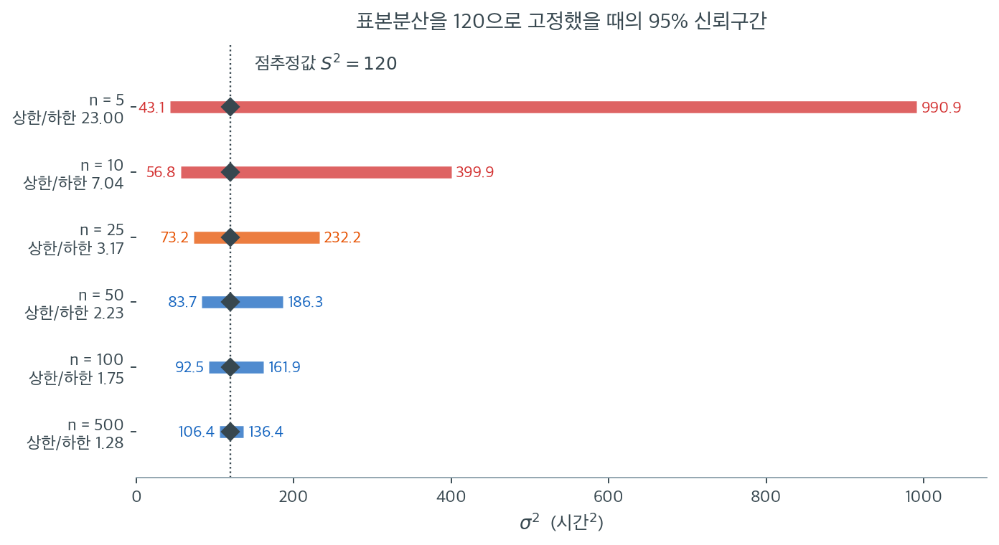

# 모분산의 신뢰구간

가설검정은 $\sigma^2$의 특정 값을 기각할지 알려주지만, 신뢰구간은 그럴듯한 값들의 범위를 제공한다. 모분산의 신뢰구간은 앞 절에서 유도한 추축량 $(n-1)S^2/\sigma^2 \sim \chi^2_{n-1}$에서 곧바로 나온다. 카이제곱분포가 오른쪽으로 치우쳐 있으므로 그 결과인 구간은 $S^2$을 중심으로 비대칭이다.

---

## 1. 추축량으로부터의 유도

분포이론적 결과

$$
\frac{(n-1)S^2}{\sigma^2} \sim \chi^2_{n-1}
$$

에서 출발하면 임의의 $0 < \alpha < 1$에 대해 다음 확률 진술을 쓸 수 있다.

$$
P\!\left(\chi^2_{\alpha/2,\, n-1} \le \frac{(n-1)S^2}{\sigma^2} \le \chi^2_{1-\alpha/2,\, n-1}\right) = 1 - \alpha
$$

여기서 $\chi^2_{\alpha/2,\, n-1}$은 자유도 $n-1$인 카이제곱분포의 하단 $\alpha/2$ 분위수, $\chi^2_{1-\alpha/2,\, n-1}$은 상단 분위수를 나타낸다.

세 부분으로 $(n-1)S^2$을 나누고 부등호 방향을 뒤집어 부등식을 뒤집으면

$$
P\!\left(\frac{(n-1)S^2}{\chi^2_{1-\alpha/2,\, n-1}} \le \sigma^2 \le \frac{(n-1)S^2}{\chi^2_{\alpha/2,\, n-1}}\right) = 1 - \alpha
$$

---

## 2. 신뢰구간 공식

모분산 $\sigma^2$의 $100(1-\alpha)\%$ 신뢰구간은

$$
\left(\frac{(n-1)S^2}{\chi^2_{1-\alpha/2,\, n-1}},\; \frac{(n-1)S^2}{\chi^2_{\alpha/2,\, n-1}}\right)
$$

모표준편차 $\sigma$의 신뢰구간은 양 끝에 제곱근을 취하여 얻는다.

$$
\left(\sqrt{\frac{(n-1)S^2}{\chi^2_{1-\alpha/2,\, n-1}}},\; \sqrt{\frac{(n-1)S^2}{\chi^2_{\alpha/2,\, n-1}}}\right)
$$

!!! note "구간의 비대칭성"
    $\bar{X}$를 중심으로 대칭인 평균의 신뢰구간과 달리 분산의 신뢰구간은 $S^2$을 중심으로 비대칭이다. 상한이 하한보다 $S^2$에서 더 멀리 뻗는다. 이 비대칭성은 카이제곱분포가 오른쪽으로 치우친 모양임을 반영한다.

---

## 3. 단측 신뢰한계

응용에 따라서는 $\sigma^2$의 상한이나 하한만 필요할 수 있다.

**상단 신뢰한계** (수준 $1 - \alpha$):

$$
\sigma^2 \le \frac{(n-1)S^2}{\chi^2_{\alpha,\, n-1}}
$$

**하단 신뢰한계** (수준 $1 - \alpha$):

$$
\sigma^2 \ge \frac{(n-1)S^2}{\chi^2_{1-\alpha,\, n-1}}
$$

상한은 분산이 지나치게 클까 우려될 때(품질관리 등) 유용하고, 하한은 분산이 지나치게 작을까 우려될 때(표집계획에 충분한 변동성이 필요한 경우 등) 쓴다.

<div class="exbox" markdown>

**보기 1.** <span class="diff easy" title="쉬움"></span> 전구 수명의 모분산 신뢰구간. 어떤 생산라인에서 전구 $n = 25$개를 확률표본으로 뽑았더니 표본분산이 $S^2 = 120$(시간$^2$)이었다. 수명이 정규분포를 따른다고 가정하고 모분산 $\sigma^2$의 95% 신뢰구간을 구성하라.

</div>

??? success "풀이"
    **1단계.** 관련 값들을 확인한다.

    - $n = 25$이므로 $n - 1 = 24$
    - $S^2 = 120$
    - $\alpha = 0.05$

    **2단계.** 자유도 $\nu = 24$의 카이제곱 임계값을 찾는다.

    - $\chi^2_{0.025,\, 24} = 12.401$
    - $\chi^2_{0.975,\, 24} = 39.364$

    **3단계.** 신뢰구간을 계산한다.

    $$
    \left(\frac{24 \times 120}{39.364},\; \frac{24 \times 120}{12.401}\right) = (73.16,\; 232.24)
    $$

    모분산이 73.16과 232.24 시간$^2$ 사이에 있다고 95% 신뢰수준에서 말할 수 있다.

    **4단계.** 표준편차에 대해서는

    $$
    \left(\sqrt{73.16},\; \sqrt{232.24}\right) = (8.55,\; 15.24)
    $$

    $\sigma$의 95% 신뢰구간은 근사적으로 $(8.55, 15.24)$ 시간이다.

---

## 4. 신뢰구간의 폭

$\sigma^2$ 신뢰구간의 폭은 두 요인에 의존한다.

1. **표본크기.** $n$이 클수록 자유도가 커져 카이제곱 분위수 사이의 간격이 좁아지고 구간이 촘촘해진다.
2. **신뢰수준.** 신뢰수준이 높을수록($\alpha$가 작을수록) 분위수가 꼬리 쪽으로 더 나아가므로 구간이 넓어진다.

작은 표본에서는 구간이 매우 넓어져 $\sigma^2$에 대한 상당한 불확실성을 드러낸다. 상한과 하한의 비가 유용한 척도이다.

$$
\text{폭 비율} = \frac{\chi^2_{1-\alpha/2,\, n-1}}{\chi^2_{\alpha/2,\, n-1}}
$$

$n \to \infty$이면 이 비가 1로 가고 구간이 점추정값 $S^2$으로 수축한다.

표본분산을 $S^2 = 120$으로 **고정한 채** 표본크기만 바꿔 가며 95% 신뢰구간을 그리면 이 두 요인이 한눈에 들어온다.



먼저 **비대칭**이다. 검은 마름모가 점추정값 120인데 어느 구간에서도 가운데에 있지 않다. $n = 25$의 구간은 $(73.2,\ 232.2)$로, 아래로는 47만큼 내려가고 위로는 112만큼 올라간다. 위쪽이 두 배 넘게 길다. 이유는 공식에 있다. 하한은 $S^2$을 **큰** 분위수로 나누고 상한은 **작은** 분위수로 나누는데, 카이제곱분포의 오른쪽 꼬리가 길어 작은 분위수 쪽이 0에 더 가깝기 때문이다. 나눗셈에서 분모가 작아지면 결과는 급격히 커진다.

다음은 **폭**이다. $n = 5$에서 구간은 $(43.1,\ 990.9)$이고 상한/하한 비가 $23.00$이다. 참 분산이 43일 수도 991일 수도 있다는 뜻이니, 사실상 아무것도 모른다는 말과 같다. $n = 25$에서 비가 $3.17$, $n = 100$에서 $1.75$, $n = 500$에서야 $1.28$까지 내려온다. **분산을 평균만큼 정밀하게 알려면 표본이 한 자릿수 더 필요하다.**

이 그림이 주는 실무 교훈은 단순하다. 작은 표본에서 "표본분산이 120이므로 분산은 120쯤이다"라고 말하는 것은 위험하다. $n = 10$이면 그 말의 정직한 판본은 "분산은 57과 400 사이 어딘가다"이다. 분산 추정값을 보고할 때 신뢰구간을 함께 적어야 하는 이유이고, 표준편차로 바꿔 보고하면 제곱근이 폭을 눌러 주어 덜 험악해 보인다는 점도 기억할 만하다. $n = 25$의 $\sigma$ 구간 $(8.55,\ 15.24)$는 같은 정보를 담고 있지만 비가 $\sqrt{3.17} = 1.78$로 줄어든다.

---

## 5. 가설검정과의 쌍대성

$\sigma^2$의 신뢰구간과 카이제곱 검정은 쌍대 절차이다. 값 $\sigma_0^2$이 $100(1-\alpha)\%$ 신뢰구간 밖에 있을 필요충분조건은 카이제곱 검정이 유의수준 $\alpha$에서 $H_0\colon \sigma^2 = \sigma_0^2$을 기각하는 것이다.

<div class="exbox" markdown>

**보기 2.** <span class="diff easy" title="쉬움"></span> 분산과 표준편차의 신뢰구간. 보기 1 과 같은 자료($n = 25$, $S^2 = 120$)로 $95\%$ 구간을 코드로 만든다.

**(1)** 구간의 **양 끝이 $S^2$ 의 상수배**임을 보이고, 그 두 배수와 상한/하한 비를 자유도만의 식으로 적으시오. 표준편차 구간의 비는 얼마인가.

**(2)** $S^2$ 을 네 자릿수에 걸쳐 바꾸어 (1)을 확인하시오. 이 구간은 $S^2$ 을 **어떤 뜻에서도 중심에 두지 않는다**는 것을 산술·기하 두 가지로 재어 보이시오.

</div>

??? success "풀이"

    **(1) 양 끝이 $S^2$ 의 상수배다.** 공식을 그대로 옮겨 적으면

    $$
    \text{하한} = \frac{(n-1)S^2}{\chi^2_{1-\alpha/2,\,n-1}} = k_{\text{lo}} \, S^2,
    \qquad
    \text{상한} = \frac{(n-1)S^2}{\chi^2_{\alpha/2,\,n-1}} = k_{\text{hi}} \, S^2
    $$

    이고 두 배수는

    $$
    k_{\text{lo}} = \frac{n-1}{\chi^2_{1-\alpha/2,\,n-1}},
    \qquad
    k_{\text{hi}} = \frac{n-1}{\chi^2_{\alpha/2,\,n-1}}
    $$

    로 **$n$ 과 $\alpha$ 만으로 정해진다.** 자료는 $S^2$ 이라는 배율 하나로만 들어온다. 그러므로 상한/하한 비에서는 $S^2$ 이 **약분되어 사라진다.**

    $$
    \frac{\text{상한}}{\text{하한}}
    = \frac{k_{\text{hi}} S^2}{k_{\text{lo}} S^2}
    = \frac{k_{\text{hi}}}{k_{\text{lo}}}
    = \frac{\chi^2_{1-\alpha/2,\,n-1}}{\chi^2_{\alpha/2,\,n-1}}
    $$

    이것이 쪽 머리의 **폭 비율**이고, 8장이 같은 사실을 다루었다. **자료를 보기도 전에 구간이 몇 배로 벌어질지 알 수 있다**는 뜻이다. 자료가 할 수 있는 일은 그 구간을 척도축 위에서 통째로 옮기는 것뿐이다.

    표준편차 구간은 양 끝의 제곱근이므로 비도 제곱근이 된다.

    $$
    \frac{\sqrt{\text{상한}}}{\sqrt{\text{하한}}} = \sqrt{\frac{\chi^2_{1-\alpha/2,\,n-1}}{\chi^2_{\alpha/2,\,n-1}}}
    $$

    $n = 25$, $\alpha = 0.05$ 에 넣으면 $\chi^2_{0.025,\,24} = 12.4012$, $\chi^2_{0.975,\,24} = 39.3641$ 이므로

    $$
    k_{\text{lo}} = \frac{24}{39.3641} = 0.60969,
    \qquad
    k_{\text{hi}} = \frac{24}{12.4012} = 1.93530
    $$

    이고 분산 구간의 비가 $1.93530/0.60969 = 3.17423$, 표준편차 구간의 비가 $\sqrt{3.17423} = 1.78164$ 다.

    **(2) 수치적으로.**

    ```python
    import numpy as np
    from scipy import stats

    n = 25
    s_squared = 120
    alpha = 0.05
    df = n - 1

    # 카이제곱은 좌우가 대칭이 아니므로 두 기각값을 따로 구한다.
    chi2_lower = stats.chi2.ppf(alpha / 2, df)
    chi2_upper = stats.chi2.ppf(1 - alpha / 2, df)

    # 위아래가 뒤집혀 들어간다. (n-1)S^2/sigma^2 이 카이제곱을 따르므로
    # sigma^2 로 풀면 분모에 기각값이 오고, 큰 기각값이 구간의 아래끝을 만든다.
    # 부호를 헷갈리기 쉬운 대목이다.
    ci_lower = df * s_squared / chi2_upper
    ci_upper = df * s_squared / chi2_lower

    # 표준편차의 구간은 분산 구간에 제곱근을 씌우면 된다. 제곱근이 단조함수라
    # 순서가 그대로 보존되기 때문이다.
    ci_sd_lower = np.sqrt(ci_lower)
    ci_sd_upper = np.sqrt(ci_upper)

    print(f"95% CI for variance: ({ci_lower:.2f}, {ci_upper:.2f})")
    print(f"95% CI for std dev:  ({ci_sd_lower:.2f}, {ci_sd_upper:.2f})")

    # (1) 양 끝이 S^2 의 상수배다. 그 상수는 자유도와 alpha 만으로 정해진다.
    k_lo = df / chi2_upper
    k_hi = df / chi2_lower
    print(f"\n하한 배수 (n-1)/chi2_0.975 = {k_lo:.5f}")
    print(f"상한 배수 (n-1)/chi2_0.025 = {k_hi:.5f}")
    print(f"분산 구간의 상한/하한 비 = {k_hi / k_lo:.5f}  (= chi2_0.975/chi2_0.025 = {chi2_upper / chi2_lower:.5f})")
    print(f"표준편차 구간의 비        = {np.sqrt(k_hi / k_lo):.5f}")

    # S^2 을 바꾸어도 비가 그대로인가.
    print(f"\n{'S^2':>10}{'하한':>12}{'상한':>12}{'비':>10}{'sd 비':>9}")
    for s2 in (0.05, 7.0, 120.0, 9_999.0):
        lo, hi = df * s2 / chi2_upper, df * s2 / chi2_lower
        print(f"{s2:>10.2f}{lo:>12.5f}{hi:>12.5f}{hi / lo:>10.5f}{np.sqrt(hi / lo):>9.5f}")

    # (2) 구간은 S^2 을 산술적으로도 기하적으로도 중심에 두지 않는다.
    print(f"\n점추정값 S^2 = {s_squared}")
    print(f"  아래로 {s_squared - ci_lower:.2f},  위로 {ci_upper - s_squared:.2f}  (위쪽이 {(ci_upper - s_squared) / (s_squared - ci_lower):.3f} 배)")
    print(f"  산술 중점 = {(ci_lower + ci_upper) / 2:.2f}")
    print(f"  기하 중점 = {np.sqrt(ci_lower * ci_upper):.2f}   (배수 {np.sqrt(k_lo * k_hi):.5f})")
    print(f"  두 분위수의 기하평균 = {np.sqrt(chi2_lower * chi2_upper):.4f}  vs  n-1 = {df}")
    ```

    출력:

    ```text
    95% CI for variance: (73.16, 232.24)
    95% CI for std dev:  (8.55, 15.24)

    하한 배수 (n-1)/chi2_0.975 = 0.60969
    상한 배수 (n-1)/chi2_0.025 = 1.93530
    분산 구간의 상한/하한 비 = 3.17423  (= chi2_0.975/chi2_0.025 = 3.17423)
    표준편차 구간의 비        = 1.78164

           S^2          하한          상한         비     sd 비
          0.05     0.03048     0.09677   3.17423  1.78164
          7.00     4.26785    13.54713   3.17423  1.78164
        120.00    73.16315   232.23652   3.17423  1.78164
       9999.00  6096.31974 19351.10823   3.17423  1.78164

    점추정값 S^2 = 120
      아래로 46.84,  위로 112.24  (위쪽이 2.396 배)
      산술 중점 = 152.70
      기하 중점 = 130.35   (배수 1.08625)
      두 분위수의 기하평균 = 22.0943  vs  n-1 = 24
    ```

    **비가 자료와 무관하다는 것이 표에 그대로 보인다.** $S^2$ 을 $0.05$ 에서 $9999$ 로 **$20$ 만 배** 키웠는데 비는 $3.17423$, 표준편차 비는 $1.78164$ 로 소수 다섯째 자리까지 꿈쩍하지 않는다. 구간의 양 끝도 $S^2$ 에 정확히 비례해 움직인다. $120 \times 0.60969 = 73.163$, $120 \times 1.93530 = 232.237$ 로 (1)의 배수와 맞는다.

    $S^2 = 0.05$ 줄이 $(0.03048,\, 0.09677)$ 인 것도 눈여겨볼 만하다. 15.2절에서 $n = 25$, $s^2 = 0.05$ 로 구한 구간과 같은 수다. **같은 $n$ 과 같은 신뢰수준이면 구간의 모양이 하나로 정해져 있고, 자료는 그것을 어디에 놓을지만 정한다.**

    **구간은 $S^2$ 을 어떤 뜻에서도 중심에 두지 않는다.** 산술적으로는 아래로 $46.84$, 위로 $112.24$ 로 위쪽이 $2.396$ 배 길고, 구간의 산술 중점 $152.70$ 은 $S^2 = 120$ 에서 한참 위다. 비대칭이 심한 양은 보통 로그 척도에서 대칭이 되는데 **여기서는 그마저도 아니다.** 기하 중점이 $\sqrt{73.16 \times 232.24} = 130.35$ 로 역시 $120$ 보다 크다. 배수로 쓰면 $\sqrt{k_{\text{lo}} k_{\text{hi}}} = 1.08625 \ne 1$ 이다.

    까닭은 마지막 줄에 있다. 기하 중점의 배수는

    $$
    \sqrt{k_{\text{lo}} k_{\text{hi}}} = \frac{n-1}{\sqrt{\chi^2_{\alpha/2,\,n-1}\,\chi^2_{1-\alpha/2,\,n-1}}}
    $$

    이고, 두 분위수의 기하평균이 $\sqrt{12.4012 \times 39.3641} = 22.0943$ 으로 **$n - 1 = 24$ 에 못 미친다.** 등꼬리 분위수 쌍이 $n-1$ 을 기하적으로 둘러싸지 않기 때문이다. 자유도가 같은 $F$ 분포에서는 두 분위수가 서로 역수라 기하평균이 정확히 $1$ 이 되는데(15.3절), $\chi^2$ 에는 그런 대칭이 없다.

    **그러므로 "$\pm$" 로 요약하지 말라.** 분산의 구간은 점추정값에 **곱해지는 두 배수**로 적는 것이 정직하다. $n = 25$, $95\%$ 라면 $S^2 \times [0.610,\ 1.935]$ 다. 이 괄호를 좁히는 방법은 하나뿐이고, 그것은 $n$ 을 키우는 것이다. $S^2$ 이 무엇으로 나오든 괄호는 그대로다.

---

## 연습문제

<div class="drillbox" markdown>

**연습문제 1.** <span class="diff easy" title="쉬움"></span>
$n \in \{10, 25, 50, 100, 500, 1000\}$에 대해 95% 신뢰구간의 폭 비율을 계산하라. 분산을 상대오차 10% 이내로 추정하려면 표본이 얼마나 커야 하는가?

</div>

??? success "풀이"

    ```python
    from scipy import stats

    print(f"{'n':>6} {'var ratio':>10} {'sd ratio':>10}")
    for n in [10, 25, 50, 100, 500, 1000]:
        df = n - 1
        r = stats.chi2.ppf(0.975, df) / stats.chi2.ppf(0.025, df)
        print(f"{n:>6} {r:>10.3f} {r**0.5:>10.3f}")
    ```

    출력:

    ```text
         n  var ratio   sd ratio
        10      7.044      2.654
        25      3.174      1.782
        50      2.225      1.492
       100      1.751      1.323
       500      1.282      1.132
      1000      1.192      1.092
    ```

    수치가 인상적이다. $n = 10$에서 상한이 하한의 **7배**이다. 분산에 대해 사실상 아무것도 모른다는 뜻이다. $n = 100$에서도 1.75배이다.

    비교하자면 평균의 신뢰구간 폭은 $2 \times 1.96 \times \sigma/\sqrt{n}$으로 $n = 100$이면 $\pm 0.196\sigma$에 불과하다. **분산은 평균보다 추정하기가 훨씬 어렵다.**

    **10% 상대오차를 얻으려면.** 표준편차 비율이 대략 $1.1$이 되기를 원한다면 표에서 $n \approx 800$ 정도가 필요하다. 근사적으로 $\operatorname{Var}(S) \approx \sigma^2/(2n)$이므로 $S$의 변동계수는 $1/\sqrt{2n}$이고, 95% 구간의 반폭이 $1.96/\sqrt{2n} < 0.05$이려면

    $$
    n > \frac{1.96^2}{2 \times 0.05^2} = 768.
    $$

    분산 자체를 10% 이내로 추정하려면 그 네 배인 $n \approx 3000$이 필요하다. 분산의 상대오차가 표준편차 상대오차의 두 배이기 때문이다. $\square$

---

<div class="drillbox" markdown>

**연습문제 2.** <span class="diff easy" title="쉬움"></span>
어떤 제조업체가 부품 치수의 표준편차가 0.5 mm를 넘지 않아야 한다는 규격을 만족함을 보이려 한다. $n = 30$개 표본에서 $s = 0.42$ mm를 얻었다. 95% 상단 신뢰한계를 계산하고 규격 준수를 주장할 수 있는지 판단하라.

</div>

??? success "풀이"

    95% 상단 신뢰한계는

    $$
    \sigma^2 \le \frac{(n-1)s^2}{\chi^2_{0.05,\, n-1}} = \frac{29 \times 0.42^2}{\chi^2_{0.05,\,29}}.
    $$

    $\chi^2_{0.05,29} = 17.708$(하단 5% 분위수)이므로

    $$
    \sigma^2 \le \frac{29 \times 0.1764}{17.708} = \frac{5.1156}{17.708} = 0.2889,
    $$

    $$
    \sigma \le \sqrt{0.2889} = 0.5375 \text{ mm}.
    $$

    ```python
    from scipy import stats
    import numpy as np

    n, s = 30, 0.42
    ub_var = (n - 1) * s**2 / stats.chi2.ppf(0.05, n - 1)
    print(f"95% upper bound: sigma^2 <= {ub_var:.4f}, sigma <= {np.sqrt(ub_var):.4f}")
    ```

    출력:

    ```text
    95% upper bound: sigma^2 <= 0.2889, sigma <= 0.5375
    ```

    **결론: 규격 준수를 주장할 수 없다.** 점추정값 $s = 0.42$가 규격 0.5보다 작지만, 95% 상단 신뢰한계 $0.5375$가 규격을 넘는다. 참 표준편차가 0.5 mm를 초과할 가능성을 배제할 수 없다.

    필요한 표본크기를 역산해 보자. $s = 0.42$가 유지된다고 가정하면 상단 한계가 0.5 아래가 되려면

    $$
    \frac{(n-1)(0.42)^2}{\chi^2_{0.05,\,n-1}} < 0.25 \implies \frac{n-1}{\chi^2_{0.05,\,n-1}} < 1.4172.
    $$

    시행착오로 확인하면 $n = 52$에서 $51/35.600 = 1.4326$으로 아직 크고, $n = 55$에서 $54/38.116 = 1.4167 < 1.4172$가 되어 조건을 만족한다. 곧 **표본을 30개에서 55개로 늘려야** 같은 $s$ 값으로 규격 준수를 주장할 수 있다.

    이는 실무에서 중요한 교훈이다. 점추정값이 규격을 만족한다고 규격 준수가 입증되는 것이 아니다. $\square$

---

<div class="drillbox" markdown>

**연습문제 3.** <span class="diff med" title="중간"></span>
카이제곱 신뢰구간의 실제 포함확률이 비정규 자료에서 어떻게 되는지 모의실험으로 조사하라. $n = 25$, 명목 95%로 정규, $t_5$, 균등, 지수분포를 비교하라.

</div>

??? success "풀이"

    ```python
    import numpy as np
    from scipy import stats

    rng = np.random.default_rng(0)
    n, df, R = 25, 24, 20000
    lo_q = stats.chi2.ppf(0.025, df)
    hi_q = stats.chi2.ppf(0.975, df)

    cases = [
        ("Normal",      lambda: rng.normal(0, 1, n),      1.0),
        ("t(5)",        lambda: rng.standard_t(5, n),     5 / 3),
        ("Uniform",     lambda: rng.uniform(0, 1, n),     1 / 12),
        ("Exponential", lambda: rng.exponential(1, n),    1.0),
    ]

    for name, gen, true_var in cases:
        hits = 0
        for _ in range(R):
            s2 = gen().var(ddof=1)
            lo, hi = df * s2 / hi_q, df * s2 / lo_q
            hits += (lo <= true_var <= hi)
        print(f"{name:>12}: coverage = {hits / R:.4f}")
    ```

    출력:

    ```text
          Normal: coverage = 0.9504
            t(5): coverage = 0.8292
         Uniform: coverage = 0.9961
     Exponential: coverage = 0.7218
    ```

    | 분포 | $\gamma_2$ | 실제 포함확률 |
    |---|---|---|
    | $\text{Uniform}$ | $-1.2$ | 0.996 |
    | $\mathcal{N}(0,1)$ | 0 | **0.950** |
    | $t_5$ | 6 | 0.829 |
    | $\text{Exponential}$ | 6 | 0.722 |

    정규 자료에서만 명목값 95%가 달성된다.

    **지수분포에서는 포함확률이 72%에 불과하다.** 곧 "95% 신뢰구간"이라고 부르는 구간이 실제로는 네 번에 한 번 이상 참값을 놓친다. $t_5$에서도 83%로 크게 부족하다.

    반대로 저첨인 균등분포에서는 99.6%로 지나치게 보수적이다. 15.1절 [분산 검정의 공통 가정](../introduction/common_assumptions.md) 연습문제 1의 팽창 인자 $(\gamma_2+2)/2$가 1보다 작기 때문이다.

    **실무적 결론.** 카이제곱 분산 신뢰구간은 정규성이 확립된 경우에만 써야 한다. 그렇지 않으면 붓스트랩 구간(15.6절)을 쓰라. 특히 금융 수익률이나 대기시간처럼 꼬리가 두꺼운 자료에서 이 구간을 쓰는 것은 심각한 오류이다. $\square$

---

<div class="drillbox" markdown>

**연습문제 4.** <span class="diff med" title="중간"></span>
신뢰구간과 가설검정의 쌍대성을 15.2절 보기로 확인하라. $n = 25$, $s^2 = 0.05$일 때 95% 신뢰구간을 구하고, 이 구간에 포함되지 않는 $\sigma_0^2$ 값에 대해서만 양측 카이제곱 검정이 $\alpha = 0.05$에서 기각함을 보여라.

</div>

??? success "풀이"

    15.2절에서 95% 신뢰구간은 $(0.0305, 0.0968)$이었다.

    쌍대성을 확인하기 위해 여러 $\sigma_0^2$ 값에 대해 검정을 수행한다.

    ```python
    from scipy import stats

    n, s2, df = 25, 0.05, 24
    lo = df * s2 / stats.chi2.ppf(0.975, df)
    hi = df * s2 / stats.chi2.ppf(0.025, df)
    print(f"95% CI: ({lo:.5f}, {hi:.5f})\n")

    for sigma0_sq in [0.025, 0.0305, 0.04, 0.07, 0.0968, 0.12]:
        c = df * s2 / sigma0_sq
        p = 2 * min(stats.chi2.cdf(c, df), stats.chi2.sf(c, df))
        inside = lo <= sigma0_sq <= hi
        print(f"sigma0^2 = {sigma0_sq:.4f}: chi2 = {c:7.3f}, "
              f"p = {p:.4f}, in CI = {inside}")
    ```

    출력:

    ```text
    95% CI: (0.03048, 0.09677)

    sigma0^2 = 0.0250: chi2 =  48.000, p = 0.0050, in CI = False
    sigma0^2 = 0.0305: chi2 =  39.344, p = 0.0502, in CI = True
    sigma0^2 = 0.0400: chi2 =  30.000, p = 0.3695, in CI = True
    sigma0^2 = 0.0700: chi2 =  17.143, p = 0.3150, in CI = True
    sigma0^2 = 0.0968: chi2 =  12.397, p = 0.0499, in CI = False
    sigma0^2 = 0.1200: chi2 =  10.000, p = 0.0109, in CI = False
    ```

    쌍대성이 정확히 성립한다. 구간 안의 값은 모두 $p > 0.05$, 밖의 값은 모두 $p < 0.05$이다.

    경계 근처의 두 값이 특히 교훈적이다. $\sigma_0^2 = 0.0305$는 하한 $0.03048$보다 아주 조금 크므로 구간 **안**이고 $p = 0.0502 > 0.05$이다. $\sigma_0^2 = 0.0968$은 상한 $0.09677$보다 아주 조금 크므로 구간 **밖**이고 $p = 0.0499 < 0.05$이다. 소수 다섯째 자리의 차이가 판정을 뒤집는다. 쌍대성이 근사가 아니라 정확한 대응관계임을 보여준다.

    **개념적 의미.** 신뢰구간은 **기각되지 않는 모든 귀무가설의 집합**이다. 이 관점은 일반적으로 성립하며, 신뢰구간 하나가 무한히 많은 가설검정을 요약한다는 것을 뜻한다. 그래서 $p$값 하나보다 신뢰구간을 보고하는 편이 정보량이 많다. $\square$

---

<div class="drillbox" markdown>

**연습문제 5.** <span class="diff med" title="중간"></span>
쪽 머리의 폭 비율 $R(\nu) = \chi^2_{1-\alpha/2,\,\nu}/\chi^2_{\alpha/2,\,\nu}$ 를 분위수 근사 $\chi^2_{p,\,\nu} \approx \nu + z_p\sqrt{2\nu}$ 로 다룬다.

**(1)** $t = z_{1-\alpha/2}\sqrt{2/\nu}$ 로 놓고 $R(\nu) \approx (1+t)/(1-t)$ 임을 보이고, $t$ 의 1 차까지 $R \approx 1 + 2t$, 표준편차 구간의 비 $\sqrt{R} \approx 1 + t$ 임을 적으시오.

**(2)** 연습문제 1 의 표와 비교하라. 어느 $n$ 부터 근사가 소수 둘째 자리까지 맞는가.

**(3)** 연습문제 1 이 10% 상대오차에 $n > 768$ 을 얻은 계산이 (1)의 특별한 경우임을 보이시오.

**(4)** $n = 10$ 에서 근사가 참값 $7.044$ 대신 $25.294$ 를 주는 까닭을 분위수 하나로 집어 말하시오.

</div>

??? success "풀이"

    **(1)** $\chi^2_\nu$ 는 평균 $\nu$, 분산 $2\nu$ 이므로 중심극한정리로 $\chi^2_{p,\,\nu} \approx \nu + z_p\sqrt{2\nu}$ 이고, 등꼬리 두 분위수는 $\nu \pm z\sqrt{2\nu}$ 가 된다($z = z_{1-\alpha/2}$). 분자와 분모를 $\nu$ 로 나누면

    $$
    R(\nu) \approx \frac{\nu + z\sqrt{2\nu}}{\nu - z\sqrt{2\nu}} = \frac{1 + z\sqrt{2/\nu}}{1 - z\sqrt{2/\nu}} = \frac{1+t}{1-t}
    $$

    이다. $(1+t)/(1-t) = 1 + 2t + 2t^2 + \cdots$ 이므로 1 차까지 $R \approx 1 + 2t = 1 + 2z\sqrt{2/\nu}$ 이고, 제곱근은 $\sqrt{1+2t} \approx 1 + t$ 이므로

    $$
    \sqrt{R} \approx \sqrt{1+2t} \approx 1 + t = 1 + z\sqrt{\frac{2}{\nu}}
    $$

    로 **표준편차 비의 초과분이 분산 비 초과분의 절반**이다. 폭이 $1/\sqrt{\nu}$ 로만 줄어든다는 것도 여기서 바로 보인다.

    **(2)** $\alpha = 0.05$, $z = 1.959964$ 로 두 값을 나란히 적는다.

    | $n$ | $t$ | $R$ 참값 | $R$ 근사 | $\sqrt{R}$ 참값 | $\sqrt{R}$ 근사 |
    |---|---|---|---|---|---|
    | 10 | 0.9239 | 7.044 | 25.294 | 2.654 | 5.029 |
    | 25 | 0.5658 | 3.174 | 3.606 | 1.782 | 1.899 |
    | 50 | 0.3960 | 2.225 | 2.311 | 1.492 | 1.520 |
    | 100 | 0.2786 | 1.751 | 1.772 | 1.323 | 1.331 |
    | 500 | 0.1241 | 1.282 | 1.283 | 1.132 | 1.133 |
    | 1000 | 0.0877 | 1.192 | 1.192 | 1.092 | 1.092 |

    $n = 500$ 에서야 소수 둘째 자리가 맞는다($1.282$ 대 $1.283$). $n = 100$ 에서도 $1.751$ 대 $1.772$ 로 둘째 자리가 틀리고, $n = 25$ 에서는 $3.174$ 를 $3.606$ 으로 13% 넘게 과대평가한다. **분산의 추론에서 정규근사는 느리게 수렴한다.**

    **(3)** 표준편차의 상대오차를 10% 이내로 하려면 $\sqrt{R} \le 1.1$, 곧 $t \le 0.1$ 이면 된다.

    $$
    z\sqrt{\frac{2}{\nu}} \le 0.1
    \iff
    \nu \ge \frac{2z^2}{0.01} = 200 z^2 = 200 \times 3.84146 = 768.29
    $$

    연습문제 1 의 $n > 768$ 과 같은 수다. 우연이 아니다. (1)의 $t$ 는 상한 배수의 1 차 전개 $\sqrt{k_{\text{hi}}} \approx 1 + z/\sqrt{2\nu}$ 의 **두 배**이고, 연습문제 1 이 쓴 왈드 반폭 $1.96/\sqrt{2n}$ 이 바로 그 $z/\sqrt{2\nu}$ 다. 한쪽이 $t/2$, 양쪽 합이 $t$ 이므로 두 계산은 같은 식을 양 끝에서 본 것에 지나지 않는다.

    **(4)** 무너지는 쪽은 **하단 분위수**다. $\nu = 9$ 에서 근사는 $9 - 1.959964\sqrt{18} = 0.6846$ 을 주는데 참값은 $\chi^2_{0.025,\,9} = 2.7004$ 로 **네 배**나 크다. 카이제곱분포는 $0$ 에서 막혀 있고 오른쪽으로 치우쳐 있어서 정규근사가 왼쪽 꼬리를 음수 방향으로 끌고 가기 때문이다. 상단은 $17.315$ 대 $19.023$ 으로 10% 안쪽이다.

    문제는 하한이 **분모**라는 데 있다. $R$ 은 하단 분위수로 나누는 양이므로 하단이 네 배 작아지면 비는 네 배 커진다. $19.023/2.700 = 7.04$ 가 $17.315/0.685 = 25.29$ 로 부푼 것이 그 계산이다. 쪽 머리가 "하한은 $S^2$ 을 큰 분위수로, 상한은 작은 분위수로 나눈다"고 적은 그 비대칭이 근사의 오차까지 증폭한다. $\square$

---

<div class="drillbox" markdown>

**연습문제 6.** <span class="diff med" title="중간"></span>
연습문제 2 는 시행착오로 $n = 55$ 를 찾았다. 그 탐색을 함수로 만들어 규격에 얼마나 다가가는지에 따라 필요 표본이 어떻게 변하는지 재어 본다. 상단 신뢰한계의 배수를 $m(n) = (n-1)/\chi^2_{0.05,\,n-1}$ 로 쓴다.

**(1)** 95% 상단 신뢰한계가 $\sigma \le s\sqrt{m(n)}$ 이므로 규격 $\sigma \le c$ 를 주장할 조건이 $m(n) < (c/s)^2$ 임을 적으시오. 이 조건에서 $s$ 와 $c$ 는 **비로만** 들어온다는 점에 주의하라.

**(2)** $c = 0.5$ 에 대해 $s/c \in \{0.84,\, 0.90,\, 0.95,\, 0.98\}$ 에 필요한 최소 $n$ 을 코드로 구하라. $s/c = 0.84$ 에서 연습문제 2 의 $55$ 가 다시 나오는지 확인하라.

**(3)** 연습문제 5 의 근사 $m(n) \approx 1 + z_{0.95}\sqrt{2/\nu}$ 로 필요 표본이 $\delta = (c/s)^2 - 1$ 의 $\delta^{-2}$ 꼴로 커짐을 보이고, 그 근사값을 (2)의 참값과 비교하라.

</div>

??? success "풀이"

    **(1)** 단측 상단 한계는 쪽의 3 절에서 $\sigma^2 \le (n-1)s^2/\chi^2_{\alpha,\,n-1} = m(n)\,s^2$ 이므로 제곱근을 씌우면 $\sigma \le s\sqrt{m(n)}$ 이다. 이것이 $c$ 보다 작아야 하므로

    $$
    s\sqrt{m(n)} < c \iff m(n) < \left(\frac{c}{s}\right)^2 .
    $$

    보기 2 의 교훈이 단측에서도 그대로다. **자료는 $s$ 라는 배율 하나로만 들어오고, 판정은 $s/c$ 라는 비 하나에만 달려 있다.** 치수가 밀리미터든 미터든, 규격이 $0.5$ 든 $50$ 이든 같은 비면 같은 $n$ 이 필요하다.

    **(2)** 코드로 푼다.

    ```python
    import numpy as np
    from scipy import stats

    spec, z95 = 0.5, stats.norm.ppf(0.95)

    def m(n):                                  # 상단 신뢰한계의 배수 (n-1)/chi2_{0.05, n-1}
        return (n - 1) / stats.chi2.ppf(0.05, n - 1)

    print(f"{'n':>6}{'m(n)':>9}{'sigma 상한':>12}")
    for n in (30, 40, 52, 54, 55, 60, 100):
        print(f"{n:>6}{m(n):>9.4f}{0.42 * np.sqrt(m(n)):>12.4f}")

    print(f"\n{'s':>6}{'s/규격':>8}{'필요 m':>9}{'필요 n':>8}{'근사 n':>8}")
    for s in (0.42, 0.45, 0.475, 0.49):
        target = (spec / s) ** 2              # m(n) < (규격/s)^2 이어야 한다
        n = next(k for k in range(2, 100000) if m(k) < target)
        n_approx = int(np.ceil(2 * z95**2 / (target - 1) ** 2)) + 1
        print(f"{s:>6.3f}{s / spec:>8.2f}{target:>9.4f}{n:>8d}{n_approx:>8d}")
    ```

    출력:

    ```text
         n     m(n)    sigma 상한
        30   1.6376      0.5375
        40   1.5178      0.5174
        52   1.4326      0.5027
        54   1.4218      0.5008
        55   1.4167      0.4999
        60   1.3935      0.4958
       100   1.2849      0.4761

         s    s/규격     필요 m    필요 n    근사 n
     0.420    0.84   1.4172      55      33
     0.450    0.90   1.2346     139     100
     0.475    0.95   1.1080     547     465
     0.490    0.98   1.0412    3394    3184
    ```

    첫 표가 연습문제 2 를 그대로 재현한다. $n = 30$ 에서 상한 $0.5375$, $n = 54$ 에서 $0.5008$ 로 아직 넘고, $n = 55$ 에서 $0.4999$ 로 처음 규격 아래로 들어온다. **필요 $m$ 이 $1.4172$ 이고 $m(55) = 1.4167$** 이다.

    **대가가 급격히 커진다.** $s/c$ 가 $0.84$ 에서 $0.98$ 로 가는 동안 필요 표본이 $55 \to 139 \to 547 \to 3394$ 로 늘어난다. $0.84$ 와 $0.90$ 의 차이는 공정 관리로 보면 사소한데 필요 표본은 두 배 반이 된다.

    **(3)** 조건은 $m(n) < 1 + \delta$ 이고 연습문제 5 의 근사를 단측 분위수에 쓰면

    $$
    m(n) = \frac{\nu}{\chi^2_{0.05,\,\nu}} \approx \frac{\nu}{\nu - z_{0.95}\sqrt{2\nu}} = \frac{1}{1 - z_{0.95}\sqrt{2/\nu}} \approx 1 + z_{0.95}\sqrt{\frac{2}{\nu}}
    $$

    이므로

    $$
    z_{0.95}\sqrt{\frac{2}{\nu}} < \delta \iff \nu > \frac{2 z_{0.95}^2}{\delta^2} = \frac{5.4111}{\delta^2}.
    $$

    **필요 표본이 여유 $\delta$ 의 제곱의 역수로 커진다.** $\delta$ 를 반으로 줄이면 표본은 네 배다. 출력의 마지막 두 열이 그 모양을 보여 준다. $\delta = 0.4172,\ 0.2346,\ 0.1080,\ 0.0412$ 에 근사값 $33,\ 100,\ 465,\ 3184$ 이고 참값은 $55,\ 139,\ 547,\ 3394$ 다. 근사는 늘 작게 나오지만 비율이 $0.60 \to 0.72 \to 0.85 \to 0.94$ 로 올라간다. 연습문제 5 (4)에서 본 그대로, $\nu$ 가 작을 때 정규근사가 카이제곱의 **하단** 분위수를 너무 작게 잡아 $m(n)$ 을 과소평가하기 때문이다.

    실무로 옮기면 이렇다. **규격에 바짝 붙은 공정은 규격을 지킨다는 것을 증명할 수 없다.** 증명의 비용이 여유의 제곱으로 들어가므로, 표본을 늘리는 대신 공정의 산포를 줄이는 쪽이 거의 항상 싸다. $\square$

---

<div class="drillbox" markdown>

**연습문제 7.** <span class="diff hard" title="어려움"></span>
연습문제 3 은 지수분포에서 포함확률이 $0.7218$ 로 무너지는 것을 보았다. 첨도를 알고 있다면 구간을 고칠 수 있는지 재어 본다. 15.1절 [분산 검정의 공통 가정](../introduction/common_assumptions.md) 연습문제 1 의 $\operatorname{Var}(S^2) \approx \sigma^4(\gamma_2+2)/n$ 을 쓴다.

**(1)** $\nu_e S^2/\sigma^2 \sim \chi^2_{\nu_e}$ 라고 **가정**하고 양변의 분산을 맞추어 유효자유도

$$
\nu_e = \frac{2n}{\gamma_2 + 2}
$$

를 유도하라. 정규($\gamma_2 = 0$), $t_5$ 와 지수($\gamma_2 = 6$), 균등($\gamma_2 = -1.2$)에서 $n = 25$ 의 $\nu_e$ 를 계산하라.

**(2)** 연습문제 3 과 같은 설계($n = 25$, $R = 20{,}000$, `default_rng(0)`, 같은 네 분포, 같은 순서)로 세 구간의 포함확률을 재라. 명목 $\nu = 24$, 참 $\gamma_2$ 로 만든 $\nu_e$, 그리고 표본 첨도로 만든 $\hat\nu_e$ 셋이다. $\hat\nu_e$ 는 `stats.kurtosis(..., bias=False)` 로 $\hat\gamma_2$ 를 구해 $2n/(\max(\hat\gamma_2, -1.99)+2)$ 를 $[1,\ 5n]$ 으로 자른 값을 쓴다.

**(3)** 첨도 보정은 쓸 수 있는 처방인가. 두 판본의 차이가 어디서 오는지 말하고, 쪽의 "정리하며"가 권하는 $\hat\gamma_2$ 사전검사와 함께 놓고 결론을 내려라.

</div>

??? success "풀이"

    **(1)** 가정 $\nu_e S^2/\sigma^2 \sim \chi^2_{\nu_e}$ 는 $\operatorname{Var}(\chi^2_{\nu_e}) = 2\nu_e$ 를 뜻하므로

    $$
    \operatorname{Var}\!\left(\frac{\nu_e S^2}{\sigma^2}\right) = \frac{\nu_e^2}{\sigma^4}\operatorname{Var}(S^2) = 2\nu_e
    \implies
    \operatorname{Var}(S^2) = \frac{2\sigma^4}{\nu_e}
    $$

    이다. 여기에 참값 $\operatorname{Var}(S^2) \approx \sigma^4(\gamma_2+2)/n$ 을 넣으면

    $$
    \frac{2\sigma^4}{\nu_e} = \frac{\sigma^4(\gamma_2+2)}{n}
    \implies
    \nu_e = \frac{2n}{\gamma_2+2}.
    $$

    정규에서 $\nu_e = 2n/2 = n = 25$ 로 명목 $n - 1 = 24$ 와 거의 같다. 이것이 올바른 유도임을 보증하는 점검이다. $\gamma_2 = 6$ 이면 $\nu_e = 50/8 = 6.25$ 로 **자유도가 네 배 가까이 줄고**, $\gamma_2 = -1.2$ 이면 $\nu_e = 50/0.8 = 62.5$ 로 오히려 늘어난다. 쪽 머리가 말한 팽창 인자 $(\gamma_2+2)/2$ 가 여기서는 자유도를 나누는 수로 나타난다.

    **(2)** 세 열을 한 번에 돌린다.

    ```python
    import numpy as np
    from scipy import stats

    rng = np.random.default_rng(0)
    n, R = 25, 20000

    def coverage(s2, true_var, nu):
        lo = nu * s2 / stats.chi2.ppf(0.975, nu)
        hi = nu * s2 / stats.chi2.ppf(0.025, nu)
        return np.mean((lo <= true_var) & (true_var <= hi))

    cases = [
        ("Normal",      lambda: rng.normal(0, 1, (R, n)),   1.0,    0.0),
        ("t(5)",        lambda: rng.standard_t(5, (R, n)),  5 / 3,  6.0),
        ("Uniform",     lambda: rng.uniform(0, 1, (R, n)),  1 / 12, -1.2),
        ("Exponential", lambda: rng.exponential(1, (R, n)), 1.0,    6.0),
    ]

    print(f"{'분포':>12}{'g2':>6}{'nu_e':>8}{'nu=24':>9}{'nu_e(참)':>10}{'nu_e(추정)':>12}")
    for name, gen, true_var, g2 in cases:
        x = gen()
        s2 = x.var(axis=1, ddof=1)
        nu_e = 2 * n / (g2 + 2)                       # 참 첨도를 아는 판본
        g2_hat = stats.kurtosis(x, axis=1, bias=False)  # 표본 첨도를 쓰는 판본
        nu_hat = np.clip(2 * n / (np.maximum(g2_hat, -1.99) + 2), 1.0, 5 * n)
        lo = nu_hat * s2 / stats.chi2.ppf(0.975, nu_hat)
        hi = nu_hat * s2 / stats.chi2.ppf(0.025, nu_hat)
        print(f"{name:>12}{g2:>6.1f}{nu_e:>8.2f}{coverage(s2, true_var, 24):>9.4f}"
              f"{coverage(s2, true_var, nu_e):>10.4f}"
              f"{np.mean((lo <= true_var) & (true_var <= hi)):>12.4f}")
    ```

    출력:

    ```text
              분포    g2    nu_e    nu=24   nu_e(참)    nu_e(추정)
          Normal   0.0   25.00   0.9504    0.9457      0.9224
            t(5)   6.0    6.25   0.8292    0.9817      0.8665
         Uniform  -1.2   62.50   0.9961    0.9327      0.9308
     Exponential   6.0    6.25   0.7218    0.9653      0.8226
    ```

    먼저 `nu=24` 열이 연습문제 3 의 $0.9504,\ 0.8292,\ 0.9961,\ 0.7218$ 과 **소수 넷째 자리까지 같다.** 같은 씨앗으로 같은 순서의 난수를 꺼냈기 때문이다(행렬로 한꺼번에 뽑은 것과 $n$ 개씩 $R$ 번 뽑은 것이 같은 흐름이다). 비교의 바탕이 같다는 확인이다.

    **참 첨도를 알면 고쳐진다.** 지수에서 $0.7218 \to 0.9653$, $t_5$ 에서 $0.8292 \to 0.9817$ 로 명목값 근처로 돌아온다. 균등은 $0.9961 \to 0.9327$ 로 지나친 보수성이 풀리면서 조금 모자라게 되고, 정규는 $0.9504 \to 0.9457$ 로 거의 그대로다($\nu_e = 25$ 가 $24$ 와 거의 같으니 당연하다).

    **(3) 쓸 수 없다.** 마지막 열을 보라. 참 $\gamma_2$ 를 $\hat\gamma_2$ 로 바꾸기만 하면 지수는 $0.9653 \to 0.8226$ 으로 다시 무너지고, 정규는 $0.9504 \to 0.9224$ 로 **멀쩡했던 것이 나빠진다.**

    까닭은 첨도가 **4 차 적률의 비**라는 데 있다. $\hat\gamma_2$ 의 분산은 꼬리가 두꺼운 분포에서 8 차 적률까지 끌어오므로 $n = 25$ 에서 거의 잡음이다. 게다가 $\nu_e$ 는 $\hat\gamma_2$ 의 **비선형**(역수) 함수라서, $\hat\gamma_2$ 가 평균적으로 맞는다 해도 $\nu_e$ 는 치우친다. 지수에서 $\hat\gamma_2$ 는 참값 $6$ 을 대체로 과소추정하므로 $\hat\nu_e$ 가 너무 커지고, 구간은 필요한 만큼 넓어지지 않는다. 정규에서는 $\hat\gamma_2$ 가 양쪽으로 흔들리면서 $\nu_e$ 를 무작위로 바꾸어 넣어 쓸데없는 변동을 더한다.

    **결론.** (1)의 유도는 왜 무너지는지를 정확히 설명하지만 처방이 되지는 못한다. "정리하며"의 $\hat\gamma_2 > 1$ 사전검사도 같은 약점을 안고 있다. 같은 잡음이 많은 통계량으로 판정하는 것이니 통과해도 안심할 수 없다. 첨도를 **추정해서 꽂는** 대신 자료 자체를 다시 뽑아 분포를 만드는 쪽, 곧 붓스트랩 구간(15.6절)으로 가는 것이 이 장이 내놓는 답이다. $\square$

---

<div class="drillbox" markdown>

**연습문제 8.** <span class="diff hard" title="어려움"></span>
보기 2 는 기하 중점의 배수가 $\sqrt{k_{\text{lo}}k_{\text{hi}}} = 1.08625 \ne 1$ 이라고 했다. 이것이 우연이 아님을 보인다. 윌슨–힐퍼티 근사

$$
\chi^2_{p,\,\nu} \approx \nu\left(1 - \frac{2}{9\nu} + z_p\sqrt{\frac{2}{9\nu}}\right)^{3}
$$

를 쓴다. $a = 2/(9\nu)$, $z = z_{1-\alpha/2}$ 로 적는다.

**(1)** 두 등꼬리 분위수의 기하평균이

$$
\sqrt{\chi^2_{\alpha/2,\,\nu}\,\chi^2_{1-\alpha/2,\,\nu}} \approx \nu\bigl[1 - a(2 + z^2 - a)\bigr]^{3/2}
$$

임을 보이고, 괄호 안이 $1$ 보다 **항상** 작으므로 모든 $\nu$ 와 모든 $\alpha$ 에서 분산 구간의 기하 중점이 $S^2$ 보다 위에 있음을 보이시오.

**(2)** $1/\nu$ 의 1 차까지 전개하여 기하 중점의 배수가 $1 + \dfrac{2+z^2}{3\nu}$ 임을 보이고, $\nu = 24$ 와 $\nu = 99$ 에서 보기 2 의 값 및 참값과 비교하라.

**(3)** (1)의 괄호 안 $2 + z^2$ 에서 $2$ 와 $z^2$ 는 각각 근사식의 어느 부분에서 왔는가. $\alpha \to 1$ 로 보내면 기하 중점은 어떻게 되는가.

</div>

??? success "풀이"

    **(1)** 등꼬리 분위수 쌍은 $z_{\alpha/2} = -z$, $z_{1-\alpha/2} = z$ 이므로 근사식에서 $b = \sqrt{2/(9\nu)} = \sqrt{a}$ 로 쓰면

    $$
    \chi^2_{\alpha/2,\,\nu} \approx \nu(1 - a - zb)^3,
    \qquad
    \chi^2_{1-\alpha/2,\,\nu} \approx \nu(1 - a + zb)^3 .
    $$

    두 수의 곱은 $\nu^2[(1-a)^2 - z^2b^2]^3$ 이고, $b^2 = a$ 이므로

    $$
    (1-a)^2 - z^2 b^2 = 1 - 2a + a^2 - z^2 a = 1 - a(2 + z^2 - a).
    $$

    제곱근을 씌우면 주장한 식이다.

    **괄호 안이 항상 1 보다 작다.** $a = 2/(9\nu) \le 2/9 < 2 \le 2 + z^2$ 이므로 $2 + z^2 - a > 0$ 이고, $a > 0$ 이니 $a(2+z^2-a) > 0$ 이다. 따라서

    $$
    \sqrt{\chi^2_{\alpha/2,\,\nu}\,\chi^2_{1-\alpha/2,\,\nu}} < \nu
    \implies
    \sqrt{k_{\text{lo}}k_{\text{hi}}} = \frac{\nu}{\sqrt{\chi^2_{\alpha/2,\,\nu}\,\chi^2_{1-\alpha/2,\,\nu}}} > 1 .
    $$

    보기 2 가 $\nu = 24$ 에서 본 $22.0943 < 24$ 는 특별한 자유도의 사정이 아니라 **구조**다. 등꼬리 카이제곱 분위수 쌍은 $\nu$ 를 기하적으로 둘러싸지 못하고, 그래서 분산 구간의 기하 중점은 언제나 $S^2$ 보다 위에 있다. $F$ 분포에서 두 분위수가 서로 역수여서 기하평균이 정확히 $1$ 이 되던 것과 대조적이다.

    **(2)** $u = 1 - a(2+z^2-a)$ 로 두면 $a = O(1/\nu)$ 이므로 $a^2$ 을 버리고 $u \approx 1 - a(2+z^2)$ 다. $(1+x)^{-3/2} \approx 1 - \tfrac32 x$ 를 쓰면

    $$
    \frac{1}{u^{3/2}} \approx 1 + \frac{3}{2}a(2+z^2) = 1 + \frac{3}{2}\cdot\frac{2}{9\nu}(2+z^2) = 1 + \frac{2+z^2}{3\nu}.
    $$

    $\alpha = 0.05$ 이면 $z^2 = 3.84146$ 이므로 계수가 $(2+3.84146)/3 = 1.94715$ 다. 세 값을 나란히 적는다.

    | $\nu$ | 기하평균 참값 | 윌슨–힐퍼티 | 배수 참값 | 배수 윌슨–힐퍼티 | 배수 1 차 전개 |
    |---|---|---|---|---|---|
    | 24 | 22.0943 | 22.0824 | 1.08625 | 1.08684 | 1.08113 |
    | 99 | 97.0627 | 97.0600 | 1.01996 | 1.01999 | 1.01967 |

    윌슨–힐퍼티는 $\nu = 24$ 에서도 기하평균을 소수 둘째 자리까지 맞히고($22.0824$ 대 $22.0943$), 1 차 전개 $1 + 1.94715/\nu$ 도 $1.08113$ 대 $1.08625$ 로 오차 $0.5\%$ 다. **배수는 $1/\nu$ 로 사라진다.** $\nu = 99$ 에서 이미 $2\%$ 이니, 비대칭 가운데 "중심이 어긋나는" 부분은 표본을 조금만 늘려도 작아진다. 사라지지 않는 것은 폭 비율 쪽이고 그것은 $1/\sqrt{\nu}$ 로만 줄어든다(연습문제 5).

    **(3)** $2$ 는 윌슨–힐퍼티의 **치우침 보정항** $-2/(9\nu)$ 에서, $z^2$ 은 **퍼짐항** $\pm z\sqrt{2/(9\nu)}$ 가 곱에서 $-z^2 b^2$ 으로 남은 데서 왔다. $95\%$ 에서는 $z^2 = 3.84$ 가 $2$ 보다 크므로 퍼짐항이 약 3 분의 2 를 담당한다.

    **$\alpha \to 1$ 로 보내도 $1$ 로 돌아가지 않는다.** 그때 $z \to 0$ 이고 배수는 $1 + 2/(3\nu) > 1$ 로 남는다. 구간을 아무리 좁혀 $S^2$ 한 점으로 수축시켜도 기하 중점은 위쪽에 머문다는 뜻이다. 퍼짐을 다 없애도 치우침은 남기 때문이고, 그것이 $\chi^2_\nu$ 의 중앙값이 $\nu$ 보다 작다는 사실의 다른 얼굴이다. $\square$

---

<div class="drillbox" markdown>

**연습문제 9.** <span class="diff hard" title="어려움"></span>
등꼬리 구간은 가장 짧은 구간이 아니다. 포함확률을 $1-\alpha$ 로 지킨 채 두 분위수 $a < b$ 를 자유롭게 고르면 구간은 $\bigl((n-1)s^2/b,\ (n-1)s^2/a\bigr)$ 이다. $f$ 를 $\chi^2_\nu$ 의 밀도로 쓴다.

**(1)** 제약 $F(b) - F(a) = 1-\alpha$ 아래에서 **폭** $(n-1)s^2(1/a - 1/b)$ 를 최소로 하는 조건이 $a^2 f(a) = b^2 f(b)$, 쪽 머리의 **폭 비율** $b/a$ 를 최소로 하는 조건이 $a f(a) = b f(b)$ 임을 유도하라.

**(2)** $\nu = 24$, $\alpha = 0.05$, $s^2 = 120$ 에서 세 구간(등꼬리·폭 최소·비 최소)을 코드로 구하고, $n = 10,\ 25,\ 100,\ 500$ 에서 두 이득을 비교하라.

**(3)** 그래도 등꼬리를 쓰는 까닭을 (2)의 수로 답하라. 폭 최소 구간이 **잃는 것**도 하나 적으시오.

</div>

??? success "풀이"

    **(1)** 제약을 $b = b(a)$ 로 풀어 넣는다. 양변을 $a$ 로 미분하면 $f(b)b' - f(a) = 0$ 이므로

    $$
    b'(a) = \frac{f(a)}{f(b)} .
    $$

    **폭.** $L(a) = (n-1)s^2(1/a - 1/b(a))$ 를 미분하면

    $$
    L'(a) = (n-1)s^2\left(-\frac{1}{a^2} + \frac{b'(a)}{b^2}\right)
    = (n-1)s^2\left(-\frac{1}{a^2} + \frac{f(a)}{b^2 f(b)}\right)
    $$

    이고 $L'(a) = 0$ 에서 $b^2 f(b) = a^2 f(a)$ 다.

    **비.** $\ln(b/a) = \ln b - \ln a$ 를 미분하면 $-1/a + b'/b = -1/a + f(a)/(b f(b))$ 이고, 영으로 놓으면 $b f(b) = a f(a)$ 다.

    두 조건이 다르다는 것이 요점이다. 일반적으로 $a^q f(a) = b^q f(b)$ 꼴이며, $q = 2$ 는 분산 구간의 폭, $q = 1$ 은 비, $q = 3/2$ 는 표준편차 구간의 폭에 해당한다. **최단이라는 말은 무엇을 재는지 정하기 전에는 뜻이 없다.** 등꼬리 구간은 이 집안에 아예 들어 있지 않다.

    **(2)** 왼꼬리 확률 $p$ 를 미지수로 삼아 $a = F^{-1}(p)$, $b = F^{-1}(p + 1 - \alpha)$ 로 매개화하면 제약이 자동으로 지켜진다.

    ```python
    import numpy as np
    from scipy import stats, optimize

    alpha, s2 = 0.05, 120.0

    def best(nu, power):
        """a^power f(a) = b^power f(b) 를 푸는 (a, b). power=2 는 폭, power=1 은 비."""
        d = stats.chi2(nu)
        ab = lambda p: (d.ppf(p), d.ppf(p + 1 - alpha))
        def g(p):
            a, b = ab(p)
            return a**power * d.pdf(a) - b**power * d.pdf(b)
        p = optimize.brentq(g, 1e-10, alpha - 1e-10, xtol=1e-14)
        return (p, *ab(p))

    nu = 24
    d = stats.chi2(nu)
    rows = [("등꼬리", alpha / 2, d.ppf(alpha / 2), d.ppf(1 - alpha / 2)),
            ("폭 최소", *best(nu, 2)),
            ("비 최소", *best(nu, 1))]
    for tag, p, a, b in rows:
        lo, hi = nu * s2 / b, nu * s2 / a
        print(f"{tag:>8}: 왼꼬리 = {p:.4f}  a = {a:7.4f}  b = {b:8.4f}  "
              f"CI = ({lo:7.3f}, {hi:7.3f})  폭 = {hi - lo:7.3f}  비 = {hi / lo:6.4f}")

    print(f"\n{'n':>5}{'등꼬리 폭':>11}{'최소 폭':>10}{'폭 이득':>9}"
          f"{'등꼬리 비':>11}{'최소 비':>10}{'비 이득':>9}")
    for n in (10, 25, 100, 500):
        v = n - 1
        dd = stats.chi2(v)
        ae, be = dd.ppf(alpha / 2), dd.ppf(1 - alpha / 2)
        _, a2, b2 = best(v, 2)
        _, a1, b1 = best(v, 1)
        w_eq, w_min = v * s2 * (1 / ae - 1 / be), v * s2 * (1 / a2 - 1 / b2)
        r_eq, r_min = be / ae, b1 / a1
        print(f"{n:>5}{w_eq:>11.3f}{w_min:>10.3f}{1 - w_min / w_eq:>9.4f}"
              f"{r_eq:>11.4f}{r_min:>10.4f}{1 - r_min / r_eq:>9.4f}")
    ```

    출력:

    ```text
         등꼬리: 왼꼬리 = 0.0250  a = 12.4012  b =  39.3641  CI = ( 73.163, 232.237)  폭 = 159.073  비 = 3.1742
        폭 최소: 왼꼬리 = 0.0433  a = 13.5227  b =  44.4802  CI = ( 64.748, 212.975)  폭 = 148.227  비 = 3.2893
        비 최소: 왼꼬리 = 0.0306  a = 12.7908  b =  40.3835  CI = ( 71.316, 225.162)  폭 = 153.846  비 = 3.1572

        n      등꼬리 폭      최소 폭     폭 이득      등꼬리 비      최소 비     비 이득
       10    343.168   287.496   0.1622     7.0445    6.8755   0.0240
       25    159.073   148.227   0.0682     3.1742    3.1572   0.0054
      100     69.431    68.211   0.0176     1.7505    1.7494   0.0006
      500     30.003    29.897   0.0035     1.2820    1.2819   0.0001
    ```

    **폭 최소 구간은 꼬리를 한쪽으로 몰아 놓는다.** 왼꼬리 $0.0433$, 오른꼬리 $0.0067$ 로 구간이 $\chi^2$ 축에서 오른쪽으로 밀리고, 그 결과 $\sigma^2$ 구간은 $(73.163,\ 232.237)$ 에서 $(64.748,\ 212.975)$ 로 **아래로** 내려간다. 폭은 $159.073 \to 148.227$ 로 $6.82\%$ 줄어든다. $1/a$ 항이 $1/b$ 항보다 훨씬 크므로 $a$ 를 키우는 쪽이 이득이고, 그러려면 왼꼬리를 희생해야 하기 때문이다.

    **(3) 비로 재면 등꼬리가 거의 최적이다.** 비 최소 구간은 $3.1572$ 로 등꼬리 $3.1742$ 보다 $0.54\%$ 좋을 뿐이고, $n = 100$ 에서는 $0.06\%$, $n = 500$ 에서는 $0.01\%$ 다. $n = 10$ 에서도 $2.4\%$ 다. 반면 폭으로 재면 등꼬리는 $n = 10$ 에서 $16.2\%$, $n = 25$ 에서 $6.8\%$ 를 잃는다.

    어느 쪽이 옳은 자가인가. 보기 2 가 답을 준다. 분산은 **척도 모수**이고 구간은 $S^2 \times [k_{\text{lo}},\ k_{\text{hi}}]$ 라는 곱셈 꼴이므로, 자료에 따라 통째로 옮겨 다니는 **절대 폭**은 보고할 수 있는 양이 아니다. 자료와 무관한 양은 비다. **등꼬리 구간은 척도에서 자유로운 자가로 재면 사실상 최적이고, 그래서 관행이 되었다.**

    폭 최소 구간이 잃는 것 하나는 **쌍대성**이다. 연습문제 4 가 확인한 대응은 등꼬리 구간과 등꼬리 양측검정 사이의 것이다. 폭 최소 구간에 대응하는 검정은 왼쪽 $4.33\%$, 오른쪽 $0.67\%$ 로 꼬리를 쪼갠 비대칭 검정이어서, 보고된 구간과 $p$ 값이 어긋난다. 재매개화에 걸려 넘어지는 것도 같은 결함이다. 폭 최소 $\sigma^2$ 구간에 제곱근을 씌운 것은 폭 최소 $\sigma$ 구간이 아니지만($q = 2$ 와 $q = 3/2$), 등꼬리 구간은 어느 단조 변환에서도 등꼬리로 남는다. $\square$

---

<div class="drillbox" markdown>

**연습문제 10.** <span class="diff hard" title="어려움"></span>
보기 2 는 "$\pm$ 로 요약하지 말라"로 끝났다. 그 말의 값을 수로 매긴다. 연습문제 1 의 $\operatorname{Var}(S) \approx \sigma^2/(2n)$ 을 써서 만든 대칭 구간

$$
s\left(1 \pm \frac{z}{\sqrt{2\nu}}\right),
\qquad \nu = n-1,\ z = z_{1-\alpha/2}
$$

를 쪽의 정확한 구간 $\bigl(s\sqrt{k_{\text{lo}}},\ s\sqrt{k_{\text{hi}}}\bigr)$ 와 견준다.

**(1)** 연습문제 5 의 분위수 근사로 $\sqrt{k_{\text{hi}}} \approx 1 + z/\sqrt{2\nu}$, $\sqrt{k_{\text{lo}}} \approx 1 - z/\sqrt{2\nu}$ 임을 보이시오. 두 구간은 1 차에서 같다.

**(2)** 그런데 대칭 구간의 **기하 중점**은 $\sqrt{1 - z^2/(2\nu)}$ 로 $1$ 보다 작고, 연습문제 8 에 따르면 정확한 구간의 기하 중점은 $1$ 보다 크다. 두 구간의 양 끝이 공통의 인자

$$
1 + \frac{1}{\nu}\left(\frac{2+z^2}{6} + \frac{z^2}{4}\right)
$$

만큼 어긋남을 보이고, $n = 25$ 와 $n = 100$ 에서 네 끝값으로 확인하라.

**(3)** 연습문제 2 에 $\pm$ 판본을 쓰면 규격 준수를 주장하는 데 필요한 표본이 얼마로 나오는가. 오차의 방향이 품질관리에서 왜 나쁜 쪽인지 말하시오.

</div>

??? success "풀이"

    **(1)** $u = z\sqrt{2/\nu}$ 로 두면 연습문제 5 의 근사로 $\chi^2_{\alpha/2,\,\nu} \approx \nu(1 - u)$, $\chi^2_{1-\alpha/2,\,\nu} \approx \nu(1+u)$ 이므로

    $$
    k_{\text{hi}} = \frac{\nu}{\chi^2_{\alpha/2,\,\nu}} \approx \frac{1}{1-u},
    \qquad
    k_{\text{lo}} = \frac{\nu}{\chi^2_{1-\alpha/2,\,\nu}} \approx \frac{1}{1+u} .
    $$

    $(1 \mp u)^{-1/2} \approx 1 \pm u/2$ 이고 $u/2 = z/\sqrt{2\nu}$ 이므로

    $$
    \sqrt{k_{\text{hi}}} \approx 1 + \frac{z}{\sqrt{2\nu}},
    \qquad
    \sqrt{k_{\text{lo}}} \approx 1 - \frac{z}{\sqrt{2\nu}} .
    $$

    대칭 구간의 양 끝과 1 차까지 똑같다. **그래서 $\pm$ 판본이 널리 쓰인다.** 두 구간의 차이는 모두 $1/\nu$ 항에 있다.

    **(2)** 대칭 구간의 두 끝 $1 \pm t$($t = z/\sqrt{2\nu}$)의 기하평균은

    $$
    \sqrt{(1-t)(1+t)} = \sqrt{1 - t^2} = \sqrt{1 - \frac{z^2}{2\nu}} \approx 1 - \frac{z^2}{4\nu}
    $$

    로 $1$ 보다 **작다.** 한편 표준편차 구간의 기하 중점은 분산 구간 기하 중점의 제곱근이므로 연습문제 8 (2)에서

    $$
    (k_{\text{lo}}k_{\text{hi}})^{1/4} \approx \sqrt{1 + \frac{2+z^2}{3\nu}} \approx 1 + \frac{2+z^2}{6\nu}
    $$

    로 $1$ 보다 **크다.** 두 구간의 비 자체는 1 차에서 일치하므로(둘 다 $\approx 1 + 2t$), 어긋남은 거의 전부 중점의 차이다. 두 중점의 비를 1 차까지 쓰면

    $$
    \frac{1 + \frac{2+z^2}{6\nu}}{1 - \frac{z^2}{4\nu}}
    \approx 1 + \frac{1}{\nu}\left(\frac{2+z^2}{6} + \frac{z^2}{4}\right)
    $$

    이고 $\alpha = 0.05$ 에서 괄호가 $0.97358 + 0.96037 = 1.93394$ 다. 곧 **정확한 구간의 양 끝은 $\pm$ 판본보다 대략 $1 + 1.934/\nu$ 배 위에 있다.**

    | $n$ | $\sqrt{k_{\text{lo}}}$ | $1-t$ | 비 | $\sqrt{k_{\text{hi}}}$ | $1+t$ | 비 | 예측 $1+1.934/\nu$ |
    |---|---|---|---|---|---|---|---|
    | 25 | 0.78083 | 0.71710 | 1.0889 | 1.39115 | 1.28290 | 1.0844 | 1.0806 |
    | 100 | 0.87801 | 0.86071 | 1.0201 | 1.16168 | 1.13929 | 1.0196 | 1.0195 |

    **두 끝이 같은 인자로 어긋난다.** $n = 25$ 에서 $1.0889$ 와 $1.0844$, $n = 100$ 에서 $1.0201$ 과 $1.0196$ 로, 예측 $1.0806$ 과 $1.0195$ 를 잘 맞힌다. 보기 1 의 수로 옮기면 $s^2 = 120$, $s = 10.9545$ 에서 정확한 구간이 $(8.5535,\ 15.2393)$ 인데 $\pm$ 판본은 $(7.8555,\ 14.0534)$ 다. **양 끝이 다 낮다.**

    **(3)** 단측 판본은 $\sigma \le s\bigl(1 + z_{0.95}/\sqrt{2\nu}\bigr)$ 다. 연습문제 2 의 $s = 0.42$, 규격 $0.5$ 에 넣으면 $n = 30$ 에서

    $$
    0.42\left(1 + \frac{1.644854}{\sqrt{58}}\right) = 0.42 \times 1.21598 = 0.5107
    $$

    로 정확한 값 $0.5375$ 보다 $5.0\%$ 낮다(두 값의 비가 $1.052$ 다). 필요 표본을 풀면

    $$
    0.42\left(1 + \frac{1.644854}{\sqrt{2\nu}}\right) < 0.5
    \iff \sqrt{2\nu} > \frac{1.644854}{0.190476} = 8.6355
    \iff \nu > 37.29
    $$

    이므로 $\nu = 38$, 곧 **$n = 39$** 다. 연습문제 2 와 연습문제 6 이 구한 참값은 $n = 55$ 다.

    **방향이 나쁜 쪽이다.** $\pm$ 판본은 상한을 **낮게** 잡으므로 아직 증명되지 않은 규격 준수를 증명되었다고 말하게 한다. $n = 39$ 에서 멈춘 검사는 규격을 지켰다고 보고하지만 정직한 상한은 $0.42\sqrt{m(39)} = 0.519$ 로 여전히 규격 밖이다. 표본을 $16$ 개 덜 쓰고 틀린 결론을 얻는 셈이다. 신뢰한계는 보수적이라야 쓸모가 있는데, $O(1/\nu)$ 항을 버린 대칭 근사는 보수성을 바로 그 방향으로 깎아 먹는다.

    **$\pm$ 는 $\nu$ 가 클 때만 쓰라.** 어긋남이 $1.934/\nu$ 이니 $1\%$ 아래로 내리려면 $\nu \gtrsim 194$ 가 필요하다. 그보다 작으면 보기 2 가 권한 대로 배수 두 개 $S^2 \times [k_{\text{lo}},\ k_{\text{hi}}]$ 로 적는 것이 맞다. $\square$

---

## 정리하며

같은 추축량에서 **신뢰구간**이 곧바로 나온다.

$$
\left[\frac{(n-1)S^2}{\chi^2_{\alpha/2,\,n-1}},\;\frac{(n-1)S^2}{\chi^2_{1-\alpha/2,\,n-1}}\right]
$$

- **분모의 임계값이 뒤바뀐다.** 부등식을 $\sigma^2$ 에 대해 풀면 큰 분위수가 하한으로 간다. 부호를 헷갈리기 쉬운 대목이다.
- **$S^2$ 을 중심으로 비대칭이다.** 카이제곱이 오른쪽으로 치우쳐 있어 구간이 위쪽으로 길게 늘어나며, $n$ 이 작을수록 심하다.
- **검정과 쌍대다.** $\sigma_0^2$ 이 구간 밖에 있는 것과 양측검정이 기각하는 것이 같다.
- **정규성 의존이 여기에도 그대로다.** 8장에서 재어 본 실제 포함률이 로그정규에서 $42\%$, 지수에서 $72\%$ 였다.
- **먼저 첨도를 확인하라.** $\hat\gamma_2$ 가 $1$ 을 넘으면 이 구간을 쓰지 않는 편이 안전하다.

다음 절 **카이제곱분포 χ²(k)** 로 넘어간다.
